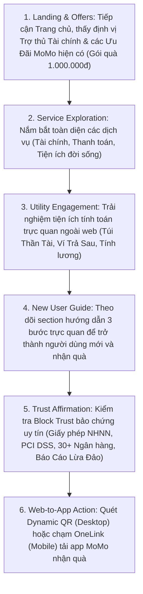

# BRD: MoMo Homepage Revamp
## Financial Authority & New User Welcome Hub

> - **Dự án:** Revamp Trang Chủ MoMo (MoMo Homepage Revamp)
> - **URL chính:** momo.vn
> - **Khối phụ trách:** Growth Platform Division (Web Platform)
> - **Phê duyệt:** Web Product Lead
> - **Phiên bản:** 2.2 · Tháng 11/2026
> - **Trạng thái:** Active

---

> **Problem:** Trang chủ momo.vn hiện tại thiếu điểm nhấn định vị chuyên sâu về uy tín tài chính (Financial Authority), thiếu các cơ chế bảo chứng an toàn chủ động (Trust Defense) và chưa có một hành trình chào đón người dùng mới (New User Welcome Experience) mượt mà với nguyên tắc trao giá trị trước (Value Before Gate), dẫn đến tỷ lệ e ngại và ma sát lớn khi chuyển đổi Web-to-App.
> **KPI Owned:** Lượt cài đặt ứng dụng mới từ Web (New App Installs from Web) đạt 20.000 - 30.000 lượt/tháng và Tỷ lệ nhấp chuyển đổi (W2A CTA CTR) đạt >= 15% → attributed via AppsFlyer OneLink & GA4.
> **Conversion Flow:** [Truy cập momo.vn] → [Khám phá Vị thế Trợ lý Tài chính & Trust Fortress] → [Trải nghiệm Interactive Calculator / Nhận diện Quyền lợi Người Dùng Mới] → [Quét QR Code / Chạm OneLink] → [Mở App MoMo, Kích hoạt gói quà 1.000.000đ & KYC].

---

## 1. Executive Summary

### 1.1 Situation
Trang chủ `momo.vn` là điểm chạm thương hiệu số 1 của MoMo trên không gian mạng, tiếp nhận hàng triệu lượt truy cập mỗi tháng. Phần lớn lưu lượng truy cập là người dùng tiềm năng (Potential Users) và người chưa từng sử dụng MoMo (Non-MoMo Users) đang tìm kiếm thông tin về độ uy tín, các dịch vụ tài chính và giải pháp thanh toán số.

### 1.2 Complication
* **Thiếu định vị Financial Authority:** Trang chủ chưa khẳng định được vị thế MoMo là "Trợ lý tài chính thông minh số 1". Toàn bộ hệ sinh thái dịch vụ tài chính quan trọng (Tích lũy sinh lời, Tín dụng, Vay tiêu dùng, Bảo hiểm, Đầu tư chứng khoán, Quản lý chi tiêu) chưa được quy hoạch thành các khối năng lực cốt lõi có tính tương tác.
* **Xây dựng niềm tin (Trust) còn mang tính thụ động:** Các cam kết an toàn chỉ dừng ở vài logo chứng chỉ bảo mật tĩnh ở chân trang, chưa truyền tải được hạ tầng phòng chống gian lận chủ động (Active Anti-Fraud) và chưa làm nổi bật kênh tiếp nhận tố giác như Cổng Báo Cáo Lừa Đảo (`/an-toan-bao-mat/bao-cao-lua-dao`).
* **Trải nghiệm chào đón New User thiếu hấp dẫn:** Chưa tạo ra một "Welcome Experience" rõ ràng; người dùng mới chưa thấy được lợi ích tức thì đã bị yêu cầu tải app, tạo ra rào cản tâm lý e ngại về bảo mật và thủ tục ngân hàng.

### 1.3 Resolution
Tái cấu trúc toàn diện Trang chủ `momo.vn` thành **Trung Tâm Định Vị Uy Tín Tài Chính (Financial Authority Hub) & Cổng Chào Đón Người Dùng Mới (New User Welcome Center)**:
* **Tập trung 100% vào Năng lực Tài chính & Quản lý Tiền bạc:** Loại bỏ việc phân tán nguồn lực quảng bá các Hub tiện ích đời sống rời rạc trên trang chủ; dồn trọn vẹn không gian để trình diễn Bộ Giải Pháp Tài Chính Toàn Diện (Túi Thần Tài, Ví Trả Sau, Vay Nhanh, Bảo hiểm, Chứng khoán, Điểm CIC).
* **Xây dựng Pháo Đài Niềm Tin (Trust Fortress):** Minh bạch tính pháp lý từ Ngân hàng Nhà nước, mạng lưới đối tác ngân hàng hàng đầu và kênh tiếp nhận phòng chống lừa đảo trực tuyến.
* **Hành trình Chào Đón & Giáo Dục Người Dùng Mới (New User Welcome & Education):** Áp dụng công thức "Value Before Gate" với công cụ tính toán tài chính tương tác (Mini-Calculator) và Gói quà CHAOMOMO 1.000.000đ, giúp người dùng mới hiểu rõ giá trị, tin tưởng và hào hứng chuyển đổi sang App MoMo.

---

## 2. Market Context & Benchmark

<table style="width:100%; border-collapse:collapse; border:1.5px solid #64748b; margin:1em 0; font-size:0.9em;">
  <thead>
    <tr style="background-color:#f1f5f9;">
      <th style="border:1.5px solid #64748b; padding:8px 12px; text-align:left; font-weight:700;">Hạng Mục So Sánh</th>
      <th style="border:1.5px solid #64748b; padding:8px 12px; text-align:left; font-weight:700;">Thực Trạng momo.vn Hiện Tại</th>
      <th style="border:1.5px solid #64748b; padding:8px 12px; text-align:left; font-weight:700;">Benchmark Fintech Hàng Đầu (Revolut, Toss, Nubank)</th>
      <th style="border:1.5px solid #64748b; padding:8px 12px; text-align:left; font-weight:700;">Định Hướng Trang Chủ Mới Của MoMo</th>
    </tr>
  </thead>
  <tbody>
    <tr>
      <td style="border:1px solid #94a3b8; padding:8px 12px; text-align:left;"><strong>Trọng Tâm Nội Dung</strong></td>
      <td style="border:1px solid #94a3b8; padding:8px 12px; text-align:left;">Dàn trải nhiều thông tin tiện ích, thiếu thông điệp tài chính xuyên suốt.</td>
      <td style="border:1px solid #94a3b8; padding:8px 12px; text-align:left;">100% không gian trang chủ tập trung vào Sức mạnh Tài chính, Quản lý tiền bạc và Tích lũy tài sản.</td>
      <td style="border:1px solid #94a3b8; padding:8px 12px; text-align:left;"><strong>Thuần nhất Financial Authority</strong>, khẳng định vị thế Trợ lý tài chính thông minh toàn diện.</td>
    </tr>
    <tr style="background-color:#f8fafc;">
      <td style="border:1px solid #94a3b8; padding:8px 12px; text-align:left;"><strong>Xây Dựng Niềm Tin</strong></td>
      <td style="border:1px solid #94a3b8; padding:8px 12px; text-align:left;">Gắn logo chứng chỉ thụ động ở chân trang.</td>
      <td style="border:1px solid #94a3b8; padding:8px 12px; text-align:left;">Chính sách bảo vệ tài khoản chủ động, cam kết an toàn, công cụ chống gian lận/lừa đảo 24/7.</td>
      <td style="border:1px solid #94a3b8; padding:8px 12px; text-align:left;">Xây dựng <strong>Trust Fortress 3 Tầng</strong>, tích hợp Cổng Báo Cáo Lừa Đảo (`/an-toan-bao-mat/bao-cao-lua-dao`).</td>
    </tr>
    <tr>
      <td style="border:1px solid #94a3b8; padding:8px 12px; text-align:left;"><strong>Trải Nghiệm Người Dùng Mới</strong></td>
      <td style="border:1px solid #94a3b8; padding:8px 12px; text-align:left;">Banner tĩnh kêu gọi tải app chung chung, không có lộ trình giáo dục.</td>
      <td style="border:1px solid #94a3b8; padding:8px 12px; text-align:left;">Khu vực Welcome Center riêng biệt, hướng dẫn 3 bước bắt đầu, hiển thị minh bạch Gói quà CHAOMOMO.</td>
      <td style="border:1px solid #94a3b8; padding:8px 12px; text-align:left;">Thiết kế <strong>New User Welcome Center</strong> kèm công cụ chọn nhu cầu và Dynamic QR Code nhận quà 1 triệu.</td>
    </tr>
    <tr style="background-color:#f8fafc;">
      <td style="border:1px solid #94a3b8; padding:8px 12px; text-align:left;"><strong>Công Cụ Tương Tác</strong></td>
      <td style="border:1px solid #94a3b8; padding:8px 12px; text-align:left;">Nội dung tĩnh, người dùng chỉ có thể đọc văn bản.</td>
      <td style="border:1px solid #94a3b8; padding:8px 12px; text-align:left;">Interactive Calculators cho phép tự tính lãi suất, kiểm tra hạn mức trả góp trước khi đăng ký.</td>
      <td style="border:1px solid #94a3b8; padding:8px 12px; text-align:left;">Nhúng <strong>Mini-Calculator Tương Tác</strong> (Túi Thần Tài & Trả Góp) ngay trên trang chủ.</td>
    </tr>
  </tbody>
</table>

---

## 3. Scope & Objectives

### 3.1 Core Product Job
* **Người dùng mới (New User):** Truy cập `momo.vn` ➔ Cảm nhận ngay sự uy tín, minh bạch và an toàn tuyệt đối ➔ Được chào đón bằng hướng dẫn 3 bước dễ hiểu cùng Gói quà CHAOMOMO 1.000.000đ ➔ Tự kéo thanh tính toán tiền lời Túi Thần Tài ➔ Quét QR chuyển sang App MoMo mở tài khoản và kích hoạt quyền lợi.
* **Người dùng tiềm năng (Potential Financial User):** Truy cập `momo.vn` ➔ Khám phá năng lực tài chính chuyên sâu của MoMo (Tích lũy, Vay tiêu dùng minh bạch, Ví Trả Sau 0% lãi, Đầu tư chứng khoán, Bảo hiểm, Kiểm tra điểm tín dụng CIC) ➔ An tâm liên kết tài khoản ngân hàng và sử dụng dịch vụ.

### 3.2 Out-of-Scope
* **KHÔNG phải nơi quảng bá các Hub tiện ích đời sống:** Trang chủ loại bỏ các khu vực promote Vehicle Hub, Cinema Hub, Student Hub hay Merchant Hub; các tiện ích này sẽ vận hành độc lập theo chiến lược Search/SEO chuyên sâu của từng Hub.
* **KHÔNG phải trang giao dịch tài chính trực tiếp trên Web:** Mọi giao dịch tài chính nhạy cảm và xác thực danh tính (KYC) vẫn được thực hiện an toàn trong môi trường bảo mật của ứng dụng MoMo.
* **KHÔNG sử dụng banner quảng cáo chắp vá:** Toàn bộ giao diện được xây dựng bằng hệ thống thiết kế (Design System) đồng nhất, tập trung vào câu chuyện tài chính và niềm tin.

---

## 4. Jobs-to-be-Done (JTBD)

### Job #1: Financial Authority & Wealth Growth
> "Tôi muốn tìm một nền tảng tài chính số được cấp phép đầy đủ, giúp tôi vừa sinh lời mỗi ngày từ tiền nhàn rỗi, vừa có nguồn vốn dự phòng an toàn mà không sợ rủi ro lừa đảo hay phí ẩn."

<table style="width:100%; border-collapse:collapse; border:1.5px solid #64748b; margin:1em 0; font-size:0.9em;">
  <thead>
    <tr style="background-color:#f1f5f9;">
      <th style="border:1.5px solid #64748b; padding:8px 12px; text-align:left; font-weight:700;">Khía Cạnh (Dimension)</th>
      <th style="border:1.5px solid #64748b; padding:8px 12px; text-align:left; font-weight:700;">Mô Tả Chi Tiết</th>
    </tr>
  </thead>
  <tbody>
    <tr>
      <td style="border:1px solid #94a3b8; padding:8px 12px; text-align:left;">Functional</td>
      <td style="border:1px solid #94a3b8; padding:8px 12px; text-align:left;">Xem bảng tỷ suất sinh lời Túi Thần Tài, quy định hạn mức Ví Trả Sau, đối tác ngân hàng cho vay và chứng chỉ bảo mật.</td>
    </tr>
    <tr style="background-color:#f8fafc;">
      <td style="border:1px solid #94a3b8; padding:8px 12px; text-align:left;">Emotional</td>
      <td style="border:1px solid #94a3b8; padding:8px 12px; text-align:left;">Cảm thấy tài sản của mình được quản lý an toàn, minh bạch và có tổ chức bảo hộ.</td>
    </tr>
    <tr>
      <td style="border:1px solid #94a3b8; padding:8px 12px; text-align:left;">Social</td>
      <td style="border:1px solid #94a3b8; padding:8px 12px; text-align:left;">An tâm chia sẻ phương pháp quản lý tài chính thông minh cho gia đình và bạn bè.</td>
    </tr>
    <tr style="background-color:#f8fafc;">
      <td style="border:1px solid #94a3b8; padding:8px 12px; text-align:left;">Trigger</td>
      <td style="border:1px solid #94a3b8; padding:8px 12px; text-align:left;">Muốn tối ưu tiền chi tiêu hàng tháng hoặc tìm giải pháp ứng vốn tiêu dùng tin cậy.</td>
    </tr>
    <tr>
      <td style="border:1px solid #94a3b8; padding:8px 12px; text-align:left;">Search → App Flow</td>
      <td style="border:1px solid #94a3b8; padding:8px 12px; text-align:left;">"MoMo tài chính" / "Túi Thần Tài MoMo lãi bao nhiêu" ➔ momo.vn (Zone 2 & Zone 3) ➔ Kéo thanh tính tiền lời ➔ Quét QR mở App kích hoạt.</td>
    </tr>
  </tbody>
</table>

### Job #2: New User Onboarding & Welcoming
> "Tôi chưa từng dùng MoMo, tôi cần biết bắt đầu như thế nào cho dễ và gói quà 1.000.000đ cho người mới gồm những gì thiết thực đối với tôi."

<table style="width:100%; border-collapse:collapse; border:1.5px solid #64748b; margin:1em 0; font-size:0.9em;">
  <thead>
    <tr style="background-color:#f1f5f9;">
      <th style="border:1.5px solid #64748b; padding:8px 12px; text-align:left; font-weight:700;">Khía Cạnh (Dimension)</th>
      <th style="border:1.5px solid #64748b; padding:8px 12px; text-align:left; font-weight:700;">Mô Tả Chi Tiết</th>
    </tr>
  </thead>
  <tbody>
    <tr>
      <td style="border:1px solid #94a3b8; padding:8px 12px; text-align:left;">Functional</td>
      <td style="border:1px solid #94a3b8; padding:8px 12px; text-align:left;">Đọc quy trình 3 bước bắt đầu, xem danh mục voucher voucher Gói quà CHAOMOMO và quét mã tải app nhanh gọn.</td>
    </tr>
    <tr style="background-color:#f8fafc;">
      <td style="border:1px solid #94a3b8; padding:8px 12px; text-align:left;">Emotional</td>
      <td style="border:1px solid #94a3b8; padding:8px 12px; text-align:left;">Cảm giác được chào đón nồng nhiệt, không bị bỡ ngỡ trước một ứng dụng quá nhiều tính năng.</td>
    </tr>
    <tr>
      <td style="border:1px solid #94a3b8; padding:8px 12px; text-align:left;">Social</td>
      <td style="border:1px solid #94a3b8; padding:8px 12px; text-align:left;">Gia nhập cộng đồng hơn 30 triệu người dùng công nghệ tài chính hiện đại.</td>
    </tr>
    <tr style="background-color:#f8fafc;">
      <td style="border:1px solid #94a3b8; padding:8px 12px; text-align:left;">Trigger</td>
      <td style="border:1px solid #94a3b8; padding:8px 12px; text-align:left;">Lần đầu truy cập trang web MoMo sau khi nghe giới thiệu từ bạn bè hoặc truyền thông.</td>
    </tr>
    <tr>
      <td style="border:1px solid #94a3b8; padding:8px 12px; text-align:left;">Search → App Flow</td>
      <td style="border:1px solid #94a3b8; padding:8px 12px; text-align:left;">"Đăng ký MoMo nhận quà" / "Hướng dẫn dùng MoMo" ➔ momo.vn (Zone 1 & Zone 2) ➔ Xem 3 bước onboarding ➔ Chạm OneLink tải App.</td>
    </tr>
  </tbody>
</table>

### Job #3: Trust & Anti-Fraud Security
> "Tôi lo ngại về các chiêu trò lừa đảo qua mạng và muốn biết MoMo có biện pháp gì để bảo vệ tài khoản của tôi, cũng như nơi tôi có thể phản ánh ngay khi gặp đối tượng giả mạo."

<table style="width:100%; border-collapse:collapse; border:1.5px solid #64748b; margin:1em 0; font-size:0.9em;">
  <thead>
    <tr style="background-color:#f1f5f9;">
      <th style="border:1.5px solid #64748b; padding:8px 12px; text-align:left; font-weight:700;">Khía Cạnh (Dimension)</th>
      <th style="border:1.5px solid #64748b; padding:8px 12px; text-align:left; font-weight:700;">Mô Tả Chi Tiết</th>
    </tr>
  </thead>
  <tbody>
    <tr>
      <td style="border:1px solid #94a3b8; padding:8px 12px; text-align:left;">Functional</td>
      <td style="border:1px solid #94a3b8; padding:8px 12px; text-align:left;">Xem các lớp bảo mật sinh trắc học/AI và truy cập nhanh form Báo Cáo Lừa Đảo ẩn danh trong 2 phút.</td>
    </tr>
    <tr style="background-color:#f8fafc;">
      <td style="border:1px solid #94a3b8; padding:8px 12px; text-align:left;">Emotional</td>
      <td style="border:1px solid #94a3b8; padding:8px 12px; text-align:left;">An tâm vì MoMo luôn đồng hành, chủ động bảo vệ người dùng và có trách nhiệm với cộng đồng.</td>
    </tr>
    <tr>
      <td style="border:1px solid #94a3b8; padding:8px 12px; text-align:left;">Social</td>
      <td style="border:1px solid #94a3b8; padding:8px 12px; text-align:left;">Cùng chung tay đẩy lùi tội phạm công nghệ cao và bảo vệ người thân.</td>
    </tr>
    <tr style="background-color:#f8fafc;">
      <td style="border:1px solid #94a3b8; padding:8px 12px; text-align:left;">Trigger</td>
      <td style="border:1px solid #94a3b8; padding:8px 12px; text-align:left;">Nhận tin nhắn giả mạo hoặc muốn kiểm tra mức độ an toàn của ví trước khi nạp số tiền lớn.</td>
    </tr>
    <tr>
      <td style="border:1px solid #94a3b8; padding:8px 12px; text-align:left;">Search → App Flow</td>
      <td style="border:1px solid #94a3b8; padding:8px 12px; text-align:left;">"MoMo an toàn bảo mật" / "Báo cáo số MoMo lừa đảo" ➔ momo.vn (Zone 4) ➔ Chuyển tiếp `/an-toan-bao-mat/bao-cao-lua-dao`.</td>
    </tr>
  </tbody>
</table>

---

## 5. Homepage Architecture

### 5.1 User Conversion Flow



### 5.2 6-Zone Page Layout

Mặt tiền Trang chủ `momo.vn` được thiết kế theo đúng cấu trúc chuyển đổi chuẩn mực: Người dùng tiếp cận ưu đãi, nắm bắt dịch vụ, trải nghiệm tiện ích, nhận hướng dẫn gia nhập và xác nhận uy tín qua 6 Zone chuyên biệt:

<table style="width:100%; border-collapse:collapse; border:1.5px solid #64748b; margin:1em 0; font-size:0.9em;">
  <thead>
    <tr style="background-color:#f1f5f9;">
      <th style="border:1.5px solid #64748b; padding:8px 12px; text-align:left; font-weight:700;">Zone</th>
      <th style="border:1.5px solid #64748b; padding:8px 12px; text-align:left; font-weight:700;">Tên Khu Vực</th>
      <th style="border:1.5px solid #64748b; padding:8px 12px; text-align:left; font-weight:700;">Mục Tiêu Trải Nghiệm (UX Goal)</th>
      <th style="border:1.5px solid #64748b; padding:8px 12px; text-align:left; font-weight:700;">Thành Phần UI Component & Nội Dung Cốt Lõi</th>
      <th style="border:1.5px solid #64748b; padding:8px 12px; text-align:left; font-weight:700;">Cơ Chế Chuyển Đổi (CTA / W2A)</th>
    </tr>
  </thead>
  <tbody>
    <tr>
      <td style="border:1px solid #94a3b8; padding:8px 12px; text-align:left;"><strong>Zone 1</strong></td>
      <td style="border:1px solid #94a3b8; padding:8px 12px; text-align:left;"><strong>Financial Authority Hero & Offers Showcase</strong></td>
      <td style="border:1px solid #94a3b8; padding:8px 12px; text-align:left;">Khẳng định vị thế Trợ thủ Tài chính với AI; đồng thời thu hút người dùng ngay màn hình đầu tiên với các chương trình ưu đãi MoMo hiện có và Gói quà CHAOMOMO.</td>
      <td style="border:1px solid #94a3b8; padding:8px 12px; text-align:left;">• Thông điệp định vị: MoMo nay là Trợ thủ Tài chính với AI.<br>• Banner Carousel trưng bày các chương trình ưu đãi hot nhất hiện có.<br>• Điểm nhấn Gói quà CHAOMOMO 1.000.000đ dành cho khách hàng mới tải app.</td>
      <td style="border:1px solid #94a3b8; padding:8px 12px; text-align:left;">Desktop: Dynamic QR Code quét tải app tức thì.<br>Mobile: Nút OneLink chạm mở luồng nhận quà và KYC (<code style="background:#f1f5f9;padding:2px 4px;border-radius:4px;font-family:monospace;">utm_source=web_home_hero</code>).</td>
    </tr>
    <tr style="background-color:#f8fafc;">
      <td style="border:1px solid #94a3b8; padding:8px 12px; text-align:left;"><strong>Zone 2</strong></td>
      <td style="border:1px solid #94a3b8; padding:8px 12px; text-align:left;"><strong>Service Ecosystem Directory (Tổng Quan Dịch Vụ)</strong></td>
      <td style="border:1px solid #94a3b8; padding:8px 12px; text-align:left;">Giúp người dùng nắm bắt trọn vẹn và đầy đủ hệ sinh thái dịch vụ đa dạng của MoMo, xóa bỏ nhận thức hạn hẹp MoMo chỉ là ví chuyển tiền.</td>
      <td style="border:1px solid #94a3b8; padding:8px 12px; text-align:left;">Bảng danh mục dịch vụ trực quan 3 cụm lớn:<br>1. Dịch Vụ Tài Chính: Tín Dụng (Ví Trả Sau, Vay Nhanh), Tích Lũy (Túi Thần Tài, Tiết Kiệm), Đầu Tư (Chứng Chỉ Quỹ, Chứng Khoán), Chi Tiêu (Quản Lý Chi Tiêu, Quỹ Nhóm).<br>2. Thanh Toán Thiết Yếu: Hóa đơn điện nước, cước viễn thông, nạp data 4G/5G, chuyển nhận tiền 24/7, phạt nguội.<br>3. Tiện Ích Đời Sống: Giao thông ETC/giá xăng, du lịch vé máy bay/xe/khách sạn, giải trí cinema, học đường.</td>
      <td style="border:1px solid #94a3b8; padding:8px 12px; text-align:left;">Thẻ liên kết nhanh dẫn vào Trung Tâm Tài Chính (<code style="background:#f1f5f9;padding:2px 4px;border-radius:4px;font-family:monospace;">/tai-chinh</code>) và các trang dịch vụ chi tiết.</td>
    </tr>
    <tr>
      <td style="border:1px solid #94a3b8; padding:8px 12px; text-align:left;"><strong>Zone 3</strong></td>
      <td style="border:1px solid #94a3b8; padding:8px 12px; text-align:left;"><strong>Interactive Financial Utilities (Bộ Tiện Ích Trực Quan)</strong></td>
      <td style="border:1px solid #94a3b8; padding:8px 12px; text-align:left;">Hiện thực hóa nguyên tắc Value Before Gate; cho phép khách hàng tự thao tác tính toán lợi ích tài chính thực tế ngay ngoài web mà không cần đăng nhập.</td>
      <td style="border:1px solid #94a3b8; padding:8px 12px; text-align:left;">• Thanh kéo trượt số tiền tích lũy Túi Thần Tài (hiển thị số tiền sinh lời thực nhận theo ngày, tháng, năm).<br>• Tab chuyển đổi ước tính hạn mức chi tiêu trước trả sau 0% lãi suất của Ví Trả Sau.<br>• Công cụ hỗ trợ tra cứu tỷ giá ngoại tệ, giá vàng và tính lương Gross - Net nhanh.</td>
      <td style="border:1px solid #94a3b8; padding:8px 12px; text-align:left;">Nút "Mở Túi Nhận Tiền Lời Ngay" chuyển tiếp deep link vào App MoMo để kích hoạt sinh lời.</td>
    </tr>
    <tr style="background-color:#f8fafc;">
      <td style="border:1px solid #94a3b8; padding:8px 12px; text-align:left;"><strong>Zone 4</strong></td>
      <td style="border:1px solid #94a3b8; padding:8px 12px; text-align:left;"><strong>New User Onboarding Guide (Hướng Dẫn Người Dùng Mới)</strong></td>
      <td style="border:1px solid #94a3b8; padding:8px 12px; text-align:left;">Giảm thiểu tối đa rào cản thao tác cho người mới; cung cấp lộ trình gia nhập từng bước rõ ràng, dễ hiểu và truyền cảm hứng bắt đầu.</td>
      <td style="border:1px solid #94a3b8; padding:8px 12px; text-align:left;">• Lộ trình 3 bước trực quan:<br>&nbsp;&nbsp;1. Tải app & Đăng ký số điện thoại.<br>&nbsp;&nbsp;2. Liên kết tài khoản ngân hàng & Xác thực thông tin.<br>&nbsp;&nbsp;3. Kích hoạt gói quà 1.000.000đ & bắt đầu giao dịch.<br>• Danh mục voucher quà tặng thiết thực (nạp điện thoại, thanh toán hóa đơn, ưu đãi dịch vụ tài chính).</td>
      <td style="border:1px solid #94a3b8; padding:8px 12px; text-align:left;">Mã Dynamic QR và nút OneLink kích hoạt tài khoản nhận trọn bộ Gói quà CHAOMOMO.</td>
    </tr>
    <tr>
      <td style="border:1px solid #94a3b8; padding:8px 12px; text-align:left;"><strong>Zone 5</strong></td>
      <td style="border:1px solid #94a3b8; padding:8px 12px; text-align:left;"><strong>Trust Fortress & Active Defense (Block Trust & An Toàn)</strong></td>
      <td style="border:1px solid #94a3b8; padding:8px 12px; text-align:left;">Xây dựng sự an tâm tuyệt đối, biến an toàn thành lợi thế cạnh tranh chủ động; xóa bỏ triệt để nỗi lo ngại lừa đảo trực tuyến.</td>
      <td style="border:1px solid #94a3b8; padding:8px 12px; text-align:left;">• Chứng nhận bảo mật quốc tế PCI DSS Level 1 và chuẩn mã hóa dữ liệu cao cấp.<br>• Giấy phép hoạt động trung gian thanh toán do Ngân hàng Nhà nước cấp.<br>• Mạng lưới đối tác chiến lược của hơn 30 ngân hàng thương mại hàng đầu Việt Nam.<br>• Cổng Báo Cáo Lừa Đảo trực tuyến 24/7 tiếp nhận và hỗ trợ xử lý rủi ro gian lận (<code style="background:#f1f5f9;padding:2px 4px;border-radius:4px;font-family:monospace;">/an-toan-bao-mat/bao-cao-lua-dao</code>).</td>
      <td style="border:1px solid #94a3b8; padding:8px 12px; text-align:left;">Nút "Báo Cáo Lừa Đảo Ngay" dẫn vào form tiếp nhận xử lý rủi ro ẩn danh trong 2 phút.</td>
    </tr>
    <tr style="background-color:#f8fafc;">
      <td style="border:1px solid #94a3b8; padding:8px 12px; text-align:left;"><strong>Zone 6</strong></td>
      <td style="border:1px solid #94a3b8; padding:8px 12px; text-align:left;"><strong>Regulatory Compliance & Deep Footer (Chân Trang Pháp Lý)</strong></td>
      <td style="border:1px solid #94a3b8; padding:8px 12px; text-align:left;">Tuân thủ nghiêm ngặt tiêu chuẩn pháp lý YMYL và củng cố cấu trúc liên kết nội bộ toàn trang.</td>
      <td style="border:1px solid #94a3b8; padding:8px 12px; text-align:left;">• Thông tin pháp nhân Công ty Cổ phần Dịch vụ Di động Trực tuyến (M_Service).<br>• Danh mục liên kết điều khoản dịch vụ, chính sách bảo vệ dữ liệu cá nhân, Tuyển Dụng (MoMo Careers) và Thông tin Liên Hệ trụ sở/hotline.<br>• Hệ thống điều hướng phân tầng đến toàn bộ các Web Hubs chuyên sâu (Vehicle, Cinema, Travel, Student).</td>
      <td style="border:1px solid #94a3b8; padding:8px 12px; text-align:left;">Liên kết nội bộ chuẩn SEO, trang Liên Hệ (<code style="background:#f1f5f9;padding:2px 4px;border-radius:4px;font-family:monospace;">/lienhe</code>) và trang Tuyển Dụng (<code style="background:#f1f5f9;padding:2px 4px;border-radius:4px;font-family:monospace;">https://momo.careers/</code>).</td>
    </tr>
  </tbody>
</table>

### 5.3 Global Navigation & Header

Để đảm bảo định vị Financial Authority đồng bộ trên toàn bộ website mà không làm mất đi các tiện ích đời sống và giao dịch hàng ngày, hệ thống thanh điều hướng Header chính trên toàn trang được quy hoạch chuẩn mực về đúng **4 Item Menu Cấp 1**:

```
[MoMo Logo]   |   1. Tài Chính   |   2. Thanh Toán   |   3. Tiện Ích Đời Sống   |   4. Về MoMo   |   [Tìm Kiếm]  [CTA: Tải App]
```

#### Navigation Breakdown

#### 1. Financial Services ("Tài Chính")
* **Cửa ngõ tổng quan (Ưu tiên cao nhất):**
  * **Trung Tâm Tài Chính MoMo (`/tai-chinh`):** Đầu mục độc lập, dẫn thẳng vào Master Hub quy tụ toàn bộ giải pháp tài chính số của MoMo.
  * **Trợ Thủ Tài Chính AI (`/tro-thu-tai-chinh`):** Nền tảng trợ thủ tài chính ứng dụng AI, đồng hành quản lý chi tiêu và nâng cao sức khỏe tài chính cá nhân.
* **Cột 1: Tín Dụng (Credit & Lending):**
  * *Ví Trả Sau:* Hạn mức chi tiêu trước, trả sau 0% lãi suất (`/vi-tra-sau`).
  * *Vay Nhanh:* Vay tiêu dùng minh bạch, giải ngân trực tiếp từ đối tác tài chính uy tín (`/vay-nhanh`).
  * *Mở Thẻ Tín Dụng:* Đăng ký phát hành thẻ tín dụng trực tuyến 100% không cần chứng minh thu nhập phức tạp.
  * *Điểm Tín Dụng CIC:* Tự kiểm tra điểm tín dụng cá nhân và theo dõi nhóm nợ theo chuẩn Trung tâm Thông tin Tín dụng Quốc gia (`/diem-tin-dung`).
* **Cột 2: Đầu Tư (Investments & Wealth):**
  * *Chứng Chỉ Quỹ:* Tích lũy quỹ mở chỉ từ 10.000đ cùng các công ty quản lý quỹ hàng đầu (Dragon Capital, VinaCapital, SSIAM...) (`/chung-chi-quy`).
  * *Chứng Khoán CVS:* Mở tài khoản và giao dịch cổ phiếu trực tuyến nhanh gọn ngay trên MoMo (`/chung-khoan`).
  * *Tiện ích theo dõi thị trường (2 trang công cụ dữ liệu độc lập, tách riêng ở cuối cột):*
    * **Giá Vàng (`/tai-chinh/gia-vang`):** Cập nhật biểu đồ biến động giá vàng miếng SJC, vàng nhẫn 9999 theo thời gian thực.
    * **Tỷ Giá (`/tai-chinh/ty-gia`):** Tra cứu và so sánh tỷ giá ngoại tệ ngân hàng hôm nay.
* **Cột 3: Tích Lũy (Savings & Daily Yield):**
  * *Túi Thần Tài:* Kênh sinh lời mỗi ngày từ tiền nhàn rỗi, nạp rút thanh toán linh hoạt 24/7 (`/tui-than-tai`).
  * *Gửi Tiết Kiệm:* Mở sổ tiết kiệm có kỳ hạn an toàn cùng các ngân hàng đối tác lớn trên MoMo.
  * *So Sánh Lãi Suất Tiết Kiệm:* Bảng tra cứu và so sánh lãi suất tiền gửi của hơn 30 ngân hàng thương mại (`/tai-chinh/lai-suat`).
* **Cột 4: Chi Tiêu (Cash Flow & Financial Tools):**
  * *Trợ Thủ Tài Chính AI:* Công nghệ AI cá nhân hóa hỗ trợ phân tích thu chi, cảnh báo ngân sách và tối ưu tài chính cá nhân (`/tro-thu-tai-chinh`).
  * *Quản Lý Chi Tiêu:* Trợ thủ tự động ghi chép giao dịch, phân loại thu chi và theo dõi ngân sách (`/quan-ly-chi-tieu`).
  * *Quỹ Nhóm:* Két tiền chung cho gia đình và hội nhóm bạn bè, sao kê thu chi minh bạch (`/quy-nhom`).
  * *Tính Lương Gross - Net:* Công cụ tính lương thực nhận chuẩn quy định thuế TNCN và mức đóng BHXH mới nhất (`/tai-chinh/tinh-luong`).
  * *Quyết Toán Thuế TNCN:* Công cụ dự toán số tiền thuế nộp thêm hoặc được hoàn cả năm.

#### 2. Payments ("Thanh Toán")
* **Cột 1: Thanh Toán Hóa Đơn:**
  * *Thanh Toán Hóa Đơn Tổng Hợp:* Cổng thanh toán hóa đơn định kỳ toàn quốc (`/thanh-toan-hoa-don`).
  * *Tiền Điện:* Thanh toán hóa đơn tiền điện EVN định kỳ toàn quốc (`/dien`).
  * *Tiền Nước:* Thanh toán nước sinh hoạt định kỳ các nhà cung cấp (`/nuoc`).
  * *Internet & Truyền Hình Cáp:* Cước mạng viễn thông FPT, VNPT, Viettel và truyền hình cáp (`/internet`, `/truyen-hinh`).
  * *Phí Quản Lý Chung Cư:* Đóng phí dịch vụ tòa nhà qua các đối tác ban quản lý (`/chung-cu`).
  * *Đóng Học Phí & Lệ Phí Tuyển Sinh:* Thanh toán học phí các cấp và nộp lệ phí xét tuyển đại học trực tuyến (`/phi-xet-tuyen`).
* **Cột 2: Viễn Thông & Dữ Liệu Di Động:**
  * *Nạp Tiền Điện Thoại:* Nạp tiền trả trước, thanh toán cước trả sau Viettel, VinaPhone, MobiFone (`/nap-tien-dien-thoai`).
  * *Mua Data 4G/5G:* Gói data dung lượng cao theo ngày, tuần, tháng với chiết khấu trực tiếp (`/nap-data`).
  * *Sim Chính Chủ & eSIM:* Đăng ký sim số đẹp, hòa mạng gói cước chính chủ trực tuyến.
* **Cột 3: Dịch Vụ Công & Phạt Nguội:**
  * *Tra Cứu Phạt Nguội:* Tra cứu biển số xe, kiểm tra lỗi vi phạm từ dữ liệu Cục CSGT (`/phat-nguoi`).
  * *Nộp Phạt Giao Thông:* Tra cứu quyết định và nộp phạt vi phạm trực tuyến vào Kho bạc Nhà nước (`/tien-ich-giao-thong/nop-phat-csgt`).
* **Cột 4: Chuyển Nhận Tiền:**
  * *Chuyển Tiền 24/7 Miễn Phí:* Chuyển tiền liên ngân hàng tức thì qua Napas (`/chuyen-tien-ngan-hang`).
  * *Quét Mã QR Đa Năng:* Thanh toán chuẩn VietQR tại hàng triệu cửa hàng trên cả nước (`/qr-da-nang`).
  * *Thanh Toán Quốc Tế:* Mua ứng dụng, nạp game trên App Store và Google Play (`/thanh-toan-quoc-te`).

#### 3. Living Utilities ("Tiện Ích Đời Sống")
* **Cột 1: Giao Thông & Bảo Hiểm Xe (Vehicle Hub):**
  * *Nạp ETC / ePass:* Nạp tiền tài khoản thu phí tự động đường bộ không dừng (`/phi-khong-dung`).
  * *Giá Xăng Hôm Nay:* Cập nhật giá xăng dầu trong nước và tìm trạm xăng gần nhất (`/tien-ich-giao-thong/gia-xang`).
  * *Garage & Cứu Hộ:* Tìm garage sửa chữa ô tô uy tín và cứu hộ giao thông (`/tien-ich-giao-thong/garage`).
  * *Bảo Hiểm Xe Máy & Ô Tô:* Bảo hiểm bắt buộc TNDS và bảo hiểm vật chất xe máy, ô tô (`/bao-hiem-xe-may`, `/bao-hiem-o-to`).
* **Cột 2: Du Lịch & Đi Lại (Travel Hub):**
  * *Vé Máy Bay & Tàu Hỏa:* Săn vé máy bay giá tốt, vé tàu đường sắt Việt Nam (`/ve-may-bay`, `/ve-tau-hoa`).
  * *Vé Xe Khách:* Đặt vé xe liên tỉnh từ các nhà xe uy tín toàn quốc (`/ve-xe`).
  * *Khách Sạn:* Đặt phòng khách sạn trong nước và quốc tế, tích điểm hoàn tiền (`/dat-khach-san`).
  * *eSIM Du Lịch:* Mua sim data dung lượng cao sử dụng tại hơn 200 quốc gia (`/esim-du-lich`).
* **Cột 3: Giải Trí & Số Hóa (Cinema Hub & Games):**
  * *Vé Xem Phim:* Tra cứu lịch chiếu và đặt vé các cụm rạp CGV, Lotte Cinema, Galaxy, BHD, NCC (`/cinema`). *(Gộp chung lịch chiếu và đặt vé)*
  * *Thẻ Nạp Game:* Mua thẻ Garena, Zing, Steam, Razer Gold chiết khấu hấp dẫn (`/nap-the-game`).
* **Cột 4: Khám Phá & Học Đường:**
  * *Góc Sinh Viên:* Gói đặc quyền sinh viên Student Pass, tiện ích trường học (`/sinh-vien`).
  * *BHYT & BHXH Gia Đình:* Gia hạn thẻ Bảo hiểm Y tế hộ gia đình và nộp tiếp BHXH tự nguyện (`/bao-hiem-y-te`).

#### 4. About MoMo ("Về MoMo")
Mục này không chia cột nhằm giữ giao diện thoáng đãng, hiển thị dưới dạng menu dọc gồm các đầu mục uy tín, an toàn, hỗ trợ và thương hiệu:
* *Báo Cáo Lừa Đảo:* Cổng tiếp nhận và hỗ trợ xử lý rủi ro gian lận, lừa đảo trực tuyến 24/7 (`/an-toan-bao-mat/bao-cao-lua-dao`).
* *An Toàn & Bảo Mật:* Trung tâm bảo mật, chứng chỉ quốc tế PCI DSS Level 1 và giấy phép trung gian thanh toán từ Ngân hàng Nhà nước (`/an-toan-bao-mat`).
* *Hỏi Đáp & Trợ Giúp:* Trung tâm trợ giúp khách hàng 24/7, bộ câu hỏi thường gặp FAQ và hướng dẫn liên kết ngân hàng/KYC (`/hoi-dap`).
* *Loa Báo Chuyển Khoản (Soundbox):* Thiết bị thông báo nhận tiền bằng giọng nói tức thì cho chủ quán, an tâm buôn bán (`/loa-thong-bao-chuyen-khoan`).
* *Khách Hàng Doanh Nghiệp:* Cổng thanh toán POS/Online, QR thu ngân đối soát và giải pháp kết nối API/SDK (`/doi-tac`).
* *Giới Thiệu MoMo:* Sứ mệnh bình dân hóa dịch vụ tài chính cho người Việt, ban lãnh đạo và giá trị văn hóa (`/ve-chung-toi`).
* *Tuyển Dụng:* Cổng việc làm MoMo Careers, môi trường công nghệ và cơ hội phát triển nghề nghiệp (`https://momo.careers/`).
* *Liên Hệ:* Kênh tổng đài hỗ trợ 1900 5454 41, email tiếp nhận và địa chỉ văn phòng đại diện TP.HCM, Hà Nội (`/lienhe`).
* *Tin Tức:* Thông cáo báo chí, sự kiện hợp tác và tin tức hoạt động chính thức (`/tin-tuc`).
* *Blog:* Cẩm nang quản lý tài chính, phong cách sống số và mẹo tiêu dùng thông minh (`/blog`).

---

## Change Log
- **Tháng 11/2026 (v2.2):** Tinh gọn tài liệu: Lược bỏ các phần Success Metrics, Dependencies và Roadmap để tập trung tuyệt đối vào Cấu trúc Trải nghiệm (User Conversion Flow), Bố cục 6 Zone mặt tiền và Kiến trúc Điều hướng Toàn Trang (Global Navigation). Đồng bộ 100% tiêu đề sang tiếng Anh ngắn gọn.
- **Tháng 11/2026 (v2.1):** Hoàn thiện tầng đặc tả chi tiết 6 Zone mặt tiền trang chủ; chuẩn hóa toàn diện Hệ thống Header Megamenu 4 mục (Tài Chính, Thanh Toán, Tiện Ích Đời Sống, Về MoMo); cơ cấu mục Tài Chính thành 4 trụ cột nghiệp vụ (Tín Dụng, Đầu Tư, Tích Lũy, Chi Tiêu); tách bạch độc lập Giá Vàng và Tỷ Giá thành 2 trang tiện ích thị trường riêng biệt; tinh gọn mục Về MoMo thành dropdown đơn 1 cột.
- **Tháng 08/2026 (v2.0):** Tái định vị toàn diện Trang chủ MoMo theo chỉ đạo chiến lược: Loại bỏ hoàn toàn phần quảng bá các Hub tiện ích đời sống (Vehicle, Cinema, Student, Merchant) trên trang chủ; tập trung 100% không gian xây dựng **Financial Authority**, **Pháo đài An toàn (Trust Fortress)** và **Trung tâm Chào đón Người dùng Mới (New User Welcome Center)**.
- **Tháng 08/2026 (v1.0):** Khởi tạo bản thảo BRD đầu tiên.
