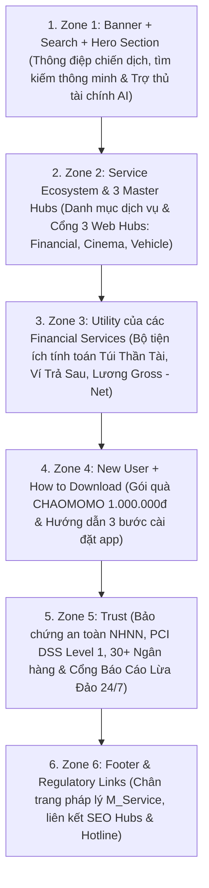

# BRD: MoMo Homepage Revamp
## Financial Authority & New User Welcome Hub

> - **Dự án:** Revamp Trang Chủ MoMo (MoMo Homepage Revamp)
> - **URL chính:** momo.vn
> - **Khối phụ trách:** Growth Platform Division (Web Platform)
> - **Phê duyệt:** Web Product Lead
> - **Phiên bản:** 2.2 · Tháng 11/2026
> - **Trạng thái:** Active

---

> **Problem:** Trang chủ momo.vn hiện tại thiếu điểm nhấn định vị chuyên sâu về uy tín tài chính (Financial Authority), thiếu các cơ chế bảo chứng an toàn chủ động (Trust Defense) và chưa có một hành trình chào đón người dùng mới (New User Welcome Experience) mượt mà với nguyên tắc trao giá trị trước (Value Before Gate), dẫn đến tỷ lệ e ngại và ma sát lớn khi chuyển đổi Web-to-App.
> **KPI Owned:** Lượt cài đặt ứng dụng mới từ Web (New App Installs from Web) đạt 20.000 - 30.000 lượt/tháng và Tỷ lệ nhấp chuyển đổi (W2A CTA CTR) đạt >= 15% → attributed via AppsFlyer OneLink & GA4.
> **Conversion Flow:** [Truy cập momo.vn] → [Khám phá Vị thế Trợ lý Tài chính & Trust Fortress] → [Trải nghiệm Interactive Calculator / Nhận diện Quyền lợi Người Dùng Mới] → [Quét QR Code / Chạm OneLink] → [Mở App MoMo, Kích hoạt gói quà 1.000.000đ & KYC].

---

## 1. Executive Summary

### 1.1 Situation
Trang chủ `momo.vn` là điểm chạm thương hiệu số 1 của MoMo trên không gian mạng, tiếp nhận hàng triệu lượt truy cập mỗi tháng. Phần lớn lưu lượng truy cập là người dùng tiềm năng (Potential Users) và người chưa từng sử dụng MoMo (Non-MoMo Users) đang tìm kiếm thông tin về độ uy tín, các dịch vụ tài chính và giải pháp thanh toán số.

### 1.2 Complication
* **Thiếu định vị Financial Authority:** Trang chủ chưa khẳng định được vị thế MoMo là "Trợ lý tài chính thông minh số 1". Toàn bộ hệ sinh thái dịch vụ tài chính quan trọng (Tích lũy sinh lời, Tín dụng, Vay tiêu dùng, Bảo hiểm, Đầu tư chứng khoán, Quản lý chi tiêu) chưa được quy hoạch thành các khối năng lực cốt lõi có tính tương tác.
* **Xây dựng niềm tin (Trust) còn mang tính thụ động:** Các cam kết an toàn chỉ dừng ở vài logo chứng chỉ bảo mật tĩnh ở chân trang, chưa truyền tải được hạ tầng phòng chống gian lận chủ động (Active Anti-Fraud) và chưa làm nổi bật kênh tiếp nhận tố giác như Cổng Báo Cáo Lừa Đảo (`/an-toan-bao-mat/bao-cao-lua-dao`).
* **Trải nghiệm chào đón New User thiếu hấp dẫn:** Chưa tạo ra một "Welcome Experience" rõ ràng; người dùng mới chưa thấy được lợi ích tức thì đã bị yêu cầu tải app, tạo ra rào cản tâm lý e ngại về bảo mật và thủ tục ngân hàng.

### 1.3 Resolution
Tái cấu trúc toàn diện Trang chủ `momo.vn` thành **Trung Tâm Định Vị Uy Tín Tài Chính (Financial Authority Hub) & Cổng Chào Đón Người Dùng Mới (New User Welcome Center)**:
* **Tập trung 100% vào Năng lực Tài chính & Quản lý Tiền bạc:** Loại bỏ việc phân tán nguồn lực quảng bá các Hub tiện ích đời sống rời rạc trên trang chủ; dồn trọn vẹn không gian để trình diễn Bộ Giải Pháp Tài Chính Toàn Diện (Túi Thần Tài, Ví Trả Sau, Vay Nhanh, Bảo hiểm, Chứng khoán, Điểm CIC).
* **Xây dựng Pháo Đài Niềm Tin (Trust Fortress):** Minh bạch tính pháp lý từ Ngân hàng Nhà nước, mạng lưới đối tác ngân hàng hàng đầu và kênh tiếp nhận phòng chống lừa đảo trực tuyến.
* **Hành trình Chào Đón & Giáo Dục Người Dùng Mới (New User Welcome & Education):** Áp dụng công thức "Value Before Gate" với công cụ tính toán tài chính tương tác (Mini-Calculator) và Gói quà CHAOMOMO 1.000.000đ, giúp người dùng mới hiểu rõ giá trị, tin tưởng và hào hứng chuyển đổi sang App MoMo.

---

## 2. Market Context & Benchmark

<table style="width:100%; border-collapse:collapse; border:1.5px solid #64748b; margin:1em 0; font-size:0.9em;">
  <thead>
    <tr style="background-color:#f1f5f9;">
      <th style="border:1.5px solid #64748b; padding:8px 12px; text-align:left; font-weight:700;">Hạng Mục So Sánh</th>
      <th style="border:1.5px solid #64748b; padding:8px 12px; text-align:left; font-weight:700;">Thực Trạng momo.vn Hiện Tại</th>
      <th style="border:1.5px solid #64748b; padding:8px 12px; text-align:left; font-weight:700;">Benchmark Fintech Hàng Đầu (Revolut, Toss, Nubank)</th>
      <th style="border:1.5px solid #64748b; padding:8px 12px; text-align:left; font-weight:700;">Định Hướng Trang Chủ Mới Của MoMo</th>
    </tr>
  </thead>
  <tbody>
    <tr>
      <td style="border:1px solid #94a3b8; padding:8px 12px; text-align:left;"><strong>Trọng Tâm Nội Dung</strong></td>
      <td style="border:1px solid #94a3b8; padding:8px 12px; text-align:left;">Dàn trải nhiều thông tin tiện ích, thiếu thông điệp tài chính xuyên suốt.</td>
      <td style="border:1px solid #94a3b8; padding:8px 12px; text-align:left;">100% không gian trang chủ tập trung vào Sức mạnh Tài chính, Quản lý tiền bạc và Tích lũy tài sản.</td>
      <td style="border:1px solid #94a3b8; padding:8px 12px; text-align:left;"><strong>Thuần nhất Financial Authority</strong>, khẳng định vị thế Trợ lý tài chính thông minh toàn diện.</td>
    </tr>
    <tr style="background-color:#f8fafc;">
      <td style="border:1px solid #94a3b8; padding:8px 12px; text-align:left;"><strong>Xây Dựng Niềm Tin</strong></td>
      <td style="border:1px solid #94a3b8; padding:8px 12px; text-align:left;">Gắn logo chứng chỉ thụ động ở chân trang.</td>
      <td style="border:1px solid #94a3b8; padding:8px 12px; text-align:left;">Chính sách bảo vệ tài khoản chủ động, cam kết an toàn, công cụ chống gian lận/lừa đảo 24/7.</td>
      <td style="border:1px solid #94a3b8; padding:8px 12px; text-align:left;">Xây dựng <strong>Trust Fortress 3 Tầng</strong>, tích hợp Cổng Báo Cáo Lừa Đảo (`/an-toan-bao-mat/bao-cao-lua-dao`).</td>
    </tr>
    <tr>
      <td style="border:1px solid #94a3b8; padding:8px 12px; text-align:left;"><strong>Trải Nghiệm Người Dùng Mới</strong></td>
      <td style="border:1px solid #94a3b8; padding:8px 12px; text-align:left;">Banner tĩnh kêu gọi tải app chung chung, không có lộ trình giáo dục.</td>
      <td style="border:1px solid #94a3b8; padding:8px 12px; text-align:left;">Khu vực Welcome Center riêng biệt, hướng dẫn 3 bước bắt đầu, hiển thị minh bạch Gói quà CHAOMOMO.</td>
      <td style="border:1px solid #94a3b8; padding:8px 12px; text-align:left;">Thiết kế <strong>New User Welcome Center</strong> kèm công cụ chọn nhu cầu và Dynamic QR Code nhận quà 1 triệu.</td>
    </tr>
    <tr style="background-color:#f8fafc;">
      <td style="border:1px solid #94a3b8; padding:8px 12px; text-align:left;"><strong>Công Cụ Tương Tác</strong></td>
      <td style="border:1px solid #94a3b8; padding:8px 12px; text-align:left;">Nội dung tĩnh, người dùng chỉ có thể đọc văn bản.</td>
      <td style="border:1px solid #94a3b8; padding:8px 12px; text-align:left;">Interactive Calculators cho phép tự tính lãi suất, kiểm tra hạn mức trả góp trước khi đăng ký.</td>
      <td style="border:1px solid #94a3b8; padding:8px 12px; text-align:left;">Nhúng <strong>Mini-Calculator Tương Tác</strong> (Túi Thần Tài & Trả Góp) ngay trên trang chủ.</td>
    </tr>
  </tbody>
</table>

---

## 3. Scope & Objectives

### 3.1 Core Product Job
* **Người dùng mới (New User):** Truy cập `momo.vn` ➔ Cảm nhận ngay sự uy tín, minh bạch và an toàn tuyệt đối ➔ Được chào đón bằng hướng dẫn 3 bước dễ hiểu cùng Gói quà CHAOMOMO 1.000.000đ ➔ Tự kéo thanh tính toán tiền lời Túi Thần Tài ➔ Quét QR chuyển sang App MoMo mở tài khoản và kích hoạt quyền lợi.
* **Người dùng tiềm năng (Potential Financial User):** Truy cập `momo.vn` ➔ Khám phá năng lực tài chính chuyên sâu của MoMo (Tích lũy, Vay tiêu dùng minh bạch, Ví Trả Sau 0% lãi, Đầu tư chứng khoán, Bảo hiểm, Kiểm tra điểm tín dụng CIC) ➔ An tâm liên kết tài khoản ngân hàng và sử dụng dịch vụ.

### 3.2 Out-of-Scope
* **KHÔNG phải nơi quảng bá các Hub tiện ích đời sống:** Trang chủ loại bỏ các khu vực promote Vehicle Hub, Cinema Hub, Student Hub hay Merchant Hub; các tiện ích này sẽ vận hành độc lập theo chiến lược Search/SEO chuyên sâu của từng Hub.
* **KHÔNG phải trang giao dịch tài chính trực tiếp trên Web:** Mọi giao dịch tài chính nhạy cảm và xác thực danh tính (KYC) vẫn được thực hiện an toàn trong môi trường bảo mật của ứng dụng MoMo.
* **KHÔNG sử dụng banner quảng cáo chắp vá:** Toàn bộ giao diện được xây dựng bằng hệ thống thiết kế (Design System) đồng nhất, tập trung vào câu chuyện tài chính và niềm tin.

---

## 4. Jobs-to-be-Done (JTBD)

### Job #1: Financial Authority & Wealth Growth
> "Tôi muốn tìm một nền tảng tài chính số được cấp phép đầy đủ, giúp tôi vừa sinh lời mỗi ngày từ tiền nhàn rỗi, vừa có nguồn vốn dự phòng an toàn mà không sợ rủi ro lừa đảo hay phí ẩn."

<table style="width:100%; border-collapse:collapse; border:1.5px solid #64748b; margin:1em 0; font-size:0.9em;">
  <thead>
    <tr style="background-color:#f1f5f9;">
      <th style="border:1.5px solid #64748b; padding:8px 12px; text-align:left; font-weight:700;">Khía Cạnh (Dimension)</th>
      <th style="border:1.5px solid #64748b; padding:8px 12px; text-align:left; font-weight:700;">Mô Tả Chi Tiết</th>
    </tr>
  </thead>
  <tbody>
    <tr>
      <td style="border:1px solid #94a3b8; padding:8px 12px; text-align:left;">Functional</td>
      <td style="border:1px solid #94a3b8; padding:8px 12px; text-align:left;">Xem bảng tỷ suất sinh lời Túi Thần Tài, quy định hạn mức Ví Trả Sau, đối tác ngân hàng cho vay và chứng chỉ bảo mật.</td>
    </tr>
    <tr style="background-color:#f8fafc;">
      <td style="border:1px solid #94a3b8; padding:8px 12px; text-align:left;">Emotional</td>
      <td style="border:1px solid #94a3b8; padding:8px 12px; text-align:left;">Cảm thấy tài sản của mình được quản lý an toàn, minh bạch và có tổ chức bảo hộ.</td>
    </tr>
    <tr>
      <td style="border:1px solid #94a3b8; padding:8px 12px; text-align:left;">Social</td>
      <td style="border:1px solid #94a3b8; padding:8px 12px; text-align:left;">An tâm chia sẻ phương pháp quản lý tài chính thông minh cho gia đình và bạn bè.</td>
    </tr>
    <tr style="background-color:#f8fafc;">
      <td style="border:1px solid #94a3b8; padding:8px 12px; text-align:left;">Trigger</td>
      <td style="border:1px solid #94a3b8; padding:8px 12px; text-align:left;">Muốn tối ưu tiền chi tiêu hàng tháng hoặc tìm giải pháp ứng vốn tiêu dùng tin cậy.</td>
    </tr>
    <tr>
      <td style="border:1px solid #94a3b8; padding:8px 12px; text-align:left;">Search → App Flow</td>
      <td style="border:1px solid #94a3b8; padding:8px 12px; text-align:left;">"MoMo tài chính" / "Túi Thần Tài MoMo lãi bao nhiêu" ➔ momo.vn (Zone 2 & Zone 3) ➔ Kéo thanh tính tiền lời ➔ Quét QR mở App kích hoạt.</td>
    </tr>
  </tbody>
</table>

### Job #2: New User Onboarding & Welcoming
> "Tôi chưa từng dùng MoMo, tôi cần biết bắt đầu như thế nào cho dễ và gói quà 1.000.000đ cho người mới gồm những gì thiết thực đối với tôi."

<table style="width:100%; border-collapse:collapse; border:1.5px solid #64748b; margin:1em 0; font-size:0.9em;">
  <thead>
    <tr style="background-color:#f1f5f9;">
      <th style="border:1.5px solid #64748b; padding:8px 12px; text-align:left; font-weight:700;">Khía Cạnh (Dimension)</th>
      <th style="border:1.5px solid #64748b; padding:8px 12px; text-align:left; font-weight:700;">Mô Tả Chi Tiết</th>
    </tr>
  </thead>
  <tbody>
    <tr>
      <td style="border:1px solid #94a3b8; padding:8px 12px; text-align:left;">Functional</td>
      <td style="border:1px solid #94a3b8; padding:8px 12px; text-align:left;">Đọc quy trình 3 bước bắt đầu, xem danh mục voucher voucher Gói quà CHAOMOMO và quét mã tải app nhanh gọn.</td>
    </tr>
    <tr style="background-color:#f8fafc;">
      <td style="border:1px solid #94a3b8; padding:8px 12px; text-align:left;">Emotional</td>
      <td style="border:1px solid #94a3b8; padding:8px 12px; text-align:left;">Cảm giác được chào đón nồng nhiệt, không bị bỡ ngỡ trước một ứng dụng quá nhiều tính năng.</td>
    </tr>
    <tr>
      <td style="border:1px solid #94a3b8; padding:8px 12px; text-align:left;">Social</td>
      <td style="border:1px solid #94a3b8; padding:8px 12px; text-align:left;">Gia nhập cộng đồng hơn 30 triệu người dùng công nghệ tài chính hiện đại.</td>
    </tr>
    <tr style="background-color:#f8fafc;">
      <td style="border:1px solid #94a3b8; padding:8px 12px; text-align:left;">Trigger</td>
      <td style="border:1px solid #94a3b8; padding:8px 12px; text-align:left;">Lần đầu truy cập trang web MoMo sau khi nghe giới thiệu từ bạn bè hoặc truyền thông.</td>
    </tr>
    <tr>
      <td style="border:1px solid #94a3b8; padding:8px 12px; text-align:left;">Search → App Flow</td>
      <td style="border:1px solid #94a3b8; padding:8px 12px; text-align:left;">"Đăng ký MoMo nhận quà" / "Hướng dẫn dùng MoMo" ➔ momo.vn (Zone 1 & Zone 4) ➔ Xem 3 bước onboarding ➔ Chạm OneLink tải App.</td>
    </tr>
  </tbody>
</table>

### Job #3: Trust & Anti-Fraud Security
> "Tôi lo ngại về các chiêu trò lừa đảo qua mạng và muốn biết MoMo có biện pháp gì để bảo vệ tài khoản của tôi, cũng như nơi tôi có thể phản ánh ngay khi gặp đối tượng giả mạo."

<table style="width:100%; border-collapse:collapse; border:1.5px solid #64748b; margin:1em 0; font-size:0.9em;">
  <thead>
    <tr style="background-color:#f1f5f9;">
      <th style="border:1.5px solid #64748b; padding:8px 12px; text-align:left; font-weight:700;">Khía Cạnh (Dimension)</th>
      <th style="border:1.5px solid #64748b; padding:8px 12px; text-align:left; font-weight:700;">Mô Tả Chi Tiết</th>
    </tr>
  </thead>
  <tbody>
    <tr>
      <td style="border:1px solid #94a3b8; padding:8px 12px; text-align:left;">Functional</td>
      <td style="border:1px solid #94a3b8; padding:8px 12px; text-align:left;">Xem các lớp bảo mật sinh trắc học/AI và truy cập nhanh form Báo Cáo Lừa Đảo ẩn danh trong 2 phút.</td>
    </tr>
    <tr style="background-color:#f8fafc;">
      <td style="border:1px solid #94a3b8; padding:8px 12px; text-align:left;">Emotional</td>
      <td style="border:1px solid #94a3b8; padding:8px 12px; text-align:left;">An tâm vì MoMo luôn đồng hành, chủ động bảo vệ người dùng và có trách nhiệm với cộng đồng.</td>
    </tr>
    <tr>
      <td style="border:1px solid #94a3b8; padding:8px 12px; text-align:left;">Social</td>
      <td style="border:1px solid #94a3b8; padding:8px 12px; text-align:left;">Cùng chung tay đẩy lùi tội phạm công nghệ cao và bảo vệ người thân.</td>
    </tr>
    <tr style="background-color:#f8fafc;">
      <td style="border:1px solid #94a3b8; padding:8px 12px; text-align:left;">Trigger</td>
      <td style="border:1px solid #94a3b8; padding:8px 12px; text-align:left;">Nhận tin nhắn giả mạo hoặc muốn kiểm tra mức độ an toàn của ví trước khi nạp số tiền lớn.</td>
    </tr>
    <tr>
      <td style="border:1px solid #94a3b8; padding:8px 12px; text-align:left;">Search → App Flow</td>
      <td style="border:1px solid #94a3b8; padding:8px 12px; text-align:left;">"MoMo an toàn bảo mật" / "Báo cáo số MoMo lừa đảo" ➔ momo.vn (Zone 5: Trust) ➔ Chuyển tiếp `/an-toan-bao-mat/bao-cao-lua-dao`.</td>
    </tr>
  </tbody>
</table>

---

## 5. Homepage Architecture

### 5.1 User Conversion Flow



### 5.2 Homepage Layout & Wireframe Structure (Cấu Trúc Khung Sườn Mặt Tiền 6 Khối)

Mặt tiền Trang chủ `momo.vn` được thiết kế theo đúng cấu trúc khung sườn wireframe chuẩn mực quốc tế kết hợp thấu cảm sâu sắc hành vi tìm kiếm và thị hiếu người dùng Việt Nam:
1. **Đối Soát Benchmark Fintech Quốc Tế:**
   * **Revolut:** Áp dụng phong cách Hero đậm nét, dứt khoát; đưa Dynamic QR Code lên màn hình đầu tiên và trình diễn hệ sinh thái sản phẩm qua các thẻ Card tương tác mượt mà.
   * **Nubank:** Áp dụng triết lý minh bạch tuyệt đối (không phí ẩn), hiển thị chân thực giao diện ứng dụng và xây dựng lộ trình chào đón người dùng mới đơn giản, liền mạch.
   * **NerdWallet:** Áp dụng triết lý Decision & Utility Engine; cung cấp các bộ công cụ tính toán tài chính tương tác (Calculators) trực quan giúp người dùng tự giải đáp bài toán tài chính trước khi tải app.
2. **Thấu Cảm Hành Vi Tìm Kiếm & Thị Hiếu Người Dùng Việt Nam:**
   * **Sợ mất tiền & Nhạy cảm rủi ro gian lận:** Khách hàng Việt Nam cực kỳ e ngại các chiêu trò lừa đảo qua mạng và bẫy tín dụng đen; do đó Block Trust phải kiên cố, minh bạch giấy phép Ngân hàng Nhà nước và tích hợp Cổng Báo Cáo Lừa Đảo chủ động ngay trên trang chủ.
   * **Thích trực quan "Mắt thấy tai nghe" con số thực tế:** Muốn thấy ngay tiền lời cụ thể mỗi ngày từ Túi Thần Tài hoặc hạn mức chi tiêu 0% lãi suất của Ví Trả Sau thông qua công cụ kéo trượt.
   * **Chuộng ưu đãi và lộ trình đơn giản:** Minh bạch hóa Gói quà CHAOMOMO 1.000.000đ thành các voucher thiết thực (giảm tiền điện nước, nạp data, vé xem phim) cùng lộ trình 3 bước bắt đầu dễ hiểu.
   * **Nhu cầu giải quyết việc cần làm tức thì:** Dẫn dắt tự nhiên vào hệ sinh thái 3 Web Hubs chuyên sâu (Financial, Cinema, Vehicle) theo đúng thói quen sinh hoạt thường nhật.

#### Bảng Cấu Trúc Khung Sườn Mặt Tiền Trang Chủ (Homepage 6-Zone Wireframe Structure)

<table style="width:100%; border-collapse:collapse; border:1.5px solid #64748b; margin:1em 0; font-size:0.9em;">
  <thead>
    <tr style="background-color:#f1f5f9;">
      <th style="border:1.5px solid #64748b; padding:8px 12px; text-align:left; font-weight:700;">Khối Giao Diện (Zone)</th>
      <th style="border:1.5px solid #64748b; padding:8px 12px; text-align:left; font-weight:700;">Cấu Trúc Thành Phần (Structure Name)</th>
      <th style="border:1.5px solid #64748b; padding:8px 12px; text-align:left; font-weight:700;">Mục Tiêu Trải Nghiệm (UX Goal)</th>
      <th style="border:1.5px solid #64748b; padding:8px 12px; text-align:left; font-weight:700;">Thành Phần UI Component & Nội Dung Cốt Lõi</th>
      <th style="border:1.5px solid #64748b; padding:8px 12px; text-align:left; font-weight:700;">Cơ Chế Chuyển Đổi (CTA / W2A)</th>
    </tr>
  </thead>
  <tbody>
    <tr>
      <td style="border:1px solid #94a3b8; padding:8px 12px; text-align:left;"><strong>Zone 1</strong></td>
      <td style="border:1px solid #94a3b8; padding:8px 12px; text-align:left;"><strong>Banner + Search + Hero Section</strong></td>
      <td style="border:1px solid #94a3b8; padding:8px 12px; text-align:left;">Tiếp cận thông điệp chiến dịch thương hiệu nóng, hỗ trợ tìm kiếm dịch vụ tức thì và khẳng định vị thế Trợ thủ Tài chính với AI kèm Gói quà CHAOMOMO 1.000.000đ ngay màn hình đầu tiên (Above the fold).</td>
      <td style="border:1px solid #94a3b8; padding:8px 12px; text-align:left;">• Top Comm Banner: Thanh thông điệp chiến dịch/ưu đãi trên cùng.<br>• Smart Search Bar: Khung tìm kiếm thông minh kèm gợi ý nóng (phạt nguội, tiền điện, túi thần tài, vé xem phim...).<br>• Hero Section: Headline H1 Trợ thủ Tài chính AI, Box quà CHAOMOMO 1.000.000đ, Mockup 3D App MoMo & Banner Carousel ưu đãi hot.</td>
      <td style="border:1px solid #94a3b8; padding:8px 12px; text-align:left;">Desktop: Dynamic QR Code quét cài app.<br>Mobile: Nút OneLink Primary "Tải App Nhận 1 Triệu" (<code style="background:#f1f5f9;padding:2px 4px;border-radius:4px;font-family:monospace;">utm_source=web_home_hero</code>).</td>
    </tr>
    <tr style="background-color:#f8fafc;">
      <td style="border:1px solid #94a3b8; padding:8px 12px; text-align:left;"><strong>Zone 2</strong></td>
      <td style="border:1px solid #94a3b8; padding:8px 12px; text-align:left;"><strong>Service Ecosystem & 3 Master Hubs</strong></td>
      <td style="border:1px solid #94a3b8; padding:8px 12px; text-align:left;">Nắm bắt trọn vẹn danh mục dịch vụ đa dạng và mở rộng tầm nhìn về hệ sinh thái 3 Web Hubs chuyên sâu của MoMo.</td>
      <td style="border:1px solid #94a3b8; padding:8px 12px; text-align:left;">• 3 Tab dịch vụ: Dịch Vụ Tài Chính, Thanh Toán Thiết Yếu, Tiện Ích Đời Sống.<br>• Bộ 3 thẻ Ecosystem Hub Cards: Financial Hub, Cinema Hub, Vehicle Hub.</td>
      <td style="border:1px solid #94a3b8; padding:8px 12px; text-align:left;">Thẻ liên kết chuyển tiếp vào Master Hubs (<code style="background:#f1f5f9;padding:2px 4px;border-radius:4px;font-family:monospace;">/tai-chinh</code>, <code style="background:#f1f5f9;padding:2px 4px;border-radius:4px;font-family:monospace;">/cinema</code>, <code style="background:#f1f5f9;padding:2px 4px;border-radius:4px;font-family:monospace;">/tien-ich-giao-thong</code>).</td>
    </tr>
    <tr>
      <td style="border:1px solid #94a3b8; padding:8px 12px; text-align:left;"><strong>Zone 3</strong></td>
      <td style="border:1px solid #94a3b8; padding:8px 12px; text-align:left;"><strong>Utility của các Financial Services</strong></td>
      <td style="border:1px solid #94a3b8; padding:8px 12px; text-align:left;">Thực hiện nguyên tắc Value Before Gate; cho phép khách hàng tự kéo thanh tính toán lợi ích tài chính thực tế ngay trên Web mà không cần đăng nhập.</td>
      <td style="border:1px solid #94a3b8; padding:8px 12px; text-align:left;">• Mini-Calculator Túi Thần Tài (kéo chọn 1 - 100 triệu, tính tiền lời theo ngày/năm).<br>• Tab dự toán hạn mức Ví Trả Sau 0% lãi suất.<br>• Công cụ tính lương Gross - Net và widget tỷ giá, giá vàng thời gian thực.</td>
      <td style="border:1px solid #94a3b8; padding:8px 12px; text-align:left;">Nút "Mở Túi Nhận Tiền Lời Ngay" chuyển tiếp deep link OneLink mở tính năng trong App MoMo.</td>
    </tr>
    <tr style="background-color:#f8fafc;">
      <td style="border:1px solid #94a3b8; padding:8px 12px; text-align:left;"><strong>Zone 4</strong></td>
      <td style="border:1px solid #94a3b8; padding:8px 12px; text-align:left;"><strong>New User + How to Download</strong></td>
      <td style="border:1px solid #94a3b8; padding:8px 12px; text-align:left;">Giảm thiểu tối đa rào cản thao tác cho người mới; minh bạch hóa toàn bộ danh mục quà tặng và hướng dẫn lộ trình 3 bước cài đặt dễ hiểu.</td>
      <td style="border:1px solid #94a3b8; padding:8px 12px; text-align:left;">• Danh mục thẻ voucher Gói quà CHAOMOMO 1.000.000đ (điện nước, data, vé xem phim).<br>• Lộ trình 3 bước trực quan: 1. Tải app ➔ 2. Xác thực CCCD ➔ 3. Liên kết ngân hàng nhận quà.</td>
      <td style="border:1px solid #94a3b8; padding:8px 12px; text-align:left;">Khung Dynamic QR kích thước lớn và nút OneLink kích hoạt tài khoản nhận trọn bộ quà tặng.</td>
    </tr>
    <tr>
      <td style="border:1px solid #94a3b8; padding:8px 12px; text-align:left;"><strong>Zone 5</strong></td>
      <td style="border:1px solid #94a3b8; padding:8px 12px; text-align:left;"><strong>Trust</strong></td>
      <td style="border:1px solid #94a3b8; padding:8px 12px; text-align:left;">Xây dựng sự an tâm tuyệt đối, biến an toàn thành lợi thế cạnh tranh chủ động; xóa bỏ triệt để nỗi lo ngại lừa đảo trực tuyến của người Việt.</td>
      <td style="border:1px solid #94a3b8; padding:8px 12px; text-align:left;">• 3 Tầng Bảo Chứng: Giấy phép NHNN, Chứng chỉ PCI DSS Level 1, Mạng lưới 30+ Ngân hàng.<br>• Cổng Báo Cáo Lừa Đảo trực tuyến 24/7 tiếp nhận phản ánh đối tượng giả mạo trong 2 phút.</td>
      <td style="border:1px solid #94a3b8; padding:8px 12px; text-align:left;">Nút "Báo Cáo Đối Tượng Giả Mạo Ngay" dẫn vào form xử lý an ninh mạng (<code style="background:#f1f5f9;padding:2px 4px;border-radius:4px;font-family:monospace;">/an-toan-bao-mat/bao-cao-lua-dao</code>).</td>
    </tr>
    <tr style="background-color:#f8fafc;">
      <td style="border:1px solid #94a3b8; padding:8px 12px; text-align:left;"><strong>Zone 6</strong></td>
      <td style="border:1px solid #94a3b8; padding:8px 12px; text-align:left;"><strong>Footer & Regulatory Links</strong></td>
      <td style="border:1px solid #94a3b8; padding:8px 12px; text-align:left;">Tuân thủ nghiêm ngặt tiêu chuẩn pháp lý YMYL của Google và củng cố mạng lưới liên kết nội bộ toàn trang.</td>
      <td style="border:1px solid #94a3b8; padding:8px 12px; text-align:left;">• Thông tin pháp nhân Công ty Cổ phần Dịch vụ Di động Trực tuyến (M_Service), MST, hotline, địa chỉ.<br>• Hệ thống liên kết phân tầng đến toàn bộ 3 Web Hubs (Financial, Cinema, Vehicle) và danh mục tiện ích tra cứu.</td>
      <td style="border:1px solid #94a3b8; padding:8px 12px; text-align:left;">Liên kết nội bộ chuẩn SEO, trang Liên Hệ (<code style="background:#f1f5f9;padding:2px 4px;border-radius:4px;font-family:monospace;">/lienhe</code>) và cổng Tuyển Dụng (<code style="background:#f1f5f9;padding:2px 4px;border-radius:4px;font-family:monospace;">https://momo.careers/</code>).</td>
    </tr>
  </tbody>
</table>

---

#### 5.2.1 Zone 1: Banner + Search + Hero Section

* **Mục tiêu & Benchmark tham chiếu:**
  * Học hỏi phong cách Hero của Revolut (Headline ngắn gọn, trực diện, khẳng định vị thế duy nhất) kết hợp Nubank (Minh bạch quyền lợi, app mockup chân thực).
  * Thấu cảm thị hiếu người dùng Việt Nam: Khách hàng cần thấy ngay thông điệp chiến dịch truyền thông của thương hiệu, có ngay khung tìm kiếm thông minh để tra cứu việc cần làm tức thì, và thấy sự an tâm thương hiệu đi kèm lợi ích tài chính cụ thể (Gói quà CHAOMOMO 1.000.000đ) ngay màn hình đầu tiên (Above the fold).
* **Bố cục giao diện (Wireframe Specifications):**
  * **1. Top Comm Banner (Thanh Banner Truyền Thông & Chiến Dịch Trên Cùng):**
    * *Vị trí:* Đặt ở dải trên cùng sát mép Header (Top bar), tạo ấn tượng thị giác đầu tiên ngay khi người dùng mở trang.
    * *Chức năng truyền thông:* Phục vụ trực tiếp nhu cầu truyền thông (Comm) các chiến dịch quy mô lớn của MoMo:
      * *Chiến dịch thương hiệu & mùa vụ:* Lễ hội Siêu Deal, Chiến dịch Tết, Đại tiệc Sinh nhật MoMo, Siêu hội tích lũy Túi Thần Tài.
      * *Thông điệp an ninh & bảo vệ khách hàng:* Cảnh báo khẩn cấp các thủ đoạn lừa đảo công nghệ cao mới xuất hiện, khuyến cáo xác thực sinh trắc học CCCD gắn chip theo quy định NHNN.
      * *Thông báo hệ thống:* Ra mắt tính năng mới, lịch bảo trì đối tác ngân hàng.
    * *Tương tác:* Nhấp chuột điều hướng thẳng đến Landing Page chiến dịch tương ứng; tích hợp nút đóng `(X)` để người dùng chủ động ẩn nếu muốn, hoặc cơ chế trượt xoay vòng (Autoplay 5 giây) khi có nhiều thông điệp chạy song song.
  * **2. Smart Search Bar (Khung Tìm Kiếm Thông Minh Ngay Mặt Tiền):**
    * *Vị trí:* Đặt nổi bật ở khu vực trung tâm màn hình đầu tiên, kết nối trực quan giữa thông điệp truyền thông và Hero.
    * *Thấu cảm hành vi người dùng Việt:* Thay vì duyệt qua menu phức tạp nhiều tầng, người dùng có xu hướng gõ thẳng nhu cầu cần làm vào ô tìm kiếm ("đóng tiền điện", "tra cứu phạt nguội", "mua data", "túi thần tài").
    * *Tính năng UI thông minh:*
      * *Instant Auto-complete:* Gõ từ khóa gợi ý ngay dịch vụ và đường dẫn chính xác (nhập "phạt" gợi ý ngay Tra Cứu Phạt Nguội CSGT; nhập "điện" gợi ý Đóng Tiền Điện EVN; nhập "lương" gợi ý Tính Lương Gross - Net).
      * *Trending Quick-Search Pills (Thẻ gợi ý nóng dưới ô tìm kiếm):* Hiển thị các từ khóa hot nhất theo thời gian thực để người dùng bấm ngay mà không cần gõ phím: `Tra Cứu Phạt Nguội`, `Đóng Tiền Điện EVN`, `Túi Thần Tài Sinh Lời`, `Lịch Chiếu Phim Rạp`, `Mua Data 4G`, `Thanh Toán Thẻ Tín Dụng`.
  * **3. Hero Section (Khu Vực Định Vị Cốt Lõi & Kêu Gọi Chuyển Đổi Web-to-App):**
    * **Desktop (Split Layout 50:50):**
      * *Cột trái (Value Proposition & W2A Trigger):*
        * Badge nhận diện: `MoMo AI Financial Assistant · Tin dùng bởi 30M+ người Việt`.
        * Tiêu đề H1: `MoMo Nay Là Trợ Thủ Tài Chính Với AI`.
        * Subheadline: `Tối ưu chi tiêu, tích lũy sinh lời mỗi ngày và hoạch định tương lai tài chính thông minh, an toàn tuyệt đối.`
        * Incentive Box: Khung làm nổi bật quyền lợi `Gói quà CHAOMOMO 1.000.000đ dành riêng cho khách hàng mới tải app`.
        * W2A Action: Khung Dynamic QR Code quét tải app tức thì kèm chú thích `Dùng camera điện thoại để quét mã tải app`.
      * *Cột phải (Visual & Offers Showcase):*
        * Mockup 3D ứng dụng MoMo hiển thị tính năng Trợ Thủ Tài Chính AI phân tích thu chi cá nhân.
        * Banner Carousel phụ: Tự động trượt sau mỗi 4 giây, hiển thị các chương trình ưu đãi hot nhất hiện có (Nạp tiền điện thoại hoàn tiền, Vé xem phim cuối tuần, Khuyến mãi tiền điện nước).
    * **Mobile Web:**
      * Tiêu đề H1 và Subheadline tinh gọn đặt trên cùng.
      * Khung Search Bar thông minh đặt ngay dưới Headline.
      * Nút OneLink Primary nổi bật ngay màn hình đầu: `Tải App Nhận Quà 1 Triệu` (nhấp trực tiếp mở App hoặc điều hướng App Store/Google Play với tham số `utm_source=web_home_hero`).

#### 5.2.2 Zone 2: Service Ecosystem & 3 Master Hubs

* **Mục tiêu & Benchmark tham chiếu:**
  * Học hỏi cấu trúc danh mục sản phẩm trực quan của Revolut và Nubank. Xóa bỏ định kiến MoMo chỉ là ví chuyển tiền; mở rộng tầm nhìn của khách hàng về hệ sinh thái tài chính và đời sống toàn diện.
  * Phù hợp thị hiếu tìm kiếm của người Việt: Tìm kiếm dịch vụ theo thói quen sinh hoạt hằng ngày.
* **Bố cục giao diện (Wireframe Specifications):**
  * **Tầng 1: Tabs Chuyển Đổi 3 Khối Dịch Vụ Cốt Lõi:**
    * *Tab 1: Dịch Vụ Tài Chính:* Thẻ sản phẩm Tín dụng (Ví Trả Sau 0% lãi, Vay Nhanh), Tích lũy (Túi Thần Tài sinh lời mỗi ngày, Tiết kiệm ngân hàng), Đầu tư (Chứng chỉ quỹ chỉ từ 10.000đ, Chứng khoán CVS), Bảo hiểm (BHYT, Bảo hiểm sức khỏe, Bảo hiểm xe).
    * *Tab 2: Thanh Toán Thiết Yếu:* Hóa đơn sinh hoạt (Điện EVN, Nước sinh hoạt, Internet, Phí chung cư, Học phí), Viễn thông (Nạp tiền điện thoại, Mua Data 4G/5G, Sim số đẹp), Dịch vụ công (Tra cứu phạt nguội, Nộp phạt CSGT), Chuyển nhận tiền (VietQR, Chuyển tiền 24/7).
    * *Tab 3: Tiện Ích Đời Sống:* Giao thông (Thu phí tự động ETC, Giá xăng hôm nay, Garage cứu hộ), Du lịch (Vé máy bay giá tốt, Vé tàu hỏa, Vé xe khách, Khách sạn, eSIM du lịch), Giải trí (Vé xem phim rạp toàn quốc, Thẻ nạp game, Nạp xu TikTok, Góc sinh viên).
  * **Tầng 2: Hệ Sinh Thái 3 Web Hubs Chuyên Sâu (Ecosystem Hub Cards):**
    * Trưng bày 3 thẻ bài lớn (Hub Cards) dẫn link trực tiếp vào các trung tâm chuyên biệt:
      1. *Financial Hub (`/tai-chinh`):* Trung tâm trợ thủ tài chính toàn diện, quản lý chi tiêu và tích lũy thông minh.
      2. *Cinema Hub (`/cinema`):* Cổng tra cứu lịch chiếu và đặt vé rạp chiếu phim tiện lợi với ngập tràn ưu đãi độc quyền.
      3. *Vehicle Hub (`/tien-ich-giao-thong`):* Hệ sinh thái tiện ích ô tô xe máy toàn diện (ETC, xăng dầu, garage, phạt nguội).

#### 5.2.3 Zone 3: Utility của các Financial Services

* **Mục tiêu & Benchmark tham chiếu:**
  * Áp dụng triết lý "Decision Engine" của NerdWallet. Người dùng Việt Nam rất thực tế, muốn thấy con số tiền tệ cụ thể ("Mắt thấy tai nghe") trước khi quyết định mở tài khoản.
  * Nguyên tắc Value Before Gate: Cung cấp giá trị tính toán và dữ liệu thị trường miễn phí ngay trên Web mà không bắt buộc tạo tài khoản hay đăng nhập.
* **Bố cục giao diện (Wireframe Specifications):**
  * Khối Tab chuyển đổi giữa 3 bộ công cụ tài chính tương tác hot nhất:
    1. *Mini-Calculator Túi Thần Tài:*
       * Giao diện: Thanh kéo trượt trực quan cho phép người dùng chọn số tiền tích lũy từ 1.000.000đ đến 100.000.000đ.
       * Logic hiển thị: Tự động tính ra tiền lời thực nhận theo từng mốc thời gian: Theo ngày, Theo tháng, Theo năm dựa trên tỷ suất sinh lời thực tế minh bạch.
       * Nút CTA chuyển đổi: `Mở Túi Nhận Tiền Lời Ngay` ➔ Deep link OneLink vào thẳng tính năng Túi Thần Tài trong App MoMo.
    2. *Ví Trả Sau Limit & Installment Estimator:*
       * Giao diện: Bộ chọn nhu cầu chi tiêu (Mua sắm, Hóa đơn gia đình, Đồ công nghệ) và kỳ hạn mong muốn (1 tháng, 3 tháng, 6 tháng).
       * Logic hiển thị: Dự toán hạn mức chi tiêu trước trả sau 0% lãi suất (từ 1 triệu đến 20 triệu đồng), bóc tách số tiền cần trả mỗi kỳ siêu nhỏ mà không phát sinh phí ẩn.
       * Nút CTA chuyển đổi: `Kích Hoạt Hạn Mức 0% Lãi` ➔ Deep link OneLink mở luồng xét duyệt hồ sơ tự động trong 3 phút.
    3. *Công Cụ Tính Lương Gross - Net Nhanh:*
       * Giao diện: Ô nhập mức lương thỏa thuận và số người phụ thuộc.
       * Logic hiển thị: Tự động tính toán chi tiết mức đóng BHXH, BHYT, BHTN và Thuế TNCN theo chính sách mới nhất; hiển thị số tiền lương Net thực nhận bỏ túi (`/tai-chinh/tinh-luong`).
  * *Khối Tiện Ích Dữ Liệu Thị Trường (Market Live Data Bar):*
    * Hiển thị widget biến động Giá Vàng SJC/9999 hôm nay (`/tai-chinh/gia-vang`) và Bảng Tỷ Giá Ngoại Tệ ngân hàng (`/tai-chinh/ty-gia`), phục vụ nhu cầu tra cứu thường nhật của hàng triệu người dùng.

#### 5.2.4 Zone 4: New User + How to Download

* **Mục tiêu & Benchmark tham chiếu:**
  * Học hỏi lộ trình Onboarding 3 bước mượt mà, giảm rào cản thao tác của Nubank và Revolut.
  * Thấu cảm tâm lý người mới tại Việt Nam: Lo sợ quy trình phức tạp, bỡ ngỡ không biết bắt đầu từ đâu, muốn biết gói quà chào đón có thực sự dùng được không.
* **Bố cục giao diện (Wireframe Specifications):**
  * **Khối 1: Minh Bạch Chi Tiết Gói Quà CHAOMOMO 1.000.000đ:**
    * Trưng bày các thẻ voucher thiết thực theo nhóm nhu cầu thực tế:
      * *Voucher Tiết Kiệm Sinh Hoạt:* Giảm đến 100.000đ khi thanh toán hóa đơn Điện, Nước, Internet.
      * *Voucher Nạp Điện Thoại & Data:* Hoàn tiền 50% khi nạp tiền điện thoại hoặc đăng ký gói Data 4G/5G.
      * *Voucher Giải Trí & Ăn Uống:* Vé xem phim đồng giá 9.000đ tại các rạp CGV, Lotte, Galaxy; voucher ăn uống chuỗi nhà hàng đối tác.
      * *Voucher Khởi Đầu Tài Chính:* Thưởng tích lũy Túi Thần Tài và ưu đãi hoàn tiền Ví Trả Sau.
  * **Khối 2: Lộ Trình 3 Bước "How to download & Start" (Rõ ràng trong 3 phút):**
    * *Bước 1: Tải Ứng Dụng MoMo:* Quét mã QR trên màn hình hoặc chạm OneLink tải trực tiếp từ App Store / Google Play.
    * *Bước 2: Đăng Ký & Xác Thực Tài Khoản:* Nhập số điện thoại chính chủ, xác thực khuôn mặt và chụp CCCD gắn chip (bảo mật tuyệt đối, hoàn tất trong 2 phút).
    * *Bước 3: Liên Kết Ngân Hàng & Nhận Quà:* Liên kết với một trong hơn 30 ngân hàng đối tác, nhận trọn bộ Gói quà CHAOMOMO 1.000.000đ và thực hiện giao dịch đầu tiên.
  * Điểm chạm chuyển đổi: Khung Dynamic QR Code lớn (Desktop) và Nút OneLink Primary `Bắt Đầu Ngay Nhận Quà 1 Triệu` (Mobile).

#### 5.2.5 Zone 5: Trust (Bảo Chứng An Toàn & Phòng Chống Lừa Đảo)

* **Mục tiêu & Benchmark tham chiếu:**
  * Nâng cấp từ cách làm thụ động gắn logo chân trang sang mô hình "Pháo Đài An Toàn" chủ động của Revolut và các tổ chức tài chính hàng đầu.
  * Trực diện giải quyết nỗi sợ lớn nhất của người dùng Việt Nam: Sợ mất tiền, sợ lừa đảo qua mạng, sợ bị lộ dữ liệu cá nhân.
* **Bố cục giao diện (Wireframe Specifications):**
  * Thiết kế 3 Khối Bảo Chứng Niềm Tin kiên cố:
    * *Khối 1: Bảo Chứng Pháp Lý Nhà Nước:* Khẳng định MoMo hoạt động chính thức theo Giấy phép dịch vụ trung gian thanh toán số 20/GP-NHNN do Thống đốc Ngân hàng Nhà nước Việt Nam cấp phép.
    * *Khối 2: Chuẩn Mực Bảo Mật Quốc Tế:* Đạt chứng nhận bảo mật toàn cầu PCI DSS Level 1 (cấp độ bảo mật cao nhất của các tổ chức thanh toán quốc tế Visa/Mastercard) và công nghệ mã hóa đường truyền SSL/TLS 256-bit bảo vệ tuyệt đối thông tin giao dịch.
    * *Khối 3: Mạng Lưới Đối Tác Ngân Hàng:* Đối tác chiến lược của hơn 30 ngân hàng thương mại lớn tại Việt Nam (Vietcombank, Agribank, BIDV, Techcombank, MB, ACB, VPBank...), đảm bảo luân chuyển dòng tiền an toàn và tức thì.
  * **Khối Hành Động Bảo Vệ Chủ Động (Active Anti-Fraud Defense Hub):**
    * Làm nổi bật **Cổng Báo Cáo Lừa Đảo 24/7** (`/an-toan-bao-mat/bao-cao-lua-dao`) với thông điệp: *"Chung tay bảo vệ cộng đồng: Một người báo cáo, Triệu người được bảo vệ"*.
    * Form tiếp nhận nhanh cho phép người dùng tra cứu và phản ánh số điện thoại, tài khoản hoặc đường link nghi ngờ giả mạo trong vòng 2 phút, giúp đội ngũ an ninh công nghệ MoMo phối hợp cùng cơ quan chức năng ngăn chặn kịp thời.
    * Nút CTA: `Báo Cáo Đối Tượng Giả Mạo Ngay` dẫn thẳng vào cổng hỗ trợ.

#### 5.2.6 Zone 6: Footer & Regulatory Links (Chân Trang Pháp Lý & SEO Hubs)

* **Mục tiêu:** Đáp ứng 100% tiêu chuẩn đánh giá chất lượng YMYL (Your Money Your Life) của Google và tạo mạng lưới liên kết nội bộ (Internal Links) vững chắc cho toàn bộ tên miền `momo.vn`.
* **Thành phần UI chi tiết:**
  * Thông tin pháp nhân: Công ty Cổ phần Dịch vụ Di động Trực tuyến (M_Service), Mã số doanh nghiệp 0305094396, Giấy phép NHNN.
  * Trụ sở chính: Tầng 6, Tòa nhà Phú Mỹ Hưng, Số 8 Hoàng Văn Thái, P. Tân Phú, Quận 7, TP.HCM; Văn phòng đại diện Hà Nội và Đà Nẵng; Tổng đài hỗ trợ 24/7: 1900 5454 41.
  * Hệ thống liên kết phân tầng đến toàn bộ 3 Web Hubs (Financial, Cinema, Vehicle) và các trang tiện ích tra cứu.
  * Logo chứng nhận website dịch vụ an toàn từ Bộ Công Thương và chứng chỉ bảo mật Cyber Security.

---

### 5.3 Global Navigation & Header

Để đảm bảo định vị Financial Authority đồng bộ trên toàn bộ website mà không làm mất đi các tiện ích đời sống và giao dịch hàng ngày, hệ thống thanh điều hướng Header chính trên toàn trang được quy hoạch chuẩn mực về đúng **4 Item Menu Cấp 1**:

```
[MoMo Logo]   |   1. Tài Chính   |   2. Thanh Toán   |   3. Tiện Ích Đời Sống   |   4. Về MoMo   |   [Tìm Kiếm]  [CTA: Tải App]
```

#### Navigation Breakdown

#### 1. Financial Services ("Tài Chính")
* **Cửa ngõ tổng quan (Ưu tiên cao nhất):**
  * **Trung Tâm Tài Chính MoMo (`/tai-chinh`):** Đầu mục độc lập, dẫn thẳng vào Master Hub quy tụ toàn bộ giải pháp tài chính số của MoMo.
  * **Trợ Thủ Tài Chính AI (`/tro-thu-tai-chinh`):** Nền tảng trợ thủ tài chính ứng dụng AI, đồng hành quản lý chi tiêu và nâng cao sức khỏe tài chính cá nhân.
* **Cột 1: Tín Dụng (Credit & Lending):**
  * *Ví Trả Sau:* Hạn mức chi tiêu trước, trả sau 0% lãi suất (`/vi-tra-sau`).
  * *Vay Nhanh:* Vay tiêu dùng minh bạch, giải ngân trực tiếp từ đối tác tài chính uy tín (`/vay-nhanh`).
  * *Thanh Toán Thẻ Tín Dụng:* Thanh toán dư nợ thẻ tín dụng các ngân hàng nhanh chóng, an toàn và tức thì (`/thanh-toan-the-tin-dung`).
  * *Điểm Tín Dụng CIC:* Tự kiểm tra điểm tín dụng cá nhân và theo dõi nhóm nợ theo chuẩn Trung tâm Thông tin Tín dụng Quốc gia (`/diem-tin-dung`).
* **Cột 2: Đầu Tư (Investments & Wealth):**
  * *Chứng Chỉ Quỹ:* Tích lũy quỹ mở chỉ từ 10.000đ cùng các công ty quản lý quỹ hàng đầu (Dragon Capital, VinaCapital, SSIAM...) (`/chung-chi-quy`).
  * *Chứng Khoán CVS:* Mở tài khoản và giao dịch cổ phiếu trực tuyến nhanh gọn ngay trên MoMo (`/chung-khoan`).
  * *Tiện ích theo dõi thị trường (2 trang công cụ dữ liệu độc lập, tách riêng ở cuối cột):*
    * **Giá Vàng (`/tai-chinh/gia-vang`):** Cập nhật biểu đồ biến động giá vàng miếng SJC, vàng nhẫn 9999 theo thời gian thực.
    * **Tỷ Giá (`/tai-chinh/ty-gia`):** Tra cứu và so sánh tỷ giá ngoại tệ ngân hàng hôm nay.
* **Cột 3: Tích Lũy (Savings & Daily Yield):**
  * *Túi Thần Tài:* Kênh sinh lời mỗi ngày từ tiền nhàn rỗi, nạp rút thanh toán linh hoạt 24/7 (`/tui-than-tai`).
  * *Gửi Tiết Kiệm:* Mở sổ tiết kiệm có kỳ hạn an toàn cùng các ngân hàng đối tác lớn trên MoMo.
  * *So Sánh Lãi Suất Tiết Kiệm:* Bảng tra cứu và so sánh lãi suất tiền gửi của hơn 30 ngân hàng thương mại (`/tai-chinh/lai-suat`).
* **Cột 4: Chi Tiêu (Cash Flow & Financial Tools):**
  * *Quản Lý Chi Tiêu:* Trợ thủ tự động ghi chép giao dịch, phân loại thu chi và theo dõi ngân sách (`/quan-ly-chi-tieu`).
  * *Quỹ Nhóm:* Két tiền chung cho gia đình và hội nhóm bạn bè, sao kê thu chi minh bạch (`/quy-nhom`).
  * *Tính Lương Gross - Net:* Công cụ tính lương thực nhận chuẩn quy định thuế TNCN và mức đóng BHXH mới nhất (`/tai-chinh/tinh-luong`).
  * *Quyết Toán Thuế TNCN:* Công cụ dự toán số tiền thuế nộp thêm hoặc được hoàn cả năm.

#### 2. Payments ("Thanh Toán")
* **Cột 1: Thanh Toán Hóa Đơn:**
  * *Thanh Toán Hóa Đơn Tổng Hợp:* Cổng thanh toán hóa đơn định kỳ toàn quốc (`/thanh-toan-hoa-don`).
  * *Tiền Điện:* Thanh toán hóa đơn tiền điện EVN định kỳ toàn quốc (`/dien`).
  * *Tiền Nước:* Thanh toán nước sinh hoạt định kỳ các nhà cung cấp (`/nuoc`).
  * *Internet:* Thanh toán cước mạng viễn thông FPT, VNPT, Viettel (`/internet`).
  * *Truyền Hình Cáp:* Cước truyền hình K+, VTVCab, FPT Play (`/truyen-hinh`).
  * *Phí Quản Lý Chung Cư:* Đóng phí dịch vụ tòa nhà qua các đối tác ban quản lý (`/chung-cu`).
  * *Lệ Phí Xét Tuyển:* Nộp lệ phí tuyển sinh và học phí đại học trực tuyến (`/phi-xet-tuyen`).
* **Cột 2: Viễn Thông & Dữ Liệu Di Động:**
  * *Nạp Tiền Điện Thoại:* Nạp tiền trả trước, thanh toán cước trả sau Viettel, VinaPhone, MobiFone (`/nap-tien-dien-thoai`).
  * *Mua Data 4G/5G:* Gói data dung lượng cao theo ngày, tuần, tháng với chiết khấu trực tiếp (`/nap-data`).
  * *Sim Số Đẹp:* Đăng ký sim chính chủ trực tuyến, kho số đa dạng từ các nhà mạng (`/sim-so-dep`).
* **Cột 3: Dịch Vụ Công & Phạt Nguội:**
  * *Tra Cứu Phạt Nguội:* Tra cứu biển số xe, kiểm tra lỗi vi phạm từ dữ liệu Cục CSGT (`/phat-nguoi`).
  * *Nộp Phạt Giao Thông:* Tra cứu quyết định và nộp phạt vi phạm trực tuyến vào Kho bạc Nhà nước (`/tien-ich-giao-thong/nop-phat-csgt`).
* **Cột 4: Chuyển Nhận Tiền:**
  * *Chuyển Tiền 24/7 Miễn Phí:* Chuyển tiền liên ngân hàng tức thì qua Napas (`/chuyen-tien-ngan-hang`).
  * *Quét Mã QR Đa Năng:* Thanh toán chuẩn VietQR tại hàng triệu cửa hàng trên cả nước (`/qr-da-nang`).
  * *Thanh Toán Quốc Tế:* Mua ứng dụng, nạp game trên App Store và Google Play (`/thanh-toan-quoc-te`).

#### 3. Living Utilities ("Tiện Ích Đời Sống")
* **Cột 1: Giao Thông (Vehicle Hub):**
  * *Tiện Ích Giao Thông:* Cổng tiện ích toàn diện cho chủ xe ô tô và xe máy (`/tien-ich-giao-thong`).
  * *Nạp ETC / ePass:* Nạp tiền tài khoản thu phí tự động đường bộ không dừng (`/phi-khong-dung`).
  * *Giá Xăng Hôm Nay:* Cập nhật giá xăng dầu trong nước và tìm trạm xăng gần nhất (`/tien-ich-giao-thong/gia-xang`).
  * *Garage Sửa Xe:* Tìm garage sửa chữa ô tô uy tín và cứu hộ giao thông (`/tien-ich-giao-thong/garage`).
* **Cột 2: Du Lịch & Đi Lại:**
  * *Vé Máy Bay:* Săn vé máy bay giá tốt nội địa và quốc tế (`/ve-may-bay`).
  * *Vé Tàu Hỏa:* Đặt vé tàu hỏa đường sắt Việt Nam trực tuyến (`/ve-tau-hoa`).
  * *Vé Xe Khách:* Đặt vé xe liên tỉnh từ các nhà xe uy tín toàn quốc (`/ve-xe`).
  * *Khách Sạn:* Đặt phòng khách sạn trong nước và quốc tế, tích điểm hoàn tiền (`/dat-khach-san`).
  * *eSIM Du Lịch:* Mua sim data quốc tế dung lượng cao tại hơn 200 quốc gia (`/esim-du-lich`).
* **Cột 3: Giải Trí & Giới Trẻ (Cinema Hub & Games):**
  * *Vé Xem Phim:* Tra cứu lịch chiếu và đặt vé các cụm rạp CGV, Lotte Cinema, Galaxy, BHD, NCC (`/cinema`). *(Gộp chung lịch chiếu và đặt vé)*
  * *Thẻ Nạp Game:* Mua thẻ Garena, Zing, Steam, Razer Gold chiết khấu hấp dẫn (`/nap-the-game`).
  * *Nạp Xu TikTok:* Nạp xu TikTok chính thống, giá rẻ và thanh toán tức thì qua MoMo (`/nap-xu-tiktok`).
  * *Góc Sinh Viên:* Gói đặc quyền sinh viên Student Pass, tiện ích trường học (`/sinh-vien`).
* **Cột 4: Bảo Hiểm (Insurtech):**
  * *Trung Tâm Bảo Hiểm:* Siêu thị bảo hiểm trực tuyến đa dạng quyền lợi (`/bao-hiem`).
  * *Bảo Hiểm Sức Khỏe:* Quyền lợi chăm sóc y tế toàn diện, bảo lãnh viện phí (`/bao-hiem-suc-khoe`).
  * *Bảo Hiểm Tai Nạn:* Bảo vệ tài chính trước rủi ro tai nạn 24/7 (`/bao-hiem-tai-nan`).
  * *Bảo Hiểm Y Tế:* Mua và gia hạn thẻ BHYT hộ gia đình trực tuyến (`/bao-hiem-y-te`).
  * *Bảo Hiểm Xã Hội:* Đóng tiếp BHXH tự nguyện online nhanh chóng (`/bao-hiem-xa-hoi`).
  * *Bảo Hiểm Xe Máy:* Mua bảo hiểm bắt buộc TNDS và tự nguyện xe máy (`/bao-hiem-xe-may`).
  * *Bảo Hiểm Ô Tô:* Bảo hiểm bắt buộc TNDS và vật chất xe ô tô (`/bao-hiem-o-to`).
  * *Bảo Hiểm Du Lịch:* Bảo hiểm du lịch nội địa và quốc tế an tâm trọn vẹn (`/bao-hiem-du-lich`).

#### 4. About MoMo ("Về MoMo")
Mục này được cơ cấu thành 2 cột cân đối, phân định rõ giữa Nền tảng An toàn và Hệ sinh thái Hợp tác, Hỗ trợ:
* **Cột 1: Nền Tảng & An Toàn (Platform & Trust):**
  * *Trợ Thủ Tài Chính:* Nền tảng AI đồng hành quản lý chi tiêu và nâng cao sức khỏe tài chính cá nhân (`/tro-thu-tai-chinh`).
  * *An Toàn Bảo Mật:* Tiêu chuẩn bảo mật quốc tế PCI DSS Level 1 và chứng nhận Ngân hàng Nhà nước (`/an-toan-bao-mat`).
  * *Báo Cáo Lừa Đảo:* Cổng tiếp nhận và hỗ trợ xử lý rủi ro gian lận trực tuyến 24/7 (`/an-toan-bao-mat/bao-cao-lua-dao`).
  * *Blog:* Cẩm nang quản lý tài chính, phong cách sống số và mẹo tiêu dùng thông minh (`/blog`).
* **Cột 2: Hợp Tác & Hỗ Trợ (Business & Support):**
  * *Doanh Nghiệp:* Cổng giải pháp thanh toán số, quản trị dòng tiền và tăng trưởng cho doanh nghiệp (`https://business.momo.vn`).
  * *Đối Tác:* Mạng lưới thương hiệu đối tác liên kết và chấp nhận thanh toán MoMo (`/doi-tac`).
  * *Tuyển Dụng:* Cổng việc làm MoMo Careers, cơ hội phát triển nghề nghiệp công nghệ (`https://momo.careers/`).
  * *Hỏi Đáp:* Trung tâm trợ giúp người dùng và giải đáp thắc mắc thường gặp 24/7 (`/hoi-dap`).
  * *Liên Hệ:* Kênh tổng đài hỗ trợ 1900 5454 41 và thông tin văn phòng đại diện (`/lienhe`).

---

## Change Log
- **Tháng 11/2026 (v2.3):** Chuẩn hóa Cấu trúc Khung sườn Wireframe Mặt tiền Trang chủ (Homepage 6-Zone Wireframe Structure) với các định danh trực diện phản ánh chuẩn wireframe thực tế: Zone 1 (Banner + Search + Hero Section: Top Comm Banner, Smart Search Bar, Trợ thủ AI), Zone 2 (Service Ecosystem & 3 Master Hubs), Zone 3 (Utility của các Financial Services), Zone 4 (New User + How to Download), Zone 5 (Trust), Zone 6 (Footer & Regulatory Links); hoàn thiện danh mục Bảo hiểm Insurtech, Nạp Xu TikTok và cơ cấu Về MoMo 2 cột.
- **Tháng 11/2026 (v2.2):** Tinh gọn tài liệu: Lược bỏ các phần Success Metrics, Dependencies và Roadmap để tập trung tuyệt đối vào Cấu trúc Trải nghiệm (User Conversion Flow), Bố cục 6 Zone mặt tiền và Kiến trúc Điều hướng Toàn Trang (Global Navigation). Đồng bộ 100% tiêu đề sang tiếng Anh ngắn gọn.
- **Tháng 11/2026 (v2.1):** Hoàn thiện tầng đặc tả chi tiết 6 Zone mặt tiền trang chủ; chuẩn hóa toàn diện Hệ thống Header Megamenu 4 mục (Tài Chính, Thanh Toán, Tiện Ích Đời Sống, Về MoMo); cơ cấu mục Tài Chính thành 4 trụ cột nghiệp vụ (Tín Dụng, Đầu Tư, Tích Lũy, Chi Tiêu); tách bạch độc lập Giá Vàng và Tỷ Giá thành 2 trang tiện ích thị trường riêng biệt; tinh gọn mục Về MoMo thành dropdown đơn 1 cột.
- **Tháng 08/2026 (v2.0):** Tái định vị toàn diện Trang chủ MoMo theo chỉ đạo chiến lược: Loại bỏ hoàn toàn phần quảng bá các Hub tiện ích đời sống (Vehicle, Cinema, Student, Merchant) trên trang chủ; tập trung 100% không gian xây dựng **Financial Authority**, **Pháo đài An toàn (Trust Fortress)** và **Trung tâm Chào đón Người dùng Mới (New User Welcome Center)**.
- **Tháng 08/2026 (v1.0):** Khởi tạo bản thảo BRD đầu tiên.
