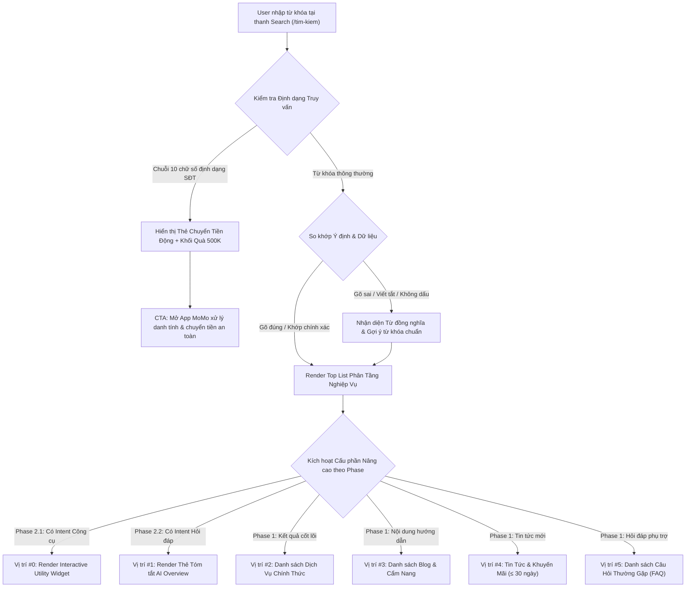

# BRD: TÁI CẤU TRÚC HỆ THỐNG TÌM KIẾM THÔNG MINH MOSPARK SEARCH (/TIM-KIEM)
## Định Vị Cửa Ngõ Tìm Kiếm Thông Minh, Phân Tầng Chuyển Đổi & Trợ Lý Tác Vụ Web-to-App

> - **Project:** Tái Cấu Trúc Hệ Thống Tìm Kiếm (MoSpark Search Revamp)
> - **Main URL:** momo.vn/tim-kiem
> - **Division:** Growth Platform Division (Web Platform)
> - **Governance:** Web Product Lead
> - **Version:** 1.0 · Tháng 10/2026
> - **Status:** Proposal - Sẵn sàng cho Business Alignment

---

> **Problem:** Hơn 80% người dùng tìm kiếm trên momo.vn bị rơi vào trang kết quả rỗng (Zero Search Results) do lỗi gõ sai/viết tắt hoặc kết quả hiển thị dàn trải thiếu phân tầng giá trị nghiệp vụ, khiến nhu cầu giao dịch thực tế bị đứt gãy và lãng phí lưu lượng truy cập tự nhiên có ý định chuyển đổi cao.
> **KPI Owned:** Useful Search Rate đạt >= 92% và Tỷ lệ chuyển đổi Web-to-App (W2A CR) từ Search đạt >= 12.00% → attributed via Umami Tracking & AppsFlyer OneLink.
> **Conversion Flow:** [Gõ từ khóa tại /tim-kiem] → [Xem Top List kết quả phân tầng nghiệp vụ] → [Thao tác Tiện ích / Xem tóm tắt AI] → [Chạm CTA Deep Link] → [Mở App MoMo hoàn tất giao dịch].

---

## 1. Executive Summary

### 1.1 Situation (Hiện Trạng)
Trang `/tim-kiem` là cửa ngõ tiếp nhận toàn bộ nhu cầu chủ động của người dùng khi truy cập `momo.vn`. Trong Quý 3/2026, hệ thống ghi nhận hơn 35.000 lượt tìm kiếm với hơn 16.600 cụm từ khóa độc lập. Lưu lượng này mang ý định (Intent) rất cao, tập trung vào việc tra cứu dịch vụ, nạp tiền/thẻ game, tra cứu thông tin tài chính và tìm kiếm hướng dẫn xử lý sự cố.

### 1.2 Complication (Thách Thức & Điểm Nghẽn)
* **Tỷ lệ kết quả rỗng quá lớn (Zero Results):** Hơn 30% truy vấn có lỗi gõ sai, viết tắt hoặc không dấu (`nap xu tt`, `liên kết vietcom`, `ff`...). Hệ thống tìm kiếm hiện tại chỉ quét từ khóa cứng nhắc, dẫn đến tỷ lệ thoát trang (Bounce Rate) vượt 80%.
* **Hiển thị dàn trải, thiếu phân tầng kinh doanh:** Danh sách kết quả hiện tại không phân định rõ giá trị chuyển đổi giữa Landing Page dịch vụ chính thức, bài viết cẩm nang và tin tức thời sự. Tin tức cũ hết hạn vẫn xuất hiện ngang hàng với các dịch vụ cốt lõi.
* **Chưa khai thác hành vi nhập Số Điện Thoại (5.96% views):** Người dùng nhập SĐT với kỳ vọng chuyển tiền hoặc tra cứu danh tính nhưng chỉ nhận lại thông báo "Không tìm thấy kết quả", gây thất thoát cơ hội kích hoạt người dùng mới (New Users).

### 1.3 Resolution (Giải Pháp & Định Vị Cốt Lõi)
Tái định vị `/tim-kiem` từ một thanh tra cứu từ điển tĩnh thành **Hệ Thống Tìm Kiếm Thông Minh Theo Định Hướng Product-Led Growth (PLG)** thông qua lộ trình 3 giai đoạn:
* **Phase 1 (Top List Phân Tầng):** Tối ưu hóa danh sách kết quả hàng đầu (Top List) theo trật tự giá trị nghiệp vụ (`Dịch Vụ > Blog Cẩm Nang > Tin Tức < 30 Ngày > FAQ`), bổ sung cơ chế sửa lỗi gõ sai/từ đồng nghĩa để xóa bỏ trang kết quả rỗng.
* **Phase 2 (Tương Tác & Tóm Tắt):** Kích hoạt Tiện ích tương tác (Utility Components) tại vị trí ưu tiên số 1 để giải quyết tác vụ tức thì (Zero-Click), kết hợp thẻ tóm tắt AI Overview trả lời nhanh các câu hỏi thủ tục.
* **Phase 3 (Trợ Lý Tác Vụ):** Chuyển đổi trải nghiệm tìm kiếm thành Trợ lý tác vụ (Agentic Assistant), hỗ trợ giải quyết vấn đề và điều hướng hành động trực tiếp vào ứng dụng MoMo.

---

## 2. Khung Năng Lực Product-Led Growth (PLG Hooks)

* **Trao Giá Trị Trước Rào Cản (Value Before Gate):** Người dùng tìm kiếm tiện ích (tính lãi vay, tra cứu phạt nguội, xem giá vàng) nhận được kết quả tính toán ngay trên Web trong 2 giây mà không bị ép buộc phải tải app hay đăng nhập.
* **Triệt Tiêu Ma Sát Chuyển Đổi (Zero Search Friction):** Khi người dùng gõ sai hoặc gõ tắt, hệ thống tự động nhận diện ý định gốc và gợi ý đúng dịch vụ mong muốn, duy trì mạch chuyển đổi liền mạch.
* **Cơ Chế Bắt Nhịp Tân Thủ (New User Onboarding Hook):** Khai thác lượng truy cập gõ số điện thoại và tìm kiếm rác để phân phối Thẻ quà chào bạn mới 500K (`CHAOMOMO`), biến traffic vãng lai thành lượt cài đặt ứng dụng thực tế.

---

## 3. Luồng Trải Nghiệm Người Dùng (User Flow)

<table style="width:100%; border-collapse:collapse; border:1.5px solid #64748b; margin:1em 0; font-size:0.9em;">
  <thead>
    <tr style="background-color:#f1f5f9;">
      <th style="border:1.5px solid #64748b; padding:8px 12px; text-align:left; font-weight:700;">Bước</th>
      <th style="border:1.5px solid #64748b; padding:8px 12px; text-align:left; font-weight:700;">Tên Giai Đoạn</th>
      <th style="border:1.5px solid #64748b; padding:8px 12px; text-align:left; font-weight:700;">Trải Nghiệm Người Dùng (UX)</th>
      <th style="border:1.5px solid #64748b; padding:8px 12px; text-align:left; font-weight:700;">Hạ Tầng / Cơ Chế Kỹ Thuật</th>
      <th style="border:1.5px solid #64748b; padding:8px 12px; text-align:left; font-weight:700;">Nền Tảng</th>
    </tr>
  </thead>
  <tbody>
    <tr>
      <td style="border:1px solid #94a3b8; padding:8px 12px; text-align:left;">1</td>
      <td style="border:1px solid #94a3b8; padding:8px 12px; text-align:left;">Tiếp Nhận & Phân Loại Truy Vấn</td>
      <td style="border:1px solid #94a3b8; padding:8px 12px; text-align:left;">Người dùng nhập từ khóa vào ô tìm kiếm, hiển thị gợi ý tức thì sau khi dừng gõ.</td>
      <td style="border:1px solid #94a3b8; padding:8px 12px; text-align:left;">Xử lý nhận diện định dạng ký tự tại trình duyệt (Client-side Intercept). Không gửi dữ liệu SĐT về máy chủ web.</td>
      <td style="border:1px solid #94a3b8; padding:8px 12px; text-align:left;">Web Search Bar</td>
    </tr>
    <tr style="background-color:#f8fafc;">
      <td style="border:1px solid #94a3b8; padding:8px 12px; text-align:left;">2</td>
      <td style="border:1px solid #94a3b8; padding:8px 12px; text-align:left;">Xử Lý So Khớp & Gợi Ý Thông Minh</td>
      <td style="border:1px solid #94a3b8; padding:8px 12px; text-align:left;">Người dùng gõ sai hoặc gõ tắt vẫn nhận được kết quả chính xác, kèm dòng gợi ý tên chuẩn.</td>
      <td style="border:1px solid #94a3b8; padding:8px 12px; text-align:left;">Bộ quy tắc từ điển đồng nghĩa (Synonym Mapping) và cơ chế tìm kiếm xấp xỉ sửa lỗi chính tả.</td>
      <td style="border:1px solid #94a3b8; padding:8px 12px; text-align:left;">MoSpark Search Engine</td>
    </tr>
    <tr>
      <td style="border:1px solid #94a3b8; padding:8px 12px; text-align:left;">3</td>
      <td style="border:1px solid #94a3b8; padding:8px 12px; text-align:left;">Trình Diễn Top List Phân Tầng</td>
      <td style="border:1px solid #94a3b8; padding:8px 12px; text-align:left;">Nhìn thấy ngay dịch vụ cần tìm ở vị trí nổi bật nhất, tiếp theo là hướng dẫn chi tiết và tin ưu đãi mới.</td>
      <td style="border:1px solid #94a3b8; padding:8px 12px; text-align:left;">Công cụ phân tầng danh mục dữ liệu tự động, áp dụng quy chuẩn lọc thời gian cho tin tức.</td>
      <td style="border:1px solid #94a3b8; padding:8px 12px; text-align:left;">Web SERP UI</td>
    </tr>
    <tr style="background-color:#f8fafc;">
      <td style="border:1px solid #94a3b8; padding:8px 12px; text-align:left;">4</td>
      <td style="border:1px solid #94a3b8; padding:8px 12px; text-align:left;">Chuyển Ngữ Cảnh Vào Ứng Dụng</td>
      <td style="border:1px solid #94a3b8; padding:8px 12px; text-align:left;">Nhấp CTA chuyển tiếp thẳng vào đúng màn hình giao dịch trên App MoMo mà không cần tìm kiếm lại.</td>
      <td style="border:1px solid #94a3b8; padding:8px 12px; text-align:left;">Đường dẫn chuyển đổi thông minh AppsFlyer OneLink mang theo tham số ngữ cảnh dịch vụ.</td>
      <td style="border:1px solid #94a3b8; padding:8px 12px; text-align:left;">Web-to-App Funnel</td>
    </tr>
  </tbody>
</table>

---

## 4. Yêu Cầu Chức Năng Chi Tiết Theo Từng Giai Đoạn

### 4.1. Phase 1: Top List Phân Tầng Nghiệp Vụ (Core Lexical Search)
Giai đoạn này tập trung 100% vào việc hiển thị **Top List kết quả tìm kiếm tiêu chuẩn**, chưa kích hoạt Widget hay AI:

* **Quy tắc Phân tầng Thứ bậc Danh mục (Hierarchy Rules):**
  1. **Nhóm 1 - Dịch Vụ Chính Thức (Services):** Nằm ở vị trí ưu tiên cao nhất (#1 - #3). Chỉ hiển thị các trang đích sản phẩm (`/vi-tra-sau`, `/cinema`, `/vay-nhanh`...). Gắn nhãn nhận diện "Chính Thức" và nút mở dịch vụ trực tiếp.
  2. **Nhóm 2 - Cẩm Nang & Hướng Dẫn (Blog):** Nằm ở vị trí tiếp theo (#4 - #7). Cung cấp kiến thức chuyên sâu, mẹo quản lý tài chính và hướng dẫn sử dụng.
  3. **Nhóm 3 - Tin Tức & Khuyến Mãi (News):** Nằm ở vị trí thứ ba (#8 - #10). **Ràng buộc nghiệp vụ bắt buộc:** Chỉ cho phép xuất hiện các thông tin có ngày xuất bản **trong vòng 30 ngày gần đây**. Nếu không có tin tức nào trong 30 ngày qua, hệ thống **tự động ẩn hoàn toàn nhóm này**, không hiển thị khoảng trống.
  4. **Nhóm 4 - Hỏi Đáp (FAQ):** Nằm ở cuối danh sách. Hiển thị tối đa 3 câu hỏi thường gặp nhất liên quan đến từ khóa.
* **Quy tắc So Khớp và Xử Lý Lỗi Gõ (Matching & Correction Rules):**
  * Ưu tiên số 1 cho kết quả khớp từ khóa chính xác.
  * Khi kết quả chính xác có ít hơn 3 bản ghi, hệ thống bắt buộc tự động kích hoạt bộ từ điển đồng nghĩa (Synonym) và cơ chế sửa lỗi gõ để tìm kiếm mở rộng, đảm bảo tỷ lệ có kết quả hữu ích đạt trên 92%.
* **Điều Hướng Chuyên Sâu Theo Tab:**
  * Cung cấp thanh điều hướng Tab: `[Tất cả]`, `[Dịch vụ]`, `[Cẩm nang]`, `[Tin mới 30 ngày]`, `[Hỏi đáp]`.
  * Khi chọn Tab riêng biệt, danh sách mở rộng toàn bộ kết quả của nhóm đó với phân trang chuẩn 10 bản ghi/trang.

### 4.2. Phase 2.1: Tích Hợp Tiện Ích Tương Tác (Rich Action Utilities)
* Khi người dùng tìm kiếm từ khóa mang tính chất thao tác hoặc tính toán (ví dụ: `tính lãi vay`, `check nợ xấu cic`, `giá vàng hôm nay`, `phạt nguội ô tô`, `nạp xu tiktok`):
  * Hệ thống tự động kích hoạt **Tiện ích tương tác (Interactive Utility)** tương ứng tại vị trí **Ưu tiên số 0** (nằm trên cả Top List).
  * Tiện ích cho phép người dùng nhập liệu, tính toán và nhận kết quả tức thời ngay trên giao diện tìm kiếm.
  * Nút hành động (CTA) trên tiện ích sẽ mang theo toàn bộ dữ liệu vừa tính toán để đẩy thẳng vào App MoMo qua OneLink.

### 4.3. Phase 2.2: Tóm Tắt Thông Minh AI Overview
* Kích hoạt Thẻ tóm tắt thông tin nhanh (AI Overview) tại vị trí đầu trang kết quả khi từ khóa là dạng câu hỏi thắc mắc, hỏi thủ tục hoặc điều kiện chính sách (ví dụ: *"hạn mức ví trả sau tối đa bao nhiêu"*, *"cách hủy liên kết ngân hàng"*).
* Nội dung tóm tắt được cô đọng trong tối đa 3 gạch đầu dòng, cam kết dựa trên dữ liệu tri thức chính thức của MoMo, đi kèm các đường link trích dẫn nguồn gốc tin cậy.
* Đối với từ khóa thương hiệu ngắn hoặc từ khóa dịch vụ thông thường, khối AI Overview tự động ẩn để tránh gây nhiễu thị giác.

### 4.4. Phase 3: Trợ Lý Tác Vụ Tương Tác (Agentic Task Assistant)
* Nâng cấp giao diện tìm kiếm thành Trợ lý tác vụ thông minh có khả năng đối thoại đa lượt.
* Trợ lý không chỉ trả lời thông tin mà còn hiểu ngữ cảnh để kích hoạt các hành động chuyên sâu: tạo sẵn lệnh chuyển tiền theo số điện thoại, mở tiện ích nộp phạt giao thông hoặc gợi ý sản phẩm tài chính phù hợp với nhu cầu người dùng.

---

## 5. Quy Chuẩn Vận Hành Và Xử Lý Ngoại Lệ (Business Rules)

### 5.1. Xử Lý An Toàn Dữ Liệu Số Điện Thoại Cá Nhân
* Nền tảng Web tuân thủ nghiêm ngặt quy định bảo vệ dữ liệu cá nhân. Hệ thống **tuyệt đối không thực hiện tra cứu danh tính, số dư hoặc lịch sử giao dịch của số điện thoại trên giao diện Web**.
* Khi người dùng nhập chuỗi 10 số điện thoại, hệ thống chỉ hiển thị Thẻ chuyển tiền động với nút bấm mở ứng dụng MoMo. Việc hiển thị tên người nhận và xác thực giao dịch chỉ được thực hiện trên ứng dụng di động có bảo mật sinh trắc học.
* Bố trí song song khối Thẻ quà tặng bạn mới 500K (`CHAOMOMO`) ngay bên dưới để chào đón người dùng chưa có tài khoản MoMo.

### 5.2. Kiểm Soát Nội Dung Độc Hại & Từ Khóa Cấm
* Thiết lập danh sách từ khóa nhạy cảm, cờ bạc, lừa đảo và liên kết độc hại.
* Khi phát hiện truy vấn nằm trong danh sách cấm, hệ thống từ chối xử lý, không ghi nhận vào lịch sử gợi ý và chuyển hướng về trang thông báo an toàn.

### 5.3. Quy Định Tối Ưu Hóa Tìm Kiếm (SEO & Crawl Budget)
* Nhằm bảo toàn tài nguyên cào dữ liệu (Crawl Budget) của các công cụ tìm kiếm cho các trang Master Hubs thương mại, trang `/tim-kiem` được cấu hình chặn thu thập dữ liệu trong file điều hướng robot (`Disallow: /tim-kiem` trong `robots.txt`).
* Trang kết quả tìm kiếm nội bộ gắn thẻ chỉ thị không lập chỉ mục (`noindex, nofollow`) để tránh sinh ra hàng nghìn trang rác hoặc nội dung mỏng trên Google.

---

## 6. Lộ Trình Triển Khai & Cột Mốc (Roadmap & Milestones)

<table style="width:100%; border-collapse:collapse; border:1.5px solid #64748b; margin:1em 0; font-size:0.9em;">
  <thead>
    <tr style="background-color:#f1f5f9;">
      <th style="border:1.5px solid #64748b; padding:8px 12px; text-align:left; font-weight:700;">Giai đoạn</th>
      <th style="border:1.5px solid #64748b; padding:8px 12px; text-align:left; font-weight:700;">Thời gian</th>
      <th style="border:1.5px solid #64748b; padding:8px 12px; text-align:left; font-weight:700;">Tên Giai Đoạn</th>
      <th style="border:1.5px solid #64748b; padding:8px 12px; text-align:left; font-weight:700;">Chi Tiết Triển Khai & Mục Tiêu</th>
    </tr>
  </thead>
  <tbody>
    <tr>
      <td style="border:1px solid #94a3b8; padding:8px 12px; text-align:left;">Giai đoạn 1</td>
      <td style="border:1px solid #94a3b8; padding:8px 12px; text-align:left;">Tháng 11/2026 (Tuần 1 - 2)</td>
      <td style="border:1px solid #94a3b8; padding:8px 12px; text-align:left;">Top List Phân Tầng & Sửa Lỗi Gõ</td>
      <td style="border:1px solid #94a3b8; padding:8px 12px; text-align:left;">Hoàn thành giao diện Top List theo trật tự: Dịch Vụ > Blog > News (< 30 ngày) > FAQ. Tích hợp từ điển đồng nghĩa xử lý lỗi viết tắt/sai chính tả. Xóa bỏ tỷ lệ trang trắng.</td>
    </tr>
    <tr style="background-color:#f8fafc;">
      <td style="border:1px solid #94a3b8; padding:8px 12px; text-align:left;">Giai đoạn 2.1</td>
      <td style="border:1px solid #94a3b8; padding:8px 12px; text-align:left;">Tháng 11/2026 (Tuần 3)</td>
      <td style="border:1px solid #94a3b8; padding:8px 12px; text-align:left;">Tiện Ích Tương Tác (Utility Integration)</td>
      <td style="border:1px solid #94a3b8; padding:8px 12px; text-align:left;">Tích hợp 5 Interactive Widgets cốt lõi (Tính lãi vay, CIC, Giá vàng, Phạt nguội, Nạp xu) vào vị trí ưu tiên số 0. Hoàn thiện luồng chuyển đổi SĐT sang App.</td>
    </tr>
    <tr>
      <td style="border:1px solid #94a3b8; padding:8px 12px; text-align:left;">Giai đoạn 2.2</td>
      <td style="border:1px solid #94a3b8; padding:8px 12px; text-align:left;">Tháng 11/2026 (Tuần 4) - Tháng 12/2026</td>
      <td style="border:1px solid #94a3b8; padding:8px 12px; text-align:left;">Khối Tóm Tắt Thông Minh AI Overview</td>
      <td style="border:1px solid #94a3b8; padding:8px 12px; text-align:left;">Tích hợp khối tóm tắt AI trả lời nhanh câu hỏi thủ tục, kết nối kho tri thức chính sách MoMo và gắn link trích dẫn nguồn bài viết gốc.</td>
    </tr>
    <tr style="background-color:#f8fafc;">
      <td style="border:1px solid #94a3b8; padding:8px 12px; text-align:left;">Giai đoạn 3</td>
      <td style="border:1px solid #94a3b8; padding:8px 12px; text-align:left;">Quý 1/2027</td>
      <td style="border:1px solid #94a3b8; padding:8px 12px; text-align:left;">Trợ Lý Tác Vụ Thông Minh (Agentic Search)</td>
      <td style="border:1px solid #94a3b8; padding:8px 12px; text-align:left;">Phát triển Trợ lý hội thoại giải quyết tác vụ phức tạp, tự động đề xuất giải pháp tài chính và tạo đường dẫn thực thi giao dịch sâu trong App.</td>
    </tr>
  </tbody>
</table>

---

## 7. Tiêu Chí Nghiệm Thu (Acceptance Criteria) & Chỉ Số Đo Lường

### 7.1. Tiêu Chí Nghiệm Thu Nghiệp Vụ (Acceptance Criteria - UAT)
* **AC-01 (Hiển thị Top List):** Khi tìm kiếm bất kỳ từ khóa nào có trong danh mục dịch vụ MoMo, thẻ Dịch Vụ chính thức phải luôn nằm ở nhóm vị trí đầu tiên kèm nút chuyển đổi mở App.
* **AC-02 (Ràng buộc Tin Tức):** Nhóm Tin Tức & Khuyến Mãi tuyệt đối không hiển thị bài viết có ngày xuất bản cũ hơn 30 ngày. Nếu không có tin mới, nhóm này tự động ẩn khỏi danh sách.
* **AC-03 (Xử lý Gõ Sai):** Người dùng gõ các cụm từ viết tắt phổ biến (`nap xu tt`, `ff`, `vietcom`...) hệ thống vẫn trả về đúng dịch vụ Nạp xu TikTok, Nạp thẻ game, hoặc Hướng dẫn liên kết Vietcombank, không được trả về trang rỗng.
* **AC-04 (Xử lý SĐT):** Khi nhập 10 chữ số định dạng số điện thoại, hệ thống hiển thị Thẻ Chuyển Tiền với nút CTA dẫn vào App MoMo qua OneLink, đồng thời hiển thị khối Voucher 500K bên dưới.

### 7.2. Chỉ Số Đo Lường Thành Công (Business KPIs)
* **Tỷ Lệ Tìm Kiếm Hữu Ích (Useful Search Rate):** Đạt **≥ 92%** trên tổng số lượt truy vấn (giảm tỷ lệ Zero Results xuống dưới 8%).
* **Tỷ Lệ Chuyển Đổi Web-to-App (Search W2A CR):** Đạt mốc **≥ 12.00%** (so với mức trung bình 4.37% hiện tại).
* **Lượt Cài Đặt Mới (New App Installs):** Thu hút **2.000 - 3.000 lượt tải app mới/tháng** thông qua phễu tiếp nhận số điện thoại và thẻ quà tân thủ 500K.
* **Tỷ Lệ Tương Tác Tiện Ích (Utility Engagement Rate - Phase 2):** Đạt trên **35%** người dùng nhấp thao tác tính toán khi nhìn thấy tiện ích tại vị trí số 0.
