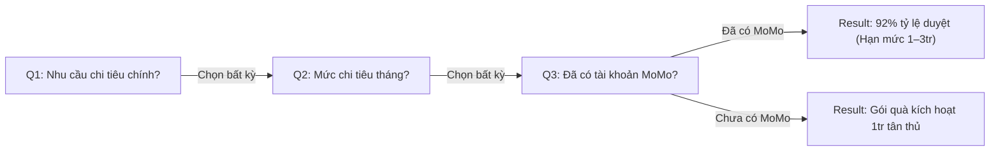
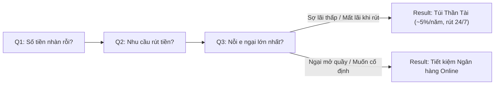
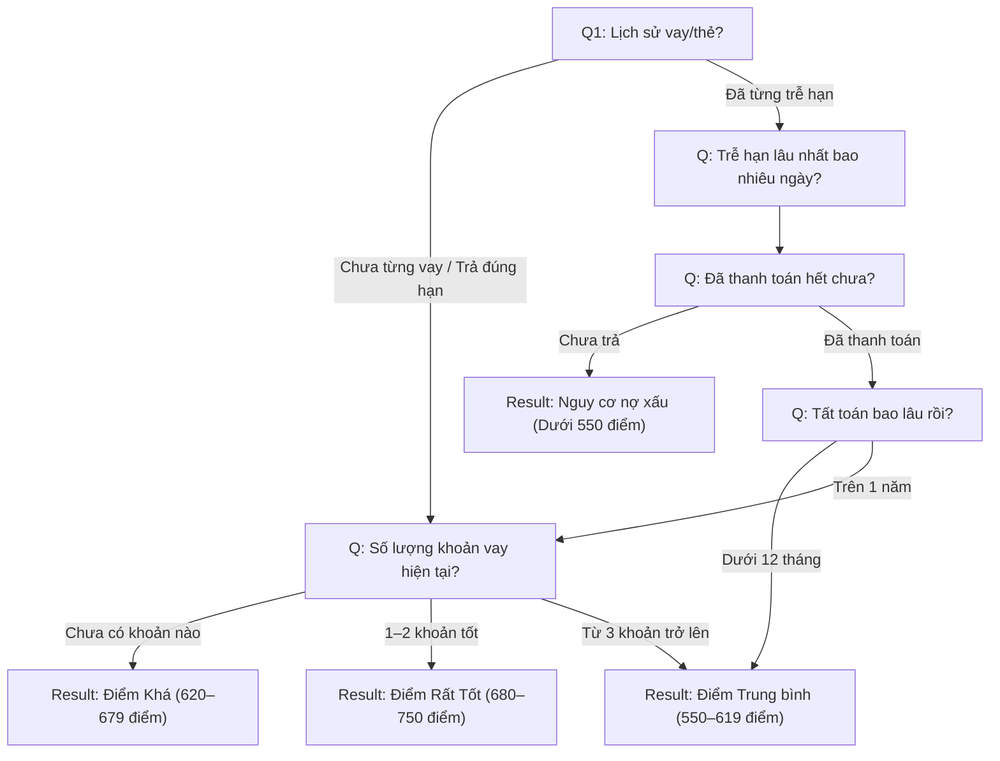
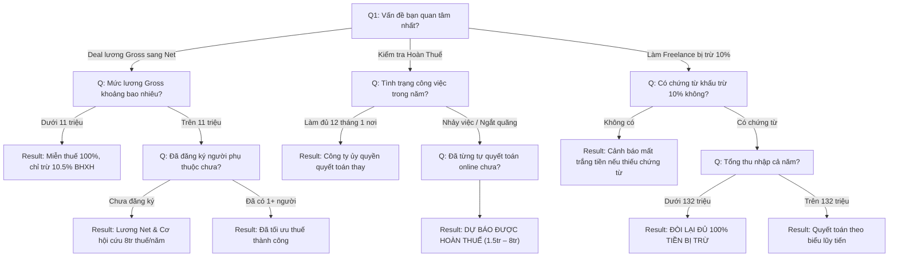

# HƯỚNG DẪN KỸ THUẬT & ĐẶC TẢ TÍCH HỢP QUIZ FLOWS (DÀNH CHO HUB DEV)
## XÂY DỰNG TRANG VISUALIZATION & CONSUME DỮ LIỆU TỪ KNOWLEDGEBASE

- **Mã tài liệu:** `MOSP-DEV-QUIZ-VIS-01`
- **Phiên bản:** 1.0.0
- **Dự án áp dụng:** Web Hubs (`react-web-momo`) & MoMo Web Platform
- **File Dữ liệu SSOT (Data Source):** [`04_MOSPARK_PLATFORM/data/quiz_catalog.json`](file:///Users/hienhv/HienHv/Klaus/Hienho_MoMo-Base/04_MOSPARK_PLATFORM/data/quiz_catalog.json)

---

## 1. MỤC TIÊU CỦA TRANG VISUALIZATION TRÊN HUB

Trang Visualization Flow (đề xuất đường dẫn: `/dashboard/quiz-flows` hoặc `/tools/quiz-visualizer` trên Hub) được xây dựng nhằm:
1. **Trực quan hóa Đồ thị Luồng (Flowchart Visualization):** Giúp Product Lead, Designer và Kỹ sư (Dev) nhìn thấy toàn bộ đường đi câu hỏi, điểm rẽ nhánh và các kịch bản kết quả mà không cần đọc code logic thô.
2. **Bộ mô phỏng Tương tác (Interactive Test Runner / Simulator):** Cho phép bấm thử từng đáp án để kiểm tra đường chuyển node (`next_node_id`), phát hiện điểm cụt (dead-end) hoặc vòng lặp vô tận (infinite loop).
3. **Tiêu thụ Dữ liệu Tập trung (Single Source of Truth - SSOT):** Mọi nội dung câu hỏi, điều kiện rẽ nhánh và kết quả 60/40 đều được kéo trực tiếp từ file dữ liệu JSON trong Knowledgebase, không hardcode trong component giao diện.

---

## 2. PHÂN LOẠI 2 DẠNG QUIZ FLOW

Hệ thống Quiz trên Web Platform được chuẩn hóa thành 2 dạng kiến trúc rõ rệt:

```
┌────────────────────────────────────────────────────────────────────────┐
│                        PHÂN LOẠI KIẾN TRÚC QUIZ                        │
├───────────────────────────────────┬────────────────────────────────────┤
│   DẠNG 1: ONE-FLOW (TUYẾN TÍNH)   │   DẠNG 2: BRANCHING (RẼ NHÁNH)     │
├───────────────────────────────────┼────────────────────────────────────┤
│ • Cấu trúc: Tuyến tính cố định    │ • Cấu trúc: Đồ thị hữu hướng (DAG) │
│   Q1 ──► Q2 ──► Q3 ──► Result     │   Q1 ──► Q2.1 / Q2.2 ──► Q3.x      │
│ • Độ dài: Cố định (3–4 câu)       │ • Độ dài: Co giãn linh hoạt (1–4 c)│
│ • Cơ chế: Tất cả user đi cùng một │ • Cơ chế: Hỗ trợ Fast Exit (2 câu) │
│   chuỗi câu hỏi; kết quả phân hoá │   và Contextual Drill-down sâu     │
│   dựa trên điểm tổng (Scoring).   │ • Ứng dụng: Điểm Tín Dụng, Bảo hiểm│
│ • Ứng dụng: Ví Trả Sau, Tiết Kiệm,│   Thân Vỏ Ô Tô, Lương & Thuế TNCN. │
│   Vay Nhanh (ma trận điểm).       │                                    │
└───────────────────────────────────┴────────────────────────────────────┘
```

---

## 3. CONTRACT DỮ LIỆU (TYPESCRIPT INTERFACES)

Kỹ sư frontend bên Hub copy trực tiếp interface này vào `types/quiz.ts`:

```typescript
export type QuizType = 'one_flow' | 'branching';
export type NodeType = 'question' | 'result';

export interface QuizCatalog {
  $schema?: string;
  version: string;
  updated_at: string;
  description: string;
  quizzes: QuizItem[];
}

export interface QuizItem {
  id: string;
  name: string;
  type: QuizType;
  theme: string;
  badge?: string;
  description: string;
  total_steps_estimate: string;
  root_question_id: string;
  nodes: Record<string, QuestionNode | ResultNode>;
}

export interface QuizOption {
  id: string;
  label: string;
  score?: number; // Dành cho chấm điểm tích lũy (ví dụ: Vay Nhanh)
  next_node_id: string; // Trỏ tới QuestionNode tiếp theo hoặc ResultNode
}

export interface QuestionNode {
  type: 'question';
  id: string;
  title: string;
  step_index: number;
  options: QuizOption[];
}

export interface ResultNode {
  type: 'result';
  id: string;
  tier: string;
  title: string;
  summary: string;
  reveal_60: {
    estimate_value: string;
    highlights: string[];
    tips: string[];
  };
  gated_40: {
    locked_title: string;
    locked_items: string[];
    cta_label: string;
    deeplink_url: string;
    subtext?: string;
  };
}
```

---

## 4. CHI TIẾT SƠ ĐỒ LUỒNG TỪNG QUIZ (MERMAID SPECIFICATIONS)

Dev có thể dùng trực tiếp các sơ đồ Mermaid dưới đây để render thử nghiệm hoặc kiểm tra tính đúng đắn của đồ thị:

### 4.1. Nhóm One-Flow (Tuyến Tính)

#### A. Quiz Ví Trả Sau (`quiz-vi-tra-sau`)


#### B. Quiz Tiết Kiệm & Tích Lũy (`quiz-tiet-kiem`)


#### C. Quiz Vay Nhanh (`quiz-vay-nhanh` - Ma trận điểm)
```mermaid
graph LR
    vn_q1["Q1: Số tiền muốn vay?"] --> vn_q2["Q2: Mức độ cần gấp?"]
    vn_q2 --> vn_q3["Q3: Nguồn thu nhập?"]
    vn_q3 --> vn_q4["Q4: Lịch sử tín dụng?"]
    vn_q4 -->|Điểm cao (3–4)| vn_res_a["Result: Duyệt 95% theo yêu cầu (1 phút)"]
    vn_q4 -->|Điểm TB (1–2)| vn_res_b["Result: Đề xuất gói khả thi 5–10tr"]
    vn_q4 -->|Điểm rủi ro (0)| vn_res_c["Result: Hướng sang Ví Trả Sau 1–3tr"]
```

---

### 4.2. Nhóm Branching (Rẽ Nhánh Phi Tuyến Tính)

#### A. Quiz Điểm Tín Dụng CIC (`quiz-diem-tin-dung` - Đã Go-Live)


#### B. Quiz Bảo Hiểm Thân Vỏ Ô Tô (`quiz-bao-hiem-than-vo`)
```mermaid
graph TD
    car_q1["Q1: Chiếc xe thuộc trường hợp nào?"]
    
    %% Nhánh 1: Xe mới
    car_q1 -->|Xe mới dưới 3 năm| car_new_park["Q: Chỗ đỗ xe qua đêm?"]
    car_new_park -->|Đỗ hầm / Vỉa hè| car_new_rep["Q: Muốn sửa xe ở đâu?"]
    car_new_park -->|Khu vực ngập nước| car_new_flood["Q: Mức độ ngập sâu?"]
    car_new_flood -->|Ngập nửa bánh| car_res_flood["Result: Gói Chuyên Biệt Mùa Mưa Ngập"]
    car_new_flood -->|Mấp mé| car_new_rep
    car_new_rep -->|Xưởng chính hãng| car_res_vip["Result: Gói Toàn Diện Giữ Zin Xe Hãng"]
    car_new_rep -->|Gara ngoài uy tín| car_res_flex["Result: Gói Toàn Diện Linh Hoạt"]
    
    %% Nhánh 2: Xe cũ
    car_q1 -->|Xe trên 3 năm| car_old_claim["Q: 1 năm qua có gọi bảo hiểm?"]
    car_old_claim -->|Không va quẹt / Quẹt nhẹ| car_old_deduct["Q: Sẵn sàng tự trả 500k để giảm 20% phí?"]
    car_old_claim -->|Từng va chạm nặng| car_res_comp["Result: Gói Thân Vỏ Cơ Bản Toàn Diện"]
    car_old_deduct -->|Sẵn sàng (Có)| car_res_save["Result: Gói Tiết Kiệm Thông Minh (-20% phí)"]
    car_old_deduct -->|Không| car_res_comp
    
    %% Nhánh 3: Xe kinh doanh
    car_q1 -->|Xe chạy dịch vụ| car_comm_plate["Q: Đăng ký biển màu gì?"]
    car_comm_plate --> car_comm_pain["Q: Điều đau đầu nhất khi làm bảo hiểm?"]
    car_comm_pain --> car_res_comm["Result: Gói Xe Kinh Doanh Bồi Thường Siêu Tốc"]
```

#### C. Quiz Tính Lương & Săn Hoàn Thuế TNCN (`quiz-tinh-luong-thue-tncn`)


---

## 5. HƯỚNG DẪN CÁCH GỌI DỮ LIỆU & DỰNG TRANG VISUALIZATION BÊN HUB

### 5.1. Cơ chế Đồng bộ Dữ liệu (Data Fetching / Sync)
Dev bên Hub có 2 lựa chọn để tiêu thụ file `quiz_catalog.json`:
- **Cách 1 (Khuyên dùng trong Monorepo/Local dev):** Đọc trực tiếp từ Knowledgebase qua đường dẫn tương đối:
  ```typescript
  import quizData from '@/../../Hienho_MoMo-Base/04_MOSPARK_PLATFORM/data/quiz_catalog.json';
  ```
- **Cách 2 (Sao chép tự động qua Build Script):** Trong `package.json` của Hub, thêm lệnh sync:
  ```json
  "scripts": {
    "sync:quiz": "cp ../Hienho_MoMo-Base/04_MOSPARK_PLATFORM/data/quiz_catalog.json ./lib/data/quiz_catalog.json"
  }
  ```

### 5.2. Công nghệ Đề xuất để Vẽ Flow (Recommended Stack)
1. **Thư viện Vẽ Node & Cạnh:** `@xyflow/react` (React Flow) hoặc `@mermaid-js/mermaid` (nhanh gọn, tự động bố trí layout).
2. **Cấu trúc Màn hình Trang Visualization (`/dashboard/quiz-flows`):**
   - **Thanh điều khiển (Header):** Dropdown chọn Quiz ID (`quiz-diem-tin-dung`, `quiz-bao-hiem-than-vo`, `quiz-vay-nhanh`...) kèm Badge hiển thị Type (`one_flow` vs `branching`).
   - **Cột Trái (Flowchart Canvas):** Vẽ toàn bộ các node câu hỏi (màu xanh dương) và node kết quả (màu hồng MoMo). Các đường mũi tên có ghi nhãn label của từng option.
   - **Cột Phải (Interactive Simulator & Inspector):**
     - Cho phép click chọn từng câu hỏi như người dùng thật.
     - Node đang hoạt động trên Canvas sẽ được viền highlight.
     - Khi chạm tới `result`, hiển thị preview màn hình 60% Reveal và 40% Gated kèm link Deeplink test.

### 5.3. Thuật toán Duyệt Node Đơn Giản (State Machine Runner)
Kỹ sư có thể dùng custom hook đơn giản để điều khiển luồng:

```typescript
import { useState } from 'react';
import { QuizItem, QuestionNode, ResultNode } from '@/types/quiz';

export function useQuizRunner(quiz: QuizItem) {
  const [currentNodeId, setCurrentNodeId] = useState<string>(quiz.root_question_id);
  const [history, setHistory] = useState<string[]>([]);

  const currentNode = quiz.nodes[currentNodeId];

  const handleSelectOption = (nextNodeId: string) => {
    setHistory((prev) => [...prev, currentNodeId]);
    setCurrentNodeId(nextNodeId);
  };

  const handleReset = () => {
    setCurrentNodeId(quiz.root_question_id);
    setHistory([]);
  };

  const handleBack = () => {
    if (history.length === 0) return;
    const prevNodeId = history[history.length - 1];
    setHistory((prev) => prev.slice(0, -1));
    setCurrentNodeId(prevNodeId);
  };

  return {
    currentNode,
    isResult: currentNode.type === 'result',
    handleSelectOption,
    handleBack,
    handleReset,
    history
  };
}
```

---

## 6. DANH MỤC TRUY VẤN NHANH QUIZ CATALOG (ID MAPPING TABLE)

| Mã Quiz ID | Tên Nghiệp Vụ | Dạng Luồng (Type) | Theme Trực Thuộc | Số Lượng Node |
| :--- | :--- | :--- | :--- | :--- |
| `quiz-vi-tra-sau` | Kiểm tra điều kiện mở Ví Trả Sau | `one_flow` | `vi-tra-sau` | 3 Questions, 2 Results |
| `quiz-tiet-kiem` | Kế hoạch Tiền Nhàn Rỗi & Túi Thần Tài | `one_flow` | `tiet-kiem-dau-tu` | 3 Questions, 2 Results |
| `quiz-vay-nhanh` | Đánh giá khả năng duyệt Vay Nhanh 1 phút | `one_flow` | `vay-nhanh` | 4 Questions, 3 Results |
| `quiz-diem-tin-dung`| Ước tính khoảng điểm CIC | `branching` | `diem-tin-dung` | 5 Questions, 4 Results |
| `quiz-bao-hiem-than-vo`| Bắt bệnh Bảo hiểm thân vỏ ô tô | `branching` | `bao-hiem-oto` | 8 Questions, 6 Results |
| `quiz-tinh-luong-thue-tncn`| Lương Gross-to-Net & Săn Hoàn Thuế | `branching` | `luong-thue-tncn` | 8 Questions, 8 Results |
