# QUY CHUẨN KỸ THUẬT: UMAMI UTILITY TRACKING SPECIFICATION

Tài liệu này cung cấp đặc tả kỹ thuật chi tiết dành cho đội ngũ Kỹ sư Web Frontend (Web Dev) và Tracking Team để triển khai tracking đồng bộ trên toàn bộ các công cụ tiện ích (Utility Tools) của MoMo Web Platform thông qua Umami Analytics.

---

## 1. KHUNG NGUYÊN TẮC KỸ THUẬT CHUNG

### 1.1 Nguyên Tắc Vàng: Mã Usecase Đồng Nhất Với MoSpark Tool ID

* **Single Source of Truth (SSOT):** Mã `usecase` trong tracking **BẮT BUỘC** lấy chính xác theo mã định danh công cụ (`tool_id` / `widget_id`) được khởi tạo và quản lý trong **MoSpark Component Registry**.
* **Mục đích:** Đảm bảo dữ liệu hành vi trên Umami có thể ánh xạ 1-1 với cấu hình CMS trên MoSpark, giúp hệ thống tự động bóc tách hiệu suất (Traffic, Usage, W2A Conversion) trực tiếp trên MoSpark Admin Dashboard mà không cần mapping thủ công.
* **Ví dụ quy chuẩn MoSpark:**
  * Công cụ tra cứu CIC: Mã đăng ký trong MoSpark là `cic_lookup` $\rightarrow$ Event Name: `web_cic_lookup_[object]_[action]`.
  * Công cụ tra cứu phạt nguội: Mã trong MoSpark là `traffic_fine_lookup` $\rightarrow$ Event Name: `web_traffic_fine_lookup_[object]_[action]`.

### 1.2 Công Thức Định Danh Event (Naming Grammar)

$$\mathbf{web\_[mospark\_tool\_id]\_[object]\_[action]}$$

Trong đó:
* `web`: Tiền tố cố định của nền tảng Web MoMo.
* `[mospark_tool_id]`: Mã định danh công cụ được cấu hình trong MoSpark (viết thường, dùng dấu gạch dưới `_`).
* `[object]`: Thành phần giao diện mà người dùng tương tác (`form`, `tab`, `btn`, `popup`, `result_card`, `qr_native`, `provider`, `amount`).
* `[action]`: Động từ mô tả hành động (`view`, `select`, `submit`, `display`, `click`).

### 1.3 Quy Chuẩn Tham Số Dùng Chung Cho Dịch Vụ Số & Thanh Toán
* **Nhà phát hành / Nhà mạng / Đối tác:** Chuẩn hóa thành **`provider`** (ví dụ: `zing`, `garena`, `viettel`, `petrolimex`, `sjc`).
* **Số tiền / Mệnh giá:** Chuẩn hóa thành **`amount`** (dạng số nguyên, ví dụ: `10000`, `50000`, `100000`).

### 1.4 Nguyên Tắc Bảo Mật Dữ Liệu Zero-PII (Nghị định 13/2023/NĐ-CP & PCI-DSS)
* **CẤM TUYỆT ĐỐI:** Không truyền dữ liệu định danh cá nhân thô vào payload của Umami (bao gồm: Số CCCD, Họ tên thật, Số điện thoại, Biển số xe cụ thể, Mức lương tuyệt đối).
* **GIẢI PHÁP CHUẨN:**
  * Chỉ track trạng thái điền: `input_status: "filled"` thay vì lưu nội dung ô nhập.
  * Phân khúc thành khoảng giá trị: `salary_range: "15m_25m"` thay vì ghi nhận số tiền lẻ.
  * Với phương tiện: Chỉ ghi nhận `vehicle_type: "car"` hoặc `"motorcycle"`.

### 1.5 Quy Tắc Chống Phình Dữ Liệu (Anti-Flooding Rule)
* Không gắn event `onChange`, `onKeyDown` trên từng ô input.
* Chỉ bắn event tại các điểm chốt chặn dứt khoát: Hiển thị form (`view`), Chuyển đổi cấu hình (`select`), Gửi tra cứu (`submit`), Trả kết quả (`display`), và Bấm mở App MoMo (`click`).

### 1.6 Nguyên Tắc Đóng Gói User Flow Tại CTA Endpoint (State Snapshot at Endpoint)
* **Quy chuẩn bắt buộc cho mọi Utility Tool:** Khi người dùng click nút CTA cuối cùng (Endpoint chuyển đổi sang App), component bắt buộc phải **đóng gói toàn bộ trạng thái lựa chọn (Snapshot State) của User Flow** vào payload của event `web_[mospark_tool_id]_btn_click`.
* **Mục đích:**
  * Giảm tải việc bắn quá nhiều event rời rạc trong quá trình người dùng thử nghiệm cấu hình.
  * Đảm bảo trên Umami Dashboard chỉ cần lọc event `btn_click` là bóc tách được 100% ngữ cảnh chuyển đổi: người dùng chọn kỳ hạn nào, ngân hàng nào, số tiền bao nhiêu, phương tiện gì trước khi mở App.
  * Cho phép phân tích ngay các tổ hợp hành vi (ví dụ: `term_and_bank`, `vehicle_and_city`).

### 1.7 Bảng Cấu Trúc Tham Số Chuẩn Hóa (`eventData` Schema)

Mọi sự kiện khi gửi về Umami thông qua hàm `umami.track(event_name, event_data)` tuân thủ bộ schema tham số chuẩn sau:

| Tên Tham Số (Key) | Kiểu Dữ Liệu | Bắt Buộc | Mô Tả & Quy Định Giá Trị |
| :--- | :--- | :---: | :--- |
| `usecase` | String | Có | Khớp 1-1 với MoSpark Tool ID (ví dụ: `cic_lookup`, `exchange_rate_lookup`) |
| `page_name` | String | Có | Slug URL của trang chứa Tool (ví dụ: `tinh_luong`, `ty_gia`, `gia_xang`) |
| `provider` | String | Tùy chọn | Tên viết thường của Đối tác / Ngân hàng / Nhà mạng / NPH (ví dụ: `bac_a_bank`, `zing`, `petrolimex`) |
| `amount` | Number | Tùy chọn | Số tiền hoặc mệnh giá dạng số nguyên (ví dụ: `10000`, `100000000`) |
| `button_name` | String | Tùy chọn | Tên định danh của nút bấm (snake_case, ví dụ: `kham_pha_trung_tam_tai_chinh`, `nap_the_ngay`) |
| `click_url` | String | Tùy chọn | Bắt buộc đối với nút W2A CTA, chứa link AppsFlyer OneLink kèm tham số `?wui=<identityId>` |
| `auth_status` | String | Tùy chọn | Trạng thái đăng nhập của người dùng (`"logged_in"` hoặc `"anonymous"`) |
| `[custom_param]` | String / Number | Tùy chọn | Thuộc tính nghiệp vụ đặc thù theo từng tool (ví dụ: `term`, `currency_pair`, `direction`) |

---

## 2. DANH MỤC MASTER MOSPARK TOOL ID & ĐẶC TẢ CHI TIẾT

| STT | Tên Utility Tool Thực Tế | MoSpark Tool ID (`usecase`) | Nhóm Nghiệp Vụ / Hub |
| :--- | :--- | :--- | :--- |
| 1 | Mua / Nạp Thẻ Game Trực Tuyến | `game_card_topup` | Digital Goods / Dịch vụ số |
| 2 | Tính Lương Gross Sang Net | `gross_net_calculator` | Financial Hub |
| 3 | Phân Bổ Ngân Sách Thu Nhập 50/30/20 | `salary_allocation_calculator` | Financial Hub |
| 4 | Tra Cứu Phạt Nguội Giao Thông | `traffic_fine_lookup` | Vehicle Hub |
| 5 | Tra Cứu Giá Xăng Dầu Hôm Nay | `fuel_price_lookup` | Vehicle Hub |
| 6 | Tra Cứu Thẻ Bảo Hiểm Y Tế (BHYT) | `bhyt_lookup` | InsurTech / Dịch vụ công |
| 7 | Bảng Tỷ Giá Ngoại Tệ FX | `exchange_rate_lookup` | Financial Hub |
| 8 | Bảng Giá Vàng SJC / PNJ | `gold_price_lookup` | Financial Hub |
| 9 | Tra Cứu Điểm Tín Dụng & Nợ Xấu CIC | `cic_lookup` | Financial Hub |
| 10 | Tìm Kiếm Garage & Cứu Hộ Giao Thông | `garage_lookup` | Vehicle Hub |
| 11 | Tính Lãi Tiết Kiệm Ngân Hàng | `saving_interest_calculator` | Financial Hub |
| 12 | Mini Game Quýt (Gamification) | `game_quyt` | Entertainment / Gamification |
| 13 | Ước Tính Tiền Gửi Tiết Kiệm Online | `saving_estimate_calculator` | Financial Hub |

---

### TOOL 1: NẠP / MUA THẺ GAME TRỰC TUYẾN (`game_card_topup`)

#### 1. Mô Tả Tool & Job-To-Be-Done (JTBD)
* **Mô tả:** Widget cho phép người dùng chọn nhà phát hành game (`provider`: Zing, Garena, Appota, Vcoin...), lựa chọn mệnh giá (`amount`: 10K, 20K, 50K...) và tiến hành thanh toán mua thẻ cào online.
* **JTBD:** Khi cần nạp tiền vào game đang chơi, tôi muốn mua thẻ game nhanh chóng với chiết khấu tốt ngay trên Web để nạp tiền vào tài khoản game ngay lập tức mà không phải tìm kiếm đại lý bán thẻ vật lý.

#### 2. User Flow & Điểm Chạm Tracking

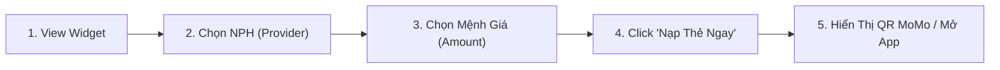

| Bước | Tên Giai Đoạn | Trải Nghiệm Người Dùng (UX) | Hạ Tầng / Cơ Chế Kỹ Thuật | Nền Tảng |
| :--- | :--- | :--- | :--- | :--- |
| 1 | Discovery | Người dùng nhìn thấy widget mua thẻ game trên trang | Tải DOM & Render component | Web |
| 2 | Configuration | Click chọn logo nhà phát hành (Zing, Garena...) | Cập nhật local state provider | Web |
| 3 | Amount Selection | Click chọn mệnh giá thẻ (10K, 20K, 50K...) | Cập nhật local state amount | Web |
| 4 | Purchase Intent | Click nút "Nạp Thẻ Ngay" (CTA) | Tạo link OneLink W2A có `?wui=` | Web |
| 5 | Conversion | Hiển thị mã QR thanh toán hoặc điều hướng mở App | Cổng thanh toán Native QR / OneLink | Web sang App |

#### 3. Cách Track & Event Name

| Event Name | Action | Payload Chuẩn (`umami data`) | Khi Nào Bắn Event? |
| :--- | :--- | :--- | :--- |
| `web_game_card_topup_form_view` | `view` | `{ page_name: "nap_the_game", form_name: "game_card_widget" }` | Khi widget render thành công trên viewport |
| `web_game_card_topup_provider_select` | `select` | `{ page_name: "nap_the_game", provider: "zing" }` | Khi click chọn nhà phát hành game |
| `web_game_card_topup_amount_select` | `select` | `{ page_name: "nap_the_game", provider: "zing", amount: 10000 }` | Khi click chọn mệnh giá |
| `web_game_card_topup_btn_click` | `click` | `{ page_name: "nap_the_game", button_name: "nap_the_ngay", provider: "zing", amount: 10000, click_url: "https://onelink.momo.vn/..." }` | Khi click nút "Nạp Thẻ Ngay" |
| `web_game_card_topup_qr_native_display` | `display` | `{ page_name: "nap_the_game", provider: "zing", amount: 10000, order_id: "ORD_123" }` | Khi popup QR MoMo hiển thị |

---

### TOOL 2: TÍNH LƯƠNG GROSS SANG NET (`gross_net_calculator`)

#### 1. Mô Tả Tool & Job-To-Be-Done (JTBD)
* **Mô tả:** Công cụ mô phỏng quy đổi lương Gross sang Net (và ngược lại) theo quy định mới nhất về Bảo hiểm xã hội và Thuế thu nhập cá nhân.
* **JTBD:** Khi nhận đề nghị mức lương mới hoặc chuẩn bị đàm phán lương, tôi muốn biết chính xác số tiền thực nhận sau khi trừ các khoản bảo hiểm và thuế TNCN để ra quyết định nhận việc hoặc cân đối chi tiêu cá nhân.

#### 2. User Flow & Điểm Chạm Tracking

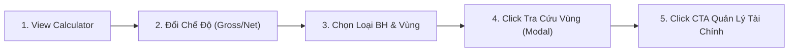

| Bước | Tên Giai Đoạn | Trải Nghiệm Người Dùng (UX) | Hạ Tầng / Cơ Chế Kỹ Thuật | Nền Tảng |
| :--- | :--- | :--- | :--- | :--- |
| 1 | Discovery | Nhìn thấy form tính lương trên trang tài chính | Render salary calculator component | Web |
| 2 | Mode Switch | Chuyển tab giữa Gross -> Net và Net -> Gross | Switch tab local state | Web |
| 3 | Insurance Config | Chọn loại đóng BH (toàn bộ lương / mức khác) | Update radio state & compute | Web |
| 4 | Region Lookup | Chọn vùng làm việc hoặc mở modal tra cứu vùng | Render modal tra cứu mức lương tối thiểu vùng | Web |
| 5 | Conversion (W2A) | Click nút CTA "Quản lý tài chính tự động" | Điều hướng OneLink W2A kèm tham số `wui` | Web sang App |

#### 3. Cách Track & Event Name Chi Tiết

| Điểm Chạm | Hành Động Thực Tế | Action | Event Name Chuẩn | Payload Bắt Buộc Gửi Về Umami (`data`) |
| :--- | :--- | :--- | :--- | :--- |
| **1. Đổi Gross / Net** | Click chuyển tab giữa Gross -> Net và Net -> Gross | `select` | `web_gross_net_calculator_tab_select` | `{ page_name: "tinh_luong", tab_name: "gross_to_net" }` (hoặc `net_to_gross`) |
| **2. Loại Đóng BH** | Chọn radio "Đóng trên toàn bộ lương" hoặc "Đóng với mức khác" | `select` | `web_gross_net_calculator_insurance_type_select` | `{ page_name: "tinh_luong", insurance_type: "full_salary" }` (hoặc `other_salary`) |
| **3A. Tra Cứu Vùng** | Click vào link/nút "Tra cứu vùng" để mở modal tra cứu | `click` | `web_gross_net_calculator_btn_click` | `{ page_name: "tinh_luong", button_name: "tra_cuu_vung" }` |
| **3B. Chọn Vùng** | Chọn Vùng I, Vùng II, Vùng III hoặc Vùng IV | `select` | `web_gross_net_calculator_region_select` | `{ page_name: "tinh_luong", region: "vung_1", source: "form_dropdown" }` (hoặc `modal_lookup`) |
| **4. Click CTA** | Bấm nút CTA "Quản lý tài chính tự động" mở App | `click` | `web_gross_net_calculator_btn_click` | `{ page_name: "tinh_luong", button_name: "quan_ly_tai_chinh_tu_dong", salary_range: "15m_25m", click_url: "https://onelink.momo.vn/...", auth_status: "anonymous" }` |

*(Sự kiện mở rộng: Khi modal Tra cứu mức lương tối thiểu vùng hiển thị thành công: `web_gross_net_calculator_popup_display` với `{ page_name: "tinh_luong", popup_name: "muc_luong_toi_thieu_vung" }`).*

---

### TOOL 3: PHÂN BỔ THU NHẬP 50/30/20 (`salary_allocation_calculator`)

#### 1. Mô Tả Tool & Job-To-Be-Done (JTBD)
* **Mô tả:** Công cụ hỗ trợ chia thu nhập hàng tháng theo quy tắc 50% Thiết yếu, 30% Linh hoạt, 20% Tích lũy.
* **JTBD:** Khi nhận lương hàng tháng, tôi muốn chia nhanh số tiền thành các khoản chi tiêu và tiết kiệm hợp lý để tránh chi tiêu quá tay và duy trì kỷ luật tài chính cá nhân.

#### 2. User Flow & Điểm Chạm Tracking

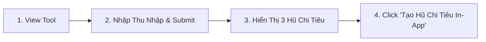

| Bước | Tên Giai Đoạn | Trải Nghiệm Người Dùng (UX) | Hạ Tầng / Cơ Chế Kỹ Thuật | Nền Tảng |
| :--- | :--- | :--- | :--- | :--- |
| 1 | Discovery | Người dùng nhìn thấy box phân bổ ngân sách 50/30/20 | Render budget component | Web |
| 2 | Execution | Nhập tổng thu nhập và bấm "Phân Bổ Ngay" | Tính toán phân bổ 3 quỹ | Web |
| 3 | Result Display | Hiển thị biểu đồ tròn và hạn mức của từng hũ tiền | Render pie chart & detail cards | Web |
| 4 | Conversion | Click nút "Tạo Hũ Chi Tiêu Trên MoMo" (CTA) | Điều hướng OneLink sang tính năng Hũ Chi Tiêu | Web sang App |

#### 3. Cách Track & Event Name

| Event Name | Action | Payload Chuẩn (`umami data`) | Khi Nào Bắn Event? |
| :--- | :--- | :--- | :--- |
| `web_salary_allocation_calculator_form_view` | `view` | `{ page_name: "phan_bo_luong", form_name: "budget_rule_form" }` | Tải xong giao diện |
| `web_salary_allocation_calculator_form_submit` | `submit` | `{ page_name: "phan_bo_luong", form_name: "budget_rule_form", form_status: "success" }` | Bấm nút "Phân Bổ Ngay" |
| `web_salary_allocation_calculator_result_card_display` | `display` | `{ page_name: "phan_bo_luong", result_status: "success", income_range: "15m_25m" }` | Hiển thị kết quả biểu đồ phân bổ |
| `web_salary_allocation_calculator_btn_click` | `click` | `{ page_name: "phan_bo_luong", button_name: "create_spending_pot", click_url: "https://onelink.momo.vn/..." }` | Bấm nút tạo hũ trên App MoMo |

---

### TOOL 4: TRA CỨU PHẠT NGUỘI GIAO THÔNG (`traffic_fine_lookup`)

#### 1. Mô Tả Tool & Job-To-Be-Done (JTBD)
* **Mô tả:** Công cụ tra cứu trực tiếp vi phạm giao thông toàn quốc từ hệ thống camera giám sát của Cục Cảnh sát giao thông.
* **JTBD:** Khi nghi ngờ phương tiện bị ghi hình vi phạm hoặc chuẩn bị đi đăng kiểm xe, tôi muốn tra cứu biển số xe xem có lỗi phạt nguội chưa nộp phạt hay không để chủ động xử lý kịp thời.

#### 2. User Flow & Điểm Chạm Tracking

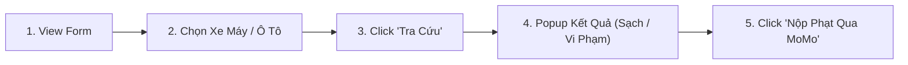

| Bước | Tên Giai Đoạn | Trải Nghiệm Người Dùng (UX) | Hạ Tầng / Cơ Chế Kỹ Thuật | Nền Tảng |
| :--- | :--- | :--- | :--- | :--- |
| 1 | Discovery | Nhìn thấy form tra cứu phạt nguội | Render fine lookup form | Web |
| 2 | Selection | Chọn loại phương tiện (Ô tô hoặc Xe máy) | Switch vehicle type state | Web |
| 3 | Execution | Nhập biển số và bấm "Tra cứu vi phạm" | Gọi API Backend Cổng CSGT | Web |
| 4 | Result Display | Popup kết quả: Xe không vi phạm HOẶC danh sách lỗi | Render modal kết quả tra cứu | Web |
| 5 | Conversion | Click nút "Nộp Phạt Trực Tuyến Qua MoMo" | Điều hướng OneLink W2A sang dịch vụ Nộp phạt | Web sang App |

#### 3. Cách Track & Event Name

| Event Name | Action | Payload Chuẩn (`umami data`) | Khi Nào Bắn Event? |
| :--- | :--- | :--- | :--- |
| `web_traffic_fine_lookup_form_view` | `view` | `{ page_name: "phat_nguoi", form_name: "traffic_fine_form" }` | Tải xong giao diện |
| `web_traffic_fine_lookup_tab_select` | `select` | `{ page_name: "phat_nguoi", vehicle_type: "car" }` | Click chọn loại xe (`car` / `motorcycle`) |
| `web_traffic_fine_lookup_form_submit` | `submit` | `{ page_name: "phat_nguoi", form_name: "traffic_fine_form", vehicle_type: "car" }` | Click nút "Tra cứu vi phạm" |
| `web_traffic_fine_lookup_popup_display` | `display` | `{ page_name: "phat_nguoi", popup_name: "fine_result", popup_value: "clean" }` | Popup hiển thị kết quả xe sạch |
| `web_traffic_fine_lookup_popup_display` | `display` | `{ page_name: "phat_nguoi", popup_name: "fine_result", popup_value: "violation", violation_count: 2 }` | Popup hiển thị có lỗi vi phạm |
| `web_traffic_fine_lookup_btn_click` | `click` | `{ page_name: "phat_nguoi", button_name: "pay_fine_in_app", click_url: "https://onelink.momo.vn/..." }` | Bấm nút nộp phạt qua App MoMo |

---

### TOOL 5: TRA CỨU GIÁ XĂNG DẦU HÔM NAY (`fuel_price_lookup`)

#### 1. Mô Tả Tool & Job-To-Be-Done (JTBD)
* **Mô tả:** Bảng cập nhật giá xăng RON 95-III, E5 RON 92, Dầu Diesel theo kỳ điều hành mới nhất của Liên Bộ Công Thương - Tài Chính.
* **JTBD:** Khi nghe tin điều chỉnh giá xăng dầu, tôi muốn xem ngay bảng giá xăng mới nhất theo từng vùng để nắm bắt biến động chi phí sinh hoạt.

#### 2. User Flow & Điểm Chạm Tracking

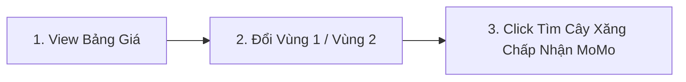

| Bước | Tên Giai Đoạn | Trải Nghiệm Người Dùng (UX) | Hạ Tầng / Cơ Chế Kỹ Thuật | Nền Tảng |
| :--- | :--- | :--- | :--- | :--- |
| 1 | Discovery | Xem bảng giá xăng dầu cập nhật theo thời gian thực | Render fuel price table | Web |
| 2 | Selection | Click tab đổi giữa Vùng 1 và Vùng 2 | Filter data theo vùng Petrolimex | Web |
| 3 | Conversion | Click nút "Tìm Cây Xăng Đổ Xăng Thanh Toán MoMo" | Điều hướng sang Map / OneLink | Web sang App |

#### 3. Cách Track & Event Name

| Event Name | Action | Payload Chuẩn (`umami data`) | Khi Nào Bắn Event? |
| :--- | :--- | :--- | :--- |
| `web_fuel_price_lookup_result_card_view` | `view` | `{ page_name: "gia_xang", provider: "petrolimex" }` | Hiển thị bảng giá xăng thành công |
| `web_fuel_price_lookup_tab_select` | `select` | `{ page_name: "gia_xang", fuel_zone: "zone_1" }` | Click chuyển đổi Vùng 1 / Vùng 2 |
| `web_fuel_price_lookup_btn_click` | `click` | `{ page_name: "gia_xang", button_name: "find_gas_station_momo", click_url: "https://onelink.momo.vn/..." }` | Bấm nút tìm trạm xăng đổ qua MoMo |

---

### TOOL 6: TRA CỨU THỜI HẠN THẺ BẢO HIỂM Y TẾ (`bhyt_lookup`)

#### 1. Mô Tả Tool & Job-To-Be-Done (JTBD)
* **Mô tả:** Công cụ tra cứu thông tin giá trị sử dụng của thẻ BHYT và ngày hết hạn từ cổng dữ liệu Bảo hiểm Xã hội Việt Nam.
* **JTBD:** Khi đi khám chữa bệnh hoặc lo lắng thẻ BHYT hết hiệu lực, tôi muốn kiểm tra nhanh ngày hết hạn thẻ để chủ động gia hạn kịp thời tránh gián đoạn quyền lợi bảo hiểm 5 năm liên tục.

#### 2. User Flow & Điểm Chạm Tracking

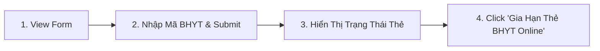

| Bước | Tên Giai Đoạn | Trải Nghiệm Người Dùng (UX) | Hạ Tầng / Cơ Chế Kỹ Thuật | Nền Tảng |
| :--- | :--- | :--- | :--- | :--- |
| 1 | Discovery | Người dùng nhìn thấy form tra cứu BHYT | Render BHYT form | Web |
| 2 | Execution | Nhập mã BHYT/CCCD và bấm "Tra cứu" | Gọi API xác thực BHXH | Web |
| 3 | Result Display | Hiển thị kết quả: Còn hạn / Sắp hết hạn / Đã hết hạn | Render result status modal | Web |
| 4 | Conversion | Click nút "Gia Hạn Ngay Qua MoMo" | Mở cổng thanh toán BHYT Native/OneLink | Web sang App |

#### 3. Cách Track & Event Name

| Event Name | Action | Payload Chuẩn (`umami data`) | Khi Nào Bắn Event? |
| :--- | :--- | :--- | :--- |
| `web_bhyt_lookup_form_view` | `view` | `{ page_name: "bhyt", form_name: "bhyt_lookup_form" }` | Tải xong giao diện |
| `web_bhyt_lookup_form_submit` | `submit` | `{ page_name: "bhyt", form_name: "bhyt_lookup_form", form_status: "success" }` | Bấm nút "Tra cứu thẻ" |
| `web_bhyt_lookup_popup_display` | `display` | `{ page_name: "bhyt", popup_name: "bhyt_result", popup_value: "expiring_soon" }` | Hiển thị kết quả sắp hết hạn |
| `web_bhyt_lookup_btn_click` | `click` | `{ page_name: "bhyt", button_name: "renew_bhyt_now", click_url: "https://onelink.momo.vn/..." }` | Bấm nút Gia hạn thẻ qua MoMo |

---

### TOOL 7: BẢNG TỶ GIÁ NGOẠI TỆ THỜI GIAN THỰC (`exchange_rate_lookup`)

#### 1. Mô Tả Tool & Job-To-Be-Done (JTBD)
* **Mô tả:** Công cụ quy đổi tỷ giá tiền tệ trực tiếp giữa VND và các ngoại tệ phổ biến (USD, EUR, JPY, KRW...) theo dữ liệu ngân hàng.
* **JTBD:** Khi chuẩn bị đi du lịch, mua hàng quốc tế hoặc gửi kiều hối, tôi muốn kiểm tra tỷ giá quy đổi chính xác theo thời gian thực để tính toán số tiền VND cần chuẩn bị.

#### 2. User Flow & Điểm Chạm Tracking

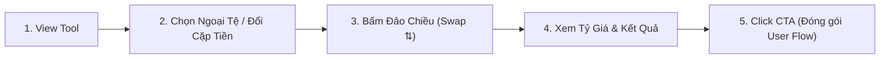

| Bước | Tên Giai Đoạn | Trải Nghiệm Người Dùng (UX) | Hạ Tầng / Cơ Chế Kỹ Thuật | Nền Tảng |
| :--- | :--- | :--- | :--- | :--- |
| 1 | Discovery | Truy cập widget quy đổi tỷ giá ngoại tệ | Render exchange rate converter | Web |
| 2 | Currency Selection | Chọn nhanh pill ngoại tệ (USD, EUR, JPY...) hoặc dropdown | Client state update & recalculate | Web |
| 3 | Direction Swap | Bấm nút đảo chiều `⇅` để chuyển hướng (Ngoại tệ $\leftrightarrow$ VND) | Swap source and target currencies | Web |
| 4 | Rate Inspection | Xem kết quả quy đổi và giá mua/bán từ ngân hàng | Compute client-side via cached rates | Web |
| 5 | Conversion (Endpoint)| Bấm nút CTA "Trải nghiệm Nhận tiền quốc tế" | **Đóng gói toàn bộ User Flow vào CTA payload** | Web sang App |

#### 3. Cách Track & Event Name Chi Tiết

| Mục Tiêu Đo Lường | Thao Tác Của Người Dùng | Action | Event Name Chuẩn | Payload Bắt Buộc Gửi Về Umami (`data`) |
| :--- | :--- | :--- | :--- | :--- |
| **1. Chọn pill ngoại tệ nhanh** | Bấm chọn pill ngoại tệ trên cùng (USD, EUR, JPY, GBP...) | `select` | `web_exchange_rate_lookup_currency_select` | `{ page_name: "ty_gia", foreign_currency: "USD", currency_pair: "USD_VND", direction: "to_vnd" }` |
| **2. Bấm nút đảo chiều (Swap)** | Bấm nút mũi tên 2 chiều `⇅` để đổi ngược vị trí tiền tệ | `click` | `web_exchange_rate_lookup_swap_btn_click` | `{ page_name: "ty_gia", currency_pair: "VND_USD", direction: "from_vnd", foreign_currency: "USD" }` |
| **3. Cặp tiền chuyển đổi (Dropdown)**| Đổi đồng tiền nguồn hoặc đích qua menu dropdown | `select` | `web_exchange_rate_lookup_currency_select` | `{ page_name: "ty_gia", source_currency: "USD", target_currency: "VND", currency_pair: "USD_VND", direction: "to_vnd", foreign_currency: "USD" }` |
| **4. CLICK CTA (ENDPOINT)** | Bấm nút màu hồng **"Trải nghiệm Nhận tiền quốc tế"** | `click` | `web_exchange_rate_lookup_btn_click` | `{ page_name: "ty_gia", button_name: "trai_nghiem_nhan_tien_quoc_te", currency_pair: "USD_VND", direction: "to_vnd", foreign_currency: "USD", source_currency: "USD", target_currency: "VND", amount: 100, provider: "vietcombank", click_url: "https://onelink.momo.vn/...", auth_status: "anonymous" }` |

> **Quy Chuẩn Bóc Tách 2 Bài Toán Nghiệp Vụ Trên Umami:**
> 1. **Cặp tiền chuyển đổi nhiều nhất:** Lọc thuộc tính `currency_pair` (ví dụ: `USD_VND`, `EUR_VND`, `JPY_VND`, `VND_USD`) để xếp hạng ngay Top cặp tiền tệ được quan tâm nhất.
> 2. **Top đồng tiền chuyển ra VND và ngược lại:**
>    * **Ngoại tệ $\rightarrow$ VND (`direction: "to_vnd"`):** Lọc theo `foreign_currency` để biết đồng tiền nào được kiều bào/người nhận tiền quốc tế chuyển về nhiều nhất (USD, EUR, JPY, KRW...).
>    * **VND $\rightarrow$ Ngoại tệ (`direction: "from_vnd"`):** Lọc theo `foreign_currency` để biết người dùng trong nước có nhu cầu quy đổi mua ngoại tệ nào nhiều nhất (phục vụ du lịch, du học).

---

### TOOL 8: BẢNG GIÁ VÀNG SJC / PNJ TRỰC TUYẾN (`gold_price_lookup`)

#### 1. Mô Tả Tool & Job-To-Be-Done (JTBD)
* **Mô tả:** Bảng theo dõi giá vàng miếng SJC, vàng nhẫn 9999, DOJI, PNJ cập nhật liên tục theo ngày.
* **JTBD:** Khi có nhu cầu mua vàng tích trữ hoặc đầu tư, tôi muốn theo dõi biến động giá vàng mua vào - bán ra trong ngày để chọn thời điểm giao dịch tối ưu.

#### 2. User Flow & Điểm Chạm Tracking

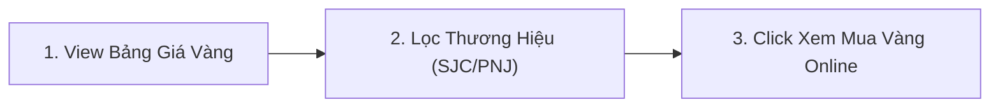

| Bước | Tên Giai Đoạn | Trải Nghiệm Người Dùng (UX) | Hạ Tầng / Cơ Chế Kỹ Thuật | Nền Tảng |
| :--- | :--- | :--- | :--- | :--- |
| 1 | Discovery | Xem bảng giá mua vào - bán ra của các loại vàng | Render gold table | Web |
| 2 | Filter | Lọc theo thương hiệu (SJC, DOJI, PNJ) hoặc loại vàng | Filter local data | Web |
| 3 | Conversion | Click nút tìm hiểu tính năng Mua vàng online trên MoMo | Điều hướng OneLink sang dịch vụ Vàng MoMo | Web sang App |

#### 3. Cách Track & Event Name

| Event Name | Action | Payload Chuẩn (`umami data`) | Khi Nào Bắn Event? |
| :--- | :--- | :--- | :--- |
| `web_gold_price_lookup_result_card_view` | `view` | `{ page_name: "gia_vang", provider: "sjc" }` | Tải bảng giá vàng thành công |
| `web_gold_price_lookup_tab_select` | `select` | `{ page_name: "gia_vang", provider: "pnj", gold_type: "nhan_24k" }` | Click đổi thương hiệu/loại vàng |
| `web_gold_price_lookup_btn_click` | `click` | `{ page_name: "gia_vang", button_name: "open_gold_saving_in_app", click_url: "https://onelink.momo.vn/..." }` | Bấm tìm hiểu mua vàng tích lũy in-app |

---

### TOOL 9: TRA CỨU ĐIỂM TÍN DỤNG & NỢ XẤU CIC (`cic_lookup`)

#### 1. Mô Tả Tool & Job-To-Be-Done (JTBD)
* **Mô tả:** Công cụ hỗ trợ người dùng kiểm tra nhanh điều kiện tín dụng và nguy cơ nợ xấu trước khi nộp hồ sơ vay vốn hoặc mở thẻ tín dụng.
* **JTBD:** Khi có kế hoạch vay ngân hàng hoặc mở thẻ tín dụng, tôi muốn kiểm tra trước lịch sử tín dụng xem mình có thuộc diện nợ xấu hay không để chủ động khắc phục.

#### 2. User Flow & Điểm Chạm Tracking

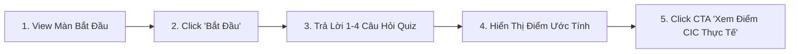

| Bước | Tên Giai Đoạn | Trải Nghiệm Người Dùng (UX) | Hạ Tầng / Cơ Chế Kỹ Thuật | Nền Tảng |
| :--- | :--- | :--- | :--- | :--- |
| 1 | Discovery | Truy cập widget Quiz "Ước tính khoảng điểm CIC của bạn" | Render quiz onboarding screen | Web |
| 2 | Quiz Start | Bấm nút màu hồng "Bắt đầu ->" để vào bộ câu hỏi | Update quiz state sang question 1 | Web |
| 3 | Question Flow | Trả lời từ 1 đến 4 câu hỏi về lịch sử vay, trễ hạn, nợ xấu | Client state flow (không bắn event lắt nhắt) | Web |
| 4 | Result Display | Hiển thị màn hình kết quả ước tính (ví dụ: 545–587 điểm) | Render result card & score band | Web |
| 5 | Conversion (Endpoint)| Bấm nút CTA "Xem điểm CIC thực tế ->" mở App | **Đóng gói toàn bộ kết quả Quiz vào CTA payload** | Web sang App |

#### 3. Cách Track & Event Name Chi Tiết (Bắt Đầu & CTA)

| Điểm Chạm Đo Lường | Thao Tác Của Người Dùng | Action | Event Name Chuẩn | Payload Bắt Buộc Gửi Về Umami (`data`) |
| :--- | :--- | :--- | :--- | :--- |
| **1. VIEW MÀN HÌNH** | Giao diện mở đầu Quiz CIC hiển thị trên màn hình | `view` | `web_cic_lookup_form_view` | `{ page_name: "cic", form_name: "cic_quiz_widget" }` |
| **2. CLICK BẮT ĐẦU** | Bấm nút màu hồng **"Bắt đầu ->"** để bắt đầu làm Quiz | `click` | `web_cic_lookup_btn_click` | `{ page_name: "cic", button_name: "bat_dau" }` |
| **3. HIỂN THỊ KẾT QUẢ** | Màn hình hiển thị khoảng điểm (ví dụ: 545–587) | `display` | `web_cic_lookup_result_card_display` | `{ page_name: "cic", cic_score_range: "545_587" }` |
| **4. CLICK THỬ LẠI** | Bấm nút "Thử lại" để làm lại Quiz | `click` | `web_cic_lookup_btn_click` | `{ page_name: "cic", button_name: "thu_lai" }` |
| **5. CLICK CTA (ENDPOINT)** | Bấm nút màu hồng **"Xem điểm CIC thực tế ->"** | `click` | `web_cic_lookup_btn_click` | `{ page_name: "cic", button_name: "xem_diem_cic_thuc_te", cic_score_range: "545_587", click_url: "https://onelink.momo.vn/...", auth_status: "anonymous" }` |

> **Nguyên Tắc Đo Lường Funnel Cho Quiz CIC:**
> * **Tỷ Lệ Bắt Đầu Quiz:** $\frac{\text{web\_cic\_lookup\_btn\_click (button\_name: "bat\_dau")}}{\text{web\_cic\_lookup\_form\_view}}$
> * **Tỷ Lệ Hoàn Thành Quiz:** $\frac{\text{web\_cic\_lookup\_result\_card\_display}}{\text{web\_cic\_lookup\_btn\_click (button\_name: "bat\_dau")}}$
> * **Tỷ Lệ Chuyển Đổi Mở App (W2A CVR):** $\frac{\text{web\_cic\_lookup\_btn\_click (button\_name: "xem\_diem\_cic\_thuc_te")}}{\text{web\_cic\_lookup\_result\_card\_display}}$

---

### TOOL 10: TÌM KIẾM GARAGE & CỨU HỘ GIAO THÔNG (`garage_lookup`)

#### 1. Mô Tả Tool & Job-To-Be-Done (JTBD)
* **Mô tả:** Bản đồ và danh bạ tra cứu các điểm sửa xe, garage uy tín và số hotline cứu hộ giao thông khẩn cấp theo khu vực.
* **JTBD:** Khi xe gặp sự cố hỏng hóc giữa đường hoặc cần bảo dưỡng định kỳ, tôi muốn tìm ngay garage uy tín gần nhất và có số hotline liên hệ để được hỗ trợ kịp thời.

#### 2. User Flow & Điểm Chạm Tracking

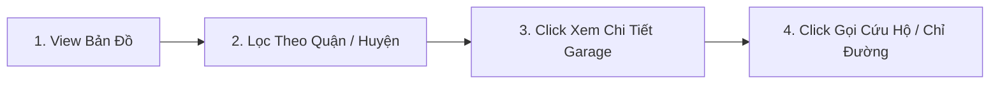

| Bước | Tên Giai Đoạn | Trải Nghiệm Người Dùng (UX) | Hạ Tầng / Cơ Chế Kỹ Thuật | Nền Tảng |
| :--- | :--- | :--- | :--- | :--- |
| 1 | Discovery | Xem danh sách garage và bản đồ cứu hộ | Render garage map & list | Web |
| 2 | Filtering | Chọn Tỉnh/Thành phố và Quận/Huyện | Filter danh sách garage theo vị trí | Web |
| 3 | Engagement | Click vào thẻ garage cụ thể để xem đánh giá | Expand garage detail view | Web |
| 4 | Action | Click gọi số hotline cứu hộ hoặc bấm xem chỉ đường | Kích hoạt tel: hoặc Google Maps | Web |

#### 3. Cách Track & Event Name

| Event Name | Action | Payload Chuẩn (`umami data`) | Khi Nào Bắn Event? |
| :--- | :--- | :--- | :--- |
| `web_garage_lookup_form_view` | `view` | `{ page_name: "garage", form_name: "garage_filter_form" }` | Tải xong giao diện |
| `web_garage_lookup_form_submit` | `submit` | `{ page_name: "garage", city: "hcm", district: "quan_1" }` | Bấm lọc theo khu vực |
| `web_garage_lookup_result_card_display` | `display` | `{ page_name: "garage", total_results: 15 }` | Hiển thị danh sách kết quả |
| `web_garage_lookup_btn_click` | `click` | `{ page_name: "garage", button_name: "call_rescue_hotline", garage_id: "gar_001" }` | Click gọi cứu hộ khẩn cấp |
| `web_garage_lookup_btn_click` | `click` | `{ page_name: "garage", button_name: "get_direction", garage_id: "gar_001" }` | Click xem chỉ đường tới garage |

---

### TOOL 11: TÍNH LÃI TIẾT KIỆM NGÂN HÀNG (`saving_interest_calculator`)

#### 1. Mô Tả Tool & Job-To-Be-Done (JTBD)
* **Mô tả:** Công cụ tính toán lãi suất tiết kiệm theo số tiền, kỳ hạn và ngân hàng; tích hợp Trợ lý MoMo AI tính toán bù đắp chênh lệch lãi ròng (Net Yield Gap) và kích hoạt phễu Web-to-App mở sổ Tiết Kiệm Online trên MoMo.
* **JTBD:** Khi có một khoản tiền nhàn rỗi, tôi muốn tính toán nhanh số tiền lãi nhận được và biết ngân hàng nào đang có lãi suất cao hơn để tối đa hóa lợi nhuận mà không tốn công đến từng quầy ngân hàng tra cứu.

#### 2. User Flow & Điểm Chạm Tracking

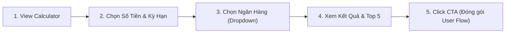

| Bước | Tên Giai Đoạn | Trải Nghiệm Người Dùng (UX) | Hạ Tầng / Cơ Chế Kỹ Thuật | Nền Tảng |
| :--- | :--- | :--- | :--- | :--- |
| 1 | Discovery | Truy cập trang tiện ích tính lãi tiết kiệm ngân hàng | Render calculator widget | Web |
| 2 | Term & Amount | Chọn số tiền gửi (pills) và kỳ hạn (1, 3, 6, 12, 24 tháng) | Client state update | Web |
| 3 | Bank Selection | Mở dropdown và chọn ngân hàng (Bac A Bank, ACB...) | Client state update & compute | Web |
| 4 | Comparison | Xem lãi thực nhận và mở rộng "Top 5 ngân hàng lãi suất tốt nhất" | Render comparison table | Web |
| 5 | Conversion (Endpoint)| Bấm nút CTA "Khám phá Trung Tâm Tài Chính" mở App | **Đóng gói toàn bộ User Flow vào CTA payload** | Web sang App |

#### 3. Cách Track & Event Name Chi Tiết

| Yêu Cầu Đo Lường | Hành Động Người Dùng | Action | Event Name Chuẩn | Payload Bắt Buộc Gửi Về Umami (`data`) |
| :--- | :--- | :--- | :--- | :--- |
| **1. Ngân Hàng Lựa Chọn** | Chọn ngân hàng trong dropdown (ABBank, ACB, Bac A Bank...) | `select` | `web_saving_interest_calculator_provider_select` | `{ page_name: "tinh_lai_tiet_kiem", provider: "bac_a_bank", term: 12, term_and_bank: "12m_bac_a_bank" }` |
| **2. Kỳ Hạn Lựa Chọn** | Bấm chọn pill kỳ hạn (1, 3, 6, 12, 24 tháng) | `select` | `web_saving_interest_calculator_term_select` | `{ page_name: "tinh_lai_tiet_kiem", term: 12, provider: "bac_a_bank", term_and_bank: "12m_bac_a_bank" }` |
| **3. Chọn Số Tiền** | Bấm chọn pill số tiền (50tr, 100tr, 200tr, 500tr, 1 tỷ) | `select` | `web_saving_interest_calculator_amount_select` | `{ page_name: "tinh_lai_tiet_kiem", amount: 100000000 }` |
| **4. Xem Top 5 Ngân Hàng** | Bấm mở rộng / thu gọn "So sánh top 5 ngân hàng..." | `click` | `web_saving_interest_calculator_btn_click` | `{ page_name: "tinh_lai_tiet_kiem", button_name: "so_sanh_top_5_ngan_hang", toggle_state: "expand" }` |
| **5. CLICK CTA (ENDPOINT)** | Bấm nút màu hồng **"Khám phá Trung Tâm Tài Chính"** | `click` | `web_saving_interest_calculator_btn_click` | `{ page_name: "tinh_lai_tiet_kiem", button_name: "kham_pha_trung_tam_tai_chinh", provider: "bac_a_bank", term: 12, term_and_bank: "12m_bac_a_bank", amount: 100000000, interest_rate: 5.60, click_url: "https://onelink.momo.vn/...", auth_status: "anonymous" }` |

> **Nguyên Tắc Đóng Gói User Flow Tại Endpoint (Chốt Chặn CTA):**
> Khi người dùng bấm nút CTA (Endpoint), hệ thống gom toàn bộ trạng thái cuối cùng của User Flow (`provider`, `term`, `term_and_bank`, `amount`, `interest_rate`) vào một payload duy nhất. Nhờ đó, Product Lead có thể query trực tiếp trên Umami để biết chính xác người dùng quyết định chọn cặp (Kỳ Hạn + Ngân Hàng) nào trước khi mở App.

---

### TOOL 12: MINI GAME QUÝT (`game_quyt`)

#### 1. Mô Tả Tool & Job-To-Be-Done (JTBD)
* **Mô tả:** Mini game tương tác giải trí "Game Quýt" trên Web MoMo, đóng vai trò công cụ Gamification thu hút lưu lượng, gia tăng thời gian onsite (Time-on-site / Engagement) và dẫn dắt người dùng tải App / mở App MoMo để nhận quà hoặc tiếp tục lượt chơi.
* **JTBD:** Khi người dùng truy cập Web MoMo, tôi muốn trải nghiệm nhanh một trò chơi giải trí nhẹ nhàng, vui nhộn ngay trên trình duyệt mà không cần cài đặt phức tạp, từ đó có động lực tải và mở App MoMo để nhận phần thưởng thực tế hoặc mở khóa các màn chơi tiếp theo.

#### 2. User Flow & Điểm Chạm Tracking

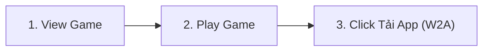

| Bước | Tên Giai Đoạn | Trải Nghiệm Người Dùng (UX) | Hạ Tầng / Cơ Chế Kỹ Thuật | Nền Tảng |
| :--- | :--- | :--- | :--- | :--- |
| 1 | Discovery | Truy cập trang và nhìn thấy màn hình giới thiệu / giao diện Game Quýt | Tải DOM & Render game canvas/container | Web |
| 2 | Engagement | Click nút "Chơi Ngay" và bắt đầu lượt tương tác game | Khởi tạo game loop / update local state | Web |
| 3 | Conversion | Click nút "Tải App MoMo" / "Mở App Nhận Quà" (CTA W2A) | Router điều hướng OneLink kèm tham số `wui` | Web sang App |

#### 3. Cách Track & Event Name

| Event Name | Action | Payload Chuẩn (`umami data`) | Khi Nào Bắn Event? |
| :--- | :--- | :--- | :--- |
| `web_game_quyt_game_view` | `view` | `{ page_name: "game_quyt", game_name: "quyt", form_name: "game_quyt_container" }` | Khi giao diện game tải xong và hiển thị trên màn hình |
| `web_game_quyt_play_btn_click` | `click` | `{ page_name: "game_quyt", button_name: "play_now", game_name: "quyt" }` | Khi click nút "Chơi ngay" bắt đầu lượt chơi |
| `web_game_quyt_btn_click` | `click` | `{ page_name: "game_quyt", button_name: "download_app", game_name: "quyt", click_url: "https://onelink.momo.vn/...", auth_status: "anonymous" }` | Khi click nút "Tải App" / "Mở App Nhận Quà" dẫn sang OneLink |

*(Tùy chọn bổ sung nếu game có màn kết thúc tính điểm:)*
* `web_game_quyt_result_card_display` (Action: `display`): Bắn khi người dùng kết thúc lượt chơi với payload `{ page_name: "game_quyt", score: 100, result_status: "completed" }`.

---

### TOOL 13: ƯỚC TÍNH TIỀN GỬI TIẾT KIỆM ONLINE (`saving_estimate_calculator`)

#### 1. Mô Tả Tool & Job-To-Be-Done (JTBD)
* **Mô tả:** Công cụ ước tính tiền gửi tiết kiệm online trên MoMo, hỗ trợ tính toán số tiền lãi nhận được theo 2 hình thức: "Gửi 1 lần" hoặc "Gửi đều hàng tháng", với các kỳ hạn từ 1 tháng đến 24 tháng kèm bảng so sánh lãi suất.
* **JTBD:** Khi có nhu cầu gửi tiết kiệm tích lũy, tôi muốn ước tính nhanh số tiền lãi nhận được và so sánh các kỳ hạn để chọn phương án gửi tiền tối ưu nhất trước khi mở sổ online trên App MoMo.

#### 2. User Flow & Điểm Chạm Tracking

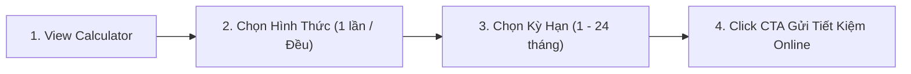

| Bước | Tên Giai Đoạn | Trải Nghiệm Người Dùng (UX) | Hạ Tầng / Cơ Chế Kỹ Thuật | Nền Tảng |
| :--- | :--- | :--- | :--- | :--- |
| 1 | Discovery | Truy cập widget ước tính tiền gửi tiết kiệm online | Render saving estimate component | Web |
| 2 | Method Selection | Chọn tab hình thức gửi ("Gửi 1 lần" hoặc "Gửi đều hàng tháng") | Switch method local state | Web |
| 3 | Term Selection | Bấm chọn kỳ hạn gửi (1, 3, 6, 9, 12, 24 tháng kèm lãi suất tương ứng) | Compute client-side & update AI advice | Web |
| 4 | Conversion (Endpoint)| Bấm nút CTA "Gửi tiết kiệm Online" mở App MoMo | **Đóng gói toàn bộ User Flow vào CTA payload** | Web sang App |

#### 3. Cách Track & Event Name Chi Tiết (View & Click)

| Loại Tương Tác | Điểm Chạm Đo Lường | Action | Event Name Chuẩn | Payload Bắt Buộc Gửi Về Umami (`data`) |
| :--- | :--- | :--- | :--- | :--- |
| **VIEW** | Widget tải xong và hiển thị trên màn hình | `view` | `web_saving_estimate_calculator_form_view` | `{ page_name: "tiet_kiem_online", form_name: "saving_estimate_widget" }` |
| **CLICK** | Chọn hình thức gửi ("Gửi 1 lần" / "Gửi đều hàng tháng") | `select` | `web_saving_estimate_calculator_tab_select` | `{ page_name: "tiet_kiem_online", deposit_method: "one_time" }` *(hoặc `"recurring_monthly"`)* |
| **CLICK** | Bấm chọn pill kỳ hạn (1, 3, 6, 9, 12, 24 tháng) | `select` | `web_saving_estimate_calculator_term_select` | `{ page_name: "tiet_kiem_online", term: 12, interest_rate: 8.0, deposit_method: "one_time" }` |
| **CLICK** | Bấm mở rộng "Xem bảng so sánh lãi suất giữa các kỳ hạn" | `click` | `web_saving_estimate_calculator_btn_click` | `{ page_name: "tiet_kiem_online", button_name: "so_sanh_lai_suat_ky_han", toggle_state: "expand" }` |
| **CLICK (ENDPOINT)**| Bấm nút màu hồng **"Gửi tiết kiệm Online"** | `click` | `web_saving_estimate_calculator_btn_click` | `{ page_name: "tiet_kiem_online", button_name: "gui_tiet_kiem_online", deposit_method: "one_time", term: 12, interest_rate: 8.0, amount: 100000, expected_interest: 8000, total_receive: 108000, click_url: "https://onelink.momo.vn/...", auth_status: "anonymous" }` |

---

## 3. CHECKLIST NGHIỆM THU DÀNH CHO KỸ SƯ (SIGN-OFF CHECKLIST)

Trước khi gửi pull request hoặc đưa công cụ lên môi trường Production, Kỹ sư Frontend bắt buộc phải tự kiểm tra 4 tiêu chí sau:

1. **Tuân Thủ MoSpark Tool ID (Registry Match):** Mã `[mospark_tool_id]` trong event name có khớp chính xác 1-1 với mã được setup trong MoSpark Registry hay không? (Ví dụ: dùng đúng `cic_lookup`, không tự đặt thành `credit_score` hay `cic_test`).
2. **Không Rò Rỉ PII (Zero-PII Audit):** Mở tab Network của trình duyệt (F12), gõ lọc `api/send` của Umami. Đảm bảo trong phần `eventData` không chứa bất kỳ chuỗi ký tự nào là CCCD, Họ tên, SĐT hay Mức lương thật của người dùng.
3. **Độ Bền Vững W2A (OneLink Attribution):** Mọi sự kiện nút bấm CTA mở App (`web_[mospark_tool_id]_btn_click`) bắt buộc phải gửi thuộc tính `click_url` chứa link OneLink hoàn chỉnh kèm tham số `wui` của phiên làm việc.
4. **Không Bắn Event Rác (No Flooding):** Kiểm tra xem thao tác gõ phím trên ô input hoặc lướt chuột trên màn hình có vô tình kích hoạt request Umami nào hay không. Nếu có, phải gỡ bỏ ngay lập tức.
