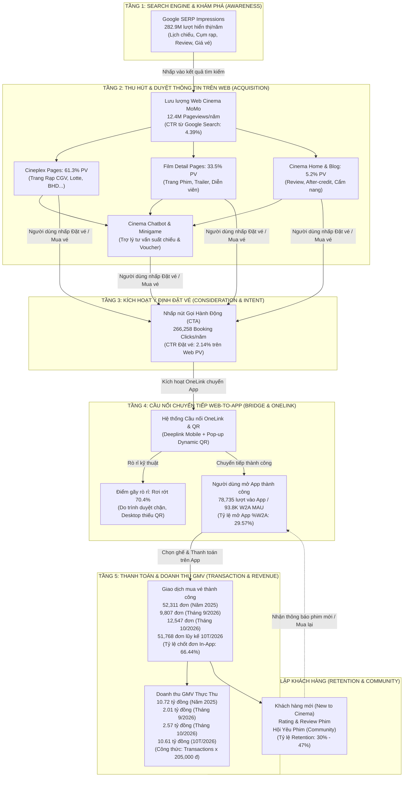

# KIẾN TRÚC PHỄU CHUYỂN ĐỔI TOÀN DIỆN CINEMA HUB (CINEMA GROWTH FUNNEL)

Tài liệu xác lập mô hình Phễu Chuyển Đổi Toàn Diện (End-to-End Cinema Growth Funnel) cho dự án Cinema Hub hợp tác giữa Web Platform và BU Movies. Phễu chuẩn hóa hành trình người dùng qua 5 tầng từ lúc phát sinh nhu cầu tìm kiếm trên Google Search đến khi mua vé thành công trên ứng dụng MoMo và vòng lặp giữ chân người dùng.

---

## 1. SƠ ĐỒ DÒNG CHẢY PHỄU CINEMA HUB (FLOWCHART TD)

---

## 2. BẢNG BÓC TÁCH CHỈ SỐ THEO TỪNG TẦNG PHỄU (FUNNEL METRICS TABLE)

| Tầng Phễu | Chỉ số chính | Giá trị chuẩn (Benchmark 2025) | Giá trị 8 Tháng 2026 | Tỷ lệ chuyển đổi tầng (%CR) | Điểm nghẽn chính | Giải pháp tối ưu hóa |
| :--- | :--- | :--- | :--- | :--- | :--- | :--- |
| **Tầng 1: Search Demand** | Google Search Impressions | 282,940,000 | ~190,000,000 | 4.39% (SERP CTR) | Thứ hạng từ khóa chưa đều ở top 1-3 | Mở rộng SEO cụm rạp địa phương và lịch chiếu |
| **Tầng 2: Web Acquisition** | Total Web Traffic (PV) | 12,425,040 | ~9,200,000 | 100% | Trang tĩnh, thiếu tương tác tư vấn | Tích hợp Cinema Chatbot và Minigame giữ chân |
| **Tầng 3: Intent Activation** | Booking Clicks | 266,258 | ~185,000 | 2.14% (CTR trên PV) | Nút CTA đặt vé chưa nổi bật, thiếu preview rạp | Bổ sung Floating CTA và bảng chọn suất chiếu nhanh |
| **Tầng 4: Web-to-App Bridge** | Traffic inApp (W2A MAU) | 78,735 (93,758 MAU) | 49,282 MAU | **29.57% (%W2A)** | **Rơi rớt 70.4% ở bước OneLink** | Smart Bridge Page, Dynamic QR trên Desktop |
| **Tầng 5: Purchase & GMV** | Transactions / GMV | 52,311 đơn / 10.72 tỷ đ thực thu | 12,547 đơn / 2.57 tỷ đ (T10) | **66.44% (In-App CR)** | Thời gian giữ ghế ngắn, hết suất đẹp | Giữ nguyên ngữ cảnh rạp/suất chiếu từ Web sang App |
| **Tầng 6: Retention** | MAU Retention Rate | 17% - 47% | 30% - 42% | Vòng lặp mua lại | Thiếu chương trình nuôi dưỡng người dùng từ Web | Khuyến mãi độc quyền lần đầu cho khách hàng Inbound |

---

## 3. PHÂN TÍCH BA NÚT THẮT QUAN TRỌNG NHẤT CỦA PHỄU

### Nút thắt 1: Rò rỉ lớn nhất ở bước chuyển Web sang App (Tầng 3 sang Tầng 4)
* **Hiện tượng:** Có 266,258 người dùng nhấp vào nút "Đặt vé" trên Web, nhưng chỉ có 78,735 lượt vào được App MoMo. Tỷ lệ rơi rớt lên tới 70.43%.
* **Nguyên nhân cốt lõi:** Trình duyệt Safari chặn deeplink tự động; người dùng truy cập bằng máy tính (Desktop) không có cơ chế chuyển giao tức thì; trang đệm (Bridge Page) tải chậm.
* **Đòn bẩy kinh tế:** Cải thiện tỷ lệ này từ 29.57% lên 45.0% giúp mang về thêm **+10.03 tỷ đồng GMV/năm** cho BU Movies.

### Nút thắt 2: Tỷ lệ kích hoạt ý định mua vé trên Web còn thấp (Tầng 2 sang Tầng 3)
* **Hiện tượng:** Tỷ lệ nhấp đặt vé mới đạt 2.14% trên tổng lưu lượng 12.4 triệu lượt xem trang.
* **Nguyên nhân cốt lõi:** Người dùng vào đọc tin tức, review hoặc xem thông tin diễn viên rồi rời đi mà không thấy đường dẫn đặt vé phù hợp với nhu cầu.
* **Giải pháp:** Chatbot AI đóng vai trò "Trợ lý phòng vé", chủ động gợi ý: *"Phim này đang chiếu tại CGV gần bạn lúc 19:30, đặt vé ngay để nhận giảm 20K"*.

### Nút thắt 3: Giữ chân khách hàng sau giao dịch đầu tiên (Tầng 5 sang Tầng 6)
* **Hiện tượng:** Khách hàng từ Web thường là khách hàng có nhu cầu đột xuất theo từng bộ phim cụ thể (Event-driven).
* **Giải pháp:** Sau khi thanh toán vé thành công trên App, tự động cấp huy hiệu thành viên và gửi thông báo nhắc lịch cho các bom tấn tiếp theo cùng thể loại.
