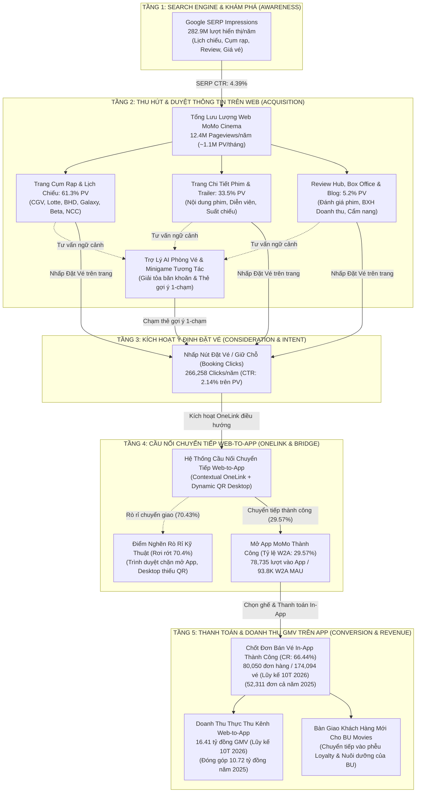
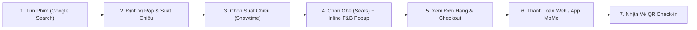
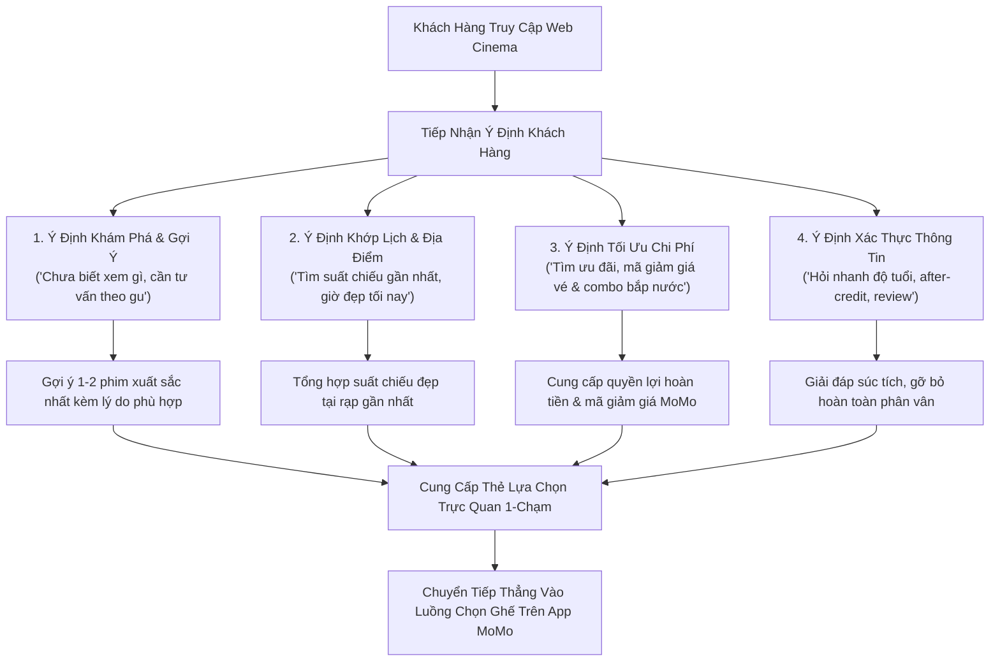
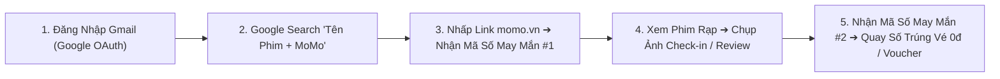

# Cinema Hub

> - **Dự án:** Cinema
> - **Khối phụ trách:** Marketing Distribution Services (MDS) / Web Platform
> - **Owner:** Web Platform Team x BU Movies
> - **Phiên bản:** v4.0 - Tháng 9/2026
> - **Trạng thái:** Active & Production Pilot Ready (`momo.vn/cinema`)

## I. Executive Summary

### 1.1 Core Problems & Objectives
* **Vấn đề thực tế (Problem Statement):** Khách hàng khi có nhu cầu xem phim sẽ chủ động tìm kiếm lịch chiếu/suất chiếu trên Google. Tuy nhiên, MoMo chưa tối ưu hóa chuyên sâu về kỹ thuật và trải nghiệm Web trong các chu kỳ trước, dẫn đến việc chưa khai thác triệt để tệp từ khóa ngành (tổng quy mô nhu cầu tìm kiếm đạt **20.850.490 search volume/tháng** với 12.067 từ khóa, riêng head-term "phim chiếu rạp" đạt ~309.8K search volume/tháng). Đồng thời, việc thiếu cổng thanh toán trực tiếp trên Web (Non-App payment barrier) khiến tỷ lệ chuyển đổi Web-to-App (W2A CR) giảm mạnh từ 12.10% xuống 4.37%, gây lãng phí lượng lớn cơ hội giao dịch.
* **Mục tiêu định lượng H2/2026:** Uplift **100% mọi chỉ số** so với H1/2026:
  * **Organic Traffic:** Đạt **>4.020.000 visits/H2** (so với 2.01M H1).
  * **Total Traffic:** Đạt **>8.070.000 visits/H2** (so với 4.03M H1).
  * **Booking Clicks:** Đạt **>1.740.000 clicks/H2** (so với 870K H1).
  * **Tickets Sold (Số vé bán):** Đạt **>214.292 vé/H2** (so với 107K H1).
  * **Web Purchase Conversion:** Đặt mục tiêu tăng tỷ lệ hoàn tất đơn hàng trên Web lên **≥ 4.50%** nhờ triển khai luồng Native Web Payment.
  * **W2A Conversion:** Theo dõi riêng tỷ lệ người dùng Web nhấp và mở App; chỉ áp dụng cho các luồng chuyển tiếp sang App.
* **Triết lý cốt lõi:** **"Một bộ phim - Trọn vẹn hành trình điện ảnh"**, biến Web `momo.vn/cinema` thành trung tâm kết nối tự động:
  1. **Tìm kiếm 0-Click, giữ chỗ realtime:** Search Google  ➔  Thấy ngay lịch chiếu rạp gần nhất trên Web MoMo mà không cần chuyển app hay nhập lại địa điểm.
  2. **Thanh toán liền mạch Native Web Payment:** Người dùng Non-App có thể hoàn tất mua vé và thanh toán trực tiếp trên Web hoặc chuyển tiếp sang App 1-click.
  3. **Vòng đời nội dung tự động (Lifecycle Automation):** Phim đang chiếu  ➔  Phim hết suất chiếu rạp tự động chuyển hướng sang các nền tảng xem phim OTT đối tác, đảm bảo không lãng phí bất kỳ lượt Traffic nào.

### 1.2 Situation - Complication - Resolution
* **Situation (Bối cảnh & Vị thế):** Cinema là Use Case trưởng thành và có tiềm năng giao dịch lớn nhất của Khối Web Platform (~1M organic/3 tháng Q1/2026, chiếm giữ Top 1 SERP cho từ khóa "vé xem phim"). Website đóng vai trò là **"cửa ngõ đón nhận nhu cầu và cổng dẫn dắt chuyển đổi"** cho hệ sinh thái vé xem phim MoMo.
* **Complication (Khó khăn & Thách thức):** Tỷ lệ chuyển đổi suy giảm do 4 vấn đề cốt lõi:
  1. *Drop-off ở luồng thanh toán:* Khách hàng Non-App bị chặn lại do bắt buộc tải App mới mua được vé.
  2. *Keyword Gap lớn:* Chưa phủ sóng hết tệp từ khóa ngành với tổng quy mô nhu cầu tìm kiếm **20.850.490 search volume/tháng** trên 12.067 từ khóa (bao gồm head-terms lớn như "phimmoi" 1M, "phim" 1M, "cgv" 450K, "phim chiếu rạp" 301K, "lotte cinema" 165K...).
  3. *Rủi ro từ Google AI Overview (AIO):* Thiếu cấu trúc dữ liệu chuẩn Schema khiến Google AI trả về kết quả trực tiếp làm người dùng không click vào Web.
  4. *Nội dung lỗi thời do vận hành thủ công:* Phim hết suất chiếu rạp nhưng Web vẫn hiển thị "Đang chiếu", gây trải nghiệm tệ và lãng phí traffic.
* **Resolution (Giải pháp H2/2026):** Tái cấu trúc toàn diện và chuyển dịch hạ tầng sang nền tảng **MoSpark**, xây dựng **Cinema Hub** theo mô hình Product-Led Growth (PLG) & Hub-and-Spoke. Triển khai **Native Web Payment**, ứng dụng **GenAI Content** tự động hóa vòng đời phim và điều hướng sang các dịch vụ xem phim OTT.

### 1.3 Product-Led Growth (PLG) Drivers
Cơ chế PLG của Cinema Hub dựa trên 5 Điểm Chạm Kích Hoạt (Acquisition & Engagement Hooks) giải quyết tức thời nhu cầu tìm kiếm trên Open Web:

1. **Phễu Tra Cứu Lịch Chiếu Realtime (Acquisition Gate):** Đón nhận nhu cầu tìm "lịch chiếu phim [tên phim] [tỉnh thành]"  ➔  Hiển thị suất chiếu của 13 chuỗi rạp đối tác (CGV, Lotte Cinema, Galaxy Cinema, BHD Star, Beta Cinemas, Cinestar, Mega GS, Cinemax, DCINE, Starlight, Rio Cinemas, Trung Tâm Chiếu Phim Quốc Gia, AEON Beta) theo vị trí GPS realtime.
2. **Phễu Báo Giá & Ưu Đãi Cụm Rạp (Retention Magnet):** Tra cứu bảng giá vé, chương trình khuyến mãi theo từng rạp  ➔  Gợi ý Combo Bỏng Nước & Thẻ quà tặng ưu đãi độc quyền MoMo.
3. **Phễu Bách Khoa Toàn Thư Điện Ảnh & Review (Topical Authority Hook):** Đón đầu nhu cầu tìm trailer, diễn viên, đạo diễn, điểm IMDb/Rotten Tomatoes  ➔  Kích hoạt tính năng đánh giá/review từ cộng đồng người xem MoMo.
4. **Phễu Native Web Payment (Conversion Hook):** Cho phép đặt ghế và thanh toán trực tiếp trên Web không cần mở App đối với khách hàng mới/Non-App.
5. **Phễu Chuyển Đổi Vòng Đời Phim sang OTT (Lifecycle Reminder Hook):** Tự động phát hiện phim đã hết suất chiếu rạp  ➔  Gợi ý link xem trực tuyến trên các nền tảng OTT đối tác (Netflix, VieON, Galaxy Play, FPT Play).

### 1.4 Key Metrics & Targets

#### Dual North Star Metrics

<table style="width:100%; border-collapse:collapse; border:1.5px solid #64748b; margin:1em 0; font-size:0.9em;">
  <thead>
    <tr style="background-color:#f1f5f9;">
      <th style="border:1.5px solid #64748b; padding:8px 12px; text-align:left; font-weight:700;">Platform Layer</th>
      <th style="border:1.5px solid #64748b; padding:8px 12px; text-align:left; font-weight:700;">North Star Metric</th>
      <th style="border:1.5px solid #64748b; padding:8px 12px; text-align:left; font-weight:700;">Definition</th>
      <th style="border:1.5px solid #64748b; padding:8px 12px; text-align:left; font-weight:700;">Target H2/2026</th>
      <th style="border:1.5px solid #64748b; padding:8px 12px; text-align:left; font-weight:700;">Strategic Role</th>
    </tr>
  </thead>
  <tbody>
    <tr>
      <td style="border:1px solid #94a3b8; padding:8px 12px; text-align:left;"><strong>Web Platform</strong> <em>(Primary Goal)</em></td>
      <td style="border:1px solid #94a3b8; padding:8px 12px; text-align:left;"><strong>Total Organic Web Traffic</strong></td>
      <td style="border:1px solid #94a3b8; padding:8px 12px; text-align:left;">Tổng số lượt truy cập tự nhiên từ Google Search và AI Search vào Cinema Hub trên Kênh Web mỗi tháng.</td>
      <td style="border:1px solid #94a3b8; padding:8px 12px; text-align:left;"><strong>>4.020.082 Visits/H2</strong> <em>(Uplift 100%)</em></td>
      <td style="border:1px solid #94a3b8; padding:8px 12px; text-align:left;">Mục tiêu cốt lõi: Đón nhận trọn vẹn nhu cầu tìm kiếm điện ảnh ngoài Open Web, mở rộng tệp Acquisition.</td>
    </tr>
    <tr style="background-color:#f8fafc;">
      <td style="border:1px solid #94a3b8; padding:8px 12px; text-align:left;"><strong>In-App & Web Booking</strong> <em>(Secondary Layer)</em></td>
      <td style="border:1px solid #94a3b8; padding:8px 12px; text-align:left;"><strong>Total Tickets Sold</strong></td>
      <td style="border:1px solid #94a3b8; padding:8px 12px; text-align:left;">Tổng số lượng vé xem phim được xuất bản thành công qua luồng Web & Web-to-App.</td>
      <td style="border:1px solid #94a3b8; padding:8px 12px; text-align:left;"><strong>>214.292 Vé/H2</strong> <em>(Uplift 100%)</em></td>
      <td style="border:1px solid #94a3b8; padding:8px 12px; text-align:left;">Đo lường hiệu quả chuyển đổi kinh doanh trực tiếp cho BU Movies và các chuỗi rạp đối tác.</td>
    </tr>
  </tbody>
</table>

#### Web Platform Metric Tree (Chi tiết H2/2026)

<table style="width:100%; border-collapse:collapse; border:1.5px solid #64748b; margin:1em 0; font-size:0.9em;">
  <thead>
    <tr style="background-color:#f1f5f9;">
      <th style="border:1.5px solid #64748b; padding:8px 12px; text-align:left; font-weight:700;">Metric</th>
      <th style="border:1.5px solid #64748b; padding:8px 12px; text-align:left; font-weight:700;">2025 Full Year</th>
      <th style="border:1.5px solid #64748b; padding:8px 12px; text-align:left; font-weight:700;">Q1/2026 (Baseline)</th>
      <th style="border:1.5px solid #64748b; padding:8px 12px; text-align:left; font-weight:700;">H1/2026 (Actual)</th>
      <th style="border:1.5px solid #64748b; padding:8px 12px; text-align:left; font-weight:700;"><strong>H2/2026 (Target)</strong></th>
    </tr>
  </thead>
  <tbody>
    <tr>
      <td style="border:1px solid #94a3b8; padding:8px 12px; text-align:left;">Organic Traffic</td>
      <td style="border:1px solid #94a3b8; padding:8px 12px; text-align:left;">6,387,700</td>
      <td style="border:1px solid #94a3b8; padding:8px 12px; text-align:left;">1,066,000</td>
      <td style="border:1px solid #94a3b8; padding:8px 12px; text-align:left;">2,010,041</td>
      <td style="border:1px solid #94a3b8; padding:8px 12px; text-align:left;"><strong>4,020,082</strong></td>
    </tr>
    <tr style="background-color:#f8fafc;">
      <td style="border:1px solid #94a3b8; padding:8px 12px; text-align:left;">Total Traffic</td>
      <td style="border:1px solid #94a3b8; padding:8px 12px; text-align:left;">12,425,040</td>
      <td style="border:1px solid #94a3b8; padding:8px 12px; text-align:left;">2,980,000</td>
      <td style="border:1px solid #94a3b8; padding:8px 12px; text-align:left;">4,035,028</td>
      <td style="border:1px solid #94a3b8; padding:8px 12px; text-align:left;"><strong>8,070,056</strong></td>
    </tr>
    <tr>
      <td style="border:1px solid #94a3b8; padding:8px 12px; text-align:left;">Booking Clicks</td>
      <td style="border:1px solid #94a3b8; padding:8px 12px; text-align:left;">266,258</td>
      <td style="border:1px solid #94a3b8; padding:8px 12px; text-align:left;">81,517</td>
      <td style="border:1px solid #94a3b8; padding:8px 12px; text-align:left;">870,467</td>
      <td style="border:1px solid #94a3b8; padding:8px 12px; text-align:left;"><strong>1,740,934</strong></td>
    </tr>
    <tr style="background-color:#f8fafc;">
      <td style="border:1px solid #94a3b8; padding:8px 12px; text-align:left;">Traffic to App (W2A Users)</td>
      <td style="border:1px solid #94a3b8; padding:8px 12px; text-align:left;">78,735</td>
      <td style="border:1px solid #94a3b8; padding:8px 12px; text-align:left;">9,866</td>
      <td style="border:1px solid #94a3b8; padding:8px 12px; text-align:left;">38,079</td>
      <td style="border:1px solid #94a3b8; padding:8px 12px; text-align:left;"><strong>76,158</strong></td>
    </tr>
    <tr>
      <td style="border:1px solid #94a3b8; padding:8px 12px; text-align:left;">Transactions (via App/Web)</td>
      <td style="border:1px solid #94a3b8; padding:8px 12px; text-align:left;">52,311</td>
      <td style="border:1px solid #94a3b8; padding:8px 12px; text-align:left;">9,212</td>
      <td style="border:1px solid #94a3b8; padding:8px 12px; text-align:left;">48,830</td>
      <td style="border:1px solid #94a3b8; padding:8px 12px; text-align:left;"><strong>97,660</strong></td>
    </tr>
    <tr style="background-color:#f8fafc;">
      <td style="border:1px solid #94a3b8; padding:8px 12px; text-align:left;">Tickets Sold (Số vé bán)</td>
      <td style="border:1px solid #94a3b8; padding:8px 12px; text-align:left;">N/A</td>
      <td style="border:1px solid #94a3b8; padding:8px 12px; text-align:left;">N/A</td>
      <td style="border:1px solid #94a3b8; padding:8px 12px; text-align:left;">107,146</td>
      <td style="border:1px solid #94a3b8; padding:8px 12px; text-align:left;"><strong>214,292</strong></td>
    </tr>
    <tr>
      <td style="border:1px solid #94a3b8; padding:8px 12px; text-align:left;"><strong>% W2A (Conversion Rate)</strong></td>
      <td style="border:1px solid #94a3b8; padding:8px 12px; text-align:left;"><strong>29.57%</strong></td>
      <td style="border:1px solid #94a3b8; padding:8px 12px; text-align:left;"><strong>12.10%</strong></td>
      <td style="border:1px solid #94a3b8; padding:8px 12px; text-align:left;"><strong>4.37%</strong></td>
      <td style="border:1px solid #94a3b8; padding:8px 12px; text-align:left;"><strong>≥ 4.50%+</strong></td>
    </tr>
    <tr style="background-color:#f8fafc;">
      <td style="border:1px solid #94a3b8; padding:8px 12px; text-align:left;">W2A MAU (Web in App)</td>
      <td style="border:1px solid #94a3b8; padding:8px 12px; text-align:left;">93,758</td>
      <td style="border:1px solid #94a3b8; padding:8px 12px; text-align:left;">25,012</td>
      <td style="border:1px solid #94a3b8; padding:8px 12px; text-align:left;">43,262</td>
      <td style="border:1px solid #94a3b8; padding:8px 12px; text-align:left;"><strong>>60,000</strong></td>
    </tr>
    <tr>
      <td style="border:1px solid #94a3b8; padding:8px 12px; text-align:left;">W2A MEU (Web in App)</td>
      <td style="border:1px solid #94a3b8; padding:8px 12px; text-align:left;">264,178</td>
      <td style="border:1px solid #94a3b8; padding:8px 12px; text-align:left;">71,692</td>
      <td style="border:1px solid #94a3b8; padding:8px 12px; text-align:left;">123,581</td>
      <td style="border:1px solid #94a3b8; padding:8px 12px; text-align:left;"><strong>>180,000</strong></td>
    </tr>
    <tr style="background-color:#f8fafc;">
      <td style="border:1px solid #94a3b8; padding:8px 12px; text-align:left;"><strong>GMV Quy Đổi Web-to-App (MAU x 205.000đ)</strong></td>
      <td style="border:1px solid #94a3b8; padding:8px 12px; text-align:left;"><strong>19.22 tỷ đ</strong></td>
      <td style="border:1px solid #94a3b8; padding:8px 12px; text-align:left;"><strong>5.13 tỷ đ</strong></td>
      <td style="border:1px solid #94a3b8; padding:8px 12px; text-align:left;"><strong>8.87 tỷ đ</strong></td>
      <td style="border:1px solid #94a3b8; padding:8px 12px; text-align:left;"><strong>>12.30 tỷ đ</strong></td>
    </tr>
    <tr>
      <td style="border:1px solid #94a3b8; padding:8px 12px; text-align:left;">GMV Theo Giao Dịch Thực Thu (Txn x 205.000đ)</td>
      <td style="border:1px solid #94a3b8; padding:8px 12px; text-align:left;">10.72 tỷ đ</td>
      <td style="border:1px solid #94a3b8; padding:8px 12px; text-align:left;">1.89 tỷ đ</td>
      <td style="border:1px solid #94a3b8; padding:8px 12px; text-align:left;">10.01 tỷ đ</td>
      <td style="border:1px solid #94a3b8; padding:8px 12px; text-align:left;"><strong>>20.00 tỷ đ</strong></td>
    </tr>
  </tbody>
</table>

### 1.5 Phễu Chuyển Đổi Web-to-App & Báo Cáo Quy Đổi Doanh Thu GMV (Chuỗi 2025 - 2026 MTD 10T)

Căn cứ dữ liệu đối soát chính thức tiếp nhận từ BU Movies và số liệu giao dịch in-app thực tế từ hệ thống Dashboard vận hành bán vé, hiệu suất chuyển đổi từ Kênh Web sang ứng dụng MoMo (Web-to-App) và doanh thu được xác lập theo hai công thức chuẩn hóa:
* **GMV Thực Thu (Actual GMV - Tiêu chuẩn tài chính SSOT):**
  $$\text{GMV Thực Thu} = \text{Success Transactions} \times \text{AoV (205,000 VND)}$$
* **GMV Tiềm Năng Quy Đổi (Potential Reach GMV):**
  $$\text{GMV Tiềm Năng} = \text{W2A MAU} \times \text{AoV (205,000 VND)}$$
*(Quy chuẩn AoV: 205,000 đồng/đơn hàng, trung bình 2.13 vé/giao dịch, tương đương ~96,000 đồng/vé).*

#### A. Bảng Theo Dõi GMV Web-to-App 10 Tháng Năm 2026 So Với Cùng Kỳ 2025

<table style="width:100%; border-collapse:collapse; border:1.5px solid #64748b; margin:1em 0; font-size:0.9em;">
  <thead>
    <tr style="background-color:#f1f5f9;">
      <th style="border:1.5px solid #64748b; padding:8px 12px; text-align:left; font-weight:700;">Tháng</th>
      <th style="border:1.5px solid #64748b; padding:8px 12px; text-align:center; font-weight:700;">2026 W2A MAU</th>
      <th style="border:1.5px solid #64748b; padding:8px 12px; text-align:center; font-weight:700;">2026 W2A MEU</th>
      <th style="border:1.5px solid #64748b; padding:8px 12px; text-align:right; font-weight:700;">GMV W2A 2026</th>
      <th style="border:1.5px solid #64748b; padding:8px 12px; text-align:center; font-weight:700;">2025 W2A MAU</th>
      <th style="border:1.5px solid #64748b; padding:8px 12px; text-align:right; font-weight:700;">GMV W2A 2025</th>
      <th style="border:1.5px solid #64748b; padding:8px 12px; text-align:center; font-weight:700;">Tăng Trưởng YoY GMV</th>
    </tr>
  </thead>
  <tbody>
    <tr>
      <td style="border:1px solid #94a3b8; padding:8px 12px; text-align:left;">Tháng 1</td>
      <td style="border:1px solid #94a3b8; padding:8px 12px; text-align:center;">5,362</td>
      <td style="border:1px solid #94a3b8; padding:8px 12px; text-align:center;">20,258</td>
      <td style="border:1px solid #94a3b8; padding:8px 12px; text-align:right;">1,099,210,000 đ</td>
      <td style="border:1px solid #94a3b8; padding:8px 12px; text-align:center;">2,687</td>
      <td style="border:1px solid #94a3b8; padding:8px 12px; text-align:right;">550,835,000 đ</td>
      <td style="border:1px solid #94a3b8; padding:8px 12px; text-align:center;">+99.6%</td>
    </tr>
    <tr style="background-color:#f8fafc;">
      <td style="border:1px solid #94a3b8; padding:8px 12px; text-align:left;">Tháng 2</td>
      <td style="border:1px solid #94a3b8; padding:8px 12px; text-align:center;">10,922</td>
      <td style="border:1px solid #94a3b8; padding:8px 12px; text-align:center;">27,595</td>
      <td style="border:1px solid #94a3b8; padding:8px 12px; text-align:right;">2,239,010,000 đ</td>
      <td style="border:1px solid #94a3b8; padding:8px 12px; text-align:center;">9,090</td>
      <td style="border:1px solid #94a3b8; padding:8px 12px; text-align:right;">1,863,450,000 đ</td>
      <td style="border:1px solid #94a3b8; padding:8px 12px; text-align:center;">+20.2%</td>
    </tr>
    <tr>
      <td style="border:1px solid #94a3b8; padding:8px 12px; text-align:left;">Tháng 3</td>
      <td style="border:1px solid #94a3b8; padding:8px 12px; text-align:center;">8,728</td>
      <td style="border:1px solid #94a3b8; padding:8px 12px; text-align:center;">23,839</td>
      <td style="border:1px solid #94a3b8; padding:8px 12px; text-align:right;">1,789,240,000 đ</td>
      <td style="border:1px solid #94a3b8; padding:8px 12px; text-align:center;">4,963</td>
      <td style="border:1px solid #94a3b8; padding:8px 12px; text-align:right;">1,017,415,000 đ</td>
      <td style="border:1px solid #94a3b8; padding:8px 12px; text-align:center;">+75.9%</td>
    </tr>
    <tr style="background-color:#f8fafc;">
      <td style="border:1px solid #94a3b8; padding:8px 12px; text-align:left;">Tháng 4</td>
      <td style="border:1px solid #94a3b8; padding:8px 12px; text-align:center;">7,300</td>
      <td style="border:1px solid #94a3b8; padding:8px 12px; text-align:center;">20,020</td>
      <td style="border:1px solid #94a3b8; padding:8px 12px; text-align:right;">1,496,500,000 đ</td>
      <td style="border:1px solid #94a3b8; padding:8px 12px; text-align:center;">8,855</td>
      <td style="border:1px solid #94a3b8; padding:8px 12px; text-align:right;">1,815,275,000 đ</td>
      <td style="border:1px solid #94a3b8; padding:8px 12px; text-align:center;">-17.6%</td>
    </tr>
    <tr>
      <td style="border:1px solid #94a3b8; padding:8px 12px; text-align:left;">Tháng 5</td>
      <td style="border:1px solid #94a3b8; padding:8px 12px; text-align:center;">5,141</td>
      <td style="border:1px solid #94a3b8; padding:8px 12px; text-align:center;">15,823</td>
      <td style="border:1px solid #94a3b8; padding:8px 12px; text-align:right;">1,053,905,000 đ</td>
      <td style="border:1px solid #94a3b8; padding:8px 12px; text-align:center;">5,285</td>
      <td style="border:1px solid #94a3b8; padding:8px 12px; text-align:right;">1,083,425,000 đ</td>
      <td style="border:1px solid #94a3b8; padding:8px 12px; text-align:center;">-2.7%</td>
    </tr>
    <tr style="background-color:#f8fafc;">
      <td style="border:1px solid #94a3b8; padding:8px 12px; text-align:left;">Tháng 6</td>
      <td style="border:1px solid #94a3b8; padding:8px 12px; text-align:center;">5,809</td>
      <td style="border:1px solid #94a3b8; padding:8px 12px; text-align:center;">16,046</td>
      <td style="border:1px solid #94a3b8; padding:8px 12px; text-align:right;">1,190,845,000 đ</td>
      <td style="border:1px solid #94a3b8; padding:8px 12px; text-align:center;">2,667</td>
      <td style="border:1px solid #94a3b8; padding:8px 12px; text-align:right;">546,735,000 đ</td>
      <td style="border:1px solid #94a3b8; padding:8px 12px; text-align:center;">+117.8%</td>
    </tr>
    <tr>
      <td style="border:1px solid #94a3b8; padding:8px 12px; text-align:left;">Tháng 7</td>
      <td style="border:1px solid #94a3b8; padding:8px 12px; text-align:center;">2,263</td>
      <td style="border:1px solid #94a3b8; padding:8px 12px; text-align:center;">7,806</td>
      <td style="border:1px solid #94a3b8; padding:8px 12px; text-align:right;">463,915,000 đ</td>
      <td style="border:1px solid #94a3b8; padding:8px 12px; text-align:center;">4,880</td>
      <td style="border:1px solid #94a3b8; padding:8px 12px; text-align:right;">1,000,400,000 đ</td>
      <td style="border:1px solid #94a3b8; padding:8px 12px; text-align:center;">-53.6%</td>
    </tr>
    <tr style="background-color:#f8fafc;">
      <td style="border:1px solid #94a3b8; padding:8px 12px; text-align:left;">Tháng 8</td>
      <td style="border:1px solid #94a3b8; padding:8px 12px; text-align:center;">3,757</td>
      <td style="border:1px solid #94a3b8; padding:8px 12px; text-align:center;">12,962</td>
      <td style="border:1px solid #94a3b8; padding:8px 12px; text-align:right;">770,185,000 đ</td>
      <td style="border:1px solid #94a3b8; padding:8px 12px; text-align:center;">16,541</td>
      <td style="border:1px solid #94a3b8; padding:8px 12px; text-align:right;">3,390,905,000 đ</td>
      <td style="border:1px solid #94a3b8; padding:8px 12px; text-align:center;">-77.3%</td>
    </tr>
    <tr>
      <td style="border:1px solid #94a3b8; padding:8px 12px; text-align:left;">Tháng 9</td>
      <td style="border:1px solid #94a3b8; padding:8px 12px; text-align:center;">8,927</td>
      <td style="border:1px solid #94a3b8; padding:8px 12px; text-align:center;">26,698</td>
      <td style="border:1px solid #94a3b8; padding:8px 12px; text-align:right;">1,830,035,000 đ</td>
      <td style="border:1px solid #94a3b8; padding:8px 12px; text-align:center;">14,952</td>
      <td style="border:1px solid #94a3b8; padding:8px 12px; text-align:right;">3,065,160,000 đ</td>
      <td style="border:1px solid #94a3b8; padding:8px 12px; text-align:center;">-40.3%</td>
    </tr>
    <tr style="background-color:#f8fafc;">
      <td style="border:1px solid #94a3b8; padding:8px 12px; text-align:left;">Tháng 10</td>
      <td style="border:1px solid #94a3b8; padding:8px 12px; text-align:center;">11,457</td>
      <td style="border:1px solid #94a3b8; padding:8px 12px; text-align:center;">30,470</td>
      <td style="border:1px solid #94a3b8; padding:8px 12px; text-align:right;">2,348,685,000 đ</td>
      <td style="border:1px solid #94a3b8; padding:8px 12px; text-align:center;">6,092</td>
      <td style="border:1px solid #94a3b8; padding:8px 12px; text-align:right;">1,248,860,000 đ</td>
      <td style="border:1px solid #94a3b8; padding:8px 12px; text-align:center;"><strong>+88.1%</strong></td>
    </tr>
    <tr style="background-color:#e2e8f0;">
      <td style="border:1.5px solid #64748b; padding:8px 12px; text-align:left;"><strong>Lũy kế 10 Tháng</strong></td>
      <td style="border:1.5px solid #64748b; padding:8px 12px; text-align:center;"><strong>69,666</strong></td>
      <td style="border:1.5px solid #64748b; padding:8px 12px; text-align:center;"><strong>201,517</strong></td>
      <td style="border:1.5px solid #64748b; padding:8px 12px; text-align:right;"><strong>14,281,530,000 đ</strong></td>
      <td style="border:1.5px solid #64748b; padding:8px 12px; text-align:center;"><strong>76,012</strong></td>
      <td style="border:1.5px solid #64748b; padding:8px 12px; text-align:right;"><strong>15,582,460,000 đ</strong></td>
      <td style="border:1.5px solid #64748b; padding:8px 12px; text-align:center;"><strong>-8.3%</strong></td>
    </tr>
  </tbody>
</table>

#### B. Báo Cáo Giao Dịch Thực Thu 10 Tháng Năm 2026 (Realtime In-App Dashboard)

Dữ liệu ghi nhận từ hệ thống vận hành bán vé in-app (`SUCCESS IN-APP TRANSACTIONS`) phản ánh số lượng đơn hàng chốt thành công và doanh thu thực tế từ Kênh Web-to-App:

<table style="width:100%; border-collapse:collapse; border:1.5px solid #64748b; margin:1em 0; font-size:0.9em;">
  <thead>
    <tr style="background-color:#f1f5f9;">
      <th style="border:1.5px solid #64748b; padding:8px 12px; text-align:left; font-weight:700;">Kỳ Báo Cáo</th>
      <th style="border:1.5px solid #64748b; padding:8px 12px; text-align:center; font-weight:700;">MAU</th>
      <th style="border:1.5px solid #64748b; padding:8px 12px; text-align:center; font-weight:700;">MEU</th>
      <th style="border:1.5px solid #64748b; padding:8px 12px; text-align:center; font-weight:700;">Đơn</th>
      <th style="border:1.5px solid #64748b; padding:8px 12px; text-align:center; font-weight:700;">Vé</th>
      <th style="border:1.5px solid #64748b; padding:8px 12px; text-align:right; font-weight:700;">GMV Thực Thu</th>
      <th style="border:1.5px solid #64748b; padding:8px 12px; text-align:center; font-weight:700;">Tăng Trưởng MoM</th>
      <th style="border:1.5px solid #64748b; padding:8px 12px; text-align:center; font-weight:700;">Vé / Đơn</th>
    </tr>
  </thead>
  <tbody>
    <tr>
      <td style="border:1px solid #94a3b8; padding:8px 12px; text-align:left;">Năm 2025</td>
      <td style="border:1px solid #94a3b8; padding:8px 12px; text-align:center;">93,758</td>
      <td style="border:1px solid #94a3b8; padding:8px 12px; text-align:center;">264,178</td>
      <td style="border:1px solid #94a3b8; padding:8px 12px; text-align:center;">52,311</td>
      <td style="border:1px solid #94a3b8; padding:8px 12px; text-align:center;">111,422</td>
      <td style="border:1px solid #94a3b8; padding:8px 12px; text-align:right;">10,723,755,000 đ</td>
      <td style="border:1px solid #94a3b8; padding:8px 12px; text-align:center;">-</td>
      <td style="border:1px solid #94a3b8; padding:8px 12px; text-align:center;">2.13</td>
    </tr>
    <tr style="background-color:#f8fafc;">
      <td style="border:1px solid #94a3b8; padding:8px 12px; text-align:left;">Tháng 1/2026</td>
      <td style="border:1px solid #94a3b8; padding:8px 12px; text-align:center;">5,362</td>
      <td style="border:1px solid #94a3b8; padding:8px 12px; text-align:center;">20,258</td>
      <td style="border:1px solid #94a3b8; padding:8px 12px; text-align:center;">5,889</td>
      <td style="border:1px solid #94a3b8; padding:8px 12px; text-align:center;">12,643</td>
      <td style="border:1px solid #94a3b8; padding:8px 12px; text-align:right;">1,207,245,000 đ</td>
      <td style="border:1px solid #94a3b8; padding:8px 12px; text-align:center;">-47.4%</td>
      <td style="border:1px solid #94a3b8; padding:8px 12px; text-align:center;">2.15</td>
    </tr>
    <tr>
      <td style="border:1px solid #94a3b8; padding:8px 12px; text-align:left;">Tháng 2/2026</td>
      <td style="border:1px solid #94a3b8; padding:8px 12px; text-align:center;">10,922</td>
      <td style="border:1px solid #94a3b8; padding:8px 12px; text-align:center;">27,595</td>
      <td style="border:1px solid #94a3b8; padding:8px 12px; text-align:center;">12,432</td>
      <td style="border:1px solid #94a3b8; padding:8px 12px; text-align:center;">28,379</td>
      <td style="border:1px solid #94a3b8; padding:8px 12px; text-align:right;">2,548,560,000 đ</td>
      <td style="border:1px solid #94a3b8; padding:8px 12px; text-align:center;">+182.5%</td>
      <td style="border:1px solid #94a3b8; padding:8px 12px; text-align:center;">2.28</td>
    </tr>
    <tr style="background-color:#f8fafc;">
      <td style="border:1px solid #94a3b8; padding:8px 12px; text-align:left;">Tháng 3/2026</td>
      <td style="border:1px solid #94a3b8; padding:8px 12px; text-align:center;">8,728</td>
      <td style="border:1px solid #94a3b8; padding:8px 12px; text-align:center;">23,839</td>
      <td style="border:1px solid #94a3b8; padding:8px 12px; text-align:center;">9,881</td>
      <td style="border:1px solid #94a3b8; padding:8px 12px; text-align:center;">20,600</td>
      <td style="border:1px solid #94a3b8; padding:8px 12px; text-align:right;">2,025,605,000 đ</td>
      <td style="border:1px solid #94a3b8; padding:8px 12px; text-align:center;">-23.0%</td>
      <td style="border:1px solid #94a3b8; padding:8px 12px; text-align:center;">2.08</td>
    </tr>
    <tr>
      <td style="border:1px solid #94a3b8; padding:8px 12px; text-align:left;">Tháng 4/2026</td>
      <td style="border:1px solid #94a3b8; padding:8px 12px; text-align:center;">7,300</td>
      <td style="border:1px solid #94a3b8; padding:8px 12px; text-align:center;">20,020</td>
      <td style="border:1px solid #94a3b8; padding:8px 12px; text-align:center;">8,221</td>
      <td style="border:1px solid #94a3b8; padding:8px 12px; text-align:center;">18,730</td>
      <td style="border:1px solid #94a3b8; padding:8px 12px; text-align:right;">1,685,305,000 đ</td>
      <td style="border:1px solid #94a3b8; padding:8px 12px; text-align:center;">-11.7%</td>
      <td style="border:1px solid #94a3b8; padding:8px 12px; text-align:center;">2.28</td>
    </tr>
    <tr style="background-color:#f8fafc;">
      <td style="border:1px solid #94a3b8; padding:8px 12px; text-align:left;">Tháng 5/2026</td>
      <td style="border:1px solid #94a3b8; padding:8px 12px; text-align:center;">5,141</td>
      <td style="border:1px solid #94a3b8; padding:8px 12px; text-align:center;">15,823</td>
      <td style="border:1px solid #94a3b8; padding:8px 12px; text-align:center;">5,777</td>
      <td style="border:1px solid #94a3b8; padding:8px 12px; text-align:center;">12,561</td>
      <td style="border:1px solid #94a3b8; padding:8px 12px; text-align:right;">1,184,285,000 đ</td>
      <td style="border:1px solid #94a3b8; padding:8px 12px; text-align:center;">-30.9%</td>
      <td style="border:1px solid #94a3b8; padding:8px 12px; text-align:center;">2.17</td>
    </tr>
    <tr>
      <td style="border:1px solid #94a3b8; padding:8px 12px; text-align:left;">Tháng 6/2026</td>
      <td style="border:1px solid #94a3b8; padding:8px 12px; text-align:center;">7,871</td>
      <td style="border:1px solid #94a3b8; padding:8px 12px; text-align:center;">16,046</td>
      <td style="border:1px solid #94a3b8; padding:8px 12px; text-align:center;">9,055</td>
      <td style="border:1px solid #94a3b8; padding:8px 12px; text-align:center;">19,444</td>
      <td style="border:1px solid #94a3b8; padding:8px 12px; text-align:right;">1,856,275,000 đ</td>
      <td style="border:1px solid #94a3b8; padding:8px 12px; text-align:center;">+56.7%</td>
      <td style="border:1px solid #94a3b8; padding:8px 12px; text-align:center;">2.15</td>
    </tr>
    <tr style="background-color:#f8fafc;">
      <td style="border:1px solid #94a3b8; padding:8px 12px; text-align:left;">Tháng 7/2026</td>
      <td style="border:1px solid #94a3b8; padding:8px 12px; text-align:center;">2,263</td>
      <td style="border:1px solid #94a3b8; padding:8px 12px; text-align:center;">7,806</td>
      <td style="border:1px solid #94a3b8; padding:8px 12px; text-align:center;">2,425</td>
      <td style="border:1px solid #94a3b8; padding:8px 12px; text-align:center;">5,211</td>
      <td style="border:1px solid #94a3b8; padding:8px 12px; text-align:right;">497,125,000 đ</td>
      <td style="border:1px solid #94a3b8; padding:8px 12px; text-align:center;">-64.6%</td>
      <td style="border:1px solid #94a3b8; padding:8px 12px; text-align:center;">2.15</td>
    </tr>
    <tr>
      <td style="border:1px solid #94a3b8; padding:8px 12px; text-align:left;">Tháng 8/2026</td>
      <td style="border:1px solid #94a3b8; padding:8px 12px; text-align:center;">3,757</td>
      <td style="border:1px solid #94a3b8; padding:8px 12px; text-align:center;">12,962</td>
      <td style="border:1px solid #94a3b8; padding:8px 12px; text-align:center;">4,016</td>
      <td style="border:1px solid #94a3b8; padding:8px 12px; text-align:center;">8,754</td>
      <td style="border:1px solid #94a3b8; padding:8px 12px; text-align:right;">823,280,000 đ</td>
      <td style="border:1px solid #94a3b8; padding:8px 12px; text-align:center;">-</td>
      <td style="border:1px solid #94a3b8; padding:8px 12px; text-align:center;">2.18</td>
    </tr>
    <tr style="background-color:#f8fafc;">
      <td style="border:1px solid #94a3b8; padding:8px 12px; text-align:left;">Tháng 9/2026</td>
      <td style="border:1px solid #94a3b8; padding:8px 12px; text-align:center;">8,927</td>
      <td style="border:1px solid #94a3b8; padding:8px 12px; text-align:center;">26,698</td>
      <td style="border:1px solid #94a3b8; padding:8px 12px; text-align:center;">9,807</td>
      <td style="border:1px solid #94a3b8; padding:8px 12px; text-align:center;">20,983</td>
      <td style="border:1px solid #94a3b8; padding:8px 12px; text-align:right;">2,010,435,000 đ</td>
      <td style="border:1px solid #94a3b8; padding:8px 12px; text-align:center;">+144.2%</td>
      <td style="border:1px solid #94a3b8; padding:8px 12px; text-align:center;">2.14</td>
    </tr>
    <tr>
      <td style="border:1px solid #94a3b8; padding:8px 12px; text-align:left;">Tháng 10/2026</td>
      <td style="border:1px solid #94a3b8; padding:8px 12px; text-align:center;">11,457</td>
      <td style="border:1px solid #94a3b8; padding:8px 12px; text-align:center;">30,470</td>
      <td style="border:1px solid #94a3b8; padding:8px 12px; text-align:center;">12,547</td>
      <td style="border:1px solid #94a3b8; padding:8px 12px; text-align:center;">26,789</td>
      <td style="border:1px solid #94a3b8; padding:8px 12px; text-align:right;">2,572,135,000 đ</td>
      <td style="border:1px solid #94a3b8; padding:8px 12px; text-align:center;">+20.1%</td>
      <td style="border:1px solid #94a3b8; padding:8px 12px; text-align:center;">2.13</td>
    </tr>
    <tr style="background-color:#e2e8f0;">
      <td style="border:1.5px solid #64748b; padding:8px 12px; text-align:left;"><strong>Tổng 9 tháng trực tiếp Dashboard</strong></td>
      <td style="border:1.5px solid #64748b; padding:8px 12px; text-align:center;"><strong>67,971</strong></td>
      <td style="border:1.5px solid #64748b; padding:8px 12px; text-align:center;"><strong>188,555</strong></td>
      <td style="border:1.5px solid #64748b; padding:8px 12px; text-align:center;"><strong>76,034</strong></td>
      <td style="border:1.5px solid #64748b; padding:8px 12px; text-align:center;"><strong>165,340</strong></td>
      <td style="border:1.5px solid #64748b; padding:8px 12px; text-align:right;"><strong>15,586,970,000 đ</strong></td>
      <td style="border:1.5px solid #64748b; padding:8px 12px; text-align:center;"><strong>-</strong></td>
      <td style="border:1.5px solid #64748b; padding:8px 12px; text-align:center;"><strong>2.17</strong></td>
    </tr>
    <tr>
      <td style="border:1px solid #94a3b8; padding:8px 12px; text-align:left;"><strong>Toàn bộ 10 tháng năm 2026</strong></td>
      <td style="border:1px solid #94a3b8; padding:8px 12px; text-align:center;"><strong>71,728</strong></td>
      <td style="border:1px solid #94a3b8; padding:8px 12px; text-align:center;"><strong>201,517</strong></td>
      <td style="border:1px solid #94a3b8; padding:8px 12px; text-align:center;"><strong>80,050</strong></td>
      <td style="border:1px solid #94a3b8; padding:8px 12px; text-align:center;"><strong>174,094</strong></td>
      <td style="border:1px solid #94a3b8; padding:8px 12px; text-align:right;"><strong>16,410,250,000 đ</strong></td>
      <td style="border:1px solid #94a3b8; padding:8px 12px; text-align:center;"><strong>-</strong></td>
      <td style="border:1px solid #94a3b8; padding:8px 12px; text-align:center;"><strong>2.17</strong></td>
    </tr>
  </tbody>
</table>

* **Đánh giá tăng trưởng thực tế:** Toàn bộ 10 tháng năm 2026 đã được xác thực chính thức từ dữ liệu vận hành bán vé in-app. Kênh Web-to-App đã mang về tổng cộng **80,050 đơn hàng thành công**, bán ra **174,094 vé xem phim** và đóng góp **16.41 tỷ đồng GMV thực thu** cho BU Movies (vượt toàn bộ năm 2025 tới **+53.0% về số đơn hàng**, **+56.2% về số vé bán ra** và **+53.0% về GMV thực thu**).

#### C. Phễu Chuyển Đổi Web-to-App Toàn Diện & Phân Tích Điểm Nghẽn OneLink (Cinema Growth Funnel)

Hành trình chuyển đổi từ tìm kiếm tự nhiên ngoài Open Web vào App và tạo ra doanh thu thực tế được chuẩn hóa qua mô hình Phễu Chuyển Đổi Toàn Diện 6 tầng (End-to-End Cinema Growth Funnel):

##### 1. Sơ Đồ Dòng Chảy Phễu Cinema Hub (Flowchart TD)

##### 2. Bảng Bóc Tách Chỉ Số Theo Từng Tầng Phễu Web-to-App (Funnel Metrics Table)

| Tầng Phễu | Chỉ số chính | Giá trị chuẩn (Benchmark 2025) | Giá trị 8 Tháng 2026 | Tỷ lệ chuyển đổi tầng (%CR) | Điểm nghẽn chính | Giải pháp tối ưu hóa |
| :--- | :--- | :--- | :--- | :--- | :--- | :--- |
| **Tầng 1: Search Demand** | Google Search Impressions | 282,940,000 | ~190,000,000 | 4.39% (SERP CTR) | Thứ hạng từ khóa chưa đều ở top 1-3 | Mở rộng SEO cụm rạp địa phương và lịch chiếu |
| **Tầng 2: Web Acquisition** | Total Web Traffic (PV) | 12,425,040 | ~9,200,000 | 100% | Trang tĩnh, thiếu tương tác tư vấn | Tích hợp Cinema Chatbot và Minigame giữ chân |
| **Tầng 3: Intent Activation** | Booking Clicks | 266,258 | ~185,000 | 2.14% (CTR trên PV) | Nút CTA đặt vé chưa nổi bật, thiếu preview rạp | Bổ sung Floating CTA và bảng chọn suất chiếu nhanh |
| **Tầng 4: Web-to-App Bridge** | Traffic inApp (W2A MAU) | 78,735 (93,758 MAU) | 49,282 MAU | **29.57% (%W2A)** | **Rơi rớt 70.4% ở bước OneLink** | Smart Bridge Page, Dynamic QR trên Desktop |
| **Tầng 5: Purchase & GMV** | Transactions / GMV | 52,311 đơn / 10.72 tỷ đ thực thu | 12,547 đơn / 2.57 tỷ đ (T10) | **66.44% (In-App CR)** | Thời gian giữ ghế ngắn, hết suất đẹp | Giữ nguyên ngữ cảnh rạp/suất chiếu từ Web sang App |

* **Phân định ranh giới đo lường (Measurement & Ownership Boundary):** Phễu chuyển đổi Web-to-App kết thúc tại **Tầng 5** khi đơn hàng và doanh thu GMV được ghi nhận thành công trên App MoMo. Toàn bộ các chỉ số về tỷ lệ quay lại mua vé sau đó (In-App MAU Retention 17% - 47%) thuộc hệ thống đo lường hành vi người dùng trong ứng dụng do **BU Movies** độc lập quản trị, Web Platform không đo lường và không nhận sở hữu chỉ số này để tránh gây hiểu nhầm về phạm vi dữ liệu.

##### 3. Phân Tích Hai Nút Thắt Quan Trọng Nhất Của Phễu Web-to-App

* **Nút thắt 1: Rò rỉ lớn nhất ở bước chuyển Web sang App (Tầng 3 sang Tầng 4)**
  * **Hiện tượng:** Có 266,258 người dùng nhấp vào nút "Đặt vé" trên Web, nhưng chỉ có 78,735 lượt vào được App MoMo. Tỷ lệ rơi rớt lên tới 70.43%.
  * **Nguyên nhân cốt lõi:** Trình duyệt Safari chặn deeplink tự động; người dùng truy cập bằng máy tính (Desktop) không có cơ chế chuyển giao tức thì; trang đệm (Bridge Page) tải chậm.
  * **Đòn bẩy kinh tế:** Cải thiện tỷ lệ này từ 29.57% lên 45.0% giúp mang về thêm **+10.03 tỷ đồng GMV/năm** cho BU Movies.

* **Nút thắt 2: Tỷ lệ kích hoạt ý định mua vé trên Web còn thấp (Tầng 2 sang Tầng 3)**
  * **Hiện tượng:** Tỷ lệ nhấp đặt vé mới đạt 2.14% trên tổng lưu lượng 12.4 triệu lượt xem trang.
  * **Nguyên nhân cốt lõi:** Người dùng vào đọc tin tức, review hoặc xem thông tin diễn viên rồi rời đi mà không thấy đường dẫn đặt vé phù hợp với nhu cầu.
  * **Giải pháp:** Chatbot AI đóng vai trò "Trợ lý phòng vé", chủ động gợi ý suất chiếu đẹp và đưa ra thẻ lựa chọn 1-chạm kết nối thẳng vào App MoMo.

* **Cơ Chế Bàn Giao Khách Hàng Cho BU Movies (Post-Conversion Handoff):** Sau khi hoàn tất mua vé tại Tầng 5, khách hàng được bàn giao trọn vẹn cho BU Movies để tiếp tục kích hoạt các chương trình chăm sóc khách hàng in-app (chương trình Loyalty, Tiệm Sưu Tầm, ưu đãi độc quyền) nhằm tối ưu tỷ lệ mua lại cho các bom tấn tiếp theo.

* **Định lượng cơ hội tổng thể (Opportunity Sizing):** Nếu nâng tỷ lệ chuyển tiếp %W2A từ 29.57% lên **45.0%** thông qua Smart Bridge Page và QR động, doanh thu GMV quy đổi sẽ tăng từ 19.22 tỷ đồng lên **29.25 tỷ đồng/năm** (tăng thêm **+10.03 tỷ đồng GMV/năm** cho BU Movies mà không tốn thêm chi phí kéo traffic).

## II. Market Context & Strategy

### 2.1 Market Sizing & Opportunity
* **Quy mô thị trường rạp chiếu phim Việt Nam:** Doanh thu thị trường rạp chiếu phim Việt Nam tăng trưởng mạnh mẽ với hơn 45 triệu lượt vé bán ra hàng năm.
* **Mạng lưới đối tác:** MoMo kết nối trực tiếp với 13 chuỗi rạp chiếu phim lớn nhất Việt Nam: **CGV, Lotte Cinema, Galaxy Cinema, BHD Star, Beta Cinemas, Cinestar, Mega GS, Cinemax, DCINE, Starlight, Rio Cinemas, Trung Tâm Chiếu Phim Quốc Gia, AEON Beta**.
* **Xu hướng AI Search & Open Web:** Hơn 85% người xem phim thực hiện tìm kiếm "lịch chiếu phim", "review phim" trên Google trước khi quyết định ra rạp. Việc đón đầu Google AI Overview (AIO) giúp MoMo chiếm lĩnh vị thế Top-of-Mind.

### 2.2 Collaboration Model & Cross-BU Synergy

Dự án được vận hành dưới mô hình đối tác chiến lược giữa **BU Movies** và **Khối Web Platform**:

#### 1. BU Movies (Business Owner)
* **Business Ownership:** Nắm giữ quyền quyết định và chịu trách nhiệm toàn trình đối với kết quả kinh doanh (P&L, Doanh thu, New Users, MAU, Transactions, Số vé bán).
* **Domain Strategy & Merchant Ecosystem:** Hoạch định chiến lược kinh doanh, đàm phán thương lượng thương mại và định hướng khai thác hệ sinh thái đối tác (13 chuỗi Rạp & Nền tảng OTT).
* **Luồng Gửi Vé & Fulfillment (E-ticket Delivery Ownership):** Chịu trách nhiệm toàn bộ đối với luồng gửi vé điện tử đa kênh sau khi giao dịch hoàn tất (gửi tin nhắn Zalo ZNS, gửi Email xác nhận vé, nhắn SMS mã check-in và gửi thông báo push nhắc giờ xem phim). Quản lý ngân sách và hạ tầng phát hành vé.
* **Kênh Push Marketing Nội Bộ In-App (MDS-Movies Social Post Feed):** Vận hành kênh tin tức In-App Social Post (Feed MoMo) để đăng tải các bài viết truyền thông, tin hot bom tấn và deal ưu đãi, biến đây thành **Kênh Push Marketing Nội Bổ In-App** kéo lượt truy cập (driven-traffic) trực tiếp về Mini App và phối hợp đồng bộ traffic với Web Cinema Hub.
* **Media & Off-Page Investment:** Chủ động đầu tư ngân sách và triển khai các hoạt động Media, Truyền thông PR, Social Marketing và Xây dựng liên kết Off-Page (Backlink Authority) để thúc đẩy độ phủ thương hiệu và sức mạnh SEO của Cinema Hub trên Open Web.

#### 2. Web Platform (Product & Tech Partner)
* **Product & Growth Ownership:** Sở hữu, định hướng và vận hành Trải nghiệm Sản phẩm (Web Product), Tỷ lệ Chuyển đổi (CR) và Tăng trưởng Organic Traffic.
* **Trọng tâm thực thi H2/2026:**
  * **Product-Led Growth (PLG):** Chuyển hóa luồng Booking thành hệ thống thu hút và giữ chân người dùng tự nhiên.
  * **MoSpark Migration:** Hiện đại hóa hạ tầng công nghệ, nâng cao khả năng chịu tải và tốc độ phát triển.
  * **GenAI Content:** Ứng dụng AI tự động hóa sản xuất nội dung theo Content Plan của BU Movies.

### 2.3 Search Demand & Keyword Research

Bộ dữ liệu Keyword Research chuẩn mới nhất của Cinema Hub gồm **12.067 từ khóa hợp pháp độc lập** với tổng quy mô nhu cầu tìm kiếm đạt **20.850.490 lượt/tháng** trên Open Web tại Việt Nam (đã chuẩn hóa và loại bỏ các từ khóa rác).

Dưới đây là Bảng phân tích nhu cầu tìm kiếm theo 7 Cụm Chủ Đề (Themes) và các Cụm Chi Tiết (Sub-Clusters):

<table style="width:100%; border-collapse:collapse; border:1.5px solid #64748b; margin:1em 0; font-size:0.9em;">
  <thead>
    <tr style="background-color:#f1f5f9;">
      <th style="border:1.5px solid #64748b; padding:8px 12px; text-align:center; font-weight:700;">Mã Cụm</th>
      <th style="border:1.5px solid #64748b; padding:8px 12px; text-align:left; font-weight:700;">Cụm Chủ Đề (Theme Content Plan)</th>
      <th style="border:1.5px solid #64748b; padding:8px 12px; text-align:left; font-weight:700;">Cụm Chi Tiết (Sub-Cluster Editorial)</th>
      <th style="border:1.5px solid #64748b; padding:8px 12px; text-align:center; font-weight:700;">Search Volume / Tháng</th>
      <th style="border:1.5px solid #64748b; padding:8px 12px; text-align:center; font-weight:700;">Tỷ Lệ %</th>
      <th style="border:1.5px solid #64748b; padding:8px 12px; text-align:left; font-weight:700;">Ý Nghĩa Nhu Cầu Tìm Kiếm (Search Intent)</th>
    </tr>
  </thead>
  <tbody>
    <tr>
      <td style="border:1px solid #94a3b8; padding:8px 12px; text-align:center;"><strong>1</strong></td>
      <td style="border:1px solid #94a3b8; padding:8px 12px; text-align:left;"><strong>THƯƠNG HIỆU RẠP & CỤM RẠP ĐỊA PHƯƠNG</strong></td>
      <td style="border:1px solid #94a3b8; padding:8px 12px; text-align:left;"><strong>Tổng Cụm Rạp & Địa Điểm</strong></td>
      <td style="border:1px solid #94a3b8; padding:8px 12px; text-align:center;"><strong>4.633.370</strong></td>
      <td style="border:1px solid #94a3b8; padding:8px 12px; text-align:center;"><strong>22.22%</strong></td>
      <td style="border:1px solid #94a3b8; padding:8px 12px; text-align:left;"><strong>Nhu cầu tìm thương hiệu rạp và rạp gần vị trí người dùng</strong></td>
    </tr>
    <tr style="background-color:#f8fafc;">
      <td style="border:1px solid #94a3b8; padding:8px 12px; text-align:center;">1.1</td>
      <td style="border:1px solid #94a3b8; padding:8px 12px; text-align:left;">Thương Hiệu Rạp & Cụm Rạp Địa Phương</td>
      <td style="border:1px solid #94a3b8; padding:8px 12px; text-align:left;">Rạp CGV Cinema</td>
      <td style="border:1px solid #94a3b8; padding:8px 12px; text-align:center;">1.626.460</td>
      <td style="border:1px solid #94a3b8; padding:8px 12px; text-align:center;">7.80%</td>
      <td style="border:1px solid #94a3b8; padding:8px 12px; text-align:left;">Intent tìm rạp CGV gần nhất, tra cứu lịch chiếu rạp CGV & giá vé CGV.</td>
    </tr>
    <tr>
      <td style="border:1px solid #94a3b8; padding:8px 12px; text-align:center;">1.2</td>
      <td style="border:1px solid #94a3b8; padding:8px 12px; text-align:left;">Thương Hiệu Rạp & Cụm Rạp Địa Phương</td>
      <td style="border:1px solid #94a3b8; padding:8px 12px; text-align:left;">Rạp Galaxy Cinema</td>
      <td style="border:1px solid #94a3b8; padding:8px 12px; text-align:center;">876.400</td>
      <td style="border:1px solid #94a3b8; padding:8px 12px; text-align:center;">4.20%</td>
      <td style="border:1px solid #94a3b8; padding:8px 12px; text-align:left;">Intent tìm lịch chiếu rạp Galaxy và cụm rạp Galaxy gần nhà.</td>
    </tr>
    <tr style="background-color:#f8fafc;">
      <td style="border:1px solid #94a3b8; padding:8px 12px; text-align:center;">1.3</td>
      <td style="border:1px solid #94a3b8; padding:8px 12px; text-align:left;">Thương Hiệu Rạp & Cụm Rạp Địa Phương</td>
      <td style="border:1px solid #94a3b8; padding:8px 12px; text-align:left;">Rạp Lotte Cinema</td>
      <td style="border:1px solid #94a3b8; padding:8px 12px; text-align:center;">668.700</td>
      <td style="border:1px solid #94a3b8; padding:8px 12px; text-align:center;">3.21%</td>
      <td style="border:1px solid #94a3b8; padding:8px 12px; text-align:left;">Intent tra cứu rạp Lotte Cinema và vị trí rạp tại các trung tâm thương mại.</td>
    </tr>
    <tr>
      <td style="border:1px solid #94a3b8; padding:8px 12px; text-align:center;">1.4</td>
      <td style="border:1px solid #94a3b8; padding:8px 12px; text-align:left;">Thương Hiệu Rạp & Cụm Rạp Địa Phương</td>
      <td style="border:1px solid #94a3b8; padding:8px 12px; text-align:left;">Rạp Cinestar Cinema</td>
      <td style="border:1px solid #94a3b8; padding:8px 12px; text-align:center;">300.620</td>
      <td style="border:1px solid #94a3b8; padding:8px 12px; text-align:center;">1.44%</td>
      <td style="border:1px solid #94a3b8; padding:8px 12px; text-align:left;">Intent tìm rạp Cinestar, vé xem phim giá rẻ & vé học sinh sinh viên.</td>
    </tr>
    <tr style="background-color:#f8fafc;">
      <td style="border:1px solid #94a3b8; padding:8px 12px; text-align:center;">1.5</td>
      <td style="border:1px solid #94a3b8; padding:8px 12px; text-align:left;">Thương Hiệu Rạp & Cụm Rạp Địa Phương</td>
      <td style="border:1px solid #94a3b8; padding:8px 12px; text-align:left;">Rạp Beta Cinemas & AEON Beta</td>
      <td style="border:1px solid #94a3b8; padding:8px 12px; text-align:center;">221.210</td>
      <td style="border:1px solid #94a3b8; padding:8px 12px; text-align:center;">1.06%</td>
      <td style="border:1px solid #94a3b8; padding:8px 12px; text-align:left;">Intent tra cứu rạp Beta Cinemas, suất chiếu & cụm rạp Beta local.</td>
    </tr>
    <tr>
      <td style="border:1px solid #94a3b8; padding:8px 12px; text-align:center;">1.6</td>
      <td style="border:1px solid #94a3b8; padding:8px 12px; text-align:left;">Thương Hiệu Rạp & Cụm Rạp Địa Phương</td>
      <td style="border:1px solid #94a3b8; padding:8px 12px; text-align:left;">Trung Tâm Chiếu Phim Quốc Gia (NCC)</td>
      <td style="border:1px solid #94a3b8; padding:8px 12px; text-align:center;">182.080</td>
      <td style="border:1px solid #94a3b8; padding:8px 12px; text-align:center;">0.87%</td>
      <td style="border:1px solid #94a3b8; padding:8px 12px; text-align:left;">Intent tìm lịch chiếu & giá vé tại Trung Tâm Chiếu Phim Quốc Gia Hà Nội.</td>
    </tr>
    <tr style="background-color:#f8fafc;">
      <td style="border:1px solid #94a3b8; padding:8px 12px; text-align:center;">1.7</td>
      <td style="border:1px solid #94a3b8; padding:8px 12px; text-align:left;">Thương Hiệu Rạp & Cụm Rạp Địa Phương</td>
      <td style="border:1px solid #94a3b8; padding:8px 12px; text-align:left;">Rạp Starlight Cinema</td>
      <td style="border:1px solid #94a3b8; padding:8px 12px; text-align:center;">163.090</td>
      <td style="border:1px solid #94a3b8; padding:8px 12px; text-align:center;">0.78%</td>
      <td style="border:1px solid #94a3b8; padding:8px 12px; text-align:left;">Intent tìm rạp Starlight Cinema tại các tỉnh miền Trung & Tây Nguyên.</td>
    </tr>
    <tr>
      <td style="border:1px solid #94a3b8; padding:8px 12px; text-align:center;">1.8</td>
      <td style="border:1px solid #94a3b8; padding:8px 12px; text-align:left;">Thương Hiệu Rạp & Cụm Rạp Địa Phương</td>
      <td style="border:1px solid #94a3b8; padding:8px 12px; text-align:left;">Rạp BHD Star Cinema</td>
      <td style="border:1px solid #94a3b8; padding:8px 12px; text-align:center;">98.180</td>
      <td style="border:1px solid #94a3b8; padding:8px 12px; text-align:center;">0.47%</td>
      <td style="border:1px solid #94a3b8; padding:8px 12px; text-align:left;">Intent tra cứu cụm rạp BHD Star Cineplex tại TPHCM & Hà Nội.</td>
    </tr>
    <tr style="background-color:#f8fafc;">
      <td style="border:1px solid #94a3b8; padding:8px 12px; text-align:center;">1.9</td>
      <td style="border:1px solid #94a3b8; padding:8px 12px; text-align:left;">Thương Hiệu Rạp & Cụm Rạp Địa Phương</td>
      <td style="border:1px solid #94a3b8; padding:8px 12px; text-align:left;">Tra Cứu Rạp Theo Tỉnh / Thành (GEO)</td>
      <td style="border:1px solid #94a3b8; padding:8px 12px; text-align:center;">459.530</td>
      <td style="border:1px solid #94a3b8; padding:8px 12px; text-align:center;">2.20%</td>
      <td style="border:1px solid #94a3b8; padding:8px 12px; text-align:left;">Intent tìm địa điểm rạp chiếu phim gần vị trí hiện tại theo Tỉnh/Thành/Quận/Huyện.</td>
    </tr>
    <tr>
      <td style="border:1px solid #94a3b8; padding:8px 12px; text-align:center;">1.10</td>
      <td style="border:1px solid #94a3b8; padding:8px 12px; text-align:left;">Thương Hiệu Rạp & Cụm Rạp Địa Phương</td>
      <td style="border:1px solid #94a3b8; padding:8px 12px; text-align:left;">Các Chuỗi Rạp Khác (DCINE, Rio, Touch, Mega GS...)</td>
      <td style="border:1px solid #94a3b8; padding:8px 12px; text-align:center;">37.100</td>
      <td style="border:1px solid #94a3b8; padding:8px 12px; text-align:center;">0.18%</td>
      <td style="border:1px solid #94a3b8; padding:8px 12px; text-align:left;">Intent tra cứu thông tin suất chiếu & vị trí các rạp đối tác khác.</td>
    </tr>
    <tr style="background-color:#f8fafc;">
      <td style="border:1px solid #94a3b8; padding:8px 12px; text-align:center;"><strong>2</strong></td>
      <td style="border:1px solid #94a3b8; padding:8px 12px; text-align:left;"><strong>KHÁM PHÁ & GỢI Ý PHIM CHIẾU RẠP</strong></td>
      <td style="border:1px solid #94a3b8; padding:8px 12px; text-align:left;"><strong>Tổng Cụm Gợi Ý & Thể Loại Phim</strong></td>
      <td style="border:1px solid #94a3b8; padding:8px 12px; text-align:center;"><strong>646.650</strong></td>
      <td style="border:1px solid #94a3b8; padding:8px 12px; text-align:center;"><strong>3.10%</strong></td>
      <td style="border:1px solid #94a3b8; padding:8px 12px; text-align:left;"><strong>Nhu cầu khám phá phim rạp mới và tìm gợi ý phim hay</strong></td>
    </tr>
    <tr>
      <td style="border:1px solid #94a3b8; padding:8px 12px; text-align:center;">2.1</td>
      <td style="border:1px solid #94a3b8; padding:8px 12px; text-align:left;">Khám Phá & Gợi Ý Phim Chiếu Rạp</td>
      <td style="border:1px solid #94a3b8; padding:8px 12px; text-align:left;">Phim Đang Chiếu Rạp Mới Nhất</td>
      <td style="border:1px solid #94a3b8; padding:8px 12px; text-align:center;">43.020</td>
      <td style="border:1px solid #94a3b8; padding:8px 12px; text-align:center;">0.21%</td>
      <td style="border:1px solid #94a3b8; padding:8px 12px; text-align:left;">Intent khám phá các bộ phim mới công chiếu tại rạp hôm nay.</td>
    </tr>
    <tr style="background-color:#f8fafc;">
      <td style="border:1px solid #94a3b8; padding:8px 12px; text-align:center;">2.2</td>
      <td style="border:1px solid #94a3b8; padding:8px 12px; text-align:left;">Khám Phá & Gợi Ý Phim Chiếu Rạp</td>
      <td style="border:1px solid #94a3b8; padding:8px 12px; text-align:left;">Top Phim Rạp Hay & Phim Hot Tuần Này</td>
      <td style="border:1px solid #94a3b8; padding:8px 12px; text-align:center;">22.540</td>
      <td style="border:1px solid #94a3b8; padding:8px 12px; text-align:center;">0.11%</td>
      <td style="border:1px solid #94a3b8; padding:8px 12px; text-align:left;">Intent tìm kiếm danh sách phim hay, phim được đánh giá cao tuần này.</td>
    </tr>
    <tr>
      <td style="border:1px solid #94a3b8; padding:8px 12px; text-align:center;">2.3</td>
      <td style="border:1px solid #94a3b8; padding:8px 12px; text-align:left;">Khám Phá & Gợi Ý Phim Chiếu Rạp</td>
      <td style="border:1px solid #94a3b8; padding:8px 12px; text-align:left;">Phim Theo Thể Loại & Quốc Gia (Hành Động, Kinh Dị...)</td>
      <td style="border:1px solid #94a3b8; padding:8px 12px; text-align:center;">581.090</td>
      <td style="border:1px solid #94a3b8; padding:8px 12px; text-align:center;">2.79%</td>
      <td style="border:1px solid #94a3b8; padding:8px 12px; text-align:left;">Intent tìm phim chiếu rạp theo thể loại (hành động, kinh dị, tình cảm, Việt Nam...).</td>
    </tr>
    <tr style="background-color:#f8fafc;">
      <td style="border:1px solid #94a3b8; padding:8px 12px; text-align:center;"><strong>3</strong></td>
      <td style="border:1px solid #94a3b8; padding:8px 12px; text-align:left;"><strong>THÔNG TIN PHIM, VŨ TRỤ PHIM & NHÂN VẬT</strong></td>
      <td style="border:1px solid #94a3b8; padding:8px 12px; text-align:left;"><strong>Tổng Cụm Phim, Vũ Trụ Phim & Diễn Viên</strong></td>
      <td style="border:1px solid #94a3b8; padding:8px 12px; text-align:center;"><strong>13.022.970</strong></td>
      <td style="border:1px solid #94a3b8; padding:8px 12px; text-align:center;"><strong>62.46%</strong></td>
      <td style="border:1px solid #94a3b8; padding:8px 12px; text-align:left;"><strong>Nhu cầu tra cứu tác phẩm cụ thể, phim bộ, diễn viên và đạo diễn</strong></td>
    </tr>
    <tr>
      <td style="border:1px solid #94a3b8; padding:8px 12px; text-align:center;">3.1</td>
      <td style="border:1px solid #94a3b8; padding:8px 12px; text-align:left;">Thông Tin Phim, Vũ Trụ Phim & Nhân Vật</td>
      <td style="border:1px solid #94a3b8; padding:8px 12px; text-align:left;">Phim Hoạt Hình & Vũ Trụ Anime</td>
      <td style="border:1px solid #94a3b8; padding:8px 12px; text-align:center;">1.515.560</td>
      <td style="border:1px solid #94a3b8; padding:8px 12px; text-align:center;">7.27%</td>
      <td style="border:1px solid #94a3b8; padding:8px 12px; text-align:left;">Intent tìm kiếm các thương hiệu Anime/Hoạt hình nổi tiếng (Doraemon, Conan, One Piece).</td>
    </tr>
    <tr style="background-color:#f8fafc;">
      <td style="border:1px solid #94a3b8; padding:8px 12px; text-align:center;">3.2</td>
      <td style="border:1px solid #94a3b8; padding:8px 12px; text-align:left;">Thông Tin Phim, Vũ Trụ Phim & Nhân Vật</td>
      <td style="border:1px solid #94a3b8; padding:8px 12px; text-align:left;">Điện Ảnh Việt Nam Bom Tấn</td>
      <td style="border:1px solid #94a3b8; padding:8px 12px; text-align:center;">558.710</td>
      <td style="border:1px solid #94a3b8; padding:8px 12px; text-align:center;">2.68%</td>
      <td style="border:1px solid #94a3b8; padding:8px 12px; text-align:left;">Intent tra cứu thông tin, lịch chiếu phim điện ảnh Việt Nam bom tấn.</td>
    </tr>
    <tr>
      <td style="border:1px solid #94a3b8; padding:8px 12px; text-align:center;">3.3</td>
      <td style="border:1px solid #94a3b8; padding:8px 12px; text-align:left;">Thông Tin Phim, Vũ Trụ Phim & Nhân Vật</td>
      <td style="border:1px solid #94a3b8; padding:8px 12px; text-align:left;">Bom Tấn Hollywood & Quốc Tế</td>
      <td style="border:1px solid #94a3b8; padding:8px 12px; text-align:center;">43.150</td>
      <td style="border:1px solid #94a3b8; padding:8px 12px; text-align:center;">0.21%</td>
      <td style="border:1px solid #94a3b8; padding:8px 12px; text-align:left;">Intent tìm kiếm phim bom tấn Hollywood và các thương hiệu điện ảnh lớn.</td>
    </tr>
    <tr style="background-color:#f8fafc;">
      <td style="border:1px solid #94a3b8; padding:8px 12px; text-align:center;">3.4</td>
      <td style="border:1px solid #94a3b8; padding:8px 12px; text-align:left;">Thông Tin Phim, Vũ Trụ Phim & Nhân Vật</td>
      <td style="border:1px solid #94a3b8; padding:8px 12px; text-align:left;">Đạo Diễn, Diễn Viên & Nhân Vật Nổi Tiếng</td>
      <td style="border:1px solid #94a3b8; padding:8px 12px; text-align:center;">2.887.650</td>
      <td style="border:1px solid #94a3b8; padding:8px 12px; text-align:center;">13.85%</td>
      <td style="border:1px solid #94a3b8; padding:8px 12px; text-align:left;">Intent tra cứu tiểu sử, sự nghiệp & danh sách phim của đạo diễn, diễn viên.</td>
    </tr>
    <tr>
      <td style="border:1px solid #94a3b8; padding:8px 12px; text-align:center;">3.5</td>
      <td style="border:1px solid #94a3b8; padding:8px 12px; text-align:left;">Thông Tin Phim, Vũ Trụ Phim & Nhân Vật</td>
      <td style="border:1px solid #94a3b8; padding:8px 12px; text-align:left;">Chi Tiết Phim & Thứ Tự Xem Phim (Watch Order)</td>
      <td style="border:1px solid #94a3b8; padding:8px 12px; text-align:center;">8.017.900</td>
      <td style="border:1px solid #94a3b8; padding:8px 12px; text-align:center;">38.45%</td>
      <td style="border:1px solid #94a3b8; padding:8px 12px; text-align:left;">Intent tra cứu thông tin chi tiết từng tác phẩm điện ảnh cụ thể.</td>
    </tr>
    <tr style="background-color:#f8fafc;">
      <td style="border:1px solid #94a3b8; padding:8px 12px; text-align:center;"><strong>4</strong></td>
      <td style="border:1px solid #94a3b8; padding:8px 12px; text-align:left;"><strong>LỊCH CHIẾU, VÉ RẠP & TRẢI NGHIỆM PHÒNG CHIẾU</strong></td>
      <td style="border:1px solid #94a3b8; padding:8px 12px; text-align:left;"><strong>Tổng Cụm Suất Chiếu & Đặt Vé Rạp</strong></td>
      <td style="border:1px solid #94a3b8; padding:8px 12px; text-align:center;"><strong>1.119.290</strong></td>
      <td style="border:1px solid #94a3b8; padding:8px 12px; text-align:center;"><strong>5.37%</strong></td>
      <td style="border:1px solid #94a3b8; padding:8px 12px; text-align:left;"><strong>Nhu cầu giao dịch trực tiếp, tra cứu suất chiếu và đặt vé rạp</strong></td>
    </tr>
    <tr>
      <td style="border:1px solid #94a3b8; padding:8px 12px; text-align:center;">4.1</td>
      <td style="border:1px solid #94a3b8; padding:8px 12px; text-align:left;">Lịch Chiếu, Vé Rạp & Trải Nghiệm Phòng Chiếu</td>
      <td style="border:1px solid #94a3b8; padding:8px 12px; text-align:left;">Tra Cứu Lịch Chiếu & Suất Chiếu Rạp</td>
      <td style="border:1px solid #94a3b8; padding:8px 12px; text-align:center;">810.530</td>
      <td style="border:1px solid #94a3b8; padding:8px 12px; text-align:center;">3.89%</td>
      <td style="border:1px solid #94a3b8; padding:8px 12px; text-align:left;">Intent tìm khung giờ chiếu, suất chiếu cụ thể tại từng rạp.</td>
    </tr>
    <tr style="background-color:#f8fafc;">
      <td style="border:1px solid #94a3b8; padding:8px 12px; text-align:center;">4.2</td>
      <td style="border:1px solid #94a3b8; padding:8px 12px; text-align:left;">Lịch Chiếu, Vé Rạp & Trải Nghiệm Phòng Chiếu</td>
      <td style="border:1px solid #94a3b8; padding:8px 12px; text-align:left;">Trải Nghiệm Phòng Chiếu Đặc Biệt (IMAX, 3D, 4DX)</td>
      <td style="border:1px solid #94a3b8; padding:8px 12px; text-align:center;">303.410</td>
      <td style="border:1px solid #94a3b8; padding:8px 12px; text-align:center;">1.46%</td>
      <td style="border:1px solid #94a3b8; padding:8px 12px; text-align:left;">Intent tìm phim chiếu định dạng đặc biệt (IMAX, 3D, 4DX).</td>
    </tr>
    <tr>
      <td style="border:1px solid #94a3b8; padding:8px 12px; text-align:center;">4.3</td>
      <td style="border:1px solid #94a3b8; padding:8px 12px; text-align:left;">Lịch Chiếu, Vé Rạp & Trải Nghiệm Phòng Chiếu</td>
      <td style="border:1px solid #94a3b8; padding:8px 12px; text-align:left;">Bảng Giá Vé Rạp & Ưu Đãi Khuyến Mãi</td>
      <td style="border:1px solid #94a3b8; padding:8px 12px; text-align:center;">3.000</td>
      <td style="border:1px solid #94a3b8; padding:8px 12px; text-align:center;">0.01%</td>
      <td style="border:1px solid #94a3b8; padding:8px 12px; text-align:left;">Intent so sánh bảng giá vé rạp và tìm mã giảm giá vé phim.</td>
    </tr>
    <tr style="background-color:#f8fafc;">
      <td style="border:1px solid #94a3b8; padding:8px 12px; text-align:center;">4.4</td>
      <td style="border:1px solid #94a3b8; padding:8px 12px; text-align:left;">Lịch Chiếu, Vé Rạp & Trải Nghiệm Phòng Chiếu</td>
      <td style="border:1px solid #94a3b8; padding:8px 12px; text-align:left;">Đặt Vé Xem Phim Trực Tuyến</td>
      <td style="border:1px solid #94a3b8; padding:8px 12px; text-align:center;">2.350</td>
      <td style="border:1px solid #94a3b8; padding:8px 12px; text-align:center;">0.01%</td>
      <td style="border:1px solid #94a3b8; padding:8px 12px; text-align:left;">Intent mua vé xem phim trực tuyến và chọn giữ ghế nhanh trên web.</td>
    </tr>
    <tr>
      <td style="border:1px solid #94a3b8; padding:8px 12px; text-align:center;"><strong>5</strong></td>
      <td style="border:1px solid #94a3b8; padding:8px 12px; text-align:left;"><strong>REVIEW PHIM & PHÂN TÍCH NỘI DUNG</strong></td>
      <td style="border:1px solid #94a3b8; padding:8px 12px; text-align:left;"><strong>Tổng Cụm Review & Đánh Giá Phim</strong></td>
      <td style="border:1px solid #94a3b8; padding:8px 12px; text-align:center;"><strong>159.040</strong></td>
      <td style="border:1px solid #94a3b8; padding:8px 12px; text-align:center;"><strong>0.76%</strong></td>
      <td style="border:1px solid #94a3b8; padding:8px 12px; text-align:left;"><strong>Nhu cầu tham khảo nhận xét, điểm số và bài viết phân tích phim</strong></td>
    </tr>
    <tr style="background-color:#f8fafc;">
      <td style="border:1px solid #94a3b8; padding:8px 12px; text-align:center;">5.1</td>
      <td style="border:1px solid #94a3b8; padding:8px 12px; text-align:left;">Review Phim & Phân Tích Nội Dung</td>
      <td style="border:1px solid #94a3b8; padding:8px 12px; text-align:left;">Review Phim & Nhận Xét Chi Tiết</td>
      <td style="border:1px solid #94a3b8; padding:8px 12px; text-align:center;">158.810</td>
      <td style="border:1px solid #94a3b8; padding:8px 12px; text-align:center;">0.76%</td>
      <td style="border:1px solid #94a3b8; padding:8px 12px; text-align:left;">Intent đọc nhận xét, bài đánh giá phim trước khi mua vé ra rạp.</td>
    </tr>
    <tr>
      <td style="border:1px solid #94a3b8; padding:8px 12px; text-align:center;">5.2</td>
      <td style="border:1px solid #94a3b8; padding:8px 12px; text-align:left;">Review Phim & Phân Tích Nội Dung</td>
      <td style="border:1px solid #94a3b8; padding:8px 12px; text-align:left;">Giải Thích Kết Phim, Spoilers & Chấm Điểm IMDb</td>
      <td style="border:1px solid #94a3b8; padding:8px 12px; text-align:center;">230</td>
      <td style="border:1px solid #94a3b8; padding:8px 12px; text-align:center;">0.00%</td>
      <td style="border:1px solid #94a3b8; padding:8px 12px; text-align:left;">Intent tìm bài phân tích kết phim, giải thích tình tiết và điểm số IMDb.</td>
    </tr>
    <tr style="background-color:#f8fafc;">
      <td style="border:1px solid #94a3b8; padding:8px 12px; text-align:center;"><strong>6</strong></td>
      <td style="border:1px solid #94a3b8; padding:8px 12px; text-align:left;"><strong>PHIM BỘ TRỰC TUYẾN & GÓI CƯỚC OTT</strong></td>
      <td style="border:1px solid #94a3b8; padding:8px 12px; text-align:left;"><strong>Tổng Cụm Phim Bộ & Gói OTT</strong></td>
      <td style="border:1px solid #94a3b8; padding:8px 12px; text-align:center;"><strong>1.261.740</strong></td>
      <td style="border:1px solid #94a3b8; padding:8px 12px; text-align:center;"><strong>6.05%</strong></td>
      <td style="border:1px solid #94a3b8; padding:8px 12px; text-align:left;"><strong>Nhu cầu xem phim bộ, TV Series trực tuyến tại nhà trên nền tảng OTT</strong></td>
    </tr>
    <tr>
      <td style="border:1px solid #94a3b8; padding:8px 12px; text-align:center;">6.1</td>
      <td style="border:1px solid #94a3b8; padding:8px 12px; text-align:left;">Phim Bộ Trực Tuyến & Gói Cước OTT</td>
      <td style="border:1px solid #94a3b8; padding:8px 12px; text-align:left;">Phim Nổi Bật Trên Netflix & OTT</td>
      <td style="border:1px solid #94a3b8; padding:8px 12px; text-align:center;">16.210</td>
      <td style="border:1px solid #94a3b8; padding:8px 12px; text-align:center;">0.08%</td>
      <td style="border:1px solid #94a3b8; padding:8px 12px; text-align:left;">Intent tìm kiếm các bộ phim phát sóng trên nền tảng Netflix.</td>
    </tr>
    <tr style="background-color:#f8fafc;">
      <td style="border:1px solid #94a3b8; padding:8px 12px; text-align:center;">6.2</td>
      <td style="border:1px solid #94a3b8; padding:8px 12px; text-align:left;">Phim Bộ Trực Tuyến & Gói Cước OTT</td>
      <td style="border:1px solid #94a3b8; padding:8px 12px; text-align:left;">Gói Cước Xem Phim VieON, FPT Play, Galaxy Play</td>
      <td style="border:1px solid #94a3b8; padding:8px 12px; text-align:center;">270</td>
      <td style="border:1px solid #94a3b8; padding:8px 12px; text-align:center;">0.00%</td>
      <td style="border:1px solid #94a3b8; padding:8px 12px; text-align:left;">Intent mua gói cước & xem phim trên nền tảng đối tác Việt Nam.</td>
    </tr>
    <tr>
      <td style="border:1px solid #94a3b8; padding:8px 12px; text-align:center;">6.3</td>
      <td style="border:1px solid #94a3b8; padding:8px 12px; text-align:left;">Phim Bộ Trực Tuyến & Gói Cước OTT</td>
      <td style="border:1px solid #94a3b8; padding:8px 12px; text-align:left;">Phim Bộ & TV Series Trực Tuyến</td>
      <td style="border:1px solid #94a3b8; padding:8px 12px; text-align:center;">1.245.260</td>
      <td style="border:1px solid #94a3b8; padding:8px 12px; text-align:center;">5.97%</td>
      <td style="border:1px solid #94a3b8; padding:8px 12px; text-align:left;">Intent tìm phim bộ, Kdrama, Anime xem trực tuyến tại nhà.</td>
    </tr>
    <tr style="background-color:#f8fafc;">
      <td style="border:1px solid #94a3b8; padding:8px 12px; text-align:center;"><strong>7</strong></td>
      <td style="border:1px solid #94a3b8; padding:8px 12px; text-align:left;"><strong>TIN TỨC PHIM SẮP CHIẾU & TRAILER</strong></td>
      <td style="border:1px solid #94a3b8; padding:8px 12px; text-align:left;"><strong>Tổng Cụm Phim Sắp Chiếu & Trailer</strong></td>
      <td style="border:1px solid #94a3b8; padding:8px 12px; text-align:center;"><strong>7.430</strong></td>
      <td style="border:1px solid #94a3b8; padding:8px 12px; text-align:center;"><strong>0.04%</strong></td>
      <td style="border:1px solid #94a3b8; padding:8px 12px; text-align:left;"><strong>Nhu cầu đón đầu thông tin phim bom tấn chuẩn bị công chiếu</strong></td>
    </tr>
    <tr>
      <td style="border:1px solid #94a3b8; padding:8px 12px; text-align:center;">7.1</td>
      <td style="border:1px solid #94a3b8; padding:8px 12px; text-align:left;">Tin Tức Phim Sắp Chiếu & Trailer</td>
      <td style="border:1px solid #94a3b8; padding:8px 12px; text-align:left;">Lịch Khởi Chiếu Phim Sắp Ra Mắt</td>
      <td style="border:1px solid #94a3b8; padding:8px 12px; text-align:center;">3.100</td>
      <td style="border:1px solid #94a3b8; padding:8px 12px; text-align:center;">0.01%</td>
      <td style="border:1px solid #94a3b8; padding:8px 12px; text-align:left;">Intent theo dõi lịch công chiếu các phim bom tấn chuẩn bị ra rạp.</td>
    </tr>
    <tr style="background-color:#f8fafc;">
      <td style="border:1px solid #94a3b8; padding:8px 12px; text-align:center;">7.2</td>
      <td style="border:1px solid #94a3b8; padding:8px 12px; text-align:left;">Tin Tức Phim Sắp Chiếu & Trailer</td>
      <td style="border:1px solid #94a3b8; padding:8px 12px; text-align:left;">Trailer Official & Tin Tức Hậu Trường</td>
      <td style="border:1px solid #94a3b8; padding:8px 12px; text-align:center;">4.330</td>
      <td style="border:1px solid #94a3b8; padding:8px 12px; text-align:center;">0.02%</td>
      <td style="border:1px solid #94a3b8; padding:8px 12px; text-align:left;">Intent xem trailer chính thức và video xem trước của phim.</td>
    </tr>
  </tbody>
</table>

### 2.4 Competitive Landscape, Gap Analysis & MoMo Strategic Advantage

#### 2.4.1 Ma Trận Phân Loại Đối Thủ Thị Trường (Market Competitor Mapping)

Thị trường thông tin và đặt vé xem phim điện ảnh trực tuyến tại Việt Nam hiện được chia thành 3 nhóm đối thủ chính:

1. **Nhóm Website Chuỗi Rạp Đơn Lẻ (CGV.vn, Lottecinema.com.vn, Galaxycine.vn, Betacinemas.vn):**
   * **Thế mạnh:** Dữ liệu suất chiếu gốc trực tiếp, chương trình thành viên rạp (Loyalty) và thương hiệu mạnh.
   * **Hạn chế:** Giới hạn rạp độc quyền (không thể so sánh suất chiếu giữa các chuỗi rạp), trải nghiệm Web SEO hạn chế ngoài từ khóa tên phim gốc, thiếu sự linh hoạt trong các giải pháp thanh toán tài chính.
2. **Nhóm Trang Trang Aggregator & Tổng Hợp Điện Ảnh (Moveek.com, Rapchieuphim.com):**
   * **Thế mạnh:** Lượng truy cập tự nhiên (Organic Traffic) lớn từ từ khóa long-tail, kho nội dung bài viết tin tức và review phong phú.
   * **Hạn chế:** Luồng thanh toán đứt gãy (phải chuyển hướng hoặc phụ thuộc công cụ bên thứ ba), hạ tầng công nghệ cũ kỹ, không có hệ sinh thái thanh toán bù trừ tài chính.
3. **Nhóm Nền Tảng Siêu Ứng Dụng (ZaloPay, Shopee, Traveloka, VinID):**
   * **Thế mạnh:** Tệp người dùng ứng dụng có sẵn, khả năng bán chéo dịch vụ In-App.
   * **Hạn chế:** Không có năng lực hiển thị và chiếm lĩnh thứ hạng trên Open Web (phụ thuộc 95%+ vào quảng cáo In-App và Banner), trải nghiệm trang Web Landing Page mờ nhạt.

#### 2.4.2 Bảng Phân Tích Khoảng Trống Thị Trường (Gap Analysis Matrix)

<table style="width:100%; border-collapse:collapse; border:1.5px solid #64748b; margin:1em 0; font-size:0.9em;">
  <thead>
    <tr style="background-color:#f1f5f9;">
      <th style="border:1.5px solid #64748b; padding:8px 12px; text-align:left; font-weight:700;">Tiêu Chí Phân Tích</th>
      <th style="border:1.5px solid #64748b; padding:8px 12px; text-align:left; font-weight:700;">Chuỗi Rạp Đơn Lẻ (CGV, Galaxy, Lotte)</th>
      <th style="border:1.5px solid #64748b; padding:8px 12px; text-align:left; font-weight:700;">Trang Aggregator Truyền Thống (Moveek, Rapchieuphim)</th>
      <th style="border:1.5px solid #64748b; padding:8px 12px; text-align:left; font-weight:700;">Ứng Dụng Khác (ZaloPay, Shopee)</th>
      <th style="border:1.5px solid #64748b; padding:8px 12px; text-align:left; font-weight:700;"><strong>MoMo Cinema Hub (momo.vn/cinema)</strong></th>
      <th style="border:1.5px solid #64748b; padding:8px 12px; text-align:left; font-weight:700;"><strong>Khoảng Trống Thị Trường & Lợi Thế MoMo</strong></th>
    </tr>
  </thead>
  <tbody>
    <tr>
      <td style="border:1px solid #94a3b8; padding:8px 12px; text-align:left;"><strong>1. Khả Năng Phủ 13 Chuỗi Rạp Trên 1 Giao Diện</strong></td>
      <td style="border:1px solid #94a3b8; padding:8px 12px; text-align:left;">Không (Chỉ hiển thị rạp thuộc chuỗi)</td>
      <td style="border:1px solid #94a3b8; padding:8px 12px; text-align:left;">Có (Hiển thị nhiều rạp nhưng đứt gãy thanh toán)</td>
      <td style="border:1px solid #94a3b8; padding:8px 12px; text-align:left;">Yếu (Không có Web Hub Open Web)</td>
      <td style="border:1px solid #94a3b8; padding:8px 12px; text-align:left;"><strong>Có (Tra cứu & mua vé 13 chuỗi rạp trên 1 giao diện duy nhất)</strong></td>
      <td style="border:1px solid #94a3b8; padding:8px 12px; text-align:left;"><strong>MoMo là Hub duy nhất cho phép so sánh suất chiếu & giá vé 13 chuỗi rạp trên 1 bản đồ.</strong></td>
    </tr>
    <tr style="background-color:#f8fafc;">
      <td style="border:1px solid #94a3b8; padding:8px 12px; text-align:left;"><strong>2. Luồng Thanh Toán Native Web Payment</strong></td>
      <td style="border:1px solid #94a3b8; padding:8px 12px; text-align:left;">Nhập thẻ ngân hàng / quét QR lâu</td>
      <td style="border:1px solid #94a3b8; padding:8px 12px; text-align:left;">Chuyển hướng bên thứ ba, đứt gãy luồng</td>
      <td style="border:1px solid #94a3b8; padding:8px 12px; text-align:left;">Chỉ thanh toán In-App</td>
      <td style="border:1px solid #94a3b8; padding:8px 12px; text-align:left;"><strong>Thanh toán Web Native 1-Click (Ví MoMo, Ví Trả Sau, Thẻ Ngân Hàng)</strong></td>
      <td style="border:1px solid #94a3b8; padding:8px 12px; text-align:left;"><strong>Triệt tiêu đứt gãy checkout, tỷ lệ chuyển đổi đơn hàng cao hơn 30%-40% đối thủ Web.</strong></td>
    </tr>
    <tr>
      <td style="border:1px solid #94a3b8; padding:8px 12px; text-align:left;"><strong>3. Giải Pháp Tài Chính & Hỗ Trợ Dòng Tiền</strong></td>
      <td style="border:1px solid #94a3b8; padding:8px 12px; text-align:left;">Không có Ví Trả Sau</td>
      <td style="border:1px solid #94a3b8; padding:8px 12px; text-align:left;">Không có</td>
      <td style="border:1px solid #94a3b8; padding:8px 12px; text-align:left;">Hạn chế</td>
      <td style="border:1px solid #94a3b8; padding:8px 12px; text-align:left;"><strong>Ví Trả Sau (BNPL 0% lãi suất), Hoàn tiền MoMo Rewards</strong></td>
      <td style="border:1px solid #94a3b8; padding:8px 12px; text-align:left;"><strong>Độc quyền Ví Trả Sau MoMo thúc đẩy mua sắm vé xem phim & combo bắp nước giá trị cao.</strong></td>
    </tr>
    <tr style="background-color:#f8fafc;">
      <td style="border:1px solid #94a3b8; padding:8px 12px; text-align:left;"><strong>4. Open Web SEO & Phủ Từ Khóa Long-Tail</strong></td>
      <td style="border:1px solid #94a3b8; padding:8px 12px; text-align:left;">Yếu (Chỉ xếp hạng từ khóa tên nhà)</td>
      <td style="border:1px solid #94a3b8; padding:8px 12px; text-align:left;">Mạnh (Hạ tầng cũ, tốc độ load chậm)</td>
      <td style="border:1px solid #94a3b8; padding:8px 12px; text-align:left;">Rất yếu (Gần như không có dữ liệu Web)</td>
      <td style="border:1px solid #94a3b8; padding:8px 12px; text-align:left;"><strong>Rất mạnh (Hạ tầng MoSpark, pSEO 120+ chi nhánh rạp, 12.067 KWs - 20,85M volume)</strong></td>
      <td style="border:1px solid #94a3b8; padding:8px 12px; text-align:left;"><strong>Chiếm lĩnh vị trí Top 1-3 Google Search cho tệp từ khóa Rạp Local, Review & Lịch chiếu.</strong></td>
    </tr>
    <tr>
      <td style="border:1px solid #94a3b8; padding:8px 12px; text-align:left;"><strong>5. Vòng Đời Dịch Vụ Điện Ảnh Khép Kín (End-to-End)</strong></td>
      <td style="border:1px solid #94a3b8; padding:8px 12px; text-align:left;">Chỉ dừng ở vé chiếu rạp</td>
      <td style="border:1px solid #94a3b8; padding:8px 12px; text-align:left;">Chỉ dừng ở bài viết tin tức</td>
      <td style="border:1px solid #94a3b8; padding:8px 12px; text-align:left;">Chỉ dừng ở giao dịch mua vé</td>
      <td style="border:1px solid #94a3b8; padding:8px 12px; text-align:left;"><strong>Rạp Chiếu + OTT (VieON/Netflix) + Combo Bắp Nước + Voucher Ăn Uống</strong></td>
      <td style="border:1px solid #94a3b8; padding:8px 12px; text-align:left;"><strong>Tự động chuyển đổi người dùng từ Phim Rạp sang Phim OTT khi hết đợt chiếu.</strong></td>
    </tr>
  </tbody>
</table>

#### 2.4.3 Các Nhóm Năng Lực Cần Xác Nhận & Định Hướng Khai Thác (Capability Alignment)

1. **Năng Lực Thanh Toán Native Web Payment:** Đánh giá khả năng tích hợp luồng thanh toán trực tiếp trên Web (Ví MoMo, Ví Trả Sau, Thẻ Ngân Hàng) để tối ưu tỷ lệ chuyển đổi đơn hàng mà không bắt buộc người dùng chuyển tiếp ứng dụng.
2. **Năng Lực Kết Nối API 13 Chuỗi Rạp & Nền Tảng OTT:** Đánh giá mức độ sẵn sàng và độ trễ của hệ thống API kết nối giữ ghế realtime với 13 chuỗi rạp đối tác và dịch vụ bán gói cước OTT.
3. **Hạ Tầng Công Nghệ Web Platform:** Đánh giá năng lực hạ tầng Web trong việc đáp ứng tốc độ tải trang, tối ưu hóa các chỉ số kỹ thuật Core Web Vitals và khả năng mở rộng trang địa điểm rạp (pSEO).
4. **Hệ Sinh Thái Phương Thức Thanh Toán:** Khai thác các phương thức thanh toán linh hoạt hiện có như Ví Trả Sau và chương trình ưu đãi MoMo Rewards để hỗ trợ kích cầu giao dịch.

## III. System Design & Product Solution

### 3.1 Multi-sided Value Proposition
* **Cho Người Xem Phim (Consumers):** Tìm kiếm suất chiếu của tất cả các rạp xung quanh trên 1 bản đồ duy nhất, đặt vé không cần tải app, nhận ưu đãi độc quyền combo bỏng nước.
* **Cho 13 Chuỗi Rạp Đối Tác (Cinema Merchants):** Tiếp cận tệp khách hàng mua vé dồi dào từ Open Web (Open Web Traffic Acquisition), tối ưu tỷ lệ lấp đầy ghế trống các suất chiếu.
* **Cho MoMo Platform:** Biến Web thành kênh thu hút người dùng mới (Acquisition Engine), tăng trưởng lượng giao dịch (Transactions) và tối ưu hóa LTV người dùng.

### 3.2 Web Onboarding & Booking Flow

#### Bảng Phân Tích Chi Tiết Các Bước (Step Breakdown Table)

<table style="width:100%; border-collapse:collapse; border:1.5px solid #64748b; margin:1em 0; font-size:0.9em;">
  <thead>
    <tr style="background-color:#f1f5f9;">
      <th style="border:1.5px solid #64748b; padding:8px 12px; text-align:center; font-weight:700;">Bước</th>
      <th style="border:1.5px solid #64748b; padding:8px 12px; text-align:left; font-weight:700;">Tên Giai Đoạn</th>
      <th style="border:1.5px solid #64748b; padding:8px 12px; text-align:left; font-weight:700;">Trải Nghiệm Người Dùng (UX)</th>
      <th style="border:1.5px solid #64748b; padding:8px 12px; text-align:left; font-weight:700;">Hạ Tầng / Cơ Chế Kỹ Thuật</th>
      <th style="border:1.5px solid #64748b; padding:8px 12px; text-align:left; font-weight:700;">Nền Tảng</th>
    </tr>
  </thead>
  <tbody>
    <tr>
      <td style="border:1px solid #94a3b8; padding:8px 12px; text-align:center;"><strong>1</strong></td>
      <td style="border:1px solid #94a3b8; padding:8px 12px; text-align:left;"><strong>Khởi Tạo Nhu Cầu (Search Trigger)</strong></td>
      <td style="border:1px solid #94a3b8; padding:8px 12px; text-align:left;">Người dùng tìm kiếm từ khóa lịch chiếu, tên phim hoặc cụm rạp trên Google Search.</td>
      <td style="border:1px solid #94a3b8; padding:8px 12px; text-align:left;">Google Indexing & SEO Metadata Schema.org (<code style="background:#f1f5f9;padding:2px 4px;border-radius:4px;font-family:monospace;">ScreeningEvent</code>, <code style="background:#f1f5f9;padding:2px 4px;border-radius:4px;font-family:monospace;">Movie</code>).</td>
      <td style="border:1px solid #94a3b8; padding:8px 12px; text-align:left;">Open Web (Google SERP)</td>
    </tr>
    <tr style="background-color:#f8fafc;">
      <td style="border:1px solid #94a3b8; padding:8px 12px; text-align:center;"><strong>2</strong></td>
      <td style="border:1px solid #94a3b8; padding:8px 12px; text-align:left;"><strong>Truy Cập & Định Vị GEO (Onboarding)</strong></td>
      <td style="border:1px solid #94a3b8; padding:8px 12px; text-align:left;">Chuyển hướng về <code style="background:#f1f5f9;padding:2px 4px;border-radius:4px;font-family:monospace;">momo.vn/cinema</code>, tự động xác định vị trí GPS để gợi ý suất chiếu rạp gần nhất.</td>
      <td style="border:1px solid #94a3b8; padding:8px 12px; text-align:left;">GeoIP Lookup API & Browser HTML5 Geolocation API.</td>
      <td style="border:1px solid #94a3b8; padding:8px 12px; text-align:left;">MoSpark Web Platform</td>
    </tr>
    <tr>
      <td style="border:1px solid #94a3b8; padding:8px 12px; text-align:center;"><strong>3</strong></td>
      <td style="border:1px solid #94a3b8; padding:8px 12px; text-align:left;"><strong>Chọn Suất Chiếu (Showtime Selection)</strong></td>
      <td style="border:1px solid #94a3b8; padding:8px 12px; text-align:left;">Chọn ngày xem, cụm rạp phù hợp và khung giờ suất chiếu mong muốn (ví dụ: 14:00).</td>
      <td style="border:1px solid #94a3b8; padding:8px 12px; text-align:left;">Showtime Inventory API sync realtime với 13 chuỗi rạp đối tác.</td>
      <td style="border:1px solid #94a3b8; padding:8px 12px; text-align:left;">MoSpark Web & Partner APIs</td>
    </tr>
    <tr style="background-color:#f8fafc;">
      <td style="border:1px solid #94a3b8; padding:8px 12px; text-align:center;"><strong>4</strong></td>
      <td style="border:1px solid #94a3b8; padding:8px 12px; text-align:left;"><strong>Chọn Ghế & Modal Bắp Nước (Seat & F&B Modal)</strong></td>
      <td style="border:1px solid #94a3b8; padding:8px 12px; text-align:left;">Chọn ghế trên sơ đồ phòng chiếu ➔ Nhấp "Tiếp tục" ➔ Bật Popup Modal / Bottom Sheet chọn combo bắp nước ➔ Sang Checkout.</td>
      <td style="border:1px solid #94a3b8; padding:8px 12px; text-align:left;">Realtime Seat Map Lock API + Dynamic Modal Component (Client State).</td>
      <td style="border:1px solid #94a3b8; padding:8px 12px; text-align:left;">MoSpark Web Platform</td>
    </tr>
    <tr>
      <td style="border:1px solid #94a3b8; padding:8px 12px; text-align:center;"><strong>5</strong></td>
      <td style="border:1px solid #94a3b8; padding:8px 12px; text-align:left;"><strong>Xem Đơn Hàng & Checkout (Review & Info)</strong></td>
      <td style="border:1px solid #94a3b8; padding:8px 12px; text-align:left;">Xem lại chi tiết đơn hàng (vé + bắp nước chọn từ modal + voucher), nhập Email/SĐT nhận vé điện tử.</td>
      <td style="border:1px solid #94a3b8; padding:8px 12px; text-align:left;">Order Calculation Engine & Guest Profile Session.</td>
      <td style="border:1px solid #94a3b8; padding:8px 12px; text-align:left;">MoSpark Web Platform</td>
    </tr>
    <tr style="background-color:#f8fafc;">
      <td style="border:1px solid #94a3b8; padding:8px 12px; text-align:center;"><strong>6</strong></td>
      <td style="border:1px solid #94a3b8; padding:8px 12px; text-align:left;"><strong>Thanh Toán & Fallback (Native Payment)</strong></td>
      <td style="border:1px solid #94a3b8; padding:8px 12px; text-align:left;">Thanh toán qua Ví MoMo hoặc All-in-One QR Code. Nếu sự cố API rạp sau khi nhận tiền, kích hoạt Fallback Queue retry hoặc Instant Refund 100% trong 5 phút.</td>
      <td style="border:1px solid #94a3b8; padding:8px 12px; text-align:left;">Gateway Payment API, All-in-One QR Engine, Instant Refund Fallback Service.</td>
      <td style="border:1px solid #94a3b8; padding:8px 12px; text-align:left;">MoMo Payment Gateway</td>
    </tr>
    <tr>
      <td style="border:1px solid #94a3b8; padding:8px 12px; text-align:center;"><strong>7</strong></td>
      <td style="border:1px solid #94a3b8; padding:8px 12px; text-align:left;"><strong>Hiển Thị Vé & Gửi Vé (Fulfillment)</strong></td>
      <td style="border:1px solid #94a3b8; padding:8px 12px; text-align:left;">Web Platform hiển thị mã QR vé điện tử trực tiếp trên màn hình web. Luồng gửi vé đa kênh (Zalo ZNS, Email, SMS) do BU Movies vận hành.</td>
      <td style="border:1px solid #94a3b8; padding:8px 12px; text-align:left;">Web QR Display Engine, Payment Webhook Trigger ➔ BU Movies Fulfillment System.</td>
      <td style="border:1px solid #94a3b8; padding:8px 12px; text-align:left;">Web Platform (UI) & BU Movies (Delivery)</td>
    </tr>
  </tbody>
</table>

### 3.3 Kick-off Alignment Rules & Web Compliance
1. **Chuyển đổi trạng thái phim tự động (Lifecycle Automation):** Phim khi hết suất chiếu rạp phải tự động chuyển trạng thái sang *"Đang chiếu Online"* và gợi ý link xem trên OTT đối tác, tuyệt đối không để trang trống hoặc báo lỗi 404.
2. **Đồng bộ sơ đồ ghế Realtime (Realtime Seat Map Sync):** Đảm bảo giữ ghế chính xác với API của 13 chuỗi rạp đối tác, không xảy ra tình trạng trùng ghế khi thanh toán qua Web.
3. **Web Payment Security Compliance:** Tuân thủ chuẩn bảo mật thanh toán PCI-DSS đối với luồng Native Web Payment, xác thực OTP SMS/Biometric khi thanh toán qua Ví MoMo/Thẻ ngân hàng.

### 3.4 Core Use Cases & KPIs Matrix

Bảng chuẩn hóa các Nhóm Trải Nghiệm Sản Phẩm Cốt Lõi (Product Use Cases) và Chỉ Số Cam Kết Kinh Doanh:

<table style="width:100%; border-collapse:collapse; border:1.5px solid #64748b; margin:1em 0; font-size:0.9em;">
  <thead>
    <tr style="background-color:#f1f5f9;">
      <th style="border:1.5px solid #64748b; padding:8px 12px; text-align:center; font-weight:700;">#</th>
      <th style="border:1.5px solid #64748b; padding:8px 12px; text-align:left; font-weight:700;">Nhóm Trải Nghiệm Cốt Lõi (Core Product Use Case)</th>
      <th style="border:1.5px solid #64748b; padding:8px 12px; text-align:left; font-weight:700;">Luồng Trải Nghiệm & Tính Năng Sản Phẩm</th>
      <th style="border:1.5px solid #64748b; padding:8px 12px; text-align:left; font-weight:700;">Mục Tiêu Nhu Cầu Gốc</th>
      <th style="border:1.5px solid #64748b; padding:8px 12px; text-align:left; font-weight:700;">Chỉ Số Cam Kết (KPIs H2/2026)</th>
    </tr>
  </thead>
  <tbody>
    <tr>
      <td style="border:1px solid #94a3b8; padding:8px 12px; text-align:center;"><strong>1</strong></td>
      <td style="border:1px solid #94a3b8; padding:8px 12px; text-align:left;"><strong>Phễu Tra Cứu Lịch Chiếu & Đặt Vé Rạp</strong></td>
      <td style="border:1px solid #94a3b8; padding:8px 12px; text-align:left;">Tra cứu suất chiếu realtime 13 chuỗi rạp, sơ đồ giữ ghế, mua combo bắp nước & thanh toán Native Web Checkout.</td>
      <td style="border:1px solid #94a3b8; padding:8px 12px; text-align:left;">Tra cứu suất chiếu & mua vé rạp gần bạn nhất.</td>
      <td style="border:1px solid #94a3b8; padding:8px 12px; text-align:left;"><strong>>214.292 Vé bán ra</strong>; Tỷ lệ chuyển đổi <strong>CR ≥ 4.50%</strong>; <strong>GMV Web-to-App >15.0 tỷ đ/H2</strong>.</td>
    </tr>
    <tr style="background-color:#f8fafc;">
      <td style="border:1px solid #94a3b8; padding:8px 12px; text-align:center;"><strong>2</strong></td>
      <td style="border:1px solid #94a3b8; padding:8px 12px; text-align:left;"><strong>Phễu Khám Phá Phim & Trang Chi Tiết Phim</strong></td>
      <td style="border:1px solid #94a3b8; padding:8px 12px; text-align:left;">Trang thông tin phim chiếu rạp, trailer HD, thông tin đạo diễn/diễn viên & gợi ý rạp chiếu theo GPS.</td>
      <td style="border:1px solid #94a3b8; padding:8px 12px; text-align:left;">Tìm hiểu nội dung phim, suất chiếu & lịch công chiếu.</td>
      <td style="border:1px solid #94a3b8; padding:8px 12px; text-align:left;"><strong>>2.0M Organic Traffic/H2</strong>; Top 1-3 SERP phim hot; <strong>CTR vào Booking >35%</strong>.</td>
    </tr>
    <tr>
      <td style="border:1px solid #94a3b8; padding:8px 12px; text-align:center;"><strong>3</strong></td>
      <td style="border:1px solid #94a3b8; padding:8px 12px; text-align:left;"><strong>Phễu Khám Phá Rạp Chi Tiết & Local GEO</strong></td>
      <td style="border:1px solid #94a3b8; padding:8px 12px; text-align:left;">Trang thông tin 13 chuỗi rạp đối tác (CGV, Galaxy, Lotte...) và pSEO 120+ chi nhánh rạp local kèm chỉ đường Google Maps.</td>
      <td style="border:1px solid #94a3b8; padding:8px 12px; text-align:left;">Tìm vị trí rạp gần nhà, bảng giá vé & ưu đãi rạp.</td>
      <td style="border:1px solid #94a3b8; padding:8px 12px; text-align:left;"><strong>Bao phủ tệp từ khóa Rạp Local (4.63M volume)</strong>; phủ 120+ chi nhánh rạp.</td>
    </tr>
    <tr style="background-color:#f8fafc;">
      <td style="border:1px solid #94a3b8; padding:8px 12px; text-align:center;"><strong>4</strong></td>
      <td style="border:1px solid #94a3b8; padding:8px 12px; text-align:left;"><strong>Phễu Đọc Review & Đánh Giá Phim</strong></td>
      <td style="border:1px solid #94a3b8; padding:8px 12px; text-align:left;">Bài viết nhận xét chi tiết, tổng hợp điểm IMDb/Rotten Tomatoes, giải thích kết phim & nhận xét từ cộng đồng MoMo.</td>
      <td style="border:1px solid #94a3b8; padding:8px 12px; text-align:left;">Đánh giá chất lượng phim trước & sau khi ra rạp.</td>
      <td style="border:1px solid #94a3b8; padding:8px 12px; text-align:left;"><strong>>50k lượt đánh giá mới</strong>; hiển thị trích dẫn Google AI Overview (AIO).</td>
    </tr>
    <tr>
      <td style="border:1px solid #94a3b8; padding:8px 12px; text-align:center;"><strong>5</strong></td>
      <td style="border:1px solid #94a3b8; padding:8px 12px; text-align:left;"><strong>Phễu Thanh Toán Gói Cước Xem Phim OTT</strong></td>
      <td style="border:1px solid #94a3b8; padding:8px 12px; text-align:left;">Trang chi tiết TV Series/Phim bộ trực tuyến (Kdrama, Anime, Netflix), mua gói cước & Voucher OTT trực tiếp qua Ví MoMo.</td>
      <td style="border:1px solid #94a3b8; padding:8px 12px; text-align:left;">Tìm phim xem tại nhà & thanh toán gói cước OTT.</td>
      <td style="border:1px solid #94a3b8; padding:8px 12px; text-align:left;"><strong>Tăng trưởng doanh thu gói cước OTT</strong> trực tiếp trên MoMo.</td>
    </tr>
    <tr style="background-color:#f8fafc;">
      <td style="border:1px solid #94a3b8; padding:8px 12px; text-align:center;"><strong>6</strong></td>
      <td style="border:1px solid #94a3b8; padding:8px 12px; text-align:left;"><strong>Phễu Săn Deal & Khuyến Mãi Vé Phim</strong></td>
      <td style="border:1px solid #94a3b8; padding:8px 12px; text-align:left;">Chuyên mục tổng hợp mã giảm giá rạp, chương trình hoàn tiền Ví MoMo, ưu đãi Ví Trả Sau & vé giá rẻ Học sinh - Sinh viên.</td>
      <td style="border:1px solid #94a3b8; padding:8px 12px; text-align:left;">Săn mã ưu đãi & vé xem phim tiết kiệm.</td>
      <td style="border:1px solid #94a3b8; padding:8px 12px; text-align:left;"><strong>Tỷ lệ đính kèm Combo Bắp nước >20%</strong>; thu hút tệp khách hàng trẻ.</td>
    </tr>
  </tbody>
</table>

### 3.5 Định Hướng Trợ Lý AI Phòng Vé: Mô Hình Chuyển Hóa Ý Định Người Dùng (MoMo Cinema AI Concierge)

Nhằm khắc phục triệt để điểm nghẽn tại Tầng 2 sang Tầng 3 của phễu chuyển đổi (người dùng đọc bài đánh giá, tra cứu thông tin nhưng thoát trang do lười tìm rạp hoặc chưa chọn được phim phù hợp), Cinema Hub đưa vào hoạt động **Trợ Lý AI Phòng Vé (MoMo Cinema AI Concierge)** trực tiếp trên nền tảng Web với định hướng chuyển hóa trọn vẹn ý định của khách hàng thành hành động mua vé.

#### 3.5.1 Ý Định Sản Phẩm & Định Vị Trải Nghiệm (Product Intent & Mission)
* **Từ Tra Cứu Thụ Động Sang Dẫn Dắt Tương Tác:** Thay vì để khách hàng phải tự bơi giữa hàng chục danh sách phim và cụm rạp, Trợ lý AI đóng vai trò như một **Tiếp Tân Phòng Vé Thông Minh** 24/7, chủ động lắng nghe, thấu cảm và đưa ra gợi ý chuẩn xác theo từng ngữ cảnh cá nhân.
* **Rút Ngắn Khoảng Cách Đến Quyết Định Mua Vé:** Thấu hiểu những băn khoăn thường gặp của khán giả để đưa ra câu trả lời trực diện, loại bỏ sự do dự và dẫn dắt người dùng đến bước đặt vé trên App MoMo chỉ sau một chạm.

#### 3.5.2 4 Nhóm Ý Định Người Dùng Trọng Tâm (4 Core User Intents)

* **1. Ý Định Khám Phá & Gợi Ý Phim (Discovery & Recommendation Intent - "Chưa biết xem gì"):**
  * *Tâm lý & Rào cản:* Khách hàng có nhu cầu giải trí cuối tuần hoặc xả stress nhưng bị choáng ngợp trước quá nhiều tựa phim đang chiếu; chưa rõ phim nào thực sự đáng tiền, phim nào hợp sở thích.
  * *Ý định đáp ứng của Trợ lý:* Lắng nghe tâm trạng, thể loại ưa thích hoặc đối tượng đi cùng (hẹn hò lãng mạn, gia đình có con nhỏ, nhóm bạn đi chơi) để đề xuất 1-2 phương án tối ưu nhất kèm tóm tắt sức hút của phim, giúp người dùng ra quyết định nhanh chóng mà không cần đọc quá nhiều bài viết dài.
* **2. Ý Định Khớp Lịch Chiếu & Rạp Tiện Lợi (Convenience & Logistics Intent - "Xem ở đâu, khi nào thuận tiện nhất"):**
  * *Tâm lý & Rào cản:* Khách hàng đã chọn được phim nhưng ngần ngại việc phải mở từng trang web của 13 chuỗi rạp để dò tìm khung giờ và địa điểm phù hợp.
  * *Ý định đáp ứng của Trợ lý:* Tiếp nhận nhu cầu về thời gian (sau giờ làm, tối muộn) và khu vực sinh sống, tự động tổng hợp những suất chiếu đẹp nhất tại các cụm rạp gần nhất để khách hàng lựa chọn ngay trong tích tắc.
* **3. Ý Định Tối Ưu Chi Phí & Săn Ưu Đãi (Value & Promotion Intent - "Làm sao mua vé tiết kiệm nhất"):**
  * *Tâm lý & Rào cản:* Khán giả trẻ, học sinh sinh viên luôn tìm kiếm các mã giảm giá, chương trình hoàn tiền hoặc combo bắp nước giá tốt trước khi quyết định chi tiền.
  * *Ý định đáp ứng của Trợ lý:* Chủ động giới thiệu các đặc quyền thanh toán trên MoMo (ưu đãi khi thanh toán qua Ví Trả Sau, quyền lợi tích điểm, quà tặng độc quyền theo từng bom tấn), khơi gợi sự hào hứng và cung cấp nút nhận ưu đãi dẫn thẳng vào ứng dụng.
* **4. Ý Định Xác Thực Thông Tin Nhanh (Validation & Assurance Intent - "Hỏi nhanh để an tâm chốt"):**
  * *Tâm lý & Rào cản:* Cần kiểm chứng gấp các chi tiết quan trọng trước khi mua: Phim có phù hợp với trẻ em không? Phim có đoạn phim bổ sung sau phần kết (after-credit) không? Rạp có phòng chiếu đặc biệt hay ghế đôi không?
  * *Ý định đáp ứng của Trợ lý:* Giải đáp ngắn gọn, trọng tâm từng băn khoăn cụ thể để người dùng hoàn toàn tự tin chuyển sang bước đặt vé.

#### 3.5.3 Hành Trình Chuyển Hóa Ý Định Thành Hành Động (Intent-to-Action Experience)
* **Bước 1: Tiếp Nhận Ý Định Tự Nhiên:** Khách hàng trò chuyện bằng câu từ tự nhiên hoặc nhấp chọn các câu hỏi gợi ý sẵn có trên giao diện web.
* **Bước 2: Giải Tỏa Băn Khoăn & Đề Xuất Trực Quan:** Trợ lý phản hồi đúng trọng tâm, hiển thị thẻ thông tin súc tích gồm tên phim, rạp chiếu, khung giờ phù hợp và quyền lợi ưu đãi đi kèm.
* **Bước 3: Chuyển Tiếp Liền Mạch Lên Ứng Dụng:** Khách hàng chỉ cần chạm nhẹ vào thẻ đề xuất là được đưa thẳng tới màn hình chọn ghế và thanh toán trên App MoMo mà không phải thao tác tìm kiếm lại từ đầu.

#### 3.5.4 Kết Quả Kinh Doanh & Trải Nghiệm Hướng Tới
* **Gia Tăng Mức Độ Tương Tác:** Biến người đọc bài thụ động thành người dùng chủ động tương tác, nâng tỷ lệ người dùng tham gia tư vấn.
* **Thúc Đẩy Chuyển Đổi Thực Chất:** Chuyển hóa lưu lượng truy cập tìm kiếm tự nhiên trên Web thành đơn đặt vé và doanh thu giao dịch thực tế trên App MoMo.
* **Xây Dựng Thói Quen Nhận Diện:** Định vị Web Cinema MoMo không chỉ là nơi xem giờ chiếu, mà là người bạn đồng hành tin cậy mỗi khi có ý định ra rạp thưởng thức điện ảnh.

### 3.6 Out of Scope
* Không tự vận hành cụm rạp chiếu phim vật lý.
* Không tự sản xuất phim điện ảnh thương mại.
* Không ôm kho vé cứng (chỉ kết nối API giữ vé realtime với các hệ thống Rạp đối tác).

## IV. Target Personas & JTBD

### 4.1 Target Personas
* **Persona 1: Gen Z / Bạn trẻ nghiện phim (Movie Buffs):** Thường xuyên tìm kiếm phim hot, xem review trước khi ra rạp, thích đặt vé nhanh không muốn tải thêm app rườm rà.
* **Persona 2: Cặp đôi & Gia đình đi xem phim cuối tuần:** Nhu cầu tìm rạp gần nhà, tiện đường đi ăn uống, chọn rạp có ghế đôi (Sweetbox) hoặc phòng chiếu trẻ em.
* **Persona 3: Người dùng tìm xem phim Online / Phim bộ:** Tìm kiếm các bộ phim đã rời rạp để xem lại trên các ứng dụng OTT tại nhà.

### 4.2 Consumer Journey (4 Stages)
1. **Trigger:** Thấy bài PR/Trailer phim mới trên Facebook/TikTok hoặc có nhu cầu đi chơi cuối tuần.
2. **Search & Discovery:** Search Google *"lịch chiếu phim [tên phim]"*  ➔  Truy cập `momo.vn/cinema` hiển thị rạp gần nhất theo vị trí GPS.
3. **Booking & Payment:** Chọn rạp  ➔  Chọn suất chiếu & ghế đẹp  ➔  Thanh toán trực tiếp trên Web bằng Native Web Payment (hoặc mở App MoMo).
4. **Experience & Retention:** Nhận vé điện tử có mã QR check-in tại rạp  ➔  Nhận thông báo đánh giá phim sau khi xem  ➔  Gợi ý các phim cùng thể loại sắp ra mắt.

### 4.3 Multi-sided JTBD Matrix

<table style="width:100%; border-collapse:collapse; border:1.5px solid #64748b; margin:1em 0; font-size:0.9em;">
  <thead>
    <tr style="background-color:#f1f5f9;">
      <th style="border:1.5px solid #64748b; padding:8px 12px; text-align:left; font-weight:700;">Đối tượng</th>
      <th style="border:1.5px solid #64748b; padding:8px 12px; text-align:left; font-weight:700;">Job-To-Be-Done chính (Job Statement)</th>
      <th style="border:1.5px solid #64748b; padding:8px 12px; text-align:left; font-weight:700;">Pain Points cần giải quyết</th>
      <th style="border:1.5px solid #64748b; padding:8px 12px; text-align:left; font-weight:700;">Thay đổi sau khi dùng Cinema Hub</th>
    </tr>
  </thead>
  <tbody>
    <tr>
      <td style="border:1px solid #94a3b8; padding:8px 12px; text-align:left;"><strong>Người xem phim (Consumers)</strong></td>
      <td style="border:1px solid #94a3b8; padding:8px 12px; text-align:left;"><em>"Giúp tôi tìm suất chiếu phim phù hợp nhất tại các rạp gần tôi và đặt vé nhanh chóng mà không cần tải nhiều app từng chuỗi rạp."</em></td>
      <td style="border:1px solid #94a3b8; padding:8px 12px; text-align:left;">- Phải tải app của từng rạp riêng lẻ (CGV app, Lotte app...). - Bị đứt gãy luồng mua vé khi dùng Web do bắt tải App. - Thông tin lịch chiếu rạp không cập nhật đúng realtime.</td>
      <td style="border:1px solid #94a3b8; padding:8px 12px; text-align:left;">- Tất cả 13 chuỗi rạp đối tác trên 1 giao diện duy nhất. - Mua vé & thanh toán mượt mà trên Native Web. - Lịch chiếu tự động cập nhật chuẩn xác.</td>
    </tr>
    <tr style="background-color:#f8fafc;">
      <td style="border:1px solid #94a3b8; padding:8px 12px; text-align:left;"><strong>Chuỗi Rạp Đối Tác (Cinemas)</strong></td>
      <td style="border:1px solid #94a3b8; padding:8px 12px; text-align:left;"><em>"Giúp rạp của tôi tiếp cận lượng lớn khách hàng tìm kiếm tự nhiên trên Google để lấp đầy các suất chiếu còn trống."</em></td>
      <td style="border:1px solid #94a3b8; padding:8px 12px; text-align:left;">- Phụ thuộc vào kênh traffic tự có của app rạp. - Chi phí quảng cáo tìm khách hàng mới trên Open Web đắt đỏ. - Tỷ lệ hủy vé cao nếu luồng đặt vé rườm rà.</td>
      <td style="border:1px solid #94a3b8; padding:8px 12px; text-align:left;">- Thu hút hàng triệu lượt tìm kiếm tự nhiên từ MoMo Web. - Đồng bộ ghế và bán vé tự động 24/7. - Đẩy mạnh bán kèm Combo Bỏng nước tăng ARPU.</td>
    </tr>
    <tr>
      <td style="border:1px solid #94a3b8; padding:8px 12px; text-align:left;"><strong>Nền tảng (MoMo Platform)</strong></td>
      <td style="border:1px solid #94a3b8; padding:8px 12px; text-align:left;"><em>"Giúp MoMo biến Web Cinema thành kênh thu hút người dùng mới, khôi phục CR và tối đa hóa số lượng vé bán ra."</em></td>
      <td style="border:1px solid #94a3b8; padding:8px 12px; text-align:left;">- CR luồng W2A suy giảm xuống 4.37% do rào cản ứng dụng. - Chưa phủ trọn tệp từ khóa ngành ~20,85M search volume/tháng. - Phim hết rạp không mang lại giá trị gia tăng.</td>
      <td style="border:1px solid #94a3b8; padding:8px 12px; text-align:left;">- Tăng trưởng Traffic H2 đạt >8.07M. - Khôi phục CR ≥ 4.50% nhờ Native Web Payment. - Tận dụng traffic phim hết rạp để monetization qua OTT.</td>
    </tr>
  </tbody>
</table>

## V. Site Structure & SEO/GEO

### 5.1 Site Structure Blueprint

#### 5.1.1 Cấu Trúc Website Hiện Tại (Current Site Structure)
Bảng tổng hợp các trang và tuyến đường dẫn sản phẩm đang vận hành hiện tại trên `momo.vn/cinema`:

<table style="width:100%; border-collapse:collapse; border:1.5px solid #64748b; margin:1em 0; font-size:0.9em;">
  <thead>
    <tr style="background-color:#f1f5f9;">
      <th style="border:1.5px solid #64748b; padding:8px 12px; text-align:left; font-weight:700;">Tên Trang (Page Name)</th>
      <th style="border:1.5px solid #64748b; padding:8px 12px; text-align:left; font-weight:700;">Cấu Trúc Đường Dẫn (Current URL Structure)</th>
      <th style="border:1.5px solid #64748b; padding:8px 12px; text-align:left; font-weight:700;">Chức Năng Cốt Lõi</th>
    </tr>
  </thead>
  <tbody>
    <tr>
      <td style="border:1px solid #94a3b8; padding:8px 12px; text-align:left;"><strong>Trang Chủ Cinema Hub</strong></td>
      <td style="border:1px solid #94a3b8; padding:8px 12px; text-align:left;"><code style="background:#f1f5f9;padding:2px 4px;border-radius:4px;font-family:monospace;">/cinema</code></td>
      <td style="border:1px solid #94a3b8; padding:8px 12px; text-align:left;">Trang chủ tổng hợp: Định vị rạp gần nhất, banner phim hot, widget tìm kiếm & giá vé rạp.</td>
    </tr>
    <tr style="background-color:#f8fafc;">
      <td style="border:1px solid #94a3b8; padding:8px 12px; text-align:left;"><strong>Lịch Chiếu Phim</strong></td>
      <td style="border:1px solid #94a3b8; padding:8px 12px; text-align:left;"><code style="background:#f1f5f9;padding:2px 4px;border-radius:4px;font-family:monospace;">/cinema/lich-chieu-phim</code></td>
      <td style="border:1px solid #94a3b8; padding:8px 12px; text-align:left;">Tra cứu lịch chiếu và suất chiếu rạp theo vị trí địa lý hoặc Tỉnh/Thành.</td>
    </tr>
    <tr>
      <td style="border:1px solid #94a3b8; padding:8px 12px; text-align:left;"><strong>Phim Chiếu Rạp</strong></td>
      <td style="border:1px solid #94a3b8; padding:8px 12px; text-align:left;"><code style="background:#f1f5f9;padding:2px 4px;border-radius:4px;font-family:monospace;">/cinema/phim-chieu</code></td>
      <td style="border:1px solid #94a3b8; padding:8px 12px; text-align:left;">Danh mục tổng hợp phim đang chiếu tại rạp.</td>
    </tr>
    <tr style="background-color:#f8fafc;">
      <td style="border:1px solid #94a3b8; padding:8px 12px; text-align:left;"><strong>Phim Sắp Chiếu Rạp</strong></td>
      <td style="border:1px solid #94a3b8; padding:8px 12px; text-align:left;"><code style="background:#f1f5f9;padding:2px 4px;border-radius:4px;font-family:monospace;">/cinema/phim-sap-chieu</code></td>
      <td style="border:1px solid #94a3b8; padding:8px 12px; text-align:left;">Danh mục tổng hợp phim chuẩn bị công chiếu & nhận thông báo mở bán vé (Notify Me).</td>
    </tr>
    <tr>
      <td style="border:1px solid #94a3b8; padding:8px 12px; text-align:left;"><strong>Chi Tiết Phim</strong></td>
      <td style="border:1px solid #94a3b8; padding:8px 12px; text-align:left;"><code style="background:#f1f5f9;padding:2px 4px;border-radius:4px;font-family:monospace;">/cinema/{movie-slug}-{movie-id}</code></td>
      <td style="border:1px solid #94a3b8; padding:8px 12px; text-align:left;">Trang thông tin chi tiết bộ phim tích hợp Widget Tra Cứu Suất Chiếu & Chọn Ghế Realtime.</td>
    </tr>
    <tr style="background-color:#f8fafc;">
      <td style="border:1px solid #94a3b8; padding:8px 12px; text-align:left;"><strong>Săn Deal & Khuyến Mãi Vé Phim</strong></td>
      <td style="border:1px solid #94a3b8; padding:8px 12px; text-align:left;"><code style="background:#f1f5f9;padding:2px 4px;border-radius:4px;font-family:monospace;">/cinema/khuyen-mai</code></td>
      <td style="border:1px solid #94a3b8; padding:8px 12px; text-align:left;">Hub tổng hợp mã giảm giá rạp, ưu đãi bắp nước & vé giá rẻ Học sinh - Sinh viên.</td>
    </tr>
    <tr>
      <td style="border:1px solid #94a3b8; padding:8px 12px; text-align:left;"><strong>Danh Sách Chuỗi Rạp (Tầng 1)</strong></td>
      <td style="border:1px solid #94a3b8; padding:8px 12px; text-align:left;"><code style="background:#f1f5f9;padding:2px 4px;border-radius:4px;font-family:monospace;">/cinema/rap</code></td>
      <td style="border:1px solid #94a3b8; padding:8px 12px; text-align:left;">Trang tổng hợp 13 thương hiệu chuỗi rạp đối tác (CGV, Lotte, Galaxy, BHD...).</td>
    </tr>
    <tr style="background-color:#f8fafc;">
      <td style="border:1px solid #94a3b8; padding:8px 12px; text-align:left;"><strong>Chuỗi Rạp Chi Tiết (Tầng 2)</strong></td>
      <td style="border:1px solid #94a3b8; padding:8px 12px; text-align:left;"><code style="background:#f1f5f9;padding:2px 4px;border-radius:4px;font-family:monospace;">/cinema/rap/{ten-rap}</code></td>
      <td style="border:1px solid #94a3b8; padding:8px 12px; text-align:left;">Trang thông tin từng thương hiệu chuỗi rạp (Ví dụ: <code style="background:#f1f5f9;padding:2px 4px;border-radius:4px;font-family:monospace;">/cinema/rap/cgv</code>, <code style="background:#f1f5f9;padding:2px 4px;border-radius:4px;font-family:monospace;">/cinema/rap/galaxy-cinema</code>).</td>
    </tr>
    <tr>
      <td style="border:1px solid #94a3b8; padding:8px 12px; text-align:left;"><strong>Rạp Chi Tiết (Tầng 3)</strong></td>
      <td style="border:1px solid #94a3b8; padding:8px 12px; text-align:left;"><code style="background:#f1f5f9;padding:2px 4px;border-radius:4px;font-family:monospace;">/cinema/rap/{ten-rap}/{ten-chi-nhanh}</code></td>
      <td style="border:1px solid #94a3b8; padding:8px 12px; text-align:left;">Trang địa điểm rạp cụ thể (Ví dụ: <code style="background:#f1f5f9;padding:2px 4px;border-radius:4px;font-family:monospace;">/cinema/rap/cgv/cgv-crescent-mall</code> - bản đồ, bảng giá, suất chiếu).</td>
    </tr>
    <tr style="background-color:#f8fafc;">
      <td style="border:1px solid #94a3b8; padding:8px 12px; text-align:left;"><strong>Top Phim & Danh Sách Chọn Lọc</strong></td>
      <td style="border:1px solid #94a3b8; padding:8px 12px; text-align:left;"><code style="background:#f1f5f9;padding:2px 4px;border-radius:4px;font-family:monospace;">/cinema/top-phim</code></td>
      <td style="border:1px solid #94a3b8; padding:8px 12px; text-align:left;">Danh mục bài viết tổng hợp, xếp hạng top phim hay theo chủ đề và mùa giải.</td>
    </tr>
    <tr>
      <td style="border:1px solid #94a3b8; padding:8px 12px; text-align:left;"><strong>Danh Mục Review Phim (Master Hub)</strong></td>
      <td style="border:1px solid #94a3b8; padding:8px 12px; text-align:left;"><code style="background:#f1f5f9;padding:2px 4px;border-radius:4px;font-family:monospace;">/cinema/review</code></td>
      <td style="border:1px solid #94a3b8; padding:8px 12px; text-align:left;">Chuyên mục tổng hợp tất cả các bài viết nhận xét và đánh giá phim.</td>
    </tr>
    <tr style="background-color:#f8fafc;">
      <td style="border:1px solid #94a3b8; padding:8px 12px; text-align:left;"><strong>Bài Review Phim Chi Tiết</strong></td>
      <td style="border:1px solid #94a3b8; padding:8px 12px; text-align:left;"><code style="background:#f1f5f9;padding:2px 4px;border-radius:4px;font-family:monospace;">/cinema/{film-detail-ID}/review</code></td>
      <td style="border:1px solid #94a3b8; padding:8px 12px; text-align:left;">Trang bài viết phân tích, đánh giá chuyên sâu cho một bộ phim cụ thể (Ví dụ: <code style="background:#f1f5f9;padding:2px 4px;border-radius:4px;font-family:monospace;">/cinema/ho-linh-trang-si-10452/review</code>). Tích hợp điểm MoMo Rating & Widget Đặt Vé 1-Click.</td>
    </tr>
    <tr style="background-color:#f8fafc;">
      <td style="border:1px solid #94a3b8; padding:8px 12px; text-align:left;"><strong>Blog Điện Ảnh</strong></td>
      <td style="border:1px solid #94a3b8; padding:8px 12px; text-align:left;"><code style="background:#f1f5f9;padding:2px 4px;border-radius:4px;font-family:monospace;">/cinema/blog</code></td>
      <td style="border:1px solid #94a3b8; padding:8px 12px; text-align:left;">Tin tức, sự kiện và bài viết blog cập nhật xu hướng điện ảnh.</td>
    </tr>
    <tr>
      <td style="border:1px solid #94a3b8; padding:8px 12px; text-align:left;"><strong>Vũ Trụ Phim & Phim Bộ (Blog)</strong></td>
      <td style="border:1px solid #94a3b8; padding:8px 12px; text-align:left;"><code style="background:#f1f5f9;padding:2px 4px;border-radius:4px;font-family:monospace;">/cinema/blog/phim-bo-vu-tru-phim</code></td>
      <td style="border:1px solid #94a3b8; padding:8px 12px; text-align:left;">Master Topic tổng hợp bài viết thứ tự xem phim (Watch Order), Anime IPs & TV Series.</td>
    </tr>
    <tr style="background-color:#f8fafc;">
      <td style="border:1px solid #94a3b8; padding:8px 12px; text-align:left;"><strong>Doanh Thu Phòng Vé (Box Office)</strong></td>
      <td style="border:1px solid #94a3b8; padding:8px 12px; text-align:left;"><code style="background:#f1f5f9;padding:2px 4px;border-radius:4px;font-family:monospace;">/cinema/doanh-thu-phong-ve</code> <i>(Alias: <code style="background:#f1f5f9;padding:2px 4px;border-radius:4px;font-family:monospace;">/doanh-thu-phong-ve</code>)</i></td>
      <td style="border:1px solid #94a3b8; padding:8px 12px; text-align:left;">Bảng xếp hạng doanh thu phim chiếu rạp theo thời gian thực (Box Office Vietnam Live Feed), CLB Phim Trăm Tỷ & nút Mua Vé Trực Tiếp.</td>
    </tr>
    <tr>
      <td style="border:1px solid #94a3b8; padding:8px 12px; text-align:left;"><strong>Thanh Toán Vé - Chọn Suất Chiếu</strong></td>
      <td style="border:1px solid #94a3b8; padding:8px 12px; text-align:left;"><code style="background:#f1f5f9;padding:2px 4px;border-radius:4px;font-family:monospace;">/cinema/dat-ve/suat-chieu/{movie-slug}</code></td>
      <td style="border:1px solid #94a3b8; padding:8px 12px; text-align:left;">Giao diện chọn cụm rạp, ngày chiếu và khung giờ suất chiếu realtime.</td>
    </tr>
    <tr style="background-color:#f8fafc;">
      <td style="border:1px solid #94a3b8; padding:8px 12px; text-align:left;"><strong>Thanh Toán Vé - Chọn Ghế & Modal F&B</strong></td>
      <td style="border:1px solid #94a3b8; padding:8px 12px; text-align:left;"><code style="background:#f1f5f9;padding:2px 4px;border-radius:4px;font-family:monospace;">/cinema/dat-ve/chon-ghe/{booking-id}</code></td>
      <td style="border:1px solid #94a3b8; padding:8px 12px; text-align:left;">Sơ đồ giữ ghế realtime tích hợp Modal Popup / Bottom Sheet chọn bắp nước ưu đãi inline.</td>
    </tr>
    <tr>
      <td style="border:1px solid #94a3b8; padding:8px 12px; text-align:left;"><strong>Thanh Toán Vé - Checkout</strong></td>
      <td style="border:1px solid #94a3b8; padding:8px 12px; text-align:left;"><code style="background:#f1f5f9;padding:2px 4px;border-radius:4px;font-family:monospace;">/cinema/dat-ve/checkout/{booking-id}</code></td>
      <td style="border:1px solid #94a3b8; padding:8px 12px; text-align:left;">Trang nhập thông tin khách hàng, xem lại tổng đơn hàng (vé + combo bắp nước) và chọn phương thức thanh toán.</td>
    </tr>
    <tr>
      <td style="border:1px solid #94a3b8; padding:8px 12px; text-align:left;"><strong>Thanh Toán Vé - Xác Thực</strong></td>
      <td style="border:1px solid #94a3b8; padding:8px 12px; text-align:left;"><code style="background:#f1f5f9;padding:2px 4px;border-radius:4px;font-family:monospace;">/cinema/dat-ve/thanh-toan/{booking-id}</code></td>
      <td style="border:1px solid #94a3b8; padding:8px 12px; text-align:left;">Trang xác thực thanh toán Native Web / QR Code Payment.</td>
    </tr>
    <tr style="background-color:#f8fafc;">
      <td style="border:1px solid #94a3b8; padding:8px 12px; text-align:left;"><strong>Thanh Toán Vé - Vé Điện Tử</strong></td>
      <td style="border:1px solid #94a3b8; padding:8px 12px; text-align:left;"><code style="background:#f1f5f9;padding:2px 4px;border-radius:4px;font-family:monospace;">/cinema/dat-ve/ve-dien-tu/{booking-id}</code></td>
      <td style="border:1px solid #94a3b8; padding:8px 12px; text-align:left;">Trang hiển thị mã QR vé điện tử check-in rạp và thông tin suất chiếu.</td>
    </tr>
  </tbody>
</table>

#### 5.1.2 Đề Xuất Mở Rộng Cấu Trúc Website H2/2026 (Suggested Site Structure Extensions - Lean & Anti-Spam Control)

Để tránh lạm dụng pSEO sinh ra hàng ngàn URL tĩnh mỏng (Thin Pages), Cinema Hub áp dụng chiến lược mở rộng **Tinh gọn & Có Quality Gate kiểm soát chỉ mục**:

<table style="width:100%; border-collapse:collapse; border:1.5px solid #64748b; margin:1em 0; font-size:0.9em;">
  <thead>
    <tr style="background-color:#f1f5f9;">
      <th style="border:1.5px solid #64748b; padding:8px 12px; text-align:left; font-weight:700;">Tên Trang Đề Xuất (Suggested Page)</th>
      <th style="border:1.5px solid #64748b; padding:8px 12px; text-align:left; font-weight:700;">Cấu Trúc Đường Dẫn Mới (Proposed URL)</th>
      <th style="border:1.5px solid #64748b; padding:8px 12px; text-align:left; font-weight:700;">Tiêu Chẩn Quality Gate & Cơ Chế Index Control</th>
    </tr>
  </thead>
  <tbody>
    <tr>
      <td style="border:1px solid #94a3b8; padding:8px 12px; text-align:left;"><strong>Phim Chiếu Rạp Theo Thể Loại Big 3</strong></td>
      <td style="border:1px solid #94a3b8; padding:8px 12px; text-align:left;"><code style="background:#f1f5f9;padding:2px 4px;border-radius:4px;font-family:monospace;">/cinema/phim-chieu/{the-loai}</code></td>
      <td style="border:1px solid #94a3b8; padding:8px 12px; text-align:left;">Chỉ mở URL tĩnh indexable cho Top 3 thể loại siêu lớn (Anime, Kinh Dị, Việt Nam). Các thể loại còn lại dùng Client-side Filter Parameter (<code style="background:#f1f5f9;padding:2px 4px;border-radius:4px;font-family:monospace;">?genre=...</code>) và Canonical về Master Hub.</td>
    </tr>
    <tr style="background-color:#f8fafc;">
      <td style="border:1px solid #94a3b8; padding:8px 12px; text-align:left;"><strong>Master Hub TV Series & OTT</strong></td>
      <td style="border:1px solid #94a3b8; padding:8px 12px; text-align:left;"><code style="background:#f1f5f9;padding:2px 4px;border-radius:4px;font-family:monospace;">/cinema/tv-series</code></td>
      <td style="border:1px solid #94a3b8; padding:8px 12px; text-align:left;">Gom 100% phim hết chiếu rạp và phim bộ OTT vào 1 Master Hub duy nhất. Tuyệt đối không tự động sinh hàng ngàn trang phim bộ rác.</td>
    </tr>
    <tr>
      <td style="border:1px solid #94a3b8; padding:8px 12px; text-align:left;"><strong>Bách Khoa Diễn Viên / Đạo Diễn (Production URL)</strong></td>
      <td style="border:1px solid #94a3b8; padding:8px 12px; text-align:left;"><code style="background:#f1f5f9;padding:2px 4px;border-radius:4px;font-family:monospace;">/cinema/person/{tên-diễn-viên}</code></td>
      <td style="border:1px solid #94a3b8; padding:8px 12px; text-align:left;">Trang Profile Diễn viên chuẩn Production (hiện vận hành chính thức 55 trang hồ sơ chất lượng cao). Chỉ cho phép Index khi trang qua Quality Gate: ≥3 bộ phim tham gia + Có điểm MoMo Rating + Có Widget phim đang chiếu. Hồ sơ mỏng tự động cắm thẻ <code style="background:#f1f5f9;padding:2px 4px;border-radius:4px;font-family:monospace;">noindex, follow</code>.</td>
    </tr>
    <tr style="background-color:#f8fafc;">
      <td style="border:1px solid #94a3b8; padding:8px 12px; text-align:left;"><strong>Bảng Xếp Hạng Doanh Thu Phòng Vé</strong></td>
      <td style="border:1px solid #94a3b8; padding:8px 12px; text-align:left;"><code style="background:#f1f5f9;padding:2px 4px;border-radius:4px;font-family:monospace;">/cinema/doanh-thu-phong-ve</code> <i>(Short link: <code style="background:#f1f5f9;padding:2px 4px;border-radius:4px;font-family:monospace;">/doanh-thu-phong-ve</code>)</i></td>
      <td style="border:1px solid #94a3b8; padding:8px 12px; text-align:left;">Data-driven Hub kết nối Box Office Vietnam (cập nhật Ngày/Tuần/Tích lũy). Đính kèm Schema <code style="background:#f1f5f9;padding:2px 4px;border-radius:4px;font-family:monospace;">Dataset</code> & <code style="background:#f1f5f9;padding:2px 4px;border-radius:4px;font-family:monospace;">ItemList</code> phục vụ trích dẫn số liệu tự động cho Google AI Overview và báo chí, đính kèm nút Mua vé 1-click.</td>
    </tr>
  </tbody>
</table>

#### 5.1.3 Đề Xuất Tối Ưu Cấu Trúc Website & Giải Pháp Chống Duplicate / Thin Content

Dựa trên phản biện chuyên sâu về Kỹ thuật SEO (Technical SEO), việc lạm dụng pSEO tạo hàng loạt URL con tĩnh (Location Pages / Format Pages) sẽ dẫn tới rủi ro nghiêm trọng về **Duplicate Content, Thin Content và Lãng phí Crawl Budget**. 

Do đó, Cinema Hub áp dụng **3 Cơ Chế Kiểm Soát Kỹ Thuật Nghiêm Ngặt** để vừa thu hút lưu lượng vừa bảo vệ chất lượng chỉ mục Google:

#### 1. Luồng Lịch Chiếu Local GEO: Dynamic Client-Side Filter & Canonical Consolidation
* **Vấn đề:** Các trang `/cinema/lich-chieu-phim/tphcm/quan-1` hay `/cinema/lich-chieu-phim/lam-dong/da-lat` nếu tạo URL tĩnh riêng lẻ sẽ bị trùng lặp 90% nội dung danh sách phim với trang lịch chiếu chung.
* **Giải pháp Kỹ thuật:**
  * **Master Page:** Giữ nguyên trang chủ Lịch chiếu `/cinema/lich-chieu-phim` làm URL gốc duy nhất được Google Index.
  * **Dynamic URL Parameters:** Nhu cầu lọc rạp theo Tỉnh/Thành/Quận/Huyện vận hành bằng URL Parameter (`/cinema/lich-chieu-phim?city=ha-noi&district=quan-1`) hoặc Client-side State.
  * **Canonical Tag Consolidation:** Toàn bộ các URL parameter lọc địa phương đều khai báo `rel="canonical"` trỏ ngược về Master Page `/cinema/lich-chieu-phim` (hoặc đặt `<meta name="robots" content="noindex, follow">` cho các bộ lọc cấp Quận/Huyện) ➔ Triệt tiêu 100% nguy cơ Duplicate Content và bảo toàn Crawl Budget.
  * **Ngoại lệ Index (Top 5 Tỉnh/Thành lớn):** Chỉ khởi tạo URL tĩnh indexable cho Top 5 Tỉnh/Thành có volume tìm kiếm khổng lồ (Hà Nội, TP.HCM, Đà Nẵng, Hải Phòng, Cần Thơ) KHI VÀ CHỈ KHI trang đó được bổ sung nội dung độc bản (Unique Content) như: Hướng dẫn cụm rạp hot nhất khu vực, Bảng giá vé trung bình địa phương & Voucher bắp nước độc quyền.

#### 2. Vũ Trụ Phim & Franchise IPs: Gom Nhóm 100% Vào 1 Chuyên Mục Blog Master Duy Nhất (`/cinema/blog/phim-bo-vu-tru-phim`)
* **Vấn đề:** Việc xé lẻ tạo thêm hàng chục Category chi tiết cho từng Franchise (`/cinema/blog/doraemon`, `/cinema/blog/conan`, `/cinema/blog/marvel`...) sẽ gây phình to cấu trúc Blog Taxonomy, lãng phí PageRank và dễ phát sinh các Category mỏng (Thin Categories).
* **Giải pháp Kỹ thuật Chuẩn hóa Cốt lõi:**
  * **1 Master Topic Category duy nhất:** Toàn bộ nội dung về Vũ trụ điện ảnh, Series hoạt hình & Franchise IPs được **gom gọn 100% vào 1 Chuyên Mục Blog Master duy nhất**: `/cinema/blog/phim-bo-vu-tru-phim` (hoặc `/cinema/blog/chuoi-phim`).
  * **Quản lý bằng Article Tags (#Tag):** Các thương hiệu chi tiết (`Doraemon`, `Conan`, `Marvel`, `Anime`...) được phân loại hoàn toàn bằng **Hệ thống Tags trong bài viết** (`#doraemon`, `#conan`, `#marvel`, `#anime`), TUYỆT ĐỐI KHÔNG sinh thêm Category URL tĩnh mới.
  * **Ưu điểm Architecture:**
    1. Giữ Blog Taxonomy tối giản nhất (chỉ gồm 3 Chuyên mục Master: `/cinema/blog/review`, `/cinema/blog/tin-tuc`, `/cinema/blog/phim-bo-vu-tru-phim`).
    2. Tập trung tối đa Authority & PageRank vào 1 Chuyên mục Topic lớn thay vì phân tán sức mạnh SEO.
    3. Triệt tiêu 100% rủi ro Thin Category hay Duplicate Category.

#### 3. Chống Trang Rác & Tự Động Hóa Quản Lý Index (Thin Content Defense Matrix)
* **Dynamic Noindex Rule:** Đối với bất kỳ trang địa điểm hay chuyên mục nào có số lượng suất chiếu rạp active **< 2 phim** hoặc không có thông tin suất chiếu realtime, hệ thống tự động chèn `<meta name="robots" content="noindex, follow">`.
* **Crawl Budget Protection:** Đảm bảo Googlebot chỉ dành năng lực thu thập dữ liệu cho các trang chất lượng cao (`/cinema/{movie-slug}` và `/cinema/rap/{ten-rap}`), loại bỏ hoàn toàn các trang rác / trang trống dữ liệu.

#### Phân Tích Khoảng Trống & Lộ Trình Nâng Cấp (Gap Analysis: As-Is vs To-Be Architecture)

Dựa trên cấu trúc 4 khối hiện trạng (`Tiêu đề`, `Nội dung review`, `Block User Rating Review`, `Block Đặt vé nếu phim còn chiếu`), Web Platform triển khai lộ trình nâng cấp lên Cấu trúc 8 Khu Vực để bứt phá tỷ lệ chuyển đổi:

<table style="width:100%; border-collapse:collapse; border:1.5px solid #64748b; margin:1em 0; font-size:0.9em;">
  <thead>
    <tr style="background-color:#f1f5f9;">
      <th style="border:1.5px solid #64748b; padding:8px 12px; text-align:left; font-weight:700;">Khối Chức Năng</th>
      <th style="border:1.5px solid #64748b; padding:8px 12px; text-align:left; font-weight:700;">Hiện Trạng (As-Is Current State)</th>
      <th style="border:1.5px solid #64748b; padding:8px 12px; text-align:left; font-weight:700;">Đề Xuất Nâng Cấp (To-Be Target H2/2026)</th>
      <th style="border:1.5px solid #64748b; padding:8px 12px; text-align:left; font-weight:700;">Tác Động Sản Phẩm & Metric Tăng Trưởng</th>
    </tr>
  </thead>
  <tbody>
    <tr>
      <td style="border:1px solid #94a3b8; padding:8px 12px; text-align:left;"><strong>Tiêu Đề & Header</strong></td>
      <td style="border:1px solid #94a3b8; padding:8px 12px; text-align:left;">Tiêu đề bài viết thô.</td>
      <td style="border:1px solid #94a3b8; padding:8px 12px; text-align:left;">Tiêu đề H1 chuẩn SEO + Metadata + <strong>MoMo Rating Badge (8.8/10 ⭐)</strong>.</td>
      <td style="border:1px solid #94a3b8; padding:8px 12px; text-align:left;">Gây ấn tượng thị giác mạnh & khẳng định uy tín nội dung biên tập.</td>
    </tr>
    <tr style="background-color:#f8fafc;">
      <td style="border:1px solid #94a3b8; padding:8px 12px; text-align:left;"><strong>Tóm Tắt 1 Phút</strong></td>
      <td style="border:1px solid #94a3b8; padding:8px 12px; text-align:left;">Chưa có (User phải cuộn đọc hết bài).</td>
      <td style="border:1px solid #94a3b8; padding:8px 12px; text-align:left;">Bổ sung <strong>Verdict Box (Pros/Cons/Verdict)</strong> + Nút CTA Đặt Vé 79K Nhanh.</td>
      <td style="border:1px solid #94a3b8; padding:8px 12px; text-align:left;">Giữ chân & chốt đơn ngẫu hứng cho 40% người đọc lười.</td>
    </tr>
    <tr>
      <td style="border:1px solid #94a3b8; padding:8px 12px; text-align:left;"><strong>Block Đặt Vé Phim</strong></td>
      <td style="border:1px solid #94a3b8; padding:8px 12px; text-align:left;">Nằm cố định ở cuối bài viết (đáy trang).</td>
      <td style="border:1px solid #94a3b8; padding:8px 12px; text-align:left;">Đẩy lên vị trí <strong>Inline ngay dưới Verdict Box</strong> + <strong>Sticky Bar chân màn hình Mobile</strong>.</td>
      <td style="border:1px solid #94a3b8; padding:8px 12px; text-align:left;">Tối ưu vị trí mắt nhìn, nâng W2A CTR từ baseline 1% lên ≥4.5% - 8%.</td>
    </tr>
    <tr style="background-color:#f8fafc;">
      <td style="border:1px solid #94a3b8; padding:8px 12px; text-align:left;"><strong>Phim Hết Chiếu Rạp</strong></td>
      <td style="border:1px solid #94a3b8; padding:8px 12px; text-align:left;">Ẩn Block hoặc để khoảng trống.</td>
      <td style="border:1px solid #94a3b8; padding:8px 12px; text-align:left;">Tự động đổi thành <strong>Block Xem Online trên OTT</strong> (VieON, FPT Play, Netflix).</td>
      <td style="border:1px solid #94a3b8; padding:8px 12px; text-align:left;">Triệt tiêu lỗi 404 & thương mại hóa danh mục phim hết rạp.</td>
    </tr>
    <tr>
      <td style="border:1px solid #94a3b8; padding:8px 12px; text-align:left;"><strong>User Rating Review</strong></td>
      <td style="border:1px solid #94a3b8; padding:8px 12px; text-align:left;">Block đánh giá cơ bản.</td>
      <td style="border:1px solid #94a3b8; padding:8px 12px; text-align:left;">Hệ thống 10 sao đính kèm Badge <strong>"Đã Mua Vé Trên MoMo"</strong> + Filter spoiler + Upvote.</td>
      <td style="border:1px solid #94a3b8; padding:8px 12px; text-align:left;">Tạo nguồn UGC thật & hiển thị điểm sao vàng Schema trên Google SERP.</td>
    </tr>
  </tbody>
</table>

### 5.2 Chiến Lược Tối Ưu SEO & GEO (Generative Engine Optimization & Local GEO Targeting)

#### 1. Chiến Lược GEO (Generative Engine Optimization - Phủ Sóng Công Cụ Tìm Kiếm AI)
Chiến lược GEO tối ưu hóa cấu trúc dữ liệu để các công cụ tìm kiếm AI (Google AI Overview, ChatGPT Search, Perplexity) ưu tiên trích dẫn MoMo Cinema Hub làm nguồn dữ liệu trả lời chính xác cho người dùng:
* **Cấu Trúc Dữ Liệu Schema.org Nâng Cao:** Khai báo mã liên kết JSON-LD đa tầng cho các thực thể: `Movie` ➔ `ScreeningEvent` ➔ `MovieTheater` ➔ `Person` (Actor/Director) ➔ `AggregateRating` & `FAQPage`. Giúp các mô hình AI đọc hiểu chính xác suất chiếu và thông tin tác phẩm mà không bị ảo giác thông tin (Hallucination).
* **Trích Xuất Thông Tin Nhanh (Fact Density & Direct Answer Block):** Xây dựng khối thông tin tóm tắt cô đọng (bullet points về nội dung, thời lượng, độ tuổi, điểm IMDb, lịch công chiếu) ngay đầu trang phim, giúp Google AI Overview dễ dàng trích dẫn làm câu trả lời nổi bật (Featured Snippets).
* **Tích Hợp Đánh Giá Người Dùng Thật (Original UGC & Community Reviews):** Khai báo cấu trúc Schema `Review` từ các nhận xét của cộng đồng người dùng MoMo, giúp các công cụ AI ưu tiên hiển thị trích dẫn nguồn đánh giá người dùng thực tế.

#### 2. Chiến Lược Local GEO Search (Tối Ưu Tìm Kiếm Theo Vị Trí Địa Lý / Tỉnh Thành / Quận Huyện)
Chiến lược Local GEO tối ưu hóa cho các từ khóa tìm kiếm rạp theo vị trí địa lý gần người dùng (`rạp chiếu phim gần đây`, `rạp cgv quận 1`, `lịch chiếu phim đà lạt`):
* **Tự Động Nhận Diện Vị Trí GPS (Auto Location Detection):** Kích hoạt GeoIP Lookup API và Browser Geolocation API để ưu tiên hiển thị rạp chiếu và suất chiếu trong bán kính 5km gần nhất ngay khi người dùng truy cập `/cinema/lich-chieu-phim`.
* **Cấu Trúc Trang pSEO Rạp Local (120+ Chi Nhánh Rạp):** Xây dựng các trang chi tiết địa điểm rạp chuẩn hóa (`/cinema/rap/{ten-rap}/{ten-chi-nhanh}`), nhúng bản đồ vị trí Google Maps, địa chỉ chính xác, hướng dẫn gửi xe, bảng giá vé và thông tin suất chiếu realtime.
* **Cơ Chế Canonical Consolidation:** Khai báo thẻ `rel="canonical"` trỏ về Master Page `/cinema/lich-chieu-phim` cho các bộ lọc tham số địa phương động (`?city=ha-noi&district=quan-1`) để bảo tồn Crawl Budget và triệt tiêu Duplicate Content.

#### 3. Tối Ưu Hạ Tầng Kỹ Thuật (Technical SEO trên MoSpark Platform)
* **Kiến Trúc Hybrid Rendering (SSR / SSG):** Render trước thông tin phim tĩnh và hydrate dữ liệu suất chiếu realtime, đảm bảo tốc độ phản hồi máy chủ TTFB < 200ms và chỉ số LCP < 1.2s.
* **Tối Ưu Chỉ Số Core Web Vitals:** Đạt chỉ số xanh 100/100 Mobile PageSpeed, triệt tiêu hoàn toàn độ trễ layout (CLS = 0) khi tải sơ đồ giữ ghế.
* **Cấu Trúc Mạng Lưới Liên Kết Nội Bộ (Hub-and-Spoke Internal Link Building):** Tạo luồng liên kết tự nhiên từ Trang Danh Mục ➔ Trang Chi Tiết Phim ➔ Trang Diễn Viên/Đạo Diễn ➔ Trang Địa Điểm Rạp.

#### 4. Đầu Tư Truyền Thông & Sức Mạnh Liên Kết Off-Page (Media & Authority Building)
* **Chiến Lược Off-Page Investment của BU Movies:** Thực hiện chiến dịch PR báo chí chính thống (VnExpress, Tuổi Trẻ, Thanh Niên, Kenh14) về các sự kiện công chiếu phim bom tấn, đính kèm liên kết uy tín về https://momo.vn/cinema.
* **Xác Thực Thực Thể Thương Hiệu (Entity Verification):** Khai báo thực thể thương hiệu MoMo Cinema trên IMDb, Wikipedia và Google Knowledge Panel.

## VI. Gamification, User Engagement & Retention Tactics

Để khắc phục tình trạng người dùng chỉ xem lịch chiếu rồi thoát trang (Bounce rate cao), Cinema Hub triển khai **6 Chiến thuật Tăng trưởng Tương tác (Product-Led Engagement Tactics)** nhằm tăng Time-on-Site (từ 45s ➔ 3-5 phút), tăng số trang xem (Pages/Session từ 1.2 ➔ 3.5+) và tỷ lệ quay lại web:

### 6.1 6 Tactics Tối Ưu Engagement Kênh Web Cinema Hub

1. **Interactive Quiz "Hôm Nay Xem Gì?" (Personalized Movie Matcher):**
   * *Cơ chế:* Bộ trắc nghiệm 3 câu hỏi siêu nhanh (Cảm xúc hiện tại? Xem với ai? Thể loại yêu thích?).
   * *Output:* Trả kết quả *"Match 99% 1 Phim Chiếu Rạp Tối Nay"* kèm Widget chọn suất chiếu rạp gần nhất 1-Click. Tăng time-on-site +40%.
2. **Dự Đoán Doanh Thu Phòng Vé nhận Voucher (Box Office Predictor & Mini Poll):**
   * *Cơ chế:* Nhúng Widget bình chọn dự đoán trên trang Doanh Thu Phòng Vé (`/doanh-thu-phong-ve`) & Trang Phim: *"Dự đoán phim [Hộ Linh Tráng Sĩ] đạt mốc 100 tỷ trong bao nhiêu ngày?"* hoặc *"Top 1 Doanh thu Cuối tuần này"*.
   * *Phần thưởng:* Dự đoán đúng nhận Voucher Combo Bắp Nước 0đ hoặc Mã giảm 20k vé phim. Giữ chân người dùng quay lại hàng tuần.
3. **MoMo Verified User Rating & Spoiler-Free Community Reviews:**
   * *Cơ chế:* Hệ thống chấm điểm 10 sao đính kèm Badge *"Đã Mua Vé Trên MoMo"*. Bộ lọc review thông minh: *"Nhanh 1 Phút (Nên Xem/Không)"*, *"Phân Tích Chi Tiết (Không Spoiler)"*, *"Thấu Thị Cổ Trại (Có Spoiler)"*.
   * *Tác động:* Tính năng Upvote/Thả tim nhận xét hay giúp kéo dài Session Duration và tăng độ uy tín SEO (UGC Content).
4. **Sơ Đồ Tương Tác Vũ Trụ Phim & Thứ Tự Xem (Interactive Franchise Flowchart):**
   * *Cơ chế:* Ứng dụng cho các Theme Vũ trụ phim & Franchise IPs (Marvel, DC, Anime IPs, Doraemon, Conan). Sơ đồ Flowchart click tương tác từng phần phim + Thanh tiến trình *"Đã xem X/15 phim"*.
   * *Tác động:* Tăng số trang xem (Pages/Session) từ 1.2 lên 4.0+ trang.
5. **Countdown & Early Bird Ticket Alert (Rèm Phim Bom Tấn & Nhắc Vé Sớm):**
   * *Cơ chế:* Đồng hồ đếm ngược (Live Countdown Timer) tại trang Phim Sắp Chiếu (`/cinema/phim-sap-chieu`) + Nút *"Nhận Thông Báo Mở Bán Vé Sớm (Notify Me)"*.
   * *Tác động:* Thu thập Data Seed (Email/SĐT) và tự động kích hoạt thông báo khi rạp mở bán vé.
6. **Vòng Quay May Mắn & Đố Vui Điện Ảnh 0đ (Daily Movie Trivia & Spin Wheel):**
   * *Cơ chế:* Đố vui điện ảnh 1 câu mỗi ngày hoặc Vòng quay vé 0đ cho người dùng hoàn tất đặt vé. Trả thưởng Voucher F&B và mã giảm giá vé phim. Tăng tỷ lệ quay lại web hàng ngày (Daily Retention Rate).

### 6.2 Chiến Lược Phục Vụ Người Dùng "Lười Khám Phá" (Zero-Friction Discovery Framework)

Khi tâm lý người dùng ngày càng thụ động và ngại gõ tìm kiếm/lướt trang (Decision Paralysis & Choice Overload), Cinema Hub chuyển từ mô hình *"Search & Browse"* (Chờ user tự đi tìm) sang mô hình **"Zero-Friction Push" (Tự động đẩy nội dung đút tận miệng)** thông qua 4 trụ cột UX:

1. **Short Video Trailers & Vertical Reels Carousel:** Thay bài viết dài bằng chuỗi Short Trailer / Highlights 15s lướt dọc/ngang trên Hero Banner. Nhúng lớp phủ (Overlay) nút *"Đặt Vé Suất Gần Bạn"* trực tiếp trên clip.
2. **Contextual Micro-Pills (Nút Ngữ Cảnh 1-Chạm):** Đưa sẵn các nút lọc 1-touch dựa trên ngữ cảnh thực tế: `[🔥 Phim Đang Hot Tối Nay]`, `[🍿 Rạp Gần Bạn Còn Ghế Đẹp]`, `[💑 Phim Cặp Đôi Mua Nhiều Nhất]`.
3. **Zero-Click GeoIP Hero Card:** Vừa vào web, hệ thống tự đọc GPS/GeoIP đút sẵn **1 Hero Card duy nhất**: *"Rạp CGV Crescent Mall (cách 1.2km) có 2 suất phim hot tối nay 19:30 & 20:15"*, triệt tiêu 100% bước lọc tỉnh/thành/rạp.
4. **Contextual Trigger Notifications:** Bắn thông báo Zalo ZNS / App Push vào khung giờ vàng (17h thứ 6 / 11h30 thứ 7): *"Tối nay đi xem Hộ Linh Tráng Sĩ? Rạp gần bạn còn 4 ghế đẹp. Đặt vé giảm 20k!"* ➔ 1-Click mở thẳng Sơ đồ chọn ghế.

### 6.3 Chiến Dịch Gamification O2O: Săn Mã Số May Mắn (Search & Check-in Lucky Draw)

Đây là **Ý tưởng Tăng trưởng Đột phá (Growth Hacking Campaign)** giúp tăng vọt Organic CTR trên Google SERP, định danh khách hàng Web và kích hoạt luồng Vòng lặp O2O (Online-to-Offline-to-Online):

#### Phân Tích Cơ Chế & Tác Động Sản Phẩm:
1. **Bước 1 - Single Sign-On (Google OAuth Login):** Người dùng đăng nhập nhanh bằng Gmail trên Web Cinema Hub ➔ Định danh nhanh khách hàng Non-App, thu thập Data Seed (Email) cho chiến dịch Retargeting.
2. **Bước 2 - SEO Traffic Húc Rank Google (Search Trigger):** 
   * Người dùng nhận hướng dẫn tìm kiếm từ khóa dạng `"tên phim + momo"` (Ví dụ: `phim hộ linh tráng sĩ momo`, `review nghỉ hè sợ nghỉ hưu momo`) trên Google Search và nhấp vào kết quả `momo.vn`.
   * *Tác động SEO:* Gửi tín hiệu **High Organic CTR & Branded Search Frequency** cực mạnh lên thuật toán Google RankBrain ➔ Đẩy từ khóa `momo.vn` lên **Top 1 Google SERP** với tốc độ kỷ lục!
   * *Xác minh kỹ thuật:* Hệ thống kiểm tra `document.referrer` chứa `google.com` ➔ Tự động cấp **Mã Số May Mắn Ngẫu Nhiên #1**.
3. **Bước 3 - Vòng Lặp O2O & Review Check-in Rạp (Social Proof Trigger):**
   * Sau khi xem phim tại rạp, người dùng tải ảnh chụp check-in tại rạp / viết review trên trang phim (`/cinema/{film-detail-ID}/review`).
   * *Tác động:* Tạo nguồn dữ liệu **UGC Content Thật 100%** (User-Generated Content có hình ảnh tại CGV/Lotte/Galaxy), giúp nâng cao uy tín thương hiệu Cinema Hub và điểm SEO Schema `Review`.
   * *Xác minh kỹ thuật:* Hệ thống xác minh ảnh check-in / vé rạp ➔ Tự động cấp **Mã Số May Mắn Ngẫu Nhiên #2** (Tỷ lệ trúng thưởng cao gấp 3 lần).
4. **Bước 4 - Quay Số Trúng Thưởng (Lucky Draw / Spin Wheel):**
   * Tổ chức Quay số trực tiếp hàng tuần (Live Stream / Auto-draw) hoặc Vòng quay may mắn trúng ngay: Vé xem phim 0đ, Voucher F&B 100k, Combo Bắp Nước 0đ hoặc Vé xem phim 1 năm miễn phí.

### 6.4 Báo Cáo Kết Quả Thực Tế Đợt Testing Minigame Cào Vé (Testing Performance Audit)

Cập nhật kết quả đo lường dữ liệu thực tế từ hệ thống Tracking Analytics cho đợt Testing Minigame Cào Vé trên Cinema Web:

#### 1. Bảng Tổng Hợp Event Tracking & Phễu Chuyển Đổi Đợt Testing:
* **`cinema_traffic_google_detected` (Traffic Google đầu phễu):** **304 lượt**
* **`cinema_game_click_start` (Kích hoạt cào vé):** **130 lượt** *(CVR từ Traffic: 42.76%)*
* **`cinema_game_scratch_completed` (Cào hoàn tất):** **97 lượt** *(CVR từ Start: **74.61%**)*
* **`cinema_game_click_copy_code` (Sao chép code):** **115 lượt**
* **`cinema_game_click_to_app` (Nhấp Mở App MoMo):** **104 lượt** *(CVR từ Cào Done: 107.2%)*
* **`cinema_game_click_download_app` (Nhấp Tải App):** **4 lượt**
* **User chơi game trong App HỢP LỆ (Valid In-App Users):** **70 users** *(CVR từ Cào Done: **72.16%** | End-to-End CVR: **23.03%**)*

#### 2. Đánh Giá Hiệu Năng & Phương Án Tối Ưu Cho Production:
* **Điểm Sáng:** Tỷ lệ cào hoàn tất trên Web đạt **74.61%** và tỷ lệ user thực sự chơi game hợp lệ trong App đạt **72.16%** (End-to-End CVR đạt **23.03%**, gấp 5 lần trung bình ngành).
* **Khắc Phục Đứt Gãy Đầu Phễu (57.24% Drop-off):** Tự động bật Sticky Floating Banner 1-touch ngay khi detect `cinema_traffic_google_detected = true` để kéo user vào game.
* **Tối Ưu Kỹ Thuật Deep Link Handoff (Bảo Mật OS Compliant):** Thay thế cơ chế dán clipboard (vi phạm chính sách OS iOS/Android) bằng phương án truyền mã đính kèm trong tham số đường dẫn Deep Link `momo://cinema/claim?code=MOMO79K`. Khi App MoMo mở ra, Native App Handler tự động đọc URL Params và **Pre-fill mã Code vào ô nhập** hoàn toàn hợp lệ.

## VII. Compliance & Risk Governance

### 7.1 Compliance & Security Rules
* **Tuân thủ Bảo vệ Dữ liệu Cá nhân (PDPD - NĐ 13/2023/NĐ-CP):** Bảo mật thông tin giao dịch, SĐT và Email của khách hàng mua vé trên Web.
* **Cơ Chế Payment Settlement & Fallback (MoMo & All-in-One QR):** 
  * Xử lý giao dịch thanh toán trực tiếp qua Ví MoMo hoặc All-in-One QR Code.
  * Trường hợp thanh toán thành công nhưng xảy ra sự cố API hệ thống rạp nghẽn hoặc đứt gãy giữ ghế: Hệ thống Web Platform tự động đưa đơn hàng vào **Pending Retry Queue (5 phút)**. Nếu quá thời gian retry không xuất được vé, hệ thống tự động hoàn tiền 100% (Instant Refund) về tài khoản thanh toán của khách hàng và gửi voucher đền bù.
* **Phân Định Trách Nhiệm Luồng Gửi Vé (Fulfillment Ownership):** Khối Web Platform chịu trách nhiệm hiển thị mã vé QR điện tử trực tiếp trên giao diện màn hình xác nhận web (`/cinema/dat-ve/ve-dien-tu/{booking-id}`). Toàn bộ luồng gửi vé qua các kênh hạ tầng bên ngoài (Zalo ZNS, Email xác nhận, nhắn tin SMS mã vé) do **BU Movies** chịu trách nhiệm vận hành và quản lý ngân sách.

### 7.2 Risk Management Matrix

<table style="width:100%; border-collapse:collapse; border:1.5px solid #64748b; margin:1em 0; font-size:0.9em;">
  <thead>
    <tr style="background-color:#f1f5f9;">
      <th style="border:1.5px solid #64748b; padding:8px 12px; text-align:left; font-weight:700;">Rủi ro tiềm tàng</th>
      <th style="border:1.5px solid #64748b; padding:8px 12px; text-align:center; font-weight:700;">Mức độ</th>
      <th style="border:1.5px solid #64748b; padding:8px 12px; text-align:left; font-weight:700;">Phương án xử lý</th>
      <th style="border:1.5px solid #64748b; padding:8px 12px; text-align:left; font-weight:700;">Đơn vị chịu trách nhiệm</th>
    </tr>
  </thead>
  <tbody>
    <tr>
      <td style="border:1px solid #94a3b8; padding:8px 12px; text-align:left;"><strong>API Chuỗi Rạp bị nghẽn</strong> vào khung giờ cao điểm mở bán phim bom tấn.</td>
      <td style="border:1px solid #94a3b8; padding:8px 12px; text-align:center;">Cao</td>
      <td style="border:1px solid #94a3b8; padding:8px 12px; text-align:left;">Triển khai cơ chế Caching lịch chiếu MoSpark & Queue giữ chỗ tạm thời trong 5 phút.</td>
      <td style="border:1px solid #94a3b8; padding:8px 12px; text-align:left;">Technical Team (Lead Eng: Hùng)</td>
    </tr>
    <tr style="background-color:#f8fafc;">
      <td style="border:1px solid #94a3b8; padding:8px 12px; text-align:left;"><strong>Người dùng hủy vé / Muốn đổi suất chiếu</strong> sau khi thanh toán trên Web.</td>
      <td style="border:1px solid #94a3b8; padding:8px 12px; text-align:center;">Trung bình</td>
      <td style="border:1px solid #94a3b8; padding:8px 12px; text-align:left;">Hiển thị rõ quy định hủy vé của từng chuỗi rạp trước khi nhấp thanh toán.</td>
      <td style="border:1px solid #94a3b8; padding:8px 12px; text-align:left;">Product Team & Operations</td>
    </tr>
    <tr>
      <td style="border:1px solid #94a3b8; padding:8px 12px; text-align:left;"><strong>Phim bị hoãn/hủy công chiếu</strong> từ phía nhà phát hành.</td>
      <td style="border:1px solid #94a3b8; padding:8px 12px; text-align:center;">Thấp</td>
      <td style="border:1px solid #94a3b8; padding:8px 12px; text-align:left;">Tự động quét cập nhật trạng thái phim từ hệ thống rạp và thông báo hoàn tiền tự động.</td>
      <td style="border:1px solid #94a3b8; padding:8px 12px; text-align:left;">Operations Team & BU Movies</td>
    </tr>
  </tbody>
</table>

## VIII. Growth Roadmap & Changelog

### 8.1 Lộ Trình Phát Triển Sản Phẩm & Kế Hoạch Trọng Tâm Q4/2026 (Roadmap & Deliverables)

Kế hoạch phát triển sản phẩm Cinema Hub được phân bổ theo các giai đoạn thực tế và tiến độ thực thi:

* **Giai Đoạn Nền Tảng & Triển Khai (Tháng 8 - Tháng 9/2026 - Hoàn Thành):**
  * **Revamp Film Detail UI/UX:** Thiết kế lại toàn bộ giao diện Trang Chi Tiết Phim (`/cinema/{film-detail-ID}`) và Trang Review Phim (`/cinema/{film-detail-ID}/review`), nhúng Widget Tra cứu suất chiếu rạp realtime 13 chuỗi rạp.
  * **Minigame Platform cho Cinema:** Xây dựng Nền tảng Minigame Platform (Google OAuth 1-tap, Thẻ Cào Scratch Card, Săn Mã Số May Mắn) thúc đẩy Organic Search CTR từ từ khóa *'Tên Phim + MoMo'* trên Google SERP, kết nối In-App Social Feed Comment với đội MDS-Movies.
  * **Blog Migration sang MoSpark CMS:** Chuyển dịch toàn bộ kho bài viết Blog, Review phim và Cẩm nang điện ảnh cũ sang hạ tầng MoSpark CMS mới.
  * **Data-Driven Box Office Leaderboard:** Ra mắt trang Doanh Thu Phòng Vé (`/cinema/doanh-thu-phong-ve` và alias `/doanh-thu-phong-ve`) kết nối Box Office Vietnam Live Feed + Schema `Dataset` & `ItemList` cho Google AI Overview.
  * **Trợ Lý Tư Vấn Phòng Vé AI:** Xây dựng kịch bản trợ lý ảo tư vấn phim, tra cứu lịch chiếu và kết nối luồng đặt vé nhanh 1-chạm sang App MoMo.

* **Giai Đoạn Tối Ưu Hóa & Tăng Trưởng Bền Vững (Tháng 10/2026 - Đã Chốt Sổ Thành Công):**
  * **Duy Trì Vị Thế Dẫn Đầu Lưu Lượng:** Đạt 1.13M PVs (101.4% Target Tháng 10), lượng tìm kiếm tự nhiên tăng +21.7% MoM bù đắp -92.9% cắt giảm ngân sách Paid Ads.
  * **Chốt Đơn Bán Vé In-App Kỷ Lục:** Đạt 12,547 đơn hàng và 2.57 tỷ đồng GMV thực thu in-app (+20.1% MoM).
  * **Thử Nghiệm Giao Diện Cụm Rạp Mới (NCC Pilot):** Đã Go-live thử nghiệm tại Trung Tâm Chiếu Phim Quốc Gia (NCC) bảo toàn chất lượng trước khi mở rộng.

* **Giai Đoạn Trọng Tâm Q4/2026 (Tháng 11 - Tháng 12/2026 - Đang Triển Khai):**
  * **1. Hạ Tầng Lịch Chiếu Theo Tỉnh Thành Sau Sáp Nhập (Local GEO Screening Architecture):**
    * *Mục tiêu:* Phục vụ nhu cầu tìm kiếm lịch chiếu địa phương sau khi sáp nhập các đơn vị hành chính tỉnh thành, tránh đứt gãy luồng tra cứu của người dùng.
    * *Kiến trúc URL Chuyên biệt:* Triển khai các URL độc lập dạng `/cinema/{film-slug}-{id}/lich-chieu-{tinh-thanh}` (ví dụ: `/cinema/ngay-con-con-me-25093/lich-chieu-tp-ho-chi-minh`).
    * *Chuẩn Hóa Schema ScreeningEvent Độc Lập:* Tích hợp bộ Schema chuẩn hóa kết hợp `ScreeningEvent`, `Movie`, `MovieTheater`, `Offer` cho từng suất chiếu cụ thể nhằm tối ưu hiển thị Rich Results và Google AI Overview.
    * *Cơ chế Crawl Budget & Anti-Spam Control:* Áp dụng Dynamic Noindex cho các tỉnh thành có ít hơn 2 rạp hoạt động để bảo vệ chất lượng chỉ mục Google.
  * **2. Chiến Dịch Hợp Tác Bom Tấn Cuối Năm: Avengers: Doomsday (Disney x MoMo x CGV):**
    * *Mục tiêu:* Khai thác tối đa sự kiện điện ảnh lớn nhất năm 2026 để bứt phá lưu lượng tìm kiếm tự nhiên ngoài web (Organic Web Traffic) và đạt mốc doanh số bán vé kỷ lục.
    * *Pillar Page Doomsday:* Xây dựng Website phim đặc biệt với visual hiệu ứng Marvel, đếm ngược ngày chiếu và widget giữ ghế 1-click.
    * *Cụm Nội Dung Tri Thức & Topic Cluster:* Trang Chủ đề 3 Phase Marvel, Timeline *"Xem gì trước Doomsday"* (kết nối Secret Wars 2027), Wiki thẻ nhân vật *"X là ai"* đón đầu câu trả lời trực tiếp của Google AI Overview và AI Search.
    * *Gamification & Engagement Hook:* Interactive Quiz *"Bạn là Avenger nào?"* lồng ghép Easter Egg, tặng voucher vé / combo bắp nước và cơ hội nhận Mặt nạ Dr. Doom (10 mặt nạ từ Disney).
    * *Khai Thác Merchandise Độc Quyền MoMo:* Triển khai cơ chế tích điểm/tích vé đổi **40 Avengers Backpacks** (độc quyền Disney dành riêng cho khách hàng MoMo, không cung cấp cho bất kỳ đơn vị rạp hay bán vé nào khác).
    * *Suất Chiếu Fan Screening Độc Quyền CGV x MoMo:* Mở các suất chiếu đặc biệt chỉ bán duy nhất trên MoMo Web/App (phối hợp CGV lock suất chiếu).
    * *Chuỗi Trải Nghiệm O2O & Sự Kiện Premiere:* Đồng hành khu trải nghiệm Avengers: Doomsday tại Royal City (Hà Nội, 14-27/12/2026 - Premiere 15/12) và Landmark 81 (TP.HCM, 14-17/12/2026 - Premiere 16/12).
    * *Brand Takeover:* Khoác giao diện theme Doomsday lên toàn bộ trang chủ `momo.vn/cinema` trước và trong tuần công chiếu.
  * **3. Trợ Lý AI Phòng Vé (MoMo Cinema AI Concierge):**
    * *Mục tiêu:* Đưa vào hoạt động trợ lý thông minh lắng nghe và chuyển hóa trọn vẹn 4 nhóm ý định của người dùng (Khám phá phim, Khớp lịch chiếu/vị trí gần nhất, Tối ưu ưu đãi chi phí, Xác thực thông tin nhanh) thành quyết định mua vé tức thì.
    * *Trải Nghiệm Dẫn Dắt:* Chuyển đổi từ trải nghiệm tra cứu tĩnh sang tương tác tự nhiên, phản hồi đúng trọng tâm và cung cấp thẻ lựa chọn 1-chạm kết nối thẳng vào màn hình giữ chỗ trên App MoMo.
    * *Thử Nghiệm & Đánh Giá:* Triển khai thử nghiệm giao diện tư vấn tại Trang Chi Tiết Phim và Trang Cụm Rạp trong Tháng 12/2026, đo lường mức độ tương tác và tỷ lệ chuyển đổi mua vé thực tế.

### 8.2 Quy Trình Phối Hợp & Đề Xuất (Proposal Standard)
* Mọi đề xuất tính năng PO bắt buộc phải chuẩn bị slide gồm 4 phần: Vấn đề/Thách thức  ➔  Giải pháp đề xuất  ➔  Tác động kinh doanh dự kiến  ➔  UI Mockup phác thảo.
* Cập nhật báo cáo định kỳ cho Ban Giám Đốc (VP/CEO) về tiến độ thực thi và điều chỉnh kế hoạch vận hành.

### 8.3 Change Log

<table style="width:100%; border-collapse:collapse; border:1.5px solid #64748b; margin:1em 0; font-size:0.9em;">
  <thead>
    <tr style="background-color:#f1f5f9;">
      <th style="border:1.5px solid #64748b; padding:8px 12px; text-align:left; font-weight:700;">Phiên bản</th>
      <th style="border:1.5px solid #64748b; padding:8px 12px; text-align:left; font-weight:700;">Ngày cập nhật</th>
      <th style="border:1.5px solid #64748b; padding:8px 12px; text-align:left; font-weight:700;">Người thực hiện</th>
      <th style="border:1.5px solid #64748b; padding:8px 12px; text-align:left; font-weight:700;">Nội dung thay đổi</th>
    </tr>
  </thead>
  <tbody>
    <tr>
      <td style="border:1px solid #94a3b8; padding:8px 12px; text-align:left;"><strong>v3.5</strong></td>
      <td style="border:1px solid #94a3b8; padding:8px 12px; text-align:left;">2026-11-11</td>
      <td style="border:1px solid #94a3b8; padding:8px 12px; text-align:left;">Web Product Lead</td>
      <td style="border:1px solid #94a3b8; padding:8px 12px; text-align:left;"><strong>Bổ sung Định hướng Trợ Lý AI Phòng Vé (MoMo Cinema AI Concierge):</strong> Mô tả toàn diện 4 nhóm ý định cốt lõi của người dùng (Khám phá phim, Khớp lịch chiếu/vị trí tiện lợi, Tối ưu ưu đãi chi phí, Xác thực thông tin nhanh) và hành trình chuyển hóa ý định thành hành động đặt vé mượt mà sang App MoMo tại Mục 3.5.</td>
    </tr>
    <tr style="background-color:#f8fafc;">
      <td style="border:1px solid #94a3b8; padding:8px 12px; text-align:left;"><strong>v3.4</strong></td>
      <td style="border:1px solid #94a3b8; padding:8px 12px; text-align:left;">2026-11-11</td>
      <td style="border:1px solid #94a3b8; padding:8px 12px; text-align:left;">Web Product Lead</td>
      <td style="border:1px solid #94a3b8; padding:8px 12px; text-align:left;"><strong>Rà soát toàn diện BRD Cinema Hub:</strong> Chuẩn hóa phân cấp tiêu đề (Section III, 5.1.3, 5.1.4, Section VI), loại bỏ các liên kết tệp phân mảnh để tối ưu tính độc lập sạch gọn, hợp nhất Kiến trúc Phễu Chuyển Đổi 6 tầng, cập nhật số liệu vận hành chốt sổ Tháng 10/2026 (16.41 tỷ GMV in-app, 174K vé), bổ sung kiến trúc Schema Lịch chiếu Tỉnh thành và kế hoạch Chiến dịch Bom tấn Disney - Avengers: Doomsday Q4/2026.</td>
    </tr>
    <tr style="background-color:#f8fafc;">
      <td style="border:1px solid #94a3b8; padding:8px 12px; text-align:left;"><strong>v3.3</strong></td>
      <td style="border:1px solid #94a3b8; padding:8px 12px; text-align:left;">2026-11-02</td>
      <td style="border:1px solid #94a3b8; padding:8px 12px; text-align:left;">Web Product Lead</td>
      <td style="border:1px solid #94a3b8; padding:8px 12px; text-align:left;"><strong>Cập nhật Báo cáo Hiệu suất Chốt sổ Tháng 10/2026:</strong> Xác nhận số liệu 10 tháng chính thức từ in-app Dashboard (80,050 đơn hàng, 174,094 vé, 16.41 tỷ GMV thực thu), đánh giá chuyển dịch bền vững sang Organic Traffic (+21.7% MoM) khi cắt giảm 92.9% Paid Ads.</td>
    </tr>
    <tr>
      <td style="border:1px solid #94a3b8; padding:8px 12px; text-align:left;"><strong>v3.2</strong></td>
      <td style="border:1px solid #94a3b8; padding:8px 12px; text-align:left;">2026-10-02</td>
      <td style="border:1px solid #94a3b8; padding:8px 12px; text-align:left;">Web Product Lead</td>
      <td style="border:1px solid #94a3b8; padding:8px 12px; text-align:left;"><strong>Cập nhật Báo cáo Hiệu suất Chốt sổ Tháng 9/2026:</strong> Đạt kỷ lục 1.22M PVs (vượt +26.5% Target), bóc tách lưu lượng theo từng Sub-page và đánh giá thử nghiệm giao diện rạp mới NCC.</td>
    </tr>
    <tr style="background-color:#f8fafc;">
      <td style="border:1px solid #94a3b8; padding:8px 12px; text-align:left;"><strong>v3.1</strong></td>
      <td style="border:1px solid #94a3b8; padding:8px 12px; text-align:left;">2026-08-05</td>
      <td style="border:1px solid #94a3b8; padding:8px 12px; text-align:left;">Web Product Lead</td>
      <td style="border:1px solid #94a3b8; padding:8px 12px; text-align:left;"><strong>Cập nhật Kế hoạch Hoạt động Trọng tâm Tháng 8/2026:</strong> Bổ sung phân loại hoạt động theo 2 trụ cột Software Engineering & Out-App Traffic Strategy, quy định chuẩn slide Proposal và chuyển đổi MoSpark.</td>
    </tr>
    <tr>
      <td style="border:1px solid #94a3b8; padding:8px 12px; text-align:left;"><strong>v3.0</strong></td>
      <td style="border:1px solid #94a3b8; padding:8px 12px; text-align:left;">2026-07-30</td>
      <td style="border:1px solid #94a3b8; padding:8px 12px; text-align:left;">Web Product Lead</td>
      <td style="border:1px solid #94a3b8; padding:8px 12px; text-align:left;"><strong>Chuyển đổi sang Cinema Hub Master BRD:</strong> Tái cấu trúc toàn diện tài liệu theo quy chuẩn kiến trúc Hub độc lập. Bổ sung 5 Phễu PLG, Native Web Payment Flow, Hub-and-Spoke Sitemap, Schema.org Matrix và Lộ trình phát triển H2/2026.</td>
    </tr>
    <tr style="background-color:#f8fafc;">
      <td style="border:1px solid #94a3b8; padding:8px 12px; text-align:left;"><strong>v2.6</strong></td>
      <td style="border:1px solid #94a3b8; padding:8px 12px; text-align:left;">2026-07-22</td>
      <td style="border:1px solid #94a3b8; padding:8px 12px; text-align:left;">Web Product Lead x BU Movies</td>
      <td style="border:1px solid #94a3b8; padding:8px 12px; text-align:left;">Thống nhất Kế hoạch H2/2026: Cam kết Uplift 100% các chỉ số (Organic Traffic 4.02M, Total Traffic 8.07M, Tickets Sold 214K vé), phân định Collaboration Model giữa BU Movies & Web Platform.</td>
    </tr>
  </tbody>
</table>
