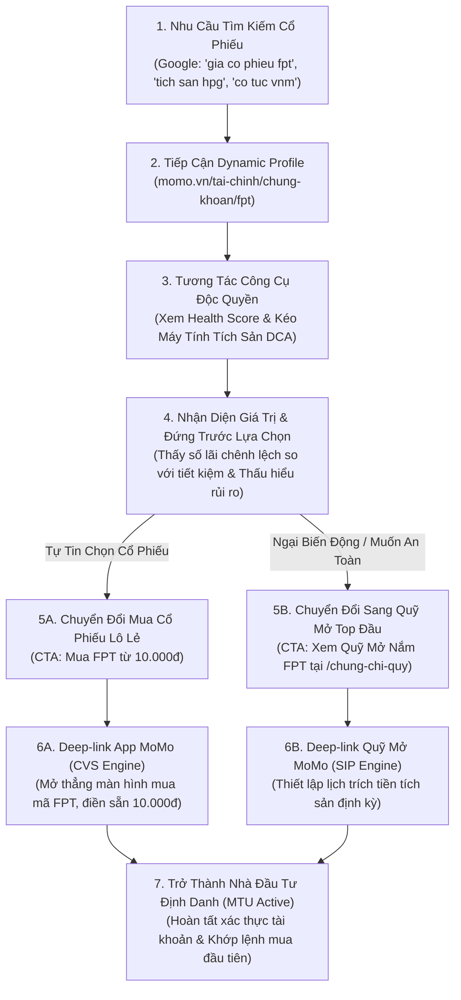
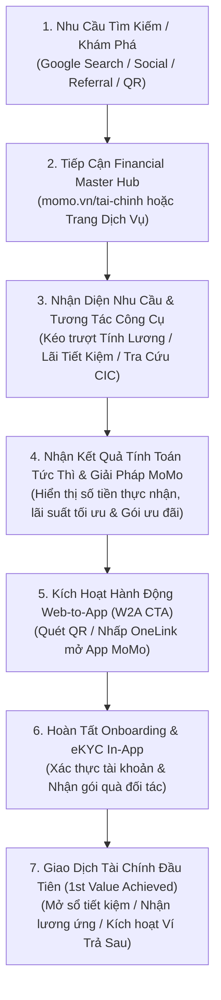

# BRD: Financial Master Hub (momo.vn/tai-chinh)

> - **Tên Dự Án:** Financial Master Hub (Cổng Khám Phá & Ra Quyết Định Dịch Vụ Tài Chính MoMo)
> - **Phân Khối Phụ Trách:** Growth Platform Division x Financial Services Division (CreditTech)
> - **Đội Ngũ Triển Khai:** Web Development Team, Backend Team, SEO & Content Team, Product Growth Team
> - **Phiên Bản:** v3.1 - Tháng 8/2026
> - **Trạng Thái:** Aligned & Production Ready (`momo.vn/tai-chinh`)

---

**MoMo Financial Master Hub:** Rút ngắn hành trình từ nhu cầu tìm kiếm đến quyết định sử dụng dịch vụ tài chính MoMo (Pre-install Discovery & Decision Gateway).

---

## 1. PHÁT BIỂU VẤN ĐỀ (PROBLEM STATEMENT)

1. **Người dùng không nhận diện được hệ sinh thái tài chính toàn diện của MoMo để giải quyết JTBD (Jobs-To-Be-Done):** Trước đây, các sản phẩm tài chính trên Web tồn tại dưới dạng 11 trang đích độc lập nằm rời rạc (`/tiet-kiem-online`, `/vay-nhanh`, `/vi-tra-sau`, `/the-tin-dung`...). Khi người dùng có nhu cầu tài chính tổng thể (như tính toán thu nhập ròng, tìm kênh tiết kiệm sinh lời, kiểm tra lịch sử tín dụng CIC để vay vốn, hay quản lý thuế), họ chỉ tiếp cận một trang đơn lẻ từ Google rồi rời đi, hoàn toàn không biết MoMo có đầy đủ giải pháp từ Tín Dụng, Tiết Kiệm, Đầu Tư đến Ngân Hàng.
2. **Khoảng cách lớn giữa Tra cứu thông tin và Kích hoạt giao dịch đầu tiên (Time-to-First-Value):** Người dùng bị đẩy quá nhanh sang bước tải app hoặc yêu cầu định danh (eKYC) phức tạp trong khi chưa được trải nghiệm giá trị cụ thể của sản phẩm trên Web, dẫn đến tỷ lệ bỏ cuộc (drop-off) cao sau khi cài đặt.
3. **Chưa khai thác tối đa dung lượng tìm kiếm toàn ngành 101.89 triệu lượt/tháng:** Nhu cầu tìm kiếm tài chính tại Việt Nam rất lớn nhưng phân tán. Thiếu một Cổng Trung Tâm (Master Hub) có năng lực kết nối chuyên đề để thâu tóm các từ khóa có lượng truy cập cao và chuyển đổi thành người dùng định danh.

---

## 2. GIẢ THUYẾT GIẢI PHÁP (SOLUTION HYPOTHESIS)

Nếu MoMo xây dựng **Financial Master Hub (`momo.vn/tai-chinh`)** làm cổng khám phá tập trung, bao phủ toàn diện 5 trụ cột dịch vụ tài chính (*Tín Dụng & Vay, Tiết Kiệm & Lãi Suất, Đầu Tư & Tích Sản, Ngân Hàng & Thẻ, Thu Nhập & Thuế*), đồng thời cung cấp **Bộ Công Cụ Tiện Ích Tương Tác Trực Tiếp (Interactive Tools & Calculators)** không cần đăng nhập cho từng bài toán thực tế:
* Người dùng sẽ tự nhận diện nhu cầu và trải nghiệm giá trị tính toán ngay lập tức trên Web (Instant Value).
* Hiểu rõ sản phẩm tài chính của MoMo giải quyết bài toán của mình như thế nào trước khi tải app.
* Tạo động lực rõ ràng để mở App, hoàn tất eKYC và kích hoạt Giao dịch Tài chính Đầu tiên (1st Financial Transaction).

---

## 3. MỤC TIÊU KINH DOANH & BÁO CÁO HIỆU SUẤT MTD (BUSINESS OBJECTIVES & PERFORMANCE)

1. **Xây dựng Cổng Dịch Vụ Tài Chính Toàn Diện (Master Financial Gateway):** Thiết lập `momo.vn/tai-chinh` thành trung tâm điều hướng và thâu tóm nhu cầu tìm kiếm cho toàn bộ 5 khối dịch vụ tài chính (101.89M lượt tìm kiếm/tháng).
2. **Báo Cáo Hiệu Suất Vận Hành Chốt Sổ Tháng 9/2026 (Full Month 30d):**
   * **Total Full Month Traffic:** Đạt **246.305 Pageviews** (chiếm 6.23% tổng lưu lượng Kênh Web).
   * **Daily Pace:** Đạt **8.210 PV/ngày**.
   * **Tỷ lệ hoàn thành Target:** Đạt **98,52% Target Tháng 9** (250.000 PVs) - **TIỆM CẬN HOÀN THÀNH 98,5% TARGET THÁNG 9**.
   * **Phân rã Top Verticals Full Month T9:** Vay Nhanh **108.614 PVs** (44.1% Hub), Tra cứu CIC **80.354 PVs** (32.6% Hub), Ví Trả Sau **42.245 PVs** (17.2% Hub), Bổ trợ **15.092 PVs** (6.1% Hub).
3. **Cột Mốc Tiến Độ Sản Phẩm & Content Mới (Cập nhật 13/10/2026):**
   * **Đã Go-Live Chính Thức:**
     - **Bảng Lãi Suất 40 Ngân Hàng & Tool Tính Tiền Lãi (`/tai-chinh/lai-suat`):** Cung cấp bảng tra cứu lãi suất 40 bank toàn cảnh thị trường và công cụ tính lãi gửi tiết kiệm theo số tiền nhập vào, tự động gợi ý ngân hàng có lãi suất tối ưu nhất.
     - **Phân Bổ Lương 50/30/20 & Hũ Tài Chính (`/tai-chinh/phan-bo-luong`):** Chính thức Go-live phục vụ chia ngân sách tự động và kết nối Hũ Chi Tiêu in-app.
     - **Bộ 3 Cổng Tiện Ích Đã Go-Live Trước Đó:** Tính Lương (`/tai-chinh/tinh-luong`), Tỷ Giá (`/tai-chinh/ty-gia`), Giá Vàng (`/tai-chinh/gia-vang`).
   * **Đang On UAT (Dự Kiến Go-Live Trong Tuần Này):**
     - **Sub-pages Tỷ Giá (5 Cặp Tiền Tệ Phổ Biến):** Hệ thống trang con chi tiết theo cặp tiền (USD, EUR, JPY, GBP, CNY...) kèm tool đổi tiền trực tiếp và biểu đồ so sánh.
     - **Mega Menu Header Mới Trên `/tai-chinh`:** Điều hướng 4 trụ cột tài chính. Khi click sang trang con có menu riêng, Mega Menu chính sẽ tự động đóng vai trò Top Menu toàn cục cố định.
   * **Đang Review Kỹ Thuật (API Review):**
     - **API Lãi Suất Gửi Tiết Kiệm MoMo (`/tai-chinh/gui-tiet-kiem`):** Thẩm định tích hợp API lãi suất tiền gửi ưu đãi đối tác (Bản Việt +0.2% lãi suất, VPBank).
     - **API Dữ Liệu Chứng Chỉ Quỹ (`/tai-chinh/chung-chi-quy`):** Thẩm định API giá NAV và tỷ suất sinh lời quỹ mở phục vụ bảng giá tra cứu và tool tích sản SIP.
     - **Cổng Chứng Khoán & Dynamic Ticker Profiles (`/tai-chinh/chung-khoan` & `/tai-chinh/chung-khoan/[ticker]`):** Hoàn thiện kiến trúc Programmatic SEO 30 mã VN30, bộ máy tính Stock DCA Backtester và Thước đo Sức khỏe Doanh nghiệp (MoMo Stock Health Score 1-100) phục vụ chiến lược tích sản cổ phiếu lô lẻ từ 10.000đ kết nối đối tác CVS.
4. **Hạ tầng Công cụ Tiện ích Dùng chung (Embeddable Widgets):** Chuẩn hóa các bộ công cụ tính toán để nhúng linh hoạt vào mọi điểm chạm trên toàn bộ Kênh Web MoMo.

---

## 4. MA TRẬN BỐI CẢNH (CONTEXT MATRIX)

| Phân Loại | Nội Dung Chi Tiết |
| :--- | :--- |
| **FACT (Sự Thật Hệ Thống)** | - MoMo là sản phẩm App-first; Web không thay thế App.<br/>- Trang Web <code style="background:#f1f5f9;padding:2px 4px;border-radius:4px;font-family:monospace;">momo.vn</code> không yêu cầu đăng nhập.<br/>- Người dùng bắt buộc phải hoàn tất định danh eKYC trên App MoMo trước khi đủ điều kiện mở sổ tiết kiệm, mở ví trả sau, vay tiêu dùng hoặc đầu tư chứng chỉ quỹ. |
| **OBSERVATION (Quan Sát Dữ Liệu)** | - Các trang sản phẩm độc lập trước đây chủ yếu thúc đẩy tải app nhanh nhưng thiếu bước giáo dục và trải nghiệm sản phẩm trước cài đặt, dẫn đến tỷ lệ drop-off lớn sau khi cài đặt/mở App.<br/>- Phần lớn nhu cầu tìm kiếm tài chính tập trung vào dạng tra cứu/công cụ tính toán (Tool Intent) thay vì đọc bài viết chữ đơn thuần. |
| **AVAILABLE SIGNALS (Tín Hiệu Có Sẵn)** | - Nguồn truy cập (Source / Referrer / UTM Campaign).<br/>- Chủ đề tìm kiếm (Search Query / Topic Cluster).<br/>- Dữ liệu người dùng tự nhập trên công cụ Web (Mức lương, Số tiền gửi, Số tiền vay, Nhóm nợ tín dụng).<br/>- Thiết bị và bối cảnh truy cập (Mobile vs Desktop). |
| **ASSUMPTION (Giả Định Cần Test)** | - Cung cấp công cụ tính toán miễn phí không cần đăng nhập (No-login Tool) trên Web sẽ tạo ra nhóm người dùng tải app có ý định sử dụng (Intent) và độ gắn kết sản phẩm cao hơn đáng kể so với việc chỉ hiển thị bài viết giới thiệu tĩnh. |

---

## 5. TỔNG QUAN SẢN PHẨM & CÁC TRỤ CỘT DỊCH VỤ (PRODUCT OVERVIEW)

### 5.1 Bốn Trụ Cột Dịch Vụ Tài Chính Tại Financial Hub

Financial Hub quy hoạch toàn bộ giải pháp tài chính MoMo thành 4 trụ cột chiến lược:

1. **Trụ Cột Tín Dụng (Credit & Borrowing):**
   * *Dịch vụ:* Chuyên trang Điểm Tín Dụng & Tra Cứu CIC (`momo.vn/diem-tin-dung`), Vay Tín Chấp (Vay Nhanh), Trả Góp (Ví Trả Sau), Vay Mua Nhà / Xe, Xóa Nợ Xấu.
   * *Công cụ cốt lõi:* Máy tính lịch trả nợ giảm dần, Máy tính trả góp 0%, Widget tự đánh giá nhóm nợ 1-5, Bảng lãi suất vay ngân hàng.
2. **Trụ Cột Tích Lũy (Savings & Accumulation):**
   * *Dịch vụ:* Gửi Tiết Kiệm Online MoMo (Đối tác Bản Việt, VPBank với ưu đãi +0.2% lãi suất), Túi Thần Tài, Bảng So Sánh Lãi Suất 40 Ngân Hàng Toàn Cảnh (`momo.vn/tai-chinh/lai-suat`).
   * *Công cụ cốt lõi:* Bảng tra cứu lãi suất 40 bank và Tool tính tiền lãi gửi tiết kiệm theo số tiền người dùng tự nhập (hiển thị ngân hàng tối ưu nhất), Bộ tính quỹ dự phòng khẩn cấp.
3. **Trụ Cột Đầu Tư (Investment & Wealth Building):**
   * *Dịch vụ:* Giá Vàng SJC/9999 Realtime (`momo.vn/tai-chinh/gia-vang`), Tỷ Giá Ngoại Tệ & Đổi Tiền (`momo.vn/tai-chinh/ty-gia`), Cổng Chứng Khoán Master & 30 Dynamic Ticker Profiles VN30 (`momo.vn/tai-chinh/chung-khoan` & `momo.vn/tai-chinh/chung-khoan/[ticker]`), Chứng Chỉ Quỹ SIP (`momo.vn/tai-chinh/chung-chi-quy`), Tự Do Tài Chính FIRE (`momo.vn/tai-chinh/tu-do-tai-chinh`).
   * *Công cụ cốt lõi:* Bảng giá vàng realtime & công cụ quy đổi, Cổng tra cứu tỷ giá 30+ ngoại tệ và 5 sub-page cặp tiền, Máy tính Giả lập Tích sản Cổ phiếu Lịch sử (Stock DCA Backtester), Thước đo Sức khỏe Doanh nghiệp (MoMo Stock Health Score 1-100), Bảng giá NAV và Máy tính tích sản SIP từ 10.000đ/ngày, Bộ giả lập FIRE.
4. **Trụ Cột Chi Tiêu (Spending & Cash Flow):**
   * *Dịch vụ:* Tính Lương Gross - Net luật mới 2026 (`momo.vn/tai-chinh/tinh-luong`), Phân Bổ Lương 50/30/20 & Hũ Tài Chính (`momo.vn/tai-chinh/phan-bo-luong`), Lương Hưu & BHXH Một Lần (`momo.vn/tai-chinh/luong-huu`), Cổng Danh Bạ 34 Ngân Hàng (`momo.vn/tai-chinh/ngan-hang`).
   * *Công cụ cốt lõi:* Máy tính Gross-Net 2026 tích hợp khấu trừ bảo hiểm 10.5% và thuế TNCN 7 bậc, Tool chia ngân sách 50/30/20 và 6 hũ tài chính kết nối Hũ Chi Tiêu in-app, Tool tính lương hưu luật mới.

### 5.2 Cơ Chế Điều Hướng Trọng Tâm Đến 3 Sản Phẩm FinHub (Driven-Traffic Engine)

### 5.2.1 Quy Chuẩn "MoMo Gợi Ý (AI)" Cá Nhân Hóa Theo Hành Vi Nhập (Dynamic Rule Engine)

Khối **MoMo Gợi Ý** tuyệt đối không sử dụng câu chữ tĩnh (Static Text), mà vận hành bằng **Động cơ Phân tích Ngữ cảnh Thời gian thực (Client-side Dynamic Rule Engine)**: Text gợi ý tự động thay đổi tức thì (Reactive UI / Debounce 150ms) khớp chính xác với từng mốc giá trị mà người dùng vừa nhập vào công cụ.

#### Ma Trận Phân Tầng Gợi Ý Mẫu Cho Công Cụ Tính Lương:
1. **Phân khúc Thu nhập Khởi điểm (< 11 triệu/tháng - Chưa chịu thuế TNCN):**
   - *Logic:* Lương thực nhận = Lương Gross trừ BHXH (10.5%). Thuế TNCN = 0đ do dưới mức giảm trừ gia cảnh 11 triệu.
   - *Câu gợi ý động:* "Với mức lương [10 triệu]/tháng, bạn chưa phải nộp thuế TNCN. Mẹo tối ưu: Hãy trích ngay [2 triệu] (20%) vào Túi Thần Tài để sau 1 năm tích lũy được quỹ dự phòng khẩn cấp [24 triệu] có sinh lời mỗi ngày."
   - *Icon ưu tiên:* Túi Thần Tài, Hũ Chi Tiêu.

2. **Phân khúc Thu nhập Trung bình - Khá (15 - 30 triệu/tháng - Chịu thuế bậc 1 & 2):**
   - *Logic:* Bắt đầu phát sinh thuế TNCN từ vài trăm ngàn đến 2-3 triệu/tháng. Đã có thặng dư tài chính tích lũy.
   - *Câu gợi ý động:* "Với mức lương [30 triệu]/tháng, bạn đang nộp khoảng [2.15 triệu] tiền thuế TNCN. Dòng tiền thặng dư sau sinh hoạt ước đạt [9 triệu]/tháng. Mẹo tối ưu: Chia [6 triệu] vào Tiết Kiệm Online Bản Việt/VPBank nhận lãi suất cao và [3 triệu] vào Thực Tập Sinh Đầu Tư để gia tăng tài sản dài hạn."
   - *Icon ưu tiên:* Tiết Kiệm Online, Thực Tập Sinh Đầu Tư, Thẻ Tín Dụng Hoàn Tiền.

3. **Phân khúc Thu nhập Cao (> 40 triệu/tháng - Chịu thuế bậc 3 trở lên):**
   - *Logic:* Chịu thuế suất biên cao (20% - 35%). Nhu cầu quản trị thuế, tối ưu chi phí và đầu tư đa kênh.
   - *Câu gợi ý động:* "Với mức lương [50 triệu]/tháng, bạn đang đóng [6.4 triệu] tiền thuế TNCN mỗi tháng. Mẹo tối ưu: Hãy khai báo tối đa người phụ thuộc hợp lệ để giảm trừ thuế, đồng thời phân bổ 40% dòng tiền thặng dư vào danh mục tích sản cân bằng (50% Tiết Kiệm an toàn + 50% Quỹ Mở tăng trưởng)."
   - *Icon ưu tiên:* Thực Tập Sinh Đầu Tư Quỹ Mở, Tiết Kiệm Kỳ Hạn Lớn, Báo Cáo CIC Hạng Cao.

> [!NOTE] **Tài Liệu Đặc Tả Kỹ Thuật & Bộ Ma Trận Copy Catchy Đầy Đủ:**
> Toàn bộ logic công thức, cơ chế Toggle Cà Khịa (Roast Mode), nút Lắc Quẻ Re-roll, mã nguồn TypeScript (`src/utils/aiProposalEngine.ts`) và mã Umami Tracking chuẩn hóa được tổng hợp độc lập tại:
> [momo-ai-proposal-engine-prd.md](file:///Users/hienhv/HienHv/Klaus/Hienho_MoMo-Base/09_PRD/momo-ai-proposal-engine-prd.md).


#### Quy Chuẩn Đề Xuất Trợ Lý MoMo AI Cho Utility Tính Lãi Tiết Kiệm (Công Thức Bù Đắp Chênh Lệch Lãi Ròng - Net Yield Gap):

Thay vì hiển thị câu chữ đếm số lượng ngân hàng hình thức gây trùng lặp với bảng so sánh, khối Trợ lý MoMo AI vận hành theo kịch bản chung duy nhất: **Bù đắp chênh lệch lãi ròng giữa phương án người dùng chọn và giải pháp tối ưu trên MoMo**.

1. **Công thức toán học:**
   $$\Delta \text{Lãi} = P \times (r_{\text{tối ưu}} - r_{\text{người dùng}}) \times \frac{T}{12}$$
   - $P$: Số tiền người dùng nhập (VND).
   - $T$: Kỳ hạn gửi được chọn (tháng).
   - $r_{\text{người dùng}}$: Lãi suất của ngân hàng người dùng đang chọn (%).
   - $r_{\text{tối ưu}}$: Lãi suất cao nhất trong danh mục đối tác Tiết Kiệm Online trên MoMo (hoặc Top 1 thị trường) cho cùng kỳ hạn $T$ (%).

2. **Ma trận hiển thị động (Dynamic Content):**
   - **Khi $\Delta \text{Lãi} > 0$ (chiếm >95% lượt tra cứu):**
     - *Nội dung hiển thị:* "Gửi tại **[Tên Bank Tối Ưu]** giúp bạn nhận thêm **+[Delta Lãi] đ** tiền lãi (đạt **[r tối ưu]%**/năm). Mở sổ online ngay trên MoMo, không cần đến quầy."
     - *Ví dụ thực tế:* *"Gửi tại **BVBank trên MoMo** giúp bạn nhận thêm **+1.000.000 đ** tiền lãi (đạt **5,70%**/năm). Mở sổ online ngay trên MoMo, không cần đến quầy."*
     - *Nút CTA:* `Gửi Tiết Kiệm Nhận Thêm +[Delta Lãi] đ` *(Ví dụ: `Gửi Tiết Kiệm Nhận Thêm +1.000.000 đ`)*
     - *Đích đến:* Deeplink mở sổ Tiết Kiệm Online trên App MoMo điền sẵn số tiền $P$ và kỳ hạn $T$.
   - **Khi $\Delta \text{Lãi} \le 0$ (người dùng đã chọn ngân hàng Top 1):**
     - *Nội dung hiển thị:* "[Tên Bank] đang có mức lãi suất tốt nhất thị trường cho kỳ hạn này (**[r tối ưu]%**/năm). Mở sổ online trên MoMo để nhận thêm quà tặng tài chính."
     - *Nút CTA:* `Mở Sổ Tiết Kiệm Online Ngay`
     - *Đích đến:* Deeplink mở danh mục Tiết Kiệm trên App MoMo.

3. **Cấu trúc dữ liệu Frontend Contract:**
   ```typescript
   interface SavingRecommendation {
     diffAmount: number;         // Tiền chênh lệch (VND), ví dụ: 1000000
     optimalBankName: string;    // Tên ngân hàng tối ưu, ví dụ: "BVBank"
     optimalRate: number;        // Lãi suất tối ưu, ví dụ: 5.70
     message: string;            // Đoạn text hiển thị trong Box AI
     ctaText: string;            // Nhãn hiển thị trên nút CTA
     deeplink: string;           // Deeplink mở App MoMo kèm tham số
   }
   ```

Toàn bộ các công cụ tính toán (Tools) và trang đích trên Kênh Web đóng vai trò là "Cỗ Máy Thu Hút Lưu Lượng" để phân luồng và đề xuất theo ngữ cảnh (Contextual Suggestion) trực tiếp vào **3 Sản Phẩm Trọng Điểm Cần Đẩy Của FinHub**:

1. **Sức Khỏe Tín Dụng (CIC & Điểm Tín Dụng MoMo):**
   - *Điểm chạm kích hoạt:* Công cụ Tính Lương, Mã Số Thuế, Tra Cứu CIC, Phân Bổ Ngân Sách, Quản Lý Dòng Tiền.
   - *Cơ chế điều hướng:* Sau khi người dùng tính toán thu nhập hoặc nợ ➔ Hệ thống tự động đo lường chỉ số an toàn đòn bẩy và hiển thị CTA *"Kiểm Tra Báo Cáo Tín Dụng CIC Miễn Phí 100% Trên MoMo"* để thẩm định hồ sơ trước khi vay.

2. **Tích Lũy An Toàn (Gửi Tiết Kiệm Online TKO - Bản Việt & VPBank):**
   - *Điểm chạm kích hoạt:* Bảng So Sánh Lãi Suất 30 Bank, Công Cụ Tính Lương Gross-Net, Quản Lý Dòng Tiền & Tiêu Dùng, Giá Vàng, Tỷ Giá Ngoại Tệ.
   - *Cơ chế điều hướng:* Khi công cụ tính toán ra Dòng Tiền Tự Do (Free Cash Flow), lương Net hoặc số tiền thặng dư ➔ Tự động tính tiền lãi sinh lời và đề xuất *"Gửi Tiết Kiệm Bản Việt / VPBank Trên MoMo (Nhận Thêm +0.2% Lãi Suất)"*.

3. **Tăng Trưởng Tài Sản (Chương Trình Thực Tập Sinh Đầu Tư - Chứng Khoán Lô Lẻ & Chứng Chỉ Quỹ (SIP)):**
   - *Điểm chạm kích hoạt:* Cổng Chứng Khoán Master (`/tai-chinh/chung-khoan`), Dynamic Ticker Profiles (`/tai-chinh/chung-khoan/[ticker]`), Tích Sản FIRE (`/tai-chinh/tu-do-tai-chinh`), Quy Đổi Vàng, Phân Bổ Lương 50/30/20.
   - *Cơ chế điều hướng:* Cơ chế chuyển đổi kép (Dual-Conversion Hook): Sau khi người dùng chạy giả lập tích sản cổ phiếu DCA ➔ Nếu sẵn sàng tự đầu tư cổ phiếu: Kích hoạt CTA *"Tích Sản Cổ Phiếu [Mã] Từ 10.000đ Trên MoMo"* (mở App kết nối đối tác Chứng khoán CVS); Nếu lo ngại biến động thị trường: Kích hoạt CTA *"Ủy Thác Danh Mục VN30 Cho Quỹ Mở Top Đầu Chỉ Từ 10.000đ/Ngày"* (điều hướng sang `/tai-chinh/chung-chi-quy`).

### 5.3 Cơ Chế Hợp Nhất Hệ Sinh Thái & Bảo Toàn Thẩm Quyền SEO

Để bảo vệ 100% thứ hạng SEO và lượng truy cập hiện có của các trang sản phẩm độc lập (`/tiet-kiem-online`, `/vay-nhanh`, `/vi-tra-sau`, `/the-tin-dung`...), hệ thống giữ nguyên cấu trúc URL gốc và thực hiện hợp nhất trải nghiệm qua **3 Cơ Chế**:
* **Trang Cổng Trung Tâm (`momo.vn/tai-chinh`):** Đóng vai trò là mặt tiền tổng hợp Dashboard thị trường và điều hướng phân luồng theo đúng JTBD.
* **Thanh Điều Hướng Thống Nhất (Global Financial Navigation Bar):** Xuất hiện đồng bộ trên tất cả các trang sản phẩm, kết nối liền mạch 5 trụ cột dịch vụ.
* **Cơ Chế Bán Chéo Theo Ngữ Cảnh (Contextual Cross-Sell Engine):** Nhúng đề xuất giải pháp liên quan ngay sau khi người dùng nhận kết quả tính toán trên công cụ.

### 5.4 Chiến Lược Cổng Chứng Khoán & Dynamic Ticker Profiles (/tai-chinh/chung-khoan)

> [!NOTE] **Tài Liệu Đặc Tả Kỹ Thuật Chi Tiết (PRD Reference):**
> Toàn bộ logic thuật toán chấm điểm sức khỏe doanh nghiệp, mô hình giả lập DCA, hợp đồng API dữ liệu giá và schema sự kiện Umami được quy định chi tiết tại:
> [chung-khoan-profile-prd.md](file:///Users/hienhv/HienHv/Klaus/Hienho_MoMo-Base/09_PRD/chung-khoan-profile-prd.md) (và liên kết nội bộ tại [05_HUBS/financial/chung-khoan-profile-prd.md](file:///Users/hienhv/HienHv/Klaus/Hienho_MoMo-Base/05_HUBS/financial/chung-khoan-profile-prd.md)).

#### 5.4.1 Định Vị Độc Đạo: Tích Sản Lô Lẻ Dành Cho 95% Dân Số Đại Chúng (F0 Wealth Accumulation)

- **Strategic Positioning:** MoMo không cạnh tranh trực diện với các công ty chứng khoán truyền thống (VPS, SSI, VNDirect, TCBS) trong việc xây dựng bảng giá giao dịch realtime phức tạp, công cụ phân tích kỹ thuật đa khung thời gian hay đòn bẩy Margin cao cho nhóm nhà đầu tư lướt sóng ngắn hạn (Day-traders / T+2.5).
- **Core Path (Con đường độc đạo):** Định vị Chứng Khoán trên Web Platform MoMo là **"Cổng Tích Sản Doanh Nghiệp Tốt Dành Cho Người Đại Chúng"**. Biến việc đầu tư cổ phần doanh nghiệp thành hành động tích lũy tài sản định kỳ, an toàn và dễ hiểu như bỏ ống heo hàng tháng.
- **Bốn Trụ Cột Đột Phá:**
  1. *Lô lẻ từ 10.000đ:* Xóa bỏ rào cản lô chẵn 100 cổ phiếu (vốn cần 10-14 triệu đồng đối với FPT, VCB). Người dùng có thể sở hữu cổ phần của các tập đoàn đầu ngành Việt Nam chỉ từ 10.000đ thông qua đối tác Chứng khoán CVS tích hợp in-app.
  2. *Zero-Jargon (Bình dân hóa ngôn ngữ tài chính):* Loại bỏ các thuật ngữ chuyên môn gây quá tải nhận thức. Toàn bộ chỉ số tài chính (P/E, P/B, ROE, D/E) được diễn giải thành câu trả lời trực tiếp ("Cổ phiếu đang Đắt hay Rẻ", "Công ty nợ nhiều hay ít", "Khả năng sinh lời so với lãi ngân hàng").
  3. *Tập trung vào Dòng tiền Cổ tức & Tăng trưởng dài hạn:* Giáo dục người dùng tập trung vào giá trị nội tại doanh nghiệp và dòng tiền cổ tức tiền mặt đều đặn thay vì tâm lý hoảng loạn theo biến động xanh đỏ từng phiên.
  4. *Cơ chế Chuyển đổi Kép (Dual-Conversion Hook):* Tạo lối thoát an toàn cho người dùng quan tâm đến ngành nhưng lo ngại biến động mã đơn lẻ bằng cách dẫn dắt sang ủy thác qua Quỹ Mở (`/tai-chinh/chung-chi-quy`).

#### 5.4.2 Kiến Trúc URL & Hệ Thống Programmatic SEO VN30

- **Cổng Tổng Quan Master Hub:** `momo.vn/tai-chinh/chung-khoan`
  - Đóng vai trò trang tổng quan thị trường, bảng phân loại cổ phiếu VN30 theo khẩu vị đầu tư (Tích sản an toàn, Cổ tức tiền mặt cao, Tăng trưởng công nghệ), và cẩm nang giáo dục F0.
- **Dynamic Ticker Profile (Programmatic SEO 30 Mã VN30):** `momo.vn/tai-chinh/chung-khoan/[ticker]`
  - URL chuẩn hóa viết thường (ví dụ: `/tai-chinh/chung-khoan/fpt`, `/tai-chinh/chung-khoan/vnm`, `/tai-chinh/chung-khoan/hpg`, `/tai-chinh/chung-khoan/vcb`, `/tai-chinh/chung-khoan/mwg`...).
  - Triển khai toàn diện 30 mã thuộc rổ chỉ số VN30 nhằm thâu tóm toàn bộ lượng tìm kiếm thương hiệu và mã chứng khoán (quy mô hơn 4.1 triệu lượt tìm kiếm/tháng).

#### 5.4.3 Wireframe Nội Dung 7 Tầng Chuẩn Hóa Cho Dynamic Ticker Profile

Mỗi trang `/tai-chinh/chung-khoan/[ticker]` được chuẩn hóa thành 7 tầng nội dung logic phục vụ hành trình khám phá và ra quyết định chuyển đổi:

- **Tầng 1: Hero & Price Action No-Jargon:**
  - Ticker, Logo doanh nghiệp, Tên công ty đầy đủ, Ngành nghề chính, Sàn niêm yết (HOSE).
  - Giá đóng cửa gần nhất, Biến động phiên (% và VND), Vốn hóa thị trường.
  - Hộp Định Giá Bình Dân: Tự động đánh giá cổ phiếu đang ở vùng giá Hợp lý / Hơi cao / Hấp dẫn dựa trên P/E lịch sử 5 năm.
  - Primary CTA: Nút nhấp mở App *"Mua Cổ Phiếu [Mã] Từ 10.000đ Trên MoMo"* kèm mã QR trên Desktop.
- **Tầng 2: Thước Đo Sức Khỏe Doanh Nghiệp (MoMo Stock Health Score 1-100):**
  - Thang điểm 1-100 trực quan phân tầng 4 mức (Xuất Sắc, Tốt, Trung Bình, Cần Thận Trọng).
  - Tách bạch 4 trụ cột đánh giá: Sức mạnh tài chính (25%), Tăng trưởng kinh doanh (25%), Lịch sử cổ tức (25%), Hiệu quả & Vị thế ngành (25%).
- **Tầng 3: Mô Hình Kinh Doanh Dễ Hiểu Cho F0 (Business Model Breakdown):**
  - Giải thích cụ thể doanh nghiệp kiếm tiền từ đâu, lợi thế cạnh tranh bền vững (Moat), và rủi ro lớn nhất cần lưu ý bằng 3-4 gạch đầu dòng súc tích.
- **Tầng 4: Máy Tính Giả Lập Tích Sản Lịch Sử (Stock DCA Backtester Tool):**
  - Tiện ích tương tác không cần đăng nhập cho phép kiểm chứng kết quả đầu tư định kỳ hàng tháng (1 năm, 3 năm, 5 năm) so sánh trực tiếp với gửi tiết kiệm ngân hàng 6%/năm.
- **Tầng 5: Lịch Trả Cổ Tức Tiền Mặt & Dòng Tiền Thụ Động (Dividend Tracker):**
  - Bảng lịch sử trả cổ tức tiền mặt 3-5 năm gần nhất, tỷ suất cổ tức bình quân (Dividend Yield) so với lãi suất tiền gửi 12 tháng.
- **Tầng 6: Cơ Chế Chuyển Đổi Kép Độc Quyền (Dual-Conversion Hook):**
  - Cánh cửa 1: Tự mua cổ phiếu lô lẻ mã này từ 10.000đ qua CVS in-app.
  - Cánh cửa 2: Ủy thác qua Quỹ Mở (`/tai-chinh/chung-chi-quy`) sở hữu trọn rổ cổ phiếu đầu ngành cho người dùng ngại rủi ro chọn mã.
- **Tầng 7: Câu Hỏi Thường Gặp (FAQ Schema JSON-LD) Chuẩn SEO/GEO:**
  - 5-6 câu hỏi giải tỏa rào cản pháp lý, cơ chế lô lẻ, cách nhận cổ tức, tính thanh khoản và biểu phí giao dịch.

#### 5.4.4 Chi Tiết Kỹ Thuật Hai Công Cụ Tương Tác Cốt Lõi

1. **Máy Tính Giả Lập Tích Sản Lịch Sử (Stock DCA Backtester):**
   - *Tham số đầu vào:* Mã cổ phiếu (`ticker`), Số tiền tích lũy mỗi tháng (`monthlyAmount`, mặc định: 1.000.000 VND, min: 10.000 VND), Thời gian tích sản (`durationYears`: 1, 3, 5 năm), Ngày tích sản cố định hàng tháng (Ngày 5).
   - *Công thức giá trị tích lũy thực tế:*
     Tại mỗi tháng $t$, số cổ phiếu mua được theo giá đóng cửa điều chỉnh $P_{\text{adj}, t}$:
     $$\text{Shares}_t = \frac{\text{monthlyAmount}}{P_{\text{adj}, t}}, \quad \text{Total Shares} = \sum_{t=1}^{N} \text{Shares}_t$$
     $$\text{Current Portfolio Value} = \text{Total Shares} \times P_{\text{current}}$$
   - *Công thức đối chuẩn gửi tiết kiệm (Benchmark Savings 6.0%/năm):*
     $$\text{Savings Value} = \text{monthlyAmount} \times \left[ \frac{(1 + r_{\text{month}})^N - 1}{r_{\text{month}}} \right] \times (1 + r_{\text{month}}) \quad \text{với } r_{\text{month}} = \frac{0.06}{12}$$
   - *Output hiển thị:* Tổng vốn đầu tư, Giá trị danh mục cổ phiếu đạt được, Giá trị nếu gửi tiết kiệm, Số tiền chênh lệch dôi dư và Tỷ suất sinh lời kép (CAGR).

2. **Thước Đo Sức Khỏe Doanh Nghiệp (MoMo Stock Health Score 1-100):**

<table style="width:100%; border-collapse:collapse; border:1.5px solid #64748b; margin:1em 0; font-size:0.85em;">
  <thead>
    <tr style="background-color:#f1f5f9;">
      <th style="border:1.5px solid #64748b; padding:6px; text-align:left; font-weight:700;">Trụ Cột Đánh Giá</th>
      <th style="border:1.5px solid #64748b; padding:6px; text-align:center; font-weight:700;">Trọng Số</th>
      <th style="border:1.5px solid #64748b; padding:6px; text-align:left; font-weight:700;">Chỉ Số Cốt Lõi</th>
      <th style="border:1.5px solid #64748b; padding:6px; text-align:left; font-weight:700;">Ngưỡng Tối Ưu (Max Điểm)</th>
      <th style="border:1.5px solid #64748b; padding:6px; text-align:left; font-weight:700;">Diễn Giải Ngôn Ngữ F0 (No-Jargon)</th>
    </tr>
  </thead>
  <tbody>
    <tr>
      <td style="border:1px solid #94a3b8; padding:6px;"><strong>1. Sức Mạnh Tài Chính</strong></td>
      <td style="border:1px solid #94a3b8; padding:6px; text-align:center;">25%</td>
      <td style="border:1px solid #94a3b8; padding:6px;">Debt-to-Equity, Current Ratio, Dự trữ tiền mặt</td>
      <td style="border:1px solid #94a3b8; padding:6px;">D/E &lt; 1.0, Current Ratio &gt; 1.5</td>
      <td style="border:1px solid #94a3b8; padding:6px;">Công ty nợ rất ít, lượng tiền mặt dồi dào, an tâm không lo phá sản hoặc áp lực trả lãi vay.</td>
    </tr>
    <tr style="background-color:#f8fafc;">
      <td style="border:1px solid #94a3b8; padding:6px;"><strong>2. Tăng Trưởng Kinh Doanh</strong></td>
      <td style="border:1px solid #94a3b8; padding:6px; text-align:center;">25%</td>
      <td style="border:1px solid #94a3b8; padding:6px;">Tăng trưởng doanh thu &amp; LNST 3 năm</td>
      <td style="border:1px solid #94a3b8; padding:6px;">Doanh thu &gt; 15%/năm, Lợi nhuận &gt; 15%/năm</td>
      <td style="border:1px solid #94a3b8; padding:6px;">Doanh nghiệp liên tục bán được nhiều hàng hơn và thu về lợi nhuận thật tăng trưởng đều đặn.</td>
    </tr>
    <tr>
      <td style="border:1px solid #94a3b8; padding:6px;"><strong>3. Lịch Sử Cổ Tức</strong></td>
      <td style="border:1px solid #94a3b8; padding:6px; text-align:center;">25%</td>
      <td style="border:1px solid #94a3b8; padding:6px;">Tính liên tục tiền mặt, Dividend Yield</td>
      <td style="border:1px solid #94a3b8; padding:6px;">Trả tiền mặt liên tục 3-5 năm, Yield &gt; 4.5%</td>
      <td style="border:1px solid #94a3b8; padding:6px;">Làm ăn có lãi thật và chia tiền sòng phẳng cho cổ đông đều đặn như nhận tiền lãi hàng năm.</td>
    </tr>
    <tr style="background-color:#f8fafc;">
      <td style="border:1px solid #94a3b8; padding:6px;"><strong>4. Hiệu Quả &amp; Vị Thế Ngành</strong></td>
      <td style="border:1px solid #94a3b8; padding:6px; text-align:center;">25%</td>
      <td style="border:1px solid #94a3b8; padding:6px;">ROE, ROA, Thị phần trong rổ VN30</td>
      <td style="border:1px solid #94a3b8; padding:6px;">ROE &gt; 20% liên tục, Top 1-3 ngành</td>
      <td style="border:1px solid #94a3b8; padding:6px;">Sử dụng vốn kinh doanh cực kỳ hiệu quả, tiền đẻ ra tiền vượt trội so với gửi ngân hàng.</td>
    </tr>
  </tbody>
</table>

#### 5.4.5 Sơ Đồ Luồng Chuyển Đổi Người Dùng Chứng Khoán (Stock Conversion Flow)



#### 5.4.6 Bảng Phân Tích Kỹ Thuật Các Bước Trong Luồng Chuyển Đổi Chứng Khoán

<table style="width:100%; border-collapse:collapse; border:1.5px solid #64748b; margin:1em 0; font-size:0.85em;">
  <thead>
    <tr style="background-color:#f1f5f9;">
      <th style="border:1.5px solid #64748b; padding:6px; text-align:center; font-weight:700;">Bước</th>
      <th style="border:1.5px solid #64748b; padding:6px; text-align:left; font-weight:700;">Tên Giai Đoạn</th>
      <th style="border:1.5px solid #64748b; padding:6px; text-align:left; font-weight:700;">Trải Nghiệm Người Dùng (UX)</th>
      <th style="border:1.5px solid #64748b; padding:6px; text-align:left; font-weight:700;">Hạ Tầng / Cơ Chế Kỹ Thuật</th>
      <th style="border:1.5px solid #64748b; padding:6px; text-align:center; font-weight:700;">Nền Tảng</th>
    </tr>
  </thead>
  <tbody>
    <tr>
      <td style="border:1px solid #94a3b8; padding:6px; text-align:center;">1</td>
      <td style="border:1px solid #94a3b8; padding:6px;"><strong>Tìm Kiếm & Khám Phá</strong></td>
      <td style="border:1px solid #94a3b8; padding:6px;">Tìm kiếm từ khóa mã cổ phiếu hoặc cổ tức VN30 trên Google và nhấp vào kết quả MoMo.</td>
      <td style="border:1px solid #94a3b8; padding:6px;">Programmatic SEO Next.js ISR, Schema Corporation &amp; FinancialProduct.</td>
      <td style="border:1px solid #94a3b8; padding:6px; text-align:center;">Google ➔ Web</td>
    </tr>
    <tr style="background-color:#f8fafc;">
      <td style="border:1px solid #94a3b8; padding:6px; text-align:center;">2</td>
      <td style="border:1px solid #94a3b8; padding:6px;"><strong>Đánh Giá Sức Khỏe</strong></td>
      <td style="border:1px solid #94a3b8; padding:6px;">Xem điểm MoMo Stock Health Score 1-100, nắm bắt nhanh doanh nghiệp tốt hay yếu không cần đọc báo cáo tài chính dài.</td>
      <td style="border:1px solid #94a3b8; padding:6px;">Client-side Visual Radial Score, Cached Financial Scoring API.</td>
      <td style="border:1px solid #94a3b8; padding:6px; text-align:center;">Web</td>
    </tr>
    <tr>
      <td style="border:1px solid #94a3b8; padding:6px; text-align:center;">3</td>
      <td style="border:1px solid #94a3b8; padding:6px;"><strong>Giả Lập Tích Sản DCA</strong></td>
      <td style="border:1px solid #94a3b8; padding:6px;">Kéo thanh trượt chọn số tiền tích lũy mỗi tháng (ví dụ 1 triệu) để nhìn thấy số tiền tạo ra so với gửi tiết kiệm.</td>
      <td style="border:1px solid #94a3b8; padding:6px;">No-login Interactive Calculator, Historical Price Database with Dividend Adjustment.</td>
      <td style="border:1px solid #94a3b8; padding:6px; text-align:center;">Web</td>
    </tr>
    <tr style="background-color:#f8fafc;">
      <td style="border:1px solid #94a3b8; padding:6px; text-align:center;">4</td>
      <td style="border:1px solid #94a3b8; padding:6px;"><strong>Lựa Chọn Chuyển Đổi Kép</strong></td>
      <td style="border:1px solid #94a3b8; padding:6px;">Người dùng tự tin thì nhấp mua cổ phiếu lô lẻ; người dùng thận trọng nhấp chọn phương án ủy thác qua Quỹ Mở đa dạng hóa.</td>
      <td style="border:1px solid #94a3b8; padding:6px;">Dual-Conversion Component, Intent Tracking, Contextual Deep-link Generator.</td>
      <td style="border:1px solid #94a3b8; padding:6px; text-align:center;">Web</td>
    </tr>
    <tr>
      <td style="border:1px solid #94a3b8; padding:6px; text-align:center;">5</td>
      <td style="border:1px solid #94a3b8; padding:6px;"><strong>Mở App & Khớp Lệnh</strong></td>
      <td style="border:1px solid #94a3b8; padding:6px;">Ứng dụng MoMo mở thẳng màn hình đặt lệnh mua lô lẻ (CVS) hoặc màn hình đăng ký tích sản quỹ mở (SIP), điền sẵn thông tin.</td>
      <td style="border:1px solid #94a3b8; padding:6px;">AppsFlyer OneLink, In-App Stock Core CVS API / Mutual Fund Engine.</td>
      <td style="border:1px solid #94a3b8; padding:6px; text-align:center;">Web ➔ App MoMo</td>
    </tr>
  </tbody>
</table>

### 5.5 Sơ Đồ Luồng Trải Nghiệm Người Dùng Tổng Thể (Master Financial User Flow)



### 5.6 Bảng Phân Tích Chi Tiết Các Bước Trải Nghiệm Tổng Thể

<table style="width:100%; border-collapse:collapse; border:1.5px solid #64748b; margin:1em 0; font-size:0.85em;">
  <thead>
    <tr style="background-color:#f1f5f9;">
      <th style="border:1.5px solid #64748b; padding:6px; text-align:center; font-weight:700;">Bước</th>
      <th style="border:1.5px solid #64748b; padding:6px; text-align:left; font-weight:700;">Tên Giai Đoạn</th>
      <th style="border:1.5px solid #64748b; padding:6px; text-align:left; font-weight:700;">Trải Nghiệm Người Dùng (UX)</th>
      <th style="border:1.5px solid #64748b; padding:6px; text-align:left; font-weight:700;">Hạ Tầng / Cơ Chế Kỹ Thuật</th>
      <th style="border:1.5px solid #64748b; padding:6px; text-align:center; font-weight:700;">Nền Tảng</th>
    </tr>
  </thead>
  <tbody>
    <tr>
      <td style="border:1px solid #94a3b8; padding:6px; text-align:center;">1</td>
      <td style="border:1px solid #94a3b8; padding:6px;"><strong>Tìm Kiếm & Tiếp Cận</strong></td>
      <td style="border:1px solid #94a3b8; padding:6px;">Tìm kiếm từ khóa nhu cầu trên Google (ví dụ: "tính lương net", "lãi suất tiết kiệm cao nhất", "tra cứu cic") và click vào kết quả MoMo.</td>
      <td style="border:1px solid #94a3b8; padding:6px;">SEO Hub-and-Spoke, Schema Markup, Programmatic SEO.</td>
      <td style="border:1px solid #94a3b8; padding:6px; text-align:center;">Web</td>
    </tr>
    <tr style="background-color:#f8fafc;">
      <td style="border:1px solid #94a3b8; padding:6px; text-align:center;">2</td>
      <td style="border:1px solid #94a3b8; padding:6px;"><strong>Khám Phá & Tương Tác</strong></td>
      <td style="border:1px solid #94a3b8; padding:6px;">Sử dụng ngay các công cụ tính toán trực quan, kéo thanh trượt chọn số tiền/kỳ hạn mà không bị chặn bởi màn hình đăng nhập.</td>
      <td style="border:1px solid #94a3b8; padding:6px;">Client-side Javascript Widgets, Mobase Component System, Zero-Latency UI.</td>
      <td style="border:1px solid #94a3b8; padding:6px; text-align:center;">Web</td>
    </tr>
    <tr>
      <td style="border:1px solid #94a3b8; padding:6px; text-align:center;">3</td>
      <td style="border:1px solid #94a3b8; padding:6px;"><strong>Nhận Diện Giá Trị</strong></td>
      <td style="border:1px solid #94a3b8; padding:6px;">Xem kết quả chi tiết kèm đề xuất giải pháp tài chính MoMo phù hợp (lãi suất gửi tiết kiệm 7.0%, hạn mức Ví Trả Sau 20 triệu).</td>
      <td style="border:1px solid #94a3b8; padding:6px;">Dynamic Recommendation Engine, Dynamic CTA Rendering.</td>
      <td style="border:1px solid #94a3b8; padding:6px; text-align:center;">Web</td>
    </tr>
    <tr style="background-color:#f8fafc;">
      <td style="border:1px solid #94a3b8; padding:6px; text-align:center;">4</td>
      <td style="border:1px solid #94a3b8; padding:6px;"><strong>Chuyển Đổi Web-to-App</strong></td>
      <td style="border:1px solid #94a3b8; padding:6px;">Nhấp nút CTA hoặc quét mã QR để mở thẳng màn hình tính năng tương ứng trên App MoMo.</td>
      <td style="border:1px solid #94a3b8; padding:6px;">Appsflyer OneLink, Deep Linking, UTM Context Passing.</td>
      <td style="border:1px solid #94a3b8; padding:6px; text-align:center;">Web ➔ App</td>
    </tr>
    <tr>
      <td style="border:1px solid #94a3b8; padding:6px; text-align:center;">5</td>
      <td style="border:1px solid #94a3b8; padding:6px;"><strong>Kích Hoạt Giá Trị Đầu Tiên</strong></td>
      <td style="border:1px solid #94a3b8; padding:6px;">Hoàn tất eKYC và thực hiện giao dịch tài chính đầu tiên (mở sổ, rút tiền ứng, thanh toán hóa đơn).</td>
      <td style="border:1px solid #94a3b8; padding:6px;">In-App Onboarding Flow, Financial Partner Core Banking APIs.</td>
      <td style="border:1px solid #94a3b8; padding:6px; text-align:center;">App MoMo</td>
    </tr>
  </tbody>
</table>

---

## 6. ĐỐI SOÁT BENCHMARK QUỐC TẾ (REFERENCE & BENCHMARK)

* **NerdWallet & Bankrate (Hoa Kỳ):** Cổng tài chính hàng đầu chuyển đổi hàng triệu lượt tìm kiếm thành người dùng sản phẩm tài chính nhờ hệ thống **Interactive Calculators** và so sánh minh bạch theo từng bài toán của người dùng (Mua nhà, Mở thẻ, Gửi tiết kiệm).
* **Revolut (<18 & Products Hub):** Tiếp cận người dùng bằng định vị giải pháp theo từng phân khúc, giải thích rõ năng lực sản phẩm (Product Capabilities) trước khi dùng phần thưởng (Reward) để thúc đẩy hoàn tất cài đặt và định danh.

---

## 7. CƠ SỞ ĐẶT CƯỢC SẢN PHẨM (WHY BETTING ON THIS MVP)

* **`[HYPOTHESIS]`** Một phần lớn tỷ lệ drop-off sau cài đặt bắt nguồn từ việc người dùng chưa thấy đủ sự liên quan của sản phẩm (Product Relevance) trước khi phải đầu tư công sức vào quy trình eKYC phức tạp.
* **`[HYPOTHESIS]`** Xây dựng Financial Hub tập trung sẽ tạo sức mạnh liên kết chuyên đề (Topical Authority), giúp website MoMo vượt mặt các bài viết tĩnh của đối thủ và chiếm lĩnh Top 1-3 Google.
* **`[HYPOTHESIS]`** Việc triển khai công cụ tính toán không cần đăng nhập (No-login Client-side Tools) sẽ giữ chân người dùng lâu hơn gấp 3-5 lần (Dwell time) và thúc đẩy tỷ lệ nhấp chuyển đổi sang App có chủ đích cao hơn.
* **`[RECOMMENDATION]`** Tập trung toàn lực triển khai **4 Cụm Quick Win** (Tính Lương, Thuế TNCN, Tra cứu CIC, Tiết Kiệm Live, Programmatic 34 Bank) trong Sprint 1 & 2 để gặt hái kết quả tăng trưởng MAU ngay lập tức trước khi đầu tư hạ tầng Realtime phức tạp cho các Big Bet (Giá Vàng, Tỷ Giá).

---

## 8. KẾT QUẢ KỲ VỌNG & KHUNG CHỈ SỐ ĐO LƯỜNG (EXPECTED OUTCOME & TARGET METRICS)

<table style="width:100%; border-collapse:collapse; border:1.5px solid #64748b; margin:1em 0; font-size:0.85em;">
  <thead>
    <tr style="background-color:#f1f5f9;">
      <th style="border:1.5px solid #64748b; padding:6px; text-align:left; font-weight:700;">Tầng Chỉ Số</th>
      <th style="border:1.5px solid #64748b; padding:6px; text-align:left; font-weight:700;">Tên Chỉ Số Cốt Lõi</th>
      <th style="border:1.5px solid #64748b; padding:6px; text-align:center; font-weight:700;">Mục Tiêu Cam Kết (Targets)</th>
      <th style="border:1.5px solid #64748b; padding:6px; text-align:left; font-weight:700;">Ý Nghĩa Nghiệp Vụ & Đo Lường</th>
    </tr>
  </thead>
  <tbody>
    <tr>
      <td style="border:1px solid #94a3b8; padding:6px;"><strong>Kênh Web (Top-of-Funnel)</strong></td>
      <td style="border:1px solid #94a3b8; padding:6px;"><strong>Monthly Pageviews (MPV)</strong></td>
      <td style="border:1px solid #94a3b8; padding:6px; text-align:center;"><strong>≥ 1.000.000 lượt/tháng</strong></td>
      <td style="border:1px solid #94a3b8; padding:6px;">Quy mô truy cập toàn bộ hệ thống Financial Hub (<code style="background:#f1f5f9;padding:2px 4px;border-radius:4px;font-family:monospace;">momo.vn/tai-chinh</code> và các trang tiện ích liên quan).</td>
    </tr>
    <tr style="background-color:#f8fafc;">
      <td style="border:1px solid #94a3b8; padding:6px;"><strong>Kênh Web (Engagement)</strong></td>
      <td style="border:1px solid #94a3b8; padding:6px;"><strong>Utility Engagement Rate</strong></td>
      <td style="border:1px solid #94a3b8; padding:6px; text-align:center;"><strong>≥ 25% tổng session</strong></td>
      <td style="border:1px solid #94a3b8; padding:6px;">Tỷ lệ người dùng thực hiện tính toán trên các công cụ (Tính Lương, Thuế, Lãi Tiết Kiệm, CIC).</td>
    </tr>
    <tr>
      <td style="border:1px solid #94a3b8; padding:6px;"><strong>Kênh Web (Conversion)</strong></td>
      <td style="border:1px solid #94a3b8; padding:6px;"><strong>Web-to-App CTR</strong></td>
      <td style="border:1px solid #94a3b8; padding:6px; text-align:center;"><strong>15% - 25%</strong></td>
      <td style="border:1px solid #94a3b8; padding:6px;">Tỷ lệ người dùng nhấp nút CTA chuyển đổi mở App MoMo sau khi sử dụng công cụ.</td>
    </tr>
    <tr style="background-color:#f8fafc;">
      <td style="border:1px solid #94a3b8; padding:6px;"><strong>In-App (Downstream)</strong></td>
      <td style="border:1px solid #94a3b8; padding:6px;"><strong>Web-to-App Activated Users</strong></td>
      <td style="border:1px solid #94a3b8; padding:6px; text-align:center;"><strong>Tăng trưởng 30% MoM</strong></td>
      <td style="border:1px solid #94a3b8; padding:6px;">Số lượng người dùng mở App thành công và hoàn tất eKYC định danh qua liên kết Web.</td>
    </tr>
    <tr>
      <td style="border:1px solid #94a3b8; padding:6px;"><strong>In-App (Business Value)</strong></td>
      <td style="border:1px solid #94a3b8; padding:6px;"><strong>1st Financial Transactions</strong></td>
      <td style="border:1px solid #94a3b8; padding:6px; text-align:center;"><strong>Tăng trưởng 25% MoM</strong></td>
      <td style="border:1px solid #94a3b8; padding:6px;">Số lượng giao dịch tài chính đầu tiên được kích hoạt (Mở sổ tiết kiệm, Mở Ví Trả Sau, Vay Nhanh, Đầu tư Quỹ Mở).</td>
    </tr>
  </tbody>
</table>

---

## 9. MA TRẬN 24 DỊCH VỤ CREDITTECH & ĐỘ KHÓ ĐÁNH CHIẾM

Tổng hợp toàn bộ 24 thị trường dịch vụ của Phân khối CreditTech (đã khử trùng lặp và tính điểm theo 8 tiêu chí chuẩn):

<table style="width:100%; border-collapse:collapse; border:1.5px solid #64748b; margin:1em 0; font-size:0.82em;">
  <thead>
    <tr style="background-color:#f1f5f9;">
      <th style="border:1.5px solid #64748b; padding:6px; text-align:center; font-weight:700;">STT</th>
      <th style="border:1.5px solid #64748b; padding:6px; text-align:left; font-weight:700;">Thị Trường / Dịch Vụ</th>
      <th style="border:1.5px solid #64748b; padding:6px; text-align:left; font-weight:700;">Khối Nghiệp Vụ</th>
      <th style="border:1.5px solid #64748b; padding:6px; text-align:right; font-weight:700;">Search Volume / Tháng</th>
      <th style="border:1.5px solid #64748b; padding:6px; text-align:center; font-weight:700;">Độ Khó (1-10)</th>
      <th style="border:1.5px solid #64748b; padding:6px; text-align:center; font-weight:700;">Xếp Loại Độ Khó</th>
      <th style="border:1.5px solid #64748b; padding:6px; text-align:center; font-weight:700;">Điểm QW Index</th>
      <th style="border:1.5px solid #64748b; padding:6px; text-align:center; font-weight:700;">Phân Nhóm Chiến Lược</th>
      <th style="border:1.5px solid #64748b; padding:6px; text-align:center; font-weight:700;">Mức Độ Ưu Tiên</th>
    </tr>
  </thead>
  <tbody>
    <tr>
      <td style="border:1px solid #94a3b8; padding:5px; text-align:center;">1</td>
      <td style="border:1px solid #94a3b8; padding:5px;"><strong>Giá Vàng</strong></td>
      <td style="border:1px solid #94a3b8; padding:5px;">Đầu Tư & Tích Sản</td>
      <td style="border:1px solid #94a3b8; padding:5px; text-align:right;"><strong>78,879,270</strong></td>
      <td style="border:1px solid #94a3b8; padding:5px; text-align:center;">7.95</td>
      <td style="border:1px solid #94a3b8; padding:5px; text-align:center;">Rất Khó</td>
      <td style="border:1px solid #94a3b8; padding:5px; text-align:center;">10.6</td>
      <td style="border:1px solid #94a3b8; padding:5px; text-align:center;">Big Bet</td>
      <td style="border:1px solid #94a3b8; padding:5px; text-align:center;">P1</td>
    </tr>
    <tr style="background-color:#f8fafc;">
      <td style="border:1px solid #94a3b8; padding:5px; text-align:center;">2</td>
      <td style="border:1px solid #94a3b8; padding:5px;"><strong>Tỷ Giá</strong></td>
      <td style="border:1px solid #94a3b8; padding:5px;">Tiền Tệ & Ngoại Hối</td>
      <td style="border:1px solid #94a3b8; padding:5px; text-align:right;"><strong>8,516,910</strong></td>
      <td style="border:1px solid #94a3b8; padding:5px; text-align:center;">7.65</td>
      <td style="border:1px solid #94a3b8; padding:5px; text-align:center;">Rất Khó</td>
      <td style="border:1px solid #94a3b8; padding:5px; text-align:center;">10.3</td>
      <td style="border:1px solid #94a3b8; padding:5px; text-align:center;">Big Bet</td>
      <td style="border:1px solid #94a3b8; padding:5px; text-align:center;">P1</td>
    </tr>
    <tr>
      <td style="border:1px solid #94a3b8; padding:5px; text-align:center;">3</td>
      <td style="border:1px solid #94a3b8; padding:5px;"><strong>Ngân Hàng</strong></td>
      <td style="border:1px solid #94a3b8; padding:5px;">Ngân Hàng & Thẻ</td>
      <td style="border:1px solid #94a3b8; padding:5px; text-align:right;"><strong>6,629,420</strong></td>
      <td style="border:1px solid #94a3b8; padding:5px; text-align:center;">6.08</td>
      <td style="border:1px solid #94a3b8; padding:5px; text-align:center;">Trung Bình</td>
      <td style="border:1px solid #94a3b8; padding:5px; text-align:center;">14.8</td>
      <td style="border:1px solid #94a3b8; padding:5px; text-align:center;">Big Bet (Programmatic)</td>
      <td style="border:1px solid #94a3b8; padding:5px; text-align:center;">P1</td>
    </tr>
    <tr style="background-color:#f8fafc;">
      <td style="border:1px solid #94a3b8; padding:5px; text-align:center;">4</td>
      <td style="border:1px solid #94a3b8; padding:5px;"><strong>Chứng Khoán</strong></td>
      <td style="border:1px solid #94a3b8; padding:5px;">Đầu Tư & Tích Sản</td>
      <td style="border:1px solid #94a3b8; padding:5px; text-align:right;"><strong>3,026,340</strong></td>
      <td style="border:1px solid #94a3b8; padding:5px; text-align:center;">7.28</td>
      <td style="border:1px solid #94a3b8; padding:5px; text-align:center;">Khó</td>
      <td style="border:1px solid #94a3b8; padding:5px; text-align:center;">11.8</td>
      <td style="border:1px solid #94a3b8; padding:5px; text-align:center;">Big Bet</td>
      <td style="border:1px solid #94a3b8; padding:5px; text-align:center;">P1</td>
    </tr>
    <tr>
      <td style="border:1px solid #94a3b8; padding:5px; text-align:center;">5</td>
      <td style="border:1px solid #94a3b8; padding:5px;"><strong>Lãi Suất</strong></td>
      <td style="border:1px solid #94a3b8; padding:5px;">Tiết Kiệm & Lãi Suất</td>
      <td style="border:1px solid #94a3b8; padding:5px; text-align:right;"><strong>1,246,620</strong></td>
      <td style="border:1px solid #94a3b8; padding:5px; text-align:center;">6.78</td>
      <td style="border:1px solid #94a3b8; padding:5px; text-align:center;">Khó</td>
      <td style="border:1px solid #94a3b8; padding:5px; text-align:center;">12.7</td>
      <td style="border:1px solid #94a3b8; padding:5px; text-align:center;">Big Bet</td>
      <td style="border:1px solid #94a3b8; padding:5px; text-align:center;">P1</td>
    </tr>
    <tr style="background-color:#eff6ff;">
      <td style="border:1px solid #94a3b8; padding:5px; text-align:center;">6</td>
      <td style="border:1px solid #94a3b8; padding:5px;"><strong>Thuế (TNCN)</strong></td>
      <td style="border:1px solid #94a3b8; padding:5px;">Thu Nhập & Thuế</td>
      <td style="border:1px solid #94a3b8; padding:5px; text-align:right;"><strong>1,159,450</strong></td>
      <td style="border:1px solid #94a3b8; padding:5px; text-align:center;">5.80</td>
      <td style="border:1px solid #94a3b8; padding:5px; text-align:center;">Trung Bình</td>
      <td style="border:1px solid #94a3b8; padding:5px; text-align:center; font-weight:700; color:#1e40af;">13.8</td>
      <td style="border:1px solid #94a3b8; padding:5px; text-align:center; font-weight:700; color:#15803d;">High-Impact Quick Win</td>
      <td style="border:1px solid #94a3b8; padding:5px; text-align:center; font-weight:700; color:#b91c1c;">P0</td>
    </tr>
    <tr style="background-color:#f8fafc;">
      <td style="border:1px solid #94a3b8; padding:5px; text-align:center;">7</td>
      <td style="border:1px solid #94a3b8; padding:5px;"><strong>Cổ Phiếu</strong></td>
      <td style="border:1px solid #94a3b8; padding:5px;">Đầu Tư & Tích Sản</td>
      <td style="border:1px solid #94a3b8; padding:5px; text-align:right;"><strong>1,077,540</strong></td>
      <td style="border:1px solid #94a3b8; padding:5px; text-align:center;">7.13</td>
      <td style="border:1px solid #94a3b8; padding:5px; text-align:center;">Khó</td>
      <td style="border:1px solid #94a3b8; padding:5px; text-align:center;">11.2</td>
      <td style="border:1px solid #94a3b8; padding:5px; text-align:center;">Big Bet</td>
      <td style="border:1px solid #94a3b8; padding:5px; text-align:center;">P1</td>
    </tr>
    <tr>
      <td style="border:1px solid #94a3b8; padding:5px; text-align:center;">8</td>
      <td style="border:1px solid #94a3b8; padding:5px;"><strong>Ngoại Tệ</strong></td>
      <td style="border:1px solid #94a3b8; padding:5px;">Tiền Tệ & Ngoại Hối</td>
      <td style="border:1px solid #94a3b8; padding:5px; text-align:right;"><strong>959,340</strong></td>
      <td style="border:1px solid #94a3b8; padding:5px; text-align:center;">6.33</td>
      <td style="border:1px solid #94a3b8; padding:5px; text-align:center;">Khó</td>
      <td style="border:1px solid #94a3b8; padding:5px; text-align:center;">11.1</td>
      <td style="border:1px solid #94a3b8; padding:5px; text-align:center;">Standard Feature</td>
      <td style="border:1px solid #94a3b8; padding:5px; text-align:center;">P2</td>
    </tr>
    <tr style="background-color:#f8fafc;">
      <td style="border:1px solid #94a3b8; padding:5px; text-align:center;">9</td>
      <td style="border:1px solid #94a3b8; padding:5px;"><strong>Crypto</strong></td>
      <td style="border:1px solid #94a3b8; padding:5px;">Tài Sản Số</td>
      <td style="border:1px solid #94a3b8; padding:5px; text-align:right;"><strong>469,420</strong></td>
      <td style="border:1px solid #94a3b8; padding:5px; text-align:center;">5.90</td>
      <td style="border:1px solid #94a3b8; padding:5px; text-align:center;">Trung Bình</td>
      <td style="border:1px solid #94a3b8; padding:5px; text-align:center;">6.4</td>
      <td style="border:1px solid #94a3b8; padding:5px; text-align:center;">Low Priority</td>
      <td style="border:1px solid #94a3b8; padding:5px; text-align:center;">P2</td>
    </tr>
    <tr>
      <td style="border:1px solid #94a3b8; padding:5px; text-align:center;">10</td>
      <td style="border:1px solid #94a3b8; padding:5px;"><strong>Thẻ Tín Dụng</strong></td>
      <td style="border:1px solid #94a3b8; padding:5px;">Ngân Hàng & Thẻ</td>
      <td style="border:1px solid #94a3b8; padding:5px; text-align:right;"><strong>394,590</strong></td>
      <td style="border:1px solid #94a3b8; padding:5px; text-align:center;">6.38</td>
      <td style="border:1px solid #94a3b8; padding:5px; text-align:center;">Khó</td>
      <td style="border:1px solid #94a3b8; padding:5px; text-align:center;">12.9</td>
      <td style="border:1px solid #94a3b8; padding:5px; text-align:center;">Big Bet</td>
      <td style="border:1px solid #94a3b8; padding:5px; text-align:center;">P1</td>
    </tr>
    <tr style="background-color:#f8fafc;">
      <td style="border:1px solid #94a3b8; padding:5px; text-align:center;">11</td>
      <td style="border:1px solid #94a3b8; padding:5px;"><strong>Vay Tín Chấp</strong></td>
      <td style="border:1px solid #94a3b8; padding:5px;">Tín Dụng & Vay Vốn</td>
      <td style="border:1px solid #94a3b8; padding:5px; text-align:right;"><strong>389,820</strong></td>
      <td style="border:1px solid #94a3b8; padding:5px; text-align:center;">6.65</td>
      <td style="border:1px solid #94a3b8; padding:5px; text-align:center;">Khó</td>
      <td style="border:1px solid #94a3b8; padding:5px; text-align:center;">12.3</td>
      <td style="border:1px solid #94a3b8; padding:5px; text-align:center;">Big Bet</td>
      <td style="border:1px solid #94a3b8; padding:5px; text-align:center;">P1</td>
    </tr>
    <tr>
      <td style="border:1px solid #94a3b8; padding:5px; text-align:center;">12</td>
      <td style="border:1px solid #94a3b8; padding:5px;"><strong>Thẻ Visa</strong></td>
      <td style="border:1px solid #94a3b8; padding:5px;">Ngân Hàng & Thẻ</td>
      <td style="border:1px solid #94a3b8; padding:5px; text-align:right;"><strong>243,110</strong></td>
      <td style="border:1px solid #94a3b8; padding:5px; text-align:center;">5.27</td>
      <td style="border:1px solid #94a3b8; padding:5px; text-align:center;">Trung Bình</td>
      <td style="border:1px solid #94a3b8; padding:5px; text-align:center;">13.5</td>
      <td style="border:1px solid #94a3b8; padding:5px; text-align:center;">Core Driver</td>
      <td style="border:1px solid #94a3b8; padding:5px; text-align:center;">P1</td>
    </tr>
    <tr style="background-color:#eff6ff;">
      <td style="border:1px solid #94a3b8; padding:5px; text-align:center;">13</td>
      <td style="border:1px solid #94a3b8; padding:5px;"><strong>Gửi Tiết Kiệm</strong></td>
      <td style="border:1px solid #94a3b8; padding:5px;">Tiết Kiệm & Lãi Suất</td>
      <td style="border:1px solid #94a3b8; padding:5px; text-align:right;"><strong>230,110</strong></td>
      <td style="border:1px solid #94a3b8; padding:5px; text-align:center;">5.67</td>
      <td style="border:1px solid #94a3b8; padding:5px; text-align:center;">Trung Bình</td>
      <td style="border:1px solid #94a3b8; padding:5px; text-align:center; font-weight:700; color:#1e40af;">14.5</td>
      <td style="border:1px solid #94a3b8; padding:5px; text-align:center; font-weight:700; color:#15803d;">High-Impact Quick Win</td>
      <td style="border:1px solid #94a3b8; padding:5px; text-align:center; font-weight:700; color:#b91c1c;">P0</td>
    </tr>
    <tr style="background-color:#eff6ff;">
      <td style="border:1px solid #94a3b8; padding:5px; text-align:center;">14</td>
      <td style="border:1px solid #94a3b8; padding:5px;"><strong>Tính Lương</strong></td>
      <td style="border:1px solid #94a3b8; padding:5px;">Thu Nhập & Thuế</td>
      <td style="border:1px solid #94a3b8; padding:5px; text-align:right;"><strong>190,690</strong></td>
      <td style="border:1px solid #94a3b8; padding:5px; text-align:center;">5.13</td>
      <td style="border:1px solid #94a3b8; padding:5px; text-align:center;">Trung Bình</td>
      <td style="border:1px solid #94a3b8; padding:5px; text-align:center; font-weight:700; color:#1e40af;">13.1</td>
      <td style="border:1px solid #94a3b8; padding:5px; text-align:center; font-weight:700; color:#15803d;">Top Quick Win</td>
      <td style="border:1px solid #94a3b8; padding:5px; text-align:center; font-weight:700; color:#b91c1c;">P0</td>
    </tr>
    <tr>
      <td style="border:1px solid #94a3b8; padding:5px; text-align:center;">15</td>
      <td style="border:1px solid #94a3b8; padding:5px;"><strong>Vay Thế Chấp</strong></td>
      <td style="border:1px solid #94a3b8; padding:5px;">Tín Dụng & Vay Vốn</td>
      <td style="border:1px solid #94a3b8; padding:5px; text-align:right;"><strong>125,960</strong></td>
      <td style="border:1px solid #94a3b8; padding:5px; text-align:center;">6.00</td>
      <td style="border:1px solid #94a3b8; padding:5px; text-align:center;">Trung Bình</td>
      <td style="border:1px solid #94a3b8; padding:5px; text-align:center;">11.2</td>
      <td style="border:1px solid #94a3b8; padding:5px; text-align:center;">Core Driver</td>
      <td style="border:1px solid #94a3b8; padding:5px; text-align:center;">P1</td>
    </tr>
    <tr style="background-color:#eff6ff;">
      <td style="border:1px solid #94a3b8; padding:5px; text-align:center;">16</td>
      <td style="border:1px solid #94a3b8; padding:5px;"><strong>Trả Góp</strong></td>
      <td style="border:1px solid #94a3b8; padding:5px;">Tín Dụng & Vay Vốn</td>
      <td style="border:1px solid #94a3b8; padding:5px; text-align:right;"><strong>116,390</strong></td>
      <td style="border:1px solid #94a3b8; padding:5px; text-align:center;">5.23</td>
      <td style="border:1px solid #94a3b8; padding:5px; text-align:center;">Trung Bình</td>
      <td style="border:1px solid #94a3b8; padding:5px; text-align:center; font-weight:700; color:#1e40af;">13.8</td>
      <td style="border:1px solid #94a3b8; padding:5px; text-align:center; font-weight:700; color:#15803d;">Top Quick Win</td>
      <td style="border:1px solid #94a3b8; padding:5px; text-align:center; font-weight:700; color:#b91c1c;">P0</td>
    </tr>
    <tr style="background-color:#f8fafc;">
      <td style="border:1px solid #94a3b8; padding:5px; text-align:center;">17</td>
      <td style="border:1px solid #94a3b8; padding:5px;"><strong>Tiền Số & Tiền Ảo</strong></td>
      <td style="border:1px solid #94a3b8; padding:5px;">Tài Sản Số</td>
      <td style="border:1px solid #94a3b8; padding:5px; text-align:right;"><strong>104,500</strong></td>
      <td style="border:1px solid #94a3b8; padding:5px; text-align:center;">5.03</td>
      <td style="border:1px solid #94a3b8; padding:5px; text-align:center;">Trung Bình</td>
      <td style="border:1px solid #94a3b8; padding:5px; text-align:center;">6.0</td>
      <td style="border:1px solid #94a3b8; padding:5px; text-align:center;">Low Priority</td>
      <td style="border:1px solid #94a3b8; padding:5px; text-align:center;">P2</td>
    </tr>
    <tr style="background-color:#eff6ff;">
      <td style="border:1px solid #94a3b8; padding:5px; text-align:center;">18</td>
      <td style="border:1px solid #94a3b8; padding:5px;"><strong>CIC (Điểm tín dụng)</strong></td>
      <td style="border:1px solid #94a3b8; padding:5px;">Tín Dụng & Vay Vốn</td>
      <td style="border:1px solid #94a3b8; padding:5px; text-align:right;"><strong>339,000</strong></td>
      <td style="border:1px solid #94a3b8; padding:5px; text-align:center;">4.65</td>
      <td style="border:1px solid #94a3b8; padding:5px; text-align:center; font-weight:700; color:#15803d;">Dễ (Low)</td>
      <td style="border:1px solid #94a3b8; padding:5px; text-align:center; font-weight:700; color:#1e40af;">14.6</td>
      <td style="border:1px solid #94a3b8; padding:5px; text-align:center; font-weight:700; color:#15803d;">Top Quick Win</td>
      <td style="border:1px solid #94a3b8; padding:5px; text-align:center; font-weight:700; color:#b91c1c;">P0</td>
    </tr>
    <tr>
      <td style="border:1px solid #94a3b8; padding:5px; text-align:center;">19</td>
      <td style="border:1px solid #94a3b8; padding:5px;"><strong>Trái Phiếu</strong></td>
      <td style="border:1px solid #94a3b8; padding:5px;">Đầu Tư & Tích Sản</td>
      <td style="border:1px solid #94a3b8; padding:5px; text-align:right;"><strong>79,580</strong></td>
      <td style="border:1px solid #94a3b8; padding:5px; text-align:center;">5.65</td>
      <td style="border:1px solid #94a3b8; padding:5px; text-align:center;">Trung Bình</td>
      <td style="border:1px solid #94a3b8; padding:5px; text-align:center;">9.0</td>
      <td style="border:1px solid #94a3b8; padding:5px; text-align:center;">Standard Feature</td>
      <td style="border:1px solid #94a3b8; padding:5px; text-align:center;">P2</td>
    </tr>
    <tr style="background-color:#eff6ff;">
      <td style="border:1px solid #94a3b8; padding:5px; text-align:center;">20</td>
      <td style="border:1px solid #94a3b8; padding:5px;"><strong>Thẻ Ghi Nợ (ATM)</strong></td>
      <td style="border:1px solid #94a3b8; padding:5px;">Ngân Hàng & Thẻ</td>
      <td style="border:1px solid #94a3b8; padding:5px; text-align:right;"><strong>73,290</strong></td>
      <td style="border:1px solid #94a3b8; padding:5px; text-align:center;">4.50</td>
      <td style="border:1px solid #94a3b8; padding:5px; text-align:center; font-weight:700; color:#15803d;">Dễ (Low)</td>
      <td style="border:1px solid #94a3b8; padding:5px; text-align:center; font-weight:700; color:#1e40af;">13.8</td>
      <td style="border:1px solid #94a3b8; padding:5px; text-align:center; font-weight:700; color:#15803d;">Top Quick Win</td>
      <td style="border:1px solid #94a3b8; padding:5px; text-align:center; font-weight:700; color:#b91c1c;">P0</td>
    </tr>
    <tr style="background-color:#eff6ff;">
      <td style="border:1px solid #94a3b8; padding:5px; text-align:center;">21</td>
      <td style="border:1px solid #94a3b8; padding:5px;"><strong>Nợ Xấu</strong></td>
      <td style="border:1px solid #94a3b8; padding:5px;">Tín Dụng & Vay Vốn</td>
      <td style="border:1px solid #94a3b8; padding:5px; text-align:right;"><strong>59,890</strong></td>
      <td style="border:1px solid #94a3b8; padding:5px; text-align:center;">4.90</td>
      <td style="border:1px solid #94a3b8; padding:5px; text-align:center; font-weight:700; color:#15803d;">Dễ (Low)</td>
      <td style="border:1px solid #94a3b8; padding:5px; text-align:center; font-weight:700; color:#1e40af;">12.7</td>
      <td style="border:1px solid #94a3b8; padding:5px; text-align:center; font-weight:700; color:#15803d;">Top Quick Win</td>
      <td style="border:1px solid #94a3b8; padding:5px; text-align:center; font-weight:700; color:#b91c1c;">P0</td>
    </tr>
    <tr style="background-color:#eff6ff;">
      <td style="border:1px solid #94a3b8; padding:5px; text-align:center;">22</td>
      <td style="border:1px solid #94a3b8; padding:5px;"><strong>Napas</strong></td>
      <td style="border:1px solid #94a3b8; padding:5px;">Ngân Hàng & Thẻ</td>
      <td style="border:1px solid #94a3b8; padding:5px; text-align:right;"><strong>51,100</strong></td>
      <td style="border:1px solid #94a3b8; padding:5px; text-align:center;">4.33</td>
      <td style="border:1px solid #94a3b8; padding:5px; text-align:center; font-weight:700; color:#15803d;">Dễ (Low)</td>
      <td style="border:1px solid #94a3b8; padding:5px; text-align:center; font-weight:700; color:#1e40af;">14.3</td>
      <td style="border:1px solid #94a3b8; padding:5px; text-align:center; font-weight:700; color:#15803d;">Top Quick Win</td>
      <td style="border:1px solid #94a3b8; padding:5px; text-align:center; font-weight:700; color:#b91c1c;">P0</td>
    </tr>
    <tr style="background-color:#eff6ff;">
      <td style="border:1px solid #94a3b8; padding:5px; text-align:center;">23</td>
      <td style="border:1px solid #94a3b8; padding:5px;"><strong>Chứng Chỉ Quỹ</strong></td>
      <td style="border:1px solid #94a3b8; padding:5px;">Đầu Tư & Tích Sản</td>
      <td style="border:1px solid #94a3b8; padding:5px; text-align:right;"><strong>25,790</strong></td>
      <td style="border:1px solid #94a3b8; padding:5px; text-align:center;">5.00</td>
      <td style="border:1px solid #94a3b8; padding:5px; text-align:center;">Trung Bình</td>
      <td style="border:1px solid #94a3b8; padding:5px; text-align:center; font-weight:700; color:#1e40af;">12.6</td>
      <td style="border:1px solid #94a3b8; padding:5px; text-align:center; font-weight:700; color:#15803d;">Top Quick Win</td>
      <td style="border:1px solid #94a3b8; padding:5px; text-align:center; font-weight:700; color:#b91c1c;">P0</td>
    </tr>
    <tr>
      <td style="border:1px solid #94a3b8; padding:5px; text-align:center;">24</td>
      <td style="border:1px solid #94a3b8; padding:5px;"><strong>Mastercard</strong></td>
      <td style="border:1px solid #94a3b8; padding:5px;">Ngân Hàng & Thẻ</td>
      <td style="border:1px solid #94a3b8; padding:5px; text-align:right;"><strong>18,630</strong></td>
      <td style="border:1px solid #94a3b8; padding:5px; text-align:center;">4.85</td>
      <td style="border:1px solid #94a3b8; padding:5px; text-align:center; font-weight:700; color:#15803d;">Dễ (Low)</td>
      <td style="border:1px solid #94a3b8; padding:5px; text-align:center;">10.9</td>
      <td style="border:1px solid #94a3b8; padding:5px; text-align:center;">Core Driver</td>
      <td style="border:1px solid #94a3b8; padding:5px; text-align:center;">P1</td>
    </tr>
    <tr style="background-color:#f1f5f9; font-weight:700;">
      <td style="border:1.5px solid #64748b; padding:6px; text-align:center;" colspan="3">TỔNG CREDITTECH (DEDUPLICATED)</td>
      <td style="border:1.5px solid #64748b; padding:6px; text-align:right;"><strong>102,140,030</strong></td>
      <td style="border:1.5px solid #64748b; padding:6px; text-align:center;">—</td>
      <td style="border:1.5px solid #64748b; padding:6px; text-align:center;">—</td>
      <td style="border:1.5px solid #64748b; padding:6px; text-align:center;">—</td>
      <td style="border:1.5px solid #64748b; padding:6px; text-align:center;">58,164 Unique Keywords</td>
      <td style="border:1.5px solid #64748b; padding:6px; text-align:center;">Master SSOT</td>
    </tr>
  </tbody>
</table>

---

## 10. LỘ TRÌNH TRIỂN KHAI TOÀN DIỆN CÁC DỰ ÁN FINANCIAL HUB (THỰC TẾ TRIỂN KHAI)

<table style="width:100%; border-collapse:collapse; border:1.5px solid #64748b; margin:1em 0; font-size:0.85em;">
  <thead>
    <tr style="background-color:#f1f5f9;">
      <th style="border:1.5px solid #64748b; padding:6px; text-align:center; font-weight:700;">Giai Đoạn (Phase)</th>
      <th style="border:1.5px solid #64748b; padding:6px; text-align:center; font-weight:700;">Thời Gian</th>
      <th style="border:1.5px solid #64748b; padding:6px; text-align:left; font-weight:700;">Tên Dự Án / Module Trọng Tâm</th>
      <th style="border:1.5px solid #64748b; padding:6px; text-align:left; font-weight:700;">Chi Tiết Triển Khai & Nhiệm Vụ Kỹ Thuật</th>
      <th style="border:1.5px solid #64748b; padding:6px; text-align:center; font-weight:700;">Trạng Thái</th>
    </tr>
  </thead>
  <tbody>
    <!-- PHASE 0 -->
    <tr style="background-color:#f0fdf4;">
      <td style="border:1px solid #94a3b8; padding:6px; text-align:center; font-weight:700;" rowspan="2"><strong>Phase 0</strong></td>
      <td style="border:1px solid #94a3b8; padding:6px; text-align:center;">Tháng 7/2026</td>
      <td style="border:1px solid #94a3b8; padding:6px;"><strong>Ví Trả Sau</strong></td>
      <td style="border:1px solid #94a3b8; padding:6px;">Tool tính trả góp Ví Trả Sau. Nhập giá trị món hàng và kỳ hạn (3 - 12 tháng) để xem số tiền thanh toán mỗi tháng, phí chuyển đổi và so sánh phương án miễn lãi 45 ngày.</td>
      <td style="border:1px solid #94a3b8; padding:6px; text-align:center; font-weight:700; color:#15803d; background-color:#dcfce7;">Done</td>
    </tr>
    <tr style="background-color:#f0fdf4;">
      <td style="border:1px solid #94a3b8; padding:6px; text-align:center;">Tháng 7/2026</td>
      <td style="border:1px solid #94a3b8; padding:6px;"><strong>Vay Nhanh</strong></td>
      <td style="border:1px solid #94a3b8; padding:6px;">Tool tính lịch trả nợ vay tiêu dùng. Nhập số tiền vay (5 - 100 triệu) và kỳ hạn (6 - 48 tháng) để tính số tiền trả hàng tháng theo dư nợ giảm dần, chi tiết gốc, lãi và tổng lãi thực tế.</td>
      <td style="border:1px solid #94a3b8; padding:6px; text-align:center; font-weight:700; color:#15803d; background-color:#dcfce7;">Done</td>
    </tr>
    <!-- PHASE 1 - THÁNG 8/2026 -->
    <tr style="background-color:#f0fdf4;">
      <td style="border:1px solid #94a3b8; padding:6px; text-align:center; font-weight:700;" rowspan="6"><strong>Phase 1</strong></td>
      <td style="border:1px solid #94a3b8; padding:6px; text-align:center;">Tháng 8/2026</td>
      <td style="border:1px solid #94a3b8; padding:6px;"><strong>Financial Hub & Mega Menu</strong></td>
      <td style="border:1px solid #94a3b8; padding:6px;">Cổng trung tâm điều hướng dịch vụ tài chính theo 4 trụ cột (Tín Dụng, Tích Lũy, Đầu Tư, Chi Tiêu). Đang on UAT Mega Menu Header mới (khi sang trang con có menu riêng sẽ tự động co thành Top menu toàn cục). Quy hoạch Cổng 34 Ngân Hàng.</td>
      <td style="border:1px solid #94a3b8; padding:6px; text-align:center; font-weight:700; color:#15803d; background-color:#dcfce7;">Done</td>
    </tr>
    <tr style="background-color:#f0fdf4;">
      <td style="border:1px solid #94a3b8; padding:6px; text-align:center;">Tháng 8/2026</td>
      <td style="border:1px solid #94a3b8; padding:6px;"><strong>Điểm Tín Dụng (/diem-tin-dung)</strong></td>
      <td style="border:1px solid #94a3b8; padding:6px;">Tool tự đánh giá điểm tín dụng CIC (thang điểm 150 - 750), xếp hạng nhóm nợ 1-5 và nhận gợi ý cải thiện hồ sơ vay.</td>
      <td style="border:1px solid #94a3b8; padding:6px; text-align:center; font-weight:700; color:#15803d; background-color:#dcfce7;">Done</td>
    </tr>
    <tr style="background-color:#f0fdf4;">
      <td style="border:1px solid #94a3b8; padding:6px; text-align:center;">Tháng 8/2026</td>
      <td style="border:1px solid #94a3b8; padding:6px;"><strong>Giá Vàng (/tai-chinh/gia-vang)</strong></td>
      <td style="border:1px solid #94a3b8; padding:6px;">Bảng tra cứu giá vàng trực tuyến (SJC, DOJI, PNJ, nhẫn trơn 9999) theo thời gian thực kèm biểu đồ lịch sử và tool quy đổi chỉ, lượng ra tiền mặt.</td>
      <td style="border:1px solid #94a3b8; padding:6px; text-align:center; font-weight:700; color:#15803d; background-color:#dcfce7;">Done</td>
    </tr>
    <tr style="background-color:#f0fdf4;">
      <td style="border:1px solid #94a3b8; padding:6px; text-align:center;">Tháng 8/2026</td>
      <td style="border:1px solid #94a3b8; padding:6px;"><strong>Tính Lương (/tai-chinh/tinh-luong)</strong></td>
      <td style="border:1px solid #94a3b8; padding:6px;">Tool tính lương Net từ Gross tự động khấu trừ 10.5% bảo hiểm bắt buộc và thuế TNCN lũy tiến 7 bậc 2026 trên cùng một màn hình (kèm tính năng chuyển đổi ngược lại).</td>
      <td style="border:1px solid #94a3b8; padding:6px; text-align:center; font-weight:700; color:#15803d; background-color:#dcfce7;">Done</td>
    </tr>
    <tr style="background-color:#f0fdf4;">
      <td style="border:1px solid #94a3b8; padding:6px; text-align:center;">Tháng 8/2026</td>
      <td style="border:1px solid #94a3b8; padding:6px;"><strong>Bảo Hiểm Xã Hội</strong></td>
      <td style="border:1px solid #94a3b8; padding:6px;">Tool tính tiền rút BHXH một lần theo quy định pháp lý mới nhất.</td>
      <td style="border:1px solid #94a3b8; padding:6px; text-align:center; font-weight:700; color:#15803d; background-color:#dcfce7;">Done</td>
    </tr>
    <tr style="background-color:#f0fdf4;">
      <td style="border:1px solid #94a3b8; padding:6px; text-align:center;">Tháng 8/2026</td>
      <td style="border:1px solid #94a3b8; padding:6px;"><strong>Lương Hưu (/tai-chinh/luong-huu)</strong></td>
      <td style="border:1px solid #94a3b8; padding:6px;">Tool dự toán lương hưu và tuổi nghỉ hưu theo lộ trình luật BHXH mới.</td>
      <td style="border:1px solid #94a3b8; padding:6px; text-align:center; font-weight:700; color:#15803d; background-color:#dcfce7;">Done</td>
    </tr>
    <!-- PHASE 1 - THÁNG 9/2026 -->
    <tr style="background-color:#f0fdf4;">
      <td style="border:1px solid #94a3b8; padding:6px; text-align:center; font-weight:700;" rowspan="5"><strong>Phase 1</strong></td>
      <td style="border:1px solid #94a3b8; padding:6px; text-align:center;">Tháng 9/2026</td>
      <td style="border:1px solid #94a3b8; padding:6px;"><strong>Tỷ Giá Master (/tai-chinh/ty-gia)</strong></td>
      <td style="border:1px solid #94a3b8; padding:6px;">Cổng tra cứu tỷ giá thị trường và tool quy đổi ngoại tệ (30+ đồng tiền từ 20+ ngân hàng).</td>
      <td style="border:1px solid #94a3b8; padding:6px; text-align:center; font-weight:700; color:#15803d; background-color:#dcfce7;">Done</td>
    </tr>
    <tr style="background-color:#fefce8;">
      <td style="border:1px solid #94a3b8; padding:6px; text-align:center;">Tháng 9/2026</td>
      <td style="border:1px solid #94a3b8; padding:6px;"><strong>Sub-page Tỷ Giá theo cặp tiền</strong></td>
      <td style="border:1px solid #94a3b8; padding:6px;">Đang on UAT 5 cặp tiền tệ phổ biến nhất (USD, EUR, JPY, GBP, CNY...) kèm tool đổi tiền trực tiếp và biểu đồ so sánh đa ngân hàng; dự kiến Go-live trong tuần này.</td>
      <td style="border:1px solid #94a3b8; padding:6px; text-align:center; font-weight:700; color:#b45309; background-color:#fef9c3;">In Progress</td>
    </tr>
    <tr style="background-color:#f0fdf4;">
      <td style="border:1px solid #94a3b8; padding:6px; text-align:center;">Tháng 9/2026</td>
      <td style="border:1px solid #94a3b8; padding:6px;"><strong>Phân Bổ Lương (/tai-chinh/phan-bo-luong)</strong></td>
      <td style="border:1px solid #94a3b8; padding:6px;">Đã Go-live: Tool lập ngân sách chi tiêu và chia hũ tiền lương theo quy tắc 50/30/20 và mô hình 6 Hũ tài chính, kết nối Hũ Chi Tiêu in-app.</td>
      <td style="border:1px solid #94a3b8; padding:6px; text-align:center; font-weight:700; color:#15803d; background-color:#dcfce7;">Done</td>
    </tr>
    <tr style="background-color:#fefce8;">
      <td style="border:1px solid #94a3b8; padding:6px; text-align:center;">Tháng 9/2026</td>
      <td style="border:1px solid #94a3b8; padding:6px;"><strong>Gửi Tiết Kiệm (/tai-chinh/gui-tiet-kiem)</strong></td>
      <td style="border:1px solid #94a3b8; padding:6px;">Đang review API lãi suất tiền gửi đối tác trên MoMo (Bản Việt, VPBank) với chính sách ưu đãi +0.2% lãi suất, chuẩn bị tích hợp cổng mở sổ online.</td>
      <td style="border:1px solid #94a3b8; padding:6px; text-align:center; font-weight:700; color:#b45309; background-color:#fef9c3;">In Progress</td>
    </tr>
    <tr style="background-color:#f0fdf4;">
      <td style="border:1px solid #94a3b8; padding:6px; text-align:center;">Tháng 9/2026</td>
      <td style="border:1px solid #94a3b8; padding:6px;"><strong>Lãi Suất 40 Ngân Hàng (/tai-chinh/lai-suat)</strong></td>
      <td style="border:1px solid #94a3b8; padding:6px;">Đã Go-live: Bảng tra cứu lãi suất 40 ngân hàng toàn cảnh thị trường và công cụ tính lãi gửi tiết kiệm theo số tiền, tự động hiển thị ngân hàng có lãi suất tối ưu nhất.</td>
      <td style="border:1px solid #94a3b8; padding:6px; text-align:center; font-weight:700; color:#15803d; background-color:#dcfce7;">Done</td>
    </tr>
    <!-- PHASE 2 - THÁNG 10/2026 -->
    <tr style="background-color:#fefce8;">
      <td style="border:1px solid #94a3b8; padding:6px; text-align:center; font-weight:700;" rowspan="4"><strong>Phase 2</strong></td>
      <td style="border:1px solid #94a3b8; padding:6px; text-align:center;">Tháng 10/2026</td>
      <td style="border:1px solid #94a3b8; padding:6px;"><strong>Cổng Chứng Khoán & 30 Dynamic Profiles VN30 (/tai-chinh/chung-khoan)</strong></td>
      <td style="border:1px solid #94a3b8; padding:6px;">Xây dựng Cổng Master `/tai-chinh/chung-khoan` và 30 trang Dynamic Ticker Profile cho toàn bộ rổ VN30. Tích hợp máy tính Stock DCA Backtester và Thước đo Sức khỏe MoMo Stock Health Score 1-100, phục vụ chiến lược tích sản cổ phiếu lô lẻ từ 10.000đ kết nối đối tác CVS.</td>
      <td style="border:1px solid #94a3b8; padding:6px; text-align:center; font-weight:700; color:#b45309; background-color:#fef9c3;">In Progress</td>
    </tr>
    <tr style="background-color:#fefce8;">
      <td style="border:1px solid #94a3b8; padding:6px; text-align:center;">Tháng 10/2026</td>
      <td style="border:1px solid #94a3b8; padding:6px;"><strong>Chứng Chỉ Quỹ (/tai-chinh/chung-chi-quy)</strong></td>
      <td style="border:1px solid #94a3b8; padding:6px;">Đang review API dữ liệu giá NAV và tỷ suất sinh lời của 30 quỹ mở từ BU CVS; xây dựng bảng giá tra cứu và tool tích sản SIP từ 10.000đ/ngày. Tích hợp cơ chế Dual-conversion chuyển đổi chéo trực tiếp từ các trang mã cổ phiếu.</td>
      <td style="border:1px solid #94a3b8; padding:6px; text-align:center; font-weight:700; color:#b45309; background-color:#fef9c3;">In Progress</td>
    </tr>
    <tr style="background-color:#f8fafc;">
      <td style="border:1px solid #94a3b8; padding:6px; text-align:center;">Tháng 10/2026</td>
      <td style="border:1px solid #94a3b8; padding:6px;"><strong>Quản Lý Dòng Tiền & Tiêu Dùng</strong></td>
      <td style="border:1px solid #94a3b8; padding:6px;">Tool tính dòng tiền tự do và quỹ khẩn cấp (tích hợp thành Module mở rộng trong /tai-chinh/phan-bo-luong) đo lường số tháng cầm cự tài chính nếu mất nguồn thu.</td>
      <td style="border:1px solid #94a3b8; padding:6px; text-align:center; font-weight:700; color:#1d4ed8; background-color:#dbeafe;">Planned</td>
    </tr>
    <tr style="background-color:#f8fafc;">
      <td style="border:1px solid #94a3b8; padding:6px; text-align:center;">Tháng 10/2026</td>
      <td style="border:1px solid #94a3b8; padding:6px;"><strong>Đầu Tư & Tích Sản FIRE (/tai-chinh/tu-do-tai-chinh)</strong></td>
      <td style="border:1px solid #94a3b8; padding:6px;">Tool lập kế hoạch tự do tài chính và nghỉ hưu sớm theo quy tắc 4% an toàn và lộ trình tích sản hàng tháng.</td>
      <td style="border:1px solid #94a3b8; padding:6px; text-align:center; font-weight:700; color:#1d4ed8; background-color:#dbeafe;">Planned</td>
    </tr>
  </tbody>
</table>
