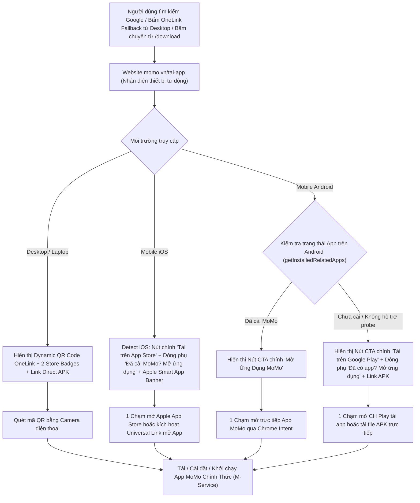

# PRD: Trang Tải Ứng Dụng MoMo Chính Thức (/tai-app)

> - **Dự án:** New User Hub & Web-to-App Acquisition - Web Platform
> - **Đơn vị phụ trách:** Web Platform Team x Growth Platform Division (GPD)
> - **Đường dẫn chuẩn (URL Schema):** `momo.vn/tai-app`
> - **Trạng thái:** P0 Priority Sprint (Tháng 10/2026)
> - **Mục tiêu:** Thuần túy là Trung tâm Tiện ích Tải Ứng dụng (Utility Software Download Center), tách biệt hoàn toàn với trang Tiếp thị Khuyến mãi / Thẻ quà

---

## I. TỔNG QUAN & BỐI CẢNH CHIẾN LƯỢC

### 1.1 Điểm Nghẽn Kỹ Thuật Trang `/download` Hiện Hữu & Phân Tách Quyền Sở Hữu (Ownership Decoupling)
- **Thực trạng trang `/download`:** Hiện tại `momo.vn/download` là mã script chuyển hướng (Client-side Redirect) cổ điển từ phiên bản v3.1 (`utm_campaign=momov3.1`), chạy hàm JavaScript thô `whatos()` và `autodetectOS()`. Khi mở trên máy tính (Desktop), logic rẽ nhánh tự động ép người dùng chuyển hướng sang trang web Google Play Store, hoàn toàn không có giao diện hiển thị, không có mã QR và không có thẻ SEO.
- **Ràng buộc với ITC:** Trang `/download` đang được ITC sử dụng trong các phiên bản App cũ để điều hướng người dùng cập nhật ứng dụng (Update App) khi có phiên bản mới hoặc bảo trì. Can thiệp trực tiếp vào `/download` sẽ gây rủi ro đứt gãy luồng vận hành của ITC.
- **Chiến lược phân tách (Decoupling):** Giữ nguyên `/download` cho mục tiêu kỹ thuật In-App Update của ITC; xây dựng mới hoàn toàn `momo.vn/tai-app` trên nền tảng MoSpark do Web Platform sở hữu 100%, phục vụ mục tiêu SEO tự nhiên và chuyển đổi Web-to-App.

### 1.2 Khoảng Trống Thị Trường (Market White Space)
- **Thực trạng đối thủ:** Khảo sát trực tiếp bằng mã phản hồi HTTP (`curl -I`) cho thấy 100% đối thủ ví điện tử và ngân hàng số tại Việt Nam (ZaloPay, Viettel Money, VNPay, MBBank) **không có trang Tải Ứng Dụng độc lập chuẩn mực** (các đường link đều trả về 404 hoặc redirect 301 về trang chủ). Các đối thủ chỉ gắn icon Store ở chân trang hoặc viết bài blog hướng dẫn cài đặt.
- **Cơ hội chiến lược:** Xây dựng `momo.vn/tai-app` chuẩn mực giúp MoMo chiếm trọn 100% thị phần tìm kiếm tự nhiên (Organic Search Dominance) cho nhóm từ khóa có ý định tải ứng dụng cao (*tải app momo, cài đặt ví momo, tải momo cho iphone/android, momo apk*).

### 1.3 Chuẩn Hóa Điểm Rơi Mặc Định Của OneLink (OneLink Desktop Fallback)
- Thiết lập `momo.vn/tai-app` làm URL đích mặc định trên môi trường máy tính (`af_web_dp`) cho toàn bộ hệ thống AppsFlyer OneLink của MoMo. Khi người dùng mở link quảng cáo/chia sẻ trên máy tính, thay vì bị văng về trang chủ gây loãng thông tin, người dùng sẽ thấy ngay mã Dynamic QR Code để quét tải app trong 5 giây.

---

## II. SƠ ĐỒ LUỒNG NGƯỜI DÙNG & BẢNG PHÂN TÍCH BƯỚC



<table style="width:100%; border-collapse:collapse; border:1.5px solid #64748b; margin:1em 0; font-size:0.9em;">
  <thead>
    <tr style="background-color:#f1f5f9;">
      <th style="border:1.5px solid #64748b; padding:8px 12px; text-align:left; font-weight:700;">Bước</th>
      <th style="border:1.5px solid #64748b; padding:8px 12px; text-align:left; font-weight:700;">Tên Giai Đoạn</th>
      <th style="border:1.5px solid #64748b; padding:8px 12px; text-align:left; font-weight:700;">Trải Nghiệm Người Dùng (UX)</th>
      <th style="border:1.5px solid #64748b; padding:8px 12px; text-align:left; font-weight:700;">Hạ Tầng / Cơ Chế Kỹ Thuật</th>
      <th style="border:1.5px solid #64748b; padding:8px 12px; text-align:left; font-weight:700;">Nền Tảng</th>
    </tr>
  </thead>
  <tbody>
    <tr>
      <td style="border:1px solid #94a3b8; padding:8px 12px; text-align:left;">1</td>
      <td style="border:1px solid #94a3b8; padding:8px 12px; text-align:left;">Tiếp nhận truy cập</td>
      <td style="border:1px solid #94a3b8; padding:8px 12px; text-align:left;">Truy cập từ Google Search, OneLink Fallback hoặc banner từ trang `/download`. Tốc độ tải tức thì (LCP &lt; 1.5s).</td>
      <td style="border:1px solid #94a3b8; padding:8px 12px; text-align:left;">MoSpark Next.js Server-Side Rendering + Edge CDN Caching</td>
      <td style="border:1px solid #94a3b8; padding:8px 12px; text-align:left;">Web Platform</td>
    </tr>
    <tr style="background-color:#f8fafc;">
      <td style="border:1px solid #94a3b8; padding:8px 12px; text-align:left;">2</td>
      <td style="border:1px solid #94a3b8; padding:8px 12px; text-align:left;">Nhận diện thiết bị &amp; Trạng thái App</td>
      <td style="border:1px solid #94a3b8; padding:8px 12px; text-align:left;">Tự nhận diện iOS, Android hoặc Desktop. Phân tầng hành động: Tải mới (New User) hoặc Mở ứng dụng (Existing User).</td>
      <td style="border:1px solid #94a3b8; padding:8px 12px; text-align:left;">User-Agent &amp; maxTouchPoints Parsing; navigator.getInstalledRelatedApps (Android); Apple Smart App Banner (iOS)</td>
      <td style="border:1px solid #94a3b8; padding:8px 12px; text-align:left;">Web Platform</td>
    </tr>
    <tr>
      <td style="border:1px solid #94a3b8; padding:8px 12px; text-align:left;">3</td>
      <td style="border:1px solid #94a3b8; padding:8px 12px; text-align:left;">Kích hoạt luồng tải / mở (Action Trigger)</td>
      <td style="border:1px solid #94a3b8; padding:8px 12px; text-align:left;">Desktop: Quét mã QR.<br>Mobile iOS: 1 Chạm tải App Store hoặc bấm mở app.<br>Mobile Android: 1 Chạm mở app (nếu có) hoặc tải từ CH Play / file APK.</td>
      <td style="border:1px solid #94a3b8; padding:8px 12px; text-align:left;">AppsFlyer OneLink + Android Chrome Intent Scheme + Dynamic QR Generator</td>
      <td style="border:1px solid #94a3b8; padding:8px 12px; text-align:left;">Web Platform x AppsFlyer</td>
    </tr>
    <tr style="background-color:#f8fafc;">
      <td style="border:1px solid #94a3b8; padding:8px 12px; text-align:left;">4</td>
      <td style="border:1px solid #94a3b8; padding:8px 12px; text-align:left;">Cài đặt / Khởi chạy an toàn</td>
      <td style="border:1px solid #94a3b8; padding:8px 12px; text-align:left;">Mở trực tiếp trang MoMo trên App Store / Google Play hoặc kích hoạt app native, hoặc tải bộ cài APK có chữ ký số M-Service.</td>
      <td style="border:1px solid #94a3b8; padding:8px 12px; text-align:left;">Official Stores / Universal Links / MoMo CDN Direct APK (Signed)</td>
      <td style="border:1px solid #94a3b8; padding:8px 12px; text-align:left;">App Stores &amp; Infra</td>
    </tr>
  </tbody>
</table>

---

## III. MA TRẬN JOBS TO BE DONE (JTBD)

- **Nguyên tắc thiết kế cốt lõi:** **Zero Marketing Noise** - Loại bỏ 100% nội dung giới thiệu thẻ quà, sự kiện khuyến mại hoặc bài viết tin tức. Toàn bộ trang tập trung vào mục tiêu duy nhất: Tải ứng dụng an toàn, đúng thiết bị, nhanh nhất.

<table style="width:100%; border-collapse:collapse; border:1.5px solid #64748b; margin:1em 0; font-size:0.9em;">
  <thead>
    <tr style="background-color:#f1f5f9;">
      <th style="border:1.5px solid #64748b; padding:8px 12px; text-align:left; font-weight:700;">Nhóm JTBD</th>
      <th style="border:1.5px solid #64748b; padding:8px 12px; text-align:left; font-weight:700;">Mô Tả Nhu Cầu Của Người Dùng</th>
      <th style="border:1.5px solid #64748b; padding:8px 12px; text-align:left; font-weight:700;">Giải Pháp Đáp Ứng Trên Trang /tai-app</th>
    </tr>
  </thead>
  <tbody>
    <tr>
      <td style="border:1px solid #94a3b8; padding:8px 12px; text-align:left;"><strong>Functional Job</strong></td>
      <td style="border:1px solid #94a3b8; padding:8px 12px; text-align:left;">Tìm kiếm và tải ứng dụng MoMo chính thức phù hợp với hệ điều hành điện thoại.</td>
      <td style="border:1px solid #94a3b8; padding:8px 12px; text-align:left;">Tự nhận diện iOS / Android; cung cấp mã Dynamic QR cho Desktop và link tải APK cho máy chuyên biệt.</td>
    </tr>
    <tr style="background-color:#f8fafc;">
      <td style="border:1px solid #94a3b8; padding:8px 12px; text-align:left;"><strong>Trust &amp; Security Job</strong></td>
      <td style="border:1px solid #94a3b8; padding:8px 12px; text-align:left;">Bảo đảm không tải nhầm ứng dụng giả mạo, mã độc lừa đảo tiền bạc hoặc đánh cắp mã OTP.</td>
      <td style="border:1px solid #94a3b8; padding:8px 12px; text-align:left;">Khẳng định pháp nhân phát hành M-Service JSC, chứng nhận bảo mật quốc tế PCI DSS Level 1 và cấp phép NHNN.</td>
    </tr>
    <tr>
      <td style="border:1px solid #94a3b8; padding:8px 12px; text-align:left;"><strong>Technical Information Job</strong></td>
      <td style="border:1px solid #94a3b8; padding:8px 12px; text-align:left;">Biết rõ ứng dụng có tương thích với phiên bản máy hiện tại không trước khi bấm tải.</td>
      <td style="border:1px solid #94a3b8; padding:8px 12px; text-align:left;">Bảng thông số kỹ thuật minh bạch: Yêu cầu hệ điều hành tối thiểu, dung lượng bộ nhớ và phiên bản phát hành.</td>
    </tr>
    <tr style="background-color:#f8fafc;">
      <td style="border:1px solid #94a3b8; padding:8px 12px; text-align:left;"><strong>Troubleshooting Job</strong></td>
      <td style="border:1px solid #94a3b8; padding:8px 12px; text-align:left;">Cần hướng dẫn nhanh khi gặp sự cố không tải được từ Store hoặc cần cài file APK.</td>
      <td style="border:1px solid #94a3b8; padding:8px 12px; text-align:left;">Khối hướng dẫn kỹ thuật dạng Accordion: Hướng dẫn cài APK, xử lý bộ nhớ đầy và giải thích quyền hệ thống.</td>
    </tr>
  </tbody>
</table>

---

## IV. CẤU TRÚC GIAO DIỆN UI/UX & NỘI DUNG KỸ THUẬT

### 4.1 Khung Điều Hướng Tối Giản (Zero Navigation Header)
- Bỏ 100% Mega Menu và các đường dẫn phân tán.
- Chỉ hiển thị: Logo MoMo (bên trái) và nhãn xác thực `Kênh Tải Ứng Dụng Chính Thức của M-Service` (bên phải).

### 4.2 Hero Conversion Block (Trung Tâm Tải Ứng Dụng)
- **Tiêu đề chính (H1):** `Tải Ứng Dụng MoMo Cho Mọi Thiết Bị`
- **Mô tả ngắn:** `Phiên bản chính thức mới nhất cho điện thoại iOS và Android. Cài đặt nhanh chóng, an toàn và bảo mật.`
- **Trải nghiệm Desktop (Split Screen):**
  - Cột trái: Tên phiên bản hiện hành (v4.2.x), dung lượng ứng dụng, yêu cầu hệ điều hành và chứng nhận an toàn M-Service PCI DSS.
  - Cột phải: Khung mã Dynamic QR Code kích thước lớn kèm chỉ dẫn *"Mở camera trên điện thoại để quét mã QR và tải ứng dụng ngay lập tức"*. Bên dưới là 2 huy hiệu chính thức của App Store, Google Play và liên kết `Tải trực tiếp file APK cho Android`.
- **Trải nghiệm Mobile iOS (100% Above the Fold):**
  - Tự động nhận diện thiết bị iOS (iPhone, iPad).
  - Nút hành động chính (Primary CTA): Nút màu hồng thương hiệu nổi bật `Tải trên App Store` (Apple Icon + Text).
  - Dòng điều hướng bổ trợ (Secondary Action): Ngay dưới nút chính là dòng text link tinh gọn: `Đã cài MoMo trên điện thoại? [Mở ứng dụng ngay]` (gắn Universal Link).
  - Apple Smart App Banner: Tích hợp thẻ meta native trên Safari để hệ điều hành tự động hiển thị chữ **"MỞ" (OPEN)** nếu máy có app hoặc **"NHẬN" (GET)** nếu máy chưa cài app.
- **Trải nghiệm Mobile Android (Dynamic App Detection):**
  - Tự động nhận diện thiết bị Android.
  - Cơ chế kiểm tra động (`navigator.getInstalledRelatedApps`):
    - *Trường hợp 1 (Đã có App):* Nút CTA chính tự động chuyển thành `Mở Ứng Dụng MoMo` (chạm mở app trực tiếp). Dòng chữ phụ: `Đã cài đặt bản chính thức v4.2.x`.
    - *Trường hợp 2 (Chưa cài App hoặc trình duyệt không hỗ trợ API probe):* Nút CTA chính hiển thị `Tải trên Google Play` (Play Store Icon + Text). Dòng text link bổ trợ: `Đã có app? [Mở ứng dụng ngay]` kèm liên kết phụ `Tải trực tiếp file APK cho Android`.
  - Cơ chế Routing 1 chạm: Toàn bộ nút Mở/Tải trên Android đều bọc Android Chrome Intent Scheme để fail-safe 100% (có app thì mở tức thì, chưa có app tự động chuyển sang CH Play).
- **Thanh điều hướng ghim đáy (Sticky Bottom CTA Bar):**
  - Khi người dùng cuộn trang vượt qua màn hình đầu tiên, thanh Sticky Bar cố định ở chân màn hình sẽ trượt lên.
  - Hiển thị logo MoMo + Text ngắn gọn (`MoMo: Ứng dụng Tài chính & Thanh toán`) + Nút CTA thu gọn tương ứng với trạng thái của thiết bị (`Tải App` hoặc `Mở App`).

### 4.3 Bảng Thông Số Kỹ Thuật Phiên Bản (Technical Specs)

<table style="width:100%; border-collapse:collapse; border:1.5px solid #64748b; margin:1em 0; font-size:0.9em;">
  <thead>
    <tr style="background-color:#f1f5f9;">
      <th style="border:1.5px solid #64748b; padding:8px 12px; text-align:left; font-weight:700;">Thông Số Kỹ Thuật</th>
      <th style="border:1.5px solid #64748b; padding:8px 12px; text-align:left; font-weight:700;">Phiên Bản Cho iOS</th>
      <th style="border:1.5px solid #64748b; padding:8px 12px; text-align:left; font-weight:700;">Phiên Bản Cho Android</th>
    </tr>
  </thead>
  <tbody>
    <tr>
      <td style="border:1px solid #94a3b8; padding:8px 12px; text-align:left;"><strong>Phiên bản hiện tại</strong></td>
      <td style="border:1px solid #94a3b8; padding:8px 12px; text-align:left;">v4.2.x (Đồng bộ theo bản phát hành mới nhất)</td>
      <td style="border:1px solid #94a3b8; padding:8px 12px; text-align:left;">v4.2.x (Đồng bộ theo bản phát hành mới nhất)</td>
    </tr>
    <tr style="background-color:#f8fafc;">
      <td style="border:1px solid #94a3b8; padding:8px 12px; text-align:left;"><strong>Yêu cầu hệ điều hành tối thiểu</strong></td>
      <td style="border:1px solid #94a3b8; padding:8px 12px; text-align:left;">iOS 13.0 trở lên (Tương thích iPhone, iPad)</td>
      <td style="border:1px solid #94a3b8; padding:8px 12px; text-align:left;">Android 7.0 trở lên</td>
    </tr>
    <tr>
      <td style="border:1px solid #94a3b8; padding:8px 12px; text-align:left;"><strong>Dung lượng cài đặt xấp xỉ</strong></td>
      <td style="border:1px solid #94a3b8; padding:8px 12px; text-align:left;">~180 MB</td>
      <td style="border:1px solid #94a3b8; padding:8px 12px; text-align:left;">~95 MB (hoặc bản APK rút gọn)</td>
    </tr>
    <tr style="background-color:#f8fafc;">
      <td style="border:1px solid #94a3b8; padding:8px 12px; text-align:left;"><strong>Nhà phát triển chính thức</strong></td>
      <td style="border:1px solid #94a3b8; padding:8px 12px; text-align:left;">M-SERVICE JSC</td>
      <td style="border:1px solid #94a3b8; padding:8px 12px; text-align:left;">M-SERVICE JSC</td>
    </tr>
    <tr>
      <td style="border:1px solid #94a3b8; padding:8px 12px; text-align:left;"><strong>Định dạng phân phối</strong></td>
      <td style="border:1px solid #94a3b8; padding:8px 12px; text-align:left;">Apple App Store Bundle</td>
      <td style="border:1px solid #94a3b8; padding:8px 12px; text-align:left;">Google Play Bundle / Direct APK</td>
    </tr>
  </tbody>
</table>

### 4.4 Ma Trận Cửa Ngõ Phân Phối (Official Distribution Matrix)
1. **Apple App Store:** Nút chuyển tiếp trực tiếp vào ứng dụng MoMo chính thức trên App Store.
2. **Google Play Store:** Nút chuyển tiếp vào Google Play Store.
3. **Bộ cài đặt APK trực tiếp (Direct APK):** Lưu trữ trên CDN chính thức của MoMo, có chữ ký số xác thực của M-Service, phục vụ người dùng sử dụng thiết bị Android không có sẵn Google Mobile Services (như máy Huawei, máy xách tay).

### 4.5 Khối Hướng Dẫn Kỹ Thuật & Khắc Phục Sự Cố (Troubleshooting Accordion)
Tích hợp 3 câu hỏi kỹ thuật chuẩn cấu trúc dữ liệu JSON-LD Schema `FAQPage`:
- *Cách cài đặt file APK MoMo trên điện thoại Android?* (Hướng dẫn bật cho phép cài đặt nguồn tin cậy trong Cài đặt).
- *Điện thoại báo không đủ dung lượng khi tải MoMo thì xử lý thế nào?* (Hướng dẫn xóa bộ nhớ tạm để giải phóng tối thiểu 300MB).
- *MoMo yêu cầu những quyền hệ thống nào khi cài đặt lần đầu?* (Giải thích quyền Camera để quét QR/eKYC và quyền Thông báo để nhận biến động số dư).

---

## V. CẤU HÌNH KỸ THUẬT & PHÂN LUỒNG HỆ THỐNG

### 5.1 Cấu Hình AppsFlyer OneLink Master Fallback
- Thiết lập quy tắc chuyển hướng mặc định trên toàn hệ thống OneLink:
  ```
  af_web_dp = https://momo.vn/tai-app?utm_source=onelink_desktop_fallback
  ```
- Chấm dứt hoàn toàn tình trạng mở OneLink trên máy tính bị rơi về trang chủ `momo.vn` hoặc bị ép nhảy vào Google Play web như hiện tại.

### 5.2 Điểm Chạm Chuyển Tiếp Từ Trang `/download`
- Giữ nguyên toàn bộ mã nguồn và logic chuyển tiếp của trang `/download` để phục vụ ITC.
- Chèn thêm một Banner điều hướng trang nhã ở vị trí đầu trang `/download`:
  `"Bạn là người dùng mới hoặc cần cài đặt lại ứng dụng? Đến Trang Tải Ứng Dụng Chính Thức -> momo.vn/tai-app"`
- Cấu hình thẻ chuẩn hóa SEO trên `/tai-app`:
  ```html
  <link rel="canonical" href="https://momo.vn/tai-app" />
  ```

### 5.3 Bảng Mã Đo Lường Sự Kiện (Umami & Analytics Tracking)
Tuân thủ chuẩn SSOT `04_MOSPARK_PLATFORM/umami_utility_tracking.md`:

| Tên sự kiện (Event Name) | Loại sự kiện | Tham số ghi nhận (Custom Parameters) | Mục đích đo lường |
| :--- | :--- | :--- | :--- |
| `tai_app_page_view` | Pageview | `device: desktop \| ios \| android`, `referrer` | Đo lường lưu lượng truy cập phân rã theo thiết bị. |
| `click_store_download` | Click | `store: appstore \| googleplay \| direct_apk` | Đo lường tỷ lệ nhấp nút tải về Store / APK (New User intent). |
| `click_open_existing_app` | Click | `target: deeplink_open`, `device_os: ios \| android` | Đo lường tỷ lệ nhấp mở ứng dụng của người dùng đã có app (Existing User intent). |
| `desktop_qr_scan_intent` | Interaction | `trigger: impression \| view_duration` | Đo lường số lượt hiển thị và tương tác mã Dynamic QR trên máy tính. |
| `troubleshoot_toggle` | Click | `item: install_apk \| memory_error \| permissions` | Đo lường mức độ quan tâm đến hướng dẫn kỹ thuật. |

### 5.4 Cơ Chế Kỹ Thuật Nhận Diện Trạng Thái Ứng Dụng (App Detection & Deep Link Routing Spec)

#### 5.4.1 Môi trường iOS (Safari / WebKit)
- **Cơ chế:** Do chính sách bảo mật Sandbox của Apple, JavaScript client-side không được phép probe trạng thái cài app native ngầm. Giải pháp chuẩn mực là tích hợp **Apple Smart App Banner**:
  ```html
  <meta name="apple-itunes-app" content="app-id=918786511, app-argument=momo://app">
  ```
- **Hành vi hệ điều hành:** Trình duyệt Safari tự động đọc trạng thái cài đặt từ iOS:
  - Nếu máy đã có app: Banner hiển thị nút **MỞ (OPEN)**.
  - Nếu máy chưa có app: Banner hiển thị nút **NHẬN (GET)**.
- **UI Web:** Nút chính hiển thị `Tải trên App Store`, dòng phụ hiển thị `Đã cài MoMo trên điện thoại? [Mở ứng dụng ngay]` gắn Universal Link (`momoapp.onelink.vn`).

#### 5.4.2 Môi trường Android (Chrome / Chromium)
- **Cơ chế 1 - Dynamic Probe (`navigator.getInstalledRelatedApps`):**
  - Khai báo file Web App Manifest (`manifest.json`):
    ```json
    {
      "related_applications": [
        {
          "platform": "play",
          "id": "com.mservice.momotransfer"
        }
      ]
    }
    ```
  - Xác thực Digital Asset Links 2 chiều tại `https://momo.vn/.well-known/assetlinks.json` khớp mã SHA256 fingerprint của ứng dụng MoMo Android.
  - Script frontend gọi kiểm tra bất đồng bộ khi tải trang: Nếu phát hiện app đã cài, tự động đổi nút CTA chính thành `Mở Ứng Dụng MoMo`.
- **Cơ chế 2 - Fail-safe Routing (Android Chrome Intent Scheme):**
  - Nhằm đảm bảo 100% người dùng trên mọi trình duyệt Android (kể cả khi không hỗ trợ API probe) không gặp lỗi, toàn bộ liên kết mở app được bọc định dạng Intent:
    ```
    intent://#Intent;scheme=momo;package=com.mservice.momotransfer;S.browser_fallback_url=https%3A%2F%2Fplay.google.com%2Fstore%2Fapps%2Fdetails%3Fid%3Dcom.mservice.momotransfer;end
    ```
  - Hành vi: Máy có app sẽ tự động mở thẳng App MoMo; máy chưa có app sẽ tự động chuyển hướng mượt mà vào trang tải trên CH Play.

---

## VI. LỘ TRÌNH TRIỂN KHAI & CHỈ SỐ MỤC TIÊU (ROADMAP & KPIS)

### 6.1 Lộ Trình Triển Khai (Roadmap)

<table style="width:100%; border-collapse:collapse; border:1.5px solid #64748b; margin:1em 0; font-size:0.9em;">
  <thead>
    <tr style="background-color:#f1f5f9;">
      <th style="border:1.5px solid #64748b; padding:8px 12px; text-align:left; font-weight:700;">Giai đoạn</th>
      <th style="border:1.5px solid #64748b; padding:8px 12px; text-align:center; font-weight:700;">Thời gian</th>
      <th style="border:1.5px solid #64748b; padding:8px 12px; text-align:left; font-weight:700;">Tên Giai Đoạn</th>
      <th style="border:1.5px solid #64748b; padding:8px 12px; text-align:left; font-weight:700;">Chi Tiết Triển Khai &amp; Mục Tiêu Kỹ Thuật</th>
    </tr>
  </thead>
  <tbody>
    <tr>
      <td style="border:1px solid #94a3b8; padding:8px 12px; text-align:left;">Sprint 1</td>
      <td style="border:1px solid #94a3b8; padding:8px 12px; text-align:center;">Tuần 3 Tháng 10/2026</td>
      <td style="border:1px solid #94a3b8; padding:8px 12px; text-align:left;">UI/UX Design &amp; OneLink Setup</td>
      <td style="border:1px solid #94a3b8; padding:8px 12px; text-align:left;">Hoàn thiện Wireframe phân tầng UI (Split Screen Desktop + Mobile phân cấp Nút Tải vs Mở App). Cấu hình Template OneLink Dynamic QR, thẻ meta Apple Smart App Banner, logic probe <code style="background:#f1f5f9;padding:2px 4px;border-radius:4px;font-family:monospace;">getInstalledRelatedApps</code> &amp; Chrome Intent trên Android; thiết lập <code style="background:#f1f5f9;padding:2px 4px;border-radius:4px;font-family:monospace;">af_web_dp</code> về <code style="background:#f1f5f9;padding:2px 4px;border-radius:4px;font-family:monospace;">/tai-app</code>.</td>
    </tr>
    <tr style="background-color:#f8fafc;">
      <td style="border:1px solid #94a3b8; padding:8px 12px; text-align:left;">Sprint 2</td>
      <td style="border:1px solid #94a3b8; padding:8px 12px; text-align:center;">Tuần 4 Tháng 10/2026</td>
      <td style="border:1px solid #94a3b8; padding:8px 12px; text-align:left;">Development &amp; MoSpark Release</td>
      <td style="border:1px solid #94a3b8; padding:8px 12px; text-align:left;">Phát triển trang trên MoSpark (Next.js + MoBase Design Token). Tích hợp link CDN file APK có chữ ký số. Gắn đầy đủ Umami Event Tracking.</td>
    </tr>
    <tr>
      <td style="border:1px solid #94a3b8; padding:8px 12px; text-align:left;">Sprint 3</td>
      <td style="border:1px solid #94a3b8; padding:8px 12px; text-align:center;">Đầu Tháng 11/2026</td>
      <td style="border:1px solid #94a3b8; padding:8px 12px; text-align:left;">Traffic Cutover &amp; SEO Submission</td>
      <td style="border:1px solid #94a3b8; padding:8px 12px; text-align:left;">Bổ sung Banner điều hướng từ <code style="background:#f1f5f9;padding:2px 4px;border-radius:4px;font-family:monospace;">/download</code> sang <code style="background:#f1f5f9;padding:2px 4px;border-radius:4px;font-family:monospace;">/tai-app</code>. Submit sitemap và FAQ JSON-LD Schema lên Google Search Console để xác lập Top 1 thứ hạng tìm kiếm.</td>
    </tr>
  </tbody>
</table>

### 6.2 Chỉ Số Đo Lường Hiệu Suất (KPI Targets)
- **Tốc độ tải trang Core Web Vitals:** LCP < 1.5 giây, CLS = 0.
- **Tỷ lệ chuyển đổi Click-to-Store (CVR):** Đạt >= **45.0%** trên tổng lượt truy cập trang.
- **Tỷ lệ quét mã Dynamic QR trên Desktop:** Đạt >= **20.0%** trên tổng lượt truy cập từ thiết bị máy tính.
- **Thứ hạng SEO từ khóa kỹ thuật:** Lọt Top 1 - 3 Google Search cho cụm từ khóa: *tải app momo, cài đặt momo, momo apk, download momo*.
