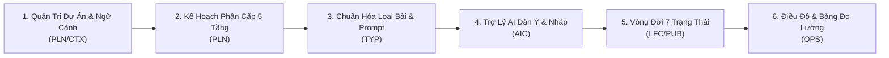
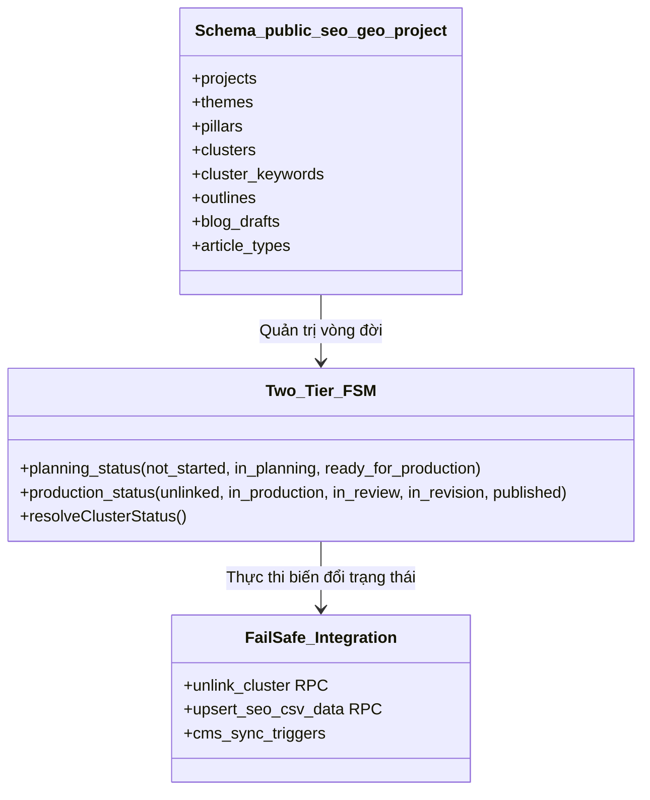

# BÁO CÁO TOÀN DIỆN VỀ module PLG PROJECTS (MOSPARK)
**Nền Tảng Hoạch Định Chiến Lược & Điều Độ Sản Xuất Nội Dung SEO Tự Động Hóa**

> **Tài liệu tham chiếu gốc:** Thư mục `PLG Projects` (Google Drive)  
> **Chủ sở hữu:** `trong.tran2@mservice.com.vn` (MoSpark Team)  
> **Thời điểm đối soát & lập báo cáo:** Tháng 11/2026  
> **Quy chuẩn trình bày:** Định dạng Báo cáo Điều hành cấp Lãnh đạo kèm thẻ định vị nội dung `[R]` (Kết quả/Số liệu) và `[D]` (Thảo luận/Quyết định)

---

## 1. TỔNG QUAN ĐIỀU HÀNH & BỐI CẢNH SẢN PHẨM

### 1.1. Bối Cảnh & Điểm Nghẽn Nghiệp Vụ Cũ
`[R]` Trước khi xây dựng module PLG Projects, hoạt động sản xuất nội dung SEO và AEO/GEO của MoMo đối mặt với 3 rào cản thao tác lớn:
1. **Dữ liệu phân tán & Cạnh tranh từ khóa nội bộ (Keyword Cannibalization):** Kế hoạch từ khóa được quản lý rời rạc trên nhiều tệp Google Sheets, dẫn đến tình trạng các bài viết vô tình nhắm cùng một từ khóa mục tiêu, làm suy giảm sức mạnh xếp hạng tổng thể trên SERP.
2. **Chất lượng AI thiếu kiểm soát:** Việc người viết tự do nhập prompt trên các công cụ AI bên ngoài khiến văn phong bài viết không đồng nhất, thiếu ngữ cảnh chuyên sâu về sản phẩm tài chính (Ví Trả Sau, Vay Nhanh, Bảo hiểm...), đồng thời dễ gặp lỗi sai lệch thông tin (*hallucination*).
3. **Đứt gãy quy trình bàn giao (Hand-off Friction):** Thiếu công cụ kết nối trực tiếp từ khâu nghiên cứu từ khóa, dựng dàn ý, viết bản nháp cho đến biên tập và xuất bản lên hệ thống quản lý nội dung (CMS). Đội ngũ không có dữ liệu đo lường thời gian xử lý và điểm nghẽn tiến độ.

### 1.2. Mục Tiêu Cốt Lõi Của PLG Projects
`[R]` **PLG Projects** được định vị là nền tảng điều độ trung tâm (Industrialized Content Production Engine) của MoSpark, thiết lập quy trình khép kín từ hoạch định chiến lược từ khóa đến xuất bản bài viết đa kênh với 3 trụ cột:
- **Ngăn chặn trùng lặp tuyệt đối:** Mỗi từ khóa chỉ thuộc duy nhất một cụm từ khóa trong toàn dự án; mỗi cụm từ khóa chỉ kết nối với một bài viết/URL duy nhất.
- **Công nghiệp hóa nội dung bằng AI Grounded:** Tự động nạp ngữ cảnh dự án và ngữ cảnh chuyên ngành, kết hợp công cụ tìm kiếm kiểm chứng dữ liệu thời gian thực (Google Search) để sinh dàn ý và bản nháp chuẩn SEO.
- **Minh bạch tiến độ vận hành:** Áp dụng cỗ máy trạng thái trực giao 2 trục (Two-Tier Orthogonal Decoupled FSM) phân tách rõ ràng giữa tầng hoạch định và tầng sản xuất, kết hợp bảng điều độ đo lường chu kỳ hoàn thành bài viết.

---

## 2. PHÂN TÍCH 6 KHỐI NGHIỆP VỤ HỆ THỐNG

### 2.1. Khối 1: Quản Trị Dự Án & Ngữ Cảnh Nền Tảng (Project & Context - PLN)
`[R]` **Năng lực cốt lõi:**
- **Không gian dự án độc lập:** Mỗi dự án được gắn kết tỷ lệ 1-1 với một Trang Microsite tương ứng.
- **Hệ thống ngữ cảnh kép (Dual-Context Framework):**
  - *Project Context (Ngữ cảnh dự án):* Khách hàng mục tiêu, thông điệp truyền thông, giá trị cốt lõi sản phẩm và quy chuẩn thương hiệu.
  - *Domain Context (Ngữ cảnh chuyên môn):* Thuật ngữ tài chính, bảo hiểm, quy định pháp lý đặc thù. Toàn bộ được tự động nạp vào mọi lệnh gọi AI.
- **Cơ chế Khóa API linh hoạt & Dự phòng tự động:** Hỗ trợ cấu hình API Key riêng cho từng dự án (Gemini, Claude, OpenAI). Khi chạm hạn mức hoặc gặp sự cố mạng, hệ thống tự động chuyển đổi sang Khóa API dự phòng của MoSpark để không làm gián đoạn người viết.
- **Quản lý hạn mức sử dụng (Quota Guard):** Cung cấp bộ đếm số lượt sinh dàn ý và bản nháp được cấp phát cho từng dự án để kiểm soát chi phí.

### 2.2. Khối 2: Hoạch Định Kế Hoạch Nội Dung 5 Tầng (Content Planning - PLN)
`[R]` **Cấu trúc phân cấp dữ liệu:**
$$\text{Dự án} \longrightarrow \text{Chủ đề lớn (Theme)} \longrightarrow \text{Trụ cột nội dung (Pillar)} \longrightarrow \text{Cụm từ khóa (Cluster)} \longrightarrow \text{Từ khóa mục tiêu (Keyword)}$$
- **Tính linh hoạt:** Hỗ trợ Cụm từ khóa trực thuộc trực tiếp Dự án, trực thuộc Chủ đề lớn, hoặc nằm dưới một Trụ cột cụ thể.
- **Đồng bộ hai chiều với cơ chế bảo vệ nạp lại (Safe CSV Upsert):** Khi nạp tệp CSV cập nhật kế hoạch, hàm cơ sở dữ liệu `upsert_seo_csv_data` tự động nhận diện các Cụm từ khóa đã bước vào giai đoạn sản xuất để bảo vệ toàn vẹn, tuyệt đối không xóa hoặc ghi đè dữ liệu đang viết.
- **Tự động định vị Từ khóa chính & Ý định tìm kiếm:** Tự động chọn từ khóa có Lượng tìm kiếm (*Search Volume*) cao nhất làm Từ khóa chính (*Primary Keyword*); gắn nhãn ý định tìm kiếm (*Search Intent*: Thông tin, Điều hướng, Thương mại, Giao dịch).
- **Ràng buộc duy nhất toàn cục:** Mỗi từ khóa chỉ được tồn tại trong 1 cụm duy nhất của dự án, triệt tiêu nguy cơ cạnh tranh nội bộ.

### 2.3. Khối 3: Chuẩn Hóa Thể Loại Bài Viết & Định Tuyến Prompt (Article Types - TYP)
`[R]` **Cơ chế hoạt động:**
- **Phân cấp danh mục Loại bài viết:** Chia làm 2 tầng: Cấp Hệ thống (System-level: các thể loại chuẩn như Cẩm nang, So sánh, Hỏi đáp...) và Cấp Dự án (Project-level: cấu hình chuyên biệt cho từng sản phẩm).
- **Cặp mẫu prompt chuyên biệt:** Mỗi loại bài viết bắt buộc phải liên kết với 2 mẫu prompt tương ứng: Mẫu sinh dàn ý và Mẫu viết bản nháp.
- **Cơ chế khóa khi sản xuất:** Khi Cụm từ khóa đã kết nối bài viết hoặc xuất bản, Loại bài viết sẽ bị đóng băng để đảm bảo tính nhất quán của cấu trúc nội dung.
- **Cảnh báo phiên bản prompt:** Khi mẫu prompt được nâng cấp, hệ thống tự động nhắc nhở đối soát trên các dàn ý cũ, kèm tùy chọn ghi nhớ bỏ qua nếu dàn ý đã hoàn chỉnh.

### 2.4. Khối 4: Trợ Lý AI Sinh Dàn Ý & Bản Nháp (AI Assistant - AIC)
`[R]` **Quy trình tương tác AI:**
- **Tích hợp kiểm chứng thực tế (Google Search Grounding):** Trợ lý AI kết nối với Gemini/Claude kết hợp công cụ tìm kiếm thời gian thực với danh sách tên miền tin cậy và danh sách loại trừ để bảo đảm dữ liệu trích dẫn chính xác.
- **Bản chụp từ khóa (Keyword Snapshot):** Tại thời điểm tạo dàn ý, hệ thống tự động đóng băng danh sách từ khóa của cụm để làm cơ sở đối soát độ bao phủ từ khóa trong bài viết sau này.
- **Trình biên tập dàn ý Markdown đa phương án:** Cho phép tạo nhiều phương án dàn ý (Candidates), người viết có thể tự do chỉnh sửa Markdown, so sánh và chọn một phương án duy nhất làm Dàn ý chính thức (*Official Outline*).
- **Sinh bản nháp & Đẩy sang CMS 1 click:** Từ Dàn ý chính thức, AI hoàn thiện bài viết và chuyển trực tiếp nội dung sang bài viết nháp trên CMS mà không cần sao chép thủ công.
- **Minh bạch tài chính:** Tự động lưu vết thời gian xử lý, số lượng token tiêu thụ và chi phí ước tính trên từng lần gọi.

### 2.5. Khối 5: Vòng Đời 7 Trạng Thái & Tích Hợp Đa Kênh Xuất Bản (Lifecycle & Multi-Channel Publishing - LFC/PUB)
`[R]` **Cơ chế tích hợp xuất bản đa kênh:**
- **Quy trình vòng đời hợp nhất 7 trạng thái:**
  1. *Chưa bắt đầu:* Cụm mới tạo, chưa có dàn ý.
  2. *Đang lập dàn ý:* Đã tạo ít nhất 1 dàn ý đề xuất nhưng chưa chốt.
  3. *Đã chốt dàn ý:* Đã phê duyệt một phương án làm Dàn ý chính thức.
  4. *Đang sản xuất:* Đã kết nối với bài viết trên CMS để người viết triển khai.
  5. *Chờ duyệt:* Bài viết đã được gửi lên hệ thống kiểm duyệt.
  6. *Cần chỉnh sửa:* Bài viết bị từ chối duyệt và trả về yêu cầu sửa đổi.
  7. *Đã xuất bản:* Bài viết chính thức lên trang hoặc đã gắn URL hoàn thành.
- **3 hình thức kết nối kênh:**
  - *Tạo bài mới:* Tự động sinh bản ghi bài viết mới trên MoSpark Blog hoặc MoSpark Landing Page từ Cụm đã chốt dàn ý.
  - *Liên kết bài có sẵn:* Tìm kiếm và map với một bài viết nháp có sẵn trong hệ thống CMS.
  - *Gắn link momo.vn có sẵn:* Dán trực tiếp đường dẫn URL bài viết đã xuất bản từ trước trên website chính thức để hoàn thành cụm từ khóa.
- **Đồng bộ hai chiều tự động:** Mọi thay đổi trạng thái bài viết trên CMS (gửi duyệt, trả về, xuất bản) được trigger cơ sở dữ liệu đồng bộ ngược lại cụm từ khóa ngay lập tức.
- **Cổng an toàn khi hủy liên kết (`unlink_cluster`):** Nghiêm cấm hủy liên kết khi bài viết đang trong trạng thái `in_review` (chờ duyệt) hoặc `in_revision` (cần chỉnh sửa) nhằm bảo vệ dữ liệu đang trong khâu kiểm soát chất lượng.

### 2.6. Khối 6: Bảng Điều Độ Sản Xuất & Đo Lường Vận Hành (Production Operations & SLA - OPS)
`[R]` **Chỉ số điều độ thời gian thực:**
- **Đo lường chu kỳ sản xuất (Cycle Time):** Đo lường thời gian trung bình từ lúc chốt dàn ý đến khi bài viết xuất bản thành công.
- **Bóc tách điểm nghẽn:** Theo dõi thời gian dừng tại từng trạng thái (`in_production`, `in_review`, `in_revision`) để phát hiện khâu viết chậm hay khâu duyệt chậm.
- **Cảnh báo vi phạm SLA:** Tự động đánh dấu các bài viết vượt ngưỡng thời gian quy định tại khâu biên tập hoặc kiểm duyệt.

---

## 3. KIẾN TRÚC KỸ THUẬT & CƠ SỞ DỮ LIỆU CHUYÊN SÂU

### 3.1. Cỗ Máy Trạng Thái Trực Giao 2 Trục (Two-Tier Orthogonal Decoupled FSM)
`[R]` Điểm đột phá về mặt kiến trúc của module này nằm ở việc giải quyết triệt để bài toán đồng bộ trạng thái không đồng nhất giữa kế hoạch SEO và CMS:
- **Trục 1 - Hoạch định (`planning_status`):** `not_started` $\to$ `in_planning` $\to$ `ready_for_production`. Trục này chỉ chịu tác động từ các sự kiện xử lý dàn ý nội bộ.
- **Trục 2 - Sản xuất (`production_status`):** `unlinked` $\to$ `in_production` $\to$ `in_review` $\to$ `in_revision` $\to$ `published`. Trục này được điều khiển bởi các sự kiện kết nối kênh và biên tập bài viết trên CMS.
- **Hàm phân giải trạng thái thuần túy (Pure Function `resolveClusterStatus`):** Ánh xạ cặp giá trị trực giao `(planning_status, production_status)` thành 1 trong 7 trạng thái trực quan hiển thị cho người dùng, giúp loại bỏ toàn bộ các trạng thái trung gian bất hợp lệ hoặc race conditions.

### 3.2. Thiết Kế Cơ Sở Dữ Liệu PostgreSQL / Supabase
`[R]` Toàn bộ thực thể được cô lập an toàn trong schema chuyên dụng `public_seo_geo_project`:
- **Khóa cột mốc vận hành bất biến (Operational Milestones Freeze):** Các trường mốc thời gian (`planning_started_at`, `ready_for_production_at`, `production_started_at`, `published_at`) một khi đã ghi nhận giá trị lần đầu sẽ được cố định bất biến, không bị ghi đè khi đổi dàn ý hay hủy liên kết, đảm bảo tính chính xác của dữ liệu lịch sử đo lường SLA.
- **Bảo vệ toàn vẹn cấu trúc nạp dữ liệu (CSV Ingestion Transaction):** Sử dụng các hàm RPC phức hợp xử lý toàn bộ quá trình nạp CSV trong một Transaction ngắn duy nhất, tự động liên kết các ID khóa ngoại phân tầng từ Theme đến Keyword.
- **Views tổng hợp hiệu năng cao:** Cung cấp `v_project_clusters` và `v_projects_overview` nạp sẵn trạng thái FSM, tên loại bài viết, số lượng từ khóa và mốc thời gian để giảm thiểu số lượng truy vấn từ phía Frontend.

### 3.3. Giải Pháp Frontend (MVVM & SOLID)
`[R]` Thiết kế giao diện áp dụng mô hình phân lớp rõ ràng:
- **Tầng Model & Sliced Store:** Tách biệt ranh giới bộ nhớ giữa dữ liệu cấu hình dự án dùng chung (Project Settings) và dữ liệu cây kế hoạch biến động cao (Content Plan Tree).
- **Coroutine Async Generator cho luồng AI (`writingWorkflow.ts`):** Mô hình hóa quy trình gọi AI đa bước (kiểm tra hạn mức $\to$ nạp ngữ cảnh $\to$ tìm kiếm kiểm chứng $\to$ tạo nội dung $\to$ lưu bản chụp) bằng Generator hàm bất đồng bộ, cho phép cập nhật thanh tiến trình theo thời gian thực và xử lý lỗi mượt mà tại từng chặng.

---

## 4. ĐÁNH GIÁ CHUYÊN SÂU: ĐIỂM SÁNG & RỦI RO KỸ THUẬT

### 4.1. Điểm Sáng Nổi Bật (Highlights)
1. **Thiết kế Domain-Driven Design (DDD) mẫu mực:** Phân chia rõ ràng 6 miền nghiệp vụ (`PLN`, `LFC`, `TYP`, `AIC`, `PUB`, `OPS`) kèm bộ mã hóa chuẩn tắc cho User Story và Business Rules, tạo sự đồng bộ hoàn hảo giữa tài liệu PRD, mã nguồn cơ sở dữ liệu và mã nguồn ứng dụng.
2. **Cơ chế Two-Tier FSM chống nghẽn luồng:** Phân tách tầng Hoạch định và tầng Sản xuất giúp đội ngũ kế hoạch có thể thoải mái tái cấu trúc dàn ý mà không làm sai lệch hay gián đoạn bài viết đã đẩy lên CMS.
3. **Cô lập lỗi liên Schema (Cross-Schema Fail-Safe):** Toàn bộ trigger tương tác giữa bảng dự án và các bảng CMS ngoài schema đều có cơ chế bắt lỗi an toàn (TRY/CATCH), đảm bảo nếu CMS gặp sự cố thì các thao tác kế hoạch nội bộ vẫn hoạt động bình thường.

### 4.2. Lowlights, Rủi Ro & Điểm Cần Hoàn Thiện (Lowlights & Open Issues)
`[D]` Qua đối soát chi tiết toàn bộ hồ sơ kỹ thuật, phát hiện 3 điểm rủi ro cần chú ý:
1. **Mục Chỉ số thành công (Success Metrics) trong PRD còn bỏ trống:**
   - *Hiện trạng:* Mục 3 trong `prd.md` ghi chú *"Chưa xác định chỉ số thành công (Sẽ được xác lập sau khi thu thập số liệu vận hành thực tế)"*.
   - *Hệ quả:* Đội ngũ chưa có thước đo định lượng (Target KPIs) cụ thể về sản lượng bài viết/tháng, tỷ lệ giảm thời gian sản xuất (Cycle Time reduction), hoặc mức tăng trưởng lưu lượng tìm kiếm tự nhiên để chứng minh hiệu quả đầu tư công nghệ.
2. **Rủi ro chi phí Token AI khi mở rộng quy mô (Token Cost Scalability):**
   - *Hiện trạng:* Mỗi lần sinh dàn ý đều tự động nhúng toàn bộ Project Context, Domain Context và thực hiện Google Search Grounding.
   - *Hệ quả:* Khi dự án có hàng nghìn cụm từ khóa, chi phí gọi API bên ngoài (Gemini/Claude) sẽ tăng đột biến nếu người viết thực hiện sinh lại nhiều lần mà không có cơ chế lưu bộ đệm kết quả tìm kiếm tương đồng (Semantic Cache).
3. **Độ trễ khi tải toàn bộ cây phân cấp lớn (Workspace Data Load):**
   - *Hiện trạng:* Hàm `get_project_workspace_data` gom toàn bộ cấu trúc Theme - Pillar - Cluster - Keyword thành một khối JSONB lớn để trả về Frontend trong 1 lượt.
   - *Hệ quả:* Với các dự án có trên 3.000 từ khóa, việc parse khối JSONB lớn này có thể gây giật khung hình trên trình duyệt của người viết nếu không áp dụng kỹ thuật ảo hóa danh sách (Virtual List) hoặc phân trang lười (Lazy Tree Node Fetching).

---

## 5. ĐỀ XUẤT HÀNH ĐỘNG & BƯỚC ĐI TIẾP THEO

`[D]` Nhằm đưa hệ thống PLG Projects vận hành hiệu quả cao nhất trên Production, đề xuất kế hoạch triển khai cụ thể:

### 5.1. Hoàn Thiện Bộ Chỉ Số Đo Lường Thành Công (Success Metrics Baseline)
- Thiết lập ngay mục tiêu định lượng cho 3 chỉ số cốt lõi:
  - **Tốc độ sản xuất bài viết (Time-to-Publish):** Giảm từ mức trung bình 5-7 ngày/bài xuống còn dưới 48 giờ/bài nhờ hỗ trợ từ Dàn ý và Bản nháp AI.
  - **Tỷ lệ bài viết hoàn thành đúng hạn (SLA Adherence):** Đạt tối thiểu 85% cụm từ khóa xuất bản đúng hạn cam kết trên Bảng điều độ sản xuất.
  - **Độ bao phủ từ khóa (Keyword Coverage):** Đạt 100% không trùng lặp từ khóa nội bộ giữa các bài viết xuất bản.

### 5.2. Kết Nối Phân Tích Với Hệ Thống Đo Lường Web Platform Hiện Hữu
- **Tích hợp mã định danh Cụm vào Tracking Web:** Gắn trường `cluster_id` vào thông tin metadata của bài viết khi xuất bản trên MoSpark Blog và Landing Page.
- **Đối soát hiệu suất kinh doanh (Closed-Loop Analytics):** Kết nối dữ liệu xuất bản của PLG Projects với pipeline BigQuery và GA4 Data API của repo `Hienho_MoMo-Base` để đo lường tự động: Từ khóa nào được sản xuất từ PLG mang lại nhiều New Users, Clicks và lượt chuyển đổi Web-to-App (W2A OneLink) nhất.

### 5.3. Tối Ưu Hóa Chi Phí Gọi AI
- Áp dụng cơ chế lưu bộ nhớ đệm (Cache) cho các kết quả tìm kiếm kiểm chứng (Search Grounding) của các cụm từ khóa cùng chủ đề trong vòng 24 giờ.
- Thiết lập ngưỡng cảnh báo tự động khi một Cụm từ khóa vượt quá 5 lần sinh lại dàn ý nhằm nhắc nhở người viết can thiệp thủ công thay vì tiếp tục lạm dụng AI.
