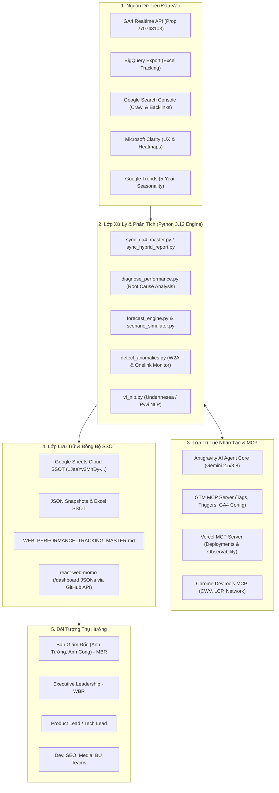

# TÀI LIỆU KIẾN TRÚC VÀ VẬN HÀNH CÔNG CỤ BÁO CÁO ĐỊNH KỲ WEB PLATFORM
*(Web Platform Periodic Reporting & Analytics Engine Architecture)*

---

## 1. TỔNG QUAN VỀ HỆ THỐNG (SYSTEM OVERVIEW)

Hệ thống báo cáo định kỳ Web Platform là một **nền tảng tự động hóa phân tích dữ liệu và ra quyết định tăng trưởng (Automated Analytics & Growth Decision Engine)**. Hệ thống hợp nhất toàn bộ dữ liệu từ các nguồn Realtime (GA4 API, Clarity), Data Warehouse (BigQuery), Technical SEO (Google Search Console), Paid Media và Dữ liệu hành vi thị trường (Google Trends) về một nguồn sự thật duy nhất (**Single Source of Truth - SSOT**), phục vụ các cấp quản trị từ Ban Giám Đốc đến Đội ngũ Kỹ sư và Tăng trưởng.



---

## 2. NỀN TẢNG KỸ THUẬT (TECH STACK) ĐANG TRIỂN KHAI

### 2.1. Môi trường Thực thi & Ngôn ngữ (Runtime & Language)
- **Runtime:** Python 3.12 được đóng gói cô lập trong môi trường ảo nội bộ [`./.venv`](file:///Users/hienhv/HienHv/Klaus/Hienho_MoMo-Base/.venv). Toàn bộ dependency quản trị tập trung tại [`scripts/requirements.txt`](file:///Users/hienhv/HienHv/Klaus/Hienho_MoMo-Base/scripts/requirements.txt).
- **Quy chuẩn gọi lệnh:** Tuyệt đối không dùng `python3` hệ thống để ngăn chặn việc macOS tự fallback về Python 3.9 gây lỗi xung đột thư viện NLP và Trends.

### 2.2. Lớp Thu thập & Tích hợp Dữ liệu (Data Ingestion Layer)
1. **Google Analytics 4 Data API (v1beta):**
   - Kết nối trực tiếp vào Property `270743103` (MoMo Web Platform).
   - Truy vấn thời gian thực các chỉ số: Total Pageviews, Sessions, Active Users (MEU), Phân rã Kênh (Non-Paid vs Paid), Chuyển đổi Web-to-App (W2A Onelink Clicks), và đóng góp theo từng Hub chiến lược.
2. **BigQuery Export & Excel Parser:**
   - Tự động phát hiện và đọc tệp trích xuất dữ liệu lớn `*Web Performance Tracking*.xlsx` tại thư mục Downloads của người dùng.
   - Thư viện `openpyxl`, `pandas` xử lý nhanh hàng trăm nghìn dòng dữ liệu và trích xuất số liệu MTD lũy kế.
3. **Google Search Console (GSC) Data Pipeline:**
   - Trích xuất dữ liệu Crawl Stats (Requests/ngày, Bytes/ngày, mã phản hồi 200, 301, 404, mục đích Discovery vs Refresh, loại Bot).
   - Phân tích Domain Authority & Backlink Profile (1.000 referring domains, nhận diện backlink độc hại A1 Gambling để xuất file Disavow tự động).
4. **Microsoft Clarity API:**
   - Đo lường tín hiệu trải nghiệm người dùng: Tỷ lệ Rage clicks, Dead clicks, Excessive scrolling, Quick backs để đánh giá mức độ hài lòng của giao diện.
5. **Google Trends Pipeline (`pytrends`):**
   - Truy vấn chuỗi thời gian 5 năm (`timeframe="today 5-y"`) của các từ khóa Pillar, chuẩn hóa 12 tháng từ T1 đến T12 phục vụ dự báo mùa vụ (Seasonality Index).

### 2.3. Lớp Tính toán & Phân tích Nâng cao (Analytics & Diagnostic Engine)
- **Hybrid Cross-Reconciliation (`scripts/sync_hybrid_report.py`):**
  - Cơ chế đối soát chéo 2 nguồn: So khớp 100% số liệu cùng kỳ giữa BigQuery Excel và GA4 API.
  - Tự động tính toán phần bù tăng trưởng (+Net Add) cho các ngày có độ trễ giữa Data Warehouse và Realtime API.
  - Tự động làm giàu (Enrichment) ma trận giữ chân (Retention Matrix) và Onelink Clicks vào cấu trúc Hubs.
- **Root Cause Diagnostic Engine (`scripts/diagnose_performance.py`):**
  - Phân tích khoảng cách (Pacing Gap) so với mục tiêu tháng.
  - Phân rã 2 tầng: Tầng Nguồn (Non-Paid vs Paid) và Tầng Phễu (Sessions vs W2A CVR).
  - Tự động phát hiện từ khóa Quick Wins (>50.000 impressions trên Search Console nhưng CTR thấp) và đề xuất đơn thuốc hành động chuẩn P0/P1/P2.
- **Multi-Scenario Forecast Engine (`scripts/lib/forecast_engine.py` & `scenario_simulator.py`):**
  - Dự báo Run-rate 31 ngày dựa trên trọng số mùa vụ 5 năm và độ dốc tăng trưởng hiện tại.
  - Xuất 3 kịch bản: Thận trọng (Conservative), Cơ sở (Base), Khả quan (Bullish).
  - Mô phỏng What-If: Định lượng kết quả kinh doanh nếu cắt giảm 20-50% ngân sách Paid Ads hoặc tăng 0.5% W2A CVR.
- **Vietnamese NLP Gateway (`scripts/lib/vi_nlp.py`):**
  - Tách từ, xử lý hình thái tiếng Việt với Underthesea 9.5+ và Pyvi.
  - Chuẩn hóa lỗi gõ Telex, teencode và trích xuất Entity thương hiệu qua Flashtext.

### 2.4. Lớp Lưu trữ & Đồng bộ Đa Nền tảng (Storage & Distribution Layer)
- **Google Sheets Cloud-Native SSOT:**
  - Ghi trực tiếp Cloud-to-Cloud qua Google Sheets API vào Spreadsheet ID **`1JaaYv2MnDy-dfBdC3P-GMB6SFgjez2VowdjX9PjmPYU`**.
  - Tự động duy trì 100% lịch sử sửa đổi (Version History), tự động tính toán lại công thức `SUM`, `INDEX MATCH`.
- **Local & Cloud Drive Backup:** Lưu bản ghi Excel `.xlsx` tại Google Drive Desktop (`07_REPORTS/web_performance_tracking.xlsx`).
- **Data Snapshots:** Lưu chuỗi thời gian dưới dạng JSON snapshot theo định dạng `monthly_MM_YYYY_mtd_XXd.json`.
- **GitHub REST API Web Hubs Distribution:** Đẩy trực tiếp dữ liệu đồng bộ vào repository `react-web-momo` (`lib/dashboard/web-data.json` & `summary.json`) lên branch `main` chỉ trong 8-10 giây.

---

## 3. TÍCH HỢP AGENT AI VÀ MCP (MODEL CONTEXT PROTOCOL)

Hệ thống được thiết kế theo kiến trúc **Agentic AI Native**, kết hợp giữa Khung tác tử Antigravity và giao thức mở Model Context Protocol (MCP).

### 3.1. Antigravity Agent AI Architecture
- **Mô hình Nền tảng (Foundation Models):** Vận hành trên các mô hình tiên tiến nhất của Google DeepMind (Gemini 2.5 / 3.8 Flash và Pro) với khả năng suy luận dài (Extended Thinking) và phân tích dữ liệu đa bước.
- **Cơ chế Vận hành Reactive & Lazy Routing:**
  - Hệ thống không chạy vòng lặp Polling gây tốn tài nguyên. Khi có lệnh hoặc sự kiện mới, cơ chế **Reactive Wakeup** tự động kích hoạt Agent.
  - Agent sử dụng bảng **Fast Routing Index** tại `AGENTS.md` để xác định đúng 1 file SSOT đích, tuyệt đối không nạp bừa bãi tài liệu lớn vào context window.
- **Custom Skills Chuyên biệt:**
  - `web-platform-reporting`: Đóng gói logic phân tích theo phong cách Product Lead / Tech Lead, chuẩn hóa cấu trúc 4 phần của MBR và 3 khối của WBR.
  - `read-latest-tracking-report`: Tự động nhận diện và nạp tệp Excel mới nhất.
  - `sync-ads`: Tự động bóc tách Paid Ads, UTM campaigns và landing pages.
  - `product-master`: Ứng dụng khung 4 Zone, RICE Scoring để xếp hạng ưu tiên sáng kiến.
- **Subagents (Tác tử Chuyên biệt):**
  - Khởi tạo các subagents `research` hoặc `self` khi cần xử lý các tác vụ phân tích dữ liệu độc lập, khảo sát sâu mà không làm ô nhiễm bộ nhớ của luồng làm việc chính.

### 3.2. Danh mục MCP Servers Đang Tích Hợp

| MCP Server | Chức Năng Kỹ Thuật | Ứng Dụng Trong Hệ Thống Báo Cáo |
| :--- | :--- | :--- |
| **`gtm` (Google Tag Manager)** | Kết nối trực tiếp GTM API & GA4 Admin API | Tra cứu container, cấu hình tag/trigger/variable; tự động kiểm tra data streams, measurement protocol, custom dimensions, audiences và key events phục vụ đo lường chuyển đổi. |
| **`vercel` (Frontend Deployment)** | Quản lý dự án, deployments, runtime logs, DNS, env vars | Giám sát trạng thái hoạt động, latency, runtime errors và triển khai bản build mới của Dashboard `react-web-momo`. |
| **`chrome-devtools`** | Điều khiển trình duyệt qua Chrome DevTools Protocol | Tự động đo lường Core Web Vitals (CWV), Largest Contentful Paint (LCP), phát hiện memory leaks và kiểm tra chuyển hướng của link Onelink trên mobile. |
| **`gdrive` (Google Drive)** | Quản lý tệp và thư mục trên Google Drive | Tự động tìm kiếm, đồng bộ và lưu trữ các tệp báo cáo, slide trình diễn trên Google Workspace của công ty. |
| **`gemini-api_gemini-api-docs`** | Tra cứu tài liệu chính thống của Gemini API/SDK | Cập nhật nhanh các chuẩn tích hợp LLM mới nhất cho pipeline phân tích. |

---

## 4. ĐỐI TƯỢNG SỬ DỤNG CÔNG CỤ (TARGET STAKEHOLDERS)

Hệ thống được thiết kế theo mô hình **Đa tầng Độc giả (Multi-tier Readership)**, tùy biến góc nhìn dữ liệu cho từng nhóm đối tượng:

### 4.1. Ban Giám Đốc & Hội Đồng Quản Trị (Board of Directors - Anh Tường, Anh Công)
- **Hình thức tiếp nhận:** Báo cáo Tháng (Monthly Business Review - MBR) chuẩn 4 phần:
  1. `[R]` Product & Business Performance: Sức khỏe động cơ tăng trưởng, tỷ trọng Non-Paid vs Paid, tiến độ so với kế hoạch (4M-5M-6M Pageviews).
  2. `[R]` Strategic Hubs: Hiệu suất 2 dự án trọng điểm (Cinema Hub, Financial Hub).
  3. `[R]` New User Acquisition: Luồng Ads và phễu chuyển đổi Web-to-App (MEU ➔ Install ➔ Mapbank ➔ First Transaction).
  4. `[D]` Strategic Discussion Topics: Tối đa 2 chủ đề chiến lược cần phê duyệt hoặc tháo gỡ cấp công ty.
- **Trọng tâm quản trị:** Thị phần, vị thế Web Destination, hiệu quả dòng tiền và tính bền vững của kênh Organic.

### 4.2. Executive Leadership (Anh Công)
- **Hình thức tiếp nhận:** Báo cáo Tuần (Weekly Business Review - WBR).
- **Trọng tâm quản trị:** Tiến độ thực thi 7 ngày, hiệu quả tự phục vụ (Self-service), kết quả A/B testing, tháo gỡ điểm nghẽn liên phòng ban và tối ưu chi phí vận hành.

### 4.3. Product Lead & Tech Lead Web Platform
- **Vai trò:** Người trực tiếp vận hành và ra lệnh cho công cụ.
- **Trọng tâm quản trị:** Giám sát độ lệch pacing MTD, phân tích nguyên nhân gốc rễ (RCA), điều phối nguồn lực kỹ thuật, đánh giá tác động What-if và theo dõi Sổ cái Quyết định (Decision Ledger).

### 4.4. Đội ngũ Kỹ sư (Web Dev, Backend, Data, SEO, Media)
- **Hình thức tiếp nhận:** Danh mục Action Items tự động phân cấp P0/P1/P2:
  - *Dev/Backend:* Khắc phục URL gãy Onelink, tối ưu P90/LCP, cải thiện 404 crawl waste.
  - *SEO/Content:* Tối ưu từ khóa Quick Wins, mở rộng cụm Topic Cluster.
  - *Media:* Tái cấu trúc ngân sách chiến dịch Paid Ads, loại bỏ các kênh UTM có CVR thấp.

---

## 5. VAI TRÒ, SỨ MỆNH VÀ LỢI ÍCH CỦA CÔNG CỤ

### 5.1. Sứ Mệnh Cốt Lõi (Mission)
1. **Xóa bỏ Phân mảnh Dữ liệu (End Data Fragmentation):** Hợp nhất các ốc đảo số liệu rời rạc (GA4, BigQuery, Excel, Search Console, Clarity) về một ngôn ngữ chung duy nhất.
2. **Chuyển dịch Tư duy từ Mô tả sang Hành động (From Descriptive to Prescriptive):** Không dừng lại ở việc trả lời *"chuyện gì đã xảy ra"*, công cụ trả lời *"tại sao xảy ra"* và *"cần làm gì ngay bây giờ để đạt mục tiêu"*.
3. **Bảo vệ Tính Bền Vững của Tăng Trưởng (Growth Integrity):** Bóc tách triệt để Non-Paid vs Paid, ngăn chặn việc sử dụng ngân sách quảng cáo ngắn hạn để che đậy sự suy giảm của năng lực cốt lõi.

### 5.2. Vai Trò của Công Cụ (Core Roles)
- **Trục Xương Sống Dữ Liệu (Operational Backbone):** Tự động hóa 100% quy trình ETL và phân phối báo cáo, giải phóng con người khỏi các thao tác thủ công sao chép số liệu.
- **Hệ Thống Cảnh Báo Sớm (Early Warning Radar):** Tự động quét và phát hiện các bất thường (rớt thứ hạng từ khóa, đứt gãy luồng chuyển đổi Onelink, lãng phí Crawl Budget) trước khi tác động tiêu cực đến doanh thu.
- **Cố Vấn Chiến Lược Số (Growth Strategy Copilot):** Định lượng hóa các quyết định kinh doanh qua mô phỏng kịch bản (Scenario Simulator) và kiểm chứng giả thuyết bằng A/B testing khoa học.

### 5.3. Lợi Ích Vượt Trội (Key Business & Operational Benefits)

| Tiêu Chí | Trước Khi Có Công Cụ | Khi Sử Dụng Công Cụ Tự Động | Mức Độ Cải Thiện |
| :--- | :--- | :--- | :--- |
| **Thời gian tổng hợp số liệu** | 2 - 4 giờ làm việc thủ công mỗi tuần | **6 - 10 giây (1 lệnh duy nhất)** | **Giảm >98% thời gian** |
| **Độ chính xác dữ liệu** | Dễ sai sót công thức, lệch số giữa GA4 và Data Warehouse | **100% đối soát chéo tự động (Hybrid Reconciliation)** | **Loại bỏ hoàn toàn sai số thủ công** |
| **Tính đa kênh & đồng bộ** | Phải copy paste qua từng file Excel, Google Sheets, Slide | **Cập nhật đồng thời Google Sheets Cloud, Git Dashboard, Markdown SSOT** | **Đồng bộ thời gian thực** |
| **Khả năng chẩn đoán (RCA)** | Họp bàn nhiều ngày để tìm nguyên nhân traffic sụt giảm | **Tự động phân rã Nguồn/Phễu/Từ khóa trong 15 giây** | **Hành động khắc phục ngay trong ngày** |
| **Định vị nguồn lưu lượng** | Số liệu Paid bị gộp chung, khó đánh giá chất lượng SEO | **Phân tách nghiêm ngặt Non-Paid vs Paid theo SSOT** | **Minh bạch hóa hiệu quả đầu tư** |
| **Khả năng dự phóng** | Ngoại suy tuyến tính đơn giản | **Dự báo 3 kịch bản kết hợp chu kỳ mùa vụ 5 năm** | **Độ chính xác dự phóng cao** |

---

## 6. HƯỚNG DẪN KÍCH HOẠT NHANH (FAST PATH EXECUTION)

Các lệnh vận hành nhanh đã được đóng gói thành các trigger tự động trong môi trường:

```bash
# 1. Đồng bộ số liệu GA4 MTD thời gian thực và đẩy đa kênh (Google Sheets, Dashboard, SSOT):
./.venv/bin/python scripts/sync_ga4_master.py

# 2. Đối soát chéo giữa BigQuery Excel và GA4 Realtime API:
./.venv/bin/python scripts/sync_hybrid_report.py

# 3. Chẩn đoán nguyên nhân gốc rễ và đề xuất đơn thuốc hành động:
./.venv/bin/python scripts/diagnose_performance.py

# 4. Quét dị biệt và đứt gãy chuyển đổi Web-to-App (Onelink):
./.venv/bin/python scripts/detect_anomalies.py

# 5. Phân tích chi tiết các chiến dịch Paid Ads và UTM:
./.venv/bin/python scripts/sync_paid_ads.py
```
