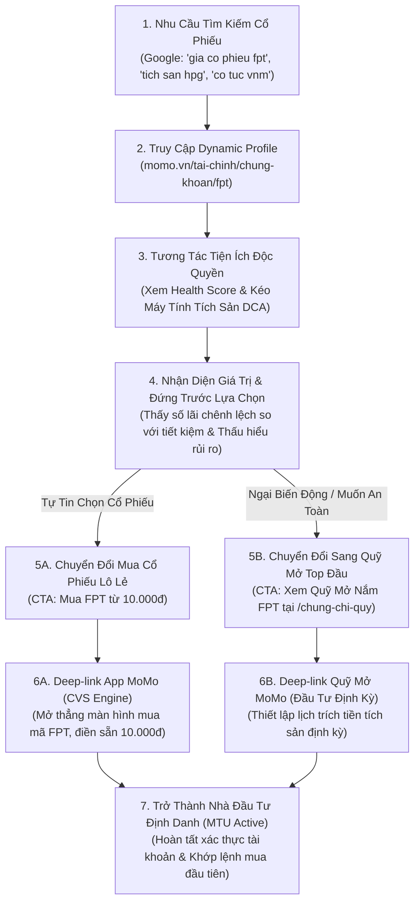

# PRD: Dynamic Stock Ticker Profiles & Cổng Chứng Khoán Master Hub

> - **Tên Sản Phẩm:** Dynamic Stock Ticker Profiles & Cổng Chứng Khoán Master Hub
> - **URL Chuẩn:** `/tai-chinh/chung-khoan` (Cổng Tổng Quan) & `/tai-chinh/chung-khoan/[ticker]` (Dynamic Ticker Profile)
> - **Phân Khối Phụ Trách:** Growth Platform Division x Financial Services Division (CreditTech x CVS Partnership)
> - **Đội Ngũ Triển Khai:** Web Development Team, Backend Team, SEO & Content Team, Product Growth Team
> - **Phiên Bản:** v1.0 - Tháng 10/2026
> - **Trạng Thái:** Production Blueprint & Technical Specification

---

## 1. ĐỊNH VỊ CHIẾN LƯỢC: TÍCH SẢN CỔ PHIẾU LÔ LẺ DÀNH CHO 95% DÂN SỐ ĐẠI CHÚNG

### 1.1 Khái Quát Vấn Đề & Bẫy Cạnh Tranh Thị Trường
- **Dung lượng thị trường:** Nhu cầu tìm kiếm về "Chứng Khoán" và "Cổ Phiếu" đạt hơn 4.103.880 lượt tìm kiếm/tháng tại Việt Nam (trong đó Chứng Khoán 3.026.340 lượt/tháng, Cổ Phiếu 1.077.540 lượt/tháng), thuộc nhóm Big Bet lớn nhất của Phân khối Tài chính.
- **Bẫy cạnh tranh hiện hữu:** Các nền tảng chứng khoán truyền thống (SSI, VPS, VNDirect, TCBS) thiết kế website và ứng dụng phục vụ nhà đầu tư chuyên nghiệp: ngập tràn thuật ngữ phức tạp, đồ thị nến kỹ thuật nhảy giật từng giây, tập trung vào lướt sóng ngắn hạn (Day-trading, T+2.5) và đòn bẩy Margin cao.
- **Rào cản người mới (Mass Retail / F0):** 95% người dùng phổ thông cảm thấy chứng khoán là cờ bạc rủi ro cao, thiếu kiến thức phân tích báo cáo tài chính, và bị chặn bởi quy định lô chẵn 100 cổ phiếu (ví dụ: mua 100 cổ phiếu FPT hoặc VCB cần từ 10 đến 14 triệu đồng, vượt quá khả năng tích lũy hàng tháng của người lao động trẻ).

### 1.2 Lối Đi Riêng Biệt Của MoMo (The MoMo Unique Path)
- **Định vị độc đạo:** MoMo không cạnh tranh làm bảng giá giao dịch nhanh cho trader. MoMo định vị Chứng Khoán trên Web Platform là **"Cổng Tích Sản Doanh Nghiệp Tốt Dành Cho Người Đại Chúng"**.
- **Giá trị cốt lõi (Value Proposition):**
  - **Lô lẻ từ 10.000đ:** Mua cổ phần của các tập đoàn hàng đầu Việt Nam chỉ với số tiền lẻ hàng ngày thông qua đối tác Chứng khoán CVS tích hợp in-app.
  - **Zero-Jargon (Bình dân hóa ngôn ngữ tài chính):** Mọi chỉ số tài chính (P/E, P/B, ROE, Debt/Equity) được chuyển đổi thành ngôn ngữ đời thường ("Cổ phiếu đang Đắt hay Rẻ", "Công ty nợ nhiều hay ít", "Khả năng sinh lời so với gửi tiết kiệm").
  - **Tư duy Tích sản thay vì Đầu cơ:** Tập trung vào dòng tiền thụ động từ cổ tức tiền mặt đều đặn và tăng trưởng giá trị doanh nghiệp theo thời gian (3-5 năm).
  - **Cơ chế Chuyển đổi Kép (Dual-Conversion Hook):** Người dùng tự tin thì mua cổ phiếu đơn lẻ từ 10.000đ; người dùng sợ rủi ro thì được dẫn dắt sang ủy thác cho quỹ mở (`/tai-chinh/chung-chi-quy`) sở hữu trọn rổ VN30.

---

## 2. KIẾN TRÚC THÔNG TIN & CẤU TRÚC URL (INFORMATION ARCHITECTURE)

### 2.1 Cấu Trúc URL Chuẩn Hóa
- **Cổng Trung Tâm (Master Hub):** `https://momo.vn/tai-chinh/chung-khoan`
  - Đóng vai trò trang tổng quan thị trường, bảng phân loại cổ phiếu VN30 theo khẩu vị đầu tư (Tích sản an toàn, Cổ tức cao, Tăng trưởng công nghệ), và cẩm nang F0.
- **Dynamic Ticker Profile (Programmatic SEO 30 Mã VN30):** `https://momo.vn/tai-chinh/chung-khoan/[ticker]`
  - URL Rewrite: Chữ thường toàn bộ, định dạng mã 3 ký tự (ví dụ: `/tai-chinh/chung-khoan/fpt`, `/tai-chinh/chung-khoan/vnm`, `/tai-chinh/chung-khoan/hpg`, `/tai-chinh/chung-khoan/vcb`, `/tai-chinh/chung-khoan/mwg`...).
  - Canonical URL trỏ chính xác về trang tương ứng; không sinh tham số thừa.

### 2.2 Danh Sách 30 Cổ Phiếu VN30 Triển Khai Giai Đoạn 1
ACB, BCM, BID, BVH, CTG, FPT, GAS, GVR, HDB, HPG, MBB, MSN, MWG, PLX, POW, SAB, SHB, SSB, SSI, STB, TCB, TPB, VCB, VHM, VIB, VIC, VJC, VNM, VPB, VRE.

---

## 3. WIREFRAME NỘI DUNG 7 TẦNG CHUẨN HÓA CHO DYNAMIC TICKER PROFILE

Mỗi trang `/tai-chinh/chung-khoan/[ticker]` được cấu trúc đồng bộ theo 7 tầng thông tin nhằm tối ưu hóa chuyển đổi Web-to-App:

### Tầng 1: Hero & Price Action No-Jargon
- **Hiển thị định danh:** Ticker, Logo doanh nghiệp, Tên đầy đủ công ty, Ngành nghề chính, Sàn niêm yết (HOSE).
- **Thị giá & Biến động:** Giá hiện tại, Thay đổi phiên (% và số tiền), Biên độ ngày (Thấp nhất - Cao nhất), Vốn hóa thị trường (nghìn tỷ VND).
- **Hộp Đánh Giá Định Giá Bình Dân (Valuation Box):**
  - Không chỉ hiển thị con số P/E hay P/B khô khan.
  - Phân tích trạng thái tự động: "Cổ phiếu đang được định giá Hợp lý / Hơi cao / Hấp dẫn so với trung bình 5 năm của chính nó và trung bình ngành".
- **Primary CTA:** Nút nhấp mở App `"Mua Cổ Phiếu [Mã] Từ 10.000đ Trên MoMo"` kèm QR Code trên Desktop.

### Tầng 2: Thước Đo Sức Khỏe Doanh Nghiệp (MoMo Stock Health Score 1-100)
- Điểm tổng hợp 1-100 kèm nhãn đánh giá trực quan:
  - `80 - 100`: Xuất Sắc (Doanh nghiệp đầu ngành, dòng tiền cực mạnh).
  - `65 - 79`: Tốt (Nền tảng tài chính lành mạnh, an toàn để tích sản).
  - `50 - 64`: Trung Bình (Cần theo dõi chu kỳ kinh doanh).
  - `< 50`: Cần Thận Trọng (Đòn bẩy nợ cao hoặc lợi nhuận biến động lớn).
- Phân tách 4 trụ cột đánh giá độc lập (mỗi trụ cột 25 điểm tối đa).

### Tầng 3: Mô Hình Kinh Doanh Dễ Hiểu Cho F0 (Business Model Breakdown)
- **Doanh nghiệp kiếm tiền từ đâu:** 3-4 gạch đầu dòng giải thích nguồn thu thực tế (ví dụ: FPT kiếm tiền từ gia công phần mềm cho Nhật/Mỹ, dịch vụ viễn thông internet cáp quang, và học phí hệ thống giáo dục).
- **Lợi thế cạnh tranh bền vững (Moat):** Lý do đối thủ khó có thể đánh bại (thương hiệu quốc gia, thị phần số 1, chi phí chuyển đổi cao...).
- **Rủi ro lớn nhất cần biết:** Cảnh báo minh bạch rủi ro khách quan (tỷ giá, chu kỳ giá nguyên vật liệu, chính sách ngành).

### Tầng 4: Máy Tính Giả Lập Tích Sản Lịch Sử (Stock DCA Backtester Tool)
- Tiện ích tương tác không cần đăng nhập cho phép người dùng kiểm chứng: "Nếu tôi dành ra X đồng mỗi tháng để mua cổ phiếu này trong 1 năm / 3 năm / 5 năm qua, bây giờ tôi có bao nhiêu tiền?".
- Bảng và biểu đồ trực quan so sánh kết quả tích sản cổ phiếu (đã tính gộp cả cổ tức tiền mặt) so với việc gửi tiết kiệm ngân hàng 6%/năm.

### Tầng 5: Lịch Trả Cổ Tức Tiền Mặt & Dòng Tiền Thụ Động (Dividend Tracker)
- **Lịch sử trả cổ tức 3-5 năm gần nhất:** Ngày chốt quyền, Tỷ lệ trả tiền mặt (% mệnh giá và số tiền/cổ phiếu).
- **Tỷ suất cổ tức bình quân (Dividend Yield):** So sánh tỷ suất cổ tức tiền mặt của cổ phiếu với lãi suất tiền gửi tiết kiệm 12 tháng.
- **Thông điệp giáo dục F0:** Cổ phiếu không chỉ là chênh lệch giá mua bán, mà là quyền nhận dòng tiền mặt đều đặn từ lợi nhuận thật của doanh nghiệp.

### Tầng 6: Cơ Chế Chuyển Đổi Kép Độc Quyền (Dual-Conversion Hook)
- Thiết kế 2 cánh cửa chuyển đổi rõ ràng theo tâm lý người dùng:
  - **Cánh cửa 1 (Dành cho người tin tưởng doanh nghiệp này):** CTA *"Bắt đầu tích sản [Mã] từ 10.000đ"* ➔ Deep-link mở tính năng Chứng Khoán CVS in-app.
  - **Cánh cửa 2 (Dành cho người thích ngành nhưng sợ rủi ro mã đơn lẻ):** Box đề xuất *"Không muốn đau đầu chọn mã? Hãy để chuyên gia quản lý"* ➔ Link điều hướng sang chuyên trang Chứng Chỉ Quỹ (`/tai-chinh/chung-chi-quy`) với các quỹ mở đầu ngành đang nắm giữ tỷ trọng lớn mã này (ví dụ: DCDS, VESAF nắm FPT, HPG).

### Tầng 7: Câu Hỏi Thường Gặp (FAQ Schema JSON-LD) Chuẩn SEO/GEO
- 5-6 câu hỏi giải quyết triệt để rào cản tâm lý của người mới:
  - Mua cổ phiếu trên MoMo có an toàn và hợp pháp không?
  - Mua cổ phiếu lô lẻ 10.000đ khác gì mua lô chẵn 100 cổ phiếu tại công ty chứng khoán?
  - Khi nào tôi được nhận tiền cổ tức vào tài khoản?
  - Tôi có thể bán cổ phiếu và rút tiền về MoMo bất kỳ lúc nào không?
  - Phí giao dịch mua bán cổ phiếu trên MoMo là bao nhiêu?

---

## 4. CHI TIẾT KỸ THUẬT HAI CÔNG CỤ TƯƠNG TÁC CỐT LÕI

### 4.1 Máy Tính Giả Lập Tích Sản Lịch Sử (Stock DCA Backtester)

#### Input Tham Số:
- `ticker`: Mã cổ phiếu (string, ví dụ: "FPT").
- `monthlyAmount`: Số tiền tích lũy mỗi tháng (number, mặc định: 1.000.000 VND, min: 10.000 VND, bước nhảy: 500.000 VND).
- `durationYears`: Khoảng thời gian kiểm thử (number, các tùy chọn: 1 năm, 3 năm, 5 năm; mặc định: 3 năm).
- `investDay`: Ngày cố định tích sản hàng tháng (mặc định: Ngày 5 - ngày nhận lương phổ biến).

#### Công Thức Tính Toán:
1. **Lũy kế vốn gốc đầu tư:**
   $$\text{Total Capital} = \text{monthlyAmount} \times (12 \times \text{durationYears})$$
2. **Số lượng cổ phiếu tích lũy thực tế (theo giá lịch sử điều chỉnh):**
   Tại mỗi kỳ $t$ (tháng thứ $t$):
   $$\text{Shares}_t = \frac{\text{monthlyAmount}}{P_{\text{adj}, t}}$$
   Trong đó $P_{\text{adj}, t}$ là giá đóng cửa phiên giao dịch gần nhất của ngày cố định trong tháng $t$, đã được điều chỉnh chia tách và cổ tức.
   Tổng số cổ phiếu nắm giữ:
   $$\text{Total Shares} = \sum_{t=1}^{N} \text{Shares}_t$$
3. **Giá trị danh mục hiện tại:**
   $$\text{Current Portfolio Value} = \text{Total Shares} \times P_{\text{current}}$$
4. **Lợi nhuận ròng và Tỷ suất sinh lời kép:**
   $$\text{Total Return (VND)} = \text{Current Portfolio Value} - \text{Total Capital}$$
   $$\text{Total Return (\%)} = \frac{\text{Total Return}}{\text{Total Capital}} \times 100$$
5. **Kịch bản so sánh với Tiết kiệm Ngân hàng chuẩn (Benchmark Savings 6.0%/năm):**
   $$r_{\text{month}} = \frac{0.06}{12} = 0.005$$
   $$\text{Savings Value} = \text{monthlyAmount} \times \left[ \frac{(1 + r_{\text{month}})^N - 1}{r_{\text{month}}} \right] \times (1 + r_{\text{month}})$$
   $$\text{Difference} = \text{Current Portfolio Value} - \text{Savings Value}$$

#### Output Trực Quan:
- Thẻ so sánh trực diện: Tổng vốn bỏ ra, Giá trị đạt được khi tích sản cổ phiếu [Mã], Giá trị đạt được nếu chỉ gửi tiết kiệm thông thường, Số tiền dôi dư tạo ra nhờ sức mạnh tăng trưởng doanh nghiệp.
- Nút CTA chuyển đổi động mang bối cảnh: `"Tích Sản [Mã] Chỉ Từ [monthlyAmount] đ/Tháng Ngay Trên MoMo"`.

---

### 4.2 Thước Đo Sức Khỏe Doanh Nghiệp (MoMo Stock Health Score 1-100)

Thước đo vận hành dựa trên thuật toán chuẩn hóa dữ liệu tài chính 4 quý gần nhất, chuyển đổi thành thang điểm trực quan 1-100:

| Trụ Cột Đánh Giá | Trọng Số | Chỉ Tiêu Tài Chính Cốt Lõi | Ngưỡng Tối Ưu (Max Điểm) | Diễn Giải Ngôn Ngữ F0 (No-Jargon) |
| :--- | :---: | :--- | :--- | :--- |
| **1. Sức Mạnh Tài Chính** | 25% | - Debt-to-Equity (D/E) - Current Ratio - Tiền mặt & Tương đương tiền | D/E < 1.0 Current Ratio > 1.5 Dự trữ tiền dồi dào | "Công ty nợ rất ít, tiền mặt trong két dồi dào, an tâm tuyệt đối không lo phá sản hay áp lực lãi vay." |
| **2. Tăng Trưởng Kinh Doanh** | 25% | - Tăng trưởng doanh thu 3 năm - Tăng trưởng lợi nhuận sau thuế - Biên lợi nhuận ròng | Tăng trưởng DT > 15%/năm Tăng trưởng LN > 15%/năm Biên ròng ổn định | "Doanh nghiệp liên tục bán được nhiều hàng hơn và thu về lợi nhuận thật tăng đều đặn qua các năm." |
| **3. Lịch Sử Cổ Tức** | 25% | - Tính liên tục trả cổ tức tiền mặt - Tỷ suất cổ tức (Dividend Yield) - Payout Ratio | Trả tiền mặt liên tục 3-5 năm Yield > 4.5%/năm Payout 30-70% | "Công ty làm ăn có lãi thật và chia tiền mặt sòng phẳng cho cổ đông đều đặn như nhận tiền lãi hàng năm." |
| **4. Hiệu Quả & Vị Thế Ngành** | 25% | - ROE (Lợi nhuận trên vốn CSH) - ROA (Lợi nhuận trên tài sản) - Vị thế thị phần trong VN30 | ROE > 20% liên tục ROA > 10% Top 1-3 ngành | "Doanh nghiệp sử dụng vốn cực kỳ hiệu quả, tiền đẻ ra tiền vượt trội so với gửi ngân hàng thông thường." |

---

## 5. SƠ ĐỒ LUỒNG CHUYỂN ĐỔI NGƯỜI DÙNG (STOCK CONVERSION FLOW)

### Bảng Phân Tích Kỹ Thuật Các Bước Trong Luồng:

<table style="width:100%; border-collapse:collapse; border:1.5px solid #64748b; margin:1em 0; font-size:0.85em;">
  <thead>
    <tr style="background-color:#f1f5f9;">
      <th style="border:1.5px solid #64748b; padding:6px; text-align:center; font-weight:700;">Bước</th>
      <th style="border:1.5px solid #64748b; padding:6px; text-align:left; font-weight:700;">Tên Giai Đoạn</th>
      <th style="border:1.5px solid #64748b; padding:6px; text-align:left; font-weight:700;">Trải Nghiệm Người Dùng (UX)</th>
      <th style="border:1.5px solid #64748b; padding:6px; text-align:left; font-weight:700;">Hạ Tầng / Cơ Chế Kỹ Thuật</th>
      <th style="border:1.5px solid #64748b; padding:6px; text-align:center; font-weight:700;">Nền Tảng</th>
    </tr>
  </thead>
  <tbody>
    <tr>
      <td style="border:1px solid #94a3b8; padding:6px; text-align:center;">1</td>
      <td style="border:1px solid #94a3b8; padding:6px;"><strong>Tìm Kiếm & Khám Phá</strong></td>
      <td style="border:1px solid #94a3b8; padding:6px;">Người dùng Google tìm kiếm mã cổ phiếu hoặc cổ tức của các công ty lớn (FPT, Vinamilk, Hòa Phát) và nhấp vào kết quả MoMo.</td>
      <td style="border:1px solid #94a3b8; padding:6px;">Programmatic SEO Next.js ISR, Schema Corporation & FinancialProduct.</td>
      <td style="border:1px solid #94a3b8; padding:6px; text-align:center;">Google ➔ Web</td>
    </tr>
    <tr style="background-color:#f8fafc;">
      <td style="border:1px solid #94a3b8; padding:6px; text-align:center;">2</td>
      <td style="border:1px solid #94a3b8; padding:6px;"><strong>Đánh Giá Sức Khỏe</strong></td>
      <td style="border:1px solid #94a3b8; padding:6px;">Xem điểm MoMo Stock Health Score 1-100, nắm bắt nhanh doanh nghiệp tốt hay yếu mà không cần đọc báo cáo tài chính 100 trang.</td>
      <td style="border:1px solid #94a3b8; padding:6px;">Client-side Visual Radial Score, Cached Financial Scoring API.</td>
      <td style="border:1px solid #94a3b8; padding:6px; text-align:center;">Web</td>
    </tr>
    <tr>
      <td style="border:1px solid #94a3b8; padding:6px; text-align:center;">3</td>
      <td style="border:1px solid #94a3b8; padding:6px;"><strong>Giả Lập Tích Sản DCA</strong></td>
      <td style="border:1px solid #94a3b8; padding:6px;">Kéo thanh trượt chọn số tiền tích lũy mỗi tháng (ví dụ 1 triệu/tháng) và kỳ hạn để nhìn thấy số tiền tạo ra so với gửi tiết kiệm.</td>
      <td style="border:1px solid #94a3b8; padding:6px;">No-login Interactive Calculator, Historical Price Database with Dividend Adjustment.</td>
      <td style="border:1px solid #94a3b8; padding:6px; text-align:center;">Web</td>
    </tr>
    <tr style="background-color:#f8fafc;">
      <td style="border:1px solid #94a3b8; padding:6px; text-align:center;">4</td>
      <td style="border:1px solid #94a3b8; padding:6px;"><strong>Lựa Chọn Chuyển Đổi Kép</strong></td>
      <td style="border:1px solid #94a3b8; padding:6px;">Người dùng tự tin thì nhấp mua cổ phiếu lô lẻ; người dùng thận trọng nhấp chọn phương án ủy thác qua Quỹ Mở đa dạng hóa.</td>
      <td style="border:1px solid #94a3b8; padding:6px;">Dual-Conversion Component, Intent Tracking, Contextual Deep-link Generator.</td>
      <td style="border:1px solid #94a3b8; padding:6px; text-align:center;">Web</td>
    </tr>
    <tr>
      <td style="border:1px solid #94a3b8; padding:6px; text-align:center;">5</td>
      <td style="border:1px solid #94a3b8; padding:6px;"><strong>Mở App & Khớp Lệnh</strong></td>
      <td style="border:1px solid #94a3b8; padding:6px;">Ứng dụng MoMo mở thẳng màn hình đặt lệnh mua lô lẻ (CVS) hoặc màn hình đăng ký tích sản Chứng Chỉ Quỹ, điền sẵn thông tin.</td>
      <td style="border:1px solid #94a3b8; padding:6px;">AppsFlyer OneLink, In-App Stock Core CVS API / Mutual Fund Engine.</td>
      <td style="border:1px solid #94a3b8; padding:6px; text-align:center;">Web ➔ App MoMo</td>
    </tr>
  </tbody>
</table>

---

## 6. QUY CHUẨN ĐO LƯỜNG SỰ KIỆN (UMAMI TRACKING SCHEMA)

Tuân thủ nghiêm ngặt theo tiêu chuẩn SSOT [`04_MOSPARK_PLATFORM/umami_utility_tracking.md`](file:///Users/hienhv/HienHv/Klaus/Hienho_MoMo-Base/04_MOSPARK_PLATFORM/umami_utility_tracking.md):

| Tên Sự Kiện (Event Name) | Điểm Chạm Kích Hoạt (Trigger Point) | Tham Số Bắt Buộc (Schema Params) | Mục Đích Đo Lường |
| :--- | :--- | :--- | :--- |
| `stock_profile_view` | Người dùng tải trang mã cổ phiếu | `ticker`, `sector`, `health_score`, `pe_ratio` | Đo lường lưu lượng Top-of-Funnel theo từng mã cổ phiếu |
| `stock_dca_calculate` | Người dùng thay đổi số tiền hoặc thời gian tích sản | `ticker`, `monthly_amount`, `duration_years`, `total_return_pct` | Đo lường mức độ tương tác công cụ tính toán |
| `stock_health_tab_click` | Nhấp xem chi tiết 1 trong 4 trụ cột Health Score | `ticker`, `pillar_name` (`finance`, `growth`, `dividend`, `efficiency`) | Đo lường nhu cầu tìm hiểu chiều sâu tài chính của F0 |
| `stock_cta_cvs_click` | Nhấp nút CTA mua cổ phiếu lẻ qua CVS | `ticker`, `cta_position` (`hero`, `calculator`, `bottom_bar`), `intent` | Đo lường tỷ lệ chuyển đổi trực tiếp Web-to-App cho cổ phiếu |
| `stock_dual_ccq_click` | Nhấp nút CTA ủy thác qua Quỹ Mở | `ticker`, `target_fund`, `cta_position` | Đo lường hiệu quả cơ chế chuyển đổi chéo sang Quỹ Mở |

---

## 7. LỘ TRÌNH TRIỂN KHAI KỸ THUẬT (TECHNICAL ROADMAP)

<table style="width:100%; border-collapse:collapse; border:1.5px solid #64748b; margin:1em 0; font-size:0.85em;">
  <thead>
    <tr style="background-color:#f1f5f9;">
      <th style="border:1.5px solid #64748b; padding:6px; text-align:center; font-weight:700;">Giai Đoạn</th>
      <th style="border:1.5px solid #64748b; padding:6px; text-align:center; font-weight:700;">Thời Gian</th>
      <th style="border:1.5px solid #64748b; padding:6px; text-align:left; font-weight:700;">Hạng Mục Trọng Tâm</th>
      <th style="border:1.5px solid #64748b; padding:6px; text-align:left; font-weight:700;">Mục Tiêu & Kết Quả Đầu Ra</th>
      <th style="border:1.5px solid #64748b; padding:6px; text-align:center; font-weight:700;">Trạng Thái</th>
    </tr>
  </thead>
  <tbody>
    <tr>
      <td style="border:1px solid #94a3b8; padding:6px; text-align:center; font-weight:700;">Phase 1</td>
      <td style="border:1px solid #94a3b8; padding:6px; text-align:center;">Tháng 10/2026</td>
      <td style="border:1px solid #94a3b8; padding:6px;"><strong>Rollout 30 Mã Cổ Phiếu VN30</strong></td>
      <td style="border:1px solid #94a3b8; padding:6px;">Phát hành Cổng Master `/tai-chinh/chung-khoan` và 30 trang Dynamic Ticker Profile cho toàn bộ rổ VN30. Tích hợp máy tính Stock DCA Backtester và Thước đo Sức khỏe MoMo Health Score 1-100.</td>
      <td style="border:1px solid #94a3b8; padding:6px; text-align:center; font-weight:700; color:#b45309; background-color:#fef9c3;">In Progress</td>
    </tr>
    <tr style="background-color:#f8fafc;">
      <td style="border:1px solid #94a3b8; padding:6px; text-align:center; font-weight:700;">Phase 2</td>
      <td style="border:1px solid #94a3b8; padding:6px; text-align:center;">Tháng 11/2026</td>
      <td style="border:1px solid #94a3b8; padding:6px;"><strong>Dual-Conversion & Tích Hợp Quỹ Mở</strong></td>
      <td style="border:1px solid #94a3b8; padding:6px;">Kết nối liên thông dữ liệu giữa 30 mã VN30 và danh mục tài sản của 30 Quỹ Mở (`/tai-chinh/chung-chi-quy`). Người dùng xem mã nào sẽ nhìn thấy ngay các quỹ đang nắm giữ mã đó để ủy thác an toàn.</td>
      <td style="border:1px solid #94a3b8; padding:6px; text-align:center; font-weight:700; color:#1d4ed8; background-color:#dbeafe;">Planned</td>
    </tr>
    <tr>
      <td style="border:1px solid #94a3b8; padding:6px; text-align:center; font-weight:700;">Phase 3</td>
      <td style="border:1px solid #94a3b8; padding:6px; text-align:center;">Tháng 12/2026</td>
      <td style="border:1px solid #94a3b8; padding:6px;"><strong>Mở Rộng Top 100 Mid-Cap & Bộ Lọc Tích Sản</strong></td>
      <td style="border:1px solid #94a3b8; padding:6px;">Mở rộng Programmatic SEO lên 100 mã cổ phiếu vốn hóa vừa và có thanh khoản cao. Xây dựng công cụ Screener trực quan lọc cổ phiếu theo tiêu chí F0 (Cổ tức tiền mặt > 6%, Điểm sức khỏe > 75).</td>
      <td style="border:1px solid #94a3b8; padding:6px; text-align:center; font-weight:700; color:#1d4ed8; background-color:#dbeafe;">Planned</td>
    </tr>
  </tbody>
</table>
