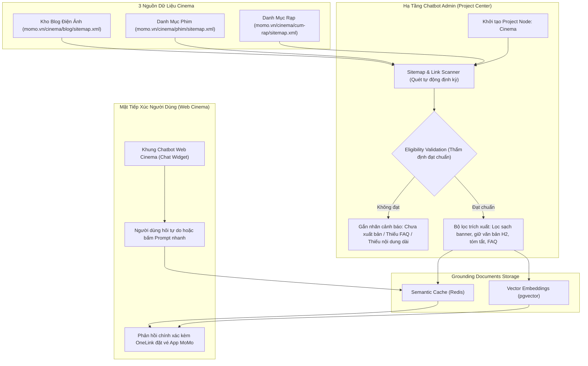

# PRODUCT REQUIREMENTS DOCUMENT (PRD)
# TRỢ LÝ CHATBOT ĐIỆN ẢNH (MOMO CINEMA CHATBOT)
# TÍCH HỢP HỆ THỐNG CƠ SỞ TRI THỨC TOÀN DIỆN: BLOG, THÔNG TIN PHIM VÀ THÔNG TIN RẠP

> **Mục tiêu tài liệu:** Đặc tả chi tiết yêu cầu sản phẩm, kiến trúc nạp dữ liệu tri thức Grounding Documents (kế thừa nền tảng Chatbot Admin của Web Platform) và thiết kế trải nghiệm giao diện Chatbot trên Kênh Web MoMo Cinema (momo.vn/cinema/*). Chatbot đóng vai trò là công cụ hỗ trợ người dùng giải đáp nhanh mọi thắc mắc về phim, rạp chiếu, bài viết review và thúc đẩy ra quyết định mua vé xem phim qua ứng dụng MoMo.

---

## THÔNG TIN TỔNG QUAN (METADATA)

| Hạng Mục | Chi Tiết |
| :--- | :--- |
| **Tên Tính Năng** | MoMo Cinema Chatbot (Trợ Lý Chatbot Điện Ảnh) |
| **Nền Tảng Hạ Tầng Kế Thừa** | Hệ thống Cơ sở tri thức & Chatbot Admin Web Platform (adminweb.momocdn.net/chatbot-admin/grounding_document) |
| **Vị Trí Triển Khai** | Toàn bộ Kênh Web MoMo Cinema (momo.vn/cinema/, momo.vn/cinema/phim-chieu/, momo.vn/cinema/cum-rap/, momo.vn/cinema/blog/*) |
| **Trạng Thái Tài Liệu** | [X] APPROVED FOR IMPLEMENTATION |
| **Phân Loại Tăng Trưởng** | Product-Led Growth (PLG), Decision Velocity & Web-to-App Conversion |
| **Đội Ngũ Phụ Trách** | Kỹ sư Nền tảng Web Platform & BU Movies Product Lead |
| **Mốc Tiến Độ Dự Kiến** | Nạp & Thẩm định dữ liệu tri thức: 10/11 - 17/11/2026 -> Thử nghiệm UAT: 18/11 - 24/11/2026 -> Go-Live: 30/11/2026 |

---

## 1. PRODUCT CONTEXT & OBJECTIVES

### 1.1 Điểm Nghẽn Của Khách Hàng Khi Vào Web Cinema
- **Hành vi tìm kiếm thông tin phân tán:** Hàng tháng Cinema Hub đón nhận hơn 1,19 triệu lượt xem trang. Người dùng khi vào web thường có nhu cầu giải đáp nhanh 3 nhóm câu hỏi then chốt trước khi mua vé:
  - Về phim: Phim này thể loại gì, có hay không, có cảnh after-credit không, độ tuổi quy định thế nào, thời lượng bao lâu?
  - Về rạp: Quanh khu vực này có rạp nào của CGV, Lotte, BHD, Galaxy hay Beta; rạp có phòng chiếu IMAX hay giường nằm không, địa chỉ cụ thể ở đâu?
  - Về trải nghiệm & cách đặt vé: Đánh giá thực tế của khán giả ra sao, giá vé thế nào, làm sao để đặt vé và nhận ưu đãi trên ứng dụng MoMo?
- **Khó khăn hiện tại:** Toàn bộ thông tin trên hiện nằm rải rác ở hàng trăm trang chi tiết phim, hàng nghìn bài blog review và danh mục rạp chiếu khác nhau. Người dùng phải chuyển qua chuyển lại nhiều trang hoặc tìm kiếm thủ công, làm chậm thời gian ra quyết định mua vé và dễ rời bỏ trang.

### 1.2 Giải Pháp: Trợ Lý Chatbot Điện Ảnh Kế Thừa Nền Tảng Sẵn Có
- Xây dựng một **Chatbot tiêu chuẩn và trực quan** ngay trên Kênh Web Cinema.
- Không xây dựng hạ tầng xử lý ngôn ngữ riêng lẻ tốn kém, mà kết nối trực tiếp vào nền tảng **Chatbot AI & Grounding Documents** sẵn có của Web Platform.
- Chatbot được nạp đầy đủ 3 trụ cột tri thức sạch: Toàn bộ bài viết Blog, Toàn bộ thông tin Phim, và Toàn bộ thông tin Cụm Rạp.
- Người dùng có thể hỏi tự do hoặc bấm vào các câu hỏi gợi ý nhanh để nhận câu trả lời chính xác trong 2-3 câu, kèm nút dẫn trực tiếp vào ứng dụng MoMo để thanh toán giữ vé.

---

## 2. QUY CHUẨN BA TRỤ CỘT CƠ SỞ TRI THỨC (GROUNDING DOCUMENTS)

Toàn bộ dữ liệu phục vụ Chatbot được chuẩn hóa và quản lý tập trung qua công cụ Chatbot Admin, chia thành 3 nguồn tri thức chính:

```
+-----------------------------------------------------------------------------------+
|                        BA TRỤ CỘT DỮ LIỆU TRI THỨC CINEMA                         |
+--------------------------+------------------------------+-------------------------+
| 1. BÀI BLOG MOSPARK      | 2. THÔNG TIN PHIM            | 3. THÔNG TIN RẠP CHIẾU  |
| - Review chuyên sâu      | - Tên phim, tên gốc, thể loại| - Chuỗi rạp & cụm rạp   |
| - Giải mã after-credit   | - Đạo diễn, dàn diễn viên    | - Địa chỉ, quận, tỉnh   |
| - Giải thích kết phim    | - Thời lượng, hạn độ tuổi    | - Định dạng phòng chiếu |
| - Thứ tự xem phần phim   | - Tóm tắt nội dung, trailer  | - Tiện ích rạp, hướng đi|
| - Hướng dẫn & mẹo xem    | - Điểm & tóm tắt review MoMo | - Quy trình mua vé rạp  |
+--------------------------+------------------------------+-------------------------+
                           |                              |
                           +--------------+---------------+
                                          |
                                          v
+-----------------------------------------------------------------------------------+
|              HỆ THỐNG QUẢN TRỊ TRI THỨC (CHATBOT ADMIN - GROUNDING DOCS)          |
|  - Quét tự động từ Sitemap (Blog, Phim, Cụm rạp)                                  |
|  - Thẩm định bài đạt chuẩn (Eligibility Validation: đã xuất bản, có văn bản/FAQ)  |
|  - Trích xuất văn bản giàu ngữ nghĩa (loại bỏ banner/nút bấm trang trí)           |
+-----------------------------------------------------------------------------------+
                                          |
                                          v
+-----------------------------------------------------------------------------------+
|                             MOMO CINEMA CHATBOT                                   |
|       (Hỏi đáp thông minh một chạm -> Kèm link nguồn & OneLink đặt vé App)        |
+-----------------------------------------------------------------------------------+
```

### 2.1 Trụ Cột 1: Toàn Bộ Kho Bài Viết Blog Điện Ảnh (MoSpark Blog CMS)
- **Nguồn dữ liệu:** Kho bài viết chuyên mục Điện ảnh trên CMS MoSpark (momo.vn/cinema/blog/*).
- **Nội dung tri thức:**
  - Bài đánh giá phim chi tiết (review có tâm, góc nhìn đa chiều).
  - Bài giải thích số lượng và ý nghĩa các đoạn after-credit, easter eggs, giải thích cái kết (ending explained).
  - Cẩm nang thứ tự xem các vũ trụ điện ảnh (Marvel, DC, Conjuring...).
  - Các bài viết tổng hợp phim hay theo chủ đề, dịp lễ (Tết, Giáng sinh, Valentine, Halloween).
- **Cơ chế nạp & thẩm định:**
  - Quét tự động từ tập tin momo.vn/cinema/blog/sitemap.xml.
  - Bộ thẩm định nội dung (Eligibility Validation) kiểm tra điều kiện: Bài viết phải ở trạng thái đã xuất bản chính thức (published), bóc tách tiêu đề, tóm tắt, các thẻ đề mục H2 và các đoạn văn bản phân tích chuyên sâu.
- **Nhiệm vụ trả lời:** Giải đáp các câu hỏi sâu về cảm nhận, ý nghĩa tình tiết phim, thông tin after-credit, đồng thời tự động đính kèm liên kết ngược về bài blog gốc để tăng lượt đọc tự nhiên cho cụm bài viết Blog.

### 2.2 Trụ Cột 2: Toàn Bộ Thông Tin Chi Tiết Của Phim (Movie Information & Metadata)
- **Nguồn dữ liệu:** Hệ thống quản lý danh mục phim của Cinema Hub (momo.vn/cinema/phim-chieu/* và cơ sở dữ liệu phim MoMo).
- **Nội dung tri thức:**
  - Thông tin định danh: Tên tiếng Việt, tên gốc tiếng Anh, và chuẩn hóa 4 trạng thái vòng đời phim (Movie Lifecycle States):
    + NOW_SHOWING (Đang chiếu chính thức tại các cụm rạp).
    + SNEAK_SHOW (Suất chiếu sớm / Suất chiếu đặc biệt trước ngày công chiếu chính thức).
    + COMING_SOON (Sắp chiếu kèm ngày khởi chiếu cụ thể releaseDate).
    + ENDED (Đã ngừng chiếu / Hết toàn bộ suất chiếu tại rạp).
  - Thông số kỹ thuật: Thời lượng (phút), ngày khởi chiếu chính thức, ngôn ngữ (phụ đề / lồng tiếng).
  - Phân loại độ tuổi chuẩn quốc gia: Nhãn P (Mọi lứa tuổi), K (Dưới 13 tuổi có phụ huynh), T13 (Từ 13 tuổi), T16 (Từ 16 tuổi), T18 (Từ 18 tuổi), C (Cấm phổ biến).
  - Thành phần sáng tạo: Đạo diễn, các diễn viên chính và diễn viên phụ nổi bật.
  - Tóm tắt cốt truyện: Bản tóm tắt tóm lược nội dung (không spoil cái kết).
  - Điểm số và nhận xét cộng đồng: Điểm đánh giá MoMo (thang điểm 10 sao), số lượng đánh giá thực tế từ người dùng đã mua vé, tóm tắt khen/chê nổi bật.
- **Cơ chế nạp & thẩm định:**
  - Quét tự động danh mục URL phim từ sitemap hoặc đồng bộ trực tiếp từ Movie Data Mart.
  - Bóc tách toàn bộ thông số thành các cặp khóa - giá trị rõ ràng (Key-Value Pairs) và cấu trúc FAQ mặc định cho từng phim.
- **Nhiệm vụ trả lời:** Trả lời chính xác 100% các câu hỏi về thời lượng, phân loại độ tuổi xem phim, dàn diễn viên, tóm tắt nội dung và nhận xét tổng quan của khán giả.

### 2.3 Trụ Cột 3: Toàn Bộ Thông Tin Hệ Thống Rạp Chiếu (Cinemas & Theaters Data)
- **Nguồn dữ liệu:** Danh mục cụm rạp đối tác của MoMo Cinema (momo.vn/cinema/cum-rap/* và cơ sở dữ liệu rạp).
- **Nội dung tri thức:**
  - Danh sách các chuỗi rạp lớn: CGV Cinemas, Lotte Cinema, BHD Star Cineplex, Galaxy Cinema, Beta Cinemas, Cinestar, Mega GS, Dcine.
  - Vị trí địa lý: Địa chỉ chi tiết, tên tòa nhà/trung tâm thương mại, phường/xã, quận/huyện, tỉnh/thành phố.
  - Định dạng phòng chiếu đặc biệt: IMAX, Starium, ScreenX, 4DX, Dolby Atmos, Gold Class, Lamour (giường nằm), Sweetbox (ghế đôi).
  - Tiện ích đi kèm: Thông tin bãi giữ xe (xe máy, ô tô), quy định mang đồ ăn uống, phòng chờ dành cho khách VIP.
  - Hướng dẫn đặt vé và thanh toán: Cách chọn rạp, chọn suất chiếu, áp dụng voucher ưu đãi trên ứng dụng MoMo, quy định đổi trả vé của từng chuỗi rạp.
- **Cơ chế nạp & thẩm định:**
  - Đồng bộ cấu trúc dữ liệu cụm rạp theo phân vùng địa lý (Hà Nội, TP. Hồ Chí Minh, Đà Nẵng, các tỉnh thành khác).
  - Tích hợp bộ câu hỏi thường gặp (FAQ) của từng chuỗi rạp về giờ mở cửa, cách nhận vé tại quầy (mã QR/SMS).
- **Nhiệm vụ trả lời:** Hỗ trợ người dùng tra cứu rạp gần vị trí của mình, giải đáp rạp nào có phòng chiếu đặc biệt, hướng dẫn cách đặt vé giữ chỗ nhanh nhất trên ứng dụng MoMo.

---

## 3. QUY TRÌNH NẠP DỮ LIỆU & KIỂM SOÁT QUA CHATBOT ADMIN

Kế thừa trực tiếp hạ tầng công cụ do Kỹ sư phụ trách hạ tầng Chatbot triển khai tại adminweb.momocdn.net/chatbot-admin/grounding_document:



- **Bước 1 - Khởi tạo dự án:** Tạo mới dự án con Cinema trong bảng điều khiển trung tâm Project Center.
- **Bước 2 - Quét tự động từ Sitemap:** Cấu hình quét 3 nguồn sitemap của Cinema Hub. Công cụ tự động phân loại các đường dẫn thành Missing Documents và Synced Documents.
- **Bước 3 - Thẩm định chất lượng (Eligibility Validation):**
  - Chỉ duyệt bài viết và trang rạp đã xuất bản chính thức.
  - Trang chi tiết phim và rạp phải có khối thông tin rõ ràng hoặc khối FAQ đạt chuẩn. Trang thiếu nội dung sẽ bị cảnh báo để biên tập viên bổ sung trên CMS.
- **Bước 4 - Trích xuất văn bản sạch:** Loại bỏ toàn bộ hình ảnh trang trí, nút bấm giao diện; chỉ giữ lại tiêu đề, tóm tắt, thông số phim, địa chỉ rạp và các câu hỏi đáp FAQ để nạp vào cơ sở dữ liệu Vector.

---


---

## 4. MA TRẬN XỬ LÝ TRUY VẤN: TỪ CƠ BẢN ĐẾN NÂNG CAO (INTENT ROUTING MATRIX)

Hệ thống Chatbot MoMo Cinema được thiết kế với cơ chế định tuyến thông minh (Query Intent Classifier) phân tách rành mạch hai cấp độ truy vấn của người dùng:

```
                                [CÂU HỎI CỦA NGƯỜI DÙNG]
                                           |
                                           v
                       [BỘ PHÂN LOẠI Ý ĐỊNH (INTENT CLASSIFIER)]
                               /                       \
                              /                         \
         [NHÓM 1: CÂU HỎI CƠ BẢN]                     [NHÓM 2: CÂU HỎI NÂNG CAO]
         (Hỏi thông tin tĩnh & tri thức)              (Giao dịch, vị trí, đặt vé)
                     |                                            |
                     v                                            v
         [Vector RAG Grounding Docs]                  [Slot Filling & Function Calling]
         - Bài blog review MoSpark                    - Bóc tách: Phim, Rạp, Số vé, Giờ
         - Thông số phim & Độ tuổi                    - Gọi API Lịch chiếu & Định vị rạp
         - Danh mục địa chỉ rạp                       - Tạo OneLink mang sẵn tham số
                     |                                            |
                     v                                            v
         [Câu trả lời ngắn gọn 2-3 câu]               [Thẻ Suất Chiếu Tương Tác 1-Chạm]
         (Kèm link bài đọc & nút mở App)              (Mở thẳng App MoMo vào sơ đồ ghế)
```

### 4.1 Nhóm Truy Vấn Cơ Bản (Knowledge & Informational Q&A)
Xử lý hoàn toàn qua cơ chế tìm kiếm ngữ nghĩa (Semantic Search) trên Vector Database từ 3 trụ cột cơ sở tri thức Grounding Documents đã được thẩm định với các câu hỏi thực tế:

1. **Ca 1: "Phim Venom: Kèo Cuối có after credit không?"**
   - **Ý định (Intent):** `MOVIE_AFTER_CREDIT`
   - **Thực thể nhận diện:** Tên phim `Venom: Kèo Cuối` (`venom-the-last-dance`).
   - **Nguồn tri thức:** Bài blog giải mã after-credit của Venom: Kèo Cuối trên MoSpark CMS hoặc trường dữ liệu `after_credit_summary` trong thông tin phim.
   - **Quy chuẩn phản hồi:**
     - Dòng 1: Xác nhận rõ ràng: "Phim Venom: Kèo Cuối có đúng 2 đoạn credit gồm 1 đoạn mid-credit giới thiệu chúa tể Knull và 1 đoạn post-credit ở cuối danh đề về mẫu cộng sinh trong quán bar."
     - Dòng 2: Tóm lược ý nghĩa không spoil: "Cả 2 đoạn đều mở ra định hướng tương lai cho vũ trụ phản diện của Sony và Marvel mà không ảnh hưởng cốt truyện chính của phần phim này."
     - Hành động kèm theo: Nút bấm `[Đọc Bài Giải Mã After-Credit Chi Tiết]` và nút `[Đặt Vé Xem Venom: Kèo Cuối Trên MoMo App]`.

2. **Ca 2: "Review nhanh phim Cô Dâu Hào Môn"**
   - **Ý định (Intent):** `MOVIE_QUICK_REVIEW`
   - **Thực thể nhận diện:** Tên phim `Cô Dâu Hào Môn` (`co-dau-hao-mon`).
   - **Nguồn tri thức:** Điểm đánh giá MoMo (8.4/10 từ hơn 2.300 lượt đánh giá thực tế) kết hợp tổng hợp nhận xét khen/chê từ cộng đồng khán giả.
   - **Quy chuẩn phản hồi:**
     - Điểm số và quy mô: "Cô Dâu Hào Môn hiện đạt 8.4/10 điểm trên MoMo từ hơn 2.300 lượt đánh giá thực tế của khán giả."
     - Điểm khen (Pros): "Kịch bản châm biếm sâu cay thói giả giàu, diễn xuất ăn ý nổi bật của Uyển Ân, Thu Trang và Kiều Minh Tuấn."
     - Điểm cần lưu ý (Cons): "Hồi kết giải quyết mâu thuẫn hơi vội, một số phân cảnh chuyển biến tâm lý chưa thật sự mượt mà. Phim dán nhãn T16."
     - Hành động kèm theo: Đường dẫn `[Đọc Bài Đánh Giá Chi Tiết Trên Blog]` và nút `[Đặt Vé Xem Phim Cô Dâu Hào Môn]`.

3. **Ca 3: "Diễn viên Uyển Ân đang tham gia phim gì?"**
   - **Ý định (Intent):** `ACTOR_FILMOGRAPHY_LOOKUP`
   - **Thực thể nhận diện:** Tên diễn viên `Uyển Ân`.
   - **Nguồn tri thức:** Danh mục diễn viên (Cast Metadata) của toàn bộ các tựa phim đang chiếu và sắp chiếu tại rạp.
   - **Quy chuẩn phản hồi:** "Diễn viên Uyển Ân hiện đang đảm nhận vai nữ chính Tú Lạc trong bộ phim điện ảnh Cô Dâu Hào Môn (đang chiếu tại rạp). Ngoài ra, Uyển Ân cũng vừa hoàn tất vai diễn mới trong dự án phim Tết 2027 Bộ Tứ Báo Thủ. Bạn có muốn xem lịch chiếu của phim Cô Dâu Hào Môn không?" kèm nút xem chi tiết phim.

4. **Ca 4: "Địa chỉ rạp CGV Crescent Mall"**
   - **Ý định (Intent):** `THEATER_LOCATION_LOOKUP`
   - **Thực thể nhận diện:** Tên cụm rạp `CGV Crescent Mall` tại Quận 7.
   - **Nguồn tri thức:** Danh mục cụm rạp đối tác (Cinema Directory).
   - **Quy chuẩn phản hồi:** "Rạp CGV Crescent Mall tọa lạc tại: Tầng 5, Trung tâm Thương mại Crescent Mall, 101 Tôn Dật Tiên, Phường Tân Phú, Quận 7, TP. Hồ Chí Minh. Rạp có bãi giữ xe ô tô và xe máy rộng rãi tại tầng hầm B1 và B2. Cụm rạp trang bị 8 phòng chiếu hiện đại, bao gồm phòng chiếu Gold Class sang trọng và phòng chiếu 2D kỹ thuật số tiêu chuẩn." kèm nút `[Xem Suất Chiếu Tại CGV Crescent Mall]` và link chỉ đường.

---

### 4.2 Nhóm Truy Vấn Nâng Cao (Transactional & Contextual Actions)
Xử lý qua quy trình bóc tách tham số (Slot Filling), gọi API nội bộ thời gian thực (Function Calling) và sinh liên kết điều hướng sâu (Dynamic OneLink Deep Routing) để đưa người dùng thẳng vào bước thanh toán trên App MoMo:

1. **Ca 1: "Mua 2 vé xem phim Cô Dâu Hào Môn ở Crescent Mall"**
   - **Ý định (Intent):** `TRANSACTIONAL_BOOKING`
   - **Bóc tách tham số (Slot Filling):**
     - `movie_title`: "Cô Dâu Hào Môn" -> Khớp thực thể mã phim `movieId = "co-dau-hao-mon"`.
     - `theater_name`: "Crescent Mall" -> Khớp cụm rạp `theaterId = "cgv-crescent-mall"` tại Quận 7.
     - `ticket_count`: 2 vé -> `seats = 2`.
     - `show_date`: Mặc định là ngày hiện tại (`date = today`).
   - **Thực thi Function Calling:** Gọi API nghiệp vụ `get_movie_showtimes("co-dau-hao-mon", "cgv-crescent-mall", today)` lấy lịch chiếu thời gian thực.
   - **Quy chuẩn phản hồi:**
     - Thông báo trực quan: "CGV Crescent Mall hôm nay có 3 suất chiếu gần nhất cho phim Cô Dâu Hào Môn: 19:30 | 20:45 | 22:15."
     - Hiển thị các khung giờ dạng nút bấm tương tác (Showtime Quick Chips).
   - **Đóng gói OneLink Deep Link:** Mỗi nút khung giờ được gắn một Universal Link / OneLink mang sẵn toàn bộ tham số:
     `https://momo.vn/cinema/booking?movieId=co-dau-hao-mon&theaterId=cgv-crescent-mall&time=1930&seats=2&af_dp=momo%3A%2F%2Fcinema%2Fbooking...`
     Khi người dùng nhấp vào khung giờ `19:30`, ứng dụng MoMo tự động mở trực tiếp vào màn hình sơ đồ chọn ghế của suất 19:30 tại CGV Crescent Mall với cấu hình sẵn 2 ghế. Người dùng chỉ cần chạm chọn vị trí ghế và bấm thanh toán bằng ví MoMo.

2. **Ca 2: "Tìm rạp chiếu phim gần tôi"**
   - **Ý định (Intent):** `NEARBY_THEATER_SEARCH`
   - **Xử lý vị trí địa lý (Geolocation Routing):**
     - Bước 1: Kích hoạt yêu cầu quyền vị trí trình duyệt (HTML5 Geolocation).
     - Bước 2: Khi có tọa độ vĩ độ/kinh độ (Latitude / Longitude), Chatbot gọi hàm `find_nearby_theaters(lat, lng, radius_km=5)`.
     - Bước 3: Trong trường hợp người dùng từ chối chia sẻ vị trí, Chatbot gợi ý chọn nhanh khu vực: "Bạn đang ở quận hoặc khu vực nào để mình tìm rạp gần nhất giúp bạn?"
   - **Quy chuẩn phản hồi:** Trả về danh sách 3 cụm rạp gần nhất kèm cự ly di chuyển thực tế (Ví dụ: 1. CGV VivoCity - cách 1.2 km; 2. Lotte Cinema Nam Sài Gòn - cách 1.8 km; 3. Galaxy Huỳnh Tấn Phát - cách 2.4 km) kèm nút xem danh sách phim đang chiếu tại từng rạp.

3. **Ca 3: "Đặt vé CGV phim Tee Yod 2"**
   - **Ý định (Intent):** `CHAIN_SPECIFIC_BOOKING`
   - **Bóc tách tham số (Slot Filling):**
     - `theater_chain`: "CGV" (lọc trong danh mục chuỗi rạp đối tác).
     - `movie_title`: "Tee Yod 2" -> Khớp mã phim `movieId = "tee-yod-2-quy-an-tang"`.
     - `user_location`: Vị trí hiện tại hoặc khu vực trung tâm người dùng quan tâm.
   - **Thực thi Function Calling:** Gọi API `get_chain_showtimes("tee-yod-2-quy-an-tang", chain="CGV", lat, lng)` để tìm các cụm rạp CGV gần nhất đang có suất chiếu phim Tee Yod 2.
   - **Quy chuẩn phản hồi:** Liệt kê 2 cụm rạp CGV thuận tiện nhất kèm khung giờ chiếu sớm nhất trong ngày (CGV Hùng Vương Plaza: 19:15 | CGV Sư Vạn Hạnh: 19:45) và nút bấm điều hướng mở ứng dụng MoMo đặt vé ngay.

### 4.3 Sáu Nhóm Trigger Ngữ Cảnh Đa Dạng Của Khách Hàng (Diverse Contextual Query Triggers)

Khách hàng mua vé xem phim trên thực tế hiếm khi chỉ gõ tên phim đơn lẻ, mà thường ra quyết định dựa trên các hoàn cảnh thực tế đa dạng. Hệ thống Chatbot được cấu hình nhận diện 6 nhóm Trigger ngữ cảnh trọng yếu sau:

```
+----------------------------------------------------------------------------------------------------+
|                               SÁU TRỤC TRIGGER NGỮ CẢNH TRỌNG YẾU (CONTEXTUAL TRIGGERS)            |
+--------------------------------------+-------------------------------------------------------------+
| 1. TRỤC THỜI GIAN & TÍNH CẤP THIẾT   | 2. TRỤC ĐỐI TƯỢNG & ĐI CÙNG AI                              |
| - "Tối nay sau 21h có phim gì ở Q.1?"| - "Dẫn người yêu đi xem phim gì có ghế đôi Sweetbox?"       |
| - "Trưa mai 12h có suất ở Landmark?" | - "Có phim hoạt hình nào cho bé 5 tuổi đi xem cuối tuần?"   |
+--------------------------------------+-------------------------------------------------------------+
| 3. TRỤC ĐỊNH DẠNG & CÔNG NGHỆ CHIẾU  | 4. TRỤC NGÂN SÁCH, KHUYẾN MÃI & NGÀY VÀNG                   |
| - "Venom: Kèo Cuối chiếu IMAX ở đâu?"| - "Thứ 4 rạp nào có vé đồng giá Happy Wednesday?"           |
| - "Rạp nào có phòng giường nằm?"     | - "Học sinh sinh viên mua vé rạp nào rẻ nhất?"              |
+--------------------------------------+-------------------------------------------------------------+
| 5. TRỤC QUY ĐỊNH, ĐỘ TUỔI & HẬU CẦN  | 6. TRỤC SO SÁNH & THĂM DÒ VÔ ĐỊNH                           |
| - "Bao nhiêu tuổi được xem phim này?"| - "Tuần này phim nào đáng xem nhất?"                        |
| - "Mua vé MoMo đến rạp lấy vé sao?"  | - "Nên xem Cô Dâu Hào Môn hay Ngày Xưa Có Một Chuyện Tình?"|
+--------------------------------------+-------------------------------------------------------------+
```

#### A. Nhóm 1: Trigger Thời Gian & Khung Giờ Cấp Thiết (Time & Urgency Triggers)
- **Câu hỏi thực tế của khách hàng:**
  - *"Tối nay sau 21h có phim gì ở gần Quận 1?"*
  - *"Trưa mai 12h có suất chiếu nào ở CGV Landmark 81 không?"*
  - *"Suất chiếu muộn sau 23h hôm nay có phim kinh dị nào?"*
- **Cơ chế bóc tách tham số (Slot Extraction):**
  - Nhận diện `time_range`: sau 21h (`>= 21:00`), trưa mai 12h (`tomorrow, 11:30 - 13:00`), suất đêm (`>= 23:00`).
  - Nhận diện `location_filter`: Quận 1, CGV Landmark 81.
  - Nhận diện `genre_filter`: Kinh dị.
- **Quy chuẩn phản hồi:** Gọi API lọc suất chiếu khớp khung giờ và địa điểm, hiển thị 2-3 khung giờ khả dụng kèm nút giữ ghế.

#### B. Nhóm 2: Trigger Đối Tượng & Đi Cùng Ai (Social & Companion Triggers)
- **Câu hỏi thực tế của khách hàng:**
  - *"Dẫn người yêu đi xem phim thì nên chọn phim nào lãng mạn có ghế đôi Sweetbox?"*
  - *"Có phim hoạt hình nào cho bé 5 tuổi đi xem cuối tuần này không?"*
  - *"Dẫn bố mẹ đi xem thì phim nào nhẹ nhàng, không có cảnh bạo lực hay chửi thề?"*
- **Cơ chế bóc tách tham số (Slot Extraction):**
  - Nhận diện `companion_type`: Cặp đôi (Couple) / Trẻ em (Kids) / Phụ huynh (Family).
  - Nhận diện `facility_requirement`: Ghế đôi Sweetbox / Phim nhãn P / Phim không bạo lực.
- **Quy chuẩn phản hồi:**
  - Với trẻ em: Gợi ý phim hoạt hình nhãn P (như Robot Hoang Dã), xác nhận độ tuổi phù hợp và rạp có ghế phụ cho bé.
  - Với cặp đôi: Gợi ý các cụm rạp có phòng chiếu ghế đôi Sweetbox kèm suất chiếu buổi tối.
  - Với phụ huynh: Gợi ý phim gia đình, cam kết nội dung nhân văn, không có yếu tố nhạy cảm.

#### C. Nhóm 3: Trigger Định Dạng Phòng Chiếu & Công Nghệ (Tech & Format Triggers)
- **Câu hỏi thực tế của khách hàng:**
  - *"Phim Venom: Kèo Cuối có chiếu phòng IMAX ở đâu tại TP.HCM?"*
  - *"Rạp nào có phòng chiếu giường nằm Lamour cho 2 người?"*
  - *"Phim này nên xem bản 2D hay bản IMAX thì đã mắt hơn?"*
- **Cơ chế bóc tách tham số (Slot Extraction):**
  - Nhận diện `format_type`: `IMAX`, `Lamour` (giường nằm), `ScreenX`, `4DX`, `Dolby Atmos`.
  - Nhận diện `movie`: Venom: Kèo Cuối.
- **Quy chuẩn phản hồi:**
  - Liệt kê chính xác các cụm rạp sở hữu định dạng công nghệ yêu cầu (Ví dụ: CGV Landmark 81, CGV VivoCity, CGV Sư Vạn Hạnh cho phòng IMAX).
  - Đưa ra lời khuyên kỹ thuật khách quan: Các phim bom tấn kỹ xảo CGI hoặc âm thanh hoành tráng nên trải nghiệm phòng IMAX; các phim tâm lý nhẹ nhàng chỉ cần xem bản 2D tiêu chuẩn để tiết kiệm chi phí.

#### D. Nhóm 4: Trigger Ngân Sách, Khuyến Mãi & Ngày Vàng (Budget & Deal Hunter Triggers)
- **Câu hỏi thực tế của khách hàng:**
  - *"Thứ 4 này rạp nào có vé đồng giá Happy Wednesday?"*
  - *"Học sinh sinh viên mua vé rạp nào rẻ nhất?"*
  - *"Đặt vé trên MoMo có voucher hoặc ưu đãi gì không?"*
- **Cơ chế bóc tách tham số (Slot Extraction):**
  - Nhận diện `deal_type`: Ngày hội thứ 4 đồng giá / Giá vé U22 học sinh sinh viên / Mã giảm giá trên ví MoMo.
- **Quy chuẩn phản hồi:**
  - Tổng hợp chính sách ưu đãi ngày vàng của từng chuỗi rạp: CGV Happy Wednesday (vé từ 75.000đ), Lotte Cinema Cinema Day, Galaxy Ngày Tri Ân.
  - Hướng dẫn áp dụng chính sách vé U22 (xuất trình thẻ học sinh/sinh viên hoặc CCCD dưới 22 tuổi tại quầy).
  - Tự động hiển thị thẻ quà tặng hoặc chương trình hoàn tiền hiện có khi thanh toán vé phim bằng ví MoMo.

#### E. Nhóm 5: Trigger Quy Định Độ Tuổi, Thủ Tục & Hậu Cần Rạp (Logistics & Policy Triggers)
- **Câu hỏi thực tế của khách hàng:**
  - *"Bao nhiêu tuổi thì được xem phim Cô Dâu Hào Môn? Có cần mang CCCD không?"*
  - *"Có được mang đồ ăn, nước uống bên ngoài vào rạp chiếu phim không?"*
  - *"Mua vé trên MoMo rồi đến rạp lấy vé như thế nào? Có cần in vé giấy không?"*
  - *"Lỡ đặt nhầm giờ chiếu có được đổi hoặc hoàn vé không?"*
- **Cơ chế bóc tách tham số (Slot Extraction):**
  - Nhận diện `policy_inquiry`: Giới hạn độ tuổi (Age verification), Quy định mang đồ ăn (Outside food), Quy trình nhận vé (Ticket pickup), Chính sách hoàn hủy (Refund/Exchange).
- **Quy chuẩn phản hồi:**
  - Trích xuất thông tin chính thức từ cơ sở dữ liệu quy định: "Phim Cô Dâu Hào Môn dán nhãn T16 (dành cho người từ đủ 16 tuổi trở lên). Nhân viên rạp có quyền kiểm tra CCCD hoặc thẻ học sinh/VNeID trước khi vào phòng chiếu."
  - "Khi mua vé thành công trên MoMo, bạn chỉ cần mở màn hình vé có mã QR hoặc mã vạch quét trực tiếp tại cổng soát vé để vào phòng chiếu mà không cần xếp hàng in vé giấy tại quầy."
  - Cung cấp minh bạch chính sách hoàn vé của các chuỗi rạp (phần lớn rạp không hỗ trợ hoàn hủy vé đã thanh toán thành công).

#### F. Nhóm 6: Trigger So Sánh & Thăm Dò Nhu Cầu Vô Định (Dilemma & Vague Exploration Triggers)
- **Câu hỏi thực tế của khách hàng:**
  - *"Tuần này có phim gì hay đáng xem nhất?"*
  - *"Phim nào đang đứng đầu doanh thu phòng vé hiện nay?"*
  - *"Nên xem Cô Dâu Hào Môn hay Ngày Xưa Có Một Chuyện Tình?"*
- **Cơ chế bóc tách tham số (Slot Extraction):**
  - Nhận diện `comparison_query`: So sánh giữa 2 hoặc nhiều phim.
  - Nhận diện `trending_query`: Phim ăn khách nhất, phim điểm cao nhất.
- **Quy chuẩn phản hồi:**
  - Bảng so sánh 3 dòng khách quan: Thể loại, Điểm cộng nổi bật theo review khán giả MoMo, và Đối tượng phù hợp nhất (Ví dụ: "Nếu bạn thích tiếng cười châm biếm và diễn xuất trào phúng, chọn Cô Dâu Hào Môn; nếu bạn thích câu chuyện tình yêu hoài niệm và bối cảnh làng quê thơ mộng, chọn Ngày Xưa Có Một Chuyện Tình").

---

### 4.4 Nhóm Truy Vấn Phổ Biến: Thể Loại, Trạng Thái Chiếu & Kiểm Tra Status Phim (Popular Genre, Release Status & Lifecycle Queries)

Nhóm câu hỏi tìm kiếm theo thể loại kết hợp trạng thái chiếu (Đang chiếu / Sắp chiếu) và kiểm tra tình trạng từng phim chiếm hơn 45% tổng lưu lượng tìm kiếm tự nhiên của Kênh Web Cinema. Hệ thống Chatbot thiết lập các luồng xử lý chuẩn mực cho 5 trường hợp điển hình:

```
+----------------------------------------------------------------------------------------------------+
|                         TRUY VẤN THỂ LOẠI, TRẠNG THÁI CHIẾU & STATUS VÒNG ĐỜI PHIM                 |
+--------------------------+-----------------------------------------+-------------------------------+
| Nhu cầu tìm kiếm         | Câu hỏi thực tế của khách hàng          | Cơ chế lọc dữ liệu & Status   |
+--------------------------+-----------------------------------------+-------------------------------+
| 1. Thể loại + Đang chiếu | "Có phim kinh dị nào đang chiếu rạp     | genre = "Kinh dị" VÀ          |
|                          | không?"                                 | status = "NOW_SHOWING"        |
+--------------------------+-----------------------------------------+-------------------------------+
| 2. Hoạt hình gia đình    | "Phim hoạt hình đang chiếu có phim      | genre = "Hoạt hình" VÀ        |
|                          | nào hay?"                               | status = "NOW_SHOWING"        |
+--------------------------+-----------------------------------------+-------------------------------+
| 3. Tổng hợp Đang chiếu   | "Hôm nay rạp có những phim gì mới?"     | status = "NOW_SHOWING"        |
|                          |                                         | Sắp xếp theo ngày ra rạp      |
+--------------------------+-----------------------------------------+-------------------------------+
| 4. Tổng hợp Sắp chiếu    | "Tháng này có phim gì sắp chiếu?"       | status = "COMING_SOON"        |
|                          | "Phim bom tấn nào chiếu dịp Tết 2027?"  | Lọc theo mốc thời gian        |
+--------------------------+-----------------------------------------+-------------------------------+
| 5. Kiểm tra Status phim  | "Phim Cô Dâu Hào Môn còn chiếu không?"  | Xác định 4 trạng thái:        |
|                          | "Phim Bộ Tứ Báo Thủ khi nào chiếu?"     | NOW_SHOWING / SNEAK_SHOW /    |
|                          | "Phim Lật Mặt 7 còn ở rạp không?"       | COMING_SOON / ENDED           |
+--------------------------+-----------------------------------------+-------------------------------+
```

#### A. Ca 1: Tìm Phim Theo Thể Loại + Đang Chiếu ("Có phim kinh dị nào đang chiếu rạp không?")
- **Ý định (Intent):** `GENRE_NOW_SHOWING_QUERY`
- **Bộ lọc trích xuất:** `genre = "Kinh dị"` kết hợp điều kiện cứng `status = "NOW_SHOWING"`.
- **Quy chuẩn phản hồi:**
  - Liệt kê các tựa phim kinh dị đang có suất chiếu tại rạp:
    - *Tee Yod 2: Quỷ Ăn Tạng:* Phim kinh dị giật gân Thái Lan gây sốt phòng vé, dán nhãn T18.
    - *Smile 2 (Cười 2):* Phim kinh dị tâm lý Hollywood, dán nhãn T18.
  - Kèm theo câu tóm tắt điểm đánh giá và nút: `[Xem Lịch Chiếu Phim Kinh Dị Hôm Nay]`.

#### B. Ca 2: Tìm Phim Hoạt Hình Gia Đình Đang Chiếu ("Phim hoạt hình đang chiếu có phim nào hay?")
- **Ý định (Intent):** `ANIMATION_FAMILY_QUERY`
- **Bộ lọc trích xuất:** `genre = "Hoạt hình"` kết hợp `status = "NOW_SHOWING"` và nhãn độ tuổi `P` hoặc `K`.
- **Quy chuẩn phản hồi:**
  - "Hiện tại rạp đang chiếu bộ phim hoạt hình xuất sắc nhất năm: Robot Hoang Dã (The Wild Robot) đạt 9.4/10 điểm trên MoMo từ hơn 3.200 đánh giá. Phim dán nhãn P (phù hợp mọi lứa tuổi), nội dung giàu cảm xúc về tình mẫu tử, rất thích hợp cho cả gia đình và trẻ nhỏ đi xem cuối tuần."
  - Đính kèm nút `[Đặt Vé Xem Robot Hoang Dã]`.

#### C. Ca 3: Danh Sách Phim Đang Chiếu Hôm Nay ("Hôm nay rạp có những phim gì mới?")
- **Ý định (Intent):** `NOW_SHOWING_DISCOVERY`
- **Bộ lọc trích xuất:** `status = "NOW_SHOWING"` sắp xếp theo ngày phát hành gần nhất và lưu lượng người xem.
- **Quy chuẩn phản hồi:**
  - Trả về danh sách 4 tựa phim tâm điểm đang chiếu hôm nay kèm thể loại và nhãn độ tuổi:
    1. *Cô Dâu Hào Môn:* Thể loại Tâm lý - Hài châm biếm (Nhãn T16).
    2. *Venom: Kèo Cuối:* Thể loại Hành động - Viễn tưởng bom tấn (Nhãn T13).
    3. *Tee Yod 2: Quỷ Ăn Tạng:* Thể loại Kinh dị giật gân (Nhãn T18).
    4. *Robot Hoang Dã:* Thể loại Hoạt hình gia đình (Nhãn P).
  - Đi kèm nút bấm `[Xem Toàn Bộ Phim Đang Chiếu]`.

#### D. Ca 4: Danh Sách Phim Sắp Chiếu Dịp Cuối Năm & Tết ("Tháng này có phim gì sắp chiếu? Phim bom tấn nào chiếu Tết 2027?")
- **Ý định (Intent):** `COMING_SOON_DISCOVERY`
- **Bộ lọc trích xuất:** `status = "COMING_SOON"` lọc theo mốc thời gian (tháng 11/2026 hoặc Tết Nguyên đán 2027).
- **Quy chuẩn phản hồi:**
  - *Phim sắp chiếu trong tháng 11/2026:*
    - *Bò Sữa Bay:* Khởi chiếu ngày 06/11/2026.
    - *Cười Xuyên Biên Giới:* Khởi chiếu ngày 15/11/2026.
    - *Wicked (Phù Thủy Xứ Oz):* Khởi chiếu ngày 22/11/2026.
  - *Tâm điểm phim Tết Nguyên đán 2027:*
    - *Bộ Tứ Báo Thủ:* Phim hài Tết của Trấn Thành, khởi chiếu Mùng 1 Tết 2027.
  - Đi kèm nút `[Xem Danh Sách Phim Sắp Ra Rạp]`.

#### E. Ca 5: Kiểm Tra Trạng Thái Vòng Đời Của Một Phim Cụ Thể (Movie Status Verification)
Hệ thống xử lý phân nhánh dựa trên 4 trạng thái vòng đời thực tế:

1. **Trường hợp phim Đang chiếu (NOW_SHOWING):**
   - *Câu hỏi:* *"Phim Cô Dâu Hào Môn còn chiếu không?"*
   - *Phản hồi:* "Phim Cô Dâu Hào Môn vẫn đang chiếu chính thức tại tất cả các cụm rạp CGV, Lotte Cinema, BHD, Galaxy trên toàn quốc. Bạn có muốn xem lịch chiếu hôm nay tại rạp gần bạn không?" kèm nút `[Xem Lịch Chiếu & Đặt Vé]`.
2. **Trường hợp phim có Suất chiếu sớm (SNEAK_SHOW):**
   - *Câu hỏi:* *"Phim Bò Sữa Bay khi nào ra rạp?"*
   - *Phản hồi:* "Phim Bò Sữa Bay khởi chiếu chính thức vào ngày 06/11/2026. Tuy nhiên, rạp đang mở các suất chiếu sớm đặc biệt (Sneak Show) trong cuối tuần này. Bạn có thể giữ vé suất chiếu sớm ngay bây giờ!" kèm nút `[Đặt Vé Suất Chiếu Sớm]`.
3. **Trường hợp phim Sắp chiếu (COMING_SOON):**
   - *Câu hỏi:* *"Phim Bộ Tứ Báo Thủ đã chiếu chưa?"*
   - *Phản hồi:* "Phim Bộ Tứ Báo Thủ hiện chưa ra rạp. Phim dự kiến khởi chiếu chính thức vào ngày Mùng 1 Tết Nguyên đán 2027 (29/01/2027). Bạn có thể theo dõi trang phim trên MoMo để nhận thông báo mở bán vé sớm nhất nhé!" kèm nút `[Bật Thông Báo Khi Mở Bán]`.
4. **Trường hợp phim Đã ngừng chiếu (ENDED):**
   - *Câu hỏi:* *"Phim Lật Mặt 7 còn chiếu ở rạp không?"*
   - *Phản hồi không cụt luồng (Zero-Dead-End):* "Phim Lật Mặt 7: Một Điều Ước đã chính thức ngừng chiếu tại các rạp chiếu phim sau đợt phát hành thành công rực rỡ. Hiện tại rạp đang chiếu bộ phim tâm lý gia đình mới Cô Dâu Hào Môn rất được khán giả yêu thích. Bạn có muốn xem lịch chiếu phim này không?" kèm nút `[Xem Phim Đang Chiếu]`.

---

---

## 5. ĐẶC TẢ GIAO DIỆN VÀ TRẢI NGHIỆM NGƯỜI DÙNG (UI/UX SPECIFICATIONS)

Chatbot được thiết kế theo dạng **khung hội thoại chuẩn mực, đơn giản và trực quan (Standard Chatbot Widget)**, không gây rối mắt hay cản trở việc xem thông tin trên trang.

### 5.1 Điểm Chạm Giao Diện (Floating Chatbot Widget)
- **Vị trí hiển thị:** Nút biểu tượng trò chuyện tròn (Floating Chat Bubble) cố định ở góc dưới bên phải màn hình trên toàn bộ các trang thuộc Kênh Web Cinema (momo.vn/cinema/*).
- **Trạng thái thu gọn:**
  - Biểu tượng Chatbot MoMo Cinema kèm dòng chữ ngắn mời gọi: `Hỏi thông tin phim & rạp`.
- **Trạng thái mở rộng:**
  - Hộp chat kích thước tiêu chuẩn (Chiều rộng 380px trên Desktop; trượt mở dạng Bottom Sheet hoặc toàn màn hình nhẹ nhàng trên Mobile Web).
  - Tiêu đề hộp thoại: `Trợ Lý Điện Ảnh MoMo`.
  - Nút đóng và nút làm mới cuộc trò chuyện.

### 5.2 Bộ Câu Hỏi Gợi Ý Nhanh Theo Ngữ Cảnh (Contextual Prompts)
Khi người dùng mở khung chat, Chatbot tự động hiển thị 3 gợi ý câu hỏi nhanh tùy theo trang người dùng đang xem:

1. **Khi người dùng ở Trang chủ Cinema (/cinema/):**
   - Prompt 1: `Phim nào đang chiếu có điểm đánh giá cao nhất?`
   - Prompt 2: `Các rạp chiếu phim gần khu vực của tôi?`
   - Prompt 3: `Hướng dẫn cách mua vé xem phim nhận ưu đãi trên MoMo?`
2. **Khi người dùng ở Trang Chi tiết phim (/cinema/[movie-slug]/):**
   - Prompt 1: `Phim này có cảnh after-credit không?`
   - Prompt 2: `Độ tuổi quy định và thời lượng phim bao nhiêu phút?`
   - Prompt 3: `Khán giả trên MoMo khen và chê phim này điều gì?`
3. **Khi người dùng ở Trang Cụm rạp (/cinema/cum-rap/[theater-slug]/):**
   - Prompt 1: `Rạp này có phòng chiếu IMAX hoặc giường nằm không?`
   - Prompt 2: `Địa chỉ cụ thể và bãi gửi xe của rạp ở đâu?`
   - Prompt 3: `Giá vé tại rạp này dao động trong khoảng bao nhiêu?`

### 5.3 Quy Chuẩn Trả Lời Của Chatbot (Response Guidelines)
- **Độ dài câu trả lời:** Tối đa từ 2 đến 3 câu văn ngắn gọn, đi thẳng vào câu hỏi, không chào hỏi rườm rà.
- **Nguyên tắc không tiết lộ nội dung (Zero-Spoiler):** Tuyệt đối không tiết lộ các cú lật cốt truyện (twist), cái kết hoặc số phận nhân vật.
- **Đính kèm hành động tiếp theo (Actionable Call-to-Action):**
  - Khi người dùng hỏi về phim: Đưa ra câu trả lời ngắn kèm nút bấm nổi bật: `[Xem Lịch Chiếu & Đặt Vé Trên App MoMo]` (đính kèm Universal Link / OneLink).
  - Khi người dùng hỏi về review chuyên sâu: Trả lời tóm tắt kèm đường link bài blog: `[Đọc bài review chi tiết trên Blog Cinema]`.
  - Khi người dùng hỏi về rạp: Hiển thị địa chỉ chính xác kèm đường link dẫn đến trang danh sách suất chiếu của rạp.

---

## 6. KIẾN TRÚC KỸ THUẬT & DATA CONTRACTS

### 6.1 Luồng Xử Lý Truy Vấn (Query Flow)

```
[Người dùng gửi câu hỏi / bấm Prompt]
                 |
                 v
[API Gateway: POST /api/cinema/chatbot/query]
                 |
                 v
   [Kiểm tra Semantic Cache (Redis)]
       /                       \
(Hit Cache <100ms)       (Miss Cache)
     /                           \
    v                             v
[Trả kết quả ngay]     [Tìm kiếm ngữ cảnh (pgvector)]
                       - Lọc theo Project: Cinema
                       - So khớp 3 nguồn: Blog, Phim, Rạp
                                  |
                                  v
                       [Mô hình Gemini Flash LLM]
                       (Sinh câu trả lời ngắn dựa trên Grounding Docs)
                                  |
                                  v
                       [Gắn OneLink chuyển đổi Web-to-App]
                                  |
                                  v
                       [Lưu kết quả vào Cache & Trả về Client]
```

### 6.2 Data Contract: API Request & Response Schema

#### A. Request Payload (`POST /api/cinema/chatbot/query`)
```json
{
  "query": "Phim Tee Yod 4 có after credit không và độ tuổi thế nào?",
  "pageContext": {
    "url": "https://momo.vn/cinema/tee-yod-4-24853",
    "pageType": "MOVIE_DETAIL",
    "movieSlug": "tee-yod-4-24853"
  },
  "sessionId": "umami-client-uuid-98765"
}
```

#### B. Response Payload (`200 OK`)
```json
{
  "status": "SUCCESS",
  "latencyMs": 240,
  "reply": {
    "text": "Phim Tee Yod 4 có đúng 1 đoạn after-credit dài khoảng 90 giây ở cuối phim hé lộ nguồn gốc linh hồn. Phim được phân loại nhãn T18 (dành cho khán giả từ đủ 18 tuổi trở lên) do có nhiều phân cảnh kinh dị giật gân.",
    "sourceLinks": [
      {
        "title": "Giải mã chi tiết after-credit phim Tee Yod 4",
        "url": "https://momo.vn/cinema/blog/giai-ma-after-credit-tee-yod-4"
      }
    ],
    "actionButton": {
      "label": "Đặt Vé Xem Phim Ngay Trên MoMo App",
      "oneLinkUrl": "https://momo.vn/cinema/booking/tee-yod-4-24853?af_dp=momo%3A%2F%2Fcinema"
    }
  }
}
```

### 6.3 Quy Chuẩn Kiểm Soát Kỹ Thuật (SLA & Guardrails)
- **Thời gian phản hồi (Latency SLA):**
  - Câu hỏi đã có trong Semantic Cache: Dưới 150 mili-giây.
  - Câu hỏi cần truy vấn Vector và sinh phản hồi từ mô hình ngôn ngữ: Dưới 1.200 mili-giây.
- **Tiêu chuẩn chống ảo giác (Zero Hallucination):**
  - Mô hình chỉ được phép trả lời dựa trên nội dung đã được nạp vào Grounding Documents của dự án Cinema.
  - Nếu thông tin chưa có trong kho tri thức, Chatbot trả lời trung thực: "Hiện tại hệ thống chưa có thông tin chi tiết về nội dung này, bạn vui lòng xem thêm tại trang chi tiết phim hoặc theo dõi thông báo mới nhất trên MoMo."

---

## 7. BỘ ĐO LƯỜNG VÀ THEO DÕI SỰ KIỆN (UMAMI TRACKING SCHEMA)

Toàn bộ tương tác của người dùng với Chatbot được gắn mã theo dõi chi tiết chuẩn hóa theo tài liệu `04_MOSPARK_PLATFORM/umami_utility_tracking.md`:

| Tên Sự Kiện (Event Name) | Điều Kiện Kích Hoạt | Schema Tham Số Chi Tiết (Custom Parameters) | Ý Nghĩa Phân Tích |
| :--- | :--- | :--- | :--- |
| `cinema_chatbot_open` | Khi người dùng nhấp mở khung Chatbot | `page_type`, `page_url`, `device_type` | Đo lường tỷ lệ mở Chatbot theo từng trang |
| `cinema_chatbot_prompt_click` | Khi người dùng bấm vào câu hỏi gợi ý nhanh | `prompt_text`, `page_type`, `movie_slug` | Xác định nhóm chủ đề người dùng quan tâm nhất |
| `cinema_chatbot_query_send` | Khi người dùng gửi câu hỏi tự do | `query_length`, `page_type`, `has_movie_slug` | Phân tích nhu cầu tìm kiếm thực tế của khách hàng |
| `cinema_chatbot_response_view` | Khi Chatbot trả lời thành công | `latency_ms`, `cached` (true/false), `has_action` | Kiểm soát hiệu năng và chất lượng phản hồi |
| `cinema_chatbot_link_click` | Khi người dùng bấm vào link bài blog gợi ý | `target_url`, `source_query` | Đo lường lưu lượng kéo sang mảng Blog |
| `cinema_chatbot_w2a_click` | Khi người dùng nhấp vào nút OneLink đặt vé App | `movie_slug`, `target_theater`, `one_link_url` | Đo lường tỷ lệ chuyển đổi Web-to-App thực tế |

---

## 8. MỤC TIÊU HIỆU QUẢ KINH DOANH & KẾ HOẠCH PHÂN CHIA GIAI ĐOẠN (PROJECT PHASING)

### 8.1 Mục Tiêu Hiệu Quả Đo Lường (Success Metrics)
- **Tỷ lệ chuyển đổi Web-to-App (W2A CVR):** Đạt tối thiểu **3,8%** trên tập người dùng có tương tác với Chatbot (so với baseline trung bình toàn trang là 1,8%).
- **Rút ngắn thời gian ra quyết định:** Giúp người dùng nắm được toàn bộ thông tin phim, rạp và after-credit trong vòng **dưới 30 giây**.
- **Đóng góp lượt đọc Blog Cinema:** Tăng thêm ít nhất **+25% Pageviews** cho các bài viết review chuyên sâu nhờ liên kết gợi ý tự nhiên từ câu trả lời của Chatbot.
- **Tỷ lệ phản hồi chính xác (Accuracy SLA):** Đạt trên **98%** cho nhóm câu hỏi thông tin cơ bản; 100% không phát sinh ảo giác (Zero Hallucination).

### 8.2 Kế Hoạch Phân Chia Giai Đoạn Triển Khai (Phasing Strategy)

Dự án được phân chia thành 2 giai đoạn chiến lược, cam kết đưa toàn bộ nhóm tính năng Cơ bản lên môi trường Production ngay trong tháng 11/2026:

#### A. Giai Đoạn 1 (Tháng 11/2026): Cinema Chatbot Cơ Bản (Informational & Knowledge Grounding MVP)
- **Mục tiêu then chốt:** Hoàn thiện trọn vẹn nhóm tính năng hỏi đáp Cơ bản và phát hành chính thức lên Production trước ngày **30/11/2026**.
- **Phạm vi triển khai (Scope Phase 1):**
  - Khởi tạo dự án con `Cinema` trên hệ thống Chatbot Admin (`adminweb.momocdn.net/chatbot-admin/grounding_document`).
  - Nạp và chuẩn hóa 3 nguồn dữ liệu Grounding Documents: Kho bài viết Blog MoSpark (review, after-credit, easter eggs), Danh mục toàn bộ phim đang và sắp chiếu (thời lượng, đạo diễn, diễn viên, tóm tắt, độ tuổi P/K/T13/T16/T18, điểm đánh giá MoMo), và Danh mục toàn bộ các cụm rạp đối tác (địa chỉ, số tầng, quận huyện, tiện ích bãi xe, phòng chiếu).
  - Vận hành bộ thẩm định điều kiện (Eligibility Validation) và bộ lọc trích xuất văn bản sạch.
  - Phát triển giao diện Chatbot Widget tiêu chuẩn (Floating Bubble góc dưới bên phải màn hình Web Cinema + Khung trò chuyện Responsive trên Desktop và Mobile Web).
  - Cấu hình 3 bộ câu hỏi gợi ý nhanh theo ngữ cảnh (Contextual Prompts) cho Trang chủ, Chi tiết phim và Chi tiết rạp.
  - Trả lời trọn vẹn 4 ca sử dụng cơ bản: After-credit, Review nhanh không spoil, Diễn viên tham gia phim nào, Địa chỉ và tiện ích rạp. Đính kèm liên kết bài viết và nút mở ứng dụng MoMo cơ bản.
  - Tích hợp bộ đo lường Umami Tracking đầy đủ.
- **Tiến độ chi tiết từng tuần trong tháng 11/2026:**
  - *Tuần 1 (04/11 - 10/11/2026):* Cấu hình dự án Cinema trên Chatbot Admin, thiết lập nguồn quét sitemap, kích hoạt bộ thẩm định nội dung và nạp dữ liệu tri thức đợt 1.
  - *Tuần 2 (11/11 - 17/11/2026):* Phát triển giao diện Chatbot Widget trên Web Cinema; kết nối Frontend vào API Gateway (`POST /api/cinema/chatbot/query`); cấu hình Contextual Prompts.
  - *Tuần 3 (18/11 - 24/11/2026):* Kiểm thử toàn diện trên môi trường Staging/UAT (`momovn-dev.mservice.io`); thẩm định độ chính xác câu trả lời và rà soát các trường hợp ngoại lệ.
  - *Tuần 4 (25/11 - 30/11/2026):* **Go-Live Production Phase 1** trên toàn bộ Kênh Web MoMo Cinema (`momo.vn/cinema/*`); giám sát hiệu năng P95 dưới 1.2 giây và theo dõi phản hồi thực tế của người dùng.

#### B. Giai Đoạn 2 (Tháng 12/2026): Cinema Chatbot Nâng Cao (Transactional & Contextual Actions - Cao Điểm Tết 2027)
- **Mục tiêu then chốt:** Mở rộng năng lực giao dịch và điều hướng sâu, phát hành trước ngày **20/12/2026** để đón đầu mùa phim Giáng sinh 2026 và chiến dịch Phim Tết 2027.
- **Phạm vi triển khai (Scope Phase 2):**
  - Tích hợp bộ phân loại ý định nâng cao (Advanced Intent Classifier) và cơ chế bóc tách tham số (Slot Filling: tên phim, rạp cụ thể, số lượng vé, khung giờ).
  - Xây dựng và kết nối các hàm gọi API nghiệp vụ thời gian thực (Function Calling):
    - `get_movie_showtimes(movieId, theaterId, date)`: Lấy dữ liệu lịch chiếu thời gian thực từ BU Movies.
    - `find_nearby_theaters(lat, lng, radius)`: Định vị rạp gần nhất qua HTML5 Geolocation kết hợp phương án nhập quận/khu vực dự phòng.
    - `get_chain_showtimes(movie_slug, chain, lat, lng)`: Lọc lịch chiếu theo chuỗi rạp đối tác (CGV, Lotte, BHD...).
  - Xây dựng động cơ sinh liên kết điều hướng sâu động (Dynamic OneLink Deep Link Generator): Đẩy trực tiếp tham số (`movieId`, `theaterId`, `time`, `seats`) vào OneLink, đưa người dùng vào thẳng màn hình sơ đồ chọn ghế trên ứng dụng MoMo chỉ với 1 lần chạm.
  - Phát triển thẻ tương tác thông minh (Interactive Showtime Action Cards) hiển thị các khung giờ chiếu trực quan ngay trong khung chat.
  - Thử nghiệm A/B Testing đo lường mức nâng tỷ lệ chuyển đổi (CVR Lift) và Go-Live toàn diện phục vụ chiến dịch Tết Nguyên đán 2027.

---

## 9. HƯỚNG DẪN TRIỂN KHAI MÃ NGUỒN CHO KỸ SƯ (DEVELOPER IMPLEMENTATION GUIDE)

Phần này đóng vai trò là kim chỉ nam kỹ thuật giúp bất kỳ Kỹ sư phần mềm (Frontend / Fullstack Dev) hoặc AI Agent khi trỏ công cụ MCP vào kho lưu trữ đều có đầy đủ 100% ngữ cảnh để thực thi ngay mà không cần tra cứu thêm:

### 9.1 Bản Đồ Mã Nguồn & Vị Trí Triển Khai (Codebase Mapping)
- **Kho lưu trữ mã nguồn Frontend (Next.js App Router):**
  - Đường dẫn tuyệt đối: `/Users/hienhv/HienHv/Klaus/Web-Idea/react-web-momo`
  - Khu vực mã nguồn Cinema Hub: `app/cinema/` (chứa các trang chủ, phim chiếu, cụm rạp, chi tiết phim).
- **Vị trí gắn Component Chatbot vào giao diện toàn trang:**
  - Tập tin Layout SSOT: `components/cinema/CinemaLayoutWrapper.tsx`
  - Cơ chế cắm: Khai báo component `<CinemaChatbotWidget />` bên trong `CinemaLayoutInner`, nằm cạnh `<CinemaNavbar />` và bao ngoài `<MobaseProviders>`. Khi gắn tại đây, khung Chatbot sẽ tự động hiện diện trên 100% các trang thuộc Cinema Hub.

### 9.2 Đề Xuất Cấu Trúc Thư Mục Component Mới
Kỹ sư tạo mới thư mục `components/cinema/chatbot/` với các tập tin chức năng chuyên biệt:
```text
components/cinema/chatbot/
├── CinemaChatbotWidget.tsx   # Component chính (Floating bubble, nút bật/tắt, quản lý state đóng/mở)
├── ChatbotDrawer.tsx         # Khung hội thoại chat (Header, lịch sử tin nhắn, khung nhập liệu)
├── ContextualPrompts.tsx     # Bộ câu hỏi gợi ý nhanh 1-chạm (nhận prop pageType và movieSlug)
├── ShowtimeActionCard.tsx    # Thẻ hiển thị các khung giờ chiếu kèm nút OneLink mở App MoMo
└── useCinemaChatbot.ts       # React Custom Hook quản lý gửi tin nhắn, gọi API và lưu session
```

### 9.3 Tuyến Đường API Backend & Cơ Chế Giả Lập Kiểm Thử (Route Handler & Mock Data)
- **Vị trí Route Handler trong Next.js:**
  - Tập tin: `app/api/cinema/chatbot/query/route.ts`
  - Phương thức: `POST`
- **Cơ chế hoạt động khi triển khai thực tế:**
  - Nhận `query`, `pageContext` từ Client.
  - Chuyển tiếp truy vấn sang Backend Chatbot Admin qua API nội bộ hoặc SDK mô hình ngôn ngữ.
- **Kịch bản kiểm thử cục bộ (Local Development & Fallback Mock):**
  - Để Kỹ sư Frontend có thể kiểm thử giao diện mượt mà trên máy cục bộ (`npm run dev`) mà không cần chờ cấu hình máy chủ, Route Handler hỗ trợ cờ giả lập:
```typescript
// app/api/cinema/chatbot/query/route.ts (Mock Fallback Pattern)
import { NextResponse } from "next/server";

export async function POST(request: Request) {
  const body = await request.json();
  const { query, pageContext } = body;

  // Nếu môi trường chưa có backend URL, trả về mock response chuẩn theo PRD
  if (query.toLowerCase().includes("after credit") || query.toLowerCase().includes("after-credit")) {
    return NextResponse.json({
      status: "SUCCESS",
      latencyMs: 120,
      reply: {
        text: "Phim có 1 đoạn after-credit dài khoảng 90 giây ngay sau đoạn danh đề đầu tiên hé lộ nguồn gốc linh hồn.",
        sourceLinks: [{ title: "Xem giải mã after-credit", url: "/cinema/blog/giai-ma-after-credit" }],
        actionButton: { label: "Đặt Vé Trên MoMo App", oneLinkUrl: "https://momo.vn/cinema/booking" }
      }
    });
  }

  // Phản hồi mặc định
  return NextResponse.json({
    status: "SUCCESS",
    latencyMs: 150,
    reply: {
      text: "Xin chào! Bạn có thể hỏi mình về thông tin phim, review khán giả, after-credit hoặc địa chỉ rạp chiếu gần bạn.",
      actionButton: { label: "Xem Suất Chiếu Hôm Nay", oneLinkUrl: "https://momo.vn/cinema" }
    }
  });
}
```

### 9.4 Quy Chuẩn Gắn Mã Theo Dõi Tracking (Umami Analytics)
- Tận dụng thư viện tracking hiện có của dự án tại `lib/tracking/` hoặc gọi trực tiếp hàm theo dõi theo quy chuẩn tài liệu `04_MOSPARK_PLATFORM/umami_utility_tracking.md`.
- Các sự kiện bắt buộc bắn tracking: `cinema_chatbot_open`, `cinema_chatbot_prompt_click`, `cinema_chatbot_query_send`, `cinema_chatbot_response_view`, và `cinema_chatbot_w2a_click`.

### 9.5 Quy Chuẩn Thiết Kế Giao Diện & Design Tokens (Cinema Dark Theme)
- **Hệ màu chuẩn nhận diện Cinema Hub:**
  - Nền khung hội thoại: Màu tối sâu `#121212` đồng bộ hoàn hảo với tập tin `cinema-dark.css` và hook `useCinemaTheme`.
  - Nền các thẻ hành động và bong bóng tin nhắn bot: `#1E1E1E` với viền mỏng `#2E2E2E`.
  - Bong bóng tin nhắn người dùng: Màu hồng thương hiệu MoMo `#D82D8B` với chữ trắng sắc nét.
  - Chữ chính (Primary text): `#FFFFFF` (độ tương phản cao); chữ phụ (Secondary text): `#A0A0A0`.
  - Nút kêu gọi hành động (CTA OneLink): Nền hồng MoMo gradient hoặc đỏ rạp phim `#E50914` nổi bật.
- **Tối ưu trải nghiệm thiết bị di động (Mobile First):**
  - Trên Desktop: Hộp chat dạng cửa sổ nổi cố định kích thước 380px x 560px ở góc dưới bên phải.
  - Trên Mobile Web: Khi mở rộng, khung chat trượt lên dạng Bottom Sheet chiếm tối đa 85vh màn hình, tự động thu gọn bàn phím ảo khi người dùng cuộn xem lịch chiếu.

### 9.6 Quản Lý Trạng Thái Phiên Hội Thoại (Session & State Management)
- **Cơ chế lưu trữ Client-side:** Sử dụng `sessionStorage` với khóa `momo_cinema_chatbot_session_v1` để lưu trữ danh sách tin nhắn trong phiên làm việc.
- **Duy trì ngữ cảnh xuyên suốt các trang (Cross-page Continuity):**
  - Khi người dùng bấm chuyển giữa các trang (Ví dụ từ Trang chủ sang Chi tiết phim Venom sang Danh mục Rạp), lịch sử trò chuyện vẫn được giữ nguyên vẹn.
  - Khối câu hỏi gợi ý nhanh (Contextual Prompts) tự động phát hiện sự thay đổi đường dẫn URL và prop `pageContext` để cập nhật lại 3 câu hỏi gợi ý phù hợp với trang mới nhất mà không làm mất đi các tin nhắn đã trao đổi trước đó.

### 9.7 Xử Lý Ngoại Lệ, Giới Hạn Tần Suất & Phản Hồi Khi Lỗi (Error Handling & Rate Limiting)
- **Chống spam phía Client (Debounce & Throttling):** Khóa tạm thời nút gửi tin nhắn trong 600 mili-giây sau khi người dùng bấm gửi để ngăn chặn việc gửi trùng lặp câu hỏi.
- **Thời gian chờ tối đa (Network Timeout SLA):** Đặt thời gian ngắt kết nối (Client Timeout) là 5.000 mili-giây.
- **Kịch bản xử lý khi mạng gián đoạn hoặc máy chủ quá tải:** Nếu API trả về mã lỗi 5xx hoặc timeout, giao diện Chatbot không hiển thị mã lỗi kỹ thuật khó hiểu mà tự động hiển thị câu thông báo thân thiện kèm nút điều hướng dự phòng:
  *"Hệ thống đang kết nối hơi chậm một chút. Bạn có thể xem nhanh lịch chiếu hôm nay tại nút bên dưới nhé!"* kèm nút bấm nổi bật `[Xem Suất Chiếu Hôm Nay]` (dẫn về `/cinema/phim-chieu`).

---

---

## 10. CƠ CHẾ KIỂM THỬ VÀ ĐÁNH GIÁ CHẤT LƯỢNG CHATBOT (EVALUATION & QA FRAMEWORK)

Để đảm bảo Cinema Chatbot vận hành ổn định, chính xác tuyệt đối và không phát sinh rủi ro thông tin sai lệch (hallucination) trước khi đưa lên Production, hệ thống thiết lập khung kiểm thử 5 tầng toàn diện:

```
+----------------------------------------------------------------------------------------------------+
|                               KHUNG KIỂM THỬ CHATBOT NĂM TẦNG TOÀN DIỆN                            |
+--------------------------+-----------------------------------------+-------------------------------+
| Tầng kiểm thử            | Công cụ & Phương pháp thực hiện         | Tiêu chuẩn nghiệm thu (SLA)   |
+--------------------------+-----------------------------------------+-------------------------------+
| 1. Kiểm toán Dữ liệu     | Eligibility Validation trên Chatbot     | 100% trang nạp đã xuất bản,   |
|    Tri thức Đầu vào      | Admin (quét 3 sitemap Blog, Phim, Rạp)  | không có trang rác/trang nháp |
+--------------------------+-----------------------------------------+-------------------------------+
| 2. Đánh giá Tự động      | Bộ đề thi chuẩn (Golden Dataset 100 câu)| Faithfulness: 100%            |
|    (LLM-as-a-Judge)      | Chấm điểm tự động qua mô hình thẩm định | Zero-Spoiler: 100%            |
|                          |                                         | Answer Relevance: > 95%       |
+--------------------------+-----------------------------------------+-------------------------------+
| 3. Kiểm thử Kỹ thuật     | Bóc tách tham số (Slot Filling) và      | Slot Accuracy: > 95%          |
|    & Tích hợp OneLink    | Trình kiểm tra cú pháp OneLink Deep Link| Deep Link mở đúng App: 100%   |
+--------------------------+-----------------------------------------+-------------------------------+
| 4. Kiểm thử Thực tế      | Môi trường UAT (momovn-dev.mservice.io) | Không có lỗi nghiêm trọng     |
|    (Dogfooding & UAT)    | Đội ngũ Product, Content & BU Movies thử| Bảng Feedback giải quyết 100% |
+--------------------------+-----------------------------------------+-------------------------------+
| 5. Giám sát Sản xuất     | Umami Tracking & Bảng theo dõi câu hỏi  | Tỷ lệ câu hỏi không đáp: < 5% |
|    (Production Monitor)  | Fallback, tỷ lệ rời bỏ và tín hiệu chê  | Thời gian phản hồi P95 < 1.2s |
+--------------------------+-----------------------------------------+-------------------------------+
```

### 10.1 Tầng 1: Kiểm Toán Dữ Liệu Tri Thức Đầu Vào (Grounding Ingestion Audit)
- **Công cụ thực hiện:** Sử dụng trực tiếp bộ thẩm định điều kiện `Eligibility Validation` trên hệ thống Chatbot Admin ([adminweb.momocdn.net/chatbot-admin/grounding_document](https://adminweb.momocdn.net/chatbot-admin/grounding_document)).
- **Nội dung kiểm tra:**
  - *Độ bao phủ tri thức (% Coverage):* Đối soát tự động toàn bộ URL trong tập tin `sitemap.xml` của Cinema Hub với kho dữ liệu tri thức Grounding Documents.
  - *Chặn dữ liệu rác:* Tự động gắn cờ và loại trừ 100% bài viết chưa xuất bản, bài viết nháp, trang rác chỉ có hình ảnh không chứa nội dung văn bản hoặc thiếu khối FAQ đạt chuẩn.
- **Tiêu chuẩn nghiệm thu:** Tỷ lệ bao phủ đạt trên 95% số trang bài viết và rạp chiếu chính thức; không có bất kỳ trang nháp nào bị nạp vào cơ sở dữ liệu Vector.

### 10.2 Tầng 2: Bộ Đề Thi Thẩm Định Tự Động (Golden Dataset & LLM-as-a-Judge)
Xây dựng một bộ đề kiểm thử chuẩn hóa gồm 100 cặp câu hỏi và câu trả lời chuẩn (Ground Truth Q&A) bao quát toàn bộ các kịch bản thực tế:
- **Cấu trúc bộ đề thi 100 câu:**
  - 30 câu hỏi Thông tin Cơ bản (After-credit, review khen/chê, diễn viên, địa chỉ rạp, tiện ích bãi xe).
  - 25 câu hỏi Thể loại & Trạng thái phát hành (Kinh dị đang chiếu, hoạt hình nhãn P, phim sắp chiếu Tết 2027, phim đã ngừng chiếu).
  - 25 câu hỏi Trigger Ngữ cảnh (Khung giờ muộn, đi cùng người yêu/ghế Sweetbox, đi cùng trẻ nhỏ, phòng chiếu IMAX, vé U22 học sinh sinh viên, quy định độ tuổi T16/CCCD).
  - 10 câu hỏi Giao dịch Nâng cao (Mua 2 vé ở rạp cụ thể, tìm rạp gần tôi, đặt vé theo chuỗi CGV).
  - 10 câu hỏi Ngoại lệ & Phòng vệ (Hỏi ngoài phạm vi điện ảnh như nấu ăn/thời tiết, hỏi phim không chiếu rạp, kiểm tra khả năng từ chối lịch sự).
- **Năm tiêu chí chấm điểm tự động (Evaluation Metrics):**
  1. *Độ bám sát tri thức (Faithfulness / Zero-Hallucination):* Câu trả lời có đúng 100% từ dữ liệu Grounding Docs không? Tuyệt đối không suy đoán ngày chiếu hoặc giờ chiếu (Tiêu chuẩn: 100%).
  2. *Tuân thủ không tiết lộ nội dung (Zero-Spoiler Compliance):* Câu trả lời có vô tình tiết lộ cú ngoặt cốt truyện (twist) hoặc cái kết của phim không? (Tiêu chuẩn: 100% không spoil).
  3. *Độ liên quan và trọng tâm (Answer Relevance):* Trả lời có đi thẳng vào thắc mắc của người dùng không? (Tiêu chuẩn: Đạt trên 95%).
  4. *Độ ngắn gọn súc tích (Conciseness):* Độ dài câu trả lời có nằm trong giới hạn 2-3 câu không? Có bị dài dòng lê thê gây mỏi mắt trên điện thoại không? (Tiêu chuẩn: Đạt trên 90%).
  5. *Tính khả thi hành động (Actionability):* Câu trả lời có đính kèm đường link bài đọc hoặc nút OneLink mở App MoMo chính xác không? (Tiêu chuẩn: 100%).

### 10.3 Tầng 3: Kiểm Thử Kỹ Thuật & Tích Hợp OneLink (Integration & Technical Verification)
- **Kiểm thử bóc tách tham số (Slot Filling Accuracy):** Đo lường độ chính xác của bộ phân tích ý định khi người dùng gõ câu lệnh có tên riêng không dấu hoặc viết tắt (Ví dụ: "cresent mall" -> `cgv-crescent-mall`, "tee yod 2" -> `tee-yod-2-quy-an-tang`). Tiêu chuẩn độ chính xác bóc tách đạt trên 95%.
- **Trình kiểm tra cú pháp OneLink (Deep Link Validator):**
  - Chạy kịch bản tự động kiểm tra 100% các đường link OneLink được sinh ra từ Chatbot.
  - Xác thực liên kết chứa đầy đủ các tham số định tuyến (`movieId`, `theaterId`, `showtime`, `seats`, `af_dp`).
  - Kiểm tra điều hướng thực tế trên cả thiết bị di động thật (iOS và Android) đảm bảo ứng dụng MoMo mở thẳng vào màn hình sơ đồ chọn ghế, không bị lỗi văng ứng dụng hoặc quay về trang chủ.
- **Kiểm thử tải và độ trễ (Latency & Performance SLA):**
  - Thời gian phản hồi khi trúng bộ nhớ đệm (Semantic Cache Hit): Dưới 150 mili-giây.
  - Thời gian phản hồi khi gọi mô hình ngôn ngữ mới (Cache Miss): Dưới 1.200 mili-giây.
  - Chạy kiểm thử tải giả lập với 50 truy vấn đồng thời (Concurrent Queries) đảm bảo hệ thống không bị nghẽn API Gateway.

### 10.4 Tầng 4: Kiểm Thử Người Dùng Thực Tế & Thử Nghiệm Nội Bộ (Dogfooding & Manual UAT)
- **Môi trường triển khai thử nghiệm:** Triển khai phiên bản thử nghiệm đầy đủ trên môi trường UAT ([momovn-dev.mservice.io](https://momovn-dev.mservice.io)).
- **Quy trình thử nghiệm nội bộ (Dogfooding):**
  - Mở quyền truy cập cho đội ngũ Kỹ sư Web Platform, đội ngũ Quản trị Nội dung (Content Team) và Đội ngũ Sản phẩm Phim (BU Movies) trải nghiệm thực tế trong 5 ngày.
  - Cố tình đặt các câu hỏi khó, câu hỏi mập mờ, câu hỏi tiếng lóng ("phim này coi có sợ té ghế không", "có suất khuya k", "bồ tèo coi phim j") để kiểm tra phản xạ của Chatbot.
- **Quản lý lỗi và phản hồi tập trung:** Sử dụng bảng đối soát trực tuyến (tương tự bảng Feedback Sheet của dự án Vé số) để ghi nhận các câu trả lời chưa chuẩn, phân loại lỗi (Lỗi thiếu dữ liệu / Lỗi hiểu sai ý định / Lỗi giao diện) và khắc phục 100% trước khi phát hành.

### 10.5 Tầng 5: Giám Sát Vận Hành Sau Phát Hành (Production Realtime Monitoring)
Sau khi đưa lên Production, hệ thống tiếp tục duy trì cơ chế đánh giá vòng lặp khép kín (Closed-Loop Feedback):
- **Theo dõi tỷ lệ câu hỏi không trả lời được (Fallback Rate):** Đo lường tần suất Chatbot phải trả lời câu mặc định "Hiện tại hệ thống chưa có thông tin...". Nếu tỷ lệ này vượt quá 5%, hệ thống tự động xuất danh sách các câu hỏi chưa đáp ứng để bổ sung tài liệu vào Grounding Documents.
- **Tín hiệu đánh giá của người dùng (Feedback Signals):** Tích hợp nút đánh giá nhanh Hữu ích (Thumbs Up) / Chưa hữu ích (Thumbs Down) bên dưới mỗi câu trả lời.
- **Đo lường tỷ lệ chuyển đổi Web-to-App (W2A CVR Tracking):** Giám sát liên tục qua Umami Analytics: tỷ lệ nhấp nút OneLink từ câu trả lời của Chatbot phải duy trì trên mức cam kết 3.8%.
