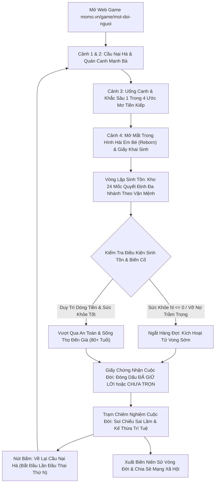

# GAME DESIGN DOCUMENT (GDD)
# WEB GAME "MỘT ĐỜI NGƯỜI" (LIFE SIMULATION & FINANCIAL SURVIVAL)

> **Mã tài liệu:** GDD-FIN-SIM-001  
> **Trạng thái:** OFFICIAL DRAFT  
> **Thể loại (Genre):** Demographic Life Simulation / Financial Survival / Roguelite Metaprogression  
> **Phân loại chiến lược:** Game Hub & Standalone Web Experience (Cầu nối Contextual Bridge sang Financial Hub)  
> **Kênh phát hành:** Web Platform (`momo.vn/game/mot-doi-nguoi`)

---

## THÔNG TIN TỔNG QUAN (METADATA)

| Hạng Mục | Chi Tiết |
| :--- | :--- |
| **Tên Trò Chơi (Game Title)** | **Web Game "Một Đời Người" (Mô phỏng Vòng đời & Quản trị Dòng tiền Sinh tồn)** |
| **Định Dạng Tài Liệu** | **Game Design Document (GDD) - Bản Đặc Tả Thiết Kế Trò Chơi Toàn Diện** |
| **Canonical Root URL** | `momo.vn/game/mot-doi-nguoi/` |
| **Đội Ngũ Phát Triển & Vận Hành** | **Game Lead & Product Strategy:** Out-App Traffic Team<br>**Lead Game Designer:** Systems & Narrative Design Team<br>**Graphics & Game Engineering:** Web Development Team & Graphics SE (Three.js / WebGL)<br>**Business Owner:** Financial Services BU (FS Team)<br>**Data & Analytics:** Web Analytics Team |
| **Vòng Lặp Cốt Lõi (Core Loop)** | Khởi sinh ngẫu nhiên ➔ Sinh tồn 16 mốc quyết định ➔ Điểm dừng cuộc đời (Sống thọ / Tử vong sớm) ➔ Trạm chiêm nghiệm dòng tiền ➔ Kế thừa bài học trí tuệ ➔ Tái thiết cuộc đời mới (Roguelite Metaprogression). |
| **Mục Tiêu Kinh Doanh** | Giáo dục tài chính cá nhân tự nhiên (Anti-upsell), tối ưu thời gian tương tác trên Website (Engagement), thúc đẩy lan truyền tự nhiên trên mạng xã hội (Viral Social Loop), định vị Kênh Web như một nguồn tài nguyên tri thức tài chính uy tín và tương tác cao. |

---

## 1. GAME OVERVIEW & DESIGN PHILOSOPHY

### 1.1 Bối Cảnh & Định Vị Sản Phẩm
Đa số các công cụ giáo dục tài chính truyền thống (Financial Literacy) thất bại vì hai lý do:
1. **Lý thuyết giáo điều:** Mang tính học thuật, thiếu tính tương tác thực tế, khiến người dùng trẻ (Gen Z, Millennials) nhanh chóng rời bỏ.
2. **Quảng cáo bán hàng thô thiển (Hard Upselling):** Đặt nút kêu gọi mở thẻ, vay tiền, mở tài khoản ngay từ những giây đầu tiên, gây mất lòng tin và làm sụt giảm uy tín thương hiệu.

Sản phẩm này tái định nghĩa trải nghiệm giáo dục tài chính trên Web Platform bằng việc chuyển hóa mô hình mô phỏng nhân khẩu học toàn cầu nổi tiếng **1 in 8 Billion (`1in8b.life`)** thành một **Trò chơi Giả lập Vòng đời & Sinh tồn Dòng tiền Thuần Web (Standalone Life & Financial Survival Simulator)**:
- Người chơi bắt đầu bằng việc rơi ngẫu nhiên vào một số phận (ngẫu nhiên tại 141 quốc gia hoặc chế độ Chuyên sâu Việt Nam: 63 tỉnh thành).
- Trải qua 100 năm cuộc đời (tương ứng 2–3 phút tương tác nhanh trên Web).
- Đưa ra các quyết định quan trọng về học vấn, công việc, chi tiêu, tích lũy, đầu tư và đối mặt với bão giá lạm phát, tai nạn, dịch bệnh và biến cố kinh tế.
- Tất cả dựa trên **dữ liệu thống kê có thật 100%** từ Liên Hợp Quốc (UN), Ngân hàng Thế giới (World Bank), Tổ chức Y tế Thế giới (WHO) và Tổng cục Thống kê Việt Nam (GSO).
- **Trải nghiệm độc lập 100% trên Web:** Không yêu cầu tải ứng dụng, không có phễu ép chuyển đổi sang App, giữ trọn vẹn giá trị nguyên bản của một công cụ mô phỏng tri thức công cộng miễn phí.

### 1.2 Hành Trình Tái Thiết Dòng Tiền & Vòng Đời Trải Nghiệm Thuần Web (Pure Web Financial Life Reset Loop)

> **Luồng Trải Nghiệm Vòng Đời:** `Hàng Dài Đầu Thai & Chén Canh Mạnh Bà (Ước Mơ Làm Lại)` ➔ `Lọt Lòng Mở Mắt Trong Hình Hài Em Bé (Reborn)` ➔ `Mô Phỏng Trải Nghiệm Sinh Tồn (Kho 24 Mốc Quyết Định)` ➔ `Điểm Dừng Cuộc Đời (Sống Thọ hoặc Tạ Thế Sớm)` ➔ `Trạm Chiêm Nghiệm & Soi Chiếu Dòng Tiền` ➔ `Tái Thiết Vận Mệnh Mới Kế Thừa Trí Tuệ`

1. **Điểm chạm Web & Mở Màn Điện Ảnh (Cinematic Hook):** Người dùng bước ngay vào không gian huyền ảo của hàng dài đầu thai bên bến luân hồi, đón nhận chén canh Mạnh Bà với ước mơ làm lại cuộc đời, sau đó bừng tỉnh mở mắt trong hình hài một đứa trẻ đỏ hỏn tại trần thế. Toàn bộ trải nghiệm hoàn toàn tự do trên trình duyệt, không cần tải ứng dụng, không quảng cáo.
2. **Khoảnh khắc Bừng tỉnh (Aha-Moment):** Nhận ra tiền mặt để yên sẽ bị lạm phát nuốt chửng; không có quỹ dự phòng sẽ vỡ nợ khi gặp biến cố; gánh nợ vì nể nang sẽ chôn vùi an toàn tài chính gia đình.
3. **Cơ Chế Tái Thiết Kế Thừa Trí Tuệ (Metaprogression Engine):** Khi kết thúc một vòng đời (do tuổi già tự nhiên hoặc tử vong sớm vì kiệt quệ tài chính / bạo bệnh), trò chơi không kết thúc vô nghĩa (Dead End). Người chơi bước vào **Trạm Chiêm Nghiệm & Soi Chiếu Dòng Tiền** để phân tích quyết định sai lầm then chốt của vòng đời vừa qua, chọn một **"Bài Học Trí Tuệ Kế Thừa" (Financial Wisdom Legacy Perk)** mang sang vòng đời tiếp theo.
4. **Giá trị Giữ chân & Lan tỏa:** Xuất bản Giấy Chứng Nhận Cuộc Đời (Life Certificate Card với 2 biến thể: Sống trọn vẹn và Tạ thế sớm) cùng Biên Niên Sử Vòng Đời (Multi-Life Chronicle) để chia sẻ mạng xã hội, thúc đẩy người chơi bấm "Bắt Đầu Cuộc Đời Mới" để chinh phục các tầng số phận cao hơn.

---

## 2. HẠ TẦNG DỮ LIỆU & BỘ THUẬT TOÁN THẾ GIỚI (DATA ENGINE & WORLD GENERATION)

### 2.1 Ma Trận Dữ Liệu Quốc Gia & Nhân Khẩu Học Toàn Cầu (Global Statistical Schema)
Hệ thống kế thừa bộ dữ liệu từ 141 quốc gia của `1in8b.life` với các tham số chuẩn hóa:

| Mã Trường | Tên Chỉ Số Dân Số Học | Nguồn Dữ Liệu Tham Chiếu | Ứng Dụng Trong Gameplay |
| :--- | :--- | :--- | :--- |
| `b` | Số ca sinh hàng năm (Annual Births) | UN World Population Prospects | Trọng số xác suất sinh ra tại quốc gia |
| `le` | Kỳ vọng sống lúc sinh (Life Expectancy) | WHO Global Health Observatory | Tính xác suất tử vong tự nhiên theo độ tuổi |
| `u5` | Tỷ lệ tử vong trẻ dưới 5 tuổi (Under-5 Mortality) | UNICEF Child Mortality Report | Xác suất vượt qua giai đoạn 0–5 tuổi |
| `ppp` | GDP bình quân theo sức mua tương đương | World Bank ICP Database | Quy đổi mức thu nhập cơ bản và sức mua |
| `gi` | Hệ số bất bình đẳng thu nhập (Gini Index) | World Bank Poverty and Inequality | Độ lệch tài sản giữa 5 tầng lớp gia đình |
| `urb` | Tỷ lệ đô thị hóa (Urban Population %) | UN World Urbanization Prospects | Xác suất sinh ra ở thành thị hay nông thôn |
| `eys` | Năm học kỳ vọng (Expected Years of Schooling) | UNDP Human Development Report | Xác suất học hết cấp 1, cấp 2, cấp 3, đại học |
| `oop` | Chi phí y tế tự chi trả (Out-of-pocket Health %) | WHO Global Health Expenditure | Số tiền mất đi khi gặp biến cố đau ốm |

### 2.2 Module Bản Địa Hóa Việt Nam (Vietnam Demographic Deep-Dive)
Người chơi có thể chọn chế độ mặc định **"Sinh ra tại Việt Nam"** để tăng độ gắn kết văn hóa:
- **Phân bổ Vùng miền & Tỉnh thành:** Hà Nội, TP. Hồ Chí Minh, Đà Nẵng, Đồng bằng Sông Hồng, Tây Nguyên, Đồng bằng Sông Cửu Long, Miền núi phía Bắc.
- **Dữ liệu thực tế GSO 2024–2026:**
  - Thu nhập bình quân đầu người theo vùng (Ví dụ: TP.HCM ~8.9 triệu/tháng, Hà Nội ~8.5 triệu/tháng, vùng nông thôn ~4.8 triệu/tháng).
  - Tỷ lệ đô thị hóa tại Việt Nam: ~42.5%.
  - Tỷ lệ học đại học: ~28.6% thanh niên trong độ tuổi.
  - Tỷ lệ người dân có khoản tích lũy dự phòng khẩn cấp: ~34.8%.

---

## 3. CƠ CHẾ GAMEPLAY CỐT LÕI & CÂN BẰNG KINH TẾ (CORE MECHANICS & ECONOMY BALANCING)

### 3.1 Bộ Chỉ Số Sống Còn (Core Attributes State `S`)

Nhân vật được định danh qua 5 nhóm chỉ số:

```typescript
interface CharacterState {
  age: number;               // Độ tuổi hiện tại (0 - 100)
  country: string;           // Mã quốc gia (VNM, USA, JPN, IND...)
  province?: string;         // Tỉnh thành (nếu ở Việt Nam)
  sex: 'M' | 'F';            // Giới tính
  urban: boolean;            // Nơi sống: Thành thị (true) / Nông thôn (false)
  quintile: 1 | 2 | 3 | 4 | 5; // Tầng lớp kinh tế gia đình (1: Nghèo nhất -> 5: Giàu nhất)
  
  // Phân loại Xuất thân Tuổi thơ & Trục Vận Mệnh
  childhoodOrigin: 'slum_worker' | 'mekong_water' | 'alley_city' | 'highland_village' | 'market_trader';
  trajectory: 'export_labor' | 'corporate_clerk' | 'merchant_trader' | 'agriculture';
  childhoodMemories: string[]; // Danh sách các mã ký ức định hình tâm lý tài chính
  
  // Bối Cảnh Gia Đình Khi Sinh Ra (Birth Context)
  parents: {
    mom: { age: number; job: string; alive: boolean };
    dad: { age: number; job: string; alive: boolean; absent: boolean };
    homeType: string;        // Loại hình nhà ở lúc mới sinh (phòng trọ, nhà tranh, căn hộ...)
  };
  birthStory: string;        // Đoạn văn tự sự mô tả khoảnh khắc chào đời
  
  // Cơ Chế Tái Thiết Kế Thừa Trí Tuệ (Metaprogression State)
  metaprogression: {
    pastLivesCount: number;         // Số vòng đời đã trải qua (0 = Vòng đời đầu tiên)
    activeWisdomPerk?: string;      // Bài học trí tuệ kích hoạt trong vòng đời này
    accumulatedWisdom: string[];    // Bộ sưu tập các bài học đã mở khóa
    multiLifeChronicle: Array<{     // Biên niên sử các vòng đời trước
      lifeIndex: number;
      birthOrigin: string;
      finalAge: number;
      isEarlyDeath: boolean;
      causeOfDeath: string;
      fatalFinancialLesson: string;
      finalNetWorth: number;
    }>;
  };
  
  // Ước Mơ Tiền Kiếp Bên Chén Canh Mạnh Bà (Karmic Vow & Seal of Destiny)
  karmicVow: {
    id: 'profit_growth' | 'emergency_buffer' | 'no_cosign_debt' | 'peaceful_aging';
    title: string;                  // Tên ước mơ đã chọn: "Tiền của tôi phải sinh lời" | ...
    isFulfilled?: boolean;          // Đã giữ lời (true: ĐÓNG DẤU "ĐÃ GIỮ LỜI") | Chưa trọn (false: "CHƯA TRỌN")
    fulfillmentDetails?: string;    // Lý do thành công hoặc thất bại cụ thể ở cuối đời
  };
  
  // Trạng Thái Nợ & Tái Cơ Cấu Dòng Tiền (Solvency & Debt State)
  debtState: {
    tenureYearsLeft: number;        // Số năm vay trả góp còn lại
    isRestructured: boolean;        // Cờ đã chuyển sang diện tái cơ cấu nợ (lãi suất ưu đãi cố định)
    consecutiveStressYears: number; // Số năm liên tiếp nợ vượt trần thu nhập
    hasIncome: boolean;             // Đã chính thức có thu nhập đi làm hay chưa
  };

  // 4 Chỉ số Sinh tồn cốt lõi (Thang điểm 0 - 100)
  hl: number;                // Sức khỏe thể chất (Health)
  h: number;                 // Hạnh phúc & Tinh thần (Happiness)
  so: number;                // Quan hệ xã hội & Gia đình (Social)
  sm: number;                // Trí tuệ & Học vấn (Smarts)

  // Chỉ số Phẩm chất & Năng khiếu Đặc thù (Tích lũy từ thời thơ ấu & Kế thừa)
  grit?: number;             // Nghị lực & Kiên cường vượt khó (0 - 100)
  arts?: number;             // Năng khiếu nghệ thuật & Sáng tạo (0 - 100)

  // Chỉ số Dòng tiền & Tài sản (VND hoặc USD PPP quy đổi)
  money: number;             // Tiền mặt khả dụng
  debt: number;              // Dư nợ chưa trả
  income: number;            // Thu nhập năm
  purchasingPower: number;   // Sức mua thực tế (Trừ hao bởi lạm phát tích lũy)
  creditScore: number;       // Điểm tín dụng giả lập (Mô phỏng CIC: 150 - 750)
  
  // Tài sản & Đầu tư
  assets: {
    emergencyFund: number;   // Quỹ khẩn cấp sinh lời (Mô phỏng Túi Thần Tài)
    budgetJars: boolean;     // Đã áp dụng phân bổ ngân sách 50/30/20 (Hũ Chi Tiêu)
    stocks: number;          // Tích sản quỹ / cổ phiếu
    realEstate: number;      // Giá trị bất động sản
    mortgageLeft: number;    // Nợ vay mua nhà còn lại
  };
}
```

### 3.2 Cơ Chế Tính Lạm Phát & Dòng Tiền Đời Sống Thực Tế (Inflation & Cashflow Engine)

Lạm phát không sử dụng các thước đo quy đổi trừu tượng làm phức tạp nhận thức người chơi, mà vận hành theo nguyên lý "Show, Don't Tell" thông qua sự leo thang chi phí sinh hoạt thực tế bằng đơn vị Việt Nam Đồng (VNĐ):
- Chi phí sinh hoạt cơ bản và các hóa đơn đời sống tự động điều chỉnh tăng dần qua từng chu kỳ 5 năm (Năm 18 tuổi: tiền ăn 1,5 triệu/tháng, tiền trọ 1,2 triệu; đến năm 35 tuổi: sinh hoạt gia đình 15 triệu/tháng; năm 50 tuổi: viện phí cấp cứu và chăm sóc sức khỏe 50 triệu).
- **Hệ quả dòng tiền:**
  - Nếu người chơi để tiền mặt nhàn rỗi nằm yên (`money` giữ nguyên trong tài khoản thanh toán): Giá trị thực tế của khoản tiền bị hao mòn trước sự tăng giá của hàng hóa và dịch vụ đời sống.
  - Nếu tiền được phân bổ vào các công cụ sinh lời hàng ngày hoặc tích sản dài hạn: Tỷ suất sinh lời bù đắp sự trượt giá, giúp gia tăng tài sản ròng bền vững.

### 3.3 Thuật Toán Quản Trị Nợ, Dư Nợ Giảm Dần & Co Giãn Vốn Mua Nhà (Solvency & Financial Engine)

Nhằm khắc phục triệt để lỗi logic nợ phình to vô hạn và phá sản sai bản chất, hệ thống tài chính tuân thủ 6 nguyên lý điều tiết dòng tiền sau:

1. **Công Thức Trả Góp Theo Dư Nợ Giảm Dần (Amortization Schedule):**
   - Khoản tiền trả nợ hàng năm không cố định mức ban đầu mà được tính toán lại sau mỗi năm:
     $$\text{Khoản trả nợ năm } t = \frac{\text{Gốc còn lại}}{\text{Kỳ hạn còn lại (năm)}} + (\text{Gốc còn lại} \times \text{Lãi suất năm})$$
   - Nhờ gốc giảm dần đều theo thời gian vay, tiền lãi các năm sau giảm tương ứng, đảm bảo người chơi có lộ trình xóa nợ dứt điểm khi thanh toán đúng hạn.

2. **Cơ Chế Khoanh Nợ & Hoãn Nợ Học Phí Cho Sinh Viên (`student_debt`):**
   - Khoản vay học phí sinh viên không bị tính là nợ quá hạn và không xét phá sản khi người chơi chưa có việc làm chính thức (`hasIncome === false`).
   - Thời gian tính lãi và yêu cầu trả nợ chỉ bắt đầu được kích hoạt từ năm nhân vật chính thức đi làm và có nguồn thu nhập đầu tiên.

3. **Cơ Chế Tự Động Thắt Lưng Buộc Bụng Khi Thâm Hụt Tiền Mặt:**
   - Khi dòng tiền khả dụng bị âm (`money < 0`), hệ thống tuyệt đối không cộng dồn phần thiếu hụt vào nợ gốc với lãi suất cao (tránh bẫy xoáy nợ).
   - Thay vào đó, người chơi tự động kích hoạt chế độ "thắt chặt chi tiêu":
     - Cắt giảm 20% chi phí sinh hoạt cá nhân (trừ `-4` điểm Hạnh phúc `h`).
     - Trích tối đa 50% thu nhập hàng năm để trả nợ.
     - Tự động giãn thêm kỳ hạn vay từ 1–3 năm để giảm áp lực dòng tiền hàng năm.

4. **Tái Cơ Cấu Nợ Sau Phá Sản (Debt Restructuring):**
   - Khi nhân vật rơi vào trạng thái mất khả năng thanh toán, hệ thống chuyển khoản nợ sang diện "Tái cơ cấu": Đóng băng lãi phạt, áp dụng mức lãi suất tái cơ cấu ưu đãi cố định 5%/năm, tạo điều kiện cho người chơi làm lại từ đầu.

5. **Độ Co Giãn Giá Mua Căn Hộ (Housing Price Elasticity):**
   - Giá căn hộ không cố định 2,4 tỷ đồng. Tại mốc quyết định mua nhà ở tuổi 31–35, giá trị căn hộ tự động co giãn theo số vốn đối ứng 30% mà người chơi tích lũy được:
     $$\text{Giá căn hộ} = \min(2.400.000.000, \max(900.000.000, \frac{\text{Vốn tích lũy}}{0,3}))$$
   - Biên độ dao động từ 900 triệu (căn hộ nhỏ / nhà ở xã hội) đến 2,4 tỷ (chung cư thương mại), đảm bảo người chơi có tích lũy đều có thể mở khóa lựa chọn an cư.

6. **Hiệu Chỉnh Trần Tài Sản Ròng Về Già:**
   - Điều chỉnh hệ số thu nhập giai đoạn 50–65 tuổi và chi phí chăm sóc sức khỏe tuổi già, đưa mức tài sản ròng trung vị của nhóm chọn toàn phương án tốt về vùng **4,2 – 5,0 tỷ VNĐ danh nghĩa** (tương đương sức mua thực tế ~1,0 – 1,3 tỷ VNĐ ở hiện giá).
   - Thẻ kết quả hiển thị minh bạch các chỉ số tài chính: Tổng tài sản ròng tích lũy (VNĐ), Dư nợ còn lại (VNĐ), và tình trạng hoàn thành Khế ước tiền kiếp.

### 3.4 Cơ Chế Xác Suất & Kích Hoạt Tử Vong Sớm (Early Death Engine)

Để khắc phục việc ép sống thọ đến 81–100 tuổi, hệ thống xây dựng mô hình tử vong sớm dựa trên nguyên nhân tài chính và sức khỏe thực tế:

1. **Công Thức Kích Hoạt Tử Vong Sớm:**
   - **Trường hợp 1 (Đột quỵ vì kiệt sức gánh nợ - `debt_exhaustion`):** Nếu tỷ lệ nợ trên thu nhập $\frac{\text{debt}}{\text{income}} > 1.0$ kéo dài liên tiếp $\ge 3$ năm, nhân vật bị trừ $-15$ điểm Sức khỏe (`hl`) mỗi năm do stress và làm việc quá sức. Khi chỉ số $\text{hl} \le 0$, kích hoạt đột quỵ/tử vong sớm ở độ tuổi 35–45 (ví dụ: mất năm 38 tuổi vì kiệt sức gánh nợ bảo lãnh người thân).
   - **Trường hợp 2 (Bạo bệnh không có quỹ phòng thân - `medical_emergency_death`):** Tại mốc biến cố y tế (`ills`), nếu chi phí điều trị vượt quá tổng tiền mặt và Quỹ khẩn cấp (`money + emergencyFund`), đồng thời trần nợ CIC chạm ngưỡng không thể vay tiếp, chỉ số $\text{hl}$ rơi thẳng về $0$, kích hoạt tử vong sớm ở độ tuổi 50–60 (ví dụ: mất năm 52 tuổi do bạo bệnh sau khi vỡ nợ hụi).

2. **Cơ Chế Ngắt Hàng Đợi Sự Kiện (Queue Interruption):**
   - Khi điều kiện tử vong sớm thỏa mãn, hệ thống thực thi hàm `triggerEarlyDeath(age, cause)`:
     - Lập tức ngắt toàn bộ các sự kiện còn lại trong hàng đợi `S.queue`.
     - Bỏ qua toàn bộ các mốc tuổi tiếp theo.
     - Chuyển hướng người chơi trực tiếp sang **Giấy Chứng Nhận Cuộc Đời (Biến Thể Tạ Thế Sớm)** và tiếp tục dẫn vào **Trạm Chiêm Nghiệm Cuộc Đời**.

### 3.5 Cảnh Mở Màn Điện Ảnh: Cầu Nại Hà, Quán Canh Mạnh Bà & Ước Mơ Tiền Kiếp (The Reincarnation Prologue & Karmic Vow)

Trò chơi khởi đầu bằng trường đoạn điện ảnh tiền kiếp (Prologue Cinematic) 4 cảnh giàu hình tượng và xúc cảm, gắn liền với cơ chế **Ước Mơ Tiền Kiếp (The Karmic Vow)** định hình mục tiêu sinh tồn xuyên suốt vòng đời:

#### 3.5.1 Kịch Bản 4 Cảnh Mở Màn Chi Tiết

##### Cảnh 1: Cầu Nại Hà, Canh Ba
- **Không gian & Thị giác:** Đêm chàm tím huyền ảo, làn sương mỏng trôi lờ lững trên mặt nước sâu không đáy. Những đốm lửa ma trơi nhỏ bay là là lên không trung, rặng đèn lồng đỏ chập chờn lay động trong gió lạnh.
- **Nhân vật:** Một hàng dài những linh hồn lặng lẽ nối đuôi nhau bước qua cầu đá cổ. Linh hồn của người chơi phát sáng mờ ảo và được gắn nhãn định danh màu vàng ấm: **“Bạn”**.
- **Tương tác nút bấm:** Nút bấm nổi bật giữa màn hình: **“Bước lên phía trước”**.

##### Cảnh 2: Quán Canh Mạnh Bà
- **Không gian & Nhân vật:** Đi hết nhịp cầu, hiện ra một mái quán tranh cổ kính với tấm biển gỗ treo dọc khắc 4 chữ thư pháp: **“Canh Mạnh Bà”**. Một bà cụ già tóc bạc phơ, gương mặt hiền từ cầm chiếc muôi gỗ múc từng muôi canh từ chiếc nồi đồng màu xanh ngọc bích đang bốc khói mỏng nghi ngút.
- **Lời thoại dẫn dắt:**
  > *“Uống đi con. Uống rồi quên hết, mà đi cho nhẹ.”*
- **Tương tác nút bấm:** Nút bấm trung tâm: **“Đỡ lấy chén canh”**.

##### Cảnh 3: Uống Canh & Khắc Sâu Ước Mơ
- **Thị giác & Dẫn nhập:** Màn hình chuyển góc nhìn cận cảnh chén canh men sành sóng sánh dòng nước trong hai bàn tay bạn. Dòng chữ tự sự hiện lên mờ ảo:
  > *“Ký ức kiếp trước tan dần như sương… Chỉ còn một ước mơ bám lại.”*
- **Tương tác lựa chọn:** Người chơi chọn 1 trong 4 Ước Mơ Tiền Kiếp để mang theo vào vòng đời mới:
  1. *“Tiền của tôi phải sinh lời”*
  2. *“Tôi phải có quỹ phòng thân”*
  3. *“Tôi không gánh nợ vì nể nang”*
  4. *“Tôi muốn già đi trong an yên”*
- **Hiệu ứng chuyển cảnh:** Ngay khi người chơi nhấp chọn ước mơ, chén canh tự động nghiêng dần như đang được uống cạn vào lòng rồi biến mất vào khoảng không mờ sương.

##### Cảnh 4: Mở Mắt & Cất Tiếng Khóc Chào Đời (Reborn)
- **Hiệu ứng thị giác:** Màn hình lóa sáng trắng toàn phần (Whiteout Flash), sau đó hai vệt mí mắt đen khép hờ chớp chớp 2 lần rồi từ từ hé mở. Tầm nhìn mờ nhòe của trẻ sơ sinh chuyển dần sang rõ nét.
- **Âm thanh & Dòng chữ:** Hình ảnh em bé sơ sinh hiện ra trong góc nhìn thứ nhất cùng dòng thông báo ấm áp:
  > *“Bạn mở mắt ra lần đầu tiên… tại [nơi sinh]”*
- **Tương tác nút bấm:** Nút bấm cảm xúc: **“Cất tiếng khóc chào đời”** ➔ Lập tức lật mở **Thẻ Giấy Khai Sinh Đầu Đời**.

---

#### 3.5.2 Cơ Chế Ước Mơ Tiền Kiếp: Con Dấu "ĐÃ GIỮ LỜI" & "CHƯA TRỌN"

Ước mơ được chọn bên chén canh Mạnh Bà **không phải dòng chữ trang trí đơn thuần**, mà là **Khế Ước Tiền Kiếp (Karmic Contract)** chi phối toàn bộ logic đánh giá khi vòng đời khép lại:

- **Cơ chế đánh giá cuối đời:** Khi nhân vật kết thúc vòng đời (sống thọ đến già hoặc tử vong sớm), hệ thống kiểm tra toàn bộ nhật ký tài chính và đóng con dấu tròn mực đỏ nổi bật lên **Giấy Chứng Nhận Cuộc Đời**:
  - Dấu **“ĐÃ GIỮ LỜI”**: Người chơi đã kiên định sống đúng với lời hứa tiền kiếp.
  - Dấu **“CHƯA TRỌN”**: Người chơi lại một lần nữa để dòng đời xô đẩy và thất hứa với chính mình.

| Ước Mơ Tiền Kiếp | Được Tính Là Giữ Lời (Đóng Dấu "ĐÃ GIỮ LỜI") | Bị Tính Là Chưa Trọn (Đóng Dấu "CHƯA TRỌN") | Ý Nghĩa Giáo Dục Tài Chính |
| :--- | :--- | :--- | :--- |
| **Tiền của tôi phải sinh lời** | Không để tiền nằm yên: Luôn phân bổ dòng tiền vào các tài sản sinh lời (Quỹ khẩn cấp sinh lời, Hũ chi tiêu, Quỹ đầu tư tích sản), sức mua thực tế (`purchasingPower`) không bị lạm phát bào mòn quá 30% tại bất kỳ thời điểm nào. | Để tiền mặt nhàn rỗi nằm yên trong tài khoản thanh toán trên 70% tổng tài sản liên tục 10 năm hoặc bị lạm phát ăn mòn trên 40% sức mua. | Rèn luyện phản xạ tích sản, không để tiền mặt bốc hơi trước trượt giá. |
| **Tôi phải có quỹ phòng thân** | Trả được toàn bộ viện phí cấp cứu năm 50 tuổi bằng Quỹ dự phòng khẩn cấp tích lũy mà không phải bán tháo tài sản gia đình, không phải vay nóng, không nợ viện phí. | Đến mốc tai biến sức khỏe tuổi 50 không có đủ tiền dự phòng, phải bán tháo xe/nhà hoặc vay nóng nợ nần để chạy chữa. | Biến việc lập quỹ dự phòng khẩn cấp thành chiếc khiên bảo vệ sống còn. |
| **Tôi không gánh nợ vì nể nang** | Tuyệt đối không ký giấy bảo lãnh vay nợ hộ người thân, không lạm dụng nợ tiêu dùng trả góp, chưa từng rơi vào tình trạng vỡ nợ hoặc phá sản. | Ký bảo lãnh vay nợ hộ người thân hoặc để nợ thẻ tín dụng vượt trần dẫn đến rơi vào cảnh bị siết nợ / phá sản. | Tách bạch ranh giới cảm xúc nể nang và kỷ luật an toàn tài chính. |
| **Tôi muốn già đi trong an yên** | Chỉ số Hạnh phúc (`h`) duy trì từ 50 trở lên ở mốc cuối đời và chưa từng rơi vào cảnh phá sản / nợ xấu CIC trong suốt vòng đời. | Chỉ số Hạnh phúc cuối đời dưới 50 hoặc từng bị phá sản, nợ nần kiệt quệ làm đảo lộn cuộc sống. | Đạt được sự an tâm và tự do tài chính đích thực ở tuổi xế chiều. |

---

#### 3.5.3 Vòng Lặp Về Lại Cầu Nại Hà (The Return Loop)

Tại màn hình cuối đời (Giấy Chứng Nhận Cuộc Đời hoặc Trạm Chiêm Nghiệm), nút hành động kết thúc được chuẩn hóa thành:

> **Nút bấm chính:** **“Về lại cầu Nại Hà”**

- **Hành vi chuyển cảnh:** Khi người chơi nhấp nút, màn hình chuyển sang làn sương chàm tím quen thuộc, đưa người chơi quay trở lại Cảnh 1 (Cầu Nại Hà, canh ba) với nhãn tiến trình cập nhật:
  > **“Lần đầu thai thứ [N]”** *(Ví dụ: Lần đầu thai thứ 2, Lần đầu thai thứ 3...)*
- Linh hồn của bạn lại tiếp tục phát sáng với nhãn **“Bạn”** và nút **“Bước lên phía trước”**, cho phép người chơi tiếp tục chọn một ước mơ mới hoặc kiên trì hoàn thành ước mơ còn dở dang ở kiếp trước.

---

#### 3.5.4 Bảng Cấu Trúc Dữ Liệu Thẻ Giấy Khai Sinh (Birth Certificate Schema)

| Hạng Mục Khai Sinh | Cơ Chế Sinh Dữ Liệu Ngẫu Nhiên | Ví Dụ Hiển Thị Thực Tế |
| :--- | :--- | :--- |
| **Tên & Giới Tính** | Sinh ngẫu nhiên theo Dynamic Naming Engine đa tầng (Mục 3.6). | Nguyễn Văn Hưng (Biệt danh: Cún) - Nam / Lê Thị Mai (Biệt danh: Bống) - Nữ |
| **Nơi Sinh Ra** | Tỉnh thành, địa danh cụ thể và phân loại thành thị / nông thôn. | Xã Ba Tri, Bến Tre (Nông thôn ven biển) / Phường An Phú, Thuận An, Bình Dương (Xóm trọ đô thị) |
| **Độ Tuổi Của Cha Mẹ** | Dựa trên độ tuổi kết hôn và sinh con trung bình tại địa phương (Mẹ: 19–38 tuổi, Bố: 21–45 tuổi, có xác suất mẹ đơn thân). | Mẹ 23 tuổi · Bố 26 tuổi (hoặc: Mẹ đơn thân 21 tuổi) |
| **Nghề Nghiệp Cha Mẹ** | Bốc ngẫu nhiên từ kho nghề nghiệp phù hợp với vùng miền và tầng lớp thu nhập. | Mẹ: Công nhân may xưởng gia giày · Bố: Thợ hàn xì công trình (hoặc: Mẹ: Làm nông cấy lúa · Bố: Đi biển đánh cá xa bờ) |
| **Nhà Ở Ban Đầu** | Loại hình nhà gắn liền với bối cảnh kinh tế gia đình lúc mới sinh. | Phòng trọ thuê 12m2 lợp tôn xi-măng / Nhà cấp 4 ba gian lợp ngói cũ / Căn hộ tập thể tầng 3 |
| **Tầng Lớp Kinh Tế** | 5 chấm tròn đồ họa (`qdots`) đại diện cho 5 phân vị thu nhập (Quintiles) từ nghèo nhất đến giàu nhất. | Phân vị 1/5 (Thuộc nhóm 20% hộ gia đình thu nhập thấp nhất khu vực) |
| **Đoạn Văn Mở Màn (`birthStory`)** | Đoạn tự sự ngắn mô tả khoảnh khắc lọt lòng, khơi gợi xúc cảm về tình mẫu tử và hoàn cảnh chào đời. | *"Bạn cất tiếng khóc chào đời vào một chiều mưa giông tháng Bảy tại trạm xá xã. Tiếng quạt trần quay kẽo kẹt trên trần vôi nứt, mẹ ôm bạn vào lòng trong chiếc chăn chiên cũ mà giọt nước mắt rưng rưng..."* |
| **Chỉ Số Thống Kê Bối Cảnh** | Dữ liệu thật từ GSO/WHO tại thời điểm chào đời: Kỳ vọng sống, tỷ lệ tử vong trẻ em, thu nhập bình quân vùng. | Kỳ vọng sống: 73.8 tuổi · Xác suất tử vong dưới 5 tuổi: 1.8% · Thu nhập bình quân đầu người vùng: 4.8 triệu/tháng |

### 3.6 Hệ Thống Sinh Danh Tính & Tên Gọi Đa Tầng Theo Vùng Miền (Dynamic Naming Engine)

Nhằm xóa bỏ sự lặp lại đơn điệu khi người chơi tái sinh nhiều kiếp, hệ thống tích hợp thuật toán sinh danh tính ngẫu nhiên đa tầng dựa trên tọa độ sinh ra, phản ánh văn hóa, thổ nhưỡng và tâm lý gửi gắm ước mơ của cha mẹ thời kỳ đó:

- **Cấu trúc danh tính hoàn chỉnh:** `Họ` + `Tên đệm` + `Tên chính` + `Tên gọi thân mật thuở nhỏ (Nickname)`.
- **Ma trận 5 nhóm văn hóa danh tính đặc trưng:**

| Nhóm Văn Hóa & Địa Bàn | Họ Phổ Biến | Tên Đệm & Tên Nam | Tên Đệm & Tên Nữ | Tên Gọi Thuở Nhỏ (Nickname) | Ý Niệm Đặt Tên Của Cha Mẹ |
| :--- | :--- | :--- | :--- | :--- | :--- |
| **Miền Bắc & Đồng Bằng Sông Hồng**<br>(Hà Nội, Hải Phòng, Nam Định, Thái Bình...) | Nguyễn, Trần, Vũ, Đỗ, Hoàng, Bùi, Ngô, Phạm | Văn Hưng, Đức Long, Minh Phong, Quốc Tuấn, Đình Trọng, Thành Nam | Thị Mai, Thu Trang, Ngọc Linh, Thùy Dung, Phương Thảo, Ánh Tuyết | Cún, Tí, Bống, Thóc, Mít, Tũn | Coi trọng học vấn, gia phong, đỗ đạt thành tài; tên ở nhà mộc mạc để dễ nuôi tránh đau ốm. |
| **Miền Trung & Duyên Hải**<br>(Thừa Thiên Huế, Quảng Nam, Quảng Ngãi, Bình Định...) | Phan, Huỳnh, Võ, Tôn Nữ, Bạch, Đoàn, Đặng, Lê | Hữu Nghĩa, Trọng Hiếu, Thanh Bình, Tấn Dũng, Công Danh, Văn kiệt | Như Thảo, Thục Trinh, Hoài An, Tôn Nữ Diệu Tâm, Mỹ Lệ, Thanh Hằng | Cu, Tèo, Hến, Mót, Bắp, Cá | Gửi gắm đạo hiếu, chữ nghĩa, sự nhẫn nại và đức kiên cường trước bão gió khắc nghiệt. |
| **Miền Nam & Sông Nước Tây Nam Bộ**<br>(TP.HCM, Cần Thơ, Bến Tre, Đồng Tháp, An Giang...) | Huỳnh, Trương, Lâm, Diệp, Thạch, Danh, Nguyễn, Võ | Tấn Phát, Tấn Đạt, Hữu Lộc, Minh Vương, Hoài Thanh, Thanh Sang | Kim Cương, Ngọc Giàu, Mỹ Hạnh, Cẩm Tiền, Thúy Kiều, Bé Ba | Út, Hai, Tủn, Bầu, Bo, Tí Nị | Khát vọng đổi đời no ấm, sung túc tiền tài; tên ở nhà mộc mạc gắn liền với thứ bậc trong gia đình. |
| **Vùng Cao Tây Bắc & Tây Nguyên**<br>(Hà Giang, Sơn La, Đắk Lắk, Gia Lai, Kon Tum...) | Giàng, Thào, Vàng, Sùng, Nông, Lò, K'sor, Rơ Chăm, Y, H' | Giàng A Páo, Thào A Dơ, Vàng A Chá, Y Jut, K'Brơi, Nông Văn Thắng | Thào Thị Mỷ, Giàng Thị Sinh, H'Nhi, H'Dung, Lò Thị Hoa, Nông Thị Mơ | Páo, Mỷ, Blô, Suối, Rẫy, Gió | Hòa quyện với thiên nhiên đại ngàn, gửi gắm sức khỏe dẻo dai, bền bỉ như rễ cây lim cây sến. |
| **Đô Thị Hoa Kiều & Giao Thương**<br>(Chợ Lớn TP.HCM, Phố Cổ Hội An...) | Quách, Trần, Lý, Lâm, Lương, Tăng, Tạ, Mã | Chí Cường, Gia Hưng, Vĩnh Kiệt, Chấn Hưng, Tuấn Vĩ, Hữu Tài | Kim Huệ, Ái Linh, Gia Hân, Ngọc Bích, Tú Quyên, Lệ Hoa | A Mẫn, A Hào, A Muội, Bé Ba, Cậu Năm | Khát vọng kinh doanh phát đạt, giữ chữ tín buôn bán và hưng thịnh danh gia vọng tộc. |

---

## 4. THIẾT KẾ NỘI DUNG, KỊCH BẢN & MA TRẬN QUYẾT ĐỊNH (NARRATIVE DESIGN & SCENARIOS)

Hệ thống kịch bản chia làm 6 giai đoạn cuộc đời với các bộ câu hỏi tình huống (Quizzes) và dữ liệu thực chứng (Facts).

### 4.1 Giai Đoạn 1: Sơ Sinh & Tuổi Thơ (0 – 12 Tuổi) - Điểm Tựa Ký Ức & Cội Nguồn Tâm Lý Tài Chính

Giai đoạn 0–12 tuổi được thiết kế như chiếc neo cảm xúc (Emotional Anchor) của toàn bộ trò chơi. Khi bắt đầu hoặc chơi lại, hệ thống không chạy một kịch bản đơn điệu mà ngẫu nhiên phân bổ nhân vật vào **1 trong 5 Bối Cảnh Xuất Thân Tuổi Thơ** kết hợp cùng **Ma Trận Biến Cố Đầu Đời**, định hình "Vết Hằn Ký Ức" chi phối hành vi tài chính khi trưởng thành.

#### 4.1.1 Bảng 5 Bối Cảnh Xuất Thân Tuổi Thơ Điển Hình (Childhood Origins)

| Mã Xuất Thân | Không Gian & Giác Quan Tuổi Thơ | Vết Hằn Ký Ức Đầu Đời Về Tiền Bạc |
| :--- | :--- | :--- |
| `slum_worker`<br>**Xóm Trọ Công Nhân** | Phòng trọ 12m2 ven khu công nghiệp (Bình Dương / Đồng Nai). Tiếng xe container gầm rú đêm ngày, mùi cơm hộp mang về sau ca tăng ca, tiếng quạt con cóc kêu lạch cạch. Bạn tự chơi một mình vì bố mẹ xoay ca kíp liên tục. | Ám ảnh sự cô đơn; sớm hiểu rằng "thời gian của bố mẹ bị đổi lấy từng đồng tiền tăng ca". Khi lớn lên có xu hướng khao khát kiếm tiền nhanh để bù đắp tình cảm gia đình. |
| `mekong_water`<br>**Sông Nước Miền Tây** | Nhà sàn ven kênh rạch mùa nước nổi (Đồng Tháp / An Giang). Tiếng sóng vỗ mạn thuyền, mùi phù sa nồng đượm, những buổi trưa cùng anh em chèo xuồng hái bông điên điển, giăng lưới bắt cá linh. | Tâm lý hào sảng, phóng khoáng nhưng ít tính phòng thủ; bài học đầu đời là sự bấp bênh của mùa vụ và con nước có thể cuốn trôi công sức cả năm sau một đêm bão. |
| `alley_city`<br>**Ngõ Nhỏ Phố Thị** | Căn nhà tập thể cũ hoặc ngõ sâu (Hà Nội / TP.HCM). Tiếng rao bánh khúc đêm đông, tiếng chổi tre quét đường, mùi sách báo cũ, quán nét đầu ngõ với những đứa bạn tụ tập chơi game thùng. | Sớm nhận thức sự phân hóa giàu nghèo khi so sánh với bạn bè cùng lớp đi học bằng xe hơi; áp lực điểm số và kỳ vọng gia đình đè nặng lên vai từ lớp 1. |
| `highland_village`<br>**Bản Làng Vùng Cao** | Mái nhà gỗ cheo leo sườn núi (Hà Giang / Sơn La / Kon Tum). Bếp củi đỏ lửa xua tan giá rét mùa đông, đôi chân trần nứt nẻ đi bộ 5 cây số đường đèo đến điểm trường, tiếng suối reo giữa đại ngàn. | Nghị lực sinh tồn phi thường (`grit` cao); đồng tiền cực kỳ hiếm hoi và thiêng liêng, chủ yếu sống tự cung tự cấp. Giấc mơ lớn nhất là có đủ cơm trắng ăn no quanh năm. |
| `market_trader`<br>**Con Nhà Tiểu Thương** | Gầm sạp vải, sạp cá ở chợ đầu mối truyền thống. Tiếng mặc cả ồn ào từ 4 giờ sáng, mùi tanh nồng của chợ sớm, tiếng đếm tiền lẻ sột soạt, bữa cơm ăn vội trên thùng carton đựng hàng. | Biết thối tiền cho khách từ năm 7 tuổi, nhạy bén với giá cả và cơ hội; sớm chứng kiến sự khắc nghiệt của nợ nần, giật hụi và sự phập phồng của buôn bán mùa Tết. |

#### 4.1.2 Ma Trận Kịch Bản & Các Lựa Chọn Tuổi Thơ Đa Chiều (0 – 12 Tuổi)

##### Mốc 1 (3 – 4 Tuổi): Tiếng Gọi Đầu Đời & Người Nuôi Dưỡng
- **Tình huống 1.1A (Xóm Trọ Công Nhân):** Bố mẹ đi làm ca đêm, gửi bạn cho bà chủ nhà trọ trông cùng 4 đứa trẻ khác. Bạn bập bẹ gọi tên "mẹ" khi nhìn thấy bóng người phụ nữ mặc áo công nhân bước qua cửa sổ phòng trọ lợp tôn xi-măng.
  - *Lựa chọn 1:* Chạy ùa ra cửa ôm chầm lấy chân mẹ -> Tăng Hạnh phúc (`h` +4), khắc sâu nỗi sợ chia xa (`memory: 'cling_mom'`).
  - *Lựa chọn 2:* Ngoan ngoãn ngồi im chia đồ chơi cho bạn nhỏ khác -> Tăng Xã hội (`so` +3), rèn tính tự lập sớm.
- **Tình huống 1.1B (Vùng Quê Sống Cùng Ông Bà):** Bố mẹ đi làm ăn xa ở miền Nam, bạn lớn lên bằng những câu chuyện cổ tích của bà ngoại và chiếc cối giã trầu. Bố mẹ gọi điện thoại bàn về nhà dịp Tết, bạn ngập ngừng không nhận ra giọng bố mẹ.
  - *Lựa chọn 1:* Lúng túng nép sau lưng bà ngoại không dám nghe máy -> Khắc sâu khoảng cách xa xứ (`memory: 'absent_parents'`).
  - *Lựa chọn 2:* Cầm lấy ống nghe bi bô kể chuyện đàn gà ở quê -> Tăng Tình cảm gia đình (`so` +4).
- **Tình huống 1.1C (Bản Làng Vùng Cao):** Mùa đông rét buốt, bạn ngồi bên bếp củi nhặt than hồng sưởi ấm bàn tay nứt nẻ. Bố mẹ đi nương rẫy từ sáng sớm chưa về.
  - *Lựa chọn 1:* Tự mình nhóm thêm củi khô giữ lửa chờ bố mẹ -> Tăng Kiên cường (`grit` +2), (`hl` +2).
  - *Lựa chọn 2:* Khóc nức nở cho đến khi ngủ thiếp đi bên vách nứa -> Giảm Thể lực (`hl` -3).
- **Tình huống 1.1D (Gầm Sạp Chợ Đầu Mối):** Mẹ vừa bế bạn vừa thoăn thoắt xếp từng bao vải, cân từng rổ cá cho khách. Chiếc nôi làm bằng thùng carton lót chăn bông cũ đặt ngay dưới gầm sạp chợ.
  - *Lựa chọn 1:* Nằm ngoan ngủ say sưa giữa tiếng mặc cả ồn ào -> Tăng Khả năng thích nghi môi trường (`grit` +2).
  - *Lựa chọn 2:* Khóc quấy đòi mẹ ẵm bồng -> Mẹ phải bỏ dở phiên buôn để vỗ về (`so` +3, `memory: 'market_cradle'`).

##### Mốc 2 (6 – 7 Tuổi): Ngưỡng Cửa Lớp 1, Tết Nguyên Đán & Đồng Tiền Đầu Đời
- **Tình huống 1.2A (Tiền Thối Mua Nước Mắm - Đứa trẻ xóm chợ / phố thị):** Mẹ đưa 20.000 đồng sai đi mua chai nước tương, thừa 3.000 đồng tiền thối. Trên đường về, bạn đi ngang qua quầy kẹo kéo ngọt lịm.
  - *Lựa chọn 1:* Mua que kẹo ăn vụng và nói dối mẹ là tiệm tạp hóa tăng giá -> Tăng Hạnh phúc tức thời (`h` +3), gieo mầm thói quen giấu giếm chi tiêu (`memory: 'secret_spending'`).
  - *Lựa chọn 2:* Đưa đủ tiền thối cho mẹ. Mẹ xoa đầu khen ngoan và thưởng 1.000 đồng bỏ vào ống heo đất -> Hình thành thói quen minh bạch tài chính (`memory: 'piggy_bank'`), tăng Gắn kết (`so` +4).
- **Tình huống 1.2B (Đôi Dép Tổ Ong Đứt Quai - Đứa trẻ vùng cao / nông thôn):** Đôi dép nhựa duy nhất bị đứt quai trước ngày khai giảng lớp 1.
  - *Lựa chọn 1:* Tự lấy dây kẽm hơ lửa xiên lại quai dép đi tiếp, cắn răng chịu đau khi đi đường đá dăm -> Tăng Nghị lực (`grit` +3), khắc sâu ký ức thiếu thốn (`memory: 'wire_slippers'`).
  - *Lựa chọn 2:* Khóc đòi bố mua đôi dép mới. Bố lặng lẽ gật đầu, nhưng trưa hôm đó bạn thấy bố nhịn bữa ăn sáng để dành tiền ra chợ huyện mua dép cho bạn -> Tăng Nhận thức hy sinh (`so` +5), (`memory: 'dad_sacrifice'`).
- **Tình huống 1.2C (Bao Lì Xì Ngày Tết & Câu Nói "Để Mẹ Giữ Giùm"):** Sáng mùng 1 Tết, bạn diện bộ quần áo mới hiếm hoi, đếm đi đếm lại từng tờ tiền mừng tuổi đỏ chót được 50.000 đồng trong phong bao. Mẹ mỉm cười xoa đầu: *"Đưa mẹ cất giùm vào tủ khóa lại, để dành sau này lớn mẹ trả mua xe đạp đi học"*.
  - *Lựa chọn 1:* Ngoan ngoãn đưa hết tiền mừng tuổi cho mẹ giữ -> Tăng Gắn kết gia đình (`so` +4), hình thành niềm tin chia sẻ tài chính với mẹ (`memory: 'mom_keeps_lixi'`).
  - *Lựa chọn 2:* Lén giữ lại 10.000 đồng nhét vào đáy ống bơ giấu dưới gậm giường -> Ý thức sở hữu tài sản cá nhân đầu đời (`money` +10k), bắt đầu có khoản tích lũy bí mật (`memory: 'secret_piggy'`).
- **Tình huống 1.2D (Buổi Trưa Hè Đi Nhặt Ve Chai & Tiếng Chuông Kem Mút):** Trưa hè nắng gắt trốn ngủ trưa, bạn rủ đứa em gái đi nhặt vỏ lon bia và gom giấy vụn bán cho bà đồng nát được 5.000 đồng. Đi ngang qua xe kem mút dạo leng keng tiếng chuông mời gọi.
  - *Lựa chọn 1:* Mua hai que kem mút mát lạnh chia cho em gái đang mồ hôi nhễ nhại -> Tăng Hạnh phúc tuổi thơ (`h` +5), thấu hiểu niềm vui sẻ chia (`memory: 'ice_cream_sharing'`).
  - *Lựa chọn 2:* Bỏ 5.000 đồng vào hộp bánh quy gỉ sét để dành tiền mua cuốn truyện tranh Doraemon -> Tăng Kiên trì tích lũy (`grit` +2), rèn tính trì hoãn sự sung sướng (`memory: 'comic_savings'`).
- **Dữ liệu thực tế đi kèm (Fact):** Khảo sát hành vi tài chính của Đại học Cambridge chỉ ra rằng các thói quen cốt lõi về tiền bạc (trì hoãn sự sung sướng, tiết kiệm, chia sẻ) được định hình vững chắc trong não bộ của trẻ trước năm 7 tuổi.

##### Mốc 3 (9 – 10 Tuổi): Va Vấp Tài Chính & Thử Thách Vùng Miền
- **Tình huống 1.3A (Giấy Báo Thu Tiền Đầu Năm & Nỗi Xấu Hổ Trước Bạn Bè):** Giờ sinh hoạt lớp, cô giáo gõ thước lên bảng, đọc tên những bạn chưa nộp tiền học phí và tiền sách vở đầu năm, yêu cầu đứng lên trước lớp. Bạn cúi gằm mặt xuống ngăn bàn, hai tai đỏ bừng vì xấu hổ khi bạn bè cùng lớp quay lại nhìn.
  - *Lựa chọn 1:* Về nhà giấu nhẹm giấy báo vì sợ bố mẹ thêm lo, tự đi lượm ve chai và mò cua bắt ốc gom từng đồng tiền lẻ nộp bổ sung -> Tăng Tự lập sớm, gánh nặng tâm lý tuổi thơ (`h` -5), hình thành nỗi ám ảnh sợ nợ nần (`memory: 'debt_shame'`).
  - *Lựa chọn 2:* Đưa giấy báo cho mẹ. Nhìn thấy giọt nước mắt lăn trên gò má sạm đen của mẹ khi lục tìm từng tờ tiền lẻ dưới đáy hòm gỗ -> Tăng Thấu hiểu đức hy sinh của cha mẹ (`so` +5), (`memory: 'mom_tears'`).
- **Tình huống 1.3B (Đêm Mưa Bão Tốc Mái - Đứa trẻ miền Trung ven biển):** Cơn bão quét qua trong đêm, gió rít từng hồi làm bung một mảng mái tôn. Nước mưa xối xả ướt sũng sách vở và góc học tập. Cả nhà co ro trong góc tường khô ráo duy nhất.
  - *Lựa chọn 1:* Ôm chặt lấy mẹ khóc trong sợ hãi -> Tăng Gắn kết gia đình (`so` +3).
  - *Lựa chọn 2:* Giúp bố kê bao cát chèn mái tôn và che chắn đàn gà ngoài sân -> Tăng Kiên cường (`grit` +3), thấu hiểu sự mong manh của tài sản trước thiên tai (`memory: 'storm_roof'`).
- **Tình huống 1.3C (Miền Tây Mùa Nước Nổi - Chiếc Xuồng Ba Lá Cùng Cha Dỡ Chà):** Con nước đỏ quạch phù sa tràn bờ đê. Bạn cùng cha chèo chiếc xuồng ba lá len lỏi rừng tràm dỡ chà kéo lưới bắt cá linh và hái bông điên điển vàng rực. Năm nay cá ít, cha ngồi đầu mũi xuồng rít điếu thuốc rê, lo lắng tiền phân bón cho vụ mùa đông xuân tới.
  - *Lựa chọn 1:* Cặm cụi cùng cha gỡ từng con cá nhỏ đem ra chợ bán sớm -> Tăng Kiên cường (`grit` +3), thấu hiểu nỗi vất vả mưu sinh thuận theo con nước (`memory: 'river_living'`).
  - *Lựa chọn 2:* Xin cha cho ở nhà ôn bài chuẩn bị kỳ thi học sinh giỏi trường -> Tăng Trí tuệ (`sm` +3), khát khao dùng con chữ thoát nghèo.
- **Tình huống 1.3D (Tây Bắc Sương Muối - Cặp Lồng Cơm Độn Ngô Vượt Đèo):** Sương muối giăng trắng xóa những vách đá tai mèo, gió mùa đông bắc buốt giá. Bạn thức dậy từ 5 giờ sáng, ôm cặp lồng cơm nguội độn ngô xay với nhúm muối ớt, đi bộ 6 cây số đường đèo dốc trơn trượt đến điểm trường.
  - *Lựa chọn 1:* Cắn răng vượt đèo đến lớp, ngồi sưởi ấm đôi bàn tay nứt nẻ bên bếp than của thầy cô -> Tăng Nghị lực phi thường (`grit` +4), gieo ý chí vươn lên bằng con chữ (`memory: 'mountain_will'`).
  - *Lựa chọn 2:* Quay về giúp bố mẹ cắt cỏ cho trâu và gùi củi khô -> Giữ gìn thể lực trước giá rét (`hl` +2), gắn bó với ruộng nương.

##### Mốc 4 (11 – 12 Tuổi): Sự Đánh Đổi Giữa Ước Mơ & Cơm Áo Gạo Tiền
- **Tình huống 1.4A (Chiếc Đàn Ghi-ta / Hộp Màu Vẽ Năng Khiếu):** Thầy giáo phát hiện bạn có năng khiếu âm nhạc/hội họa nổi bật và khuyên gia đình cho theo học lớp năng khiếu ở thị xã. Chi phí một khóa học bằng tiền mua cả tạ gạo của cả nhà trong 3 tháng.
  - *Lựa chọn 1:* Tự cất lời khen của thầy vào ngăn kéo, nói với bố mẹ "con không thích học" để gia đình đỡ tốn tiền -> Hy sinh đam mê vì sinh kế (`memory: 'buried_dream'`), tăng Trưởng thành thực tế.
  - *Lựa chọn 2:* Bố mẹ quyết định thắt lưng buộc bụng cho đi học, bố nhận thêm việc bốc vác đêm để trang trải -> Mở khóa nhánh tài năng (`arts` +5), nhưng chịu áp lực kỳ vọng nặng nề (`memory: 'heavy_hope'`).
- **Tình huống 1.4B (Tấm Giấy Khen Trên Vách Nứa):** Bạn đạt giải học sinh giỏi toàn huyện. Phần thưởng là 5 cuốn vở ô ly và một chiếc bút máy. Bố cẩn thận lấy đinh đóng tấm giấy khen lên vách nứa đơn sơ. Mâm cơm tối hôm đó có thêm đĩa trứng rán ăn mừng — bữa cơm ngon nhất trong năm.
  - *Lựa chọn 1:* Hứa với bố mẹ sẽ đỗ đại học để đổi đời -> Tăng Trí tuệ (`sm` +4), gieo mầm khát vọng vươn lên (`memory: 'certificate_pride'`).
  - *Lựa chọn 2:* Đề nghị nghỉ học sớm để đi làm phụ bố mẹ -> Mở ra nhánh lao động sớm, tăng Gắn kết gia đình (`so` +4).
- **Tình huống 1.4C (Gánh Hàng Chợ Phiên Cùng Mẹ & Chiếc Cân Đồng):** Mẹ bị sốt phát ban đúng phiên chợ Tết đông khách nhất năm. Một mình bạn ngồi trông sạp hàng rau quả, tay thoăn thoắt bấm máy tính, cân từng mớ rau và thối tiền lẻ cho khách mua hàng tấp nập.
  - *Lựa chọn 1:* Giữ trọn sự minh bạch, cẩn thận ghi chép từng đồng tiền vào cuốn sổ tay giao đủ cho mẹ -> Tăng Nhạy bén kinh doanh (`sm` +3), hình thành tính trung thực tiền bạc (`memory: 'market_ledger'`).
  - *Lựa chọn 2:* Trích bớt một phần tiền lời nhỏ mua một bát cháo nóng và thuốc hạ sốt mang về cho mẹ -> Tăng Tình cảm (`so` +5), mẹ ôm bạn vào lòng rưng rưng khen ngợi.

#### 4.1.3 Cơ Chế "Hộp Ký Ức Tuổi Thơ" & Tiếng Vọng Khi Trưởng Thành (Adult Echoes)

Toàn bộ các lựa chọn trong giai đoạn 0–12 tuổi sẽ được hệ thống mã hóa và lưu vào mảng `childhoodMemories`. Khi nhân vật bước sang tuổi trưởng thành, các quyết định tài chính lớn sẽ tự động kích hoạt **Tiếng Vọng Ký Ức (Flashback Echo)**:

1. **Khi tích lũy mua được tài sản lớn đầu tiên (Xe máy mới / Đất nền / Căn hộ) ở tuổi 24–35:**
   - *Nếu có cờ `wire_slippers` (Đôi dép tổ ong) hoặc `mountain_will` (Cơm độn ngô vượt đèo):* Màn hình khẽ chuyển tông màu hoài niệm kèm dòng chữ: *"Chạm tay vào tài sản lớn đầu tiên tích lũy bằng mồ hôi nước mắt, bạn bỗng nhớ về bàn chân nứt nẻ lội bùn năm 7 tuổi với đôi dép xiên dây kẽm."*
2. **Khi đối mặt với việc chi tiêu hoang phí ở tuổi 23–25:**
   - *Nếu có cờ `secret_spending` (Ăn vụng tiền thối):* Game đưa ra cảnh báo tâm lý: *"Cảm giác chi tiêu bốc đồng hôm nay gợi lại vị ngọt cay đắng của que kẹo năm 6 tuổi giấu mẹ."*
   - *Nếu có cờ `comic_savings` (Nhịn kem mút gom tiền mua truyện):* Game kích hoạt phản xạ giữ tiền: *"Thói quen chắt chiu từ chiếc hộp bánh quy tuổi thơ mách bảo bạn hãy dừng tay trước khi quẹt thẻ bốc đồng."*
3. **Khi chuẩn bị trích lập quỹ dự phòng ở tuổi 30:**
   - *Nếu có cờ `debt_shame` (Ám ảnh bị đọc tên nợ tiền học):* Game tự động cộng thêm điểm kỷ luật: *"Nỗi xấu hổ khi bị đọc tên trước lớp năm 9 tuổi đã trở thành tấm khiên thép giúp bạn không bao giờ để số dư tài khoản về 0."*
4. **Khi bão giá / mùa màng thất bát ở tuổi 40:**
   - *Nếu có cờ `river_living` (Mùa nước nổi cùng cha) hoặc `storm_roof` (Đêm bão tốc mái):* Nhân vật giữ tâm thế bình thản: *"Cơn bão dòng tiền hôm nay không thể quật ngã người từng đứng vững trong những đêm giông bão thời thơ ấu."*

#### 4.1.4 Cầu Nối Phân Nhánh: 4 Trục Vận Mệnh Trưởng Thành (Adult Trajectories)

Từ nền tảng xuất thân và các quyết định ở tuổi 12, nhân vật được phân luồng tự nhiên vào **1 trong 4 Trục Vận Mệnh Lớn** cho toàn bộ giai đoạn trưởng thành tiếp theo (từ 13 đến 100 tuổi), đảm bảo mỗi lần chơi lại là một hành trình sự nghiệp và tài chính hoàn toàn mới:

| Trục Vận Mệnh | Điều Kiện Kích Hoạt Ban Đầu | Hành Trình Cuộc Đời Điển Hình | Bài Toán Dòng Tiền & Cú Sốc Lớn Nhất |
| :--- | :--- | :--- | :--- |
| **Trục 1: Xa Xứ & Kiều Hối**<br>(`export_labor`) | Xuất thân `mekong_water` hoặc `slum_worker`, Phân vị 1–2, **và người chơi chọn nhánh Đi XKLĐ ở tuổi 18–22**. (Nếu chọn học Đại học trong nước, hệ thống bắt buộc phân luồng sang Trục 2 hoặc Trục 3 để tránh lỗi người đi học ĐH nhưng lại nhận biến cố hồi hương sau năm tháng xa xứ). | Nghỉ học sớm hoặc tốt nghiệp cấp 3 ➔ Vay 150 triệu đi XKLĐ (Nhật/Hàn/Đài) ➔ Gửi tiền về xây nhà cho bố mẹ ở quê ➔ Hồi hương tái hòa nhập ở tuổi 36 tìm vốn mở xưởng. | Gánh nợ ban đầu; rủi ro dồn hết tiền gửi về quê xây nhà mà bản thân không giữ lại đồng vốn nào phòng thân. |
| **Trục 2: Công Sở & Bẫy Đô Thị**<br>(`corporate_clerk`) | Xuất thân `alley_city`, Phân vị 3, theo học Đại học. *(Fallback routing: Nếu nhân vật thành thị chọn bỏ đại học đi làm sớm ở tuổi 18, hệ thống tự động bẻ luồng sang **Trục 3: Thương Trường & Tự Do** với vai trò nhân viên bán hàng / kinh doanh tự do).* | Học đại học ➔ Làm nhân viên công sở ➔ Cám dỗ chi tiêu cảm xúc ➔ Vay mua nhà trả góp 20 năm ➔ Khủng hoảng tuổi 36 cắt giảm biên chế. | Bẫy nợ tín dụng ngắn hạn; áp lực dòng tiền trả nợ thế chấp nhà khi thu nhập bị gián đoạn đột ngột. |
| **Trục 3: Thương Trường & Tự Do**<br>(`merchant_trader`) | Xuất thân `market_trader`, Phân vị 3–4. | Bỏ ngang đại học ➔ Mở quán/buôn hàng online ➔ Dòng tiền mùa vụ bấp bênh ➔ Phá sản lần đầu vì đọng vốn ➔ Gầy dựng lại thương hiệu. | Quản trị vốn lưu động (Working Capital); rủi ro lấy tiền túi bù lỗ cho công việc kinh doanh dẫn đến vỡ nợ dây chuyền. |
| **Trục 4: Đất Đai & Nông Nghiệp**<br>(`agriculture`) | Xuất thân `highland_village`, Phân vị 2–3. | Gắn bó với mảnh đất quê nhà ➔ Chuyển đổi cây trồng (cà phê, sầu riêng) ➔ Vượt qua hạn mặn / mất mùa ➔ Trở thành chủ nông trại bền vững. | Rủi ro thiên tai và biến động giá nông sản; thiếu thanh khoản tiền mặt khi tài sản phần lớn nằm ở đất và cây trồng. |

---

### 4.2 Giai Đoạn 2: Thi Cử, Học Vấn & Ngã Rẽ Trưởng Thành (13 – 22 Tuổi)

#### Tình huống 2.1: Kỳ Thi Chuyển Cấp 3 (`school3`)
- **Bối cảnh dẫn dắt (Narrative Vignette):** Mâm cơm tối mùa hè oi ả dưới ánh đèn tuýp nhấp nháy. Trên mặt bàn gỗ tróc sơn là tờ phiếu đăng ký nguyện vọng vào lớp 10. Bố ngồi trầm ngâm rít từng điếu thuốc lào, mắt nhìn đăm đăm vào khoảng sân tối. Mẹ cẩn thận vuốt thẳng từng nếp gấp của cuốn học bạ loại giỏi rồi khẽ thở dài: *"Nhà mình dạo này kẹt tiền quá con ơi, hay con tính đường học nghề cho đỡ học phí ba năm..."* Bạn nhìn vào mắt mẹ, nơi những vết chân chim hằn sâu nỗi âu lo sinh kế, lòng ngổn ngang giữa giấc mơ đèn sách và gánh nặng của gia đình.
- **Lựa chọn:**
  1. *Thi vào trường THPT công lập:* Quyết tâm theo đuổi con đường học vấn dài hạn. Mẹ gật đầu nuốt nước mắt vào trong, nhận thêm việc dọn dẹp nhà buổi tối để gom tiền đóng học phí đầu năm (`sm` +5, chi phí gia đình tăng, khắc sâu quyết tâm đổi đời `memory: 'academic_pursuit'`).
  2. *Vào trường trung cấp / trường nghề thực hành:* Học nghề kỹ thuật (điện lạnh, cơ khí, ẩm thực). Bạn tự nhủ 18 tuổi sẽ tự nuôi sống bản thân, giảm bớt gánh nặng trên đôi vai gầy của bố mẹ (`grit` +3, ra trường có thu nhập sớm từ năm 18 tuổi).
  3. *Nộp đơn vào trường năng khiếu nghệ thuật / thể thao:* (Điều kiện: có chỉ số năng khiếu `arts >= 5` từ nhỏ). Dấn thân vào con đường nghệ thuật chông gai, chấp nhận chi phí đồ nghề đắt đỏ để nuôi dưỡng đam mê ấp ủ từ thuở bé (`arts` +5, `sm` +3).
  4. *Nghỉ học hẳn để đi làm phụ bố mẹ:* Gấp lại trang sách khi tuổi đời mới tròn 15. Bạn bắt đầu chuỗi ngày bươn chải tại xưởng gỗ hoặc phụ việc quán cơm, kiếm từng đồng tiền tươi gửi về đỡ đần đàn em thơ dại (`income` kích hoạt sớm, học vấn dừng lại ở THCS, `so` +5).
  5. *Học bổ túc văn hóa ban đêm vừa học vừa làm:* (Dành cho người từng nghỉ học ở tuổi 12). Ban ngày bốc vác mưu sinh, ban đêm cắp sách tới lớp học tình thương. Một con đường gian nan nhưng thắp lên cơ hội lấy bằng tốt nghiệp cấp 3 để cải thiện hệ số lương sau này (`grit` +4, `sm` +3).
- **Dữ liệu thực tế đi kèm (Fact):** Tại Việt Nam, tỷ lệ phân luồng học sinh sau THCS vào học nghề hiện đạt khoảng 15–20%, trong khi mục tiêu giáo dục hướng tới 30% để đáp ứng nhu cầu thị trường lao động.

#### Tình huống 2.2: Cửa Ngõ Đại Học & Áp Lực Thi Lại (`college` & `retake`)
- **Bối cảnh dẫn dắt (Narrative Vignette):** Tiếng loa phát thanh bến xe miền Tây ồn ã xen lẫn mùi khói xăng dầu nồng nặc. Bác bưu tá đạp xe vào tận ngõ đưa tận tay phong bì kết quả thi tốt nghiệp THPT: bạn thiếu đúng 0,5 điểm để chạm vào cánh cổng trường đại học mơ ước. Ba đứng tựa cửa nhìn ra ngõ, mẹ lặng lẽ mở chiếc hòm gỗ cũ kỹ dưới đáy giường kiểm tra xem còn bao nhiêu chỉ vàng tích cóp từ ngày cưới. Không gian gia đình chùng xuống trong sự im lặng nghẹt thở.
- **Lựa chọn:**
  1. *Quyết tâm ở lại thành phố ôn thi thêm một năm:* Vừa làm gia sư ban đêm vừa vùi đầu vào sách vở tại thư viện công cộng. Áp lực nhìn bạn bè cùng trang lứa rạng rỡ bước vào giảng đường khiến giấc ngủ chập chờn (`h` -5, `grit` +3, hoãn thu nhập 1 năm).
  2. *Học một trường ngoài công lập hoặc trường ngoài nguyện vọng:* Chấp nhận mức học phí cao hơn gấp đôi. Gia đình làm thủ tục vay vốn sinh viên chính sách; bạn tự hứa vừa học vừa chạy bàn trang trải chi phí (`debt` tăng nhẹ theo diện khoanh nợ sinh viên, tốt nghiệp đúng tiến độ).
  3. *Gấp lại giấc mơ giảng đường, bước thẳng vào thị trường lao động:* Xách ba lô xin làm công nhân xưởng may hoặc tài xế giao vận công nghệ. Đồng tiền kiếm được bằng mồ hôi giúp bạn tự lập tài chính ngay lập tức, dù trong lòng phảng phất nỗi buồn mỗi khi đi ngang cổng trường đại học (`income` ổn định sớm, `so` -2).
- **Dữ liệu thực tế đi kèm (Fact):** Tại các quốc gia Đông Á như Hàn Quốc, Trung Quốc và Việt Nam, áp lực thi đại học tạo nên hiện tượng hàng trăm ngàn thí sinh dành từ 1 đến 3 năm chỉ để thi lại nhằm vào được các trường top đầu (KICE / Bộ GD&ĐT).

#### Tình huống 2.3: Cạm Bẫy Việc Nhẹ Lương Cao & Nợ Tín Dụng Sinh Viên (`student_scam`)
- **Bối cảnh dẫn dắt (Narrative Vignette):** Năm thứ hai xa nhà, phòng trọ ẩm thấp tăng giá điện nước, tiền trợ cấp ở quê gửi lên trễ hẹn vì mất mùa. Bạn cùng phòng rỉ tai bạn về một hội thảo "Khởi nghiệp không cần vốn - Kiếm 20 triệu/tháng chỉ với chiếc điện thoại". Tại một trung tâm sang trọng, những diễn giả comple bảnh bao vỗ tay hô vang khẩu hiệu đổi đời, yêu cầu bạn đóng cọc 15 triệu đồng để nhập lô thực phẩm chức năng hoặc nạp vào tài khoản ngoại hối sinh lời 2%/ngày. Trong túi bạn chỉ có 200.000 đồng tiền ăn tuần tới.
- **Lựa chọn:**
  1. *Vay tiền qua ứng dụng tín dụng đen để nộp cọc gia nhập:* Khát khao đổi đời biến thành ác mộng. Sau 2 tuần, nền tảng đầu tư ảo sập và người bảo trợ biến mất; bạn gánh khoản nợ 15 triệu với lãi suất cắt cổ, ngày đêm bị các cuộc gọi đe dọa đòi nợ khủng bố (`debt` +25 triệu gồm lãi phạt, `h` -8, `hl` -5).
  2. *Cảnh giác rút lui, chọn đi làm thêm gia sư / chạy bàn 25.000đ/giờ:* Từ chối ảo tưởng làm giàu nhanh. Dù mỗi tối trở về phòng trọ rã rời chân tay, bạn giữ trọn sự trong sạch tài chính và rèn luyện tính kỷ luật lao động (`grit` +3, `money` tự trang trải đủ sinh hoạt).
  3. *Vạch trần mô hình đa cấp lừa đảo và kéo bạn cùng phòng ra khỏi bẫy:* Bị nhóm bảo trợ đe dọa nhưng giúp bạn bè giữ lại số tiền dành dụm quý giá (`so` +5, tăng sự nhạy bén thực tế).
- **Dữ liệu thực tế đi kèm (Fact):** Theo báo cáo an toàn tài chính số, sinh viên và lao động trẻ từ 18 đến 24 tuổi chiếm hơn 45% nạn nhân của các vụ lừa đảo việc làm online và bẫy tín dụng đen qua app tại các đô thị lớn.

#### Tình huống 2.4: Mối Tình Đầu Đời & Chi Phí Hẹn Hò Tuổi 20 (`first_love`)
- **Bối cảnh dẫn dắt (Narrative Vignette):** Tuổi 20 rực rỡ với mối tình đầu trong sáng. Bạn đem lòng yêu một người bạn cùng khóa có gia cảnh khá giả. Ngày sinh nhật người yêu cận kề, bạn bè rủ rê tổ chức tiệc tại một nhà hàng sang trọng và gợi ý món quà tặng hàng hiệu trị giá 2 triệu đồng — bằng toàn bộ tiền ăn một tháng rưỡi của bạn. Đứng trước cửa hàng lung linh ánh đèn, bạn nhìn lại chiếc ví da sờn rách chỉ còn vài tờ tiền lẻ.
- **Lựa chọn:**
  1. *Vay nóng tiền bạn bè để mua quà đắt tiền và chi trả bữa tiệc xa hoa:* Thỏa mãn sĩ diện tuổi trẻ trước nhóm bạn (`so` +3). Nhưng bạn phải ăn mì gói liên tục 40 ngày sau đó và hình thành thói quen chi tiêu vượt quá năng lực tài chính (`debt` +3 triệu, `hl` -4).
  2. *Thành thật chia sẻ hoàn cảnh và tự tay làm một món quà kỷ niệm ý nghĩa:* Đưa người yêu đi ăn quán chè quen thuộc ven đường. Người bạn đời xúc động trước sự chân thành, cả hai cùng thấu hiểu và trân trọng giá trị đích thực của tình cảm (`so` +6, `h` +5, tiết kiệm dòng tiền).
  3. *Tự ti mặc cảm về xuất thân nghèo khó, chủ động né tránh và chia tay:* Vùi đầu vào làm thêm để quên đi nỗi buồn tuổi trẻ, bỏ lỡ kỷ niệm thanh xuân đẹp đẽ (`grit` +2, `h` -6, tâm lý khép kín).

---

### 4.3 Giai Đoạn 3: Lập Nghiệp, Dòng Tiền & Cám Dỗ Chi Tiêu (23 – 30 Tuổi)

#### Tình huống 3.1: Nhận Tháng Lương Đầu Tiên & Phân Bổ Ngân Sách
- **Bối cảnh dẫn dắt (Narrative Vignette):** Chuông điện thoại rung lên lúc 17h30 ngày làm việc cuối tháng. Màn hình sáng lên thông báo biến động số dư: +10.000.000 VNĐ — khoản tiền lương chính thức đầu tiên trong cuộc đời sau bao năm tháng thử việc và mài đũng quần trên ghế nhà trường. Tiếng hò reo của nhóm đồng nghiệp rủ nhau đi ăn lẩu nướng ăn mừng; trên bản tin mạng xã hội tràn ngập hình ảnh chiếc điện thoại thông minh đời mới kèm lời mời chào: *"Sở hữu ngay chỉ với 0 đồng trả trước, duyệt hồ sơ tín dụng trong 5 phút"*.
- **Lựa chọn:**
  1. *Tự thưởng chiếc điện thoại trả góp đời mới & liên hoan thâu đêm:* Cảm giác thỏa mãn tức thời khi cầm món đồ công nghệ sang trọng trên tay (`h` +6). Nhưng ngay tháng sau, thông báo trừ nợ 3 triệu đồng/tháng khiến dòng tiền sinh hoạt co thắt nghẹt thở, mở đầu cho chuỗi ngày trả góp mệt mỏi (`debt` +18 triệu, `purchasingPower` giảm).
  2. *Áp dụng nghiêm ngặt nguyên tắc 3 hũ ngân sách (50/30/20):* Trích ngay 2 triệu gửi về quê biếu bố mẹ mua thuốc, 2 triệu nạp vào Quỹ khẩn cấp sinh lời, 5 triệu chi tiêu tiền trọ ăn uống, 1 triệu duy trì quan hệ bạn bè. Bạn làm chủ đồng tiền ngay từ tháng đầu đi làm (`assets.emergencyFund` +2 triệu, hình thành phản xạ tài chính an toàn).
  3. *Để mặc tiền trong tài khoản thanh toán và chi tiêu theo cảm xúc:* Không ghi chép, không chia hũ. Chỉ sau 10 ngày đầu tháng, tài khoản báo động đỏ và bạn phải ăn mì gói qua ngày chờ kỳ lương tiếp theo (`money` cạn kiệt, `h` -3).
- **Tiếng vọng ký ức (Echo Trigger):** Nếu có cờ `secret_spending` (Ăn vụng tiền thối năm 6 tuổi), game hiện dòng nhắc nhở: *"Cảm giác chi tiêu bốc đồng hôm nay gợi lại vị ngọt cay đắng của que kẹo giấu mẹ năm nào."*
- **Dữ liệu thực tế đi kèm (Fact):** Khảo sát tài chính cá nhân chỉ ra hơn 60% người trẻ dưới 30 tuổi tại các đô thị không duy trì được khoản dự phòng đủ sống trong 3 tháng nếu đột ngột mất việc.

#### Tình huống 3.2: Mua Xe Máy / Phương Tiện Đi Lại (`buy`)
- **Bối cảnh dẫn dắt (Narrative Vignette):** Cơn mưa rào trút nước như xối xả đúng giờ tan tầm. Chiếc xe máy cà tàng bố để lại khạc ra làn khói đen rồi chết máy giữa dòng nước ngập ngang đầu gối trên đường về phòng trọ. Bạn gồng mình dắt bộ 3 cây số dưới mưa, chiếc áo mưa rách bươm, khói bụi cay xè khóe mắt. Ngày mai bạn có buổi thuyết trình dự án then chốt với đối tác. Một phương tiện di chuyển tin cậy không còn là sở thích, mà là chiếc cần câu cơm sống còn mỗi ngày.
- **Lựa chọn:**
  1. *Vay tiêu dùng mua xe tay ga cao cấp (trả góp 24 tháng):* Tự tin lướt đi trên phố, nâng cao diện mạo cá nhân khi gặp gỡ đối tác (`so` +3). Nhưng bạn phải gánh mức lãi suất thực tế 22%/năm; mỗi tháng tiền gốc và lãi nuốt trọn 25% thu nhập của bạn.
  2. *Mua một chiếc xe số cũ thanh lý bằng tiền tích lũy cá nhân:* Dáng vẻ bình dân, trầy xước vài chỗ nhưng máy móc bền bỉ. Bạn trả dứt điểm trong một lần, không nợ một đồng lãi suất nào, giữ trọn tiền mặt để chuẩn bị cho những bước ngoặt lớn hơn (`money` trừ nhẹ, không phát sinh nợ).
  3. *Tiếp tục đi xe buýt công cộng và xe ôm công nghệ:* Tiết kiệm chi phí đầu tư phương tiện, nhưng phải dậy từ 5h30 sáng mỗi ngày, mất 3 tiếng di chuyển khiến năng lượng làm việc bị bào mòn (`hl` -2, thời gian cá nhân co hẹp).
- **Dữ liệu thực tế đi kèm (Fact):** Nợ tiêu dùng không kiểm soát ở độ tuổi 22–27 là nguyên nhân chính khiến điểm tín dụng cá nhân bị xếp vào nhóm nợ chú ý hoặc nợ xấu trên hệ thống CIC.

#### Tình huống 3.3: Lập Gia Đình, Tổ Chức Hôn Lễ Hay Duy Trì Độc Thân (`wedding`)
- **Bối cảnh dẫn dắt (Narrative Vignette):** Buổi gặp gỡ dạm ngõ giữa hai bên gia đình trong một phòng ăn nhỏ ấm cúng. Sau những câu chuyện hỏi thăm sức khỏe, câu chuyện chuyển dần sang khâu chuẩn bị hôn lễ. Mẹ bạn đời khẽ đặt chén trà xuống, giọng trầm ngâm: *"Cả đời con gái người ta chỉ có một lần, họ hàng ở quê trông vào nhiều lắm, làm sơ sài quá thì tội nghiệp cho cháu..."* Bạn và người yêu nắm chặt tay nhau dưới gầm bàn; trong tài khoản chung hai đứa tích cóp bấy lâu mới gom được vỏn vẹn 80 triệu đồng.
- **Lựa chọn:**
  1. *Vay mượn thêm 100 triệu để tổ chức đám cưới hoành tráng 40 bàn tiệc:* Rạng rỡ thể diện hai họ, những bức ảnh cưới lung linh trên mạng xã hội nhận hàng ngàn lượt tương tác chúc phúc (`h` +6, `so` +5). Nhưng đêm tân hôn khép lại bằng việc ngồi bóc từng phong bì mừng cưới trong thắc thỏm để tính tiền bù lỗ tiền cỗ nhà hàng.
  2. *Lễ cưới ấm cúng, tinh gọn và dùng tiền mừng làm vốn gầy dựng tổ ấm:* Chỉ mời gia đình ruột thịt và bạn bè chí cốt. Chi phí vừa vặn với số tiền có sẵn; số tiền mừng 60 triệu gom được chuyển thẳng vào Quỹ tích sản chung để chuẩn bị cho kế hoạch sinh con (`so` +4, `assets` +60 triệu, tâm lý thảnh thơi).
  3. *Tạm hoãn kết hôn, thỏa thuận cùng nhau tập trung phát triển sự nghiệp cá nhân:* Tiết kiệm được khoản chi phí lớn ban đầu nhưng phải đối mặt với những lời dò xét, thúc giục của họ hàng mỗi dịp Tết về quê (`h` -3, áp lực tâm lý gia đình).
- **Dữ liệu thực tế đi kèm (Fact):** Khảo sát đời sống gia đình tại Việt Nam chỉ ra chi phí tổ chức đám cưới trung bình từ 150 đến 300 triệu đồng; gần 40% các cặp vợ chồng trẻ đối mặt với xung đột tài chính trong 2 năm đầu hôn nhân do áp lực trả nợ chi phí cưới hỏi.

#### Tình huống 3.4: Bão Sa Thải, Xưởng Đóng Cửa & Lựa Chọn Chuyển Nghề (`layoff_pivot`)
- **Bối cảnh dẫn dắt (Narrative Vignette):** Tuổi 26, làn sóng kinh tế suy thoái ập đến. Doanh nghiệp cắt giảm 40% nhân sự hoặc xưởng may gia công thiếu đơn hàng đột ngột đóng cửa. Bạn cầm quyết định chấm dứt hợp đồng lao động cùng 1 tháng trợ cấp thôi việc. Tiền thuê phòng trọ và hóa đơn sinh hoạt tháng tới vẫn gõ cửa đúng hẹn. Trong tay bạn là số tiền tích lũy ít ỏi vừa đủ sống cầm cự trong 45 ngày.
- **Lựa chọn:**
  1. *Rút toàn bộ bảo hiểm xã hội 1 lần để trang trải chi tiêu trước mắt:* Có ngay một khoản tiền mặt 30–40 triệu đồng để giải quyết khó khăn tức thời. Tuy nhiên, bạn tự tay xóa bỏ quyền lợi an sinh xã hội tích lũy bấy lâu và mất đi điểm tựa hưu trí sau này (`money` tăng ngắn hạn, mất điểm tựa an sinh dài hạn).
  2. *Trích tiền trợ cấp đăng ký khóa học nghề thực chiến (lập trình, tiếng Hàn, kỹ thuật số):* Chấp nhận thắt lưng buộc bụng ăn cơm hộp qua ngày trong 6 tháng để nâng cấp kỹ năng chuyên môn. Sau khi tốt nghiệp, bạn tìm được công việc mới với mức thu nhập tăng 40% (`sm` +6, `income` tăng trưởng bền vững).
  3. *Đăng ký chạy xe công nghệ / giao hàng để duy trì dòng tiền sống sót hàng ngày:* Lấy công làm lời, làm việc 12 tiếng mỗi ngày để không phải vay nợ ai. Bạn giữ vững tinh thần tự lập trong khi kiên nhẫn nộp hồ sơ tìm kiếm công việc chính thức (`grit` +4, `hl` -3).
- **Dữ liệu thực tế đi kèm (Fact):** Báo cáo thị trường lao động của Tổng Liên đoàn Lao động cho thấy khi xảy ra biến cố mất việc, hơn 70% lao động trẻ dưới 30 tuổi có xu hướng rút BHXH 1 lần thay vì bảo lưu thời gian đóng để hưởng lương hưu.

#### Tình huống 3.5: Góp Hụi Chợ & Cơn Sốt Đất Nền Cùng Đồng Nghiệp (`hui_land_hype`)
- **Bối cảnh dẫn dắt (Narrative Vignette):** Giờ nghỉ trưa tại văn phòng hoặc góc chợ phiên, mọi người bàn tán sôi nổi về cơn sốt đất phân lô vùng ven hoặc dây hụi 10 triệu/tháng chuẩn bị hốt chót ăn lãi cao. Người trưởng nhóm rỉ tai bạn: *"Bỏ vào 50 triệu mua chung một suất đất phân lô, 3 tháng sau sang tay kiếm lời 30% chắc chắn. Ai cũng làm giàu ầm ầm, để tiền ngân hàng lãi mấy đồng bạc thì biết bao giờ mới mua nổi nhà thành phố?"*
- **Lựa chọn:**
  1. *Dồn toàn bộ 50 triệu tiền tiết kiệm phòng thân tham gia lướt sóng đất nền:* Cơn sốt đất hạ nhiệt đột ngột, dự án vướng pháp lý không thể ra sổ và mất thanh khoản hoàn toàn. Số tiền mồ hôi nước mắt bị chôn vùi trong bãi đất cỏ mọc hoang (`money` -50 triệu, tài sản đóng băng, `h` -7).
  2. *Từ chối lời rủ rê, kiên định duy trì kỷ luật tích sản qua Chứng chỉ quỹ / Quỹ khẩn cấp sinh lời:* Bị đồng nghiệp chê bai là nhát gan, thiếu tầm nhìn làm giàu. Nhưng 6 tháng sau, khi thị trường sụp đổ và dây hụi bị giật, bạn là người duy nhất giữ trọn vẹn tài sản an toàn (`assets` tăng trưởng ổn định, tâm an).
  3. *Tham gia dây hụi nhỏ có kiểm soát với người uy tín để gom vốn:* Đóng hụi đều đặn mỗi tháng và lấy hụi ở những lượt cuối để hưởng lãi suất hợp lý làm vốn quay vòng buôn bán (`assets` tăng nhẹ, kiểm soát rủi ro).
- **Dữ liệu thực tế đi kèm (Fact):** Các vụ vỡ hụi và lừa đảo đất nền dự án "ma" chiếm hơn 65% tổng số vụ tranh chấp tài chính dân sự tại các tỉnh vùng ven và khu công nghiệp.

---

### 4.4 Giai Đoạn 4: Hôn Nhân, Nhà Cửa & Biến Cố Dòng Tiền (31 – 45 Tuổi)

#### Tình huống 4.1: Mua Nhà Đất Hay Thuê Nhà Dài Hạn (`house`)
- **Bối cảnh dẫn dắt (Narrative Vignette):** Đêm mùa hè oi ả trong căn phòng trọ 18m2, tiếng quạt trần quay kẽo kẹt không xua nổi hơi nóng hầm hập phả xuống từ mái tôn xi-măng. Đứa con nhỏ khóc ngặt nghẽo vì rôm sảy, vợ bạn thức trắng đêm bế con đi đi lại lại trong phòng. Sáng hôm sau, chủ nhà trọ gõ cửa đưa thông báo tháng tới tăng giá điện và tiền phòng. Hai vợ chồng nhìn nhau lặng thinh, trên bàn là tập hồ sơ dự án căn hộ chung cư kèm dòng cam kết từ ngân hàng: *"Chỉ cần thanh toán trước 30%, thời hạn vay vốn lên tới 20 năm"*.
- **Lựa chọn:**
  1. *Ký hợp đồng vay thế chấp 70% ngân hàng trong 15–20 năm (áp dụng dư nợ giảm dần):* Khoảnh khắc tra chiếc chìa khóa vào cánh cửa căn nhà đầu tiên của đời mình xúc động đến nghẹn ngào (`h` +8). Nhưng từ đây, bạn bước vào chuỗi ngày không được phép ốm, không được phép mất việc, trích đều đặn 35% thu nhập hàng tháng để trả nợ gốc và lãi.
  2. *Tiếp tục thuê căn hộ dịch vụ tiện nghi và đem toàn bộ tiền tích lũy đi đầu tư sinh lời:* Dòng tiền linh hoạt, không chịu áp lực nợ nần đè nặng mỗi sớm mai thức dậy. Tuy nhiên, bạn phải đối mặt với cảm giác bất an mỗi khi chủ nhà thông báo lấy lại nhà để bán hoặc tăng giá thuê đột ngột.
- **Tiếng vọng ký ức (Echo Trigger):** Nếu có cờ `storm_roof` (Đêm bão tốc mái năm 9 tuổi), game hiện dòng hoài niệm: *"Đứng giữa căn nhà kiên cố của chính mình, bạn rưng rưng nhớ về góc tường ẩm ướt đêm mưa bão năm 9 tuổi bên bố mẹ."*
- **Dữ liệu thực tế đi kèm (Fact):** Tỷ lệ nợ trên thu nhập (DTI - Debt-to-Income) an toàn được các chuyên gia tài chính khuyến nghị là dưới 35% tổng thu nhập hàng tháng để tránh nguy cơ mất thanh khoản khi lãi suất thả nổi tăng.

#### Tình huống 4.2: Khởi Nghiệp Mở Cửa Hàng / Doanh Nghiệp Riêng (`bizfund` & `bizop`)
- **Bối cảnh dẫn dắt (Narrative Vignette):** Tờ thông báo tái cơ cấu tổ chức và tinh giản biên chế dán trước cửa sảnh công ty. Những đồng nghiệp xấp xỉ tuổi 40 nhìn nhau bằng ánh mắt bất an; làn sóng nhân sự trẻ với mức lương thấp hơn và thành thạo công nghệ mới đang sẵn sàng lấp đầy mọi vị trí. Chiều muộn, một người bạn chí cốt hẹn bạn ra quán cà phê ven đường, đặt lên bàn bản kế hoạch mở xưởng kinh doanh riêng: *"Hoặc là đánh đổi một lần để tự làm chủ vận mệnh của mình, hoặc ngồi yên chờ ngày nhận quyết định cho thôi việc..."*
- **Lựa chọn:**
  1. *Đem giấy tờ nhà đất của gia đình thế chấp ngân hàng để huy động vốn lớn:* Cơ hội bứt phá đưa gia đình lên nấc thang kinh tế mới (`income` tiềm năng tăng gấp 3), nhưng áp lực trả lãi hàng tháng khiến bạn mất ngủ triền miên; nếu công việc kinh doanh đổ vỡ, cả gia đình sẽ đứng trước nguy cơ mất trắng mái ấm sinh tồn.
  2. *Góp vốn 50/50 cùng bạn thân bằng số tiền tiết kiệm cá nhân:* San sẻ gánh nặng vốn liếng, không ảnh hưởng đến tài sản cốt lõi của gia đình. Tuy nhiên sau 18 tháng, những bất đồng về quản trị dòng tiền và chia sẻ lợi nhuận bắt đầu đặt tình bạn mười năm trước thử thách nghiệt ngã.
  3. *Mở mô hình kinh doanh nhỏ từ tốn bằng vốn tự có, giữ một chân đi làm thuê:* Tăng trưởng chậm rãi nhưng kiểm soát chặt chẽ từng đồng vốn lưu động; nếu thất bại chỉ mất khoản tiền nhàn rỗi mà không kéo gia đình vào cảnh nợ nần bần cùng.
- **Dữ liệu thực tế đi kèm (Fact):** Thống kê doanh nghiệp của OECD và VCCI cho thấy khoảng 50% doanh nghiệp và hộ kinh doanh cá thể đóng cửa sau 3 năm đầu tiên do thiếu hụt dòng tiền lưu động.

#### Tình huống 4.3: Người Thân Nhờ Đứng Tên Vay / Bảo Lãnh Tín Dụng (`cosign`)
- **Bối cảnh dẫn dắt (Narrative Vignette):** Cơn mưa chiều mịt mù trút xuống hiên nhà. Người anh em ruột thịt / họ hàng thân thiết bước vào với gương mặt hốc hác, quầng mắt thâm đen vì chuỗi ngày trốn nợ. Người ấy ngồi thụp xuống ghế, nắm chặt tay bạn van lơn: *"Công việc làm ăn của em vỡ lở rồi anh ơi, chủ nợ kéo đến tận nhà đập phá dọa nạt vợ con. Ngân hàng chỉ chịu giải ngân cho em đảo nợ nếu có người thân đứng tên bảo lãnh tín dụng 200 triệu đồng. Em xin anh cứu mạng gia đình em lần này, em cày cuốc trả đúng từng tháng không để anh chịu thiệt một đồng..."*
- **Lựa chọn:**
  1. *Đặt bút ký bảo lãnh vì nể nang tình máu mủ ruột rà:* Giữ trọn thể diện và chữ tình trong dòng họ (`so` +5), người thân cảm kích rơi nước mắt. Nhưng 8 tháng sau, điện thoại bạn liên tục réo vang từ bộ phận thu hồi nợ: người vay đã cắt liên lạc, và toàn bộ khoản nợ 200 triệu kèm lãi phạt chuyển thẳng sang tên bạn gánh chịu.
  2. *Khéo léo từ chối ký giấy bảo lãnh, nhưng hỗ trợ 10–20 triệu tiền mặt trong khả năng:* Người thân trách móc xa lánh, không khí gia đình rạn nứt tạm thời (`so` -3). Nhưng bạn bảo vệ nguyên vẹn sự an toàn tài chính của vợ con mình trước cơn bão nợ nần không đáy của người khác.
- **Dữ liệu thực tế đi kèm (Fact):** Hơn 70% các trường hợp đứng tên bảo lãnh vay hộ giữa người thân kết thúc bằng tranh chấp tài chính và rạn nứt quan hệ gia đình khi có nợ quá hạn.

#### Tình huống 4.4: Chi Phí Cho Con Ăn Học - Trường Công Hay Song Ngữ Quốc Tế (`child_education`)
- **Bối cảnh dẫn dắt (Narrative Vignette):** Đứa con đầu lòng chuẩn bị bước vào lớp 1. Bạn bè đồng trang lứa xung quanh rôm rả khoe hồ sơ nộp vào các trường quốc tế, trường song ngữ chất lượng cao với các lớp năng khiếu tiếng Anh bản ngữ. Học phí trường song ngữ lên tới 15 triệu/tháng — ngốn đứt 40% thu nhập của cả hai vợ chồng. Trên bàn ăn tối, vợ bạn thở dài nhìn con: *"Cả đời mình đã chịu khổ vì thiếu thốn rồi, giờ có thắt lưng buộc bụng cũng phải cho con học trường tốt nhất để sau này không thua sút bạn bè..."*
- **Lựa chọn:**
  1. *Cắn răng cho con học trường song ngữ quốc tế:* Rạng danh gia đình, con được tiếp cận môi trường giáo dục tân tiến (`so` +4). Nhưng hai vợ chồng rơi vào guồng quay tăng ca nghẹt thở, không dám nghỉ ốm hay du lịch, tài chính gia đình luôn ở mức báo động đỏ (`money` kiệt quệ, `h` -4).
  2. *Chọn trường công lập chất lượng tốt, trích 20% lập Quỹ giáo dục đầu tư sinh lời cho con:* Giữ vững cấu trúc dòng tiền an toàn. Bạn dành thời gian buổi tối cùng con đọc sách và rèn tính tự lập; số tiền tiết kiệm được phân bổ vào quỹ tích sản để sẵn sàng cho con học đại học hoặc du học sau này (`assets` tăng bền vững, gia đình đầm ấm).
  3. *Cho con học trường công và ép học thêm kín tuần 5 lớp:* Chi phí học thêm ngốn nhiều tiền bạc nhưng đứa trẻ bị quá tải stress, không khí gia đình căng thẳng nặng nề (`h` -5, `so` -3).
- **Dữ liệu thực tế đi kèm (Fact):** Tại các đô thị lớn ở Việt Nam, chi phí giáo dục cho con cái chiếm trung bình từ 35% đến 48% tổng chi tiêu của một hộ gia đình trung lưu.

#### Tình huống 4.5: Xung Đột Tài Chính Hôn Nhân & Sóng Gió Tuổi 40 (`marital_finance`)
- **Bối cảnh dẫn dắt (Narrative Vignette):** Sau 12 năm chung sống, ngọn lửa tình yêu ban đầu nhường chỗ cho những âu lo thường nhật. Một tối nọ, việc người bạn đời lén chuyển 50 triệu đồng tiền tiết kiệm về phụ giúp gia đình bên nội/ngoại mà không bàn bạc trước đã thổi bùng lên cơn giận dữ tích tụ bấy lâu. Căn phòng ngủ chìm trong sự im lặng lạnh ngắt; những tờ sao kê tài khoản đặt trên bàn như những nhát dao cứa vào niềm tin hôn nhân. Người bạn đời đề nghị ly thân để giải thoát cho nhau.
- **Lựa chọn:**
  1. *Ngồi lại đối thoại thẳng thắn, công khai minh bạch tài chính gia đình:* Thống nhất hạn mức chi tiêu cá nhân và quy chế hỗ trợ hai bên nội ngoại bằng tài khoản chung. Hôn nhân vượt qua thử thách, niềm tin được hàn gắn vững chắc hơn xưa (`so` +6, `h` +5, ổn định dòng tiền).
  2. *Quyết định ly hôn, phân chia đôi tài sản và quyền nuôi con:* Bán vội căn nhà chung để chia tiền mặt, gánh nặng án phí và chi phí cấp dưỡng hàng tháng khiến tài sản tích lũy 15 năm bị phân tán phân nửa, con cái chịu tổn thương tâm lý (`money` giảm 50%, `h` -8, `so` -5).
- **Dữ liệu thực tế đi kèm (Fact):** Thống kê tư pháp chỉ ra rằng hơn 60% các vụ ly hôn ở độ tuổi 35–45 tại Việt Nam có nguyên nhân bắt nguồn trực tiếp từ mâu thuẫn quản trị tài chính và thiếu minh bạch dòng tiền trong gia đình.

---

### 4.5 Giai Đoạn 5: Khủng Hoảng Trung Niên, Sức Khỏe & Tích Sản (46 – 65 Tuổi)

#### Tình huống 5.1: Cú Sốc Viện Phí Cấp Cứu Nửa Đêm & Tấm Khiên Tiền Mặt Khẩn Cấp (`ills`)
- **Bối cảnh dẫn dắt (Narrative Vignette):** 2 giờ sáng, tiếng còi xe cấp cứu xé toang màn đêm tĩnh mịch. Cơn đau thắt ngực dữ dội khiến bạn ngã quỵ trên nền gạch hoa, mồ hôi vã ra như tắm, hơi thở đứt quãng. Tại phòng cấp cứu bệnh viện, bác sĩ trực bước nhanh ra hành lang đưa phiếu chỉ định mổ gấp: *"Bệnh nhân bị nhồi máu cơ tim, phải can thiệp đặt stent ngay lập tức để cứu tính mạng. Người nhà nộp ngay 50 triệu đồng tiền tạm ứng viện phí tại quầy thu ngân"*. Giữa đêm hôm khuya khoắt, vợ bạn run rẩy đứng trước cửa quầy thu ngân sáng đèn lạnh lẽo.
- **Lựa chọn & Tình trạng dòng tiền:**
  - *Nếu người chơi ĐÃ CÓ Quỹ khẩn cấp sinh lời (Túi dự phòng MoMo / Tiền mặt tích lũy):* Mở điện thoại quét mã QR chuyển khoản 50 triệu viện phí trong vòng 30 giây. Ca phẫu thuật diễn ra ngay trong đêm, bạn qua cơn thập tử nhất sinh mà không phải phiền lụy con cái hay bán non tài sản gia đình (`hl` phục hồi nhanh, tâm lý bình an, thấu hiểu giá trị của dòng tiền dự phòng).
  - *Nếu người chơi KHÔNG CÓ quỹ dự phòng và đang ngập nợ:* Tài khoản ngân hàng trống rỗng, thẻ tín dụng đã kịch trần; vợ con cuống cuồng gọi điện khắp danh bạ lúc 2h sáng vay mượn từng triệu lẻ trong tiếng khóc nghẹn ngào (`hl` suy kiệt, nợ nần chồng chất đẩy gia đình vào vòng xoáy tái nghèo).
- **Tiếng vọng ký ức (Echo Trigger):** Nếu từng có cờ `debt_shame` (Bị đọc tên nợ tiền học năm 9 tuổi), game hiện dòng xúc cảm: *"Cảm giác đứng trước quầy viện phí hôm nay làm sống lại nỗi nghẹn ngào ngày xưa khi mẹ vét từng đồng tiền lẻ dưới đáy hòm gỗ lo cho con."*
- **Dữ liệu thực tế đi kèm (Fact):** Thống kê tài chính cá nhân chỉ ra rằng các chi phí cấp cứu và điều trị y tế đột xuất ngoài dự kiến là nguyên nhân trực tiếp đẩy hơn 60% hộ gia đình không có quỹ phòng thân rơi vào cảnh vay nóng lãi cao và kiệt quệ tài chính.

#### Tình huống 5.2: Chuẩn Bị Quỹ Hưu Trí & Phụ Dưỡng Cha Mẹ Già (`retire`)
- **Bối cảnh dẫn dắt (Narrative Vignette):** Chiều Chủ nhật bình yên, con trai và con dâu bế cháu nội về thăm nhà. Sau bữa cơm ấm cúng, người con trai ngập ngừng đặt lên bàn cuốn sổ đặt cọc mua nhà: *"Bố mẹ ơi, tụi con đang tính mua căn hộ nhỏ để tiện đi làm, nhưng còn thiếu 300 triệu tiền đối ứng. Bố mẹ cho tụi con mượn cuốn sổ tiết kiệm dưỡng già, sau này tụi con làm ăn khấm khá sẽ phụng dưỡng bố mẹ chu đáo..."* Hai vợ chồng ngồi lặng nhìn mái tóc hoa râm của nhau, nghĩ về chuỗi ngày tuổi già không còn sức lao động sắp tới.
- **Lựa chọn:**
  1. *Dồn toàn bộ tiền tiết kiệm dưỡng già cho con cái mua nhà:* Con cái xúc động, tình cảm gia đình gắn kết bền chặt (`so` +5). Nhưng bạn tự đặt mình vào thế bị động: nếu công việc làm ăn của con cái gặp trắc trở, bạn sẽ trở thành gánh nặng phụ thuộc hoàn toàn vào chu cấp của thế hệ sau.
  2. *Giữ lại 60% làm quỹ hưu trí tự chủ, chỉ hỗ trợ con cái 40% trong khả năng:* Con cái hơi hụt hẫng lúc ban đầu nhưng thấu hiểu. Bạn duy trì kỷ luật dòng tiền qua Chứng chỉ quỹ / Hưu trí tự nguyện, tự chủ kinh tế tuổi già để con cái yên tâm lập nghiệp mà không phải bận lòng nuôi bố mẹ.
- **Dữ liệu thực tế đi kèm (Fact):** Việt Nam đang là một trong những quốc gia có tốc độ già hóa dân số nhanh nhất thế giới. Dự kiến đến năm 2036, Việt Nam sẽ chính thức bước vào giai đoạn dân số già, tạo áp lực lớn lên hệ thống an sinh xã hội nếu người lao động không tự chuẩn bị tài chính hưu trí.

#### Tình huống 5.3: Hợp Đồng Bảo Hiểm Nhân Thọ & Bẫy Tư Vấn Nhập Nhằng (`insurance_trap`)
- **Bối cảnh dẫn dắt (Narrative Vignette):** Năm 50 tuổi, các dấu hiệu thoái hóa xương khớp và huyết áp bắt đầu xuất hiện. Một người quen làm đại lý bảo hiểm đến nhà chơi, nhiệt tình chào mời gói bảo hiểm liên kết đầu tư với cam kết vừa bảo vệ sinh mạng vừa sinh lời 10–12%/năm, phí đóng 40 triệu/năm trong 15 năm. Người quen thúc giục bạn ký ngay để kịp hưởng khuyến mãi trong tháng.
- **Lựa chọn:**
  1. *Ký hợp đồng vội vã vì nể nang người quen mà không đọc kỹ bảng minh họa:* Đóng phí đều đặn 5 năm, đến khi cần chi trả viện phí phẫu thuật thì bị từ chối do điều khoản loại trừ bệnh có sẵn bị giấu nhẹm; rút hợp đồng trước hạn bị trừ sạch 70% giá trị tích lũy (`money` mất oan tiền phí, `h` -6).
  2. *Nghiên cứu kỹ lưỡng, chỉ mua gói bảo hiểm sức khỏe thuần túy (Term Life / Bảo hiểm y tế bảo lãnh viện phí):* Tách bạch rõ ràng giữa bảo vệ rủi ro y tế và tích lũy đầu tư. Chi phí chỉ tốn 8 triệu/năm, phần tiền còn lại tiếp tục tự tích sản quỹ mở an toàn (`assets` tối ưu, được bảo vệ viện phí toàn diện).
  3. *Từ chối hoàn toàn các loại bảo hiểm vì cho rằng lừa đảo:* Tự chịu 100% rủi ro chi phí y tế nếu mắc bệnh nan y tuổi già (`hl` tiềm ẩn nguy cơ cao).
- **Dữ liệu thực tế đi kèm (Fact):** Theo Bộ Tài chính, hơn 80% khiếu nại về bảo hiểm nhân thọ liên quan đến việc đại lý tư vấn mập mờ giữa quyền lợi bảo vệ và lãi suất đầu tư, khiến khách hàng hủy hợp đồng trong 3 năm đầu chịu tổn thất lớn.

#### Tình huống 5.4: Gánh Nặng Phụng Dưỡng Cha Mẹ Già Tai Biến Bại Liệt (`parent_stroke`)
- **Bối cảnh dẫn dắt (Narrative Vignette):** Cha mẹ già ngoài 80 tuổi ở quê không may bị tai biến mạch máu não, liệt nửa người và cần người túc trực chăm sóc 24/7. Các anh chị em trong nhà đều có hoàn cảnh khó khăn riêng, bắt đầu nảy sinh tranh cãi về việc ai sẽ đón bố mẹ về chăm sóc hoặc đóng góp chi phí thuốc men hàng tháng.
- **Lựa chọn:**
  1. *Xin nghỉ việc sớm về quê trực tiếp chăm sóc cha mẹ già:* Đạo hiếu vẹn tròn, cha mẹ được con ruột chăm sóc chu đáo (`so` +6). Nhưng nguồn thu nhập chính của bản thân bị cắt đứt đột ngột, bạn phải tiêu lẹm dần vào số tiền tiết kiệm dưỡng già của chính mình (`money` giảm dần).
  2. *Đứng ra làm đầu mối, tổ chức họp gia đình thống nhất góp tiền thuê điều dưỡng chuyên môn tại nhà:* Bạn đóng góp phần nhiều hơn tương ứng với điều kiện tài chính, thuê điều dưỡng chuyên nghiệp chăm sóc vệ sinh và vật lý trị liệu cho bố mẹ. Bản thân vẫn duy trì được công việc và sự nghiệp (`so` +4, cân bằng hiếu nghĩa và dòng tiền).
  3. *Đùn đẩy trách nhiệm cho các anh chị em khác ở quê:* Tiết kiệm được chi phí nhưng tình cảm anh em ruột thịt rạn nứt sâu sắc, gánh nặng cắn rứt lương tâm đeo bám (`so` -6, `h` -5).
- **Dữ liệu thực tế đi kèm (Fact):** Khảo sát dân số già hóa tại Việt Nam cho thấy hơn 70% người cao tuổi cần người hỗ trợ sinh hoạt hàng ngày, và chi phí chăm sóc y tế cho cha mẹ già bại liệt chiếm trung bình 30–50% thu nhập của thế hệ con cái ở tuổi trung niên.

---

### 4.6 Giai Đoạn 6: Tuổi Già, Di Sản & Giấy Chứng Nhận Cuộc Đời (66 – 100 Tuổi)

#### Tình huống 6.1: Nơi Ở Tuổi Xế Chiều (`oldhome`)
- **Bối cảnh dẫn dắt (Narrative Vignette):** Đôi bàn tay đã run rẩy, mắt đã mờ đục sau bảy thập kỷ phong trần. Những bậc cầu thang căn nhà cũ trở thành thử thách nặng nề mỗi ngày. Các con bạn đều bận rộn với guồng quay mưu sinh và nuôi dạy con cái, bữa cơm sum vầy thưa dần. Một buổi chiều ngồi bên khung cửa sổ nhìn lá vàng rơi, bạn tự hỏi bản thân muốn trải qua những năm tháng xế chiều như thế nào để giữ trọn sự tự tôn và an yên.
- **Lựa chọn:**
  1. *Ở lại căn nhà cũ cùng gia đình người con trưởng:* Được nghe tiếng cười đùa của con cháu mỗi ngày (`so` +4), nhưng đôi khi cảm thấy chạnh lòng trước những khác biệt sinh hoạt và nhịp sống gấp gáp của giới trẻ.
  2. *Chủ động vào viện dưỡng lão chất lượng cao bằng lương hưu và tiền tích sản:* Có đội ngũ y bác sĩ chăm sóc chuyên nghiệp 24/7, sinh hoạt cùng những người bạn đồng niên (`hl` +4, `h` +4). Bạn giữ trọn phẩm giá và sự tự do tuổi già, để con cái rảnh tay phấn đấu cho tương lai của chúng.
  3. *Tiếp tục ở lại nhà cũ và thuê người chăm sóc theo giờ:* Quen thuộc không gian sống gắn bó cả đời người, chi trả chi phí sinh hoạt từ nguồn thu nhập thụ động bền vững.

#### Tình huống 6.2: Lập Di Chúc & Phân Chia Di Sản (`will`)
- **Bối cảnh dẫn dắt (Narrative Vignette):** Nằm trên chiếc giường gỗ quen thuộc, ngoài sân tiếng chim hót líu lo dưới tán cây mà bạn đã tự tay vun trồng từ ba mươi năm trước. Trí tuệ vẫn còn sáng suốt, luật sư gia đình ngồi bên cạnh mở chiếc cặp tài liệu. Các con bạn tề tựu đông đủ ngoài hiên nhà. Bạn nhìn lại chặng đường một đời người đã qua — những thăng trầm cơm áo, những đêm mất ngủ vì nợ nần, những quyết định sáng suốt và cả những sai lầm đã tôi luyện nên bản lĩnh của bạn.
- **Lựa chọn:**
  1. *Phân chia tài sản công khai, minh bạch và lập văn bản công chứng rõ ràng:* Không để lại bất kỳ kẽ hở nào cho sự tranh chấp giữa các con. Các thế hệ sau gắn kết yêu thương, gìn giữ hòa khí gia đình (`so` +6, di sản bình an).
  2. *Trích một phần tài sản thành lập Quỹ Khuyến Học mang tên dòng họ và đóng góp xã hội:* Phần còn lại chia đều cho con cái. Bạn khép lại vòng đời không chỉ bằng những con số tài sản, mà bằng một giá trị nhân văn trường tồn truyền cảm hứng cho thế hệ mai sau (`h` +8, Enlightenment Score đạt mức tối đa).

#### Tình huống 6.3: Cuộc Gọi Lừa Đảo Công Nghệ Cao Mạo Danh Cơ Quan Điều Tra (`cyber_fraud`)
- **Bối cảnh dẫn dắt (Narrative Vignette):** Năm 73 tuổi, bạn ở nhà một mình thì nhận được cuộc điện thoại xưng là cán bộ Viện Kiểm sát nhân dân tối cao. Đầu dây bên kia đọc chính xác số CCCD, dọa nạt rằng tài khoản ngân hàng của bạn dính líu đến đường dây ma túy quốc tế và lệnh bắt giam đã ký. Chúng yêu cầu bạn giữ bí mật tuyệt đối, ra ngân hàng rút sạch cuốn sổ tiết kiệm 300 triệu dưỡng già chuyển vào "tài khoản phong tỏa an toàn của cơ quan điều tra để thẩm tra".
- **Lựa chọn:**
  1. *Hoảng loạn làm theo lời đe dọa, ra ngân hàng chuyển sạch 300 triệu dưỡng già:* Toàn bộ tiền mồ hôi nước mắt cả đời bốc hơi trong 5 phút. Khi nhận ra bị lừa, bạn ngã quỵ suy sụp tinh thần, bệnh huyết áp tái phát dữ dội (`money` mất trắng 300 triệu, `h` -10, `hl` -8).
  2. *Bình tĩnh tắt máy, gọi ngay cho con cái hoặc đi bộ ra công an phường xác minh:* Nhờ con cái hỗ trợ kiểm tra, vạch trần thủ đoạn lừa đảo tinh vi. Bạn bảo toàn nguyên vẹn số tiền hưu trí dưỡng già và cảnh báo cho hội người cao tuổi trong khu phố (`sm` +5, tài sản an toàn tuyệt đối).
- **Dữ liệu thực tế đi kèm (Fact):** Cục An toàn Thông tin ghi nhận người cao tuổi từ 60 tuổi trở lên chiếm hơn 60% tổng thiệt hại tài chính từ các vụ lừa đảo mạo danh cơ quan tư pháp và công an qua điện thoại tại Việt Nam.

#### Tình huống 6.4: Sang Tên Sổ Đỏ Cho Con Sớm Hay Giữ Quyền Định Đoạt (`property_gift`)
- **Bối cảnh dẫn dắt (Narrative Vignette):** Bạn bước sang tuổi 76, sở hữu mảnh đất căn nhà hương hỏa do cha ông để lại. Người con trai trưởng làm ăn kinh doanh gặp khó khăn, liên tục nài nỉ bạn sang tên sổ đỏ trước để thế chấp ngân hàng lấy vốn đáo hạn, hứa chắc nịch sẽ phụng dưỡng bạn đến cuối đời. Các con khác hay tin liền kéo về phản đối, đòi chia đều phần đất.
- **Lựa chọn:**
  1. *Mềm lòng sang tên sổ đỏ cho con trai trưởng đứng tên thế chấp ngân hàng:* Con trai làm ăn thua lỗ phá sản, ngân hàng phát mãi căn nhà khiến bạn mất chỗ nương tựa ở tuổi xế chiều, phải đi ở nhờ (`h` -9, mất quyền kiểm soát tài sản).
  2. *Giữ nguyên quyền sở hữu sổ đỏ cho đến cuối đời, chỉ lập di chúc phân chia rõ ràng:* Tự chủ tuyệt đối về nơi ăn chốn ở, khuyên con cái tìm phương án cơ cấu nợ khác thay vì đem mái ấm cha mẹ ra mạo hiểm (`so` giữ vững, tự tôn tuổi già trọn vẹn).
- **Dữ liệu thực tế đi kèm (Fact):** Các vụ kiện tụng dân sự đòi lại nhà đất đã tặng cho con cái ở người cao tuổi chiếm tỷ lệ gia tăng tại các tòa án địa phương khi con cái phát sinh nợ nần kinh doanh.

---

### 4.7 Bộ Sưu Tập Đoạn Văn Tự Sự Cuộc Đời (The Life Epilogues & Eulogy Generator)

Khi nhân vật dừng bước (sống thọ trọn vẹn hoặc tạ thế sớm), màn hình **Giấy Chứng Nhận Cuộc Đời** sẽ hiển thị một đoạn tự sự đúc kết mang tính điện ảnh cao, được tạo tự động dựa trên toàn bộ nhật ký quyết định của người chơi:

1. **Biến thể Tạ Thế Sớm Tuổi 38 (Kiệt sức gánh nợ vì bảo lãnh tín dụng):**
   > *"Bạn ra đi vào một buổi chiều mưa tầm tã tuổi 38, trên chiếc bàn làm việc ngổn ngang những tờ giấy báo đòi nợ của người thân mà bạn từng đứng tên bảo lãnh. Một đời sống vì chữ tình và nể nang thể diện, bạn đã gánh trên vai món nợ không phải của mình cho đến hơi thở cuối cùng. Bài học để lại cho kiếp sau: Lòng tốt không đi kèm giới hạn tài chính sẽ trở thành bi kịch tự hủy diệt."*

2. **Biến thể Tạ Thế Sớm Tuổi 52 (Bạo bệnh không có quỹ dự phòng sau khi vỡ nợ kinh doanh):**
   > *"Bạn nhắm mắt ở tuổi 52 tại căn gác trọ nhỏ ven đô. Cơn bạo bệnh ập đến đúng lúc công việc làm ăn đổ vỡ và tài khoản không còn một đồng dự phòng. Cả thanh xuân liều lĩnh chạy theo những thương vụ bấp bênh mà quên lập tấm khiên bảo vệ, bạn dừng bước khi bao ước mơ còn dang dở. Bài học để lại cho kiếp sau: Xây lâu đài cát mà không có móng, một con sóng dữ cũng đủ cuốn phăng tất cả."*

3. **Biến thể Sống Thọ Tuổi 82 (An nhàn tự chủ nhờ quy tắc 50/30/20 và tích sản bền bỉ):**
   > *"Bạn thanh thản chìm vào giấc ngủ thiên thu ở tuổi 82 giữa vòng tay ấm áp của con cháu. Xuất phát điểm từ một đứa trẻ xóm trọ nghèo khó, bạn đã kiên trì kỷ luật với từng đồng lương, vững vàng vượt qua cám dỗ chi tiêu và bão giá lạm phát. Bạn để lại cho đời một khối sản nghiệp bền vững và tấm gương về sự tự do tài chính đích thực."*

4. **Biến thể Sống Thọ Tuổi 78 (Gia đình hòa thuận, để lại di sản khuyến học dòng họ):**
   > *"Trút hơi thở cuối cùng ở tuổi 78, nụ cười bình yên vẫn đọng trên khóe mắt bạn. Không chỉ nuôi dạy con cái thành tài và giữ trọn mái ấm hòa thuận, bạn còn để lại một Quỹ Khuyến Học thắp sáng ước mơ cho hàng chục đứa trẻ nghèo trong dòng họ. Cuộc đời bạn là minh chứng sống động: Giá trị lớn nhất của tiền bạc là tạo ra di sản yêu thương."*

5. **Biến thể Xa Xứ Hồi Hương Tuổi 76 (Cần cù mưu sinh, tái thiết quê hương):**
   > *"Bạn khép lại hành trình 76 năm cuộc đời trong căn nhà ba gian khang trang ngát hương hoa bưởi tại quê nhà. Nửa đời người bươn chải xứ người gửi từng đồng kiều hối về phụng dưỡng cha mẹ, nửa đời sau vững vàng làm chủ cơ nghiệp trên mảnh đất quê hương. Mồ hôi và nghị lực của bạn đã viết nên câu chuyện tái thiết diệu kỳ."*

---

### 4.8 Cơ Chế Tái Thiết Cuộc Đời & Trạm Chiêm Nghiệm Dòng Tiền (The Financial Reflection & Legacy Engine)

#### 4.8.1 Triết Lý Bài Học Kế Thừa Trong Quản Trị Tài Chính
Cơ chế Tái Thiết Cuộc Đời (Metaprogression Engine) trong "Một Đời Người" được thiết kế dựa trên triết lý Tâm lý học hành vi kết hợp cơ chế phát triển lũy tiến (Roguelite Progression) chuẩn mực:
- Mỗi vòng đời khép lại là một bài học đắt giá về dòng tiền và quản trị rủi ro cá nhân.
- Người chơi không bắt đầu lại từ con số 0 vô nghĩa; sai lầm chí mạng hoặc bản lĩnh vượt khó của vòng đời trước được chuyển hóa thành **"Bài Học Trí Tuệ Kế Thừa" (Financial Wisdom Legacy Perk)** mang sang vòng đời tiếp theo.
- Thông điệp giáo dục cốt lõi: *"Phải trải qua bao nhiêu vòng đời trải nghiệm, bạn mới tích lũy đủ kỷ luật tài chính để đạt được tự do và an tâm trước bão giông tiền bạc?"*

#### 4.8.2 Màn Hình Trạm Chiêm Nghiệm Cuộc Đời (The Reflection Station)
Khi nhân vật qua đời (do tuổi già tự nhiên hoặc tử vong sớm vì kiệt quệ tài chính / bạo bệnh), giao diện chuyển sang không gian tĩnh lặng màu xám khói sang trọng với các thành phần chính:
1. **Nhãn Định Danh Vòng Đời:** Hiển thị rõ nét *"Vòng Đời Thứ [N]"* ở góc trên để người chơi nhận diện tiến trình lũy tiến của mình.
2. **Tấm Gương Soi Chiếu Dòng Tiền (Financial Reflection Mirror):**
   - Đúc kết tuổi thọ đạt được, di sản tài sản để lại và nguyên nhân dừng bước (Ví dụ: *Vòng đời thứ 1: Tạ thế tuổi 38 do đột quỵ vì kiệt sức gánh nợ bảo lãnh người thân*).
   - Tóm tắt "Vết Thương Dòng Tiền Lớn Nhất": Phân tích chính xác quyết định tài chính sai lầm then chốt đã làm bẻ gãy quỹ đạo an toàn của vòng đời vừa qua.
3. **Khai Mở & Lựa Chọn Bài Học Trí Tuệ Kế Thừa (Wisdom Legacy Perks):**
   - Dựa trên nguyên nhân dừng bước hoặc thành tựu nổi bật của vòng đời vừa kết thúc, hệ thống mở khóa Bài Học Trí Tuệ tương ứng.
   - Người chơi được chọn mang theo 1 Bài Học Trí Tuệ vào vòng đời kế tiếp để thay đổi vận mệnh và phản xạ dòng tiền.

#### 4.8.3 Danh Mục 6 Bài Học Trí Tuệ Kế Thừa (Financial Wisdom Legacy Perks)

| Tên Bài Học Kế Thừa | Điều Kiện Kích Hoạt Từ Vòng Đời Trước | Hiệu Ứng Thực Tế Ở Vòng Đời Kế Tiếp | Ý Nghĩa Giáo Dục Tài Chính |
| :--- | :--- | :--- | :--- |
| **Bản Lĩnh Vượt Bão Giá**<br>(`inflation_vigilance`) | Vòng đời trước bị hao mòn tài sản nghiêm trọng do duy trì tỷ lệ tiền mặt nhàn rỗi trên 70% trong 10 năm liên tiếp. | Từ năm 18 tuổi, tự động kích hoạt tính năng "Nhạy Bén Dòng Tiền"; giảm 20% mức trượt giá chi phí sinh hoạt qua các chu kỳ kinh tế. | Hiểu rõ tiền mặt không sinh lời là tài sản bốc hơi nhanh nhất theo thời gian. |
| **Tỉnh Táo Trước Nể Nang**<br>(`cosign_immunity`) | Vòng đời trước từng gánh nợ thay hoặc rơi vào vỡ nợ do đứng tên vay hộ / bảo lãnh tín dụng cho người thân. | Tại tình huống nhờ bảo lãnh nợ ở tuổi 35–45, xuất hiện thêm lựa chọn "Khéo Léo Từ Chối Không Mất Lòng" mà không bị giảm điểm Quan hệ gia đình (`so` giữ nguyên). | Tách bạch ranh giới cảm xúc nể nang và an toàn tài chính cá nhân. |
| **Phản Xạ Lập Quỹ Phòng Thân**<br>(`buffer_instinct`) | Vòng đời trước từng phải bán tháo tài sản hoặc kiệt quệ tài chính khi gặp biến cố tai nạn / ốm đau do không có quỹ dự phòng. | Ngay tại mốc bắt đầu có nguồn thu nhập đầu tiên (`first_income_age`: 15, 18, 22 hoặc 23 tuổi), hệ thống tự động trích 15% thu nhập vào Quỹ khẩn cấp sinh lời; miễn dịch với bẫy chi tiêu cảm xúc tháng đầu. | Biến việc trích lập quỹ dự phòng khẩn cấp thành nguyên tắc bất di bất dịch trước khi chi tiêu. |
| **Trân Trọng Bữa Cơm Nhà**<br>(`frugal_anchor`) | Vòng đời trước xuất thân nghèo khó hoặc từng mắc nợ thẻ tín dụng vượt quá 3 tháng lương vì lối sống hào nhoáng ở giai đoạn 20–30 tuổi. | Giảm 25% chi phí sinh hoạt phung phí ở giai đoạn 20–30 tuổi mà chỉ số Hạnh phúc (`h`) không bị giảm. | Thấu hiểu giá trị giản đơn, chủ động ngăn ngừa bẫy lạm phát lối sống. |
| **Giữ Chặt Sổ Đỏ Gia Đình**<br>(`shield_heritage`) | Vòng đời trước từng đem giấy tờ nhà đất của bố mẹ thế chấp vay vốn khởi nghiệp dẫn đến mất tài sản gia đình. | Khi khởi nghiệp gặp rủi ro, tự động kích hoạt cơ chế "Khoanh Vùng Trách Nhiệm": Chỉ mất phần vốn tự có của bản thân, bảo toàn nguyên vẹn mái ấm của bố mẹ già. | Nguyên tắc quản trị rủi ro tối thượng: Tuyệt đối không đánh cược tài sản sinh tồn của gia đình. |
| **Tâm An Vượt Nghịch Cảnh**<br>(`grit_heritage`) | Vòng đời trước kiên cường vượt qua nghịch cảnh thiên tai / hạn mặn tại bản làng vùng cao hoặc nông thôn miền Tây. | Chỉ số Kiên cường cơ bản (`grit`) cộng thêm +5 điểm vĩnh viễn; khi gặp biến cố mất mùa / dịch bệnh, tốc độ phục hồi Sức khỏe và Tinh thần nhanh gấp đôi. | Nội lực tinh thần vững vàng là bệ đỡ lớn nhất để tái thiết sản nghiệp. |

#### 4.8.4 Biên Niên Sử Vòng Đời (The Multi-Life Chronicle)
Hệ thống kết nối chuỗi các vòng đời thành **Biên Niên Sử Vòng Đời (Multi-Life Tree)** có thể chia sẻ:
- **Phả Hệ Các Đời:** Hiển thị cây hành trình: *Vòng đời 1 (Nguyễn Văn An - Xóm trọ công nhân - Mất năm 38 tuổi vì bạo bệnh) ➔ Vòng đời 2 (Lê Thị Mai - Tiểu thương chợ phiên - Mất năm 52 tuổi vì vỡ nợ hụi) ➔ Vòng đời 3 (Trần Hữu Bình - Nhân viên công sở - Thọ 82 tuổi an nhàn hưu trí)*.
- **Điểm Giác Ngộ Tài Chính (Enlightenment Score: 0 – 100):** Tính toán dựa trên số lượng Bài Học Trí Tuệ đã tích lũy và mức cải thiện tài sản ròng qua từng vòng đời.
- **Chia sẻ Mạng Xã Hội:** Người chơi có thể xuất ảnh phả hệ để chia sẻ lên Facebook, Threads, Zalo kèm câu hỏi kích thích tương tác tự nhiên: *"Tôi đã mất 3 vòng đời mới học được cách không bảo lãnh nợ thay người khác, còn bạn?"*.

---

## 5. VÒNG LẶP TRÒ CHƠI, TRẢI NGHIỆM NGƯỜI DÙNG & LAN TỎA XÃ HỘI (CORE LOOP, UX & SOCIAL SHARE)

### 5.1 Sơ Đồ Trực Quan Luồng Người Dùng (User Flow Diagram)



### 5.2 Bảng Phân Tích Chi Tiết Các Bước (Step Breakdown Table)

| Bước | Tên Giai Đoạn | Trải Nghiệm Người Dùng (UX) | Hạ Tầng / Cơ Chế Kỹ Thuật | Nền Tảng |
| :---: | :--- | :--- | :--- | :---: |
| **1** | Cầu Nại Hà, Chén Canh Mạnh Bà & Ước Mơ Tái Sinh (Prologue & Reborn) | Trải qua 4 cảnh điện ảnh: Bước qua Cầu Nại Hà đêm chàm tím (nhãn "Bạn"), ghé Quán Canh Mạnh Bà nhận chén canh xanh ngọc, uống canh và chọn 1 trong 4 Ước Mơ Tiền Kiếp; mở mắt trong hình hài em bé với thị giác nhòe mờ chuyển rõ và bấm "Cất tiếng khóc chào đời" để mở Thẻ Giấy Khai Sinh. | Three.js Canvas, shader làm mờ Depth-of-Field nhãn quan sơ sinh, Web Audio API kích hoạt âm thanh tiếng khóc và quạt trần, engine sinh thẻ khai sinh Client-side. | Web |
| **2** | Vòng Lặp Ra Quyết Định (Life Run: Kho 24 Mốc Đa Nhánh) | Chơi qua chuỗi quyết định chọn lọc từ kho 24 kịch bản tùy biến theo xuất thân và trục vận mệnh: Học vấn, bẫy việc làm sinh viên, chi phí hẹn hò, mua xe, kết hôn, bão sa thải, hụi đất nền, mua nhà, học phí trường tư của con, xung đột hôn nhân, khởi nghiệp, bảo hiểm, phụng dưỡng cha mẹ già bại liệt, lừa đảo công nghệ cao, sang tên sổ đỏ. Chi phí sinh hoạt và các hóa đơn leo thang tự nhiên phản ánh lạm phát thực tế. | Hàm `finances()` tính dư nợ giảm dần, State Management trong trình duyệt, hàng đợi sự kiện `S.queue`. | Web |
| **3** | Xử Lý Biến Cố & Ngắt Hàng Đợi Tử Vong Sớm | Đối mặt bão giá, bệnh tật, bảo lãnh tín dụng. Nếu nợ nần kiệt quệ dẫn đến Sức khỏe rơi về 0, hệ thống kích hoạt tử vong sớm và ngắt toàn bộ các mốc tuổi còn lại. | Thuật toán ngắt hàng đợi `triggerEarlyDeath()`, tự động chuyển trạng thái sang Giấy Chứng Nhận Tạ Thế Sớm. | Web |
| **4** | Giấy Chứng Nhận Cuộc Đời (Đóng Dấu "ĐÃ GIỮ LỜI" / "CHƯA TRỌN") | Xuất thẻ Certificate theo 2 biến thể: Sống thọ (tông sáng trang nhã) hoặc Tạ thế sớm (tông trầm slate); kiểm tra khế ước tiền kiếp và đóng con dấu tròn mực đỏ: **"ĐÃ GIỮ LỜI"** (nếu đạt chuẩn) hoặc **"CHƯA TRỌN"** (nếu thất hứa). | HTML5 Canvas to Image Export, logic kiểm tra điều kiện `karmicVow.isFulfilled`, tích hợp OpenGraph meta tags động theo từng biến thể. | Web |
| **5** | Tải Thẻ Kết Quả & Lan Tỏa Xã Hội (Social Share) | Tải thẻ kết quả có con dấu ước mơ hoặc xuất ảnh Phả Hệ Vòng Đời về máy, nhấp nút chia sẻ trực tiếp lên Facebook, Threads, Zalo để so sánh thành tích và số phận với bạn bè. | Web Share API tích hợp sẵn trên trình duyệt, fallback sang copy link kèm ảnh preview. | Web |
| **6** | Về Lại Cầu Nại Hà & Vòng Lặp Tái Sinh (The Return Loop) | Nút bấm chính đổi thành **"Về lại cầu Nại Hà"**. Khi bấm, màn hình chuyển sang sương mờ chàm tím, đưa người chơi về Cảnh 1 với nhãn **"Lần đầu thai thứ [N]"**, linh hồn gắn nhãn **"Bạn"** và nút **"Bước lên phía trước"** để bắt đầu vòng đời mới. | Lưu trữ `multi_life_chronicle` trong `localStorage`, lưu phiên hiện tại trong `sessionStorage`, thực thi hàm `reincarnate()` reset RAM state dưới 50ms và tăng biến đếm `pastLivesCount + 1`. | Web |

---

## 6. HẠ TẦNG KỸ THUẬT & ENGINE ĐỒ HỌA CLIENT-SIDE (TECHNICAL ARCHITECTURE & GRAPHICS SPEC)

### 6.1 Ngân Sách Hiệu Năng & Tối Ưu Tải Trang (Performance Budget)

Vì game vận hành trên Website phục vụ hơn 85% người dùng di động, kiến trúc bắt buộc tuân thủ nghiêm ngặt các ngưỡng hiệu năng sau:

| Chỉ Số Hiệu Năng (CWV) | Ngưỡng Tối Đa Cho Phép | Giải Pháp Triển Khai Kỹ Thuật |
| :--- | :---: | :--- |
| **Tổng Dung Lượng Tải (Initial Bundle)** | **< 1.2 MB** | Tree-shaking Three.js, loại bỏ toàn bộ physics engine không cần thiết. |
| **3D Assets & Mesh Optimization** | **< 600 KB** | Sử dụng mô hình Low-poly định dạng `.glb` nén bằng thuật toán Google Draco / Meshopt. |
| **First Contentful Paint (FCP)** | **< 1.1 giây** | Tải trước bộ khung UI tĩnh bằng HTML/CSS trước khi kích hoạt WebGL context. |
| **Time to Interactive (TTI)** | **< 2.2 giây** | Chạy game mượt mà trên kết nối 4G phổ thông và thiết bị di động cấu hình tầm trung. |
| **Cumulative Layout Shift (CLS)** | **0.00** | Cố định tỷ lệ khung hình canvas (Aspect Ratio Lock) ngăn giật cục giao diện. |

### 6.2 Kiến Trúc Quản Trị Trạng Thái Cục Bộ & Bộ Nhớ Vòng Đời (Client-Side State & Multi-Life Storage)

Toàn bộ logic tính toán, dữ liệu vòng đời và cơ chế tái thiết được xử lý độc lập ngay tại Client (Client-Side In-Memory & LocalStorage Engine) nhằm đảm bảo tốc độ phản hồi tức thì và bảo vệ quyền riêng tư tuyệt đối cho người chơi:

1. **Quản trị Trạng thái trong Bộ nhớ (In-Memory State Management):**
   - Trạng thái nhân vật của vòng đời hiện tại (`CharacterState`), dòng tiền hàng năm, lịch sử biến cố và hàng đợi sự kiện (`S.queue`) được tính toán và lưu trữ hoàn toàn trong bộ nhớ RAM trình duyệt.
   - Khi chuyển sang vòng đời mới, hệ thống thực thi hàm `reincarnate()`: nạp Bài Học Trí Tuệ đã chọn, cập nhật số vòng đời (`pastLivesCount + 1`), reset RAM state và tạo số phận mới trong thời gian dưới 50ms mà không phát sinh bất kỳ yêu cầu mạng (network request) nào.

2. **Lưu trữ Vòng Đời & Xuất Dữ liệu Đồ họa (Multi-Life Chronicle & Canvas Export):**
   - Sử dụng `localStorage` để lưu trữ bền vững Biên Niên Sử Vòng Đời (`multi_life_chronicle`), danh mục Bài Học Trí Tuệ đã tích lũy (`accumulatedWisdom`) và Điểm Giác Ngộ Tài Chính (`enlightenmentScore`).
   - Sử dụng `sessionStorage` để lưu tạm tiến trình của vòng đời đang diễn ra, ngăn mất dữ liệu khi người dùng vô tình tải lại (refresh) trang.
   - Thẻ hình ảnh Giấy Chứng Nhận Cuộc Đời và Phả Hệ Vòng Đời được render trực tiếp thông qua HTML5 Canvas API (Data URL / Blob), cho phép tải về máy hoặc chia sẻ qua Web Share API mà không cần lưu trữ hình ảnh trên máy chủ backend.

### 6.3 Đòn Bẩy Kinh Doanh & Kết Nối Hệ Sinh Thái Financial Hub (Business Impact & Ecosystem Bridging)

Dù được thiết kế như một trải nghiệm thuần Web độc lập (Standalone Web Experience không ép tải App), sản phẩm đóng vai trò là thỏi nam châm thu hút lưu lượng và định vị thương hiệu cho Kênh Web Platform:

1. **Gia Tăng Organic & Direct Traffic Bền Vững:**
   - Cơ chế xuất thẻ hình ảnh và Biên Niên Sử phả hệ tạo ra vòng lặp lan truyền tự nhiên (Viral Social Loop) trên Facebook, Threads và Zalo, kéo nguồn truy cập chất lượng cao trực tiếp về domain `momo.vn` mà không phụ thuộc vào chi phí quảng cáo trả phí (Paid Ads).

2. **Kéo Dài Thời Gian Lưu Trang & Giữ Chân Người Dùng (Engagement & D1/D7 Retention):**
   - Cơ chế kế thừa trí tuệ qua nhiều vòng đời biến một phiên chơi đơn lẻ 2–3 phút thành chuỗi trải nghiệm 10–15 phút. Người chơi có động lực quay lại nhiều lần để mở khóa đủ 6 Bài Học Kế Thừa và chinh phục Điểm Giác Ngộ Tài Chính cao nhất.

3. **Cầu Nối Dẫn Dòng Tự Nhiên Sang Financial Hub (Contextual Bridge):**
   - Tại màn hình Trạm Chiêm Nghiệm, khi hệ thống phân tích "Vết thương dòng tiền lớn nhất", giao diện khéo léo hiển thị thẻ gợi ý công cụ tiện ích tương ứng thuộc **Financial Hub (`/tai-chinh/`)**:
     - *Nếu mất sức mua vì lạm phát:* Gợi ý công cụ "Mô phỏng Lãi suất Thực & Tích lũy Quỹ Đầu tư" (`/tai-chinh/chung-chi-quy`).
     - *Nếu gánh nợ hoặc vỡ nợ:* Gợi ý công cụ "Kiểm tra Điểm Tín Dụng Giả Lập CIC & Lập Kế Hoạch Trả Nợ" (`/tai-chinh/diem-tin-dung`).
     - *Nếu chi tiêu mất kiểm soát / không có ngân sách:* Gợi ý công cụ "Phân Bổ Lương 50/30/20 & Hũ Tài Chính" (`/tai-chinh/phan-bo-luong`).
     - *Nếu thiếu quỹ phòng thân:* Gợi ý công cụ "Tính Toán Dòng Tiền & Lập Quỹ Dự Phòng Khẩn Cấp" (`/tai-chinh/quy-du-phong`).
   - Luồng chuyển tiếp này đóng vai trò mở phễu người dùng có nhu cầu thực tế (High-intent users) sang hệ sinh thái dịch vụ tài chính của MoMo một cách hoàn toàn tự nhiên và tôn trọng trải nghiệm người dùng.

4. **Bộ Đo Lường Tối Thiểu Đo Hiệu Quả Cầu Nối Kinh Doanh (Minimal Analytics Blueprint):**
   Để giải quyết bài toán chứng minh đóng góp của sản phẩm cho Kênh Web và Financial Hub mà không làm nặng tài liệu game design, hệ thống chỉ ghi nhận chính xác **3 sự kiện cốt lõi**:
   - **`life_sim_complete` (Hoàn thành vòng đời):** Kích hoạt khi nhân vật kết thúc vòng đời (sống thọ đến già hoặc tử vong sớm) và hiển thị Giấy Chứng Nhận. Thuộc tính: `final_age`, `net_worth`, `is_early_death`. Đo lường Completion Rate toàn game.
   - **`life_sim_hub_bridge_click` (Nhấp gợi ý công cụ sang Financial Hub):** Kích hoạt khi người chơi click vào thẻ công cụ tại Trạm Chiêm Nghiệm. Thuộc tính: `target_url` (`/tai-chinh/chung-chi-quy`, `/tai-chinh/diem-tin-dung`, `/tai-chinh/phan-bo-luong`, `/tai-chinh/quy-du-phong`), `context_cause`. Đo lường trực tiếp tỷ lệ click-through (CTR) và số lượng người dùng thực tế được dẫn sang Financial Hub.
   - **`life_sim_reincarnate` (Bắt đầu vòng đời mới):** Kích hoạt khi người chơi chọn xong Bài Học Trí Tuệ Kế Thừa và bấm "Bắt Đầu Cuộc Đời Mới" tại Trạm Chiêm Nghiệm. Thuộc tính: `life_index`, `selected_perk`, `enlightenment_score`. Đo lường tỷ lệ Retention và hiệu quả của vòng lặp Metaprogression.

---

## 7. LỘ TRÌNH SẢN XUẤT GAME & CỘT MỐC (PRODUCTION ROADMAP & MILESTONES)

| Giai Đoạn | Thời Gian | Tên Giai Đoạn | Chi Tiết Triển Khai & Mục Tiêu |
| :---: | :---: | :--- | :--- |
| **Phase 1** | Tuần 1 – Tuần 2 | Data Modeling & Vietnamese Adaptation | Đóng gói bộ dữ liệu nhân khẩu học 141 nước và dữ liệu 63 tỉnh thành Việt Nam. Hoàn thiện bộ text Việt hóa cho 50 kịch bản quyết định cốt lõi. |
| **Phase 2** | Tuần 3 – Tuần 4 | Interactive Engine & 3D Prototyping | Dựng nguyên mẫu WebGL/Three.js nhẹ (dung lượng < 1.2MB). Tích hợp logic tính lạm phát, thu nhập, lãi suất và kiểm thử FPS trên các dòng điện thoại phổ thông. |
| **Phase 3** | Tuần 5 | Social Share Engine & Canvas Optimization | Tích hợp Web Share API, tối ưu Canvas Image Generator xuất thẻ Certificate sắc nét cho mạng xã hội (Facebook, Threads, Zalo) và hoàn thiện bộ đếm vòng lặp chơi lại. |
| **Phase 4** | Tuần 6 | Pilot, A/B Testing & Official Go-Live | Phát hành chính thức trên chuyên mục Game / Game Hub (`momo.vn/game/mot-doi-nguoi`), đo lường tỷ lệ hoàn thành lượt chơi, thời gian lưu trang và tỷ lệ chia sẻ mạng xã hội trước khi đẩy mạnh truyền thông. |
