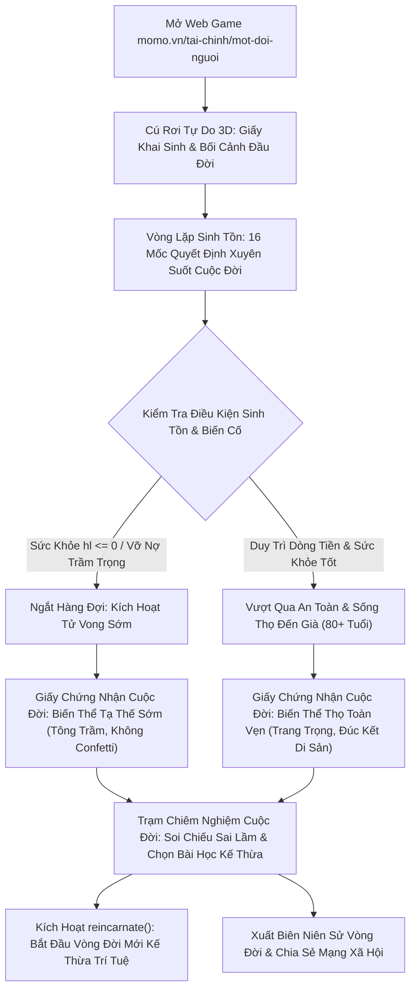

# GAME DESIGN DOCUMENT (GDD)
# WEB GAME "MỘT ĐỜI NGƯỜI" (LIFE SIMULATION & FINANCIAL SURVIVAL)

> **Mã tài liệu:** GDD-FIN-SIM-001  
> **Trạng thái:** OFFICIAL DRAFT  
> **Thể loại (Genre):** Demographic Life Simulation / Financial Survival / Roguelite Metaprogression  
> **Phân loại chiến lược:** Transformation Zone / Financial Hub & Standalone Web Experience  
> **Kênh phát hành:** Web Platform (`momo.vn/tai-chinh/mot-doi-nguoi`)

---

## THÔNG TIN TỔNG QUAN (METADATA)

<table style="width:100%; border-collapse:collapse; border:1.5px solid #64748b; margin:1em 0; font-size:0.9em;">
  <thead>
    <tr style="background-color:#f1f5f9;">
      <th style="border:1.5px solid #64748b; padding:8px 12px; text-align:left; font-weight:700;">Hạng Mục</th>
      <th style="border:1.5px solid #64748b; padding:8px 12px; text-align:left; font-weight:700;">Chi Tiết</th>
    </tr>
  </thead>
  <tbody>
    <tr>
      <td style="border:1px solid #94a3b8; padding:8px 12px; text-align:left;"><strong>Tên Trò Chơi (Game Title)</strong></td>
      <td style="border:1px solid #94a3b8; padding:8px 12px; text-align:left;"><strong>Web Game "Một Đời Người" (Mô phỏng Vòng đời & Quản trị Dòng tiền Sinh tồn)</strong></td>
    </tr>
    <tr style="background-color:#f8fafc;">
      <td style="border:1px solid #94a3b8; padding:8px 12px; text-align:left;"><strong>Định Dạng Tài Liệu</strong></td>
      <td style="border:1px solid #94a3b8; padding:8px 12px; text-align:left;"><strong>Game Design Document (GDD) - Bản Đặc Tả Thiết Kế Trò Chơi Toàn Diện</strong></td>
    </tr>
    <tr>
      <td style="border:1px solid #94a3b8; padding:8px 12px; text-align:left;"><strong>Canonical Root URL</strong></td>
      <td style="border:1px solid #94a3b8; padding:8px 12px; text-align:left;"><code style="background:#f1f5f9;padding:2px 4px;border-radius:4px;font-family:monospace;">momo.vn/tai-chinh/mot-doi-nguoi/</code></td>
    </tr>
    <tr style="background-color:#f8fafc;">
      <td style="border:1px solid #94a3b8; padding:8px 12px; text-align:left;"><strong>Đội Ngũ Phát Triển & Vận Hành</strong></td>
      <td style="border:1px solid #94a3b8; padding:8px 12px; text-align:left;">
        <strong>Game Lead & Product Strategy:</strong> Out-App Traffic Team<br>
        <strong>Lead Game Designer:</strong> Systems & Narrative Design Team<br>
        <strong>Graphics & Game Engineering:</strong> Web Development Team & Graphics SE (Three.js / WebGL)<br>
        <strong>Business Owner:</strong> Financial Services BU (FS Team)<br>
        <strong>Data & Analytics:</strong> Web Analytics Team
      </td>
    </tr>
    <tr>
      <td style="border:1px solid #94a3b8; padding:8px 12px; text-align:left;"><strong>Vòng Lặp Cốt Lõi (Core Loop)</strong></td>
      <td style="border:1px solid #94a3b8; padding:8px 12px; text-align:left;">Khởi sinh ngẫu nhiên ➔ Sinh tồn 16 mốc quyết định ➔ Điểm dừng cuộc đời (Sống thọ / Tử vong sớm) ➔ Trạm chiêm nghiệm dòng tiền ➔ Kế thừa bài học trí tuệ ➔ Tái thiết cuộc đời mới (Roguelite Metaprogression).</td>
    </tr>
    <tr style="background-color:#f8fafc;">
      <td style="border:1px solid #94a3b8; padding:8px 12px; text-align:left;"><strong>Mục Tiêu Kinh Doanh</strong></td>
      <td style="border:1px solid #94a3b8; padding:8px 12px; text-align:left;">Giáo dục tài chính cá nhân tự nhiên (Anti-upsell), tối ưu thời gian tương tác trên Website (Engagement), thúc đẩy lan truyền tự nhiên trên mạng xã hội (Viral Social Loop), định vị Kênh Web như một nguồn tài nguyên tri thức tài chính uy tín và tương tác cao.</td>
    </tr>
  </tbody>
</table>

---

## 1. GAME OVERVIEW & DESIGN PHILOSOPHY

### 1.1 Bối Cảnh & Định Vị Sản Phẩm
Đa số các công cụ giáo dục tài chính truyền thống (Financial Literacy) thất bại vì hai lý do:
1. **Lý thuyết giáo điều:** Mang tính học thuật, thiếu tính tương tác thực tế, khiến người dùng trẻ (Gen Z, Millennials) nhanh chóng rời bỏ.
2. **Quảng cáo bán hàng thô thiển (Hard Upselling):** Đặt nút kêu gọi mở thẻ, vay tiền, mở tài khoản ngay từ những giây đầu tiên, gây mất lòng tin và làm sụt giảm uy tín thương hiệu.

Sản phẩm này tái định nghĩa trải nghiệm giáo dục tài chính trên Web Platform bằng việc chuyển hóa mô hình mô phỏng nhân khẩu học toàn cầu nổi tiếng **1 in 8 Billion (`1in8b.life`)** thành một **Trò chơi Giả lập Vòng đời & Sinh tồn Dòng tiền Thuần Web (Standalone Life & Financial Survival Simulator)**:
- Người chơi bắt đầu bằng việc rơi ngẫu nhiên vào một số phận (ngẫu nhiên tại 141 quốc gia hoặc chế độ Chuyên sâu Việt Nam: 63 tỉnh thành).
- Trải qua 100 năm cuộc đời (tương ứng 2–3 phút tương tác nhanh trên Web).
- Đưa ra các quyết định quan trọng về học vấn, công việc, chi tiêu, tích lũy, đầu tư và đối mặt với bão giá lạm phát, tai nạn, dịch bệnh và biến cố kinh tế.
- Tất cả dựa trên **dữ liệu thống kê có thật 100%** từ Liên Hợp Quốc (UN), Ngân hàng Thế giới (World Bank), Tổ chức Y tế Thế giới (WHO) và Tổng cục Thống kê Việt Nam (GSO).
- **Trải nghiệm độc lập 100% trên Web:** Không yêu cầu tải ứng dụng, không có phễu ép chuyển đổi sang App, giữ trọn vẹn giá trị nguyên bản của một công cụ mô phỏng tri thức công cộng miễn phí.

### 1.2 Hành Trình Tái Thiết Dòng Tiền & Vòng Đời Trải Nghiệm Thuần Web (Pure Web Financial Life Reset Loop)

> **Luồng Trải Nghiệm Vòng Đời:** `Khởi Sinh (Nhập Thế)` ➔ `Mô Phỏng Trải Nghiệm Sinh Tồn (16 Mốc Quyết Định)` ➔ `Điểm Dừng Cuộc Đời (Sống Thọ hoặc Tạ Thế Sớm)` ➔ `Trạm Chiêm Nghiệm & Soi Chiếu Dòng Tiền` ➔ `Tái Thiết Vận Mệnh Mới Kế Thừa Trí Tuệ`

1. **Điểm chạm Web:** Người dùng trải nghiệm tự do 100%, không cần đăng nhập, không pop-up quảng cáo, không chuyển hướng ứng dụng.
2. **Khoảnh khắc Bừng tỉnh (Aha-Moment):** Nhận ra tiền mặt để yên sẽ bị lạm phát nuốt chửng; không có quỹ dự phòng sẽ vỡ nợ khi gặp biến cố; gánh nợ vì nể nang sẽ chôn vùi an toàn tài chính gia đình.
3. **Cơ Chế Tái Thiết Kế Thừa Trí Tuệ (Metaprogression Engine):** Khi kết thúc một vòng đời (do tuổi già tự nhiên hoặc tử vong sớm vì kiệt quệ tài chính / bạo bệnh), trò chơi không kết thúc vô nghĩa (Dead End). Người chơi bước vào **Trạm Chiêm Nghiệm & Soi Chiếu Dòng Tiền** để phân tích quyết định sai lầm then chốt của vòng đời vừa qua, chọn một **"Bài Học Trí Tuệ Kế Thừa" (Financial Wisdom Legacy Perk)** mang sang vòng đời tiếp theo.
4. **Giá trị Giữ chân & Lan tỏa:** Xuất bản Giấy Chứng Nhận Cuộc Đời (Life Certificate Card với 2 biến thể: Sống trọn vẹn và Tạ thế sớm) cùng Biên Niên Sử Vòng Đời (Multi-Life Chronicle) để chia sẻ mạng xã hội, thúc đẩy người chơi bấm "Bắt Đầu Cuộc Đời Mới" để chinh phục các tầng số phận cao hơn.

---

## 2. HẠ TẦNG DỮ LIỆU & BỘ THUẬT TOÁN THẾ GIỚI (DATA ENGINE & WORLD GENERATION)

### 2.1 Ma Trận Dữ Liệu Quốc Gia & Nhân Khẩu Học Toàn Cầu (Global Statistical Schema)
Hệ thống kế thừa bộ dữ liệu từ 141 quốc gia của `1in8b.life` với các tham số chuẩn hóa:

<table style="width:100%; border-collapse:collapse; border:1.5px solid #64748b; margin:1em 0; font-size:0.9em;">
  <thead>
    <tr style="background-color:#f1f5f9;">
      <th style="border:1.5px solid #64748b; padding:8px 12px; text-align:left; font-weight:700;">Mã Trường</th>
      <th style="border:1.5px solid #64748b; padding:8px 12px; text-align:left; font-weight:700;">Tên Chỉ Số Dân Số Học</th>
      <th style="border:1.5px solid #64748b; padding:8px 12px; text-align:left; font-weight:700;">Nguồn Dữ Liệu Tham Chiếu</th>
      <th style="border:1.5px solid #64748b; padding:8px 12px; text-align:left; font-weight:700;">Ứng Dụng Trong Gameplay</th>
    </tr>
  </thead>
  <tbody>
    <tr>
      <td style="border:1px solid #94a3b8; padding:8px 12px; text-align:left;"><code style="background:#f1f5f9;padding:2px 4px;border-radius:4px;font-family:monospace;">b</code></td>
      <td style="border:1px solid #94a3b8; padding:8px 12px; text-align:left;">Số ca sinh hàng năm (Annual Births)</td>
      <td style="border:1px solid #94a3b8; padding:8px 12px; text-align:left;">UN World Population Prospects</td>
      <td style="border:1px solid #94a3b8; padding:8px 12px; text-align:left;">Trọng số xác suất sinh ra tại quốc gia</td>
    </tr>
    <tr style="background-color:#f8fafc;">
      <td style="border:1px solid #94a3b8; padding:8px 12px; text-align:left;"><code style="background:#f1f5f9;padding:2px 4px;border-radius:4px;font-family:monospace;">le</code></td>
      <td style="border:1px solid #94a3b8; padding:8px 12px; text-align:left;">Kỳ vọng sống lúc sinh (Life Expectancy)</td>
      <td style="border:1px solid #94a3b8; padding:8px 12px; text-align:left;">WHO Global Health Observatory</td>
      <td style="border:1px solid #94a3b8; padding:8px 12px; text-align:left;">Tính xác suất tử vong tự nhiên theo độ tuổi</td>
    </tr>
    <tr>
      <td style="border:1px solid #94a3b8; padding:8px 12px; text-align:left;"><code style="background:#f1f5f9;padding:2px 4px;border-radius:4px;font-family:monospace;">u5</code></td>
      <td style="border:1px solid #94a3b8; padding:8px 12px; text-align:left;">Tỷ lệ tử vong trẻ dưới 5 tuổi (Under-5 Mortality)</td>
      <td style="border:1px solid #94a3b8; padding:8px 12px; text-align:left;">UNICEF Child Mortality Report</td>
      <td style="border:1px solid #94a3b8; padding:8px 12px; text-align:left;">Xác suất vượt qua giai đoạn 0–5 tuổi</td>
    </tr>
    <tr style="background-color:#f8fafc;">
      <td style="border:1px solid #94a3b8; padding:8px 12px; text-align:left;"><code style="background:#f1f5f9;padding:2px 4px;border-radius:4px;font-family:monospace;">ppp</code></td>
      <td style="border:1px solid #94a3b8; padding:8px 12px; text-align:left;">GDP bình quân theo sức mua tương đương</td>
      <td style="border:1px solid #94a3b8; padding:8px 12px; text-align:left;">World Bank ICP Database</td>
      <td style="border:1px solid #94a3b8; padding:8px 12px; text-align:left;">Quy đổi mức thu nhập cơ bản và sức mua</td>
    </tr>
    <tr>
      <td style="border:1px solid #94a3b8; padding:8px 12px; text-align:left;"><code style="background:#f1f5f9;padding:2px 4px;border-radius:4px;font-family:monospace;">gi</code></td>
      <td style="border:1px solid #94a3b8; padding:8px 12px; text-align:left;">Hệ số bất bình đẳng thu nhập (Gini Index)</td>
      <td style="border:1px solid #94a3b8; padding:8px 12px; text-align:left;">World Bank Poverty and Inequality</td>
      <td style="border:1px solid #94a3b8; padding:8px 12px; text-align:left;">Độ lệch tài sản giữa 5 tầng lớp gia đình</td>
    </tr>
    <tr style="background-color:#f8fafc;">
      <td style="border:1px solid #94a3b8; padding:8px 12px; text-align:left;"><code style="background:#f1f5f9;padding:2px 4px;border-radius:4px;font-family:monospace;">urb</code></td>
      <td style="border:1px solid #94a3b8; padding:8px 12px; text-align:left;">Tỷ lệ đô thị hóa (Urban Population %)</td>
      <td style="border:1px solid #94a3b8; padding:8px 12px; text-align:left;">UN World Urbanization Prospects</td>
      <td style="border:1px solid #94a3b8; padding:8px 12px; text-align:left;">Xác suất sinh ra ở thành thị hay nông thôn</td>
    </tr>
    <tr>
      <td style="border:1px solid #94a3b8; padding:8px 12px; text-align:left;"><code style="background:#f1f5f9;padding:2px 4px;border-radius:4px;font-family:monospace;">eys</code></td>
      <td style="border:1px solid #94a3b8; padding:8px 12px; text-align:left;">Năm học kỳ vọng (Expected Years of Schooling)</td>
      <td style="border:1px solid #94a3b8; padding:8px 12px; text-align:left;">UNDP Human Development Report</td>
      <td style="border:1px solid #94a3b8; padding:8px 12px; text-align:left;">Xác suất học hết cấp 1, cấp 2, cấp 3, đại học</td>
    </tr>
    <tr style="background-color:#f8fafc;">
      <td style="border:1px solid #94a3b8; padding:8px 12px; text-align:left;"><code style="background:#f1f5f9;padding:2px 4px;border-radius:4px;font-family:monospace;">oop</code></td>
      <td style="border:1px solid #94a3b8; padding:8px 12px; text-align:left;">Chi phí y tế tự chi trả (Out-of-pocket Health %)</td>
      <td style="border:1px solid #94a3b8; padding:8px 12px; text-align:left;">WHO Global Health Expenditure</td>
      <td style="border:1px solid #94a3b8; padding:8px 12px; text-align:left;">Số tiền mất đi khi gặp biến cố đau ốm</td>
    </tr>
  </tbody>
</table>

### 2.2 Module Bản Địa Hóa Việt Nam (Vietnam Demographic Deep-Dive)
Người chơi có thể chọn chế độ mặc định **"Sinh ra tại Việt Nam"** để tăng độ gắn kết văn hóa:
- **Phân bổ Vùng miền & Tỉnh thành:** Hà Nội, TP. Hồ Chí Minh, Đà Nẵng, Đồng bằng Sông Hồng, Tây Nguyên, Đồng bằng Sông Cửu Long, Miền núi phía Bắc.
- **Dữ liệu thực tế GSO 2024–2026:**
  - Thu nhập bình quân đầu người theo vùng (Ví dụ: TP.HCM ~8.9 triệu/tháng, Hà Nội ~8.5 triệu/tháng, vùng nông thôn ~4.8 triệu/tháng).
  - Tỷ lệ đô thị hóa tại Việt Nam: ~42.5%.
  - Tỷ lệ học đại học: ~28.6% thanh niên trong độ tuổi.
  - Tỷ lệ tham gia bảo hiểm y tế: ~93.2%.

---

## 3. CƠ CHẾ GAMEPLAY CỐT LÕI & CÂN BẰNG KINH TẾ (CORE MECHANICS & ECONOMY BALANCING)

### 3.1 Bộ Chỉ Số Sống Còn (Core Attributes State `S`)

Nhân vật được định danh qua 5 nhóm chỉ số:

```typescript
interface CharacterState {
  age: number;               // Độ tuổi hiện tại (0 - 100)
  country: string;           // Mã quốc gia (VNM, USA, JPN, IND...)
  province?: string;         // Tỉnh thành (nếu ở Việt Nam)
  sex: 'M' | 'F';            // Giới tính
  urban: boolean;            // Nơi sống: Thành thị (true) / Nông thôn (false)
  quintile: 1 | 2 | 3 | 4 | 5; // Tầng lớp kinh tế gia đình (1: Nghèo nhất -> 5: Giàu nhất)
  
  // Phân loại Xuất thân Tuổi thơ & Trục Vận Mệnh
  childhoodOrigin: 'slum_worker' | 'mekong_water' | 'alley_city' | 'highland_village' | 'market_trader';
  trajectory: 'export_labor' | 'corporate_clerk' | 'merchant_trader' | 'agriculture';
  childhoodMemories: string[]; // Danh sách các mã ký ức định hình tâm lý tài chính
  
  // Bối Cảnh Gia Đình Khi Sinh Ra (Birth Context)
  parents: {
    mom: { age: number; job: string; alive: boolean };
    dad: { age: number; job: string; alive: boolean; absent: boolean };
    homeType: string;        // Loại hình nhà ở lúc mới sinh (phòng trọ, nhà tranh, căn hộ...)
  };
  birthStory: string;        // Đoạn văn tự sự mô tả khoảnh khắc chào đời
  
  // Cơ Chế Tái Thiết Kế Thừa Trí Tuệ (Metaprogression State)
  metaprogression: {
    pastLivesCount: number;         // Số vòng đời đã trải qua (0 = Vòng đời đầu tiên)
    activeWisdomPerk?: string;      // Bài học trí tuệ kích hoạt trong vòng đời này
    accumulatedWisdom: string[];    // Bộ sưu tập các bài học đã mở khóa
    multiLifeChronicle: Array<{     // Biên niên sử các vòng đời trước
      lifeIndex: number;
      birthOrigin: string;
      finalAge: number;
      isEarlyDeath: boolean;
      causeOfDeath: string;
      fatalFinancialLesson: string;
      finalNetWorth: number;
    }>;
  };
  
  // Trạng Thái Nợ & Tái Cơ Cấu Dòng Tiền (Solvency & Debt State)
  debtState: {
    tenureYearsLeft: number;        // Số năm vay trả góp còn lại
    isRestructured: boolean;        // Cờ đã chuyển sang diện tái cơ cấu nợ (lãi suất ưu đãi cố định)
    consecutiveStressYears: number; // Số năm liên tiếp nợ vượt trần thu nhập
    hasIncome: boolean;             // Đã chính thức có thu nhập đi làm hay chưa
  };

  // 4 Chỉ số Sinh tồn cốt lõi (Thang điểm 0 - 100)
  hl: number;                // Sức khỏe thể chất (Health)
  h: number;                 // Hạnh phúc & Tinh thần (Happiness)
  so: number;                // Quan hệ xã hội & Gia đình (Social)
  sm: number;                // Trí tuệ & Học vấn (Smarts)

  // Chỉ số Phẩm chất & Năng khiếu Đặc thù (Tích lũy từ thời thơ ấu & Kế thừa)
  grit?: number;             // Nghị lực & Kiên cường vượt khó (0 - 100)
  arts?: number;             // Năng khiếu nghệ thuật & Sáng tạo (0 - 100)

  // Chỉ số Dòng tiền & Tài sản (VND hoặc USD PPP quy đổi)
  money: number;             // Tiền mặt khả dụng
  debt: number;              // Dư nợ chưa trả
  income: number;            // Thu nhập năm
  purchasingPower: number;   // Sức mua thực tế (Trừ hao bởi lạm phát tích lũy)
  creditScore: number;       // Điểm tín dụng giả lập (Mô phỏng CIC: 150 - 750)
  
  // Tài sản & Đầu tư
  assets: {
    emergencyFund: number;   // Quỹ khẩn cấp sinh lời (Mô phỏng Túi Thần Tài)
    budgetJars: boolean;     // Đã áp dụng phân bổ ngân sách 50/30/20 (Hũ Chi Tiêu)
    stocks: number;          // Tích sản quỹ / cổ phiếu
    realEstate: number;      // Giá trị bất động sản
    mortgageLeft: number;    // Nợ vay mua nhà còn lại
  };
}
```

### 3.2 Cơ Chế Tính Lạm Phát & Sức Mua Thực Tế (Inflation & Purchasing Power Engine)

Lạm phát không được trình bày bằng tỷ lệ phần trăm trừu tượng mà thể hiện qua **"Thước Đo Bát Phở" (The Pho Index)**:
- Năm 18 tuổi: 1 Bát phở = 35.000 VNĐ.
- Sau mỗi 5 năm: Tỷ lệ lạm phát tích lũy đẩy giá bát phở lên (Năm 25 tuổi: 45.000 VNĐ, năm 35 tuổi: 60.000 VNĐ, năm 50 tuổi: 90.000 VNĐ).
- **Hệ quả dòng tiền:**
  - Nếu người chơi để tiền mặt nằm yên (`money` giữ nguyên): Sức mua thực tế giảm tương ứng với tỷ lệ tăng giá bát phở.
  - Nếu tiền được gửi vào công cụ sinh lời hàng ngày hoặc quỹ tích sản: Tỷ suất sinh lời bù đắp hoặc vượt trượt giá, bảo toàn tài sản.

### 3.3 Thuật Toán Quản Trị Nợ, Dư Nợ Giảm Dần & Co Giãn Vốn Mua Nhà (Solvency & Financial Engine)

Nhằm khắc phục triệt để lỗi logic nợ phình to vô hạn và phá sản sai bản chất, hệ thống tài chính tuân thủ 6 nguyên lý điều tiết dòng tiền sau:

1. **Công Thức Trả Góp Theo Dư Nợ Giảm Dần (Amortization Schedule):**
   - Khoản tiền trả nợ hàng năm không cố định mức ban đầu mà được tính toán lại sau mỗi năm:
     $$\text{Khoản trả nợ năm } t = \frac{\text{Gốc còn lại}}{\text{Kỳ hạn còn lại (năm)}} + (\text{Gốc còn lại} \times \text{Lãi suất năm})$$
   - Nhờ gốc giảm dần đều theo thời gian vay, tiền lãi các năm sau giảm tương ứng, đảm bảo người chơi có lộ trình xóa nợ dứt điểm khi thanh toán đúng hạn.

2. **Cơ Chế Khoanh Nợ & Hoãn Nợ Học Phí Cho Sinh Viên (`student_debt`):**
   - Khoản vay học phí sinh viên không bị tính là nợ quá hạn và không xét phá sản khi người chơi chưa có việc làm chính thức (`hasIncome === false`).
   - Thời gian tính lãi và yêu cầu trả nợ chỉ bắt đầu được kích hoạt từ năm nhân vật chính thức đi làm và có nguồn thu nhập đầu tiên.

3. **Cơ Chế Tự Động Thắt Lưng Buộc Bụng Khi Thâm Hụt Tiền Mặt:**
   - Khi dòng tiền khả dụng bị âm (`money < 0`), hệ thống tuyệt đối không cộng dồn phần thiếu hụt vào nợ gốc với lãi suất cao (tránh bẫy xoáy nợ).
   - Thay vào đó, người chơi tự động kích hoạt chế độ "thắt chặt chi tiêu":
     - Cắt giảm 20% chi phí sinh hoạt cá nhân (trừ `-4` điểm Hạnh phúc `h`).
     - Trích tối đa 50% thu nhập hàng năm để trả nợ.
     - Tự động giãn thêm kỳ hạn vay từ 1–3 năm để giảm áp lực dòng tiền hàng năm.

4. **Tái Cơ Cấu Nợ Sau Phá Sản (Debt Restructuring):**
   - Khi nhân vật rơi vào trạng thái mất khả năng thanh toán, hệ thống chuyển khoản nợ sang diện "Tái cơ cấu": Đóng băng lãi phạt, áp dụng mức lãi suất tái cơ cấu ưu đãi cố định 5%/năm, tạo điều kiện cho người chơi làm lại từ đầu.

5. **Độ Co Giãn Giá Mua Căn Hộ (Housing Price Elasticity):**
   - Giá căn hộ không cố định 2,4 tỷ đồng. Tại mốc quyết định mua nhà ở tuổi 31–35, giá trị căn hộ tự động co giãn theo số vốn đối ứng 30% mà người chơi tích lũy được:
     $$\text{Giá căn hộ} = \min(2.400.000.000, \max(900.000.000, \frac{\text{Vốn tích lũy}}{0,3}))$$
   - Biên độ dao động từ 900 triệu (căn hộ nhỏ / nhà ở xã hội) đến 2,4 tỷ (chung cư thương mại), đảm bảo người chơi có tích lũy đều có thể mở khóa lựa chọn an cư.

6. **Hiệu Chỉnh Trần Tài Sản Ròng Về Già:**
   - Điều chỉnh hệ số thu nhập giai đoạn 50–65 tuổi và chi phí chăm sóc sức khỏe tuổi già, đưa mức tài sản ròng trung vị của nhóm chọn toàn phương án tốt về vùng **4,2 – 5,0 tỷ VNĐ danh nghĩa** (tương đương sức mua thực tế ~1,0 – 1,3 tỷ VNĐ ở hiện giá).
   - Thẻ kết quả hiển thị song song cả hai giá trị: Tài sản danh nghĩa và Sức mua thực tế quy đổi theo giá trị bát phở.

### 3.4 Cơ Chế Xác Suất & Kích Hoạt Tử Vong Sớm (Early Death Engine)

Để khắc phục việc ép sống thọ đến 81–100 tuổi, hệ thống xây dựng mô hình tử vong sớm dựa trên nguyên nhân tài chính và sức khỏe thực tế:

1. **Công Thức Kích Hoạt Tử Vong Sớm:**
   - **Trường hợp 1 (Đột quỵ vì kiệt sức gánh nợ - `debt_exhaustion`):** Nếu tỷ lệ nợ trên thu nhập $\frac{\text{debt}}{\text{income}} > 1.0$ kéo dài liên tiếp $\ge 3$ năm, nhân vật bị trừ $-15$ điểm Sức khỏe (`hl`) mỗi năm do stress và làm việc quá sức. Khi chỉ số $\text{hl} \le 0$, kích hoạt đột quỵ/tử vong sớm ở độ tuổi 35–45 (ví dụ: mất năm 38 tuổi vì kiệt sức gánh nợ bảo lãnh người thân).
   - **Trường hợp 2 (Bạo bệnh không có quỹ phòng thân - `medical_emergency_death`):** Tại mốc biến cố y tế (`ills`), nếu chi phí điều trị vượt quá tổng tiền mặt và Quỹ khẩn cấp (`money + emergencyFund`), đồng thời trần nợ CIC chạm ngưỡng không thể vay tiếp, chỉ số $\text{hl}$ rơi thẳng về $0$, kích hoạt tử vong sớm ở độ tuổi 50–60 (ví dụ: mất năm 52 tuổi do bạo bệnh sau khi vỡ nợ hụi).

2. **Cơ Chế Ngắt Hàng Đợi Sự Kiện (Queue Interruption):**
   - Khi điều kiện tử vong sớm thỏa mãn, hệ thống thực thi hàm `triggerEarlyDeath(age, cause)`:
     - Lập tức ngắt toàn bộ các sự kiện còn lại trong hàng đợi `S.queue`.
     - Bỏ qua toàn bộ các mốc tuổi tiếp theo.
     - Chuyển hướng người chơi trực tiếp sang **Giấy Chứng Nhận Cuộc Đời (Biến Thể Tạ Thế Sớm)** và tiếp tục dẫn vào **Trạm Chiêm Nghiệm Cuộc Đời**.

### 3.5 Đặc Tả Màn Hình Giấy Khai Sinh Đầu Đời (The Birth Certificate Screen)

Tương tự như màn hình khai sinh kinh điển của `1in8b.life`, ngay sau hiệu ứng rơi tự do 3D mở màn, trò chơi hiển thị **Thẻ Giấy Khai Sinh (Birth Certificate Card)** mô tả toàn cảnh số phận và bối cảnh xuất thân ban đầu của đứa trẻ trước khi bắt đầu cuộc đời:

<table style="width:100%; border-collapse:collapse; border:1.5px solid #64748b; margin:1em 0; font-size:0.9em;">
  <thead>
    <tr style="background-color:#f1f5f9;">
      <th style="border:1.5px solid #64748b; padding:8px 12px; text-align:left; font-weight:700;">Hạng Mục Khai Sinh</th>
      <th style="border:1.5px solid #64748b; padding:8px 12px; text-align:left; font-weight:700;">Cơ Chế Sinh Dữ Liệu Ngẫu Nhiên</th>
      <th style="border:1.5px solid #64748b; padding:8px 12px; text-align:left; font-weight:700;">Ví Dụ Hiển Thị Thực Tế</th>
    </tr>
  </thead>
  <tbody>
    <tr>
      <td style="border:1px solid #94a3b8; padding:8px 12px; text-align:left;"><strong>Tên & Giới Tính</strong></td>
      <td style="border:1px solid #94a3b8; padding:8px 12px; text-align:left;">Sinh ngẫu nhiên họ tên phổ biến theo giới tính sinh học (Tỷ lệ bé trai/bé gái chuẩn GSO).</td>
      <td style="border:1px solid #94a3b8; padding:8px 12px; text-align:left;">Nguyễn Văn An (Nam) / Lê Thị Mai (Nữ)</td>
    </tr>
    <tr style="background-color:#f8fafc;">
      <td style="border:1px solid #94a3b8; padding:8px 12px; text-align:left;"><strong>Nơi Sinh Ra</strong></td>
      <td style="border:1px solid #94a3b8; padding:8px 12px; text-align:left;">Tỉnh thành, địa danh cụ thể và phân loại thành thị / nông thôn.</td>
      <td style="border:1px solid #94a3b8; padding:8px 12px; text-align:left;">Xã Ba Tri, Bến Tre (Nông thôn ven biển) / Phường An Phú, Thuận An, Bình Dương (Xóm trọ đô thị)</td>
    </tr>
    <tr>
      <td style="border:1px solid #94a3b8; padding:8px 12px; text-align:left;"><strong>Độ Tuổi Của Cha Mẹ</strong></td>
      <td style="border:1px solid #94a3b8; padding:8px 12px; text-align:left;">Dựa trên độ tuổi kết hôn và sinh con trung bình tại địa phương (Mẹ: 19–38 tuổi, Bố: 21–45 tuổi, có xác suất mẹ đơn thân).</td>
      <td style="border:1px solid #94a3b8; padding:8px 12px; text-align:left;">Mẹ 23 tuổi · Bố 26 tuổi (hoặc: Mẹ đơn thân 21 tuổi)</td>
    </tr>
    <tr style="background-color:#f8fafc;">
      <td style="border:1px solid #94a3b8; padding:8px 12px; text-align:left;"><strong>Nghề Nghiệp Cha Mẹ</strong></td>
      <td style="border:1px solid #94a3b8; padding:8px 12px; text-align:left;">Bốc ngẫu nhiên từ kho nghề nghiệp phù hợp với vùng miền và tầng lớp thu nhập.</td>
      <td style="border:1px solid #94a3b8; padding:8px 12px; text-align:left;">Mẹ: Công nhân may xưởng gia giày · Bố: Thợ hàn xì công trình (hoặc: Mẹ: Làm nông cấy lúa · Bố: Đi biển đánh cá xa bờ)</td>
    </tr>
    <tr>
      <td style="border:1px solid #94a3b8; padding:8px 12px; text-align:left;"><strong>Nhà Ở Ban Đầu</strong></td>
      <td style="border:1px solid #94a3b8; padding:8px 12px; text-align:left;">Loại hình nhà gắn liền với bối cảnh kinh tế gia đình lúc mới sinh.</td>
      <td style="border:1px solid #94a3b8; padding:8px 12px; text-align:left;">Phòng trọ thuê 12m2 lợp tôn xi-măng / Nhà cấp 4 ba gian lợp ngói cũ / Căn hộ tập thể tầng 3</td>
    </tr>
    <tr style="background-color:#f8fafc;">
      <td style="border:1px solid #94a3b8; padding:8px 12px; text-align:left;"><strong>Tầng Lớp Kinh Tế</strong></td>
      <td style="border:1px solid #94a3b8; padding:8px 12px; text-align:left;">5 chấm tròn đồ họa (<code style="background:#f1f5f9;padding:2px 4px;border-radius:4px;font-family:monospace;">qdots</code>) đại diện cho 5 phân vị thu nhập (Quintiles) từ nghèo nhất đến giàu nhất.</td>
      <td style="border:1px solid #94a3b8; padding:8px 12px; text-align:left;">Phân vị 1/5 (Thuộc nhóm 20% hộ gia đình thu nhập thấp nhất khu vực)</td>
    </tr>
    <tr>
      <td style="border:1px solid #94a3b8; padding:8px 12px; text-align:left;"><strong>Đoạn Văn Mở Màn (<code style="background:#f1f5f9;padding:2px 4px;border-radius:4px;font-family:monospace;">birthStory</code>)</strong></td>
      <td style="border:1px solid #94a3b8; padding:8px 12px; text-align:left;">Đoạn tự sự ngắn mô tả khoảnh khắc lọt lòng, khơi gợi xúc cảm về tình mẫu tử và hoàn cảnh chào đời.</td>
      <td style="border:1px solid #94a3b8; padding:8px 12px; text-align:left;"><em>"Bạn cất tiếng khóc chào đời vào một chiều mưa giông tháng Bảy tại trạm xá xã. Tiếng quạt trần quay kẽo kẹt trên trần vôi nứt, mẹ ôm bạn vào lòng trong chiếc chăn chiên cũ mà giọt nước mắt rưng rưng..."</em></td>
    </tr>
    <tr style="background-color:#f8fafc;">
      <td style="border:1px solid #94a3b8; padding:8px 12px; text-align:left;"><strong>Chỉ Số Thống Kê Bối Cảnh</strong></td>
      <td style="border:1px solid #94a3b8; padding:8px 12px; text-align:left;">Dữ liệu thật từ GSO/WHO tại thời điểm chào đời: Kỳ vọng sống, tỷ lệ tử vong trẻ em, thu nhập bình quân vùng.</td>
      <td style="border:1px solid #94a3b8; padding:8px 12px; text-align:left;">Kỳ vọng sống: 73.8 tuổi · Xác suất tử vong dưới 5 tuổi: 1.8% · Thu nhập bình quân đầu người vùng: 4.8 triệu/tháng</td>
    </tr>
  </tbody>
</table>

---

## 4. THIẾT KẾ NỘI DUNG, KỊCH BẢN & MA TRẬN QUYẾT ĐỊNH (NARRATIVE DESIGN & SCENARIOS)

Hệ thống kịch bản chia làm 6 giai đoạn cuộc đời với các bộ câu hỏi tình huống (Quizzes) và dữ liệu thực chứng (Facts).

### 4.1 Giai Đoạn 1: Sơ Sinh & Tuổi Thơ (0 – 12 Tuổi) - Điểm Tựa Ký Ức & Cội Nguồn Tâm Lý Tài Chính

Giai đoạn 0–12 tuổi được thiết kế như chiếc neo cảm xúc (Emotional Anchor) của toàn bộ trò chơi. Khi bắt đầu hoặc chơi lại, hệ thống không chạy một kịch bản đơn điệu mà ngẫu nhiên phân bổ nhân vật vào **1 trong 5 Bối Cảnh Xuất Thân Tuổi Thơ** kết hợp cùng **Ma Trận Biến Cố Đầu Đời**, định hình "Vết Hằn Ký Ức" chi phối hành vi tài chính khi trưởng thành.

#### 4.1.1 Bảng 5 Bối Cảnh Xuất Thân Tuổi Thơ Điển Hình (Childhood Origins)

<table style="width:100%; border-collapse:collapse; border:1.5px solid #64748b; margin:1em 0; font-size:0.9em;">
  <thead>
    <tr style="background-color:#f1f5f9;">
      <th style="border:1.5px solid #64748b; padding:8px 12px; text-align:left; font-weight:700;">Mã Xuất Thân</th>
      <th style="border:1.5px solid #64748b; padding:8px 12px; text-align:left; font-weight:700;">Không Gian & Giác Quan Tuổi Thơ</th>
      <th style="border:1.5px solid #64748b; padding:8px 12px; text-align:left; font-weight:700;">Vết Hằn Ký Ức Đầu Đời Về Tiền Bạc</th>
    </tr>
  </thead>
  <tbody>
    <tr>
      <td style="border:1px solid #94a3b8; padding:8px 12px; text-align:left;"><code style="background:#f1f5f9;padding:2px 4px;border-radius:4px;font-family:monospace;">slum_worker</code><br><strong>Xóm Trọ Công Nhân</strong></td>
      <td style="border:1px solid #94a3b8; padding:8px 12px; text-align:left;">Phòng trọ 12m2 ven khu công nghiệp (Bình Dương / Đồng Nai). Tiếng xe container gầm rú đêm ngày, mùi cơm hộp mang về sau ca tăng ca, tiếng quạt con cóc kêu lạch cạch. Bạn tự chơi một mình vì bố mẹ xoay ca kíp liên tục.</td>
      <td style="border:1px solid #94a3b8; padding:8px 12px; text-align:left;">Ám ảnh sự cô đơn; sớm hiểu rằng "thời gian của bố mẹ bị đổi lấy từng đồng tiền tăng ca". Khi lớn lên có xu hướng khao khát kiếm tiền nhanh để bù đắp tình cảm gia đình.</td>
    </tr>
    <tr style="background-color:#f8fafc;">
      <td style="border:1px solid #94a3b8; padding:8px 12px; text-align:left;"><code style="background:#f1f5f9;padding:2px 4px;border-radius:4px;font-family:monospace;">mekong_water</code><br><strong>Sông Nước Miền Tây</strong></td>
      <td style="border:1px solid #94a3b8; padding:8px 12px; text-align:left;">Nhà sàn ven kênh rạch mùa nước nổi (Đồng Tháp / An Giang). Tiếng sóng vỗ mạn thuyền, mùi phù sa nồng đượm, những buổi trưa cùng anh em chèo xuồng hái bông điên điển, giăng lưới bắt cá linh.</td>
      <td style="border:1px solid #94a3b8; padding:8px 12px; text-align:left;">Tâm lý hào sảng, phóng khoáng nhưng ít tính phòng thủ; bài học đầu đời là sự bấp bênh của mùa vụ và con nước có thể cuốn trôi công sức cả năm sau một đêm bão.</td>
    </tr>
    <tr>
      <td style="border:1px solid #94a3b8; padding:8px 12px; text-align:left;"><code style="background:#f1f5f9;padding:2px 4px;border-radius:4px;font-family:monospace;">alley_city</code><br><strong>Ngõ Nhỏ Phố Thị</strong></td>
      <td style="border:1px solid #94a3b8; padding:8px 12px; text-align:left;">Căn nhà tập thể cũ hoặc ngõ sâu (Hà Nội / TP.HCM). Tiếng rao bánh khúc đêm đông, tiếng chổi tre quét đường, mùi sách báo cũ, quán nét đầu ngõ với những đứa bạn tụ tập chơi game thùng.</td>
      <td style="border:1px solid #94a3b8; padding:8px 12px; text-align:left;">Sớm nhận thức sự phân hóa giàu nghèo khi so sánh với bạn bè cùng lớp đi học bằng xe hơi; áp lực điểm số và kỳ vọng gia đình đè nặng lên vai từ lớp 1.</td>
    </tr>
    <tr style="background-color:#f8fafc;">
      <td style="border:1px solid #94a3b8; padding:8px 12px; text-align:left;"><code style="background:#f1f5f9;padding:2px 4px;border-radius:4px;font-family:monospace;">highland_village</code><br><strong>Bản Làng Vùng Cao</strong></td>
      <td style="border:1px solid #94a3b8; padding:8px 12px; text-align:left;">Mái nhà gỗ cheo leo sườn núi (Hà Giang / Sơn La / Kon Tum). Bếp củi đỏ lửa xua tan giá rét mùa đông, đôi chân trần nứt nẻ đi bộ 5 cây số đường đèo đến điểm trường, tiếng suối reo giữa đại ngàn.</td>
      <td style="border:1px solid #94a3b8; padding:8px 12px; text-align:left;">Nghị lực sinh tồn phi thường (`grit` cao); đồng tiền cực kỳ hiếm hoi và thiêng liêng, chủ yếu sống tự cung tự cấp. Giấc mơ lớn nhất là có đủ cơm trắng ăn no quanh năm.</td>
    </tr>
    <tr>
      <td style="border:1px solid #94a3b8; padding:8px 12px; text-align:left;"><code style="background:#f1f5f9;padding:2px 4px;border-radius:4px;font-family:monospace;">market_trader</code><br><strong>Con Nhà Tiểu Thương</strong></td>
      <td style="border:1px solid #94a3b8; padding:8px 12px; text-align:left;">Gầm sạp vải, sạp cá ở chợ đầu mối truyền thống. Tiếng mặc cả ồn ào từ 4 giờ sáng, mùi tanh nồng của chợ sớm, tiếng đếm tiền lẻ sột soạt, bữa cơm ăn vội trên thùng carton đựng hàng.</td>
      <td style="border:1px solid #94a3b8; padding:8px 12px; text-align:left;">Biết thối tiền cho khách từ năm 7 tuổi, nhạy bén với giá cả và cơ hội; sớm chứng kiến sự khắc nghiệt của nợ nần, giật hụi và sự phập phồng của buôn bán mùa Tết.</td>
    </tr>
  </tbody>
</table>

#### 4.1.2 Ma Trận Kịch Bản & Các Lựa Chọn Tuổi Thơ Đa Chiều (0 – 12 Tuổi)

##### Mốc 1 (3 – 4 Tuổi): Tiếng Gọi Đầu Đời & Người Nuôi Dưỡng
- **Tình huống 1.1A (Xóm Trọ):** Bố mẹ đi làm ca đêm, gửi bạn cho bà chủ nhà trọ trông cùng 4 đứa trẻ khác. Bạn bập bẹ gọi tên "mẹ" khi nhìn thấy bóng người phụ nữ mặc áo công nhân bước qua cửa sổ.
  - *Lựa chọn 1:* Chạy ùa ra cửa ôm chầm lấy chân mẹ -> Tăng Hạnh phúc (`h` +4), khắc sâu nỗi sợ chia xa (`memory: 'cling_mom'`).
  - *Lựa chọn 2:* Ngoan ngoãn ngồi im chia đồ chơi cho bạn nhỏ khác -> Tăng Xã hội (`so` +3), rèn tính tự lập sớm.
- **Tình huống 1.1B (Vùng Quê Sống Cùng Ông Bà):** Bố mẹ đi làm ăn xa ở miền Nam, bạn lớn lên bằng những câu chuyện cổ tích của bà ngoại và chiếc cối giã trầu. Bố mẹ gọi điện thoại bàn về nhà dịp Tết, bạn ngập ngừng không nhận ra giọng bố mẹ.
  - *Lựa chọn 1:* Lúng túng nép sau lưng bà ngoại không dám nghe máy -> Khắc sâu khoảng cách xa xứ (`memory: 'absent_parents'`).
  - *Lựa chọn 2:* Cầm lấy ống nghe bi bô kể chuyện đàn gà ở quê -> Tăng Tình cảm (`so` +4).
- **Tình huống 1.1C (Bản Làng Vùng Cao):** Mùa đông rét buốt, bạn ngồi bên bếp củi nhặt than hồng sưởi ấm bàn tay nứt nẻ. Bố mẹ đi nương rẫy từ sáng sớm chưa về.
  - *Lựa chọn 1:* Tự mình nhóm thêm củi khô giữ lửa chờ bố mẹ -> Tăng Kiên cường (`grit` +2), (`hl` +2).
  - *Lựa chọn 2:* Khóc nức nở cho đến khi ngủ thiếp đi bên vách nứa -> Giảm Thể lực (`hl` -3).

##### Mốc 2 (6 – 7 Tuổi): Ngưỡng Cửa Lớp 1 & Tiếp Xúc Sơ Khai Với Đồng Tiền
- **Tình huống 1.2A (Tiền Thối Mua Nước Mắm - Đứa trẻ xóm chợ / phố thị):** Mẹ đưa 20.000 đồng sai đi mua chai nước tương, thừa 3.000 đồng tiền thối. Trên đường về, bạn đi ngang qua quầy kẹo kéo ngọt lịm.
  - *Lựa chọn 1:* Mua que kẹo ăn vụng và nói dối mẹ là tiệm tạp hóa tăng giá -> Tăng Hạnh phúc tức thời (`h` +3), gieo mầm thói quen giấu giếm chi tiêu (`memory: 'secret_spending'`).
  - *Lựa chọn 2:* Đưa đủ tiền thối cho mẹ. Mẹ xoa đầu khen ngoan và thưởng 1.000 đồng bỏ vào ống heo đất -> Hình thành thói quen minh bạch tài chính (`memory: 'piggy_bank'`), tăng Gắn kết (`so` +4).
- **Tình huống 1.2B (Đôi Dép Tổ Ong Đứt Quai - Đứa trẻ vùng cao / nông thôn):** Đôi dép nhựa duy nhất bị đứt quai trước ngày khai giảng lớp 1.
  - *Lựa chọn 1:* Tự lấy dây kẽm hơ lửa xiên lại quai dép đi tiếp, cắn răng chịu đau khi đi đường đá dăm -> Tăng Nghị lực (`grit` +3), khắc sâu ký ức thiếu thốn (`memory: 'wire_slippers'`).
  - *Lựa chọn 2:* Khóc đòi bố mua đôi dép mới. Bố lặng lẽ gật đầu, nhưng trưa hôm đó bạn thấy bố nhịn bữa ăn sáng để dành tiền ra chợ huyện mua dép cho bạn -> Tăng Nhận thức hy sinh (`so` +5), (`memory: 'dad_sacrifice'`).
- **Dữ liệu thực tế đi kèm (Fact):** Khảo sát hành vi tài chính của Đại học Cambridge chỉ ra rằng các thói quen cốt lõi về tiền bạc (trì hoãn sự sung sướng, tiết kiệm, chia sẻ) được định hình vững chắc trong não bộ của trẻ trước năm 7 tuổi.

##### Mốc 3 (9 – 10 Tuổi): Khoảnh Khắc Nhận Ra Gia Đình Gian Khó
- **Tình huống 1.3A (Tiếng Đọc Tên Trước Lớp - Nợ tiền học phí):** Giờ sinh hoạt lớp, cô giáo đọc tên những bạn chưa hoàn thành tiền bảo hiểm y tế và tiền học bổ trợ. Bạn cúi gằm mặt xuống bàn, tai đỏ bừng vì xấu hổ trước bạn bè.
  - *Lựa chọn 1:* Về nhà giấu nhẹm giấy báo vì sợ bố mẹ lo, tự đi lượm ve chai bán gom từng đồng lẻ -> Tăng Tự lập sớm, gánh nặng tâm lý (`h` -5), hình thành nỗi ám ảnh sợ nợ nần (`memory: 'debt_shame'`).
  - *Lựa chọn 2:* Đưa giấy báo cho mẹ. Nhìn thấy giọt nước mắt lăn trên gò má sạm đen của mẹ khi lục tìm từng tờ tiền lẻ dưới đáy hòm -> Tăng Thấu hiểu (`so` +5), (`memory: 'mom_tears'`).
- **Tình huống 1.3B (Đêm Mưa Bão Tốc Mái - Đứa trẻ miền Trung / sông nước):** Cơn bão quét qua trong đêm, gió rít từng hồi làm bung một mảng mái tôn. Nước mưa xối xả ướt sũng sách vở và góc học tập. Cả nhà co ro trong góc tường khô ráo duy nhất.
  - *Lựa chọn 1:* Ôm chặt lấy mẹ khóc trong sợ hãi -> Tăng Gắn kết gia đình (`so` +3).
  - *Lựa chọn 2:* Giúp bố kê bao cát chèn mái tôn và che chắn đàn gà ngoài sân -> Tăng Kiên cường (`grit` +3), thấu hiểu sự mong manh của tài sản trước thiên tai (`memory: 'storm_roof'`).

##### Mốc 4 (11 – 12 Tuổi): Sự Đánh Đổi Giữa Ước Mơ & Cơm Áo Gạo Tiền
- **Tình huống 1.4A (Chiếc Đàn Ghi-ta / Hộp Màu Vẽ Năng Khiếu):** Thầy giáo phát hiện bạn có năng khiếu âm nhạc/hội họa nổi bật và khuyên gia đình cho theo học lớp năng khiếu ở thị xã. Chi phí một khóa học bằng tiền mua cả tạ gạo của cả nhà trong 3 tháng.
  - *Lựa chọn 1:* Tự cất lời khen của thầy vào ngăn kéo, nói với bố mẹ "con không thích học" để gia đình đỡ tốn tiền -> Hy sinh đam mê vì sinh kế (`memory: 'buried_dream'`), tăng Trưởng thành thực tế.
  - *Lựa chọn 2:* Bố mẹ quyết định thắt lưng buộc bụng cho đi học, bố nhận thêm việc bốc vác đêm để trang trải -> Mở khóa nhánh tài năng (`arts` +5), nhưng chịu áp lực kỳ vọng nặng nề (`memory: 'heavy_hope'`).
- **Tình huống 1.4B (Tấm Giấy Khen Trên Vách Nứa):** Bạn đạt giải học sinh giỏi toàn huyện. Phần thưởng là 5 cuốn vở ô ly và một chiếc bút máy. Bố cẩn thận lấy đinh đóng tấm giấy khen lên vách nứa đơn sơ. Mâm cơm tối hôm đó có thêm đĩa trứng rán ăn mừng — bữa cơm ngon nhất trong năm.
  - *Lựa chọn 1:* Hứa với bố mẹ sẽ đỗ đại học để đổi đời -> Tăng Trí tuệ (`sm` +4), gieo mầm khát vọng vươn lên (`memory: 'certificate_pride'`).
  - *Lựa chọn 2:* Đề nghị nghỉ học sớm để đi làm phụ bố mẹ -> Mở ra nhánh lao động sớm, tăng Gắn kết gia đình (`so` +4).

#### 4.1.3 Cơ Chế "Hộp Ký Ức Tuổi Thơ" & Tiếng Vọng Khi Trưởng Thành (Adult Echoes)

Toàn bộ các lựa chọn trong giai đoạn 0–12 tuổi sẽ được hệ thống mã hóa và lưu vào mảng `childhoodMemories`. Khi nhân vật bước sang tuổi trưởng thành, các quyết định tài chính lớn sẽ tự động kích hoạt **Tiếng Vọng Ký Ức (Flashback Echo)**:

1. **Khi tích lũy mua được tài sản lớn đầu tiên (Xe máy mới / Đất nền / Căn hộ) ở tuổi 24–35:**
   - *Nếu có cờ `wire_slippers` (Đôi dép tổ ong) và xuất thân từ `highland_village`, `mekong_water` hoặc `slum_worker`:* Màn hình khẽ chuyển tông màu hoài niệm kèm dòng chữ: *"Chạm tay vào tài sản lớn đầu tiên tích lũy bằng mồ hôi nước mắt, bạn bỗng nhớ về bàn chân nứt nẻ lội bùn năm 7 tuổi với đôi dép xiên dây kẽm."*
2. **Khi đối mặt với việc chi tiêu hoang phí ở tuổi 24:**
   - *Nếu có cờ `secret_spending` (Ăn vụng tiền thối):* Game đưa ra cảnh báo tâm lý: *"Cảm giác chi tiêu bốc đồng hôm nay gợi lại vị ngọt cay đắng của que kẹo năm 6 tuổi giấu mẹ."*
3. **Khi chuẩn bị trích lập quỹ dự phòng ở tuổi 30:**
   - *Nếu có cờ `debt_shame` (Ám ảnh đòi tiền học):* Game tự động cộng thêm điểm kỷ luật: *"Nỗi xấu hổ khi bị đọc tên trước lớp năm 9 tuổi đã trở thành tấm khiên thép giúp bạn không bao giờ để số dư tài khoản về 0."*

#### 4.1.4 Cầu Nối Phân Nhánh: 4 Trục Vận Mệnh Trưởng Thành (Adult Trajectories)

Từ nền tảng xuất thân và các quyết định ở tuổi 12, nhân vật được phân luồng tự nhiên vào **1 trong 4 Trục Vận Mệnh Lớn** cho toàn bộ giai đoạn trưởng thành tiếp theo (từ 13 đến 100 tuổi), đảm bảo mỗi lần chơi lại là một hành trình sự nghiệp và tài chính hoàn toàn mới:

<table style="width:100%; border-collapse:collapse; border:1.5px solid #64748b; margin:1em 0; font-size:0.9em;">
  <thead>
    <tr style="background-color:#f1f5f9;">
      <th style="border:1.5px solid #64748b; padding:8px 12px; text-align:left; font-weight:700;">Trục Vận Mệnh</th>
      <th style="border:1.5px solid #64748b; padding:8px 12px; text-align:left; font-weight:700;">Điều Kiện Kích Hoạt Ban Đầu</th>
      <th style="border:1.5px solid #64748b; padding:8px 12px; text-align:left; font-weight:700;">Hành Trình Cuộc Đời Điển Hình</th>
      <th style="border:1.5px solid #64748b; padding:8px 12px; text-align:left; font-weight:700;">Bài Toán Dòng Tiền & Cú Sốc Lớn Nhất</th>
    </tr>
  </thead>
  <tbody>
    <tr>
      <td style="border:1px solid #94a3b8; padding:8px 12px; text-align:left;"><strong>Trục 1: Xa Xứ & Kiều Hối</strong><br>(<code style="background:#f1f5f9;padding:2px 4px;border-radius:4px;font-family:monospace;">export_labor</code>)</td>
      <td style="border:1px solid #94a3b8; padding:8px 12px; text-align:left;">Xuất thân <code style="background:#f1f5f9;padding:2px 4px;border-radius:4px;font-family:monospace;">mekong_water</code> hoặc <code style="background:#f1f5f9;padding:2px 4px;border-radius:4px;font-family:monospace;">slum_worker</code>, Phân vị 1–2, <strong>và người chơi chọn nhánh Đi XKLĐ ở tuổi 18–22</strong>. (Nếu chọn học Đại học trong nước, hệ thống bắt buộc phân luồng sang Trục 2 hoặc Trục 3 để tránh lỗi người đi học ĐH nhưng lại nhận biến cố hồi hương sau năm tháng xa xứ).</td>
      <td style="border:1px solid #94a3b8; padding:8px 12px; text-align:left;">Nghỉ học sớm hoặc tốt nghiệp cấp 3 ➔ Vay 150 triệu đi XKLĐ (Nhật/Hàn/Đài) ➔ Gửi tiền về xây nhà cho bố mẹ ở quê ➔ Hồi hương tái hòa nhập ở tuổi 36 tìm vốn mở xưởng.</td>
      <td style="border:1px solid #94a3b8; padding:8px 12px; text-align:left;">Gánh nợ ban đầu; rủi ro dồn hết tiền gửi về quê xây nhà mà bản thân không giữ lại đồng vốn nào phòng thân.</td>
    </tr>
    <tr style="background-color:#f8fafc;">
      <td style="border:1px solid #94a3b8; padding:8px 12px; text-align:left;"><strong>Trục 2: Công Sở & Bẫy Đô Thị</strong><br>(<code style="background:#f1f5f9;padding:2px 4px;border-radius:4px;font-family:monospace;">corporate_clerk</code>)</td>
      <td style="border:1px solid #94a3b8; padding:8px 12px; text-align:left;">Xuất thân <code style="background:#f1f5f9;padding:2px 4px;border-radius:4px;font-family:monospace;">alley_city</code>, Phân vị 3, theo học Đại học. <em>(Fallback routing: Nếu nhân vật thành thị chọn bỏ đại học đi làm sớm ở tuổi 18, hệ thống tự động bẻ luồng sang <strong>Trục 3: Thương Trường & Tự Do</strong> với vai trò nhân viên bán hàng / kinh doanh tự do).</em></td>
      <td style="border:1px solid #94a3b8; padding:8px 12px; text-align:left;">Học đại học ➔ Làm nhân viên công sở ➔ Cám dỗ chi tiêu cảm xúc ➔ Vay mua nhà trả góp 20 năm ➔ Khủng hoảng tuổi 36 cắt giảm biên chế.</td>
      <td style="border:1px solid #94a3b8; padding:8px 12px; text-align:left;">Bẫy nợ tín dụng ngắn hạn; áp lực dòng tiền trả nợ thế chấp nhà khi thu nhập bị gián đoạn đột ngột.</td>
    </tr>
    <tr>
      <td style="border:1px solid #94a3b8; padding:8px 12px; text-align:left;"><strong>Trục 3: Thương Trường & Tự Do</strong><br>(<code style="background:#f1f5f9;padding:2px 4px;border-radius:4px;font-family:monospace;">merchant_trader</code>)</td>
      <td style="border:1px solid #94a3b8; padding:8px 12px; text-align:left;">Xuất thân <code style="background:#f1f5f9;padding:2px 4px;border-radius:4px;font-family:monospace;">market_trader</code>, Phân vị 3–4.</td>
      <td style="border:1px solid #94a3b8; padding:8px 12px; text-align:left;">Bỏ ngang đại học ➔ Mở quán/buôn hàng online ➔ Dòng tiền mùa vụ bấp bênh ➔ Phá sản lần đầu vì đọng vốn ➔ Gầy dựng lại thương hiệu.</td>
      <td style="border:1px solid #94a3b8; padding:8px 12px; text-align:left;">Quản trị vốn lưu động (Working Capital); rủi ro lấy tiền túi bù lỗ cho công việc kinh doanh dẫn đến vỡ nợ dây chuyền.</td>
    </tr>
    <tr style="background-color:#f8fafc;">
      <td style="border:1px solid #94a3b8; padding:8px 12px; text-align:left;"><strong>Trục 4: Đất Đai & Nông Nghiệp</strong><br>(<code style="background:#f1f5f9;padding:2px 4px;border-radius:4px;font-family:monospace;">agriculture</code>)</td>
      <td style="border:1px solid #94a3b8; padding:8px 12px; text-align:left;">Xuất thân <code style="background:#f1f5f9;padding:2px 4px;border-radius:4px;font-family:monospace;">highland_village</code>, Phân vị 2–3.</td>
      <td style="border:1px solid #94a3b8; padding:8px 12px; text-align:left;">Gắn bó với mảnh đất quê nhà ➔ Chuyển đổi cây trồng (cà phê, sầu riêng) ➔ Vượt qua hạn mặn / mất mùa ➔ Trở thành chủ nông trại bền vững.</td>
      <td style="border:1px solid #94a3b8; padding:8px 12px; text-align:left;">Rủi ro thiên tai và biến động giá nông sản; thiếu thanh khoản tiền mặt khi tài sản phần lớn nằm ở đất và cây trồng.</td>
    </tr>
  </tbody>
</table>

---

### 4.2 Giai Đoạn 2: Thi Cử, Học Vấn & Ngã Rẽ Trưởng Thành (13 – 22 Tuổi)

#### Tình huống 2.1: Kỳ Thi Chuyển Cấp 3 (`school3`)
- **Mở đầu dẫn dắt:** Bạn tốt nghiệp cấp 2. Nhiều người khuyên bạn nên học một nghề cụ thể để nhanh đi làm, trong khi bạn bè cùng lớp đều nộp hồ sơ vào trường cấp 3 công lập.
- **Lựa chọn:**
  1. *Thi vào trường THPT công lập:* Tăng cơ hội vào đại học, tốn thêm học phí gia đình 3 năm.
  2. *Vào trường trung cấp / trường nghề:* Học kỹ năng thực hành, ra trường đi làm sớm kiếm tiền ngay từ năm 18 tuổi.
  3. *Nộp đơn vào trường năng khiếu nghệ thuật / thể thao:* Yêu cầu có chỉ số năng khiếu tích lũy từ nhỏ.
  4. *Nghỉ học đi làm phụ gia đình:* Kiếm tiền ngay, học vấn dừng lại ở bậc trung học cơ sở.
  5. *Học bổ túc văn hóa ban đêm / Trường nghề vừa học vừa làm (Dành cho người từng nghỉ học ở tuổi 12):* Tạo cơ hội phục hồi học vấn, vừa có thu nhập vừa lấy bằng cấp 3 để cải thiện hệ số lương sau này.
- **Dữ liệu thực tế đi kèm (Fact):** Tại Việt Nam, tỷ lệ phân luồng học sinh sau THCS vào học nghề hiện đạt khoảng 15–20%, trong khi mục tiêu giáo dục hướng tới 30% để đáp ứng nhu cầu thị trường lao động.

#### Tình huống 2.2: Cửa Ngõ Đại Học & Áp Lực Thi Lại (`college` & `retake`)
- **Mở đầu dẫn dắt:** Kỳ thi tuyển sinh đại học vừa công bố kết quả. Điểm số của bạn suýt soát điểm chuẩn trường đại học mơ ước.
- **Lựa chọn:**
  1. *Quyết tâm thi lại (Ôn thi thêm 1 năm):* Mất 1 năm không có thu nhập, gia đình tốn thêm tiền ăn học, tăng áp lực tâm lý (`h` -5).
  2. *Học một trường đại học tư hoặc trường ngoài nguyện vọng:* Học phí cao hơn, ra trường đúng tiến độ.
  3. *Bỏ đại học, đi làm lao động hoặc học nghề ngắn hạn:* Có tiền ngay, tích lũy kinh nghiệm làm việc sớm.
- **Dữ liệu thực tế đi kèm (Fact):** Tại các quốc gia Đông Á như Hàn Quốc, Trung Quốc và Việt Nam, áp lực thi đại học tạo nên hiện tượng hàng trăm ngàn thí sinh dành từ 1 đến 3 năm chỉ để thi lại nhằm vào được các trường top đầu (KICE / Bộ GD&ĐT).

---

### 4.3 Giai Đoạn 3: Lập Nghiệp, Dòng Tiền & Cám Dỗ Chi Tiêu (23 – 30 Tuổi)

#### Tình huống 3.1: Nhận Tháng Lương Đầu Tiên & Phân Bổ Ngân Sách
- **Mở đầu dẫn dắt:** Bạn nhận tháng lương chính thức đầu tiên trị giá 10 triệu đồng. Bạn bè rủ đi ăn mừng và mua sắm tự thưởng.
- **Lựa chọn:**
  1. *Tự thưởng chiếc điện thoại trả góp đời mới:* Mất 30% lương mỗi tháng để trả góp nợ tiêu dùng trong 12 tháng tới. Hạnh phúc tức thời tăng (`h` +6), nhưng dòng tiền khả dụng bị co hẹp.
  2. *Áp dụng nguyên tắc chia 3 hũ (50/30/20):* 50% tiền trọ ăn uống, 30% sinh hoạt cá nhân, 20% trích lập ngay vào quỹ khẩn cấp sinh lời.
  3. *Để toàn bộ trong tài khoản thanh toán không tính toán:* Dễ bị chi tiêu cảm xúc cuốn trôi sau 2 tuần.
- **Dữ liệu thực tế đi kèm (Fact):** Khảo sát tài chính cá nhân chỉ ra hơn 60% người trẻ dưới 30 tuổi tại các đô thị không duy trì được khoản dự phòng đủ sống trong 3 tháng nếu đột ngột mất việc.

#### Tình huống 3.2: Mua Xe Máy / Phương Tiện Đi Lại (`buy`)
- **Mở đầu dẫn dắt:** Nơi làm việc cách chỗ ở 12km. Bạn cần một phương tiện đi lại ổn định.
- **Lựa chọn:**
  1. *Vay tiêu dùng mua xe tay ga cao cấp (trả góp 2 năm):* Trả trước ít, nhưng gánh lãi suất thực tế 18–25%/năm.
  2. *Mua một chiếc xe số cũ bằng tiền tích lũy:* Ngoại hình bình thường nhưng không nợ nần, tiết kiệm chi phí xăng xe.
  3. *Đi xe buýt / phương tiện công cộng:* Tiết kiệm tối đa, tốn thời gian di chuyển (`so` -2).
- **Dữ liệu thực tế đi kèm (Fact):** Nợ tiêu dùng không kiểm soát ở độ tuổi 22–27 là nguyên nhân chính khiến điểm tín dụng cá nhân bị xếp vào nhóm nợ chú ý hoặc nợ xấu trên hệ thống CIC.

#### Tình huống 3.3: Lập Gia Đình, Tổ Chức Hôn Lễ Hay Duy Trì Độc Thân (`wedding`)
- **Mở đầu dẫn dắt:** Bước sang tuổi 28, công việc dần ổn định. Bạn và người yêu đứng trước ngưỡng cửa hôn nhân và bài toán chi phí đám cưới.
- **Lựa chọn:**
  1. *Tổ chức đám cưới hoành tráng (vay mượn thêm để nở mày nở mặt hai bên gia đình):* Tăng Hạnh phúc (`h` +6) và Thể diện xã hội (`so` +5), nhưng gánh khoản nợ tiệc cưới 100 triệu đồng phải trả góp trong 2 năm.
  2. *Lễ cưới ấm cúng, tinh gọn và dùng toàn bộ tiền mừng làm vốn tích lũy gia đình:* Gắn kết hai bên bền chặt (`so` +4), bổ sung ngay 60 triệu đồng vào Quỹ tích sản chung.
  3. *Tạm hoãn kết hôn, tập trung tự do tài chính và thăng tiến sự nghiệp cá nhân:* Tiết kiệm chi phí, nhưng chịu áp lực định kiến gia đình (`h` -3).
- **Dữ liệu thực tế đi kèm (Fact):** Khảo sát đời sống gia đình tại Việt Nam chỉ ra chi phí tổ chức đám cưới trung bình từ 150 đến 300 triệu đồng; gần 40% các cặp vợ chồng trẻ đối mặt với xung đột tài chính trong 2 năm đầu hôn nhân do áp lực trả nợ chi phí cưới hỏi.

---

### 4.4 Giai Đoạn 4: Hôn Nhân, Nhà Cửa & Biến Cố Dòng Tiền (31 – 45 Tuổi)

#### Tình huống 4.1: Mua Nhà Đất Hay Thuê Nhà Dài Hạn (`house`)
- **Mở đầu dẫn dắt:** Bạn và bạn đời tích lũy được một khoản tiền tương đương 30% giá trị một căn hộ (giá trị căn hộ tự động co giãn từ 900 triệu đến 2,4 tỷ đồng theo đúng số vốn đối ứng 30% bạn đang có).
- **Lựa chọn:**
  1. *Vay thế chấp 70% ngân hàng trong 15–20 năm để mua nhà (áp dụng cơ chế dư nợ giảm dần):* Có tài sản cố định, an cư lập nghiệp, trích từ 30–40% thu nhập trả gốc và lãi giảm dần theo từng năm.
  2. *Tiếp tục thuê nhà và đem toàn bộ tiền tích lũy đi đầu tư sinh lời:* Linh hoạt dòng tiền, nhưng chịu rủi ro chủ nhà tăng giá thuê và biến động thị trường đầu tư.
- **Dữ liệu thực tế đi kèm (Fact):** Tỷ lệ nợ trên thu nhập (DTI - Debt-to-Income) an toàn được các chuyên gia tài chính khuyến nghị là dưới 35% tổng thu nhập hàng tháng để tránh nguy cơ mất thanh khoản khi lãi suất thả nổi tăng.

#### Tình huống 4.2: Khởi Nghiệp Mở Cửa Hàng / Doanh Nghiệp Riêng (`bizfund` & `bizop`)
- **Mở đầu dẫn dắt:** Sau 8 năm đi làm thuê, bạn quyết định mở một quán cà phê / nhà hàng kinh doanh riêng. Bạn huy động vốn thế nào?
- **Lựa chọn:**
  1. *Vay ngân hàng và thế chấp sổ đỏ của gia đình:* Vốn lớn, nhưng áp lực trả nợ đè nặng lên cả gia đình.
  2. *Rủ bạn thân góp vốn chung 50/50:* Giảm áp lực vốn, nhưng có nguy cơ mâu thuẫn quản trị sau 2 năm.
  3. *Mở quy mô nhỏ bằng số tiền tự tiết kiệm:* An toàn, nếu thất bại không bị rơi vào cảnh nợ nần.
- **Dữ liệu thực tế đi kèm (Fact):** Thống kê doanh nghiệp của OECD và VCCI cho thấy khoảng 50% doanh nghiệp và hộ kinh doanh cá thể đóng cửa sau 3 năm đầu tiên do thiếu hụt dòng tiền lưu động.

#### Tình huống 4.3: Người Thân Nhờ Đứng Tên Vay / Bảo Lãnh Tín Dụng (`cosign`)
- **Mở đầu dẫn dắt:** Một người họ hàng thân thiết làm ăn thua lỗ và nhờ bạn đứng tên ký hợp đồng bảo lãnh khoản vay 200 triệu đồng tại ngân hàng.
- **Lựa chọn:**
  1. *Nhận lời ký bảo lãnh vì nể nang gia đình:* Tăng điểm quan hệ gia đình trong ngắn hạn (`so` +5), nhưng đối mặt rủi ro 65% người vay mất khả năng chi trả và bạn phải gánh toàn bộ khoản nợ.
  2. *Khéo léo từ chối và hỗ trợ một khoản tiền nhỏ trong khả năng:* Mất lòng người thân tạm thời, bảo vệ an toàn tài chính cho gia đình mình.
- **Dữ liệu thực tế đi kèm (Fact):** Hơn 70% các trường hợp đứng tên bảo lãnh vay hộ giữa người thân kết thúc bằng tranh chấp tài chính và rạn nứt quan hệ gia đình khi có nợ quá hạn.

---

### 4.5 Giai Đoạn 5: Khủng Hoảng Trung Niên, Sức Khỏe & Tích Sản (46 – 65 Tuổi)

#### Tình huống 5.1: Cú Sốc Chi Phí Sức Khỏe Đột Xuất (`ills`)
- **Mở đầu dẫn dắt:** Một biến cố sức khỏe bất ngờ xảy ra (phát hiện bệnh lý tim mạch hoặc cần phẫu thuật gấp). Chi phí điều trị ước tính 80 triệu đồng.
- **Lựa chọn & Tình trạng tài chính lúc này:**
  - *Nếu người chơi ĐÃ CÓ bảo hiểm và quỹ khẩn cấp sinh lời:* Bảo hiểm thanh toán 80%, phần còn lại trích từ quỹ dự phòng mà không phải bán tháo tài sản.
  - *Nếu người chơi KHÔNG CÓ quỹ dự phòng:* Buộc phải bán gấp xe, rút tiền đầu tư non hoặc vay mượn với lãi suất cao.
- **Dữ liệu thực tế đi kèm (Fact):** Báo cáo của WHO cho biết tại các nước đang phát triển, chi phí y tế tự chi trả không qua bảo hiểm là nguyên nhân hàng đầu đẩy hàng triệu hộ gia đình tái nghèo mỗi năm.

#### Tình huống 5.2: Chuẩn Bị Quỹ Hưu Trí & Phụ Dưỡng Cha Mẹ Già (`retire`)
- **Mở đầu dẫn dắt:** Con cái đã tốt nghiệp đại học và tự lập. Cha mẹ hai bên già yếu cần người chăm sóc. Bạn sắp bước vào tuổi nghỉ hưu.
- **Lựa chọn:**
  1. *Duy trì thói quen tích sản định kỳ qua chứng chỉ quỹ / hưu trí tự nguyện:* Tự chủ tài chính tuổi già, không phụ thuộc vào tiền chu cấp của con cái.
  2. *Dồn toàn bộ tiền dưỡng già cho con cái mua nhà:* Tăng tình cảm với con cái, nhưng đối mặt với rủi ro trắng tay khi về già nếu con cái gặp khó khăn.
- **Dữ liệu thực tế đi kèm (Fact):** Việt Nam đang là một trong những quốc gia có tốc độ già hóa dân số nhanh nhất thế giới. Dự kiến đến năm 2036, Việt Nam sẽ chính thức bước vào giai đoạn dân số già, tạo áp lực lớn lên hệ thống an sinh xã hội nếu người lao động không tự chuẩn bị tài chính hưu trí.

---

### 4.6 Giai Đoạn 6: Tuổi Già, Di Sản & Giấy Chứng Nhận Cuộc Đời (66 – 100 Tuổi)

#### Tình huống 6.1: Nơi Ở Tuổi Xế Chiều (`oldhome`)
- **Mở đầu dẫn dắt:** Sức khỏe suy giảm, bạn không thể tự mình nấu nướng và sinh hoạt một mình.
- **Lựa chọn:**
  1. *Dọn về sống chung với gia đình người con trưởng:* Gần gũi con cháu, nhưng có thể nảy sinh khác biệt thế hệ trong sinh hoạt hàng ngày.
  2. *Vào viện dưỡng lão chất lượng cao (chi trả bằng lương hưu hoặc cho thuê căn nhà hiện tại):* Được chăm sóc y tế chuyên nghiệp, tự do không làm phiền con cái.
  3. *Tiếp tục ở lại nhà cũ và thuê người chăm sóc theo giờ:* Quen thuộc không gian sống, tốn kém chi phí cố định hàng tháng.

#### Tình huống 6.2: Lập Di Chúc & Phân Chia Di Sản (`will`)
- **Mở đầu dẫn dắt:** Bạn bước sang tuổi 80, trí tuệ còn minh mẫn. Luật sư khuyên bạn nên hoàn tất việc lập di chúc hợp pháp.
- **Lựa chọn:**
  1. *Chia đều toàn bộ tài sản cho các con một cách công khai, minh bạch:* Giữ gìn hòa khí gia đình, tránh tranh chấp tài sản sau này.
  2. *Trích một phần tài sản thành lập quỹ khuyến học dòng họ hoặc đóng góp xã hội:* Để lại giá trị nhân văn bền vững.

---

### 4.7 Cơ Chế Tái Thiết Cuộc Đời & Trạm Chiêm Nghiệm Dòng Tiền (The Financial Reflection & Legacy Engine)

#### 4.7.1 Triết Lý Bài Học Kế Thừa Trong Quản Trị Tài Chính
Cơ chế Tái Thiết Cuộc Đời (Metaprogression Engine) trong "Một Đời Người" được thiết kế dựa trên triết lý Tâm lý học hành vi kết hợp cơ chế phát triển lũy tiến (Roguelite Progression) chuẩn mực:
- Mỗi vòng đời khép lại là một bài học đắt giá về dòng tiền và quản trị rủi ro cá nhân.
- Người chơi không bắt đầu lại từ con số 0 vô nghĩa; sai lầm chí mạng hoặc bản lĩnh vượt khó của vòng đời trước được chuyển hóa thành **"Bài Học Trí Tuệ Kế Thừa" (Financial Wisdom Legacy Perk)** mang sang vòng đời tiếp theo.
- Thông điệp giáo dục cốt lõi: *"Phải trải qua bao nhiêu vòng đời trải nghiệm, bạn mới tích lũy đủ kỷ luật tài chính để đạt được tự do và an tâm trước bão giông tiền bạc?"*

#### 4.7.2 Màn Hình Trạm Chiêm Nghiệm Cuộc Đời (The Reflection Station)
Khi nhân vật qua đời (do tuổi già tự nhiên hoặc tử vong sớm vì kiệt quệ tài chính / bạo bệnh), giao diện chuyển sang không gian tĩnh lặng màu xám khói sang trọng với các thành phần chính:
1. **Nhãn Định Danh Vòng Đời:** Hiển thị rõ nét *"Vòng Đời Thứ [N]"* ở góc trên để người chơi nhận diện tiến trình lũy tiến của mình.
2. **Tấm Gương Soi Chiếu Dòng Tiền (Financial Reflection Mirror):**
   - Đúc kết tuổi thọ đạt được, di sản tài sản để lại và nguyên nhân dừng bước (Ví dụ: *Vòng đời thứ 1: Tạ thế tuổi 38 do đột quỵ vì kiệt sức gánh nợ bảo lãnh người thân*).
   - Tóm tắt "Vết Thương Dòng Tiền Lớn Nhất": Phân tích chính xác quyết định tài chính sai lầm then chốt đã làm bẻ gãy quỹ đạo an toàn của vòng đời vừa qua.
3. **Khai Mở & Lựa Chọn Bài Học Trí Tuệ Kế Thừa (Wisdom Legacy Perks):**
   - Dựa trên nguyên nhân dừng bước hoặc thành tựu nổi bật của vòng đời vừa kết thúc, hệ thống mở khóa Bài Học Trí Tuệ tương ứng.
   - Người chơi được chọn mang theo 1 Bài Học Trí Tuệ vào vòng đời kế tiếp để thay đổi vận mệnh và phản xạ dòng tiền.

#### 4.7.3 Danh Mục 6 Bài Học Trí Tuệ Kế Thừa (Financial Wisdom Legacy Perks)

<table style="width:100%; border-collapse:collapse; border:1.5px solid #64748b; margin:1em 0; font-size:0.9em;">
  <thead>
    <tr style="background-color:#f1f5f9;">
      <th style="border:1.5px solid #64748b; padding:8px 12px; text-align:left; font-weight:700;">Tên Bài Học Kế Thừa</th>
      <th style="border:1.5px solid #64748b; padding:8px 12px; text-align:left; font-weight:700;">Điều Kiện Kích Hoạt Từ Vòng Đời Trước</th>
      <th style="border:1.5px solid #64748b; padding:8px 12px; text-align:left; font-weight:700;">Hiệu Ứng Thực Tế Ở Vòng Đời Kế Tiếp</th>
      <th style="border:1.5px solid #64748b; padding:8px 12px; text-align:left; font-weight:700;">Ý Nghĩa Giáo Dục Tài Chính</th>
    </tr>
  </thead>
  <tbody>
    <tr>
      <td style="border:1px solid #94a3b8; padding:8px 12px; text-align:left;"><strong>Bản Lĩnh Vượt Bão Giá</strong><br>(<code style="background:#f1f5f9;padding:2px 4px;border-radius:4px;font-family:monospace;">inflation_vigilance</code>)</td>
      <td style="border:1px solid #94a3b8; padding:8px 12px; text-align:left;">Vòng đời trước bị sụt giảm hơn 50% sức mua (<code style="background:#f1f5f9;padding:2px 4px;border-radius:4px;font-family:monospace;">purchasingPower &lt; 0.5 * initial</code>) do duy trì tỷ lệ tiền mặt trên 70% trong 10 năm liên tiếp.</td>
      <td style="border:1px solid #94a3b8; padding:8px 12px; text-align:left;">Từ năm 18 tuổi, tự động kích hoạt tính năng "Cảnh Báo Lạm Phát Bát Phở"; giảm 20% mức sụt giảm sức mua tích lũy qua các chu kỳ kinh tế.</td>
      <td style="border:1px solid #94a3b8; padding:8px 12px; text-align:left;">Hiểu rõ tiền mặt không sinh lời là tài sản bốc hơi nhanh nhất theo thời gian.</td>
    </tr>
    <tr style="background-color:#f8fafc;">
      <td style="border:1px solid #94a3b8; padding:8px 12px; text-align:left;"><strong>Tỉnh Táo Trước Nể Nang</strong><br>(<code style="background:#f1f5f9;padding:2px 4px;border-radius:4px;font-family:monospace;">cosign_immunity</code>)</td>
      <td style="border:1px solid #94a3b8; padding:8px 12px; text-align:left;">Vòng đời trước từng gánh nợ thay hoặc rơi vào vỡ nợ do đứng tên vay hộ / bảo lãnh tín dụng cho người thân.</td>
      <td style="border:1px solid #94a3b8; padding:8px 12px; text-align:left;">Tại tình huống nhờ bảo lãnh nợ ở tuổi 35–45, xuất hiện thêm lựa chọn "Khéo Léo Từ Chối Không Mất Lòng" mà không bị giảm điểm Quan hệ gia đình (<code style="background:#f1f5f9;padding:2px 4px;border-radius:4px;font-family:monospace;">so</code> giữ nguyên).</td>
      <td style="border:1px solid #94a3b8; padding:8px 12px; text-align:left;">Tách bạch ranh giới cảm xúc nể nang và an toàn tài chính cá nhân.</td>
    </tr>
    <tr>
      <td style="border:1px solid #94a3b8; padding:8px 12px; text-align:left;"><strong>Phản Xạ Lập Quỹ Phòng Thân</strong><br>(<code style="background:#f1f5f9;padding:2px 4px;border-radius:4px;font-family:monospace;">buffer_instinct</code>)</td>
      <td style="border:1px solid #94a3b8; padding:8px 12px; text-align:left;">Vòng đời trước từng phải bán tháo tài sản hoặc kiệt quệ tài chính khi gặp biến cố tai nạn / ốm đau do không có quỹ dự phòng.</td>
      <td style="border:1px solid #94a3b8; padding:8px 12px; text-align:left;">Ngay tại mốc bắt đầu có nguồn thu nhập đầu tiên (<code style="background:#f1f5f9;padding:2px 4px;border-radius:4px;font-family:monospace;">first_income_age</code>: 15, 18, 22 hoặc 23 tuổi), hệ thống tự động trích 15% thu nhập vào Quỹ khẩn cấp sinh lời; miễn dịch với bẫy chi tiêu cảm xúc tháng đầu.</td>
      <td style="border:1px solid #94a3b8; padding:8px 12px; text-align:left;">Biến việc trích lập quỹ dự phòng khẩn cấp thành nguyên tắc bất di bất dịch trước khi chi tiêu.</td>
    </tr>
    <tr style="background-color:#f8fafc;">
      <td style="border:1px solid #94a3b8; padding:8px 12px; text-align:left;"><strong>Trân Trọng Bữa Cơm Nhà</strong><br>(<code style="background:#f1f5f9;padding:2px 4px;border-radius:4px;font-family:monospace;">frugal_anchor</code>)</td>
      <td style="border:1px solid #94a3b8; padding:8px 12px; text-align:left;">Vòng đời trước xuất thân nghèo khó hoặc từng mắc nợ thẻ tín dụng vượt quá 3 tháng lương vì lối sống hào nhoáng ở giai đoạn 20–30 tuổi.</td>
      <td style="border:1px solid #94a3b8; padding:8px 12px; text-align:left;">Giảm 25% chi phí sinh hoạt phung phí ở giai đoạn 20–30 tuổi mà chỉ số Hạnh phúc (<code style="background:#f1f5f9;padding:2px 4px;border-radius:4px;font-family:monospace;">h</code>) không bị giảm.</td>
      <td style="border:1px solid #94a3b8; padding:8px 12px; text-align:left;">Thấu hiểu giá trị giản đơn, chủ động ngăn ngừa bẫy lạm phát lối sống.</td>
    </tr>
    <tr>
      <td style="border:1px solid #94a3b8; padding:8px 12px; text-align:left;"><strong>Giữ Chặt Sổ Đỏ Gia Đình</strong><br>(<code style="background:#f1f5f9;padding:2px 4px;border-radius:4px;font-family:monospace;">shield_heritage</code>)</td>
      <td style="border:1px solid #94a3b8; padding:8px 12px; text-align:left;">Vòng đời trước từng đem giấy tờ nhà đất của bố mẹ thế chấp vay vốn khởi nghiệp dẫn đến mất tài sản gia đình.</td>
      <td style="border:1px solid #94a3b8; padding:8px 12px; text-align:left;">Khi khởi nghiệp gặp rủi ro, tự động kích hoạt cơ chế "Khoanh Vùng Trách Nhiệm": Chỉ mất phần vốn tự có của bản thân, bảo toàn nguyên vẹn mái ấm của bố mẹ già.</td>
      <td style="border:1px solid #94a3b8; padding:8px 12px; text-align:left;">Nguyên tắc quản trị rủi ro tối thượng: Tuyệt đối không đánh cược tài sản sinh tồn của gia đình.</td>
    </tr>
    <tr style="background-color:#f8fafc;">
      <td style="border:1px solid #94a3b8; padding:8px 12px; text-align:left;"><strong>Tâm An Vượt Nghịch Cảnh</strong><br>(<code style="background:#f1f5f9;padding:2px 4px;border-radius:4px;font-family:monospace;">grit_heritage</code>)</td>
      <td style="border:1px solid #94a3b8; padding:8px 12px; text-align:left;">Vòng đời trước kiên cường vượt qua nghịch cảnh thiên tai / hạn mặn tại bản làng vùng cao hoặc nông thôn miền Tây.</td>
      <td style="border:1px solid #94a3b8; padding:8px 12px; text-align:left;">Chỉ số Kiên cường cơ bản (<code style="background:#f1f5f9;padding:2px 4px;border-radius:4px;font-family:monospace;">grit</code>) cộng thêm +5 điểm vĩnh viễn; khi gặp biến cố mất mùa / dịch bệnh, tốc độ phục hồi Sức khỏe và Tinh thần nhanh gấp đôi.</td>
      <td style="border:1px solid #94a3b8; padding:8px 12px; text-align:left;">Nội lực tinh thần vững vàng là bệ đỡ lớn nhất để tái thiết sản nghiệp.</td>
    </tr>
  </tbody>
</table>

#### 4.7.4 Biên Niên Sử Vòng Đời (The Multi-Life Chronicle)
Hệ thống kết nối chuỗi các vòng đời thành **Biên Niên Sử Vòng Đời (Multi-Life Tree)** có thể chia sẻ:
- **Phả Hệ Các Đời:** Hiển thị cây hành trình: *Vòng đời 1 (Nguyễn Văn An - Xóm trọ công nhân - Mất năm 38 tuổi vì bạo bệnh) ➔ Vòng đời 2 (Lê Thị Mai - Tiểu thương chợ phiên - Mất năm 52 tuổi vì vỡ nợ hụi) ➔ Vòng đời 3 (Trần Hữu Bình - Nhân viên công sở - Thọ 82 tuổi an nhàn hưu trí)*.
- **Điểm Giác Ngộ Tài Chính (Enlightenment Score: 0 – 100):** Tính toán dựa trên số lượng Bài Học Trí Tuệ đã tích lũy và mức cải thiện tài sản ròng qua từng vòng đời.
- **Chia sẻ Mạng Xã Hội:** Người chơi có thể xuất ảnh phả hệ để chia sẻ lên Facebook, Threads, Zalo kèm câu hỏi kích thích tương tác tự nhiên: *"Tôi đã mất 3 vòng đời mới học được cách không bảo lãnh nợ thay người khác, còn bạn?"*.

---

## 5. VÒNG LẶP TRÒ CHƠI, TRẢI NGHIỆM NGƯỜI DÙNG & LAN TỎA XÃ HỘI (CORE LOOP, UX & SOCIAL SHARE)

### 5.1 Sơ Đồ Trực Quan Luồng Người Dùng (User Flow Diagram)



### 5.2 Bảng Phân Tích Chi Tiết Các Bước (Step Breakdown Table)

<table style="width:100%; border-collapse:collapse; border:1.5px solid #64748b; margin:1em 0; font-size:0.9em;">
  <thead>
    <tr style="background-color:#f1f5f9;">
      <th style="border:1.5px solid #64748b; padding:8px 12px; text-align:center; font-weight:700;">Bước</th>
      <th style="border:1.5px solid #64748b; padding:8px 12px; text-align:left; font-weight:700;">Tên Giai Đoạn</th>
      <th style="border:1.5px solid #64748b; padding:8px 12px; text-align:left; font-weight:700;">Trải Nghiệm Người Dùng (UX)</th>
      <th style="border:1.5px solid #64748b; padding:8px 12px; text-align:left; font-weight:700;">Hạ Tầng / Cơ Chế Kỹ Thuật</th>
      <th style="border:1.5px solid #64748b; padding:8px 12px; text-align:center; font-weight:700;">Nền Tảng</th>
    </tr>
  </thead>
  <tbody>
    <tr>
      <td style="border:1px solid #94a3b8; padding:8px 12px; text-align:center;"><strong>1</strong></td>
      <td style="border:1px solid #94a3b8; padding:8px 12px; text-align:left;">Giấy Khai Sinh & Khởi Tạo Vận Mệnh (The Birth Certificate)</td>
      <td style="border:1px solid #94a3b8; padding:8px 12px; text-align:left;">Hiệu ứng rơi 3D 3 giây, hiển thị Giấy Khai Sinh: Tên, giới tính, độ tuổi cha mẹ, nghề nghiệp bố mẹ, nơi sinh, loại hình nhà ở, tầng lớp kinh tế (5 chấm phân vị) và đoạn văn tự sự mở màn xúc động.</td>
      <td style="border:1px solid #94a3b8; padding:8px 12px; text-align:left;">Three.js Canvas, thuật toán phân bổ nhân khẩu ngẫu nhiên theo trọng số UN/GSO, engine render thẻ khai sinh Client-side.</td>
      <td style="border:1px solid #94a3b8; padding:8px 12px; text-align:center;">Web</td>
    </tr>
    <tr style="background-color:#f8fafc;">
      <td style="border:1px solid #94a3b8; padding:8px 12px; text-align:center;"><strong>2</strong></td>
      <td style="border:1px solid #94a3b8; padding:8px 12px; text-align:left;">Vòng Lặp Ra Quyết Định (Life Run: 16 Mốc Tuổi)</td>
      <td style="border:1px solid #94a3b8; padding:8px 12px; text-align:left;">Chơi qua 16 mốc quyết định trọng yếu: Học vấn, công việc, mua xe, kết hôn, co giãn mua nhà, lập nghiệp, biến cố gia đình. Giá bát phở tăng dần phản ánh lạm phát thực tế.</td>
      <td style="border:1px solid #94a3b8; padding:8px 12px; text-align:left;">Hàm <code style="background:#f1f5f9;padding:2px 4px;border-radius:4px;font-family:monospace;">finances()</code> tính dư nợ giảm dần, State Management trong trình duyệt, hàng đợi sự kiện <code style="background:#f1f5f9;padding:2px 4px;border-radius:4px;font-family:monospace;">S.queue</code>.</td>
      <td style="border:1px solid #94a3b8; padding:8px 12px; text-align:center;">Web</td>
    </tr>
    <tr>
      <td style="border:1px solid #94a3b8; padding:8px 12px; text-align:center;"><strong>3</strong></td>
      <td style="border:1px solid #94a3b8; padding:8px 12px; text-align:left;">Xử Lý Biến Cố & Ngắt Hàng Đợi Tử Vong Sớm</td>
      <td style="border:1px solid #94a3b8; padding:8px 12px; text-align:left;">Đối mặt bão giá, bệnh tật, bảo lãnh tín dụng. Nếu nợ nần kiệt quệ dẫn đến Sức khỏe rơi về 0, hệ thống kích hoạt tử vong sớm và ngắt toàn bộ các mốc tuổi còn lại.</td>
      <td style="border:1px solid #94a3b8; padding:8px 12px; text-align:left;">Thuật toán ngắt hàng đợi <code style="background:#f1f5f9;padding:2px 4px;border-radius:4px;font-family:monospace;">triggerEarlyDeath()</code>, tự động chuyển trạng thái sang Giấy Chứng Nhận Tạ Thế Sớm.</td>
      <td style="border:1px solid #94a3b8; padding:8px 12px; text-align:center;">Web</td>
    </tr>
    <tr style="background-color:#f8fafc;">
      <td style="border:1px solid #94a3b8; padding:8px 12px; text-align:center;"><strong>4</strong></td>
      <td style="border:1px solid #94a3b8; padding:8px 12px; text-align:left;">Giấy Chứng Nhận Cuộc Đời (2 Biến Thể Đồ Họa)</td>
      <td style="border:1px solid #94a3b8; padding:8px 12px; text-align:left;">Xuất thẻ Certificate theo 2 biến thể: Sống thọ (tông sáng trang nhã, chúc mừng trọn vẹn) hoặc Tạ thế sớm (tông trầm slate, không confetti, khắc họa bài học đắt giá nhất).</td>
      <td style="border:1px solid #94a3b8; padding:8px 12px; text-align:left;">HTML5 Canvas to Image Export, tích hợp OpenGraph meta tags động theo từng biến thể.</td>
      <td style="border:1px solid #94a3b8; padding:8px 12px; text-align:center;">Web</td>
    </tr>
    <tr>
      <td style="border:1px solid #94a3b8; padding:8px 12px; text-align:center;"><strong>5</strong></td>
      <td style="border:1px solid #94a3b8; padding:8px 12px; text-align:left;">Tải Thẻ Kết Quả & Lan Tỏa Xã Hội (Social Share)</td>
      <td style="border:1px solid #94a3b8; padding:8px 12px; text-align:left;">Tải thẻ kết quả hoặc xuất ảnh Phả Hệ Vòng Đời về máy, nhấp nút chia sẻ trực tiếp lên Facebook, Threads, Zalo để so sánh thành tích và số phận với bạn bè.</td>
      <td style="border:1px solid #94a3b8; padding:8px 12px; text-align:left;">Web Share API tích hợp sẵn trên trình duyệt, fallback sang copy link kèm ảnh preview.</td>
      <td style="border:1px solid #94a3b8; padding:8px 12px; text-align:center;">Web</td>
    </tr>
    <tr style="background-color:#f8fafc;">
      <td style="border:1px solid #94a3b8; padding:8px 12px; text-align:center;"><strong>6</strong></td>
      <td style="border:1px solid #94a3b8; padding:8px 12px; text-align:left;">Trạm Chiêm Nghiệm & Tái Thiết Cuộc Đời Mới (Life Reset)</td>
      <td style="border:1px solid #94a3b8; padding:8px 12px; text-align:left;">Hiển thị "Vòng đời thứ N", soi chiếu vết thương dòng tiền, chọn 1 Bài Học Kế Thừa và nhấp nút "Bắt Đầu Cuộc Đời Mới" để bước vào hành trình mới với phản xạ tài chính được nâng cấp.</td>
      <td style="border:1px solid #94a3b8; padding:8px 12px; text-align:left;">Lưu trữ <code style="background:#f1f5f9;padding:2px 4px;border-radius:4px;font-family:monospace;">multi_life_chronicle</code> trong <code style="background:#f1f5f9;padding:2px 4px;border-radius:4px;font-family:monospace;">localStorage</code>, lưu phiên hiện tại trong <code style="background:#f1f5f9;padding:2px 4px;border-radius:4px;font-family:monospace;">sessionStorage</code>, thực thi hàm <code style="background:#f1f5f9;padding:2px 4px;border-radius:4px;font-family:monospace;">reincarnate()</code> reset RAM state dưới 50ms.</td>
      <td style="border:1px solid #94a3b8; padding:8px 12px; text-align:center;">Web</td>
    </tr>
  </tbody>
</table>

---

## 6. HẠ TẦNG KỸ THUẬT & ENGINE ĐỒ HỌA CLIENT-SIDE (TECHNICAL ARCHITECTURE & GRAPHICS SPEC)

### 6.1 Ngân Sách Hiệu Năng & Tối Ưu Tải Trang (Performance Budget)

Vì game vận hành trên Website phục vụ hơn 85% người dùng di động, kiến trúc bắt buộc tuân thủ nghiêm ngặt các ngưỡng hiệu năng sau:

<table style="width:100%; border-collapse:collapse; border:1.5px solid #64748b; margin:1em 0; font-size:0.9em;">
  <thead>
    <tr style="background-color:#f1f5f9;">
      <th style="border:1.5px solid #64748b; padding:8px 12px; text-align:left; font-weight:700;">Chỉ Số Hiệu Năng (CWV)</th>
      <th style="border:1.5px solid #64748b; padding:8px 12px; text-align:center; font-weight:700;">Ngưỡng Tối Đa Cho Phép</th>
      <th style="border:1.5px solid #64748b; padding:8px 12px; text-align:left; font-weight:700;">Giải Pháp Triển Khai Kỹ Thuật</th>
    </tr>
  </thead>
  <tbody>
    <tr>
      <td style="border:1px solid #94a3b8; padding:8px 12px; text-align:left;"><strong>Tổng Dung Lượng Tải (Initial Bundle)</strong></td>
      <td style="border:1px solid #94a3b8; padding:8px 12px; text-align:center;"><strong>&lt; 1.2 MB</strong></td>
      <td style="border:1px solid #94a3b8; padding:8px 12px; text-align:left;">Tree-shaking Three.js, loại bỏ toàn bộ physics engine không cần thiết.</td>
    </tr>
    <tr style="background-color:#f8fafc;">
      <td style="border:1px solid #94a3b8; padding:8px 12px; text-align:left;"><strong>3D Assets & Mesh Optimization</strong></td>
      <td style="border:1px solid #94a3b8; padding:8px 12px; text-align:center;"><strong>&lt; 600 KB</strong></td>
      <td style="border:1px solid #94a3b8; padding:8px 12px; text-align:left;">Sử dụng mô hình Low-poly định dạng <code style="background:#f1f5f9;padding:2px 4px;border-radius:4px;font-family:monospace;">.glb</code> nén bằng thuật toán Google Draco / Meshopt.</td>
    </tr>
    <tr>
      <td style="border:1px solid #94a3b8; padding:8px 12px; text-align:left;"><strong>First Contentful Paint (FCP)</strong></td>
      <td style="border:1px solid #94a3b8; padding:8px 12px; text-align:center;"><strong>&lt; 1.1 giây</strong></td>
      <td style="border:1px solid #94a3b8; padding:8px 12px; text-align:left;">Tải trước bộ khung UI tĩnh bằng HTML/CSS trước khi kích hoạt WebGL context.</td>
    </tr>
    <tr style="background-color:#f8fafc;">
      <td style="border:1px solid #94a3b8; padding:8px 12px; text-align:left;"><strong>Time to Interactive (TTI)</strong></td>
      <td style="border:1px solid #94a3b8; padding:8px 12px; text-align:center;"><strong>&lt; 2.2 giây</strong></td>
      <td style="border:1px solid #94a3b8; padding:8px 12px; text-align:left;">Chạy game mượt mà trên kết nối 4G phổ thông và thiết bị di động cấu hình tầm trung.</td>
    </tr>
    <tr>
      <td style="border:1px solid #94a3b8; padding:8px 12px; text-align:left;"><strong>Cumulative Layout Shift (CLS)</strong></td>
      <td style="border:1px solid #94a3b8; padding:8px 12px; text-align:center;"><strong>0.00</strong></td>
      <td style="border:1px solid #94a3b8; padding:8px 12px; text-align:left;">Cố định tỷ lệ khung hình canvas (Aspect Ratio Lock) ngăn giật cục giao diện.</td>
    </tr>
  </tbody>
</table>

### 6.2 Kiến Trúc Quản Trị Trạng Thái Cục Bộ & Bộ Nhớ Vòng Đời (Client-Side State & Multi-Life Storage)

Toàn bộ logic tính toán, dữ liệu vòng đời và cơ chế tái thiết được xử lý độc lập ngay tại Client (Client-Side In-Memory & LocalStorage Engine) nhằm đảm bảo tốc độ phản hồi tức thì và bảo vệ quyền riêng tư tuyệt đối cho người chơi:

1. **Quản trị Trạng thái trong Bộ nhớ (In-Memory State Management):**
   - Trạng thái nhân vật của vòng đời hiện tại (`CharacterState`), dòng tiền hàng năm, lịch sử biến cố và hàng đợi sự kiện (`S.queue`) được tính toán và lưu trữ hoàn toàn trong bộ nhớ RAM trình duyệt.
   - Khi chuyển sang vòng đời mới, hệ thống thực thi hàm `reincarnate()`: nạp Bài Học Trí Tuệ đã chọn, cập nhật số vòng đời (`pastLivesCount + 1`), reset RAM state và tạo số phận mới trong thời gian dưới 50ms mà không phát sinh bất kỳ yêu cầu mạng (network request) nào.

2. **Lưu trữ Vòng Đời & Xuất Dữ liệu Đồ họa (Multi-Life Chronicle & Canvas Export):**
   - Sử dụng `localStorage` để lưu trữ bền vững Biên Niên Sử Vòng Đời (`multi_life_chronicle`), danh mục Bài Học Trí Tuệ đã tích lũy (`accumulatedWisdom`) và Điểm Giác Ngộ Tài Chính (`enlightenmentScore`).
   - Sử dụng `sessionStorage` để lưu tạm tiến trình của vòng đời đang diễn ra, ngăn mất dữ liệu khi người dùng vô tình tải lại (refresh) trang.
   - Thẻ hình ảnh Giấy Chứng Nhận Cuộc Đời và Phả Hệ Vòng Đời được render trực tiếp thông qua HTML5 Canvas API (Data URL / Blob), cho phép tải về máy hoặc chia sẻ qua Web Share API mà không cần lưu trữ hình ảnh trên máy chủ backend.

### 6.3 Đòn Bẩy Kinh Doanh & Kết Nối Hệ Sinh Thái Financial Hub (Business Impact & Ecosystem Bridging)

Dù được thiết kế như một trải nghiệm thuần Web độc lập (Standalone Web Experience không ép tải App), sản phẩm đóng vai trò là thỏi nam châm thu hút lưu lượng và định vị thương hiệu cho Kênh Web Platform:

1. **Gia Tăng Organic & Direct Traffic Bền Vững:**
   - Cơ chế xuất thẻ hình ảnh và Biên Niên Sử phả hệ tạo ra vòng lặp lan truyền tự nhiên (Viral Social Loop) trên Facebook, Threads và Zalo, kéo nguồn truy cập chất lượng cao trực tiếp về domain `momo.vn` mà không phụ thuộc vào chi phí quảng cáo trả phí (Paid Ads).

2. **Kéo Dài Thời Gian Lưu Trang & Giữ Chân Người Dùng (Engagement & D1/D7 Retention):**
   - Cơ chế kế thừa trí tuệ qua nhiều vòng đời biến một phiên chơi đơn lẻ 2–3 phút thành chuỗi trải nghiệm 10–15 phút. Người chơi có động lực quay lại nhiều lần để mở khóa đủ 6 Bài Học Kế Thừa và chinh phục Điểm Giác Ngộ Tài Chính cao nhất.

3. **Cầu Nối Dẫn Dòng Tự Nhiên Sang Financial Hub (Contextual Bridge):**
   - Tại màn hình Trạm Chiêm Nghiệm, khi hệ thống phân tích "Vết thương dòng tiền lớn nhất", giao diện khéo léo hiển thị thẻ gợi ý công cụ tiện ích tương ứng thuộc **Financial Hub (`/tai-chinh/`)**:
     - *Nếu mất sức mua vì lạm phát:* Gợi ý công cụ "Mô phỏng Lãi suất Thực & Tích lũy Quỹ Đầu tư" (`/tai-chinh/chung-chi-quy`).
     - *Nếu gánh nợ hoặc vỡ nợ:* Gợi ý công cụ "Kiểm tra Điểm Tín Dụng Giả Lập CIC & Lập Kế Hoạch Trả Nợ" (`/tai-chinh/diem-tin-dung`).
     - *Nếu chi tiêu mất kiểm soát / không có ngân sách:* Gợi ý công cụ "Phân Bổ Lương 50/30/20 & Hũ Tài Chính" (`/tai-chinh/phan-bo-luong`).
     - *Nếu thiếu quỹ phòng thân:* Gợi ý công cụ "Tính Toán Dòng Tiền & Lập Quỹ Dự Phòng Khẩn Cấp" (`/tai-chinh/quy-du-phong`).
   - Luồng chuyển tiếp này đóng vai trò mở phễu người dùng có nhu cầu thực tế (High-intent users) sang hệ sinh thái dịch vụ tài chính của MoMo một cách hoàn toàn tự nhiên và tôn trọng trải nghiệm người dùng.

4. **Bộ Đo Lường Tối Thiểu Đo Hiệu Quả Cầu Nối Kinh Doanh (Minimal Analytics Blueprint):**
   Để giải quyết bài toán chứng minh đóng góp của sản phẩm cho Kênh Web và Financial Hub mà không làm nặng tài liệu game design, hệ thống chỉ ghi nhận chính xác **3 sự kiện cốt lõi**:
   - **`life_sim_complete` (Hoàn thành vòng đời):** Kích hoạt khi nhân vật kết thúc vòng đời (sống thọ đến già hoặc tử vong sớm) và hiển thị Giấy Chứng Nhận. Thuộc tính: `final_age`, `net_worth`, `is_early_death`. Đo lường Completion Rate toàn game.
   - **`life_sim_hub_bridge_click` (Nhấp gợi ý công cụ sang Financial Hub):** Kích hoạt khi người chơi click vào thẻ công cụ tại Trạm Chiêm Nghiệm. Thuộc tính: `target_url` (`/tai-chinh/chung-chi-quy`, `/tai-chinh/diem-tin-dung`, `/tai-chinh/phan-bo-luong`, `/tai-chinh/quy-du-phong`), `context_cause`. Đo lường trực tiếp tỷ lệ click-through (CTR) và số lượng người dùng thực tế được dẫn sang Financial Hub.
   - **`life_sim_reincarnate` (Bắt đầu vòng đời mới):** Kích hoạt khi người chơi chọn xong Bài Học Trí Tuệ Kế Thừa và bấm "Bắt Đầu Cuộc Đời Mới" tại Trạm Chiêm Nghiệm. Thuộc tính: `life_index`, `selected_perk`, `enlightenment_score`. Đo lường tỷ lệ Retention và hiệu quả của vòng lặp Metaprogression.

---

## 7. LỘ TRÌNH SẢN XUẤT GAME & CỘT MỐC (PRODUCTION ROADMAP & MILESTONES)

<table style="width:100%; border-collapse:collapse; border:1.5px solid #64748b; margin:1em 0; font-size:0.9em;">
  <thead>
    <tr style="background-color:#f1f5f9;">
      <th style="border:1.5px solid #64748b; padding:8px 12px; text-align:center; font-weight:700;">Giai Đoạn</th>
      <th style="border:1.5px solid #64748b; padding:8px 12px; text-align:center; font-weight:700;">Thời Gian</th>
      <th style="border:1.5px solid #64748b; padding:8px 12px; text-align:left; font-weight:700;">Tên Giai Đoạn</th>
      <th style="border:1.5px solid #64748b; padding:8px 12px; text-align:left; font-weight:700;">Chi Tiết Triển Khai & Mục Tiêu</th>
    </tr>
  </thead>
  <tbody>
    <tr>
      <td style="border:1px solid #94a3b8; padding:8px 12px; text-align:center;"><strong>Phase 1</strong></td>
      <td style="border:1px solid #94a3b8; padding:8px 12px; text-align:center;">Tuần 1 – Tuần 2</td>
      <td style="border:1px solid #94a3b8; padding:8px 12px; text-align:left;">Data Modeling & Vietnamese Adaptation</td>
      <td style="border:1px solid #94a3b8; padding:8px 12px; text-align:left;">Đóng gói bộ dữ liệu nhân khẩu học 141 nước và dữ liệu 63 tỉnh thành Việt Nam. Hoàn thiện bộ text Việt hóa cho 50 kịch bản quyết định cốt lõi.</td>
    </tr>
    <tr style="background-color:#f8fafc;">
      <td style="border:1px solid #94a3b8; padding:8px 12px; text-align:center;"><strong>Phase 2</strong></td>
      <td style="border:1px solid #94a3b8; padding:8px 12px; text-align:center;">Tuần 3 – Tuần 4</td>
      <td style="border:1px solid #94a3b8; padding:8px 12px; text-align:left;">Interactive Engine & 3D Prototyping</td>
      <td style="border:1px solid #94a3b8; padding:8px 12px; text-align:left;">Dựng nguyên mẫu WebGL/Three.js nhẹ (dung lượng &lt; 1.2MB). Tích hợp logic tính lạm phát, thu nhập, lãi suất và kiểm thử FPS trên các dòng điện thoại phổ thông.</td>
    </tr>
    <tr>
      <td style="border:1px solid #94a3b8; padding:8px 12px; text-align:center;"><strong>Phase 3</strong></td>
      <td style="border:1px solid #94a3b8; padding:8px 12px; text-align:center;">Tuần 5</td>
      <td style="border:1px solid #94a3b8; padding:8px 12px; text-align:left;">Social Share Engine & Canvas Optimization</td>
      <td style="border:1px solid #94a3b8; padding:8px 12px; text-align:left;">Tích hợp Web Share API, tối ưu Canvas Image Generator xuất thẻ Certificate sắc nét cho mạng xã hội (Facebook, Threads, Zalo) và hoàn thiện bộ đếm vòng lặp chơi lại.</td>
    </tr>
    <tr style="background-color:#f8fafc;">
      <td style="border:1px solid #94a3b8; padding:8px 12px; text-align:center;"><strong>Phase 4</strong></td>
      <td style="border:1px solid #94a3b8; padding:8px 12px; text-align:center;">Tuần 6</td>
      <td style="border:1px solid #94a3b8; padding:8px 12px; text-align:left;">Pilot, A/B Testing & Official Go-Live</td>
      <td style="border:1px solid #94a3b8; padding:8px 12px; text-align:left;">Phát hành chính thức trên trang chuyên mục Financial Hub (<code style="background:#f1f5f9;padding:2px 4px;border-radius:4px;font-family:monospace;">momo.vn/tai-chinh/mot-doi-nguoi</code>), đo lường tỷ lệ hoàn thành lượt chơi, thời gian lưu trang và tỷ lệ chia sẻ mạng xã hội trước khi đẩy mạnh truyền thông.</td>
    </tr>
  </tbody>
</table>
