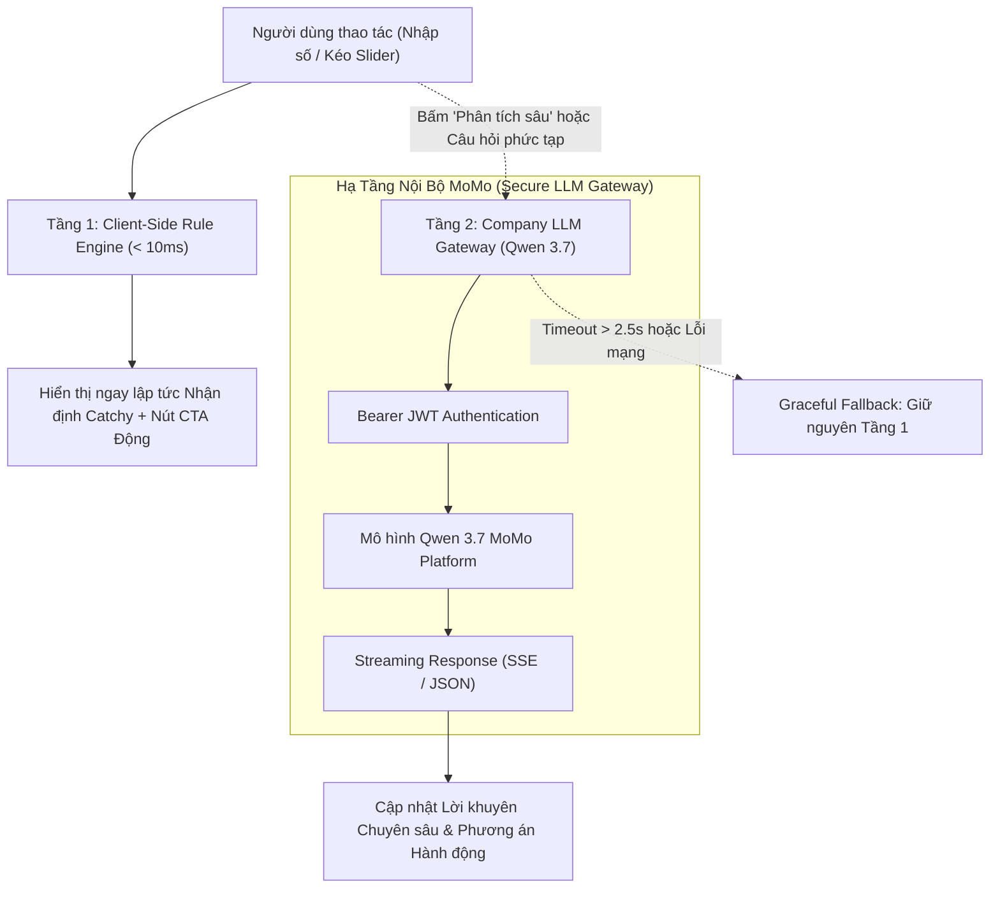

# ĐẶC TẢ SẢN PHẨM & KỸ THUẬT: MOMO AI PROPOSAL ENGINE (HYBRID DUAL-ENGINE ARCHITECTURE)
## BỘ MÁY GỢI Ý & PHẢN HỒI THÔNG MINH KẾT HỢP CLIENT-SIDE RULE ENGINE & CỔNG API QWEN 3.7 NỘI BỘ CHO WEB PLATFORM

---

## THÔNG TIN TỔNG QUAN (METADATA)

<table style="width:100%; border-collapse:collapse; border:1.5px solid #64748b; margin:1em 0; font-size:0.9em;">
  <thead>
    <tr style="background-color:#f1f5f9;">
      <th style="border:1.5px solid #64748b; padding:8px 12px; text-align:left; font-weight:700;">Hạng Mục</th>
      <th style="border:1.5px solid #64748b; padding:8px 12px; text-align:left; font-weight:700;">Chi Tiết</th>
    </tr>
  </thead>
  <tbody>
    <tr>
      <td style="border:1px solid #94a3b8; padding:8px 12px; text-align:left;"><strong>Tên Tính Năng / Engine</strong></td>
      <td style="border:1px solid #94a3b8; padding:8px 12px; text-align:left;"><strong>MoMo AI Proposal Engine (Hybrid Architecture: Client-Side Rule Matrix + Company Qwen 3.7 Gateway)</strong></td>
    </tr>
    <tr style="background-color:#f8fafc;">
      <td style="border:1px solid #94a3b8; padding:8px 12px; text-align:left;"><strong>Mã Tài Liệu</strong></td>
      <td style="border:1px solid #94a3b8; padding:8px 12px; text-align:left;"><code>PRD-WEB-AI-PROPOSAL-2026-V2</code></td>
    </tr>
    <tr>
      <td style="border:1px solid #94a3b8; padding:8px 12px; text-align:left;"><strong>Phạm Vi Áp Dụng</strong></td>
      <td style="border:1px solid #94a3b8; padding:8px 12px; text-align:left;">Toàn bộ tiện ích tính toán và công cụ hỗ trợ người dùng (Utility Tools) trên Kênh Web MoMo: <strong>Financial Hub</strong> (26 công cụ tài chính), <strong>Vehicle Hub</strong> (Phạt Nguội, Giá Xăng, Dự Toán Lăn Bánh, Đăng Kiểm, Trạm Sạc/Cây Xăng) và <strong>mọi Utility Tool được phát triển mới</strong> trên toàn Web Platform.</td>
    </tr>
    <tr style="background-color:#f8fafc;">
      <td style="border:1px solid #94a3b8; padding:8px 12px; text-align:left;"><strong>Trọng Tâm Triển Khai (Wave 1 &amp; Wave 2)</strong></td>
      <td style="border:1px solid #94a3b8; padding:8px 12px; text-align:left;">
        <strong>Wave 1 - Financial Utilities:</strong> Tính Lương Gross - Net (<code>/tai-chinh/tinh-luong</code>), Chia Hóa Đơn Du Lịch (<code>/tai-chinh/cong-cu/chia-tien-du-lich</code>), Phân Bổ Lương 50/30/20, Tỷ Giá &amp; Giá Vàng.<br/>
        <strong>Wave 2 - Vehicle Utilities:</strong> Tra Cứu Phạt Nguội (<code>/phat-nguoi</code>), Dự Toán Giá Lăn Bánh Xe (<code>/tien-ich-giao-thong/du-toan-lan-banh</code>), Biến Động Giá Xăng Dầu (<code>/tien-ich-giao-thong/gia-xang</code>), Nhắc Lịch Đăng Kiểm.<br/>
        <strong>Universal Adapter:</strong> Thiết kế chuẩn cắm rút (Plug-and-play) cho mọi tiện ích mới phát sinh thuộc các Hubs khác.
      </td>
    </tr>
    <tr>
      <td style="border:1px solid #94a3b8; padding:8px 12px; text-align:left;"><strong>Trạng Thái</strong></td>
      <td style="border:1px solid #94a3b8; padding:8px 12px; text-align:left;"><strong>APPROVED &amp; INTEGRATING COMPANY QWEN 3.7 API</strong></td>
    </tr>
    <tr style="background-color:#f8fafc;">
      <td style="border:1px solid #94a3b8; padding:8px 12px; text-align:left;"><strong>Đội Ngũ Triển Khai</strong></td>
      <td style="border:1px solid #94a3b8; padding:8px 12px; text-align:left;">Web Frontend Team, AI Platform Team, Content/Copywriting Team, QA Team</td>
    </tr>
  </tbody>
</table>

---

## 1. MỤC TIÊU SẢN PHẨM & NGUYÊN TẮC KIẾN TRÚC

### 1.1 Vấn Đề Thực Tế (Problem Statement)
- Các công cụ tính toán tài chính trên Web thường cho ra kết quả số liệu rất chính xác nhưng **khô cứng và thiếu cảm xúc**.
- Thành phần *"Trợ lý MoMo AI"* trước đây trên các trang tính toán sử dụng mẫu câu tĩnh rập khuôn (*"Lương thực nhận chiếm 89% tổng Gross. Bạn có thể trích từ 2.670.000đ/tháng..."*), khiến người dùng có cảm giác đọc tài liệu kỹ thuật hơn là một người bạn trợ lý tài chính thông minh.
- Trước đây, việc gọi API LLM thương mại bên ngoài (OpenAI / Claude / Gemini) để sinh câu thoại theo thời gian thực gặp 3 rào cản lớn:
  1. **Độ trễ cao (1.5s - 3s):** Phá vỡ trải nghiệm tính toán tức thì (Zero-Latency UI) khi người dùng kéo thanh trượt (slider).
  2. **Chi phí token tích lũy:** Hàng triệu lượt tính toán mỗi tháng sẽ phát sinh chi phí thương mại rất lớn.
  3. **Rủi ro rò rỉ dữ liệu và bảo mật:** Không được đưa số liệu tài chính nhạy cảm của người dùng ra các API bên thứ ba không thuộc hạ tầng kiểm soát của MoMo.

### 1.2 Giải Pháp: Kiến Trúc Lai Đa Tầng (Hybrid Dual-Engine Architecture)
Với việc Đội ngũ Nền tảng AI hoàn thành đóng gói thành công **Bộ thư viện API nội bộ công ty (Company LLM Gateway SDK)** tích hợp mô hình **Qwen 3.7** chạy trên hạ tầng máy chủ của MoMo:
- **Tầng 1 (Client-Side Instant Heuristics - Zero-Latency Engine):** Vận hành bộ máy ma trận điều kiện chạy 100% tại Client. Đảm bảo thời gian phản hồi tức thì **< 10ms**, chi phí vận hành bằng **0đ**, 100% an toàn thương hiệu và tối đa hóa tỷ lệ nhấp chuyển đổi (CTR) vào ứng dụng MoMo ngay khi người dùng thao tác nhập liệu.
- **Tầng 2 (Deep Contextual Reasoning - Company Qwen 3.7 Gateway):** Kích hoạt bất đồng bộ (streaming hoặc on-demand qua nút "Phân Tích Sâu MoMo AI" hoặc khi người dùng đặt câu hỏi tài chính phức tạp). Mô hình **Qwen 3.7** cung cấp năng lực suy luận ngữ cảnh vượt trội, phân tích chi tiết dòng tiền cá nhân và đưa ra lời khuyên tài chính cá nhân hóa mà không phát sinh chi phí token bên ngoài và bảo mật 100% dữ liệu nội bộ.
- **Cơ chế Dự phòng (Graceful Degradation):** Khi mạng chậm hoặc API Qwen 3.7 vượt ngưỡng timeout 2.5s, hệ thống tự động giữ nguyên kết quả Tầng 1 mà không làm gián đoạn trải nghiệm người dùng.



---

## 2. KIẾN TRÚC MA TRẬN QUY TẮC & KHO NỘI DUNG (RULE & COPY MATRIX)

Mỗi công cụ được cấu hình theo mô hình:
$$\text{Output Data} \longrightarrow \text{Condition Evaluator} \longrightarrow \text{Persona Tone Mode} \longrightarrow \text{Randomized Witty Copy} + \text{Dynamic CTA}$$

---

### 2.1 Công Cụ 1: Tính Lương Gross Sang Net (`/tai-chinh/tinh-luong`)

#### Biến Số Đầu Vào
- `gross`: Lương Gross (VND).
- `net`: Lương Net thực nhận (VND).
- `tax`: Thuế TNCN phải nộp (VND).
- `insurance`: Tổng tiền bảo hiểm bắt buộc BHXH, BHYT, BHTN (VND).
- `deduction = gross - net`: Tổng số tiền bị khấu trừ (VND).
- `net_ratio = Math.round((net / gross) * 100)`: Tỷ lệ thực nhận (%).
- `save_target = Math.round(net * 0.15)`: Khuyến nghị tích lũy 15% Net (VND).

#### Ma Trận Quy Tắc & Kho Nội Dung

<table style="width:100%; border-collapse:collapse; border:1.5px solid #64748b; margin:1em 0; font-size:0.85em;">
  <thead>
    <tr style="background-color:#f1f5f9;">
      <th style="border:1.5px solid #64748b; padding:6px; text-align:left; font-weight:700;">Nhánh Logic</th>
      <th style="border:1.5px solid #64748b; padding:6px; text-align:left; font-weight:700;">Điều Kiện Kích Hoạt</th>
      <th style="border:1.5px solid #64748b; padding:6px; text-align:left; font-weight:700;">Nội Dung Chế Độ Mặc Định (Gentle Mode)</th>
      <th style="border:1.5px solid #64748b; padding:6px; text-align:left; font-weight:700;">Nội Dung Chế Độ Cà Khịa (Roast Mode)</th>
      <th style="border:1.5px solid #64748b; padding:6px; text-align:left; font-weight:700;">Nhãn Nút CTA &amp; Deep Link</th>
    </tr>
  </thead>
  <tbody>
    <tr>
      <td style="border:1px solid #94a3b8; padding:6px;"><strong>Thu Nhập Phổ Thông (15M - 25M Gross)</strong><br/><em>(Case thực tế trong ảnh)</em></td>
      <td style="border:1px solid #94a3b8; padding:6px;"><code>gross &gt;= 15M &amp;&amp; gross &lt;= 25M</code></td>
      <td style="border:1px solid #94a3b8; padding:6px;">
        - <em>Var 1:</em> "{net_ratio}% lương Net đã về bản an toàn! Trích ngay {save_target}đ cất vào Túi Thần Tài để tiền sinh lời mỗi ngày trước khi tiêu sạch nhé."<br/>
        - <em>Var 2:</em> "Ví của bạn giữ lại được {net}đ sau nghĩa vụ bảo hiểm. Cài đặt tự động chia tiền vào Hũ Tiết Kiệm để tạo quỹ phòng thân an tâm công tác."
      </td>
      <td style="border:1px solid #94a3b8; padding:6px;">
        - <em>Var 1:</em> "'Bốc hơi' mất {deduction}đ tiền thuế và bảo hiểm nhưng ví vẫn còn {net}đ cầm cự. Trích ngay {save_target}đ vào Hũ trước khi các hội săn sale tìm đến bạn!"<br/>
        - <em>Var 2:</em> "Lương 20 củ mà tháng nào cũng kêu hết tiền. Đừng để {net}đ này biến thành 50 ly trà sữa vô tội vạ. Khóa tiền ngay kẻo cuối tháng lại ăn mì tôm!"
      </td>
      <td style="border:1px solid #94a3b8; padding:6px;">
        <strong>Khóa 15% vào Hũ Tiết Kiệm</strong><br/>
        <code>momo://app?action=spending_jar&amp;tab=savings</code>
      </td>
    </tr>
    <tr style="background-color:#f8fafc;">
      <td style="border:1px solid #94a3b8; padding:6px;"><strong>Thuế Cắn Sâu (Gross &gt; 30M)</strong></td>
      <td style="border:1px solid #94a3b8; padding:6px;"><code>tax &gt;= 2.5M</code></td>
      <td style="border:1px solid #94a3b8; padding:6px;">
        - <em>Var 1:</em> "Mức đóng góp ngân sách {tax}đ khẳng định năng lực vượt trội của bạn. Bù đắp cho dòng tiền cá nhân bằng cách gửi Tiết Kiệm Online MoMo nhận thêm +0.2% lãi suất ưu đãi."<br/>
        - <em>Var 2:</em> "Thu nhập vững vàng! Đây là thời điểm vàng để tái cơ cấu danh mục tài sản tăng trưởng qua chứng chỉ quỹ mở."
      </td>
      <td style="border:1px solid #94a3b8; padding:6px;">
        - <em>Var 1:</em> "Nhìn lương Gross thì oai phong, nhìn thuế TNCN trừ tận {tax}đ thì muốn trầm cảm. Đóng thuế bằng cả tháng lương người ta thế này thì phải bắt tiền làm việc bù lại gấp!"<br/>
        - <em>Var 2:</em> "Chào người hùng gánh còng lưng ngân sách! Để xoa dịu nỗi đau mất {tax}đ, mở ngay sổ tiết kiệm Bản Việt để lấy lại tiền lãi mỗi tháng nào."
      </td>
      <td style="border:1px solid #94a3b8; padding:6px;">
        <strong>Gửi Tiết Kiệm Bù Thuế (+0.2%)</strong><br/>
        <code>momo://app?action=saving_online&amp;partner=bvbank</code>
      </td>
    </tr>
    <tr>
      <td style="border:1px solid #94a3b8; padding:6px;"><strong>Fresher / Miễn Thuế (Gross &lt; 11M)</strong></td>
      <td style="border:1px solid #94a3b8; padding:6px;"><code>tax === 0</code></td>
      <td style="border:1px solid #94a3b8; padding:6px;">
        - <em>Var 1:</em> "Thuế TNCN bằng 0đ là điểm khởi đầu lý tưởng. Chỉ cần 10.000đ/ngày, bạn đã có thể bắt đầu tích sản cùng chương trình Thực Tập Sinh Đầu Tư."<br/>
        - <em>Var 2:</em> "Bảo vệ toàn vẹn {net}đ thu nhập bằng cách đặt hạn mức chi tiêu tuần, xây dựng nền tảng tài chính kỷ luật."
      </td>
      <td style="border:1px solid #94a3b8; padding:6px;">
        - <em>Var 1:</em> "Lương chưa kịp ấm ví đã sợ bay màu? Đừng đợi lương trăm triệu mới tiết kiệm, bắt đầu tích tiểu thành đại từ 10.000đ mỗi ngày để 2 năm nữa tự tin đổi điện thoại mới!"<br/>
        - <em>Var 2:</em> "Chưa phải đóng thuế là một đặc ân của tuổi trẻ. Đừng tiêu sạch {net}đ trong 10 ngày đầu tháng rồi những ngày sau sống bằng niềm tin nhé."
      </td>
      <td style="border:1px solid #94a3b8; padding:6px;">
        <strong>Tích Sản Từ 10.000đ/Ngày</strong><br/>
        <code>momo://app?action=micro_investing_sip</code>
      </td>
    </tr>
  </tbody>
</table>

---

### 2.2 Công Cụ 2: Bảng Tra Cứu & Tính Lãi Suất 40 Ngân Hàng (`/tai-chinh/lai-suat`)

#### Biến Số Đầu Vào
- `selected_bank`: Tên ngân hàng người dùng đang chọn so sánh.
- `amount`: Số tiền gửi tiết kiệm dự kiến (VND).
- `term`: Kỳ hạn gửi (tháng).
- `user_interest`: Tiền lãi tại ngân hàng đã chọn.
- `momo_interest`: Tiền lãi tại đối tác MoMo (Bản Việt / VPBank với ưu đãi +0.2%).
- `gap_interest = momo_interest - user_interest`: Số tiền lãi chênh lệch nhận thêm khi gửi qua MoMo.

#### Ma Trận Quy Tắc & Kho Nội Dung
- **Điều kiện 1: Ngân hàng đã chọn có lãi suất thấp hơn đối tác MoMo (`gap_interest > 0`):**
  - *Gentle:* "Gửi tại {selected_bank} bạn nhận {user_interest}đ. Nếu gửi qua đối tác Bản Việt/VPBank trên MoMo, bạn nhận thêm chênh lệch {gap_interest}đ tiền lãi mỗi năm."
  - *Roast:* "Cùng là số tiền này mà gửi ở đây bạn đang 'tặng không' cho ngân hàng {gap_interest}đ tiền lãi. Bấm mở sổ trên MoMo nhận thêm +0.2% lãi suất, đủ tiền uống trà sữa cả năm!"
  - *CTA:* **Mở Sổ Lãi Cao Nhất (+0.2%)** (`momo://app?action=saving_online`)
- **Điều kiện 2: Số tiền gửi nhỏ chưa đủ mở sổ kỳ hạn (`amount < 10.000.000đ`):**
  - *Gentle:* "Số tiền chưa đủ mở sổ kỳ hạn lớn? Để ngay vào Túi Thần Tài để nhận tiền lời tự động chi trả mỗi ngày, rút ra bất kỳ lúc nào vẫn bảo toàn lãi."
  - *Roast:* "Tiền ít không có nghĩa là để ví nằm im! {amount}đ để trong tài khoản thường chỉ được 0.1%/năm, thả vào Túi Thần Tài mỗi sáng mở mắt ra có ngay tiền ăn sáng."
  - *CTA:* **Sinh Lời Mỗi Ngày Với Túi Thần Tài** (`momo://app?action=tui_than_tai`)

---

### 2.3 Công Cụ 3: Phân Bổ Lương 50/30/20 & Hũ Tài Chính (`/tai-chinh/phan-bo-luong`)

#### Biến Số Đầu Vào
- `need_ratio`, `want_ratio`, `save_ratio`: Tỷ lệ % phân bổ cho Thiết yếu, Mong muốn, Tích lũy.
- `want_amount`, `save_amount`: Số tiền tương ứng.

#### Ma Trận Quy Tắc & Kho Nội Dung
- **Điều kiện 1: Hũ Mong Muốn (Chi tiêu linh hoạt) vượt quá 35%:**
  - *Gentle:* "Khoản chi tiêu cho sở thích đang chiếm {want_ratio}% thu nhập. Hãy cân nhắc cài đặt hạn mức Hũ Chi Tiêu tuần để bảo vệ quỹ tiết kiệm tương lai."
  - *Roast:* "Nghe nói bạn định tiết kiệm, nhưng cái giỏ hàng Shopee và ly trà sữa size L đã nói 'không'. Khóa trần hạn mức bằng Hũ Chi Tiêu ngay trước khi ăn mì tôm vào ngày 20!"
  - *CTA:* **Cài Hạn Mức Hũ Chi Tiêu** (`momo://app?action=spending_jar`)
- **Điều kiện 2: Hũ Tích Lũy mỏng (< 10%):**
  - *Gentle:* "Tỷ lệ tích lũy {save_ratio}% là khá mỏng trước các rủi ro bất ngờ. Đặt mục tiêu nâng dần lên 15-20% bằng tính năng tích lũy tự động định kỳ."
  - *Roast:* "Tương lai đang gọi nhưng tài khoản tích lũy không bắt máy! Không tích lũy từ bây giờ thì lúc có biến chỉ biết ngửa tay than trời. Bật tự động tích lũy Túi Thần Tài ngay!"
  - *CTA:* **Bật Tích Lũy Tự Động** (`momo://app?action=tui_than_tai`)

---

### 2.4 Công Cụ 4: Cổng Tỷ Giá & Quy Đổi Ngoại Tệ (`/tai-chinh/ty-gia`)

#### Biến Số Đầu Vào
- `currency`: Mã ngoại tệ (USD, EUR, JPY, GBP, THB, KRW...).
- `amount`: Số tiền ngoại tệ quy đổi.
- `direction`: Hướng đổi (Ngoại tệ sang VND hoặc ngược lại).

#### Ma Trận Quy Tắc & Kho Nội Dung
- **Điều kiện 1: Quy đổi ngoại tệ du lịch phổ biến (USD, JPY, THB, KRW):**
  - *Gentle:* "Theo dõi sát biểu đồ biến động để chọn thời điểm đổi tiền tối ưu nhất. Khi đi du lịch, bạn có thể quét thanh toán trực tiếp qua MoMo tại nhiều quốc gia."
  - *Roast:* "Tính đổi tiền đi vi vu nước ngoài hả bạn ơi? Đổi tiền mặt cồng kềnh dễ rơi mất, dùng MoMo quét mã QR thanh toán quốc tế không tốn phí chuyển đổi cồng kềnh!"
  - *CTA:* **Khám Phá Thanh Toán Quốc Tế MoMo** (`momo://app?action=international_payment`)
- **Điều kiện 2: Nhận tiền kiều hối gửi về (`currency === 'USD' && amount >= 500`):**
  - *Gentle:* "Nhận tiền kiều hối trực tiếp vào MoMo 24/7 hoàn toàn miễn phí, quy đổi sang VND theo tỷ giá ưu đãi và rút về tài khoản ngân hàng liên kết tức thì."
  - *Roast:* "Tiền kiều hối người thân gửi về mà chạy ra quầy xếp hàng ký giấy tờ thì quá mất thời gian. Nhận thẳng vào Ví MoMo trong 30 giây, an toàn tuyệt đối!"
  - *CTA:* **Nhận Tiền Quốc Tế Miễn Phí** (`momo://app?action=folder_remittances`)

---

### 2.5 Công Cụ 5: Bảng Giá Vàng & Quy Đổi Vàng SJC, 9999 (`/tai-chinh/gia-vang`)

#### Biến Số Đầu Vào
- `gold_type`: Loại vàng (SJC, Nhẫn 9999, PNJ, DOJI).
- `spread`: Chênh lệch giá mua vào - bán ra (VND/lượng).
- `quantity`: Số lượng chỉ/lượng người dùng muốn quy đổi.

#### Ma Trận Quy Tắc & Kho Nội Dung
- **Điều kiện 1: Chênh lệch mua bán lớn (`spread >= 1.500.000đ`):**
  - *Gentle:* "Biên độ chênh lệch mua bán đang ở mức {spread}đ/lượng. Nhà đầu tư nên cân nhắc rủi ro ngắn hạn trước khi giải ngân khối lượng lớn."
  - *Roast:* "Vàng nhảy múa từng giờ, mua đu đỉnh là tối về mất ngủ! Thay vì ôm tiền chờ đợi, trích vốn nhàn rỗi tích sản Chứng Chỉ Quỹ mở trên MoMo để phân tán rủi ro."
  - *CTA:* **Đa Dạng Danh Mục Với Quỹ Mở** (`momo://app?action=mutual_fund`)
- **Điều kiện 2: Quy đổi số lượng nhỏ lẻ (`quantity < 1` chỉ):**
  - *Gentle:* "Tích lũy vàng từng phân/chỉ nhỏ là chiến lược bảo toàn sức mua tuyệt vời. Bạn có thể mua Vàng Tài Lộc online trực tiếp trên ứng dụng MoMo."
  - *Roast:* "Chưa đủ tiền mua nguyên cây vàng thì mua từng phân vàng online! Không lo cất giấu dưới gối sợ trộm, mở MoMo mua tích sản từ vài trăm ngàn."
  - *CTA:* **Mua Vàng Tài Lộc Online** (`momo://app?action=gold_accumulate`)

---

### 2.6 Công Cụ 6: Điểm Tín Dụng & CIC Simulator (`/diem-tin-dung`)

#### Biến Số Đầu Vào
- `credit_score`: Điểm tín dụng ước tính (150 - 750).
- `risk_tier`: Phân loại nợ (Hạng 1 đến Hạng 5).

#### Ma Trận Quy Tắc & Kho Nội Dung
- **Điều kiện 1: Điểm tín dụng Tốt / Rất Tốt (`credit_score >= 650`):**
  - *Gentle:* "Điểm tín dụng của bạn thuộc nhóm Ưu tú ({credit_score} điểm). Bạn đủ điều kiện kích hoạt các gói hạn mức tài chính cao nhất trên MoMo."
  - *Roast:* "Uy tín ngời ngời, hồ sơ sạch không tì vết! Điểm đẹp thế này mà không mở Ví Trả Sau hạn mức tới 20 triệu để nhận 45 ngày miễn lãi thì quá phí."
  - *CTA:* **Mở Ví Trả Sau Hạn Mức Tối Đa** (`momo://app?action=vi_tra_sau`)
- **Điều kiện 2: Điểm tín dụng thấp / Có nguy cơ trả trễ (`credit_score < 550`):**
  - *Gentle:* "Hồ sơ của bạn đang có cảnh báo rủi ro tín dụng. Hãy ưu tiên thanh toán dứt điểm các khoản dư nợ thẻ và hóa đơn đúng hạn để cải thiện điểm số."
  - *Roast:* "Cảnh báo đỏ! Lịch sử trả trễ đang kéo điểm tín dụng của bạn xuống dốc. Cài đặt ngay tính năng Tự động thanh toán hóa đơn trên MoMo để không bao giờ bị dính phạt nợ xấu nữa!"
  - *CTA:* **Cài Tự Động Thanh Toán Hóa Đơn** (`momo://app?action=auto_bill_pay`)

---

### 2.7 Công Cụ 7: Dự Toán Lương Hưu & BHXH 1 Lần (`/tai-chinh/luong-huu`)

#### Biến Số Đầu Vào
- `mode`: Chế độ tính (`rut_mot_lan` hoặc `luong_huu`).
- `lump_sum`: Tiền rút BHXH 1 lần ước tính.
- `monthly_pension`: Lương hưu hàng tháng dự kiến.

#### Ma Trận Quy Tắc & Kho Nội Dung
- **Điều kiện 1: Người dùng chọn tính Rút BHXH 1 lần:**
  - *Gentle:* "Rút một lần giúp bạn giải quyết dòng tiền trước mắt ({lump_sum}đ), nhưng bạn sẽ mất đi quyền lợi thẻ BHYT miễn phí trọn đời và lương hưu hàng tháng."
  - *Roast:* "Rút một cục {lump_sum}đ tiêu vèo cái là hết, rồi về già sống bằng tình thương hả bạn ơi? Nếu bắt buộc phải rút, nhớ trích ngay 40% gửi Tiết Kiệm Online để tự tạo sổ hưu riêng!"
  - *CTA:* **Gửi Tiết Kiệm Làm Quỹ Hưu Trí** (`momo://app?action=saving_online`)
- **Điều kiện 2: Lương hưu dự kiến thấp (`monthly_pension < 5.000.000đ`):**
  - *Gentle:* "Lương hưu dự kiến {monthly_pension}đ/tháng có thể chịu áp lực lớn từ lạm phát. Hãy chủ động lập quỹ hưu trí bổ sung ngay từ hôm nay."
  - *Roast:* "Nghỉ hưu với {monthly_pension}đ/tháng sau 20 năm nữa thì chỉ đủ tiền ăn bánh mì uống nước lọc. Bắt đầu tích sản Chứng Chỉ Quỹ từ 10.000đ/ngày để khi về hưu được an nhàn đi du lịch!"
  - *CTA:* **Lập Kế Hoạch Tự Do Tài Chính FIRE** (`momo://app?action=fire_simulator`)

---

### 2.8 Công Cụ 8: Trả Góp Ví Trả Sau (`/vi-tra-sau`)

#### Biến Số Đầu Vào
- `item_amount`: Giá trị món hàng cần mua.
- `term`: Kỳ hạn trả góp (3, 6, 9, 12 tháng).

#### Ma Trận Quy Tắc & Kho Nội Dung
- **Điều kiện: Món đồ giá trị lớn (`item_amount >= 15.000.000đ`):**
  - *Gentle:* "Chia nhỏ thanh toán thành các kỳ hạn linh hoạt giúp bạn chủ động dòng tiền, giữ lại số tiền nhàn rỗi sinh lời trên Túi Thần Tài."
  - *Roast:* "Mê món đồ {item_amount}đ này quá rồi đúng không? Đừng rút hết tiền tiết kiệm mua đứt, chọn trả góp qua Ví Trả Sau mỗi tháng chỉ từ vài trăm ngàn để ví không bị viêm màng!"
  - *CTA:* **Kích Hoạt Ví Trả Sau Nhận 20 Triệu** (`momo://app?action=vi_tra_sau`)

---

### 2.9 Công Cụ 9: Lịch Trả Nợ Vay Nhanh (`/vay-nhanh`)

#### Biến Số Đầu Vào
- `loan_amount`: Số tiền cần vay (VND).
- `monthly_payment`: Số tiền trả gốc và lãi hàng tháng theo dư nợ giảm dần.

#### Ma Trận Quy Tắc & Kho Nội Dung
- **Điều kiện: Tính toán lịch trả nợ vay tiêu dùng:**
  - *Gentle:* "Lãi suất tính trên dư nợ giảm dần minh bạch. Mỗi tháng bạn cần thanh toán {monthly_payment}đ, giải ngân trực tiếp vào Ví MoMo chỉ sau 1 phút duyệt hồ sơ."
  - *Roast:* "Cần tiền gấp thì vay ngân hàng uy tín trên MoMo, tuyệt đối tránh xa các app 'tín dụng đen' ngoài mạng! Số tiền trả mỗi tháng cố định {monthly_payment}đ, rõ ràng từng đồng."
  - *CTA:* **Thẩm Định Hạn Mức Vay Trong 1 Phút** (`momo://app?action=vay_nhanh`)

---

### 2.10 Công Cụ 10: Chia Hóa Đơn Du Lịch Nhóm (`/tai-chinh/cong-cu/chia-tien-du-lich`)

#### Biến Số Đầu Vào
- `user_net_balance`: Số dư bù trừ của người xem bảng tính (> 0 là chủ nợ, < 0 là con nợ).
- `max_creditor`: Tên người ứng tiền nhiều nhất.
- `avg_per_person`: Chi phí bình quân đầu người.

#### Ma Trận Quy Tắc & Kho Nội Dung
- **Điều kiện 1: Thủ quỹ ứng tiền hộ nhiều (`user_net_balance > 1.000.000đ`):**
  - *Gentle:* "Bạn đã ứng trước số tiền lớn cho cả chuyến đi. Nhấn nút nhắc nợ để bạn bè thanh toán dứt điểm vào tài khoản MoMo của bạn nhanh chóng."
  - *Roast:* "Bồ tát sống của cả chuyến đi là đây! Bạn đã quẹt thẻ hộ cả nhóm tận {user_net_balance}đ. Gửi bảng này vào nhóm chat đòi nợ ngay kẻo tình bạn thì còn mà tiền thì bay màu!"
  - *CTA:* **Sao Chép Nhắc Nợ Kèm Link MoMo** (`clipboard_copy_summary`)
- **Điều kiện 2: Con nợ lớn nhất nhóm (`user_net_balance < -500.000đ`):**
  - *Gentle:* "Phần chi phí cần thanh toán lại của bạn là {abs_balance}đ. Chuyển khoản 1 chạm qua MoMo để hoàn tất công nợ chuyến đi."
  - *Roast:* "Hôm đi hết mình, hôm về hết hồn! Bạn đang nợ {max_creditor} số tiền {abs_balance}đ. Bắn tiền dứt điểm qua MoMo trong 3 giây để giữ vững danh hiệu người bạn văn minh sòng phẳng nào."
  - *CTA:* **Bắn MoMo Cho {max_creditor} Ngay** (`momo://app?action=p2p_transfer`)
- **Điều kiện 3: Chuyến đi chi phí bình quân cao (`avg_per_person > 3.000.000đ`):**
  - *Gentle:* "Chuyến đi có mức chi tiêu chất lượng cao ({avg_per_person}đ/người). Để chuẩn bị tốt cho chuyến tới, nhóm bạn có thể mở Quỹ Nhóm MoMo để cùng nhau tích lũy sinh lời hàng tháng."
  - *Roast:* "Nhóm mình đi du lịch hay đi thị sát đời sống giới thượng lưu vậy? Tiêu sương sương {avg_per_person}đ/người. Lần sau trước khi xách vali đi, mở Quỹ Nhóm MoMo tích tiền trước kẻo về nhà lại ăn bánh mì trừ bữa!"
  - *CTA:* **Mở Quỹ Nhóm Cho Chuyến Tới** (`momo://app?action=group_fund`)

---

### 2.11 Công Cụ 11: Tích Sản FIRE & Tự Do Tài Chính (`/tai-chinh/tu-do-tai-chinh`)

#### Biến Số Đầu Vào
- `retire_age`: Độ tuổi mong muốn nghỉ hưu.
- `target_asset`: Khối tài sản cần có theo quy tắc 4% an toàn.

#### Ma Trận Quy Tắc & Kho Nội Dung
- **Điều kiện: Muốn nghỉ hưu sớm trước 40 tuổi (`retire_age <= 40`):**
  - *Gentle:* "Để nghỉ hưu ở tuổi {retire_age}, bạn cần xây dựng danh mục tài sản sinh lời ròng {target_asset}đ. Bắt đầu phân bổ định kỳ vào chứng chỉ quỹ tăng trưởng ngay hôm nay."
  - *Roast:* "Muốn 35 tuổi đã thảnh thơi đi câu cá ngắm hoàng hôn? Với tốc độ tiêu tiền hiện tại thì 65 tuổi bạn vẫn đang cày deadline đấy! Bắt tay vào tích sản Chứng Chỉ Quỹ ngay hôm nay."
  - *CTA:* **Bắt Đầu Tích Sản Chứng Chỉ Quỹ Với Quỹ Mở** (`momo://app?action=mutual_fund_sip`)

---

### 2.12 Công Cụ 12: Soi Danh Mục Quỹ Mở & NAV (`/tai-chinh/chung-chi-quy`)

#### Biến Số Đầu Vào
- `fund_return_1y`: Tỷ suất sinh lời 1 năm gần nhất của quỹ (%).

#### Ma Trận Quy Tắc & Kho Nội Dung
- **Điều kiện: Quỹ có tỷ suất sinh lời vượt trội (`fund_return_1y >= 12%`):**
  - *Gentle:* "Quỹ ghi nhận tỷ suất sinh lời {fund_return_1y}%/năm, vượt trội so với lãi suất tiền gửi thông thường. Thích hợp cho mục tiêu đầu tư trung và dài hạn từ 10.000đ."
  - *Roast:* "Gửi tiết kiệm được 5%, trong khi quỹ mở làm ăn tốt mang về {fund_return_1y}%/năm. Không cần có bằng tài chính, chỉ cần từ 10k là đã có chuyên gia quản lý vốn hộ bạn rồi!"
  - *CTA:* **Tham Gia Thực Tập Sinh Đầu Tư Chỉ Từ 10k** (`momo://app?action=micro_investing_sip`)

---

### 2.13 Công Cụ 13: Dự Toán Chi Phí Đám Cưới & Điểm Hòa Vốn

- **Điều kiện: Tổng chi tiệc cưới vượt quá dự kiến mừng cưới:**
  - *Gentle:* "Chi phí tiệc cưới đang chênh lệch cao so với dự phòng. Hãy cân nhắc tối ưu các khoản decor hoặc kích hoạt nguồn vốn đòn bẩy ngắn hạn an toàn."
  - *Roast:* "Tính toán cho thấy đám cưới cần tối thiểu 35 mâm cỗ để hòa vốn. Nhưng nếu hội bạn thân rủ nhau đi phong bì 300k thì cô dâu chú rể chuẩn bị tinh thần rửa bát trừ nợ! Bật Ví Trả Sau để có sẵn 20 triệu dự phòng khẩn cấp nào."
  - *CTA:* **Mở Hạn Mức Ví Trả Sau Dự Phòng** (`momo://app?action=vi_tra_sau`)

---

### 2.14 Công Cụ 14: Dự Toán Chi Phí Thuê Nhà & Ra Ở Riêng

- **Điều kiện: Tiền thuê nhà > 35% tổng thu nhập hàng tháng:**
  - *Gentle:* "Chi phí nhà ở vượt quá ngưỡng an toàn tài chính (30%). Nên tìm bạn ở ghép hoặc lựa chọn khu vực có chi phí tối ưu hơn."
  - *Roast:* "Căn phòng có ban công chill thật đấy, nhưng tiền thuê ngốn gần nửa tháng lương thì tối về chỉ có nước ngắm trăng uống nước lọc. Đi làm cả tháng chỉ để nuôi chủ nhà thôi bạn ơi!"
  - *CTA:* **Lập Kế Hoạch Ngân Sách Thuê Nhà** (`momo://app?action=spending_jar`)

---

### 2.15 Công Cụ 15: Tra Cứu Phạt Nguội & Cảnh Báo Vi Phạm (`/phat-nguoi`)

#### Biến Số Đầu Vào
- `violation_count`: Số lỗi vi phạm chưa nộp phạt.
- `total_fine`: Tổng số tiền phạt ước tính (VND).
- `vehicle_type`: Loại phương tiện (Ô tô hoặc Xe máy).

#### Ma Trận Quy Tắc & Kho Nội Dung
- **Điều kiện 1: Phát hiện có lỗi vi phạm phạt nguội (`violation_count > 0`):**
  - *Gentle:* "Phương tiện của bạn ghi nhận {violation_count} lỗi vi phạm giao thông chưa xử lý với tổng tiền phạt {total_fine}đ. Hãy nộp phạt trực tuyến nhanh chóng qua MoMo để đảm bảo đủ điều kiện đăng kiểm."
  - *Roast:* "Phóng nhanh một phút, nộp phạt cả tháng lương! Xe bạn đang 'nợ nước' {total_fine}đ tiền phạt nguội kìa. Nộp phạt ngay qua MoMo trong 1 phút kẻo đến ngày đi đăng kiểm lại bị từ chối rồi mất công quay xe về nhé!"
  - *CTA:* **Nộp Phạt Nguội Trực Tuyến Qua MoMo** (`momo://app?action=traffic_fine`)
- **Điều kiện 2: Xe sạch lỗi vi phạm (`violation_count === 0`):**
  - *Gentle:* "Chúc mừng bạn! Phương tiện không có lỗi vi phạm phạt nguội nào trên hệ thống. Tiếp tục duy trì thói quen lái xe an toàn và tra cứu định kỳ."
  - *Roast:* "Hồ sơ sạch bóng không một vết gợn, xứng danh tay lái vàng trong làng tuân thủ luật! Cài đặt ngay tính năng Nhắc Lịch Đăng Kiểm tự động trên MoMo để xe luôn sẵn sàng lăn bánh."
  - *CTA:* **Cài Đặt Tự Động Nhắc Phạt Nguội & Đăng Kiểm** (`momo://app?action=vehicle_registry_reminder`)

---

### 2.16 Công Cụ 16: Dự Toán Chi Phí Lăn Bánh Ô Tô / Xe Máy (`/tien-ich-giao-thong/du-toan-lan-banh`)

#### Biến Số Đầu Vào
- `car_price`: Giá niêm yết của xe (VND).
- `rolling_cost`: Tổng chi phí lăn bánh thực tế (VND).
- `tax_fee`: Tổng phí bắt buộc (Thuế trước bạ, biển số, bảo hiểm TNDS, bảo trì đường bộ).

#### Ma Trận Quy Tắc & Kho Nội Dung
- **Điều kiện: Chi phí lăn bánh chênh lệch lớn so với giá niêm yết (`tax_fee >= 50.000.000đ`):**
  - *Gentle:* "Tổng chi phí lăn bánh dự kiến là {rolling_cost}đ (thuế phí bắt buộc {tax_fee}đ). Bạn có thể lựa chọn gói vay mua xe liên kết ngân hàng qua MoMo để dàn trải dòng tiền."
  - *Roast:* "Nhìn giá xe niêm yết thì vừa túi, cộng thêm thuế phí {tax_fee}đ thì muốn 'xỉu ngang'! Đừng để giấc mơ bốn bánh bị kẹt giữa đường, mở MoMo tham khảo ngay gói vay mua xe lãi suất tốt từ các ngân hàng đối tác nào."
  - *CTA:* **Dự Toán Gói Vay Mua Xe Lãi Suất Tốt** (`momo://app?action=car_loan`)

---

### 2.17 Công Cụ 17: Biến Động & Dự Báo Giá Xăng Dầu (`/tien-ich-giao-thong/gia-xang`)

#### Biến Số Đầu Vào
- `gas_price`: Giá bán lẻ hiện hành (VND/lít).
- `forecast_trend`: Xu hướng kỳ tới (`TĂNG` hoặc `GIẢM`).
- `predicted_delta`: Mức điều chỉnh dự kiến (VND/lít).

#### Ma Trận Quy Tắc & Kho Nội Dung
- **Điều kiện: Giá xăng dự báo tăng mạnh (`forecast_trend === 'TĂNG'`):**
  - *Gentle:* "Giá xăng dầu dự báo tăng khoảng {predicted_delta}đ/lít trong kỳ điều chỉnh tới. Đổ đầy bình sớm và quét mã MoMo tại các cây xăng PVOIL/Comeco để tích lũy hoàn tiền."
  - *Roast:* "Xăng lại sắp tăng giá rồi bạn ơi! Đừng để ví tiền bị 'đốt cháy' theo từng lít xăng. Mở MoMo quét QR đổ xăng PVOIL nhận ngay voucher hoàn tiền để ví đỡ xót!"
  - *CTA:* **Nhận Voucher Đổ Xăng PVOIL Trên MoMo** (`momo://app?action=pvoil_gas`)

---

### 2.18 Chuẩn Mở Rộng Tiện Ích Đa Nền Tảng (Universal Utility Extensibility Contract)

MoMo AI được thiết kế theo kiến trúc **Mô-đun cắm rút dùng chung (Plug-and-Play Universal Engine)** cho **bất kỳ tiện ích tính toán nào (Utility Tool) thuộc mọi Hub**:
- Mỗi Utility Tool khi được phát triển mới chỉ cần cung cấp:
  1. `toolId`: Định danh tiện ích (ví dụ: `vehicle-fine`, `vehicle-gas`, `finance-salary`, `insurtech-quote`...).
  2. `hub`: Phân khối (`FINANCIAL`, `VEHICLE`, `INSURTECH`, `OTA`, `OTHER`).
  3. `metrics`: Dữ liệu số liệu đầu ra của phép tính.
- **Tự động thừa hưởng 2 tầng AI:**
  - *Tầng 1:* Chạy qua hàm đánh giá điều kiện nội bộ để xuất ngay nhận định dí dỏm + CTA deep link thích hợp (< 10ms).
  - *Tầng 2:* Chuyển tải `metrics` sang Company LLM Gateway (Model Qwen 3.7) kèm prompt ngữ cảnh của Utility tương ứng khi người dùng cần tư vấn sâu.

---

## 3. ĐẶC TẢ GIAO DIỆN & THÀNH PHẦN FRONTEND (UI/UX SPEC)

### 3.1 Cấu Trúc Khung Hiển Thị (Component Box Layout)

```text
┌────────────────────────────────────────────────────────────────────────┐
│ [✨ ICON] TRỢ LÝ MOMO AI                 [🔘 Chế độ Cà Khịa: ON/OFF]   │
├────────────────────────────────────────────────────────────────────────┤
│ "Câu nhận xét catchy, hóm hỉnh theo đúng số liệu tính toán..."        │
│                                                                        │
│ [🔄 Lắc quẻ lời khuyên khác]                                           │
├────────────────────────────────────────────────────────────────────────┤
│ [            NÚT BẤM CTA ĐỘNG (Ví dụ: Khóa tiền vào Hũ ngay)         ] │
└────────────────────────────────────────────────────────────────────────┘
```

### 3.2 Quy Chuẩn Thiết Kế Visual (Design Tokens)
- **Container Background:** `#FFF5F8` (Hồng phấn MoMo nhạt) với border `1px solid #FCE7F0`, bo góc `rounded-2xl` (16px).
- **Header Tag:** Font chữ đậm `text-xs font-bold text-pink-600 uppercase tracking-wider`.
- **Toggle Switch:** Nút gạt chuyển đổi giữa `Nhẹ nhàng` và `Cà khịa` (Roast Mode), lưu trạng thái vào `localStorage` của người dùng.
- **Message Body:** Font chữ `text-sm text-slate-800 leading-relaxed font-normal`. Các con số tiền bạc và tỷ lệ % bắt buộc in đậm `font-bold text-slate-900`.
- **Nút Re-roll:** Icon xoay tròn nhỏ `text-xs font-medium text-slate-500 hover:text-pink-600 transition-colors cursor-pointer`.
- **CTA Button:** Button lớn full-width chuẩn Mobase UI, nền hồng `bg-pink-500 hover:bg-pink-600 text-white font-bold h-11 rounded-xl shadow-sm`.

---

## 4. MÃ NGUỒN TYPESCRIPT SẴN SÀNG TRIỂN KHAI (CODE IMPLEMENTATION)

Đội ngũ Frontend có thể đưa trực tiếp 2 file mã nguồn này vào dự án Web Platform:

### File 1: Engine Logic & Kho Dữ Liệu (`src/utils/aiProposalEngine.ts`)

```typescript
// src/utils/aiProposalEngine.ts

export type ProposalMode = 'GENTLE' | 'ROAST';

export interface SalaryParams {
  gross: number;
  net: number;
  tax: number;
  insurance: number;
  mode?: ProposalMode;
}

export interface ProposalOutput {
  tag: string;
  message: string;
  ctaText: string;
  deeplink: string;
}

export const getSalaryAiProposal = (params: SalaryParams, seed: number = 0): ProposalOutput => {
  const { gross, net, tax, mode = 'GENTLE' } = params;
  const netRatio = Math.round((net / gross) * 100);
  const deduction = (gross - net).toLocaleString('vi-VN');
  const netStr = net.toLocaleString('vi-VN');
  const taxStr = tax.toLocaleString('vi-VN');
  const saveTarget = Math.round(net * 0.15).toLocaleString('vi-VN');

  // Case 1: Thuế cao (Tax >= 2.5M)
  if (tax >= 2500000) {
    if (mode === 'ROAST') {
      const quotes = [
        `Nhìn lương Gross thì oai phong, nhìn thuế TNCN trừ tận ${taxStr}đ thì muốn trầm cảm. Đóng thuế bạc triệu thế này thì phải bắt tiền làm việc bù lại gấp!`,
        `Chào người hùng gánh còng lưng ngân sách! Để xoa dịu nỗi đau mất ${taxStr}đ, mở ngay sổ tiết kiệm Bản Việt để lấy lại tiền lãi mỗi tháng nào.`
      ];
      return {
        tag: "MOMO AI CÀ KHỊA",
        message: quotes[seed % quotes.length],
        ctaText: "Gửi Tiết Kiệm Bù Thuế (+0.2%)",
        deeplink: "momo://app?action=saving_online&partner=bvbank"
      };
    }
    return {
      tag: "MOMO AI GỢI Ý",
      message: `Mức đóng góp ngân sách ${taxStr}đ khẳng định năng lực vượt trội của bạn. Bù đắp cho dòng tiền cá nhân bằng cách gửi Tiết Kiệm Online MoMo nhận thêm +0.2% lãi suất ưu đãi.`,
      ctaText: "Gửi Tiết Kiệm Nhận +0.2%",
      deeplink: "momo://app?action=saving_online&partner=bvbank"
    };
  }

  // Case 2: Thu nhập phổ thông văn phòng (15M - 25M)
  if (gross >= 15000000 && gross <= 25000000) {
    if (mode === 'ROAST') {
      const quotes = [
        `'Bốc hơi' mất ${deduction}đ tiền thuế và bảo hiểm nhưng ví vẫn còn ${netStr}đ cầm cự. Trích ngay ${saveTarget}đ vào Hũ trước khi các hội săn sale Shopee tìm đến bạn!`,
        `Lương 20 củ mà tháng nào cũng kêu hết tiền. Đừng để ${netStr}đ này biến thành 50 ly trà sữa vô tội vạ. Khóa tiền ngay kẻo cuối tháng lại ăn mì tôm!`
      ];
      return {
        tag: "MOMO AI CÀ KHỊA",
        message: quotes[seed % quotes.length],
        ctaText: "Khóa 15% Vào Hũ Tiết Kiệm",
        deeplink: "momo://app?action=spending_jar&tab=savings"
      };
    }
    return {
      tag: "MOMO AI GỢI Ý",
      message: `${netRatio}% lương Net đã về bản an toàn! Trích ngay ${saveTarget}đ cất vào Túi Thần Tài để tiền sinh lời mỗi ngày trước khi tiêu sạch nhé.`,
      ctaText: "Khóa 15% Vào Hũ Tiết Kiệm",
      deeplink: "momo://app?action=spending_jar&tab=savings"
    };
  }

  // Case 3: Thu nhập dưới mức chịu thuế (Tax == 0)
  if (tax === 0) {
    if (mode === 'ROAST') {
      return {
        tag: "MOMO AI CÀ KHỊA",
        message: `Lương chưa kịp ấm ví đã sợ bay màu? Đừng đợi lương trăm triệu mới tiết kiệm, bắt đầu tích sản từ 10.000đ mỗi ngày để 2 năm nữa tự tin đổi iPhone mới!`,
        ctaText: "Tích Sản Từ 10.000đ/Ngày",
        deeplink: "momo://app?action=micro_investing_sip"
      };
    }
    return {
      tag: "MOMO AI GỢI Ý",
      message: `Thuế TNCN bằng 0đ là điểm khởi đầu lý tưởng. Chỉ cần 10.000đ/ngày, bạn đã có thể bắt đầu tích sản cùng chương trình Thực Tập Sinh Đầu Tư.`,
      ctaText: "Tích Sản Từ 10.000đ/Ngày",
      deeplink: "momo://app?action=micro_investing_sip"
    };
  }

  // Case mặc định
  return {
    tag: "MOMO AI GỢI Ý",
    message: `Lương thực nhận đạt ${netRatio}% tổng thu nhập. Thiết lập kỷ luật trích ${saveTarget}đ vào Túi Thần Tài để xây dựng nền tảng tài chính bền vững.`,
    ctaText: "Quản Lý Tài Chính Tự Động",
    deeplink: "momo://app?action=financial_hub"
  };
};
```

---

### File 2: Component React Hiển Thị (`src/components/AiProposalBox.tsx`)

```tsx
// src/components/AiProposalBox.tsx
import React, { useState } from 'react';
import { getSalaryAiProposal, ProposalMode, SalaryParams } from '../utils/aiProposalEngine';

export const AiProposalBox: React.FC<SalaryParams> = (props) => {
  const [mode, setMode] = useState<ProposalMode>('ROAST'); // Mặc định mở chế độ Cà Khịa để tăng tương tác
  const [seed, setSeed] = useState<number>(0);

  const proposal = getSalaryAiProposal({ ...props, mode }, seed);

  const handleReRoll = () => {
    setSeed(prev => prev + 1);
    if (typeof window !== 'undefined' && (window as any).umami) {
      (window as any).umami.track('ai_proposal_reroll', { tool: 'tinh_luong', seed: seed + 1 });
    }
  };

  const handleToggleMode = () => {
    const nextMode: ProposalMode = mode === 'ROAST' ? 'GENTLE' : 'ROAST';
    setMode(nextMode);
    if (typeof window !== 'undefined' && (window as any).umami) {
      (window as any).umami.track('ai_proposal_toggle_roast', { tool: 'tinh_luong', mode: nextMode });
    }
  };

  const handleClickCta = () => {
    if (typeof window !== 'undefined' && (window as any).umami) {
      (window as any).umami.track('ai_proposal_click_cta', { 
        tool: 'tinh_luong', 
        mode, 
        cta_text: proposal.ctaText,
        deeplink: proposal.deeplink 
      });
    }
    window.location.href = proposal.deeplink;
  };

  return (
    <div className="mt-4 overflow-hidden rounded-2xl border border-pink-100 bg-[#FFF5F8] p-4 sm:p-5 transition-all shadow-sm">
      {/* Header Bar */}
      <div className="flex items-center justify-between pb-2">
        <div className="flex items-center gap-1.5">
          <span className="text-pink-500 font-bold text-sm">✨</span>
          <span className="text-xs font-bold uppercase tracking-wider text-pink-600">
            {proposal.tag}
          </span>
        </div>

        {/* Roast Mode Toggle */}
        <button
          type="button"
          onClick={handleToggleMode}
          className="flex items-center gap-1.5 text-[11px] font-semibold text-slate-500 hover:text-pink-600 transition-colors"
          title="Bật/Tắt chế độ Cà Khịa"
        >
          <span>Cà khịa</span>
          <span className={`inline-block h-3.5 w-7 rounded-full transition-colors relative ${mode === 'ROAST' ? 'bg-pink-500' : 'bg-slate-300'}`}>
            <span className={`absolute top-0.5 h-2.5 w-2.5 rounded-full bg-white transition-transform ${mode === 'ROAST' ? 'translate-x-3.5' : 'translate-x-0.5'}`} />
          </span>
        </button>
      </div>

      {/* Message Content */}
      <div className="mt-1 text-sm leading-relaxed text-slate-800">
        <p>{proposal.message}</p>
      </div>

      {/* Sub-actions: Re-roll */}
      <div className="mt-2.5 flex items-center justify-between">
        <button
          type="button"
          onClick={handleReRoll}
          className="text-[11px] text-slate-400 hover:text-slate-600 flex items-center gap-1 transition-colors"
        >
          <span>🔄</span>
          <span>Xem lời khuyên khác</span>
        </button>
      </div>

      {/* Main Dynamic CTA Button */}
      <button
        type="button"
        onClick={handleClickCta}
        className="mt-4 w-full h-11 rounded-xl bg-pink-500 hover:bg-pink-600 active:scale-[0.99] text-white font-bold text-sm shadow-xs transition-all flex items-center justify-center gap-2"
      >
        <span>{proposal.ctaText}</span>
      </button>
    </div>
  );
};
```

### File 3: Module Kết Nối Company LLM Gateway (Model Qwen 3.7) (`src/services/companyLlmService.ts`)

```typescript
// src/services/companyLlmService.ts
/**
 * Module kết nối Cổng API LLM Nội Bộ Công Ty (Company LLM Gateway)
 * Tích hợp mô hình Qwen 3.7 dùng chung đa dự án (Web Platform, MoMo AI, MoSpark)
 */

export interface QwenAnalysisRequest {
  toolId: string;
  financialMetrics: Record<string, number | string>;
  userIntent?: string;
  toneMode?: 'GENTLE' | 'ROAST';
}

export interface QwenAnalysisResponse {
  tag: string;
  deepAnalysis: string;
  recommendedActions: string[];
  suggestedProducts: {
    productName: string;
    actionLabel: string;
    deeplink: string;
  }[];
  isAiGenerated: boolean;
}

export const fetchQwenFinancialInsight = async (
  payload: QwenAnalysisRequest,
  timeoutMs: number = 2500
): Promise<QwenAnalysisResponse | null> => {
  const controller = new AbortController();
  const timer = setTimeout(() => controller.abort(), timeoutMs);

  try {
    const response = await fetch('/api/internal/llm-gateway/v1/chat/completions', {
      method: 'POST',
      headers: {
        'Content-Type': 'application/json',
        'X-Project-Id': 'momo-web-ai-financial',
        'Authorization': `Bearer ${process.env.INTERNAL_MOMO_LLM_JWT || ''}`,
      },
      body: JSON.stringify({
        model: 'qwen-3.7-instruct',
        temperature: 0.3,
        max_tokens: 350,
        messages: [
          {
            role: 'system',
            content: `Bạn là Trợ lý Tài chính MoMo AI (Model Qwen 3.7 nội bộ). 
Nhiệm vụ: Đưa ra nhận xét tài chính sâu sắc, thực tế, ngắn gọn (dưới 120 từ), chuẩn văn phong ${payload.toneMode === 'ROAST' ? 'hóm hỉnh, cà khịa nhẹ nhàng văn phòng Gen Z' : 'ấm áp, đồng hành, tích cực'}. 
Tuyệt đối không bịa số liệu, bám sát các chỉ số đầu vào và đề xuất đúng giải pháp sản phẩm MoMo.`
          },
          {
            role: 'user',
            content: JSON.stringify({
              tool: payload.toolId,
              metrics: payload.financialMetrics,
              intent: payload.userIntent || 'general_financial_health'
            })
          }
        ]
      }),
      signal: controller.signal
    });

    clearTimeout(timer);

    if (!response.ok) {
      console.warn(`[Qwen Gateway] Server error: ${response.status}`);
      return null;
    }

    const data = await response.json();
    return {
      tag: payload.toneMode === 'ROAST' ? 'MOMO AI CÀ KHỊA (QWEN 3.7)' : 'MOMO AI CHUYÊN GIA (QWEN 3.7)',
      deepAnalysis: data.choices?.[0]?.message?.content || '',
      recommendedActions: data.recommendations || [],
      suggestedProducts: data.products || [],
      isAiGenerated: true
    };
  } catch (error: any) {
    clearTimeout(timer);
    // Graceful fallback to client-side rule engine
    console.info('[Qwen Gateway] Timeout or network failure, falling back to client-side rule matrix.');
    return null;
  }
};
```

---

## 5. BỘ CHỈ SỐ ĐO LƯỜNG & SỰ KIỆN UMAMI TRACKING

Đội ngũ kỹ thuật đảm bảo gắn 6 sự kiện chuẩn vào Umami để đo lường hiệu quả chuyển đổi thực tế:

<table style="width:100%; border-collapse:collapse; border:1.5px solid #64748b; margin:1em 0; font-size:0.85em;">
  <thead>
    <tr style="background-color:#f1f5f9;">
      <th style="border:1.5px solid #64748b; padding:6px; text-align:left; font-weight:700;">Hành Động Người Dùng</th>
      <th style="border:1.5px solid #64748b; padding:6px; text-align:left; font-weight:700;">Tên Sự Kiện (Umami Event Name)</th>
      <th style="border:1.5px solid #64748b; padding:6px; text-align:left; font-weight:700;">Tham Số Kèm Theo (Event Properties)</th>
    </tr>
  </thead>
  <tbody>
    <tr>
      <td style="border:1px solid #94a3b8; padding:6px;">Hiển thị khung AI Proposal (Tầng 1)</td>
      <td style="border:1px solid #94a3b8; padding:6px;"><code>ai_proposal_impression</code></td>
      <td style="border:1px solid #94a3b8; padding:6px;"><code>{ tool: string, mode: 'GENTLE'|'ROAST', logic_tier: string }</code></td>
    </tr>
    <tr style="background-color:#f8fafc;">
      <td style="border:1px solid #94a3b8; padding:6px;">Bấm nút Lắc quẻ / Lời khuyên khác</td>
      <td style="border:1px solid #94a3b8; padding:6px;"><code>ai_proposal_reroll</code></td>
      <td style="border:1px solid #94a3b8; padding:6px;"><code>{ tool: string, seed: number }</code></td>
    </tr>
    <tr>
      <td style="border:1px solid #94a3b8; padding:6px;">Gạt nút Bật/Tắt Cà khịa</td>
      <td style="border:1px solid #94a3b8; padding:6px;"><code>ai_proposal_toggle_roast</code></td>
      <td style="border:1px solid #94a3b8; padding:6px;"><code>{ tool: string, next_mode: 'GENTLE'|'ROAST' }</code></td>
    </tr>
    <tr style="background-color:#f8fafc;">
      <td style="border:1px solid #94a3b8; padding:6px;">Bấm nút CTA điều hướng vào App</td>
      <td style="border:1px solid #94a3b8; padding:6px;"><code>ai_proposal_click_cta</code></td>
      <td style="border:1px solid #94a3b8; padding:6px;"><code>{ tool: string, cta_text: string, deeplink: string }</code></td>
    </tr>
    <tr>
      <td style="border:1px solid #94a3b8; padding:6px;">Kích hoạt phân tích chuyên sâu Qwen 3.7 (Tầng 2)</td>
      <td style="border:1px solid #94a3b8; padding:6px;"><code>ai_proposal_qwen_call</code></td>
      <td style="border:1px solid #94a3b8; padding:6px;"><code>{ tool: string, model: 'qwen-3.7-instruct' }</code></td>
    </tr>
    <tr style="background-color:#f8fafc;">
      <td style="border:1px solid #94a3b8; padding:6px;">Nhận kết quả hoặc kích hoạt Fallback</td>
      <td style="border:1px solid #94a3b8; padding:6px;"><code>ai_proposal_qwen_result</code></td>
      <td style="border:1px solid #94a3b8; padding:6px;"><code>{ tool: string, status: 'SUCCESS'|'FALLBACK', latency_ms: number }</code></td>
    </tr>
  </tbody>
</table>

---

## 6. KẾ HOẠCH BÀN GIAO & TIÊU CHÍ NGHIỆM THU (ACCEPTANCE CRITERIA)

- **Tiêu chí 1 (Zero-Latency Tầng 1):** Mọi sự thay đổi về số liệu nhập (lương Gross, bảo hiểm, người phụ thuộc) phải cập nhật ngay lập tức nội dung gợi ý AI trong vòng `< 10ms`, không có hiện tượng giật/lag.
- **Tiêu chí 2 (Dynamic Deep Link):** Nhãn nút CTA và URL Deep Link phải thay đổi tương ứng theo từng ngữ cảnh số liệu (không dùng hardcode tĩnh).
- **Tiêu chí 3 (Cross-Browser LocalStorage):** Chế độ chọn `Cà khịa` hoặc `Nhẹ nhàng` phải được lưu vào `localStorage` để khi người dùng reload trang hoặc chuyển sang công cụ khác không bị mất tùy chọn.
- **Tiêu chí 4 (Tracking Validation):** Đầy đủ 6 sự kiện Umami bắn thành công trong tab Network của DevTools.
- **Tiêu chí 5 (Hybrid Dual-Engine Graceful Fallback):** Khi kích hoạt phân tích Tầng 2 qua Company LLM Gateway (Qwen 3.7), nếu gặp lỗi mạng hoặc thời gian phản hồi vượt quá 2.5s, hệ thống phải tự động fallback 100% về Tầng 1 mà không hiển thị màn hình lỗi, bảo toàn trải nghiệm người dùng liền mạch.
- **Tiêu chí 6 (Zero-PII Compliance):** Dữ liệu truyền tải qua Company LLM Gateway tuyệt đối không chứa thông tin định danh cá nhân (PII như SĐT, Họ tên, CCCD); chỉ gửi các biến số tài chính dạng số.
